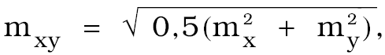

## Tretí oddiel

## PRESNOSŤ MERAČSKÝCH PRÁC

# § 132

(1) Geometrickým základom katastrálnych máp sú body Česko-slovenskej trigonometrickej siete a body podrobného polohového bodového poľa.

(2) Podrobné polohové bodové pole sa buduje s presnosťou, ktorá je daná základnou strednou súradnicovou chybou

- a) pri bodoch 1. triedy presnosti 0,02 m,

- b) pri ostatných bodoch najmenej 0,06 m.

(3) Presnosť podrobného merania a výsledných súradníc lomových bodov vlastníckych hraníc a obvodov stavieb sa posudzuje k najbližším (blízkym) bodom podrobného polohového bodového poľa alebo základného bodového poľa.

(4) Charakteristikou presnosti určenia súradníc x, y lomových bodov podľa odseku 3 je základná stredná súradnicová chyba mxy, daná vzťahom

kde mx, my sú základné stredné chyby určenia súradníc x, y.

(5) Charakteristika relatívnej presnosti určenia súradníc x a y dvojice lomových bodov podľa odseku 3 je základná stredná chyba md dĺžky d priamej spojnice bodov tejto dvojice, vypočítanej zo súradníc.

(6) Súradnice lomových bodov podľa odseku 4 sú určené tak, aby

- a) charakteristika mxy neprekročila kritérium uxy v hodnote

  - 1. v intravilánoch a mimo intravilánov v tých katastrálnych územiach, v ktorých boli vykonané pozemkové úpravy, 0,14 m,

  - 2. v ostatných prípadoch 0,26 m,

- b) charakteristika md neprekročila kritérium ud, vypočítané pre každú dĺžku zo vzťahu ud = 1,5 [(d + 12) : (d + 20)] uxy, pričom uxy má hodnotu podľa písmena a).

(7) Overenie a testovanie výsledkov meračských prác (odsek 6) ustanovuje osobitný predpis.11)

(8) V katastrálnej mape vedenej v grafickej forme sa podrobné body zobrazujú tak, aby presnosť zobrazenia bodov určených v geodetickom a miestnom súradnicovom systéme charakterizovaná strednou súradnicovou chybou zobrazenia bodu neprekročila hodnotu 0,16 mm na katastrálnej mape.

(9) Dosiahnutie presnosti zobrazenia zmien hraníc katastrálnych území a vlastníckych hraníc podľa odseku 8 sa posudzuje podľa veľkosti rozdielu medzi priamo meranou dĺžkou medzi dvoma podrobnými bodmi a dĺžkou odmeranou na katastrálnej mape s prihliadnutím na zrážku katastrálnej mapy. Dosiahnutie presnosti sa posudzuje pri katastrálnej mape

- a) v mierke 1 : 1000, 1 : 2000 a 1 : 5000 podľa osobitného predpisu,

- b) v iných mierkach podľa uvedených odchýlok:

Mierka katastrálnej mapy | Krajná odchýlka pre dĺžku v m | |

| do 50 m | nad 50 m | nad 300 m

1 : 1250 | 0,58 | 0,68 | -

1 : 1440 | 0,67 | 0,77 | -

1 : 2500 | 1,16 | 1,26 | -

1 : 2880 | 1,26 | 1,47 | d/200

(10) Presnosť výpočtu výmer sa posudzuje podľa rozdielu výsledkov dvoch nezávisle vykonaných výpočtov výmer. Rozdiel nemôže prekročiť hodnotu krajnej odchýlky.

(11) Hodnota krajnej odchýlky sa vypočíta v m2 zo vzorcov, kde P je vypočítaná výmera

- a) pri výmerách určených z priamo meraných mier alebo zo súradníc lomových bodov parcely alebo jej dielu, ktoré boli vypočítané z priamo meraných mier v porovnaní s výmerami určenými graficky pre mierku mapy:

1 : 1000 | UMP = 0,25 .√ P + 2

1 : 1250 a 1 : 1440 | UMP = 0,35 . √P + 3

1 : 2000 | UMP = 0,50 .√ P + 4

1 : 2500 a 1 : 2880 | UMP = 0,90 .√ P + 7

1 : 5000 | UMP = 1,20. √P + 10

- b) pri výmerách určených nezávisle dvakrát graficky pre mierku mapy

1 : 1000 | UMP= 0,20 .√ P + 3

1 : 2500 a 1 : 1440 | UMP = 0,30 .√ P + 4

1 : 2000 | UMP = 0,40 .√ P + 6

1 : 2500 a 1 : 2880 | UMP = 0,60 . √P + 8

1 : 5000 | UMP = 1,05 .√ P + 14

(12) Hodnota krajnej odchýlky v m2 medzi doterajšou výmerou skupiny a novou výmerou sa určí, ak sú

- a) doterajšie a nové výmery určené zo súradníc lomových bodov obvodu parcely alebo jej dielu, ktoré boli vypočítané z priamo meraných mier zo vzorca uMP = 0,5 (n1 + n2 - 1), kde n1 je počet doterajších parciel v skupine, n2 je počet nových parciel alebo jej dielov v skupine,

- b) doterajšie a nové výmery skupiny určené graficky alebo kombináciou rôznych spôsobov, dvojnásobnou hodnotou, vypočítanou podľa vzorcov uvedených v odseku 10 písm. b).
