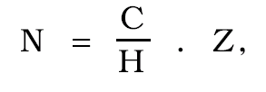

# § 2

Povinnej osobe, ktorá podľa osobitného predpisu2) vydala oprávnenej osobe majetok nadobudnutý podľa osobitného predpisu3) alebo jeho časť, poskytne ministerstvo peňažnú náhradu vo výške vypočítanej podľa vzorca

kde N je peňažná náhrada za vydaný majetok,

C je kúpna cena celého majetku nadobudnutého povinnou osobou,

H je účtovná hodnota celého majetku nadobudnutého povinnou osobou v čase prevodu (prechodu) majetku na povinnú osobu,

Z je účtovná hodnota vydávaného majetku v čase prevodu (prechodu) na povinnú osobu.
