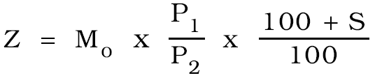
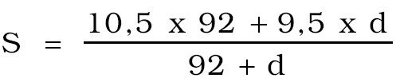
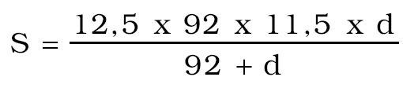

Príloha nariadenia vlády Slovenskej republiky č. 165/1994 Z. z. 1. POSTUP VÝPOČTU SUMY REGULAČNÉHO ODVODU

R = M1 - Z M1 Z

R - regulačný odvod

M - objem vyplatených miezd a ostatných osobných nákladov

Z - východisková základňa

P - priemerný evidenčný prepočítaný počet pracovníkov

1 - hodnotené obdobie

o - rovnaké obdobie predchádzajúceho roka (zhodné s hodnoteným obdobím)

S - smerný rast miezd

pre podnikateľské subjekty uvedené v § 4 ods. 6 písm. b) sa vypočíta podľa vzorca

pre podnikateľské subjekty uvedené v § 4 ods. 7 písm. b) sa vypočíta podľa vzorca

d - počet kalendárnych dní v 4. štvrťroku do zániku subjektu

Hodnoty jednotlivých zlomkov sa vyčíslujú s presnosťou na tri desatinné miesta.

[2. Vzor tabuľky](../assets/416aae1f02635471b518a56401f2476f03a4818a91fc2df4b70211d7ad0c51ac.pdf)
