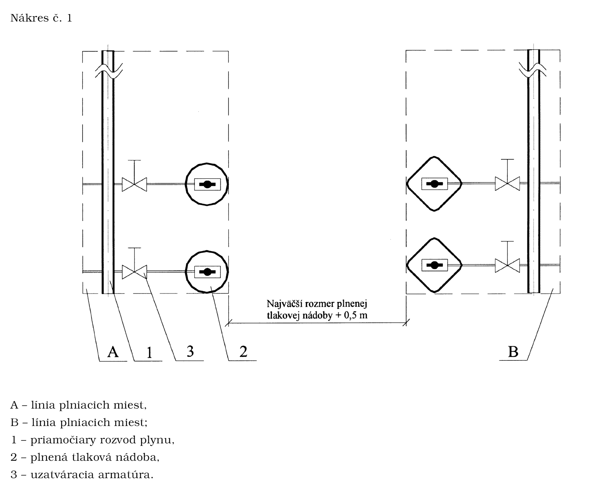
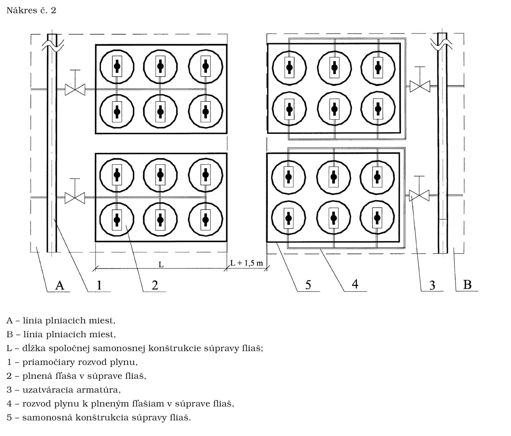
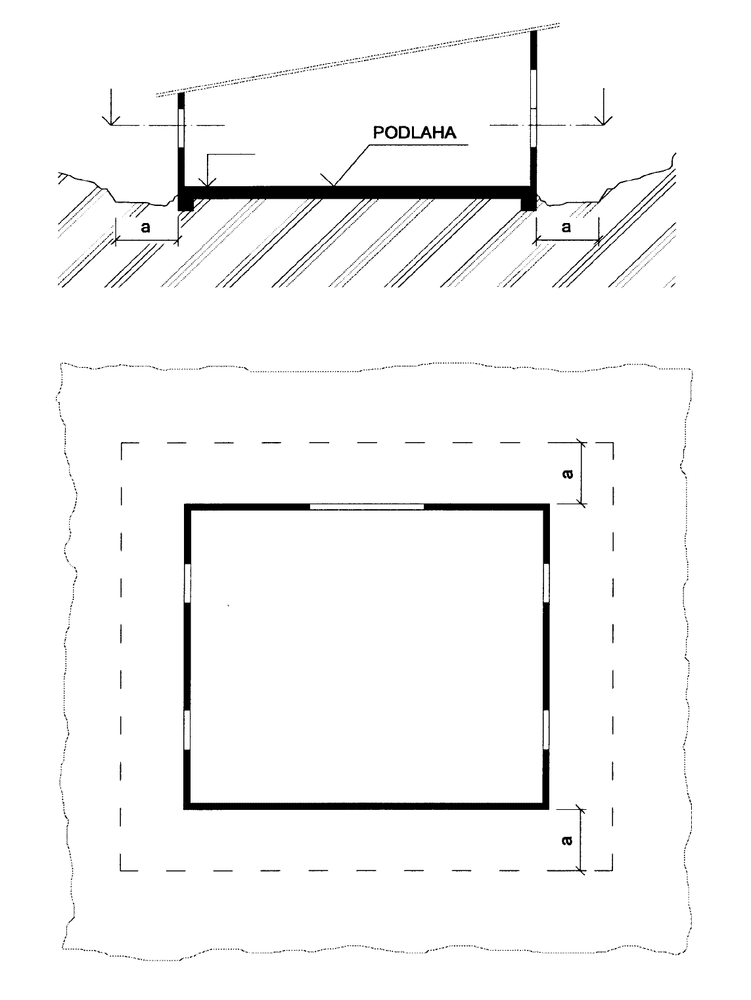
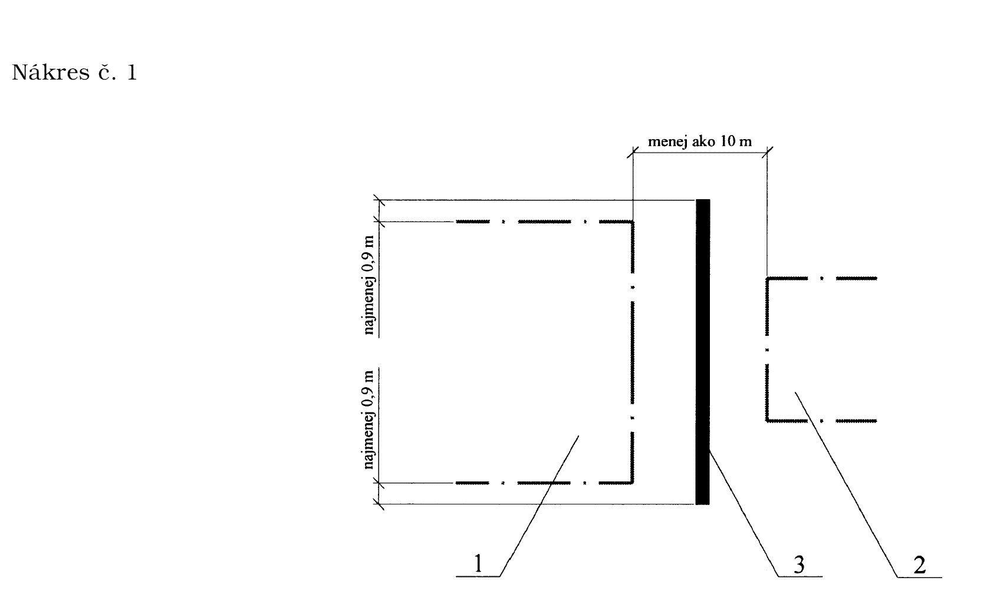
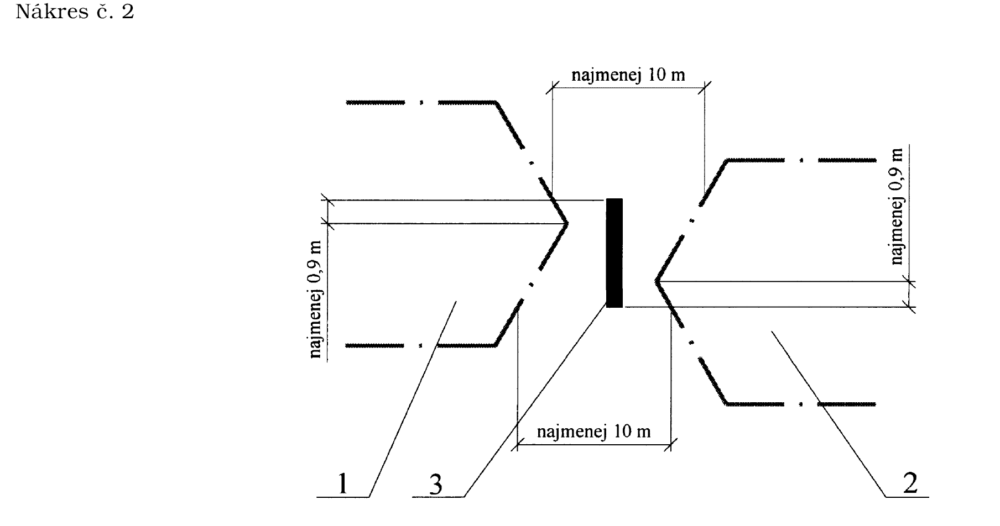

Príloha č. 1 k vyhláške č. 124/2000 Z. z. URČENIE VZÁJOMNEJ VZDIALENOSTI PLNIACICH MIEST DVOCH LÍNIÍ PLNIACICH MIEST

Príloha č. 2 k vyhláške č. 124/2000 Z. z.

POŽIADAVKY NA VYHOTOVENIE VODNÉHO CHLADIACEHO ZARIADENIA BRÁNIACEHO ŠÍRENIU POŽIARU V PLNIARNI ACETYLÉNU, V PRIESTORE NA PLNENIE ACETYLÉNU A VO VEĽKOKAPACITNOM ODBERNOM MIESTE ACETYLÉNU

1. Vodné chladiace zariadenie brániace šíreniu požiaru musí začať dodávať vodu automaticky pri vzniku požiaru v plniarni acetylénu, v priestore na plnenie acetylénu alebo vo veľkokapacitnom odbernom mieste acetylénu, v ktorom je umiestnené batériové vozidlo.

2. Prúd vody je sprchový s intenzitou najmenej 28 l min-1 m2.

3. Tlak vody pred výtokom z vodného chladiaceho zariadenia je najmenej 0,6 MPa.

4. Vodné chladiace zariadenie brániace šíreniu požiaru musí byť schopné dodávať vodu najmenej počas 30 minút.

5. Vodné chladiace zariadenie brániace šíreniu požiaru musí mať okrem hlavného čerpadla na dodávku vody poháňaného elektromotorom napojeným na hlavný zdroj elektrickej energie aj záložné čerpadlo poháňané elektromotorom, ktorý je napájaný z hlavného zdroja elektrickej energie a zo záložného zdroja elektrickej energie.

6. Zariadenie sa musí dať kedykoľvek odskúšať.

Príloha č. 3 k vyhláške č. 124/2000 Z. z.

ŠÍRKA PRIĽAHLÉHO TERÉNU OKOLO PLNIARNE HORĽAVÝCH PLYNOV ŤAŽŠÍCH AKO VZDUCH, OKOLO PRIESTORU NA PLNENIE ALEBO STÁČANIE HORĽAVÝCH PLYNOV ŤAŽŠÍCH AKO VZDUCH A OKOLO VEĽKOKAPACITNÉHO ODBERNÉHO MIESTA HORĽAVÝCH PLYNOV ŤAŽŠÍCH AKO VZDUCH

a pre plniareň horľavých plynov ťažších ako vzduch – najmenej 5 m,

a pre priestor na plnenie alebo stáčanie horľavých plynov ťažších ako vzduch – najmenej 10 m,

a pre veľkokapacitné odberné miesto horľavých plynov ťažších ako vzduch – najmenej 10 m.

Príloha č. 4 k vyhláške č. 124/2000 Z. z.

NAJMENŠIA VZDIALENOSŤ MEDZI HLAVNÝM SKLADOM HORĽAVÝCH PLYNOV ALEBO HORENIE PODPORUJÚCICH PLYNOV A INÝMI STAVBAMI

Celkový vnútorný objem tlakových nádob skladovaných v sklade horľavých plynov alebo horenie podporujúcich plynov v l | Druh stavby | Najmenšia vzdialenosť hlavného skladu horľavých plynov alebo horenie podporujúcich plynov od stavby v m

od 2 000 do 20 000 | výrobné objekty | 12

nad 20 000 do 120 000 | | 15

nad 120 000 | | 20

nad 2000 | obytné domy, verejné budovy, administratívne budovy | 25

nad 2 000 | hromadné úkryty civilnej ochrany | 30

nad 2 000 | verejné komunikácie | 10

Príloha č. 5 k vyhláške č. 124/2000 Z. z.

NÁPISY NA MIESTACH SKLADOVANIA PRÁZDNYCH TLAKOVÝCH NÁDOB, PLNÝCH TLAKOVÝCH NÁDOB, PRÁZDNYCH FLIAŠ A PLNÝCH FLIAŠ

Miesta na skladovanie tlakových nádob alebo fliaš sa označujú týmito nápismi:

PRÁZDNE TLAKOVÉ NÁDOBY NA DOPRAVU PLYNU,

PLNÉ TLAKOVÉ NÁDOBY NA DOPRAVU PLYNU,

PRÁZDNE FĽAŠE,

PLNÉ FĽAŠE.

Príloha č. 6 k vyhláške č. 124/2000 Z. z.

VYHOTOVENIE POŽIARNEJ STENY V OTVORENOM SKLADE HORĽAVÝCH PLYNOV ALEBO HORENIE PODPORUJÚCICH PLYNOV

1 – požiarny úsek 1,

2 – požiarny úsek 2,

3 – požiarna stena.

Príloha č. 7 k vyhláške č. 124/2000 Z. z.

SPÔSOB URČENIA VÝŠKY POŽIARNEJ STENY

Výška požiarnej steny v hlavnom otvorenom sklade horľavých plynov alebo horenie podporujúcich plynov sa určuje podľa vzorca

Hps = htn + hp,

kde Hps je výška požiarnej steny v m,

htn je výška uskladnených tlakových nádob v m,

hp je najmenšia veľkosť požiarnej steny v m, o ktorú musí požiarna stena presahovať výšku uskladnených

tlakových nádob.

Výška htn uskladnených tlakových nádob v m | Veľkosť hp v m, o ktorú musí požiarna stena najmenej presahovať výšku uskladnených tlakových nádob

do 2 | 0,9

nad 2 do 3 | 1,5

nad 3 | 2

Najmenšia výška požiarneho úseku je 2 m.

Príloha č. 8 k vyhláške č. 124/2000 Z. z.

VEĽKOSŤ PRETLAKU ZOSTATKOVÉHO ACETYLÉNU V TLAKOVEJ NÁDOBE S ACETYLÉNOM ALEBO V TLAKOVEJ NÁDOBE VOZIDLA S ACETYLÉNOM V ZÁVISLOSTI OD TEPLOTY POVRCHU TLAKOVEJ NÁDOBY

Teplota povrchu tlakovej nádoby s acetylénom v °C | Pretlak zostatkového acetylénu v tlakovej nádobe s acetylénom v MPa

pod 0 | 0,02

od 0 do +15 | 0,05

od +15 do +25 | 0,10

od +25 do +35 | 0,15
