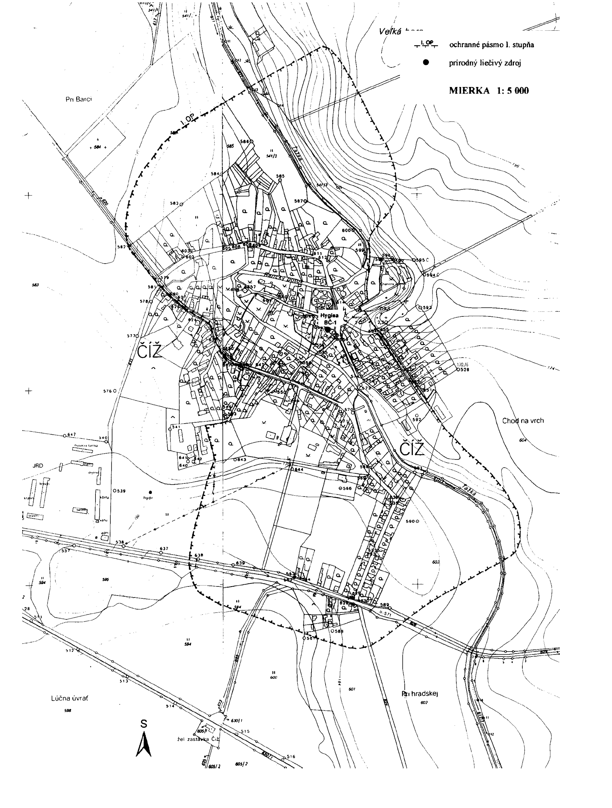
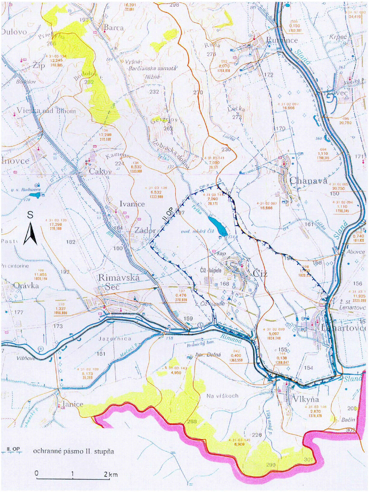

Príloha č. 1 k vyhláške č. 18/2000 Z.z. OCHRANNÉ PÁSMO I. STUPŇA PRÍRODNÝCH LIEČIVÝCH ZDROJOV V ČÍŽI

Príloha č. 2 k vyhláške č. 18/2000 Z.z.

OCHRANNÉ PÁSMO II. STUPŇA PRÍRODNÝCH LIEČIVÝCH ZDROJOV V ČÍŽI

Príloha č. 3 k vyhláške č. 18/2000 Z.z.

POPIS HRANÍC OCHRANNÝCH PÁSIEM PRÍRODNÝCH LIEČIVÝCH ZDROJOV V ČÍŽI

Ochranné pásmo I. stupňa

Ochranné pásmo I. stupňa je vyznačené v mapovom podklade – Štátna mapa odvodená v mierke 1 : 5 000, listy Rimavská Seč 4-0, Rimavská Seč 5-0.

Ochranné pásmo I. stupňa chráni výverovú oblasť. Severná hranica sa začína na vrstevnici 190 v svahu Veľká hora, odkiaľ smeruje kolmo na údolie Tešky na vrstevnicu 180 a prebieha po nej až po poľnú cestu, kde sa stáča na juhovýchod. Pokračuje po ceste cez obec Číž až po križovatku ciest (odbočka ku kúrii Hanvey), kde sa kolmo stáča a pokračuje po tejto ceste až po sad, ktorý obchádza smerom na štátnu cestu, a tú kolmo pretína. Južné ohraničenie prebieha paralelne so štátnou cestou Číž – Lenartovce vo vzdialenosti 75 m od nej, pretína cestu vedúcu na železničnú stanicu a ohraničuje južnú časť obce Číž až po poľnú cestu, kde sa stáča na severovýchod. Prechádza údolím Tešky a po jej ľavej strane sa pripája k miestnej ceste vedúcej k charitnému domovu, kde sa stáča na sever a prechádza na ľavý breh potoka Teška. Odtiaľ sa oblúkom do svahu Veľkej hory spája so severným ohraničením.

Ochranné pásmo II. stupňa

Ochranné pásmo II. stupňa je vyznačené v mapovom podklade – Vodohospodárska mapa Slovenskej republiky v mierke 1 : 50 000, listy Rimavská Sobota 37-33, Rimavská Seč 47-11.

Ochranné pásmo II. stupňa chráni akumulačnú oblasť. Východná hranica sa začína na sútoku Slanej a Rimavy. Pokračuje pravým brehom toku Slanej po most štátnej cesty severne od Lenartoviec. Odtiaľ pokračuje priamo na kótu 196, vedie po rozvodnici Rimavy a Slanej. Severne od vodnej nádrže Číž sa stáča kolmo na svah do údolia Tešky. Prechádza cez potok Teška, pripája sa k poľnej ceste a po jej ľavej strane prechádza cez kótu 197 až po Čížsky kanál, kde sa stáča na juhovýchod a pokračuje po ľavom brehu Čížskeho kanála po sútok s Rimavou. Ďalej pokračuje po ľavom brehu toku Rimavy až po sútok so Slanou, kde sa pripája k východnému ohraničeniu.

Ochranné pásmo III. stupňa

Ochranné pásmo III. stupňa nebolo stanovené.

Príloha č. 4 k vyhláške č. 18/2000 Z.z.

POPIS HYDROGEOLOGICKEJ ŠTRUKTÚRY PRÍRODNÝCH LIEČIVÝCH ZDROJOV V ČÍŽI

Ochranné pásma sú vymedzené na základe výsledkov hydrogeologického prieskumu a návrhu záverečnej správy vypracovanej Z. Bondarenkovou a kolektívom: Číž, ochranné pásma kúpeľov, rok 1988.

Hydrogeologická štruktúra je klasifikovaná ako polozatvorená so zakrytou výverovou oblasťou. V hydrogeologickej štruktúre je vyčlenená akumulačná oblasť, v ktorej sa formujú základné fyzikálno-chemické vlastnosti, a výverová oblasť, v ktorej dochádza k odvodňovaniu.

Formovanie a obeh minerálnych vôd sa uskutočňuje v oligomiocénnych horninách terciéru. Kolektory minerálnej vody tvoria prachovce a prachové pieskovce. Vody majú pomerne plytký obeh v hĺbkach 100 – 300 m.

Na formovaní, obehu a výstupe sa podieľa bloková tektonická stavba. Ide o elevácie a depresie. Zlomové systémy severovýchodno-juhozápadné a severozápadno-juhovýchodné vymedzujú šafárikovskú eleváciu, abovskú poklesnutú kryhu, čížsku hrasť. Najvýznamnejším tektonickým prvkom je neporadzský zlom. Severojužné a západovýchodné zlomy prebiehajú údoliami tokov Slanej a Rimavy.

Vzhľadom na charakter a klasifikáciu hydrogeologickej štruktúry nebola vyčlenená infiltračná oblasť, t. j. prirodzená dotácia minerálnych vôd.

Akumulačnú oblasť minerálnych vôd tvoria nízko priepustné prachovce a prachové pieskovce oligomiocénnej výplne Rimavskej kotliny, v ktorých podloží sa nachádzajú karbonáty mezozoických komplexov. Rozsah akumulačnej oblasti nie je jednoznačne známy. Výskyt kolektorov možno priestorovo priradiť k abovskej poklesnutej kryhe. Vzhľadom na málo priepustné horniny kolektorov je akumulačná oblasť vyčlenená na základe tektonickej stavby.

V zakrytej výverovej oblasti nie je hydrogeologická štruktúra prirodzene odvodňovaná. Na lokalite Číž nie sú známe prirodzené vývery minerálnej vody. Minerálna voda sa môže využívať z umelých záchytných zariadení. Minerálne vody vystupujú po zlomoch. Hybnou silou minerálnej vody pri výstupe na povrch je hydrostatický tlak a hlbinný oxid uhličitý.
