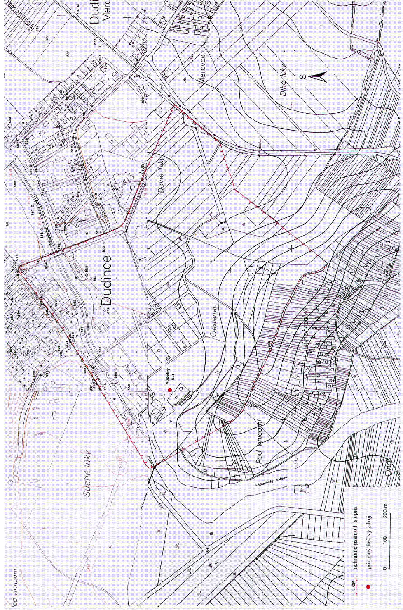
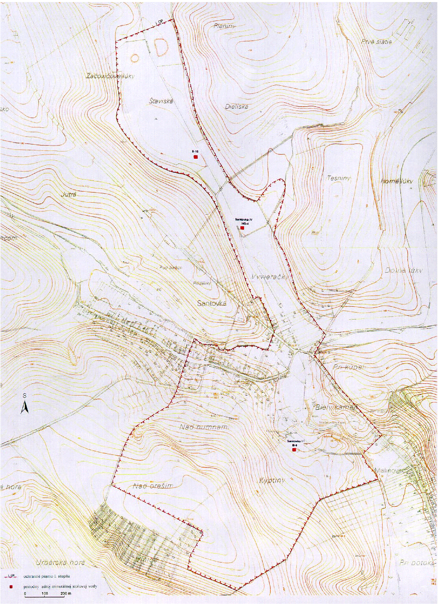
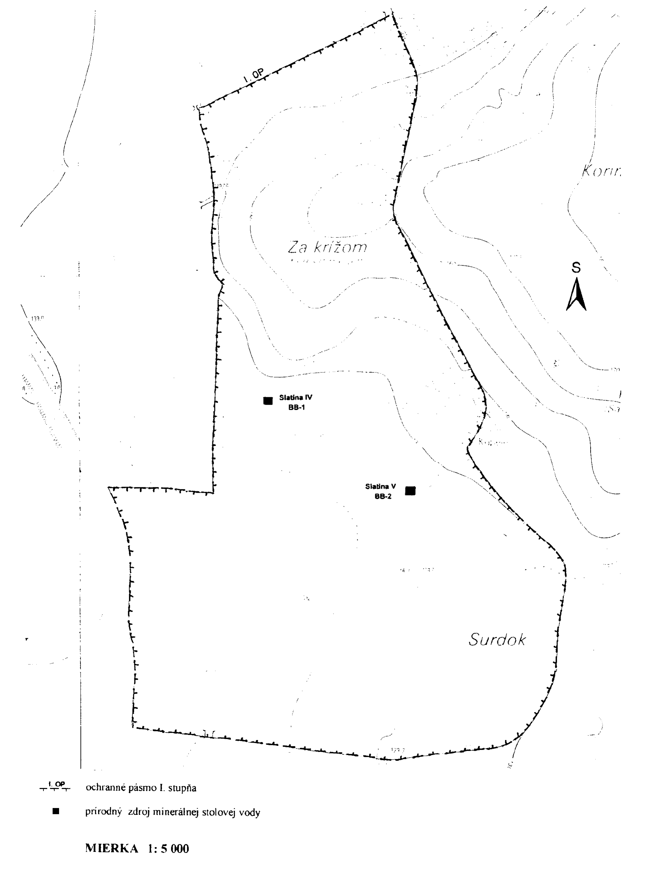
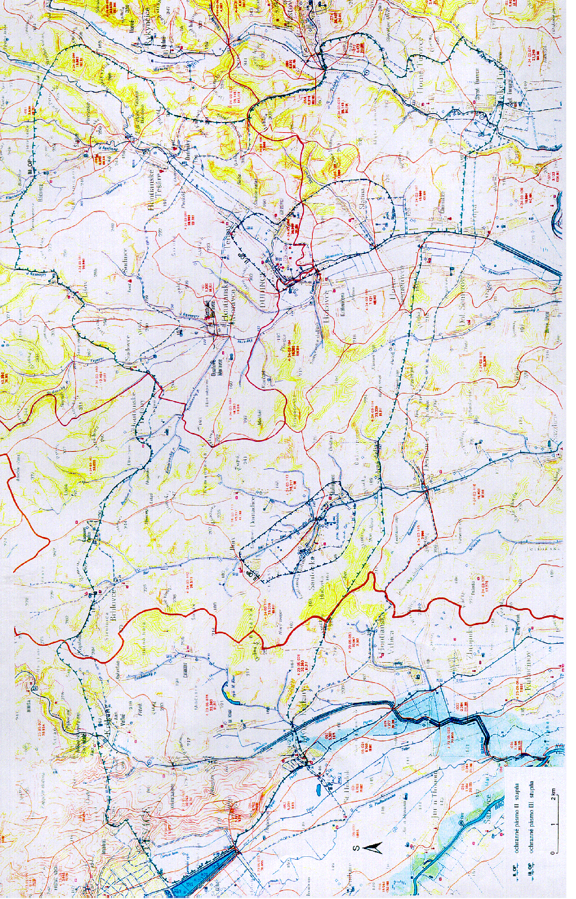

Príloha č. 1 k vyhláške č. 19/2000 Z. z. OCHRANNÉ PÁSMO I. STUPŇA PRÍRODNÝCH LIEČIVÝCH ZDROJOV V DUDINCIACH

Príloha č. 2 k vyhláške č. 19/2000 Z. z.

OCHRANNÉ PÁSMO I. STUPŇA PRÍRODNÝCH ZDROJOV MINERÁLNYCH STOLOVÝCH VÔD V SANTOVKE

Príloha č. 3 k vyhláške č. 19/2000 Z. z.

OCHRANNÉ PÁSMO I. STUPŇA PRÍRODNÝCH ZDROJOV MINERÁLNYCH STOLOVÝCH VÔD V SLATINE

Príloha č. 4 k vyhláške č. 19/2000 Z. z.

OCHRANNÉ PÁSMO II. A III. STUPŇA PRÍRODNÝCH LIEČIVÝCH ZDROJOV V DUDINCIACH A PRÍRODNÝCH ZDROJOV MINERÁLNYCH STOLOVÝCH VÔD V SANTOVKE A V SLATINE

Príloha č. 5 k vyhláške č. 19/2000 Z. z.

POPIS HRANÍC PRÍRODNÝCH LIEČIVÝCH ZDROJOV V DUDINCIACH A PRÍRODNÝCH ZDROJOV MINERÁLNYCH STOLOVÝCH VÔD V SANTOVKE A V SLATINE

Ochranné pásmo I. stupňa v Dudinciach

Ochranné pásmo I. stupňa je vyznačené v mapovom podklade – Štátna mapa odvodená v mierke 1 : 5 000, listy Plášťovce 7-4, Plášťovce 6-4, Plášťovce 7-5, 6-5.

Ochranné pásmo I. stupňa chráni výverovú oblasť. Severné ohraničenie sa začína na križovatke ciest Šahy –

– Krupina a odbočke na most (pri moteli), pokračuje po štátnej ceste až po oblúk potoka Štiavnica, kde prechádza kolmo cez potok a pokračuje do svahu na hrebeň Gestenca. Pokračuje po miestnej ceste medzi vinohradmi. Po miernom oblúku cesty sa hranica stáča severovýchodným smerom k areálu ihriska a k železničnej trati a pokračuje po nej k železničnej stanici. Odtiaľ sa stáča severozápadným smerom po miestnej ceste, pretína potok Štiavnica až na križovatku so štátnou cestou Šahy – Krupina, kde sa spája so severným ohraničením.

Ochranné pásmo I. stupňa v Santovke

Ochranné pásmo I. stupňa je vyznačené v mapovom podklade – Štátna mapa odvodená v mierke 1 : 5 000, listy Levice 0-4, Levice 0-5.

Ochranné pásmo I. stupňa chráni výverovú oblasť. Západné ohraničenie vedie kolmo na potok Búr, pretína údolie až na vrstevnicu 150, pokračuje po vrstevnici 150 juhovýchodným smerom až k obci, kde nadväzuje na cestu a pokračuje po nej až ku križovatke. Odtiaľ sa stáča na juh a pomedzi domy prechádza na poľnú cestu, po ktorej v dĺžke približne 375 m pokračuje na západ. Tu sa kolmo stáča na juhozápad, prechádza cez cestu a pokračuje kolmo do svahu a ďalej oblúkom na hrebeň Nad Oreším. Tu sa kolmo stáča na juhovýchod, pokračuje po hrebeni a na konci viníc sa kolmo stáča na juhozápad po vrstevnicu 200. Odtiaľ pokračuje 250 m po vrstevnici 200 až po poľnú cestu. Pokračuje po poľnej ceste k potoku Búr. Opäť sa kolmo stáča na severozápad a pokračuje po potoku Búr v dĺžke 125 m, kolmo sa stáča na severovýchod v dĺžke 100 m, kde sa napája na cestu. Pokračuje po ceste severozápadným smerom po križovatku, kde mení smer na severovýchod, pokračuje v dĺžke 100 m po ceste, kde sa opäť stáča na severozápad a po miestnej ceste pokračuje až k severnému ohraničeniu.

Ochranné pásmo I. stupňa v Slatine

Ochranné pásmo I. stupňa je vyznačené v mapovom podklade – Štátna mapa odvodená v mierke 1 : 5 000, listy Plášťovce 6-6, Plášťovce 6-7.

Ochranné pásmo I. stupňa chráni výverovú oblasť. Severné ohraničenie prebieha údolím potoka Slatina po most, kde sa kolmo stáča na juh a pokračuje po železničnej trati približne po úroveň plniarne. Ďalej sa stáča na západ až k ľavému brehu Štiavnice, pokračuje po jej ľavom brehu až k poľnej ceste, kde sa opäť kolmo stáča na východ, pretína železničnú trať, prechádza cez križovatku ciest a pokračuje po ceste po vrstevnicu 130. Odtiaľ pokračuje severným smerom, prebieha po vrstevnici 130 až k poľnej ceste, po ktorej pokračuje a ďalej smeruje po štátnej ceste vedúcej do Slatiny, kde sa spája so severným ohraničením.

Ochranné pásmo II. stupňa v Dudinciach a v Slatine

Ochranné pásmo II. stupňa je vyznačené v mapovom podklade – Vodohospodárska mapa Slovenskej republiky v mierke 1 : 50 000, listy Sebechleby 46-11, Šahy 46-13.

Ochranné pásmo II. stupňa chráni akumulačnú oblasť. Severné ohraničenie sa začína pri cintoríne v Teranoch, pokračuje priamo juhozápadným smerom po svahu Staré vinice až k štátnej ceste Hontianske Moravce – Horné Semerovce. Odtiaľ pokračuje po tejto štátnej ceste v dĺžke približne 500 m. Pokračuje mimo cesty priamo juhovýchodným smerom popri kostole v Hokovciach ľavou stranou údolia Štiavnice. Vo vzdialenosti približne 1,5 km od kostola sa hranica napája na ľavý breh toku Štiavnica a vedie po ňom v dĺžke približne 1 km. Ďalej sa oblúkom stáča na východ, prechádza cez železničnú trať, pokračuje oblúkom na sever a pretína údolie potoka Slatina. Odtiaľ pokračuje smerom na severozápad miestnou eróznou ryhou na kótu Bača (239), prechádza naprieč hrebeňom a údolím k Dudinciam. Tu sa kolmo stáča na severovýchod paralelne so železničnou traťou vo vzdialenosti 250 m od nej. Ďalej sa oblúkom stáča na severozápad k cintorínu v Teranoch.

Ochranné pásmo II. stupňa v Santovke

Ochranné pásmo II. stupňa je vyznačené v mapovom podklade – Vodohospodárska mapa Slovenskej republiky v mierke 1 : 50 000, listy Sebechleby 46-11, Šahy 46-13.

Ochranné pásmo II. stupňa chráni akumulačnú oblasť. Severné ohraničenie sa začína pri moste v obci Bory, pokračuje juhozápadným smerom a pretína štátnu cestu Santovka – Čankov, za ktorou sa stáča južným smerom. Ďalej pretína Ludiansku dolinu, štátnu cestu Santovka – Hontianska Vrbica (kóta 198), odkiaľ sa oblúkom stáča na východ po sútok potoka Búr a jeho ľavobrežného prítoku v južnej časti obce. Pokračuje údolím tohto prítoku v dĺžke 750 m, kde sa stáča na severozápad ku kóte 145 (sútok bezmenných potokov), od ktorých pokračuje paralelne s potokom Búr približne vo vzdialenosti 500 m až do obce Bory, kde sa spája so severným ohraničením.

Ochranné pásmo III. stupňa v Dudinciach, v Santovke a v Slatine

Ochranné pásmo III. stupňa je vyznačené v mapovom podklade – Vodohospodárska mapa Slovenskej republiky v mierke 1 : 50 000, listy Levice 45-22, Sebechleby 46-11, Želiezovce 45-24, Šahy 46-13.

Ochranné pásmo III. stupňa chráni infiltračnú oblasť. Severné ohraničenie sa začína pri Levických rybníkoch v juhovýchodnej časti mesta Levice. Pokračuje po východnom okraji mesta, obchádza kótu Strážny vrch (222) smerom na Krškany, Brhlovce a na kótu Kamenec (265). Obchádza z juhu Kamenný Chotár, prechádza do údolia Trstianskeho potoka, z ktorého smeruje do obce Hontianske Trsťany a Súdovce a obchádza kótu Dravský vrch (258). Ďalej pokračuje cez obec Lišov údolím Lišovského potoka, odkiaľ prechádza do údolia Klastavského potoka, obchádza kótu Vrchný hrb (258) a kótu Horné Pirovské (275) a pretína údolie Štiavnice smerom na kótu Benčina (306). Odtiaľto sa stáča na juh cez kóty Plieška (300), Nad Kukučkami (303) a pokračuje južným smerom údolím medzi Babicou (303) a Čiernym hradom (330) až po most na toku Krupinica. Od mosta cez Krupinicu oblúkom obchádza kóty Konerad (249) a Čiernica (266) a vedie až po Selecký potok k južnému okraju Veľkých Turoviec. V obci Veľké Turovce pretína potok Krupinica, smeruje na kótu Tupý vrch (224), odkiaľ západným smerom pokračuje medzi obce Tupá a Chorvatice k potoku Štiavnica. Tu sa kolmo stáča na sever v dĺžke 1 000 m a opätovne sa stáča západným smerom cez obec Horné Semerovce a Kučerov majer do Studenej doliny, pretína potok Búr a z juhu obchádza kótu Strmina (206). Ďalej pokračuje cez kótu Ďurkov (234) do obce Mýtne Ludany, pretína potok Sikenica a pokračuje k potoku Perec. Tu sa stáča na severozápad, pričom sleduje potok Perec až po Levické rybníky, kde sa napája na severné ohraničenie.

Príloha č. 6 k vyhláške č. 19/2000 Z. z.

POPIS HYDROGEOLOGICKEJ ŠTRUKTÚRY PRÍRODNÝCH LIEČIVÝCH ZDROJOV V DUDINCIACH A PRÍRODNÝCH ZDROJOV MINERÁLNYCH STOLOVÝCH VÔD V SANTOVKE A V SLATINE

Ochranné pásma sú vymedzené na základe výsledkov hydrogeologického prieskumu a návrhu záverečnej správy vypracovanej L. Meliorisom a kolektívom: Dudince – Santovka – Slatina, rok 1986.

Územie lokalít Dudince, Santovka a Slatina patrí k významnej hydrogeologickej štruktúre nazývanej levická žriedlová línia. Ide o komplikovanú štruktúru s viacerými čiastkovými samostatnými štruktúrami a výverovými oblasťami. Hydrogeologická štruktúra je klasifikovaná ako otvorená s poloodkrytými a polozakrytými výverovými oblasťami. V hydrogeologickej štruktúre je vyčlenená infiltračná oblasť, v ktorej dochádza k dopĺňaniu, akumulačná oblasť, v ktorej sa formujú základné fyzikálno-chemické vlastnosti, a výverová oblasť, v ktorej dochádza k odvodňovaniu.

Formovanie a obeh minerálnych vôd sa uskutočňuje v horninách permu, mezozoických karbonátoch, neogénnych a kvartérnych sedimentoch. V kombinovanom geologickom prostredí sa tu vytvorili 3 typy vôd: dudinecký, santovský a slatinský.

Na formovaní a obehu sa tiež podieľa tektonická stavba s tromi významnými zlomovými systémami severozápadno-juhovýchodným, severovýchodno-juhozápadným a severojužným. Uvedené zlomové línie majú staré založenie, ale pohyby po nich sa odohrávali aj v miocéne a kvartéri. Zlomové línie vymedzili niekoľko elevačných a depresných štruktúr. Najvýznamnejšia je túrovsko-levická hrasť, ktorú severojužné zlomy rozdelili na túrovskú hrasť, santovskú eleváciu, kalinčiakovskú hrasť a hrasť Vápnika.

Za infiltračnú oblasť minerálnych vôd dudineckého, santovského a slatinského typu sa považujú stredoslovenské vulkanity Krupinskej vrchoviny resp. Štiavnických vrchov. Výsledky prieskumu potvrdili priaznivý charakter pre infiltráciu veľkého množstva zrážkovej vody.

Akumulačnú oblasť minerálnych vôd dudineckého typu tvoria vulkanicko-sedimentárne horniny medzi Dudincami a Hontianskymi Tesármi. Zvláštnu úlohu zohráva bazálne bádenské štrkové súvrstvie v oblasti Dudiniec, ktoré umožňuje zvýšenú akumuláciu minerálnej vody.

Minerálna voda santovského typu je produktom miešania vysokomineralizovanej vody s menej mineralizovanými vodami plytkého vadózneho pôvodu. Akumulačnú oblasť jednej zo zložiek minerálnych vôd santovského typu tvoria mezozoické karbonáty domadickej kryhy. Dôležitým prvkom je zlomové pásmo Búrskeho potoka, ktoré pravdepodobne spomaľuje prúdenie vôd zo severovýchodu.

Minerálna voda slatinského typu je tiež produktom miešania vysokomineralizovanej vody s menej mineralizovanými vodami plytkého vadózneho pôvodu. Za akumulačnú oblasť viac mineralizovaných vôd sa považujú permské horniny túrovskej hraste, kremence spodného triasu a bádenské zlepence. Nízkomineralizované vody majú pôvod v infiltrácii zrážkovej vody do povrchových častí túrovskej hraste aj v infiltrácii z toku Štiavnica. Obyčajná voda sa akumuluje v bádenských a kvartérnych sedimentoch.

Za výverovú oblasť minerálnych vôd dudineckého typu sa považujú okrajové kryhy na severnom úpätí Gestenca, kde už pred navŕtaním minerálnych vôd existovali prirodzené vývery. Minerálne vody prúdiace od severovýchodu tu zadržiava túrovská hrasť permských hornín.

Za výverovú oblasť minerálnych vôd santovského typu sa považuje územie s najvhodnejšími podmienkami prísunu nízkomineralizovanej vody infiltrovanej zo zrážok, kde je spomalený prísun vysokomineralizovanej vody a kde je dobrý prísun oxidu uhličitého. Pozitívnu úlohu tu zohráva poklesnutá santovská kryha.

Za výverovú oblasť minerálnych vôd santovského typu sa považuje územie s výskytom travertínových kôp v Slatine.
