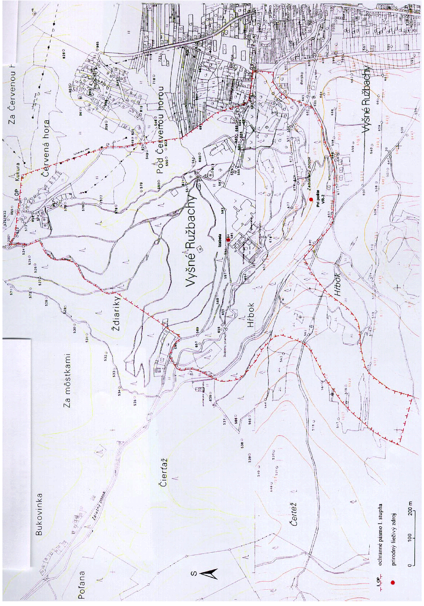
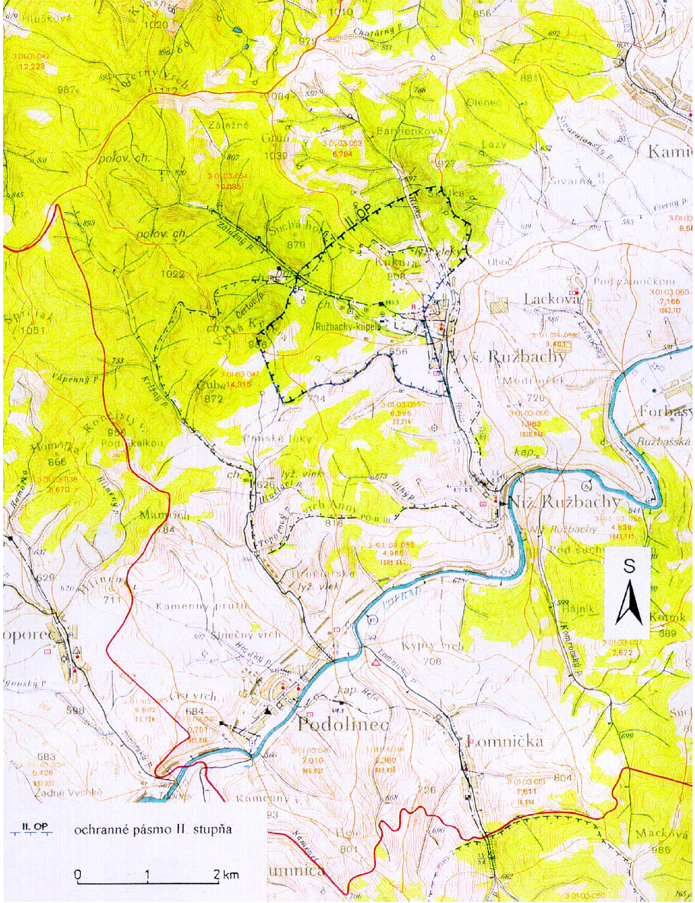

Príloha č. 1 k vyhláške č. 24/2000 Z. z. OCHRANNÉ PÁSMO I. STUPŇA PRÍRODNÝCH LIEČIVÝCH ZDROJOV VO VYŠNÝCH RUŽBACHOV

Príloha č. 2 k vyhláške č. 24/2000 Z. z.

OCHRANNÉ PÁSMO II. STUPŇA PRÍRODNÝCH LIEČIVÝCH ZDROJOV VO VYŠNÝCH RUŽBACHOV

Príloha č. 3 k vyhláške č. 24/2000 Z.z.

POPIS HRANÍC OCHRANNÝCH PÁSIEM PRÍRODNÝCH LIEČIVÝCH ZDROJOV VO VYŠNÝCH RUŽBACHOCH

Ochranné pásmo I. stupňa

Ochranné pásmo I. stupňa je vyznačené v mapovom podklade – Štátna mapa odvodená v mierke 1 : 5 000, listy Stará Ľubovňa 4-5, Stará Ľubovňa 4-6.

Ochranné pásmo I. stupňa chráni výverovú oblasť. Južná hranica sa začína pri reštaurácii Horbek, odkiaľ pokračuje západným smerom prístupovou cestou k bytovkám až po tzv. horný travertínový lom. Ďalej sa stáča juhozápadným smerom na vrstevnicu 680 až po poľnú cestu, odtiaľ smeruje kolmo do svahu severozápadným smerom v dĺžke 175 m na vrstevnicu 700, po ktorej pokračuje severovýchodným smerom po poľnú cestu, pretína ju a pokračuje severoseverovýchodným smerom v dĺžke 120 m na lesnú cestu. Po nej pokračuje až po horáreň, ktorú obchádza. Ďalej sa stáča severovýchodným smerom kolmo do svahu v dĺžke 260 m po lesnú cestu, pokračuje po lesnej ceste severovýchodným smerom po križovatku lesných ciest, odkiaľ sa stáča na východ smerom na kótu Kukura. Od kóty Kukura sa opäť stáča na juh popri malom lyžiarskom vleku až na cestu v rekreačnej oblasti. Ďalej pokračuje južným smerom po svahu zastavanej časti obce 50 m východne od liečebného domu Travertín II po cestu ku Kráteru, ktorú sleduje východným smerom v dĺžke 120 m. Tu sa stáča južným smerom po Zálažný potok, obchádza areál ihriska a spája sa s južným ohraničením.

Ochranné pásmo II. stupňa

Ochranné pásmo II. stupňa je vyznačené v mapovom podklade – Vodohospodárska mapa Slovenskej republiky v mierke 1 : 50 000, list Podolínec 27-32.

Ochranné pásmo II. stupňa chráni akumulačnú oblasť. Hranica sa začína pri futbalovom ihrisku a vedie južným smerom po štátnej ceste až po most cez pravostranný prítok potoka Rieka. Ďalej pokračuje po tomto potoku až po pramennú oblasť, kde prechádza cez hrebeň a po rozvodnici na kótu Veľká Kýčera (966), odkiaľ prechádza priamo do údolia Zálažného potoka a pretína ho. Odtiaľ pokračuje v priamke severovýchodným smerom do údolia Rieky. Pretína potok Rieka a kolmo stúpa do svahu až po rozvodnicu Rieky a Čierneho potoka. Pokračuje rozvodnicou juhovýchodným smerom až po lesnú cestu, po ktorej pokračuje po potok Rieka a odtiaľ južným smerom po futbalové ihrisko.

Ochranné pásmo III. stupňa

Ochranné pásmo III. stupňa nie je stanovené.

Príloha č. 4 k vyhláške č. 24/2000 Z. z.

POPIS HYDROGEOLOGICKEJ ŠTRUKTÚRY PRÍRODNÝCH LIEČIVÝCH ZDROJOV VO VYŠNÝCH RUŽBACHOCH

Ochranné pásma sú vymedzené na základe výsledkov hydrogeologického prieskumu a návrhu záverečnej správy vypracovanej M. Mlynarčíkom a kolektívom: Vyšné Ružbachy, ochranné pásma, II. podetapa, rok 1990.

Hydrogeologická štruktúra je klasifikovaná ako otvorená s poloodkrytou až polozakrytou výverovou oblasťou. V hydrogeologickej štruktúre je vyčlenená infiltračná oblasť, v ktorej dochádza k dopĺňaniu, akumulačná oblasť, v ktorej sa formujú základné fyzikálno-chemické vlastnosti, a výverová oblasť, v ktorej dochádza k odvodňovaniu.

Formovanie a obeh minerálnych vôd sa uskutočňuje v karbonatických horninách stredného a vrchného triasu krížňanského príkrovu, ktorý sa skladá z viacerých čiastkových hydrogeologických štruktúr v niekoľkých geomorfologických celkoch a má charakter megasynklinály.

Za infiltračnú oblasť hydrogeologickej štruktúry sa považujú hydrogeologické štruktúry puklinovo-krasových vôd Šumivého potoka a Bujačieho vrchu ležiace v severovýchodnej časti Belianskych Tatier. Ich plocha je približne 52,7 km2. Kolektory podzemných vôd tvoria najmä triasové vápence a dolomity, v menšej miere bazálna litofácia paleogénu a kriedové muránske vápence. Zo západu tvorí ohraničenie štruktúry kryštalinikum Vysokých Tatier, severné ohraničenie tvorí ílovcovo-pieskovcový vývoj vnútrokarpatského paleogénu masívu Spišskej Magury a juhovýchodné ohraničenie tvoria flyšové sedimenty paleogénu Popradskej kotliny pozdĺž podtatranského zlomu.

Akumulačnú oblasť minerálnych vôd tvoria triasové karbonáty nachádzajúce sa pod súvrstvím paleogénu Spišskej Magury. Voda sa pri zostupe otepľuje a mineralizuje do hĺbky približne 700–800 m v priestore severne od Vojnian. Odtiaľ pokračuje výstupná časť obehu minerálnej vody až po zlom približne 1,2 km západne od areálu kúpeľov. V celej tejto časti sú kolektory s minerálnou vodou chránené od povrchu 700 m hrubým nepriepustným paleogénnym súvrstvím .

Akumulačná oblasť je ohraničená na juhozápade zlomovým systémom prebiehajúcim po východných svahoch kóty Veľká Kýčera, na juhovýchode priebehom podtatranského zlomu, na severovýchode ju ohraničuje zlom prebiehajúci údolím potoka Rieka severne od Vyšných Ružbách a severné, resp. severozápadné obmedzenie je dané výskytom minerálnej vody v triasových karbonátoch v údolí Zálažného potoka. Takto vymedzená akumulačná oblasť zaberá plochu približne 1,1 km2 a je budovaná strednotriasovými a vrchnotriasovými dolomitmi a vápencami.

Vo výverovej oblasti kolektor minerálnych vôd (dolomity a vápence stredného a vrchného triasu) nevystupuje priamo na povrch, ale je zakrytý priepustnými kvartérnymi sedimentmi a travertínmi. Jedna časť prameňov minerálnej vody vyviera v druhotných akumuláciách kvartérnych sedimentov. V časti územia bola minerálna voda zachytená v podloží izolačného keuperského súvrstvia.
