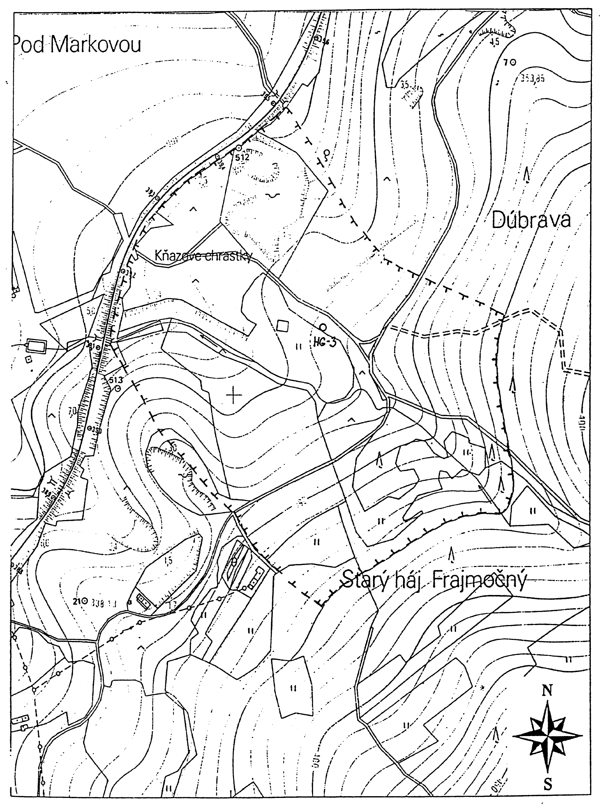
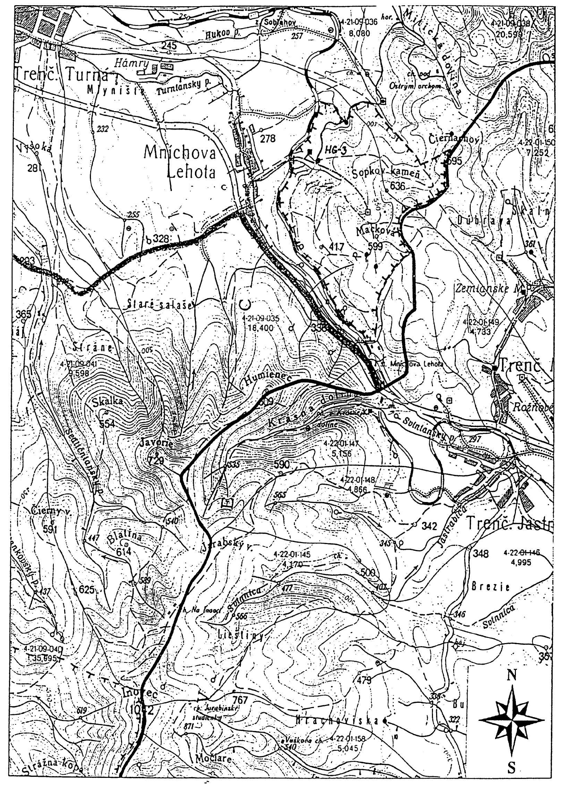

Príloha č. 1 k vyhláške č. 287/2000 Z. z.

OCHRANNÉ PÁSMO I. STUPŇA PRÍRODNÝCH ZDROJOV MINERÁLNYCH STOLOVÝCH VÔD V MNÍCHOVEJ LEHOTE

LEGENDA:

+ + + ochranné pásmo I. stupňa

M 1 : 5 000

Príloha č. 2 k vyhláške č. 287/2000 Z. z.

OCHRANNÉ PÁSMO II. STUPŇA PRÍRODNÝCH ZDROJOV MINERÁLNYCH STOLOVÝCH VÔD V MNÍCHOVEJ LEHOTE

LEGENDA:

+ + + ochranné pásmo II. stupňa

M 1 : 50 000

Príloha č. 3 k vyhláške č. 287/2000 Z. z.

POPIS HRANÍC OCHRANNÝCH PÁSIEM PRÍRODNÝCH ZDROJOV MINERÁLNYCH STOLOVÝCH VÔD V MNÍCHOVEJ LEHOTE

Ochranné pásmo I. stupňa

Západná hranica ochranného pásma I. stupňa sa začína pri železničnom moste cez pravostranný prítok Turnianskeho potoka v Mníchovej Lehote. Pokračuje po pravej strane železničnej trate smerom na Soblahov až po ďalší železničný most, kde sa stáča na juhovýchod a prechádza údolím pravostranného prítoku Turnianskeho potoka až na vrstevnicu 375 m n. m. Ďalej hranica vedie po vrstevnici 375 m n. m., po ktorej pokračuje južným a juhozápadným smerom na dĺžke približne 500 m. Potom sa hranica stáča na severozápad, na krátkom úseku sa napája na poľnú cestu a pokračuje plochým hrebeňom až k železničnému mostu, kde sa uzatvára hranica ochranného pásma I. stupňa.

Ochranné pásmo II. stupňa

Ochranné pásmo II. stupňa chráni akumulačnú a infiltračnú oblasť minerálnych vôd.

Hranica ochranného pásma II. stupňa sa začína na kóte Čiernachov (695) a pokračuje po rozvodnici južným a juhozápadným smerom, pričom obchádza kótu Macková (599) a ďalej pokračuje po lesnej ceste smerom k železničnej stanici Mníchova Lehota. Ďalej ide po pravej strane pravostranného prítoku Turnianskeho potoka až k železničnému mostu. Odtiaľ vedie popri železničnej trati smerom na Soblahov. Za Mníchovou Lehotou sa hranica stáča na juhovýchod, ide po ľavej strane pravostranného prítoku Turnianskeho potoka, pokračuje po poľnej ceste juhovýchodným smerom až po vrstevnicu 500 m n. m., kde sa stáča severovýchodne a napája sa na kótu Čiernachov, kde sa uzatvára hranica ochranného pásma II. stupňa.

Príloha č. 4 k vyhláške č. 287/2000 Z. z.

POPIS HYDROGEOLOGICKEJ ŠTRUKTÚRY PRÍRODNÝCH ZDROJOV MINERÁLNYCH STOLOVÝCH VÔD V MNÍCHOVEJ LEHOTE

Hydrogeologická štruktúra je klasifikovaná ako otvorená s poloodkrytou výverovou oblasťou. Otvorená hydrogeologická štruktúra má infiltračnú, akumulačnú a výverovú oblasť. Minerálne vody sú dopĺňané prirodzenou infiltráciou a sú odvodňované prameňmi a hydrogeologickým vrtom. Kolektor minerálnych vôd nevystupuje na povrch, je prekrytý hlinitokamenitými sedimentmi kvartéru.

Formovanie a obeh minerálnych vôd sa uskutočňujú v karbonatických horninách stredného a vrchného triasu chočského a strážovského príkrovu. Prostredím tvorby minerálnych vôd sú oponitické vápence (karn) a tmavosivé vápence (anis). Pôvod vodnej zložky je vadózny, ide o infiltráciu atmosférických zrážok do karbonatického prostredia a prestup podzemných vôd z plytkých kolektorov do väčších hĺbok.

Na formovaní a obehu sa podieľa aj tektonická stavba. Významné sú pozdĺžne zlomové línie juhozápadno-severovýchodného smeru a priečne zlomové línie severozápadno-juhovýchodného smeru.

Za infiltračnú oblasť hydrogeologickej štruktúry sa považujú západné svahy Strážovských vrchov, v oblasti kót Macková (599), Sopkov kameň (636) a Čiernachov (695). Územie je budované karbonátovými horninami mezozoika – dolomitmi a vápencami stredného až vrchného triasu a chočského a strážovského príkrovu. Infiltrovaná zrážková voda sa v prostredí s vysokou puklinovou až puklinovo-krasovou priepustnosťou zúčastňuje na hlbšom obehu, kde vplyvom mineralizačných procesov (rozpúšťanie karbonátov – vápencov) postupne získava vyššiu mineralizáciu.

Akumulačnú oblasť minerálnych vôd tvoria vápence chočského a strážovského príkrovu. V tejto oblasti dochádza k príronu oxidu uhličitého z väčších hĺbok prostredníctvom križovaní dvoch zlomových systémov. Pôvod oxidu uhličitého je pravdepodobne viazaný na podložie mezozoických komplexov.

Vo výverovej oblasti vlastný kolektor minerálnych vôd (vápence stredného-vrchného triasu) nevystupuje priamo na povrch, ale je zakrytý slabo priepustnými deluviálnymi kvartérnymi sedimentmi. Hydrogeologická štruktúra je odvodňovaná prirodzenými prameňmi minerálnej vody v oblasti Mníchovej Lehoty.
