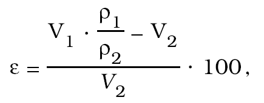
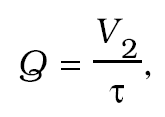

Príloha č. 23 k vyhláške č. 310/2000 Z. z. ANALYZÁTORY VÝFUKOVÝCH PLYNOV MOTOROVÝCH VOZIDIEL SO ZÁŽIHOVÝM MOTOROM

Prvá časť

Vymedzenie meradiel a spôsob ich metrologickej kontroly

1. Táto príloha sa vzťahuje na analyzátory výfukových plynov motorových vozidiel so zážihovým motorom, ktoré sa používajú na meranie objemových zlomkov oxidu uhoľnatého, oxidu uhličitého, nespálených uhľovodíkov a kyslíka vo výfukových plynoch motorových vozidiel, ako na určené meradlá podľa § 8 zákona.

2. Analyzátory výfukových plynov motorových vozidiel so zážihovým motorom pred uvedením na trh podliehajú schváleniu typu a prvotnému overeniu. Metódy technických skúšok pri schvaľovaní typu a metódy skúšania pri overovaní sú uvedené v druhej časti.

3. Analyzátory výfukových plynov motorových vozidiel so zážihovým motorom schváleného typu výrobca alebo dovozca označí značkou schváleného typu.

4. Analyzátory výfukových plynov motorových vozidiel so zážihovým motorom, ktoré pri overení vyhovejú ustanoveným požiadavkám, označí vykonávateľ overenia overovacou značkou a vydá doklad o overení.

5. Analyzátory výfukových plynov motorových vozidiel so zážihovým motorom počas ich používania podliehajú ako určené meradlá následnému overeniu.

Druhá časť

Technické požiadavky, metrologické požiadavky, metódy technických skúšok a metódy skúšania pri overovaní analyzátorov výfukových plynov motorových vozidiel

1. Termíny a definície

1.1 Odberová sonda – trubica, ktorá sa vkladá do výfukovej rúry vozidla na odobratie vzoriek plynu.

1.2 Odberová hadica – hadica pripojená k odberovej sonde, ktorá zabezpečuje prívod odoberanej plynnej vzorky do prístroja.

1.3 Odlučovač vody – zariadenie, ktoré odstraňuje vodu natoľko, že zabráni jej kondenzácii vnútri systému rozvodu plynu.

1.4 Filtračná jednotka – zariadenie, ktoré odstraňuje pevné čiastočky hmoty zo vzorky výfukového plynu.

1.5 Systém rozvodu plynu – všetky časti meradla od odberovej sondy po výstup odoberaného plynu, cez ktoré je vzorka výfukového plynu rozvádzaná čerpadlom.

1.6 Justovanie (meradla) – uvedenie meradla do funkčného stavu, ktorý zodpovedá podmienkam jeho používania.

1.7 Užívateľské nastavovanie (meradla) – justovanie s výlučným použitím prostriedkov určených pre užívateľa.

1.8 Možnosť ručného nastavovania – možnosť pripúšťajúca nastavenie meradla užívateľom.

1.9 Možnosť poloautomatického nastavovania – možnosť pripúšťajúca spustenie nastavovania užívateľom bez možnosti ovplyvnenia jeho veľkosti, bez ohľadu na to, či sa nastavovanie vyžaduje automaticky, alebo nie. Pre prístroje, ktoré vyžadujú ručné zadanie objemových zlomkov (4.3.1) kalibračného plynu, sa možnosť nastavovania považuje za poloautomatickú.

1.10 Možnosť automatického nastavovania – možnosť uskutočňovať nastavovanie prístroja podľa programu bez zásahu užívateľa na jeho spustenie alebo jeho veľkosť.

1.11 Možnosť nastavovania nuly – možnosť nastaviť údaj prístroja na nulu.

1.12 Možnosť nastavovania kalibračným plynom – možnosť nastaviť údaj prístroja na hodnotu kalibračného plynu.

1.13 Možnosť vnútorného nastavovania – možnosť nastaviť prístroj na stanovené hodnoty bez použitia vonkajšieho kalibračného plynu.

1.14 Čas zahrievania – časový interval medzi okamihom zapnutia prístroja a okamihom, v ktorom je prístroj schopný vyhovieť metrologickým požiadavkám.

1.15 Možnosť kontroly – schopnosť prístroja umožňujúca zistiť významné poruchy a reagovať na ne (napríklad svetelný alebo zvukový signál, zablokovanie procesu).

1.16 Možnosť automatickej kontroly – možnosť kontroly bez zásahu užívateľa.

1.17 Možnosť sústavnej automatickej kontroly – možnosť automatickej kontroly počas každého meracieho cyklu.

1.18 Možnosť občasnej automatickej kontroly – možnosť automatickej kontroly v určitých časových intervaloch alebo po pevne stanovenom počte meracích cyklov.

1.19 Test – séria úkonov vedúcich k overeniu zhody testovaného zariadenia s predpísanými požiadavkami.

1.20 Lambda – bezrozmerná hodnota charakterizujúca účinnosť spaľovania motora, vyjadrená pomerom vzduch/palivo vo výfukových plynoch a vypočítavaná normalizovanou rovnicou.

1.21 Kalibračný plyn – plynná zmes známeho zloženia používaná pri periodických kalibráciách prístroja a pri rôznych testoch.

1.22 Modul (čísla) – hodnota čísla bez ohľadu na jeho znak (synonymum – absolútna hodnota).

1.23 Trieda presnosti – trieda meracích prístrojov, ktoré spĺňajú metrologické požiadavky zamerané na udržanie chýb v špecifikovaných medziach.

1.24 Objemový zlomok plynných zložiek je indikovaný v percentách pre oxid uhoľnatý a kysličník uhoľnatý a číslom vynásobeným 10-6 pre uhľovodíky.

1.25 Drift – zmena údajov meradla, ktorá nastáva za určitý čas merania pri konštantnej hmotnostnej koncentrácii etanolu vo vzduchu.

2. Značky a skratky

CO – oxid uhoľnatý,

CO2 – oxid uhličitý,

O2 – kyslík,

HC – uhľovodíky (uvádzané hodnoty pre rozsahy a chyby sú kvantifikované na n-hexán),

PEF – propán ekvivalentný faktor.

3. Metrologické požiadavky

3.1 Merací rozsah

Najmenšie rozsahy indikácie prístrojov sú uvedené v tabuľke č. 1

Tabuľka č. 1

Trieda presnosti | Objemové zlomky plynov | | |

| CO | CO2 | O2 | HC

0 a I | 0 % | 0 % | 0 % | 0 ś 10-6

| 5 % | 16 % | 21 % | 2000 ś 10-6

II | 0 % | 0 % | 0 % | 0 ś 10-6

| 7 % | 16 % | 21 % | 2000 ś 10-6

3.2 Najväčšie dovolené chyby

Najväčšie dovolené chyby uvedené v tabuľke č. 2 platia pre prístroj pri referenčných podmienkach ustanovených v bode 3.10.

Tabuľka č. 2

Trieda presnosti | | Objemové zlomky plynov | | |

| | CO | CO2 | O2 | HC

0 | a*) | î 0,03 % | î 0,4 % | î 0,1 % | î 10 ś 10-6

| b**) | î 3 % | î 4 % | î 3 % | î 5 %

I | a | î 0,06 % | î 0,4 % | î 0,1 % | î 12 ś 10-6

| b | î 3 % | î 4 % | î 3 % | î 5 %

II | a | î 0,15 % | î 0,5 % | î 0,2 % | î 20 ś 10-6

| b | î 5 % | î 5 % | î 5 % | î 5 %

*) Absolútna chyba indikácie prístroja v objemových zlomkoch.

**) Relatívna chyba indikácie prístroja. Z dvoch chýb a a b sa použije väčšia.

3.3 Najväčšie dovolené chyby pri prvotnom overení

Najväčšie dovolené chyby uvedené v tabuľke č. 3 platia pri prvotnom overení pre prístroj pracujúci v pracovných podmienkach ustanovených v bode 3.11.

Tabuľka č. 3

Trieda presnosti | | Objemové zlomky plynov | | |

| | CO | CO2 | O2 | HC

0 | a*) | î 0,03 % | î 0,5 % | î 0,1 % | î 10 ś 10-6

| b**) | î 5 % | î 5 % | î 5 % | î 5 %

I | a | î 0,06 % | î 0,5 % | î 0,1 % | î 12 ś 10-6

| b | î 5 % | î 5 % | î 5 % | î 5 %

II | a | î 0,2 % | î 1 % | î 0,2 % | î 30 ś 10-6

| b | î 10 % | î 10 % | î 10 % | î 10 %

*) Absolútna chyba indikácie prístroja v objemových zlomkoch.

**) Relatívna chyba indikácie prístroja. Z dvoch chýb a a b sa použije väčšia.

3.4 Najväčšie dovolené chyby pri následnom overení

Najväčšie dovolené chyby pri následnom overení sa zhodujú s už uvedenými chybami pri prvotnom overení a platia pre skutočné podmienky pri meraní. Chyba pri následnom overení prístroja však môže byť väčšia ako chyba pri prvotnom overení.

3.5 Časová stálosť

Ak sa prístroj používa v prevádzkových podmienkach udávaných výrobcom, potom údaje prístroja za stabilných okolitých podmienok a po nastavení kalibračným plynom alebo po umožnení vnútorného nastavenia prístroja zostávajú v rozsahu najväčšej dovolenej chyby pri prvotnom overení počas 4 hodín bez nutnosti použitia kalibračného plynu alebo vnútorného znovunastavenia. Ak je prístroj vybavený prostriedkami na kompenzáciu driftu, napr. na automatické nastavenie nuly alebo automatické vnútorné nastavenie, uskutočnenie týchto nastavení nespôsobuje nič, čo by sa mohlo zameniť s meraním externého plynu.

3.6 Opakovateľnosť

Pre 20 následných meraní tou istou zmesou kalibračného plynu vykonaných tou istou osobou, tým istým prístrojom počas relatívne krátkeho časového intervalu sú výsledky najmenej 13 meraní v intervale A a všetkých 20 meraní v intervale B, pričom interval B je daný modulom najväčšej dovolenej chyby pri prvotnom overení a interval A je 1/3 tejto hodnoty. Tento interval sa rozkladá okolo strednej hodnoty výsledkov 20 meraní.

3.7 Čas reakcie

Pri meraní CO, CO2 a HC indikuje prístroj vrátane špeciálneho systému prenosu plynu do 15 sekúnd najmenej 95 % konečnej hodnoty použitého kalibračného plynu po výmene plynu s nulovým obsahom zložky.

3.8 Čas zahrievania

Po uplynutí času zahrievania prístroj vyhovuje metrologickým požiadavkám. Prístroje tried 0 a I majú prostriedky na zabránenie zobrazenia meraných objemových zlomkov počas zahrievania. Pre prístroje triedy II neprekročí čas zahrievania 30 minút.

3.9 Propán/hexán ekvivalentný faktor (PEF)

Prístroj meria HC v objemových zlomkoch n-hexánu a nastavuje sa použitím propánu. Propán/hexán ekvivalentný faktor udávaný ako C3/C6 faktor alebo PEF sa trvalým spôsobom vyznačuje alebo zobrazuje na displeji každého prístroja. Túto hodnotu poskytuje výrobca na každý prístroj individuálne číslom s troma platnými miestami. Ak sa v prístroji vymení alebo opraví časť závislá od zloženia plynu, vyznačí sa na prístroji nový propán ekvivalentný faktor. Hodnota tohto faktora je obvykle medzi 0,490 až 0,540.

3.10 Referenčné podmienky

a) Teplota: | 20 °C ±2 °C,

b) relatívna vlhkosť: | 50 % ±20 %,

c) atmosférický tlak: | stabilné okolie,

d) sieťové napätie: | nominálne napätie ±2 %,

| nominálna frekvencia ±1 %,

e) prítomnosť ovplyvňujúcich plynných zložiek: | žiadne, s výnimkou hlavných zložiek meraných v N2.

3.11 Pracovné podmienky

a) Teplota: | od 5 °C do 40 °C, |

b) relatívna vlhkosť: | až do 90 %, |

c) atmosférický tlak: | triedy 0 a I: | 86 kPa až 106 kPa,

&nbsp | trieda II: | okolitý ±2500 Pa,

d) kolísanie sieťového napätia: | -15 % až po +10 % nominálneho napätia, |

| ±2 % nominálnej frekvencie. |

Ak sa prístroj napája z batérie, hodnota napájacieho napätia sa uvádza vo výrobnej špecifikácii prístroja. Pri použití prenosného generátora sú jeho parametre zhodné so špecifikáciou sieťového napätia prístroja.

3.12 Iné vplyvy

Prístroj sa vyhotovuje tak, aby chyba spôsobená vplyvom iných plynných zložiek, ako je meraný plyn, neprekročila polovicu najväčšej dovolenej základnej chyby, pričom tieto plynné zložky môžu byť obsiahnuté v týchto najväčších objemových zlomkoch:

16 % CO2,6 % CO, 10 % O2, 5 % H2, 0,3 % NO, 2000 Í 10-6 HC (ako n-hexán), vodná para až do nasýtenia.

4. Technické požiadavky

4.1 Materiál

Všetky časti systému rozvodu plynu sa vyrábajú z materiálu odolného korózii a osobitne odberová sonda z materiálu, ktorý odoláva teplote výfukového plynu. Použité materiály neovplyvňujú zloženie odoberaného plynu.

4.2 Konštrukcia

a) Odberová sonda sa skonštruuje tak, aby mohla byť vsunutá do výfukového potrubia najmenej do hĺbky 30 cm a uchytená poistným zariadením bez ohľadu na hĺbku zasunutia.

b) Systém rozvodu plynu má obsahovať filtračnú jednotku so znovu použiteľným alebo vymeniteľným filtrom schopným odstrániť častice s väčším priemerom ako 5 µm. Prístroj možno používať 0,5 hodiny pri výfukových plynoch z motora vozidla s objemovým zlomkom HC zložky okolo 800 Í 10-6. Prístroj má umožňovať pozorovanie stupňa znečistenia filtra bez jeho odmontovania, ako aj jeho výmenu jednoduchým spôsobom bez špeciálnych pomôcok, ak je to potrebné.

c) Systém rozvodu plynu má obsahovať odlučovač vody, ktorý zabraňuje vzniku kondenzovanej vody v meracích častiach prístroja.

d) Okrem odberovej sondy má mať prístroj merajúci uhľovodíky aj samostatný vstup na nasávanie okolitého vzduchu alebo iného plynu bez uhľovodíkov, ktorý poskytuje možnosť nastavenia nuly meracieho prístroja. Ak sa používa okolitý vzduch, tento vzduch prechádza cez filter s aktívnym uhlím alebo cez ekvivalentný systém. Prístroje bez uhľovodíkovej kyvety môžu byť vybavené aj prídavným vstupom. Kyslíkové meracie články nemôžu na nastavenie nuly použiť okolitý vzduch; ak sa požaduje nastavenie nuly, môže byť použitý plyn bez kyslíka. Na privádzanie kalibračného plynu sa môže do systému rozvodu plynu doplniť ďalší vstup. Obidva vstupy sa umiestňujú za odlučovač vody a filtračnú jednotku pre prípad minimalizácie možného znečistenia privádzaných plynov. Všetky prostriedky v zariadení majú zabezpečiť udržanie rovnakého tlaku vnútri detektora počas nastavovania nuly, kalibrácie plynom alebo odberu výfukového plynu.

e) Čerpadlo rozvádzajúce výfukový plyn sa montuje tak, aby jeho vibrácie nemali vplyv na meranie. Prístroj má umožňovať užívateľovi zapínať a vypínať čerpadlo nezávisle od ostatných častí prístroja, ale nemá umožňovať meranie, ak je čerpadlo vypnuté. Pred vypnutím čerpadla sa odporúča automaticky prepláchnuť systém rozvodu plynu okolitým vzduchom.

f) Prístroj sa vybavuje prostriedkami, ktoré indikujú zníženie prietokovej rýchlosti pod hladinu, ktorá by zapríčinila prekročenie času reakcie alebo prekročenie polovice modulu najväčšej dovolenej chyby pri prvotnom overení, a ktoré pri prístrojoch tried 0 a I pri dosiahnutí tohto limitu zabraňujú meraniu.

g) Systém prenosu plynu má byť vzduchotesný do takej miery, že vplyv zriedenia plynu okolitým vzduchom na výsledky merania nebude vyšší ako

- polovica modulu najväčšej dovolenej chyby pri prvotnom overení pre CO, CO2 a HC,

- 0,1 % objemového zlomku pre O2.

Postup skúšky netesnosti dostatočne podrobne poskytuje výrobca v prevádzkovom návode. Prístroje tried 0 a I sa vybavujú prostriedkami, ktoré zabránia meraniu, ak sa dosiahne uvedený limit.

h) Prístroj môže byť vybavený rozhraniami na prepojenie prístroja s inými periférnymi zariadeniami alebo s inými prístrojmi. Ak je prístroj napojený na tlačiareň, potom sa prenos údajov z prístroja do tlačiarne zabezpečuje tak, aby nemohlo dôjsť k falšovaniu výsledkov. V oblasti kontrol vyžadovaných inými právnymi predpismi sa vylučuje vytlačenie dokumentu, ak prostriedky kontroly poukazujú na významnú chybu alebo nefunkčnosť prístroja.

4.3 Indikačné zariadenie

4.3.1 Zobrazenie nameraných hodnôt

Objemové zlomky plynných zložiek sa indikujú v percentách pre CO a CO2 a číslom vynásobeným 10-6 pre HC. Označenie pre tieto jednotky sa jednoznačne priraďuje k zobrazovanej hodnote, napr. % CO, % CO2 a 10-6 HC. Výrobcovia používajú na označenie displejov na analyzátore označenie „% vol.“, resp. „% obj.“, čím sa rozumie percento objemového zlomku, a „ppm vol.“, resp. „ppm obj.“, čím sa rozumie číslo vynásobené 10-6 objemového zlomku. Ide predovšetkým o jednoznačné odlíšenie použitia objemových a hmotnostných zlomkov.

4.3.2 Analógové indikačné zariadenie

Dieliky stupnice analógového prístroja sú 0,1 % alebo 0,2 % pre objemový zlomok pre CO a CO2 a 10 alebo 20 Í 10-6 pre objemový zlomok pre HC. Najmenšia šírka dielika stupnice je 1,25 mm. Šírka strelky nemá byť väčšia ako štvrtina dielika stupnice. Strelka má prekrývať najmenej jednu tretinu najkratšej značky a má byť jasne viditeľná. Delenie sa označuje číslami najmenej 5 mm vysokými a vyznačenými tak, aby nedošlo k mylnému výkladu.

4.3.3 Digitálne indikačné zariadenie

Digitálne číslice majú byť najmenej 5 mm vysoké. Posledná platná číslica má predstavovať údaj rovnajúci sa hodnotám, ktoré sú uvedené v tabuľke č. 4 alebo sú väčšie.

Tabuľka č. 4

Trieda presnosti | Objemové zlomky | | |

| CO | CO2 | O2 | HC

0 a I | 0,01 % | 0,1 % | *) | 1 ś 10-6

II | 0,05 % | 0,1 % | 0,1 % | 5 ś 10-6

*) 0,02 % pre množstvo meranej zložky ≤4 % alebo 0,1 % pre množstvo meranej zložky >4 %.

4.4 Možnosť nastavenia

a) Prístroj má umožňovať vlastné nastavenie, t. j. nastavenie nuly, kalibráciu plynom, ak je potrebná, a vnútornú kalibráciu. Nastavenie môže byť ručné, poloautomatické alebo automatické.

b) Prístroje tried 0 a I majú umožňovať automatické nastavovanie nuly a automatickú vnútornú kalibráciu.

c) Prístroje triedy II môžu umožňovať ručné, poloautomatické alebo automatické nastavovanie.

d) Vnútorné nastavenie, ktoré je spojené s akýmkoľvek nastavením, ktoré sa robí kalibračným plynom, nemá ovplyvňovať ani nastavenie nuly, ani linearitu reakcie prístroja.

e) Prístroje tried 0 a I sa vybavujú prostriedkami na skúmanie negatívnej indikácie v blízkosti nuly pri niektorých skúškach. Prístroje triedy II majú byť schopné indikácie záporných hodnôt v blízkosti nuly v prípade, že je potrebné vykonať nastavenie nuly.

4.5 Prevádzkové pokyny

Na každý prístroj poskytne výrobca prevádzkové pokyny napísané v štátnom jazyku. Prevádzkové pokyny obsahujú

a) časové intervaly a postupy na nastavenie a údržbu, ktorá sa dodržiava, aby sa vyhovelo požiadavkám najväčších dovolených chýb,

b) opis postupu skúšky netesnosti,

c) pokyn pre užívateľa, ktorý ho vedie ku kontrole zvyšku HC pred každým meraním HC vrátane opisu postupu na kontrolu zvyšku HC,

d) najväčšiu a najmenšiu teplotu pri skladovaní,

e) určenie požadovaného napätia a frekvencie pre prenosný generátor v súlade s ďalej uvedenými pracovnými podmienkami,

f) údaj o normálnych pracovných podmienkach,

g) v prípade výpočtu hodnoty lambda opis použitého vzorca,

h) inštrukcie na výmenu kyslíkového článku.

5. Nápisy a značky

5.1 Štítok

Prístroj má mať trvalé a ľahko čitateľné štítky, ktoré poskytujú tieto informácie:

a) ochrannú značku/obchodné meno výrobcu,

b) rok výroby,

c) označenie triedy presnosti,

d) označenie typu a číslo modelu,

e) výrobné číslo prístroja a meracieho snímača,

f) najmenší a menovitý prietok,

g) menovité napätie siete, frekvenciu a požadovaný príkon,

h) zložky plynu a príslušné najväčšie merané hodnoty,

i) typ a model kyslíkového článku.

Na každom prístroji má byť uvedená hodnota propán/hexán ekvivalentného faktora a na prístroji triedy II aj čas potrebný na ohrievanie, vyznačený na prednej strane prístroja alebo zobrazený na indikačnom zariadení.

5.2 Meracie jednotky

Objemové zlomky zložiek plynu sa vyjadrujú v percentách (% obj., % vol.) pre CO, CO2 a O2 a v parts per million (ppm obj., ppm vol.) pre HC. Nápisy týchto jednotiek sa uvádzajú jednoznačne pri indikácii zložky ako napr. „% obj. CO“, „% obj. CO2“, „% obj. O2“ a „ppm obj. HC“. Skratky „obj.“, „vol.“ nie sú súčasťou jednotky, ale slúžia na vysvetlenie, že sa používajú objemové zlomky, a ppm používajú na základe medzinárodného odporúčania OIML R99 zahraniční výrobcovia.

5.3 Umiestnenie overovacích a zabezpečovacích značiek

Prístroj, ktorý vyhovel podmienkam overenia, sa označuje overovacou značkou a vydáva sa k nemu doklad o overení. Umiestnenie overovacej značky sa uvádza v rozhodnutí o schválení typu.

6. Ochrana proti neoprávneným zásahom

a) Prístroj sa navrhuje a vyrába tak, aby sa nemohli vyskytnúť významné chyby alebo aby boli detekované a určené pomocou kontrolných pomôcok.

b) Prístroje s HC kanálom sa vybavujú kontrolnými prostriedkami na detekciu zvyšku HC, ktoré slúžia na zistenie, či je hodnota okolitého vzduchu prechádzajúceho cez odberovú sondu pred meraním menšia ako 20 Í 10-6 n-hexánu. Prístroje tried 0 alebo I sa nemajú používať na meranie, ak hodnota zvyškových HC prekročí objemový zlomok 20 Í 10-6.

c) Prístroj s kanálom na meranie kyslíka sa vybavuje zariadením, ktoré automaticky zistí akúkoľvek poruchu senzora spôsobenú starnutím alebo znehodnotením spojovacích prvkov.

d) Prístroje tried 0 a I sa vybavujú automatickými kontrolnými prostriedkami, ktoré pracujú tak, že predtým, ako sa meranie indikuje alebo vytlačí, sa potvrdia vhodné hodnoty alebo stavy pre všetky vnútorné nastavenia, pre nastavenie kalibračným plynom a pre ostatné parametre kontrolných zariadení. Typy kontrolných prostriedkov na jednotlivé parametre sú uvedené v tabuľke č. 5

Tabuľka č. 5

Parameter prístroja | Typ kontroly

Kontrola intervalu zahrievania | T (trvalo samočinne)

Kontrola nízkeho prietoku | T

Kontrola zvyšku HC | O (občasne samočinne)

Kontrola vlastného základného nastavenia | T alebo O

Kontrola kalibrácie plynom*) | O

Kontrola netesnosti*) | O

*) Časový interval určuje výrobca v návode na obsluhu a podrobuje sa schváleniu typu.

e) Prístroje vybavené prostriedkami automatického alebo poloautomatického nastavenia majú zabrániť vykonávaniu merania, ak nebolo nastavenie správne dokončené.

f) Prístroje vybavené prostriedkami poloautomatického nastavovania majú zabrániť vykonaniu merania, ak sa nastavovanie požaduje.

g) Prostriedky upozorňujúce na požadované nastavenie môžu tvoriť súčasť automatickej i poloautomatickej možnosti nastavovania.

h) Všetky časti prístroja, ktoré nemôžu byť chránené iným spôsobom proti operáciám ovplyvňujúcim presnosť alebo spoľahlivosť prístroja, sa zaplombujú. To sa vzťahuje predovšetkým na

1. prostriedky nastavovania,

2. spoľahlivosť softvéru,

3. jednorazové kyslíkové články.

i) Ak prístroj nemá zariadenia na kompenzáciu tlaku, požaduje sa každodenná kalibrácia.

j) Ak je napätie napájacej batérie nižšie, ako uvádza výrobca, prístroj má pokračovať v správnej činnosti alebo neudávať žiadnu hodnotu.

7. Metódy technických skúšok

Prístroj dodaný na skúšky pri schvaľovaní typu sa dodáva kompletne aj s príslušenstvom a dokumentáciou. Skúšky sa vykonávajú najmenej na jednom a bežne nie na viac ako na troch kusoch prístroja daného typu. Pre všetky triedy prístrojov sa na tieto skúšky používajú zmesi plynov – certifikované referenčné materiály – v rozsahoch (HC vyjadrené ako n-hexán) podľa tabuľky č. 6

Tabuľka č. 6

Trieda presnosti | Zložka | Objemové zlomky

0 a I | CO | 0,5 % až 5 %

| CO2 | 4 % až 16 %

| HC | 100 ś 10-6 až 2000 ś 10-6

II | CO | 1 % až 7 %

| CO2 | 6 % až 16 %

| HC | 300 ś 10-6 až 2000 ś 10-6

Všetky tri zložky plynu sú spolu v matricovom plyne N2. Pri všetkých triedach prístrojov môže byť kyslíkový kanál kontrolovaný kalibračným plynom bez obsahu kyslíka a kalibračným plynom s objemovým zlomkom 20,9 % O2.

Pred technickými skúškami pri schvaľovaní typu sa najskôr vykoná nastavenie kalibračným plynom podľa pracovných inštrukcií výrobcu. Nastavenie aj ostatné skúšky sa vykonávajú pri referenčných podmienkach uvedených v bode 3.10. Objemové zlomky HC sú pre nasledovné skúšky vyjadrené v hodnotách pre n-hexán (z dôvodu, že mnohé prístroje indikujú HC len ako n-hexán); ale z dôvodu fyzikálnochemických vlastností n-hexánu sa žiada použiť na overovanie a na technické skúšky plynná zmes s propánom.

7.1 Linearita merania (resp. kalibračná krivka)

Experimentálne údaje sa získavajú výhradne až po zahriatí analyzátora na prevádzkovú teplotu podľa týchto krokov:

a) skontroluje sa indikácia nulových údajov a zvyškové HC (okrem údaja pre O2),

b) do analyzátora sa privedú z tlakových nádob cez prietokomer (prietok nastavený podľa požiadaviek výrobcu a pri atmosférickom tlaku s najväčšou odchýlkou 750 Pa) certifikované referenčné plyny, pričom sa postupuje od najnižších hodnôt k najvyšším,

c) celý postup sa opakuje najmenej trikrát a namerané údaje sa zapisujú do tabuľky.

Chyby merania nemajú prekročiť najväčšie dovolené chyby uvedené v bode 3.2.

7.2 Časová stabilita merania

Ak sa prístroj používa podľa návodu výrobcu, potom merania na prístroji pri stabilných okolitých podmienkach a po nastavení kalibračným plynom alebo vnútorným nastavením prístroja majú vyhovovať najväčším dovoleným chybám pri prvotnom overení uvedeným v bode 3.3 počas 4 hodín, a to bez ďalšej možnosti kalibrácie plynom alebo vnútorného znovunastavenia prístroja obsluhou.

7.3 Opakovateľnosť merania

Pri 20 následných meraniach tou istou zmesou kalibračného plynu vykonaných tou istou osobou na tom istom prístroji počas relatívne krátkeho časového intervalu nemá pri prvotnom overení smerodajná odchýlka všetkých 20 meraní presiahnuť 1/3 modulu najväčšej dovolenej chyby uvedenej v bode 3.3.

7.4 Nízky prietok

Merania sa vykonávajú kalibračným plynom, ktorý sa na začiatku dodáva do odberového systému plynu s vyšším prietokom, ako je najmenší prietok požadovaný prístrojom. Počas skúšky sa prietok plynu znižuje dovtedy, pokiaľ indikátor nízkeho prietoku nebude reagovať podľa požiadaviek uvedených v bode 4.2 písm. f).

7.5 Propán/hexán ekvivalentný faktor

Skúška overuje priemernú hodnotu PEF a vykonáva sa takto:

a) vykoná sa meranie pre každý z odporučených objemových zlomkov propánu v kalibračnom plyne: 200 Í 10-6 a 2000 Í 10-6,

b) pre každú z koncentrácií propánu v kalibračnom plyne sa vypočíta absolútna chyba prístroja ako rozdiel medzi nameranou a správnou hodnotou,

c) zopakujú sa tie isté kroky, ale s n-hexánom 100 Í 10-6 a 1000 Í 10-6.

Rozdiel medzi chybami pre jednotlivé koncentrácie nemá presiahnuť najväčšiu dovolenú chybu pri prístrojoch s jedným PEF a polovicu najväčšej dovolenej chyby pri prístrojoch schopných uviesť súbor PEF.

8. Metódy skúšania pri overovaní

Overenie analyzátora výfukových plynov motorových vozidiel sa vykonáva v laboratóriách vykonávateľa overenia podľa § 15 zákona alebo u používateľa meradla použitím predpísaných metód a certifikovaných referenčných materiálov zmesi plynov, ktoré sú nadviazané na národný etalón zloženia vybraných zmesí plynov.

Overenie sa rozlišuje na prvotné overenie a následné overenie.

8.1 Prvotné overenie

Prvotné overenie nového prístroja sa vykonáva po schválení jeho typu, a to použitím potrebných pomôcok a certifikovaných referenčných materiálov zmesi plynov. Pozostáva z týchto krokov:

a) vonkajšej obhliadky, či zodpovedá schválenému typu meradla,

b) kontroly napätia a frekvencie zdroja elektrickej energie v mieste overovania a porovnania s údajom na štítku prístroja,

c) kontroly uzamknutia prístroja tried 0 a I počas zahrievania pri snahe merať počas prvej minúty od zapnutia prístroja,

d) kontroly kalibračnej krivky po zahriatí prístroja,

e) kontroly tesnosti prístroja podľa návodu výrobcu,

f) kontroly zvyšku HC podľa návodu výrobcu,

g) kontroly času reakcie na meranie CO.

8.2 Následné overenie

Následné overenie pozostáva z rovnakých skúšok ako prvotné overenie okrem kontroly napätia a času zahrievania.

8.3 Vonkajšia obhliadka a kontrola technického stavu

Pri vonkajšej obhliadke a kontrole technického stavu prístroja sa zisťuje, či

a) zodpovedá schválenému typu meradla,

b) sa predkladá na overenie kompletne podľa technickej dokumentácie výrobcu,

c) nemá znečistenú filtračnú sústavu,

d) nevykazuje netesnosť meracieho reťazca.

8.4 Správnosť merania prístroja

K meraniu sa pristupuje až po zahriatí prístroja na prevádzkovú teplotu. Skontroluje sa indikácia nulových hodnôt. Pred overením prístroja sa vykoná kalibrácia plynom podľa postupu poskytnutého výrobcom. Následne sa do overovaného prístroja privedú certifikované referenčné plyny a zistí sa linearita merania. Chyba prístroja sa určuje oddelene pre každú zložku aspoň v troch hodnotách ich špecifického rozsahu merania pre prístroje tried 0 a I a aspoň v dvoch hodnotách pre prístroje triedy II, pričom sa použijú objemové zlomky podľa tabuľky č. 7

Tabuľka č. 7

Zložka | Objemové zlomky meraných zložiek | |

| referenčný materiál č. 1 | referenčný materiál č. 2 | referenčný materiál č. 3

CO | 0,5 % | 1 % | 3,5 %

CO2 | 6 % | 10 % | 14 %

C3H8 | 200 ś 10-6 | 600 ś 10-6 | 2000 ś 10-6

Na meranie sa použijú certifikované referenčné materiály zmesi plynov, ktoré sú nadviazané na národný etalón zloženia vybraných zmesí plynov.

Výrobná tolerancia je ±15 % pre každú zložku. Pre všetky triedy prístrojov môže byť elektrochemický článok na kyslík kontrolovaný kalibračným plynom bez obsahu kyslíka a kalibračným plynom s objemovým zlomkom 20,9 % O2.

8.5 Vyhodnotenie nameraných výsledkov a spracovanie výsledkov skúšok

Na každé meranie sa stanoví hodnota rozšírenej neistoty. Pre meradlo, ktoré vyhovelo príslušným požiadavkám, sa vystaví doklad o overení a meradlo sa označí overovacou značkou.

Príloha č. 24 k vyhláške č. 310/2000 Z. z.

OBJEMOVÉ MERADLÁ NA LIEH

Prvá časť

Vymedzenie meradiel a spôsob ich metrologickej kontroly

1. Táto príloha sa vzťahuje na objemové meradlá na lieh – bubnové meradlá na kontinuálne meranie objemu liehu, ktoré majú doplnkové prístroje na stanovenie koncentrácie etanolu, používané na kontrolu výroby liehu v liehovarníckych podnikoch a pestovateľských páleniciach, ako na určené meradlá podľa § 8 zákona.

2. Objemové meradlá na lieh pred uvedením na trh podliehajú schváleniu typu a prvotnému overeniu. Metódy technických skúšok pri schvaľovaní typu a metódy skúšania pri overovaní sú uvedené v druhej časti.

3. Objemové meradlá na lieh schváleného typu výrobca alebo dovozca označí značkou schváleného typu.

4. Objemové meradlá na lieh, ktoré pri overení vyhovejú ustanoveným požiadavkám, sa označia overovacou značkou.

5. Objemové meradlá na lieh počas ich používania podliehajú ako určené meradlá následnému overeniu.

Druhá časť

Technické požiadavky, metrologické požiadavky, metódy technických skúšok a metódy skúšania pri overovaní objemových meradiel na lieh

1. Termíny a definície

1.1 Meraná kvapalina – termín „lieh“ sa používa vo význame etanol (etylalkohol) a pre zmesi etanolu a vody.

1.2 Objemové meradlo na lieh – bubnové meradlo pozostávajúce z viacerých pohyblivých komôr spojených tak, aby tvorili rotujúci bubon. Meranie sa vykonáva postupným napĺňaním a vyprázdňovaním jednotlivých komôr, pričom sa indikácia indikačného zariadenia zakaždým posunie o hodnotu rovnajúcu sa objemu jednej meracej komory.

1.3 Objem meracej komory – objem meracej komory naplnenej do stanovenej výšky, ktorá je daná konštrukciou meradla.

1.4 Objem bubna – súčet objemov meracích komôr tvoriacich bubon.

1.5 Indikačné zariadenie – ručičkové, valčekové alebo kombinované počítadlo pretečeného objemu.

1.6 Vzorkovacie zariadenie – zariadenie, ktoré odoberá a uchováva vzorky liehu z meracích komôr bubnov, na základe ktorých sa určuje priemerná objemová koncentrácia pretečeného liehu.

1.7 Naberačka vzorkovacieho zariadenia – časť vzorkovacieho zariadenia, ktorá odmeriava vzorky liehu odobraté z meracích komôr a vylieva ich do zberných nádob.

1.8 Zberná nádoba – nádoba určená na zhromažďovanie vzoriek liehu.

1.9 Vložná nádoba – nádoba umiestnená v blízkosti zberných nádob, slúžiaca na posúdenie zmien koncentrácie liehu v zberných nádobách.

1.10 Vzduvná nádoba – nádoba na zachytenie vzorky liehu v prípade násilného zastavenia odtoku liehu z meradla.

1.11 Záložné meracie zariadenie – zariadenie, ktoré zabezpečuje meranie pretečeného objemu liehu v prípade prietoku liehu prekračujúceho najväčší merací rozsah bubna alebo pri neprípustnom zastavení hlavného bubna.

1.12 Signalizačné zariadenie – zariadenie, ktoré opticky alebo akusticky upozorní obsluhu na poruchu pravidelného chodu komorového bubna.

1.13 Zariadenia na zamedzenie neprípustných stavov v meradle – špeciálne zariadenia zabudované v meradle, ktoré zabraňujú vzniku neprípustných prevádzkových podmienok alebo chýb, prípadne na také chyby upozornia.

1.14 Skriňa meradla – skriňa, v ktorej sa ukladá meracie zariadenie a ostatné časti meradla.

1.15 Najväčší teplomer – teplomer registrujúci najvyššiu dosiahnutú teplotu v meradle.

1.16 Ochranný plášť meradla – plášť slúžiaci na ochranu proti tepelným vplyvom, zakrývajúci skriňu meradla okrem priezorného skla, štítku a číselníka hlavného počítadla.

2. Rozdelenie objemových meradiel na lieh

2.1 Objemové meradlá na lieh sa podľa spôsobu stanovenia objemu etanolu obsiahnutého v kvapaline, ktorá cez ne pretiekla, delia na

a) bubnové meradlá so vzorkovacím zariadením,

b) bubnové meradlá s korektorom na stanovenie objemu etanolu.

2.2 Podľa spôsobu stanovenia objemu pretečeného liehu sa delia na

a) maloobjemové meradlá s objemom bubna menším ako 4 dm3 alebo rovným 4 dm3,

b) veľkoobjemové meradlá s objemom bubna väčším ako 4 dm3.

3. Technické požiadavky

3.1 Objemové meradlo na lieh (ďalej len „meradlo“) sa vyrába z materiálu, ktorý je zdravotne vyhovujúci a trvalo odoláva vplyvom liehu.

3.2 Jednotlivé časti meradla sa vyhotovujú tak, aby nemohlo dôjsť pri dovolenom rozsahu teplôt meradla k ich deformáciám a tým k zmene presnosti meradla.

3.3 Dovolený rozsah teplôt meradla je 0 až 50 oC.

3.4 Meradlo sa má dať jednoducho rozoberať.

3.5 Meradlo po technickej stránke má vyhovovať slovenským technickým normám.

3.6 Indikačné zariadenie meradla má indikovať nameraný objem v kubických decimetroch, litroch alebo kubických metroch.

3.7 Indikácia má umožňovať jednoznačné, ľahké a presné odčítanie. Ak má zariadenie viac prvkov, usporiada sa celá zostava tak, aby výsledok merania bolo možné jednoducho odčítať.

3.8 Hodnota dielika stupnice meradla sa má rovnať objemu meracej komory. Dielik stupnice korektora má mať hodnotu 1 x 10k, 2 x 10k alebo 5 x 10k jednotky objemu, pričom k je kladné alebo záporné celé číslo alebo nula.

3.9 Najväčší rozsah celého indikačného zariadenia má byť v tvare 1x 10k, 2 x 10k alebo 5 x 10k jednotky objemu, pričom k je kladné celé číslo.

3.10 Spojenie bubna a indikačného zriadenia má byť mechanické.

3.11 Bubon a indikačné zariadenie majú byť chránené proti spätnému chodu.

3.12 Pred vstupom liehu do bubna sa umiestňuje záchytka na liehomer a teplomer.

3.13 Teplomer umiestnený v záchytke na vstupe liehu do bubna má mať merací rozsah 0 až 50 oC.

3.14 Zasklený priezor skrine meradla má umožňovať vizuálnu kontrolu prietoku liehu a odčítanie údajov liehomera a teplomera.

3.15 Objem jednotlivých meracích komôr má zodpovedať hodnotám 1 x 10k, 2 x 10k alebo 5 x 10k (dm3, 1, m3), pričom k je kladné celé číslo alebo nula. Všetky meracie komory majú rovnakú veľkosť.

3.16 Naberačky vzorkovacieho zariadenia sa konštruujú tak, aby ich bolo možné podľa potreby nahradiť naberačkami s iným objemom.

3.17 Naberačky z každej súpravy majú mať rovnakú menovitú hmotnosť – z dôvodu vyváženia bubna.

3.18 Veľkoobjemové meradlo sa vybavuje záložným meracím zariadením so samostatnou indikáciou. Činnosť tohto zariadenia je signalizovaná opticky a zvukovo.

3.19 Maloobjemové meradlo sa vybavuje optickou signalizáciou prietoku liehu v prípade prekročenia najväčšieho objemu bubna alebo neprípustného zastavenia bubna.

3.20 Na vstupe liehu do meradla sa umiestňuje zariadenie na odvod liehových pár.

3.21 Meradlo sa vybavuje teplomerom slúžiacim na indikáciu prekročenia dovoleného teplotného rozsahu meradla.

3.22 Veľkoobjemové meradlo sa chráni proti zámernému pôsobeniu tepla ochranným plášťom meradla.

3.23 Skriňa a ochranný plášť meradla sa upravujú tak, aby bolo možné meradlo uzavrieť a zabezpečiť ho overovacími značkami a úradnou uzáverou (plombou) Ministerstva financií Slovenskej republiky.

3.24 Meradlo sa vybavuje vzduvnou nádobou.

3.25 Meradlo sa vybavuje zariadením zabraňujúcim zavzdušneniu odtokového potrubia. Meracie komory bubna sa vybavujú odvzdušňovacími otvormi.

3.26 Meradlo sa inštaluje vo vodorovnej polohe a v takej výške, aby bolo možné vykonať všetky predpísané skúšky priamym vtokom liehu do skúšobného zariadenia. Meradlo sa zabezpečuje proti zmene polohy a premiestneniu.

3.27 Meradlo sa umiestňuje tak, aby bolo zo všetkých strán voľne prístupné a v dostatočnej vzdialenosti od tepelných zdrojov.

4. Metrologické požiadavky

4.1 Najväčšia dovolená chyba pretečeného objemu maloobjemových meradiel je 0,3 %.

4.2 Najväčšia dovolená chyba pretečeného objemu veľkoobjemových meradiel je 0,5 %.

4.3 Najväčšia dovolená chyba teplomera určeného na indikáciu prekročenia dovoleného teplotného rozsahu je 1 oC.

5. Značky a nápisy

Na meradle sa umiestňujú tieto značky a nápisy:

a) značka alebo meno výrobcu,

b) typ meradla,

c) výrobné číslo a rok výroby,

d) značka schváleného typu,

e) druh meranej kvapaliny (môže vyplývať z názvu meradla),

f) menovitý objem meracej komory,

g) menovitý objem bubna,

h) na indikačnom zariadení sa uvádza jednotka indikácie,

i) na plášti meradla pri otvoroch na zberné nádoby sú uvedené ich objemy.

6. Skúšky meradla

Pri skúšaní objemových meradiel na lieh sa vykonávajú tieto úkony:

a) vonkajšia obhliadka,

b) skúška tesnosti jednotlivých častí meradla,

c) skúška správnosti meradla meraním objemu pretečeného cez merací bubon,

d) skúška objemu jednotlivých komôr bubna a skúška citlivosti bubna,

e) skúška záložného meracieho zariadenia,

f) skúška správnosti vzorkovacieho zariadenia alebo korektora,

g) kontrola indikačných zariadení,

h) kontrola zariadenia na zisťovanie neprípustných stavov pri meraní.

7. Pomôcky

7.1 Dve etalónové odmerné nádoby s objemom 20 dm3 alebo etalónová odmerná nádoba s objemom 100 dm3.

7.2 Rovná podložka nastaviteľná do vodorovnej polohy.

7.3 Libela.

7.4 Odmerný valec s výlevkou s objemom 1 dm3.

7.5 Dva odmerné valce s výlevkou s objemom 10 cm3.

7.6 Odmerný valec bez výlevky s objemom 1 dm3.

7.7 Pipeta nedelená, 100 ml.

7.8 Pipety delené, 20 ml a 50 ml.

7.9 Teplomer s hodnotou dielika 0,1 oC s meracím rozsahom 0 až 50 oC.

7.10 Stopky.

7.11 Súprava liehomerov pre rozsah 0 až 100 % s delením 0,1 a 0,2 % obj.

7.12 Kovový sud.

7.13 Čerpadlo.

7.14 Pomocná nádoba s regulačným ventilom a stojanom.

7.15 Súprava hadíc a pomocného materiálu.

7.16 Vreckové svietidlo.

7.17 Dostatočné množstvo nedenaturovaného liehu na vykonanie skúšok s percentom objemového zlomku 50 % obj. etanolu pre maloobjemové meradlá a 90 % obj. etanolu pre veľkoobjemové meradlá.

8. Technická skúška typu

Pri technickej skúške typu objemového liehového meradla sa vykonajú skúšky v rozsahu skúšok pri prvotnom overení podľa bodu 9.

9. Prvotné a následné overenie

9.1 Vonkajšia obhliadka

9.1.1 Pri vonkajšej obhliadke sa zisťuje, či je meradlo kompletné a či je zabezpečená ochrana meradla proti zásahu zvonka.

9.1.2 Pri vonkajšej obhliadke nových alebo opravených meradiel sa zisťuje

a) správnosť nastavenia polohových značiek na jednotlivých funkčných častiach meradla,

b) správnosť činnosti záložného meracieho zariadenia,

c) správnosť činnosti indikačných zariadení,

d) správnosť činnosti zariadenia na zamedzenie neprípustných stavov v meradle.

9.1.3 Pri následnom overení meradiel sa vonkajšou obhliadkou zisťuje, či nie je porušená niektorá overovacia značka a či meradlo nie je poškodené.

9.2 Skúška tesnosti

9.2.1 Skúška tesnosti bubna sa vykonáva pri overení nových alebo opravených meradiel. Skúška sa robí po vybratí bubna z meradla.

9.2.2 Pri overení nových alebo opravených meradiel sa skúša tesnosť týchto častí:

a) záložného meracieho zariadenia,

b) spojenia nádobky liehomera so skriňou meradla,

c) havarijnej nádoby pri maloobjemovom meradle.

9.2.3 Tesnosť zberných a vložných nádob a ich vypúšťacích ventilov sa skúša pri overení nových alebo opravených meradiel a tiež pri následnom overení.

9.3 Skúška správnosti meradla meraním objemu pretečeného cez meracie komory

9.3.1 Skúška správnosti merania objemu liehu pretečeného bubnom sa vykoná jedným z týchto spôsobov:

a) striedavým plnením a vyprázdňovaním etalónových odmerných nádob s objemom 20 dm3, ak sa skúška vykonáva pri prietoku väčšom ako 10 dm3min-1, používa sa pri odbere liehu pomocný kovový sud. Objem meradlom pretečeného liehu odobratého do suda sa na záver skúšky odmeria etalónovými odmernými nádobami,

b) striedavým plnením a vyprázdňovaním dvojitého objemového zariadenia, ktorého počítadlo zaznamenáva počet meraní alebo priamo pretečený objem,

c) pri veľkoobjemových meradlách sa skúška môže vykonať plnením do etalónovej odmernej nádoby s objemom 100 dm3.

9.3.2 Pri používaní etalónových odmerných nádob sa dodržiavajú zásady ich správneho používania.

9.3.3 Pri skúške správnosti meradla meraním pretečeného objemu sa vzorkovacie zariadenie odpojí.

9.3.4 Meraný objem liehu pri skúške má zodpovedať objemu rovnajúcemu sa najmenej objemu piatich otáčok bubna.

9.3.5 Meranie objemu pretečeného cez bubon sa uskutočňuje pri prietokoch uvedených v tabuľke č. 1 pri následnom overení alebo v tabuľke č. 2 pri prvotnom overení nových alebo opravených meradiel.

Tabuľka č. 1

Meradlo | Prietok (dm3.min-1) |

| Q1 | Q2

maloobjemové | 0,5 až 1 | 1,5 až 3

veľkoobjemové | 3 až 6 | 10 až 15

Tabuľka č. 2

Meradlo | Prietok (dm3.min-1) | |

| Q1 | Q2 | Q3

maloobjemové | 0,5 až 1 | 1 až 2 | 2 až 3

veľkoobjemové | 3 až 5 | 5 až 10 | 10 až 15

9.3.6 Pri pretečení každých 20 dm3 (l) sa meria

a) teplota liehu t1 na vstupe do skúšaného meradla a teplota liehu t2 v naplnenej etalónovej odmernej nádobe. Teplota v etalónovej odmernej nádobe sa meria po dôkladnom premiešaní obsahu nádoby. Obe teploty sa po každých 20 dm3 zaznamenávajú a vypočítajú sa z nich stredné teploty t1s a t2s,

b) zdanlivá koncentrácia liehu po naplnení a odmeraní pretečeného objemu v etalónovej odmernej nádobe (koncentrácia sa meria liehomerom s príslušným rozsahom).

Na korekciu nameraných hodnôt na správne hodnoty sa vykonajú tieto prepočty:

a) stanovenie pravej objemovej koncentrácie liehu zo zdanlivej koncentrácie,

b) stanovenie korekcie údaja objemového liehového meradla na teplotu liehu v etalónovej odmernej nádobe podľa príslušnej slovenskej technickej normy.

9.3.7 Na určenie prietoku sa čas skúšky meria stopkami.

9.3.8 Na elimináciu zmeny teploty liehu sa vykoná prepočet objemu udávaného indikačným zariadením meradla a objemu meraného odmernými nádobami.

9.3.9 Relatívna chyba objemu meradla v percentách sa vypočíta podľa vzťahu:

kde

ε je relatívna chyba merania pretečeného objemu skúšaného meradla v percentách,

V1 je údaj pretečeného objemu skúšaného meradla v dm3,

V2 je objem liehu stanovený etalónovými odmernými nádobami v dm3,

ρ1 je hustota liehu pri teplote t1s v kgm-3,

ρ2 je hustota liehu pri teplote t2s v kgm-3.

9.3.10 Prietok v dm3min-1 sa vypočíta podľa vzťahu:

kde

Q je prietok meradla v dm3min-1,

τ je čas skúšky v min.

9.3.11 Relatívna chyba meradla nemá byť väčšia ako hodnoty stanovené v bode 4.1 pre maloobjemové meradlá a v bode 4.2 pre veľkoobjemové meradlá.

9.4 Skúška objemu meracích komôr bubna

9.4.1 Skúška objemu meracích komôr bubna sa vykonáva vyliatím objemu meracej komory do odmerného valca. Táto skúška sa vykonáva pri overení nových alebo opravených meradiel.

9.5 Skúška citlivosti bubna

9.5.1 Skúška citlivosti bubna sa vykonáva len na nových a opravených meradlách. Pred touto skúškou sa celý bubon vymokrí.

9.5.2 Pri tejto skúške pri najmenšom prietoku má pohyb bubna nastať skôr, ako začne lieh vytekať vylievacím kanálikom.

9.6 Skúška záložného meracieho zariadenia

9.6.1 Skúška sa vykonáva len na nových a opravených meradlách.

9.6.2 Pred skúškou sa kontroluje

a) pravidelnosť chodu zariadenia,

b) správnosť činnosti signalizačného zariadenia.

9.6.3 Skúška správnosti merania objemu liehu pretečeného cez záložný bubon sa vykonáva podľa bodov 9.3.1 až 9.3.4 a 9.3.6 až 9.3.11 pri prietoku 5 až 10 dm3min-1.

9.6.4 Relatívna chyba merania objemu záložného bubna má byť menšia ako 0,6 % alebo rovná 0,6 %.

9.6.5 Skúška citlivosti bubna záložného zariadenia sa vykonáva podľa bodu 9.5.1.

9.7 Skúška správnosti vzorkovacieho zariadenia

9.7.1 Stanovenie chyby objemu všetkých systémov vzorkovacieho zariadenia (naberačiek) sa vykonáva pri jednej otáčke bubna. Objem liehu odobratého štyrmi naberačkami pre každý systém vzorkovacieho zariadenia sa zachytí do odmerného valca s výlevkou.

9.7.2 Relatívna chyba merania štyroch objemov naberačiek má vyhovovať slovenskej technickej norme.

9.7.3 Stanovenie chyby objemu naberačiek sa môže vykonať pri skúške správnosti objemu pretečeného cez bubon. Vtedy sa lieh odobratý pri skúške naberačiek naleje do liehu odmeraného bubnom.

9.7.4 Skúšky správnosti objemu zberných, vložných a vzduvných nádob sa vykonávajú len na nových alebo opravených meradlách po vymokrení nádob meraním objemu za pomoci odmerných valcov a pipety pri dodržaní požiadaviek bodu 4.3.2.

9.7.5 Relatívna chyba kalibrácie objemu zberných, vložných a vzduvných nádob má vyhovovať slovenskej technickej norme.

9.8 Kontrola indikačných zariadení

9.8.1 Pri kontrole indikačných zariadení sa vykonávajú tieto skúšky:

a) kontrola súhlasu prevodov (po odňatí ochranných krytov) s výrobnými výkresmi (iba na nových alebo opravených meradlách),

b) kontrola funkčnosti spätných západiek,

c) kontrola spojenia bubna s indikačným zariadením.

10. Záver skúšok pri prvotnom a následnom overení

10.1 Ak meradlo nespĺňa príslušné požiadavky, zabezpečí sa tak, aby sa nemohlo používať, kým sa neopraví a nepreskúša a nevystaví sa doklad o zamietnutí.

10.2 Ak meradlo spĺňa príslušné požiadavky, označí sa overovacou značkou a vystaví sa doklad o overení.

10.3 Plomby overovacích značiek sa umiestnia podľa rozhodnutia o schválení typu na daný typ meradla.

10.4 V doklade o overení sa uvedú tieto údaje:

a) výrobca,

b) typ meradla,

c) výrobné číslo,

d) objednávateľ,

e) umiestnenie meradla,

f) dátum skúšky,

g) čas platnosti overenia,

h) teplota liehu pri skúšaní v oC,

i) prietoky, pri ktorých sa meradlo skúšalo v dm3min-1,

j) relatívna chyba meradla pri jednotlivých prietokoch v %,

k) objem naberačiek,

l) objem zberných nádob,

m) rozšírená neistota merania.

11. Osobitné náležitosti

Meradlá v prevádzke sa zabezpečujú úradnou uzáverou (plombou) Ministerstva financií Slovenskej republiky, preto sa pri ich overení zúčastňujú zamestnanci daňového úradu.

Príloha č. 25 k vyhláške č. 310/2000 Z. z.

ANALYZÁTORY DYCHU

Prvá časť

Vymedzenie meradiel a spôsob ich metrologickej kontroly

1. Táto príloha sa vzťahuje na analyzátory dychu, ktoré automaticky merajú hmotnostnú koncentráciu alkoholu vo vydychovanom vzduchu a ktoré sa používajú na dokazovanie ako určené meradlá podľa § 8 zákona.

2. Analyzátory dychu sa používajú na meranie a číselné zobrazenie hmotnostnej koncentrácie etanolu v dychu osôb (vodičov, zamestnancov a pod.). Analyzátory dychu sa členia na

a) prenosné, ktoré sa používajú vnútri a mimo budov,

b) neprenosné, ktoré sa používajú len v budovách alebo ktoré sa používajú na meranie za rovnakých podmienok okolia (napr. v mobilných laboratóriách).

3. Analyzátory dychu pred uvedením na trh podliehajú schváleniu typu a prvotnému overeniu. Metódy technických skúšok pri schvaľovaní typu a metódy skúšania pri overení sú uvedené v druhej časti.

4. Analyzátory dychu schváleného typu výrobca alebo dovozca označí značkou schváleného typu.

5. Analyzátory dychu, ktoré pri overení vyhovejú ustanoveným požiadavkám, sa označia overovacou značkou.

6. Analyzátory dychu počas ich používania podliehajú ako určené meradlá následnému overeniu.

Druhá časť

Technické požiadavky, metrologické požiadavky, metódy technických skúšok a metódy skúšania pri overení analyzátorov dychu

1. Definície

1.1 Analyzátor dychu – meradlo slúžiace na stanovenie koncentrácie etanolu vo vydychovanom vzduchu, ktorý vzniká v pľúcnych alveolách.

1.2 Pamäťový efekt – rozdiel údajov meradla, ktorý sa získa z dvoch dávkovaní plynu určitej hmotnostnej koncentrácie, pričom medzi týmito dvoma dávkovaniami sa dávkuje plyn s vyššou hmotnostnou koncentráciou.

1.3 Drift – zmena údajov meradla, ktorá nastáva za určitý čas merania pri danej hmotnostnej koncentrácii etanolu vo vzduchu.

2. Metrologické požiadavky

2.1 Najväčšia dovolená chyba

Hodnoty najväčších dovolených chýb (kladných alebo záporných) pri technických skúškach na účely schvaľovania typu a pri prvotnom overení za predpísaných pracovných podmienok pre jednotlivé merania sú uvedené v tabuľke č. 1.

Tabuľka č. 1

Hmotnostná koncentrácia etanolu vo vydychovanom vzduchu (mg/l) | Najväčšia dovolená chyba (mg/l)

< 0,4 | 0,02

≥ 0,4 až ≤ 2 | 5 % *)

> 2 | 20 % *)

*) Hodnoty v percentách sa vzťahujú na meranú hodnotu hmotnostnej koncentrácie.

2.2 Opakovateľnosť merania

Opakovateľnosť merania vyjadrená ako smerodajná odchýlka má byť menšia ako hodnoty uvedené pre jednotlivé rozsahy hodnôt hmotnostnej koncentrácie v tabuľke č. 2.

Tabuľka č. 2

Hmotnostná koncentrácia etanolu vo vydychovanom vzduchu (mg/l) | Najväčšia dovolená smerodajná odchýlka (mg/l)

< 0,4 | 0,007

≥ 0,4 až ≤ 2 | 1,75 % *)

> 2 | 6 % *)

*) Hodnoty v percentách sa vzťahujú na meranú hodnotu hmotnostnej koncentrácie.

Štatistická pravdepodobnosť, že analyzátor dychu zabezpečí požiadavky uvedené v tabuľke č. 2, má byť väčšia ako 95 % alebo rovná 95 % pre každú hmotnostnú koncentráciu.

2.3 Drift

2.3.1 Drift nuly

Drift nuly má byť menší ako 0,010 mg/l počas 4 hodín.

2.3.2 Drift pri koncentrácii 0,40 mg/l

Krátkodobý drift má byť menší ako 0,010 mg/l počas 4 hodín. Dlhodobý drift má byť menší ako 0,020 mg/l počas 2 mesiacov.

2.4 Pamäťový efekt

2.4.1 Pamäťový efekt

Pamäťový efekt má byť menší ako 4 % z hodnoty hmotnostnej koncentrácie etanolu v plyne pri skúškach uvedených v slovenskej technickej norme.

2.4.2 Malé zmeny v hmotnostnej koncentrácii

Chyba výsledku merania plynu, ktorého koncentrácia je o 0,10 mg/l nižšia ako plynu, ktorý sa meral pred týmto plynom, je menšia ako najväčšia dovolená chyba merania pre nižšiu hmotnostnú koncentráciu.

2.5 Ovplyvňujúce veličiny

Meradlá majú spĺňať pri skúškach aj požiadavky ovplyvňujúcich faktorov. Metódy skúšok a hodnoty faktorov sú uvedené v slovenských technických normách.

2.5.1 Ovplyvňujúce faktory v parametroch charakterizujúcich skúšobné plyny

a) Faktory týkajúce sa vplyvu

1. dávkovaného objemu,

2. času trvania exhalácie,

3. času trvania konštantnej hodnoty hmotnostnej koncentrácie,

4. oxidu uhličitého CO2.

Chyby výsledkov nemajú prekročiť najväčšiu dovolenú chybu podľa bodu 2.1.

b) Faktor týkajúci sa vplyvu prerušenia prietoku výdychu do analyzátora. Analyzátor v takomto prípade nemá udávať hodnotu.

c) Faktory týkajúce sa vplyvu etanolu v hornom respiračnom trakte.

2.5.2 Fyzikálne ovplyvňujúce faktory

a) napájacie striedavé napätie,

b) napájacia frekvencia,

c) napájacie jednosmerné napätie,

d) kolísanie jednosmerného napätia,

e) teplota okolia,

f) relatívna vlhkosť okolia,

g) atmosférický tlak,

h) obsah uhľovodíkov v okolitom prostredí.

2.5.3 Fyziologické ovplyvňujúce faktory

Súčasti liečiv alebo produkty abnormálneho metabolizmu človeka obsiahnuté v rozpúšťadlách alebo priemyselných produktoch, alebo iné plyny môžu mať vplyv na výsledok merania, ak sú prítomné v dychu.

2.5.4 Fyzikálne rušivé vplyvy

a) krátkodobý pokles napájacieho napätia,

b) parazitické napätie k napájaciemu napätiu,

c) vibrácie,

d) mechanické rázy,

e) elektrostatické výboje,

f) elektromagnetické a magnetické polia,

g) cyklické zmeny zrážania vlhkosti okolitým teplom (len pre prenosné meradlá),

h) okolité podmienky uchovávania (len pre prenosné meradlá),

i) otrasy počas transportu (len pre prenosné meradlá),

j) rušivé vplyvy na prenosné meradlá používané výhradne na otvorených priestranstvách.

2.6 Trvanlivosť

Analyzátor dychu sa podrobí skúške trvanlivosti. Po skončení tejto skúšky majú byť jeho chyby menšie ako najväčšie dovolené chyby uvedené v tabuľke č. 1.

3. Technické požiadavky

3.1 Merací rozsah

Merací rozsah analyzátora dychu má byť od 0,00 mg/l do najmenej 1,50 mg/l. Pri bežnej prevádzke môže analyzátor udávať 0,00 mg/l pre hmotnostnú koncentráciu rovnú 0,05 mg/l alebo menšiu ako 0,05 mg/l. Horná hranica meracieho rozsahu nemá byť väčšia ako 3,00 mg/l.

3.2 Hodnota dielika

Hodnota dielika pri bežnej prevádzke sa má rovnať 0,01 mg/l. Pri metrologickej kontrole alebo manuálnej kalibrácii má meradlo rozlišovať hodnotu 0,001 mg/l (hodnota overovacieho dielika analyzátora dychu).

3.3 Displej

a) Údaj na displeji môže byť pri bežnej prevádzke zaokrúhlený nadol na 0,01 mg/l z údaja požadovaného pri metrologickej kontrole z 0,001 mg/l (napr. 0,427mg/l sa zaokrúhli a zobrazí ako 0,42 mg/l).

b) Na displeji, v tesnej blízkosti výsledku merania, má byť zobrazený názov meracej jednotky meranej veličiny alebo jej symbol.

3.4 Tlačiareň

Výsledky merania na výstupe z tlačiarne majú byť zhodné s výsledkami, ktoré sú zobrazené na displeji, vrátane symbolu meracej jednotky, v ktorej sa vyjadruje meraná veličina.

3.5 Najmenší objem

Meradlo má merať pri najmenšom objeme exhalovaného vzduchu 1,5 l.

3.6 Čas zahrievania

Pri referenčných podmienkach má meradlo správne merať v meracom režime

a) po 15 min od zapnutia meradla,

b) po 5 min od prepnutia z pokojového režimu (stand-by mode) do meracieho režimu.

Ak tieto požiadavky nie sú splnené, príslušné časy sa zreteľne vyznačia na meradle a uvedú v príručke pre používateľa.

3.7 Ochrana a bezpečnosť

Meradlo má umožňovať používanie výmenných násad (násosiek), do ktorých sa vydychuje vzduch.

3.8 Označenie meradla (štítok)

Na viditeľnom mieste sa na meradlo vyznačia tieto údaje:

a) značka schváleného typu,

b) meno výrobcu,

c) výrobné číslo,

d) názov meradla,

e) merací rozsah,

f) rozsah teploty okolia, pri ktorej sa môže analyzátor dychu používať na dôkazové účely,

g) čas zahrievania, ak nie sú splnené požiadavky podľa bodu 3.6,

h) čas alebo počet analýz povolený medzi jednotlivými údržbami a nastaveniami meradla používateľom (podľa príručky pre používateľa dodanej výrobcom).

4. Metódy technických skúšok a metódy skúšania pri overení

4.1 Technická skúška typu zahŕňa tieto skúšky meradla:

a) skúšku správnosti merania (najväčšia dovolená chyba podľa bodu 2.1),

b) skúšku opakovateľnosti merania (opakovateľnosť merania podľa bodu 2.2),

c) skúšku driftu meradla (drift podľa bodu 2.3),

d) skúšku pamäťového efektu (pamäťový efekt podľa bodu 2.4),

e) skúšku vplyvu ovplyvňujúcich veličín (vplyv veličín podľa bodu 2.5),

f) skúšku trvanlivosti (trvanlivosť podľa bodu 2.6).

4.2 Skúšky pri prvotnom overení zahŕňajú

a) skúšku správnosti merania (najväčšia dovolená chyba podľa bodu 2.1),

b) skúšku opakovateľnosti merania (opakovateľnosť merania podľa bodu 2.2),

c) skúšky ovplyvňujúcich faktorov v parametroch charakterizujúcich skúšobné plyny podľa bodu 2.5.1 písm. a) položiek 1 až 3.

4.3 Skúšky pri následnom overení zahŕňajú

a) skúšku správnosti merania (najväčšia dovolená chyba podľa bodu 2.1),

b) skúšku opakovateľnosti merania (opakovateľnosť merania podľa bodu 2.2)

pri dvoch rôznych podmienkach dávkovania plynu do meradla (čas trvania exhalácie, dávkovaný objem plynu, čas trvania konštantnej hodnoty hmotnostnej koncentrácie).

4.4 Nadväznosť meraní

Na meranie sa použijú certifikované referenčné materiály zmesi etanolu vo vzduchu (v dusíku), ktoré sú nadviazané na národný etalón zloženia vybraných zmesí plynov.

4.5 Postupy pri technickej skúške typu a postupy pri prvotnom overení a následnom overení ustanovuje príslušná slovenská technická norma.

Príloha č. 26 k vyhláške č. 310/2000 Z. z.

VÁHY S AUTOMATICKOU ČINNOSŤOU DÁVKOVACIE PLNIACE

Prvá časť

Vymedzenie meradiel a spôsob ich metrologickej kontroly

1. Táto príloha sa vzťahuje na váhy s automatickou činnosťou dávkovacie plniace, ktoré sa používajú na delenie celkového množstva materiálu na vopred nastavené jednotlivé dávky s konštantnou hmotnosťou, pričom dávky zostávajú samostatne oddelené, a ktoré sa používajú ako určené meradlá podľa § 8 zákona.

2. Váhy s automatickou činnosťou dávkovacie plniace pred uvedením na trh podliehajú schváleniu typu a prvotnému overeniu. Metódy technických skúšok pri schvaľovaní typu a metódy skúšania pri overovaní sú uvedené v druhej časti.

3. Váhy s automatickou činnosťou dávkovacie plniace schváleného typu výrobca alebo dovozca označí značkou schváleného typu.

4. Váhy s automatickou činnosťou dávkovacie plniace, ktoré pri overení vyhovejú ustanoveným požiadavkám, sa označia overovacou značkou.

5. Váhy s automatickou činnosťou dávkovacie plniace počas ich používania podliehajú ako určené meradlá následnému overeniu.

Druhá časť

Technické požiadavky, metrologické požiadavky, metódy technických skúšok a metódy skúšania pri overení dávkovacích plniacich váh

1. Termíny a definície

1.1 Váhy

Merací prístroj slúžiaci na určenie hmotnosti telesa s využitím účinku gravitácie na toto teleso. Podľa spôsobu činnosti sa váhy klasifikujú ako váhy s automatickou činnosťou alebo neautomatickou činnosťou.

1.2 Váhy s automatickou činnosťou

Váhy vážiace bez zásahu operátora, pracujúce na základe vopred určeného programu automatických procesov charakteristických pre dané váhy.

1.3 Váhy s automatickou činnosťou dávkovacie plniace

Váhy, ktoré z celkového množstva materiálu automaticky odvažujú vopred nastavené dávky s konštantnou hmotnosťou a týmito plnia obaly; ich základom je automatické plniace zariadenie alebo zariadenia pripojené na jednu alebo viac odvažovacích jednotiek, ako aj vhodné ovládacie a vyprázdňovacie zariadenia.

1.4 Asociatívne váhy

Váhy s automatickou činnosťou dávkovacie plniace (pracujúce na základe výberovej kombinácie) pozostávajúce z jednej alebo viacerých odvažovacích jednotiek, ktoré vypočítavajú príslušnú kombináciu náplní a spájajú ich, aby ich následne vyprázdnili ako jednu dávku.

1.5 Kumulatívne váhy

Váhy s automatickou činnosťou dávkovacie plniace s jednou odvažovacou jednotkou so zariadením zabezpečujúcim plnenie pomocou viacerých vážiacich cyklov.

1.6 Subtraktívne váhy

Váhy s automatickou činnosťou dávkovacie plniace, pri ktorých sa veľkosť dávky nastavuje pomocou regulácie množstva na výstupe z násypky.

1.7 Dávka

Jedno alebo viac zaťažení (náplní) vyprázdnených do jedného obalu, ktoré vytvoria vopred stanovenú hmotnosť.

1.8 Odvažovacia jednotka

Zariadenie, ktoré poskytuje informáciu o hmotnosti váženého zaťaženia. Toto zariadenie môžu tvoriť celé váhy s neautomatickou činnosťou alebo ich časť.

1.9 Nosič zaťaženia

Časť váh určená na prijímanie zaťaženia.

1.10 Podávacie zariadenie

Zariadenie, ktoré dopravuje materiál na odvažovaciu jednotku.

1.11 Zariadenie na ovládanie podávania

Zariadenie upravujúce rýchlosť prísunu dopravovaného materiálu.

1.12 Zariadenie na nastavenie dávky

Zariadenie na nastavenie vopred stanovenej hodnoty hmotnosti dávky.

1.13 Nulovacie zariadenie

Zariadenie na nastavenie nulovej indikácie pri prázdnom nosiči zaťaženia.

1.14 Referenčná hmotnosť časti materiálu

Hmotnosť rovnajúca sa strednej hodnote desiatich najväčších základných častí alebo kusov materiálu odobratých z jednej alebo viacerých dávok.

1.15 Nastavená hodnota

Hodnota vyjadrená v jednotkách hmotnosti, vopred nastavená operátorom na zariadení na nastavenie dávky ako určitá menovitá hodnota hmotnosti dávok.

1.16 Statické nastavenie

Hodnota hmotnosti skúšobných závaží alebo hmotností, ktorými sú v statickom režime vyvážené hmotnosti dávky zvolené na zariadení na nastavenie veľkosti dávky.

1.17 Vážiaci cyklus

Sled týchto činností:

a) doprava materiálu na nosič zaťaženia,

b) váženie,

c) vyprázdnenie jedného samostatného zaťaženia (dávky).

1.18 Dolná medza váživosti (Min)

Najmenšie samostatné zaťaženie, ktoré možno na nosiči zaťaženia automaticky odvážiť.

1.19 Horná medza váživosti (Max)

Najväčšie samostatné zaťaženie, ktoré možno na nosiči zaťaženia automaticky odvážiť.

1.20 Najmenšia menovitá dávka

Menovitá hodnota hmotnosti dávky, pod ktorou môžu výsledky váženia vykazovať chyby mimo medzí špecifikovaných v tejto prílohe.

2. Technické požiadavky na meradlá

2.1 Vhodnosť na použitie

Dávkovacie plniace váhy (ďalej len „váhy“) sa navrhujú tak, aby vyhovovali prevádzkovým podmienkam a produktom, pre ktoré sú určené. Váhy majú mať primerane pevnú konštrukciu, aby si uchovali svoje metrologické vlastnosti.

2.2 Bezpečnosť prevádzky

Váhy sa konštruujú tak, aby sa náhodná porucha alebo rozjustovanie ovládacích prvkov spôsobujúcich poruchu správnej činnosti nevyskytli bez toho, aby ich účinok nebol evidentný.

2.3 Používanie tlačiarne

Okrem nastavených hodnôt a počtu vážení sa všetky vytlačené údaje považujú za informatívne, nie sú použiteľné v obchodných vzťahoch.

2.4 Prídavné zariadenia

Žiadne prídavné zariadenie, ktoré sa používa spolu s váhami, nemá ovplyvniť správnosť funkcie váh.

2.5 Hodnota dielika (d)

Hodnoty dielikov stupníc všetkých indikačných zariadení pripojených na odvažovaciu jednotku majú byť rovnaké.

2.6 Podávacie zariadenie

Podávacie zariadenie sa navrhuje tak, aby zabezpečilo dostatočné množstvo materiálu a jeho pravidelný prísun.

2.7 Nosič zaťaženia

Nosič zaťaženia, plniace zariadenia a vyprázdňovacie zariadenia sa navrhujú tak, aby zabezpečovali, že množstvo materiálu, ktoré zostane po vyprázdnení, bude zanedbateľné.

2.8 Nulovacie a tarovacie zariadenia

Váhy sa vybavujú nulovacím zariadením, ktoré možno používať aj na nastavenie tary. Toto zariadenie môže byť manuálne, poloautomatické alebo automatické. Neautomatické alebo poloautomatické nulovacie a tarovacie zariadenia sú počas automatickej prevádzky váh zablokované.

3. Metrologické požiadavky na meradlá

3.1 Triedy presnosti

Trieda presnosti a referenčná hodnota triedy presnosti sa špecifikuje v súlade s bodom 3.2 a vyznačuje sa na váhach. Trieda presnosti sa špecifikuje na dané konkrétne použitie váh, t. j. podľa charakteru váženého materiálu, druhu inštalácie, hodnoty hmotnosti dávky a pracovnej rýchlosti.

3.2 Dovolené chyby

3.2.1 Najväčšia dovolená chyba pri statických skúškach

Váhy majú špecifikovanú referenčnú hodnotu Ref (x) pre triedu presnosti platnú iba pri statických skúškach, pre ktorú najväčšia dovolená chyba pri skúškach ovplyvňujúcich veličín je podľa špecifikácie v bode 3.4 vynásobená koeficientom triedy presnosti (x).

3.2.2 Najväčšia dovolená odchýlka jednotlivej dávky

Váhy majú špecifikovanú triedu presnosti X(x), pre ktorú sa najväčšia dovolená odchýlka jednotlivej dávky od priemeru rovná medzným hodnotám špecifikovaným v tabuľke č. 1, vynásobeným koeficientom triedy presnosti (x), keď (x) je v tvare 1 Í 10k, 2 Í 10k, 5 Í 10k, pričom k je kladné alebo záporné celé číslo alebo nula.

Tabuľka č. 1

Hodnota hmotnosti dávok M (g) | | | Najväčšia dovolená odchýlka jednotlivej dávky od priemeru pre triedu X (l) |

| | | Prvotné overenie | Následné overenie a kontrola v prevádzke

&nbsp | M ≤ | 50 | 6,3 % | 9 %

50 | < M ≤ | 100 | 3,15 g | 4,5 g

100 | < M ≤ | 200 | 3,15 % | 4,5 %

200 | < M ≤ | 300 | 6,3 g | 9 g

300 | < M ≤ | 500 | 2,1 % | 3 %

500 | < M ≤ | 1 000 | 10,5 g | 15 g

1 000 | < M ≤ | 10 000 | 1,05 % | 1,5 %

10 000 | < M ≤ | 15 000 | 105 g | 150 g

15 000 | < M | &nbsp | 0,7 % | 1 %

3.3 Najväčšia dovolená chyba nastavenej hodnoty (chyba nastavenia)

Váhy, na ktorých možno nastaviť hmotnosť dávky, nemajú mať najväčší rozdiel medzi nastavenou hodnotou a priemernou hmotnosťou dávok väčší ako 0,25-násobok najväčšej dovolenej odchýlky jednotlivej dávky od priemeru špecifikovanej pre následné overenie.

3.4 Najväčšia dovolená chyba pri skúškach ovplyvňujúcich faktorov

Najväčšia dovolená chyba pre akékoľvek statické skúšobné zaťaženie pri skúškach ovplyvňujúcich faktorov nemá byť väčšia ako 0,25-násobok najväčšej dovolenej odchýlky následného overenia dávky, ktorej hmotnosť zodpovedá veľkosti skúšobného zaťaženia.

3.5 Konštantné teploty

Váhy majú spĺňať príslušné technické požiadavky a metrologické požiadavky pri teplotách od -10 oC do +40 oC. Teplotný rozsah môže byť v prípadoch špeciálnych aplikácií odlišný, ale nie menší ako 30 oC a špecifikuje sa v opisnom označení.

3.6 Sklon

Váhy, ktoré nie sú pevne inštalované a ktoré nemajú indikátor polohy, majú vyhovovať príslušným technickým požiadavkám a metrologickým požiadavkám pri 5 % sklone. Ak váhy majú indikátor polohy, tento má umožňovať nastavenie sklonu do 1 %.

3.7 Meracie jednotky

Jednotkou hmotnosti pri používaní váh je miligram (mg), gram (g), kilogram (kg) a tona (t).

4. Nápisy a značky

4.1 Nápisy

Na váhy sa umiestňujú tieto údaje:

4.1.1 Údaje vypísané slovne sú:

a) meno výrobcu alebo jeho značka,

b) výrobné číslo a typové označenie váh,

c) špecifikácia produktu (t. j. druh materiálu, ktorý možno vážiť),

d) teplotný rozsah (ak je to potrebné),

e) napätie zdroja,

f) frekvencia zdroja,

g) pracovný tlak kvapalného média (ak je to aplikovateľné),

h) priemerný počet zaťažení/dávok (ak je to aplikovateľné),

i) najväčšia dávka (ak je to aplikovateľné),

j) menovitá najmenšia dávka,

k) najväčšia pracovná rýchlosť (ak je to aplikovateľné).

4.1.2 Údaje vyjadrené v kódoch sú:

a) značka schváleného typu,

b) vyznačenie triedy presnosti X(x),

c) referenčná hodnota pre triedu presnosti Ref (x),

d) hodnota dielika stupnice (ak je to aplikovateľné),

e) horná medza váživosti,

f) dolná medza váživosti (prípadne najmenšie vyprázdnenie),

g) najväčšia hodnota pripočítavacieho tarovníka,

h) najväčšia hodnota odpočítavacieho tarovníka.

Váhy možno overiť na váženie rôznych materiálov, pre ktoré platia rôzne triedy presnosti alebo ktoré si vyžadujú rôzne prevádzkové parametre, aby neboli prekročené najväčšie dovolené chyby. Značenie na váhach má byť také, aby údaje o alternatívnej triede presnosti alebo prevádzkových parametroch boli zreteľne priradené k príslušnému označeniu materiálu.

4.1.3 Softvérové nápisy

Opisné označenie sa môže zobrazovať aj na programovateľnom displeji, ktorý sa ovláda softvérom. V tom prípade sa zabezpečí, aby ich akékoľvek preprogramovanie bolo automaticky a nezmazateľne zaznamenané, napríklad dosledovateľným prístupovým softvérom. Ak sa použije programovateľný displej, na opisnom štítku sa označuje najmenej

a) typové označenie váh,

b) meno alebo značka výrobcu,

c) značka schváleného typu,

d) napätie zdroja,

e) frekvencia zdroja.

4.2 Overovacie značky

4.2.1 Umiestnenie

Na váhach sa vyčleňuje miesto na umiestnenie overovacích značiek. Toto miesto

a) má byť také, aby sa časť váh, na ktorej sa značka nachádza, nedala z váh odstrániť bez poškodenia značky,

b) má umožňovať jednoduché umiestnenie značky bez toho, aby sa tým zmenili metrologické vlastnosti váh,

c) má byť viditeľné bez posunutia váh počas ich prevádzky.

4.2.2 Pripevnenie

Na váhach sa vyhradzuje podložka na trvalé umiestnenie overovacej značky takto:

a) ak sa značka vyráža na plombu, podložku tvorí platnička z olova alebo z iného vhodného materiálu s podobnými vlastnosťami zapustená v doske pripevnenej na váhach alebo zapustená do otvoru vyvŕtaného do váh,

b) ak je značkou samolepiaca nálepka, pripraví sa na ňu vhodné miesto.

5. Metrologická kontrola meradiel

5.1 Metódy technických skúšok na schválenie typu

5.1.1 Všeobecné požiadavky

Technická skúška pri schvaľovaní typu sa vykoná aspoň na jednej alebo viacerých, spravidla nie viacerých ako troch, váhach predstavujúcich konkrétny typ. Na účely skúšok má byť k dispozícii jedna alebo viac kompletných a plne funkčných váh. Jedna alebo viac váh má byť k dispozícii v stave vhodnom na simulačné skúšky v laboratóriu. Váhy na simulačné skúšky majú obsahovať všetky elektronické súčasti, ktoré ovplyvňujú výsledky váženia, okrem prípadu asociatívnych váh, keď postačuje len reprezentatívna odvažovacia jednotka.

Váhy alebo simulátory váh majú mať indikátor zaťaženia alebo rozhranie, cez ktoré je možný prístup k nastaviteľnej veličine tak, aby bola k dispozícii taká indikácia zaťaženia, ktorá umožňuje preskúšať zhodu s požiadavkami na najväčšie dovolené chyby pri statických skúškach a ktorá umožňuje vykonanie skúšok na ovplyvňujúce veličiny. Hodnota dielika stupnice indikátora zaťaženia nemá prekročiť 0,125-násobok najväčšej dovolenej odchýlky následného overenia pri dávke rovnajúcej sa dolnej medzi váživosti.

Materiál použitý ako skúšobné zaťaženie pri technických skúškach má byť reprezentatívnou vzorkou produktu, na ktorého váženie sú váhy určené.

5.1.2 Skúšky

5.1.2.1 Skontroluje sa predložená dokumentácia a vykonajú sa skúšky na preverenie, či váhy zodpovedajú

a) technickým požiadavkám,

b) metrologickým požiadavkám,

c) požiadavkám na elektronické váhy (ak je to aplikovateľné).

5.1.2.2 Postup technických skúšok na schválenie typu ustanovuje príslušná slovenská technická norma.

5.1.2.3 V rozhodnutí o schválení typu sa stanoví referenčná hodnota pre triedu presnosti, ktorá bola určená pri statických skúškach, a uvedie sa, že skutočná trieda presnosti (rovnaká alebo väčšia ako referenčná hodnota) sa určí v súlade s metrologickými požiadavkami pri prvotnom overení.

5.1.3 Podmienky vykonania skúšok

Vykonávateľ technických skúšok môže na účely skúšok vyžadovať od žiadateľa o schválenie typu náležité množstvo materiálu, kontrolné zariadenia (váhy) a personál.

5.1.4 Miesto skúšky

Váhy predložené na technické skúšky možno skúšať

a) v mieste sídla vykonávateľa skúšok, alebo

b) na ktoromkoľvek inom vhodnom mieste, na ktorom sa vykonávateľ skúšky a žiadateľ o schválenie typu dohodnú.

5.2 Metódy skúšania pri prvotnom a následnom overovaní

5.2.1 Skúšky

5.2.1.1 Vykonávateľ overenia preverí zhodu váh so schváleným typom a preskúša, či váhy vyhovujú technickým a metrologickým požiadavkám na predpokladané produkty a danú triedu presnosti pri bežných pracovných podmienkach.

5.2.1.2 Skúšky vykoná vykonávateľ overenia na mieste používania na plne skompletizovaných váhach upevnených v polohe, v ktorej sa budú používať.

5.2.1.3 Postupy pri prvotnom a následnom overení ustanovuje príslušná slovenská technická norma.

5.2.1.4 Vykonávateľ overenia v odôvodnenom prípade a v záujme toho, aby sa predišlo duplicite skúšok, ktoré už boli predtým vykonané pri technických skúškach na schválenie typu, môže použiť tieto výsledky pri prvotnom overovaní.

5.2.2 Podmienky vykonania skúšok

Vykonávateľ overenia môže na účely skúšok pri overovaní vyžadovať od objednávateľa overenia náležité množstvo materiálu, kontrolné zariadenia (váhy) a personál.

Príloha č. 27 k vyhláške č. 310/2000 Z. z.

VÝČAPNÉ NÁDOBY

Prvá časť

Vymedzenie meradiel a spôsob ich metrologickej kontroly

1. Táto príloha sa vzťahuje na výčapné nádoby používané na čapovanie nápojov ako určené meradlá podľa § 8 zákona:

a) výčapné nádoby na prenášanie používané výhradne na stáčanie špecifických objemov nápojov (výčapné džbány, krčahy, demižóny, kanvice, fľaše s objemovou čiarkou, karafy),

b) výčapné nádoby na pitie používané pri konzumácii špecifických objemov nápojov (kalíšky, poháriky, odlievky, poháre, šálky, poháre s uchom).

2. Výčapné nádoby pred uvedením na trh podliehajú schváleniu typu a prvotnému overeniu. Metódy technických skúšok pri schvaľovaní typu a metódy skúšania pri overovaní sú uvedené v druhej časti.

3. Výčapné nádoby schváleného typu sa neoznačujú značkou schváleného typu.

4. Výčapné nádoby, ktoré vyhovujú požiadavkám na prvotné overenie, sa označujú overovacou značkou.

Druhá časť

Technické požiadavky, metrologické požiadavky, metódy technických skúšok a metódy skúšania pri overovaní výčapných nádob

1. Technické požiadavky a metrologické požiadavky na výčapné nádoby

1.1 Termíny a definície

1.1.1 Výčapná nádoba – objemová miera s vyznačeným a označeným objemom používaná na čapovanie nápojov.

1.1.2 Menovitý objem – hodnota objemu vyznačená na výčapnej nádobe.

1.1.3 Skutočný objem – konvenčne pravá hodnota objemu, ktorý zaberá kvapalina vo výčapnej nádobe naplnenej po objemovú čiarku pri referenčných podmienkach.

1.1.4 Objemová čiarka – čiarka vyznačujúca menovitý objem výčapnej nádoby.

1.1.5 Chyba objemu výčapnej nádoby – rozdiel medzi údajom menovitého objemu a údajom skutočného objemu kvapaliny odmeranej odmerným priestorom výčapnej nádoby.

1.1.6 Nadmerok – vzdialenosť horného okraja objemovej čiarky od horného okraja výčapnej nádoby.

1.1.7 Čítanie priehľadom – čítanie hladiny kvapaliny priehľadnou stenou, na ktorej sa vyznačuje objemová čiarka.

1.2 Všeobecné požiadavky

1.2.1 Výčapné nádoby sa vyrábajú z materiálu nemeniaceho tvar, zdravotne vyhovujúceho a schváleného na výrobu nádob prichádzajúcich do priameho styku s požívatinami, ktorý nemôže nápoje znehodnocovať. Výrobným materiálom na výčapné nádoby je číre (priehľadné) sklo alebo iný vhodný materiál.

1.2.2 Vnútorný povrch výčapnej nádoby má byť hladký, bez záhybov znemožňujúcich ich úplné vyprázdnenie. Vonkajší povrch výčapnej nádoby má byť hladký, bez ostrých hrán a preliskov.

1.2.3 Výlevka alebo rozšírené hrdlo výčapných nádob na prenášanie nemá zasahovať do odmerného priestoru nádoby.

1.2.4 Horný okraj výčapnej nádoby má byť hladký a rovný (odtavený, zabrúsený a pod.).

1.2.5 Hrúbka objemovej čiarky má byť 0,5 až 1 mm, dĺžka najmenej 10 mm.

1.2.6 Objemová čiarka sa vo svojej bezprostrednej blízkosti dopĺňa číselnou hodnotou menovitého objemu a symbolom meracej jednotky, na priehľadných výčapných nádobách vpravo od objemovej čiarky, nad ňou alebo pod ňou; na nepriehľadných výčapných nádobách v hornej tretine vnútornej plochy steny. Ak má výčapná nádoba ucho, objemová čiarka a menovitý objem sa umiestňujú vľavo od ucha.

1.2.7 Objemové čiarky, číslice a symboly meracích jednotiek sa zhotovujú trvanlivým a výrazným spôsobom, aby sa dali dobre čítať a za bežných podmienok používania sa nedali odstrániť.

1.2.8 V blízkosti objemovej čiarky nemajú byť ozdoby, hrany, zosilnené okraje, iné úpravy a také chyby materiálu, ktoré by mohli znemožniť čítanie hladiny a mohli by viesť k ich zámene s objemovou čiarkou. Ak má výčapná nádoba farebnú ozdobnú linku a spĺňa požiadavky bodu 1.2.5, môže táto linka súčasne tvoriť objemovú čiarku.

1.2.9 Jednotkou objemu pri výčapných nádobách je l, dm3, dl, cl, ml a cm3.

1.2.10 Číslice a symboly meracej jednotky označujúcej objem na výčapných nádobách nemajú byť menšie ako

- 3 mm pri objeme 0,05 dm3 a menšom,

- 4 mm pri objeme nad 0,05 dm3 do 0,5 dm3,

- 6 mm pri objeme nad 0,5 dm3.

1.3 Výčapné nádoby na prenášanie

1.3.1 Výčapné nádoby na prenášanie môžu mať jeden z týchto menovitých objemov:

0,2 – 0,25 – 0,3 – 0,4 – 0,5 – 0,7 – 1 – 1,5 – 2 l.

1.3.2 Rad menovitých objemov, najväčších dovolených chýb, najmenších nadmerkov a najväčších dovolených vnútorných priemerov v mieste objemovej čiarky pre výčapné nádoby na prenášanie je uvedený v tabuľke č. 1.

Tabuľka č. 1

Menovitý objem v l | Najmenší nadmerok v mm | Najväčší dovolený vnútorný priemer v mieste objemovej čiarky v mm | Najväčšia dovolená chyba v %

2 | 40 | - | ±3%

1,5 | - | - |

1 | - | - |

0,7 | 30 | 118 |

0,5 | - | 105 |

0,4 | 20 | 96 |

0,3 | - | 88 |

0,25 | - | 82 |

0,2 | - | 78 |

1.4 Výčapné nádoby na pitie

1.4.1 Výčapné nádoby na pitie môžu mať jeden z týchto menovitých objemov:

0,02 – 0,025 – 0,03 – 0,04 – 0,05 – 0,1 – 0,2 – 0,25 – 0,3 – 0,4 – 0,5 – 0,7 – 1 l.

1.4.2 Rad menovitých objemov, najväčších dovolených chýb, najmenších nadmerkov a najväčších dovolených priemerov v mieste objemovej čiarky pre výčapné nádoby na pitie je uvedený v tabuľke č. 2.

Tabuľka č. 2

Menovitý objem v l | Najmenší nadmerok v mm | Najväčší dovolený vnútorný priemer v mieste objemovej čiarky v mm | Najväčšia dovolená chyba v %

1 | 20 | - | ±3%

0,7 | | 118 |

0,5 | | 105 |

0,4 | | 96 |

0,3 | 10 | 88 |

0,25 | | 82 |

0,2 | | 78 |

0,1 | | 65 |

0,05 | 5 | 57 | ±5%

0,04 | | 52 |

0,03 | | 44 |

0,025 | | 40 |

0,02 | | 36 |

2. Metódy technických skúšok a metódy skúšania pri overení výčapných nádob

2.1 Na výčapných nádobách sa kontroluje vonkajší vzhľad, rozmery výčapnej nádoby, číslic a symbolov meracej jednotky, objem.

2.2 Prehliadka a kontrola dodržania technických požiadaviek sa vykoná pred skúškou objemovej správnosti výčapných nádob. Prehliadkou sa zisťuje, či výčapné nádoby nie sú poškodené (prasknuté), či vyznačenie a označenie objemu sú správne. Vnútorné priemery sa merajú v rovine kolmej na os nádoby preloženej horným okrajom objemovej čiarky (referenčná rovina). Skontrolujú sa aj požiadavky na dĺžku, hrúbku a stálosť objemovej čiarky.

2.3 Tvar výčapnej nádoby a jej rozmery majú zodpovedať v rámci dovolených odchýlok technickým výkresom, ktoré sú v mierke 1:1.

2.4 Vnútorný priemer výčapnej nádoby v mieste objemovej čiarky sa stanovuje tak, aby v žiadnom prípade neboli prekročené rozmery uvedené v tabuľke č. 1 alebo v tabuľke č. 2, a súčasne sa dodržiava najmenší nadmerok uvedený v týchto tabuľkách.

2.5 Vymeranie objemu sa vykoná objemovou metódou odchýlkovou s použitím etalónovej odmernej nádoby sklenenej koncovej (ďalej len „etalónová koncová nádoba“) a delenej pipety.

2.6 Pri vymeraní objemu sa používa pitná voda teplá 20 ( 5) oC.

2.7 Rozšírená neistota stanovenia objemu pri skúške typu výčapnej nádoby nemá prekročiť 1/5 najväčšej dovolenej chyby výčapnej nádoby. Pri výpočte rozšírenej neistoty sa použije koeficient rozšírenia k = 2.

2.8 Pri vymeriavaní objemovou metódou odchýlkovou sa objem kvapaliny preliatej do výčapnej nádoby odmeriava etalónovou koncovou nádobou a na prípadné nastavenie hladiny (doplnenie, resp. odobratie kvapaliny) sa použije delená pipeta. Po ustálení kvapaliny vo výčapnej nádobe sa pozoruje hladina, pričom oko pozorovateľa je na úrovni hladiny kvapaliny.

2.9 Objem kvapaliny vo výčapnej nádobe V sa potom určí podľa vzťahu

a) pri doplnení kvapaliny pipetou:

V = Vo + Vp

b) pri odobratí prebytočného množstva kvapaliny pipetou:

V = Vo - Vp

kde V – objem výčapnej nádoby,

V0 – objem etalónovej koncovej nádoby,

Vp – objem doplnený (odobratý) pipetou.

2.10 Ak prvotné overenie výčapných nádob vykonáva ich výrobca ako autorizovaná osoba na výkon overovania určených meradiel, namiesto overovacej značky M podľa prílohy č. 3 k vyhláške overovacou značkou môže byť ochranná známka výrobcu.

2.11 Podľa § 16 ods. 5 zákona prvotné overenie výčapných nádob možno vykonávať použitím štatistických metód.

2.12 Štatistická kontrola sa vykonáva na náhodne vybraných vzorkách výčapných nádob toho istého typu a rovnakej hodnoty menovitého objemu, ktoré tvoria výber z kontrolovaného súboru.

2.13 Rozsah výberu závisí od spôsobu výroby výčapných nádob a predstavuje

a) 2 % z celkovej produkcie pri výčapných nádobách vyrábaných strojovo (výberom od jednotlivých foriem jedenkrát za hodinu),

b) 5 % z celkovej produkcie pri výčapných nádobách vyrábaných liso-fúkaním.

2.14 Vonkajšia obhliadka a kontrola dodržania technických požiadaviek a metrologických požiadaviek sa vykoná na všetkých vzorkách vo výbere. Ak sa vo výbere vyskytne jedna vzorka, ktorá nevyhovuje ustanoveným požiadavkám, vykoná sa stopercentná kontrola celého súboru, z ktorého bola vzorka odobraná. Všetky nesprávne výčapné nádoby sa vyradia.

2.15 Pri ručnej výrobe výčapných nádob sa tieto overujú jednotlivo.

Príloha č. 28 k vyhláške č. 310/2000 Z. z.

VÝČAPNÉ DÁVKOVAČE

Prvá časť

Vymedzenie meradiel a spôsob ich metrologickej kontroly

1. Táto príloha sa vzťahuje na výčapné dávkovače, ktoré sa používajú na čapovanie hotových studených nápojov ako určené meradlá podľa § 8 zákona.

2. Výčapné dávkovače pred uvedením na trh podliehajú schváleniu typu a prvotnému overeniu. Metódy technických skúšok pri schvaľovaní typu a metódy skúšania pri overovaní sú uvedené v druhej časti.

3. Výčapné dávkovače schváleného typu výrobca alebo dovozca označí značkou schváleného typu.

4. Výčapné dávkovače, ktoré pri overení vyhovejú ustanoveným požiadavkám, sa označia overovacou značkou.

5. Výčapné dávkovače počas ich používania ako určené meradlá podliehajú následnému overeniu. Postup pri následnom overení sa zhoduje s postupom pri prvotnom overení.

Druhá časť

Technické požiadavky, metrologické požiadavky, metódy technických skúšok a metódy skúšania pri overovaní výčapných dávkovačov

1. Technické požiadavky a metrologické požiadavky na výčapné dávkovače

1.1 Odmerná nádoba výčapného dávkovača sa vyrába z materiálu nemeniaceho tvar, zdravotne vyhovujúceho a schváleného na výrobu nádob prichádzajúcich do priameho styku s požívatinami, ktorý nemôže nápoje znehodnocovať. Výrobným materiálom na objemové nádobky je číre sklo alebo vhodný priehľadný materiál.

1.2 Zo zdravotne vyhovujúceho materiálu sa vyrábajú tiež súčasti ventilového mechanizmu a horná a spodná časť výčapného dávkovača v miestach, kde uzatvárajú odmerný priestor (antikorózny kov, prípadne vhodný plast).

1.3 Súčasti meradla sa konštruujú a vyrábajú tak, aby

a) nemohlo dochádzať k deformáciám, ktoré by mali vplyv na správnosť meradla,

b) bolo zabezpečené riadne plnenie a vyprázdňovanie odmerného priestoru,

c) bola znemožnená akákoľvek manipulácia narušujúca správnosť meradla.

1.4 Ak nemožno konštrukčným riešením meradla zabrániť neoprávnenému zásahu, ktorý by mal vplyv na správnosť meradla, upravia sa tieto časti tak, aby sa dali zabezpečiť overovacou značkou.

1.5 Odmerná nádoba výčapného dávkovača má mať tvar dutého valca alebo mierne kónického kužeľa a umožňovať ľahké čistenie.

1.6 Pre výčapné dávkovače sú povolené tieto menovité objemy: 500, 300, 200, 100, 50, 30 a 20 cm3.

1.7 Rysky, číslice a symboly meracích jednotiek označujúce menovitý objem dávkovača majú byť zhotovené trvanlivým a výrazným spôsobom (rytím, leptaním, nalisovaním) na prednej stene odmerného priestoru, majú byť dobre čitateľné a za bežných podmienok používania neodstrániteľné.

1.8 Najväčšie dovolené chyby výčapných dávkovačov sú uvedené v tabuľke č. 1.

Tabuľka č. 1

Menovitý objem v cm3 | Najväčšia dovolená chyba

500 až 200 | î 2 %

100 až 20 | î 3%

2. Metódy technických skúšok a metódy skúšania pri overovaní výčapných dávkovačov

2.1 Všeobecne

2.1.1 Technická skúška pri schvaľovaní typu sa vykoná na jednej až troch vzorkách výčapných dávkovačov, pričom skúška správnosti dávkovania objemu sa vykoná na každom meradle 10-krát.

2.1.2 Pri technickej skúške pri schvaľovaní typu výčapných dávkovačov sa vykoná

a) kontrola splnenia technických požiadaviek podľa bodu 1,

b) skúška správnosti dávkovaného objemu.

2.1.3 Skúška správnosti dávkovaného objemu sa vykoná vymeraním objemu

a) hlavnou objemovou metódou s použitím etalónovej odmernej banky s ryskou pre menovitý objem a s ďalšími dvoma odchýlkovými ryskami, ktoré udávajú menovitý objem zväčšený (zmenšený) o najväčšiu dovolenú chybu, alebo

b) objemovou metódou s použitím etalónovej odmernej banky s ryskou a delenou pipetou.

2.1.4 Na vymeranie objemu sa používa pitná alebo destilovaná voda teplá 20 (ń 5) oC.

2.2 Vymeranie objemu hlavnou objemovou metódou

2.2.1 Pri vymeraní hlavnou objemovou metódou sa použije etalónová odmerná banka s ryskou pre menovitý objem a s dvoma odchýlkovými ryskami.

2.2.2 Etalónová odmerná banka sa namočí pitnou alebo destilovanou vodou. Voda sa z banky vyleje a nechá sa odkvapkať 15 s, pričom sa nádoba obráti dnom nahor pod uhlom 60o až 70o.

2.2.3 Do takto namočenej banky sa vypustí z výčapného dávkovača jedna dávka.

2.2.4 Ak je spodný okraj menisku hladiny vody vypustenej z dávkovača medzi odchýlkovými ryskami, je vypustená dávka správna.

2.2.5 Voda z etalónovej odmernej banky sa vyleje a po uplynutí 15 s sa vykoná ďalšie meranie objemu predchádzajúcim spôsobom.

2.3 Vymeranie objemu objemovou metódou

2.3.1 Pri vymeraní objemu touto metódou sa použije etalónová odmerná banka s ryskou a delená pipeta.

2.3.2 Postup pri objemovej skúške dávkovača touto metódou sa zhoduje s postupom v bode 2.2, pričom správnosť dávkovača sa vyhodnotí podľa bodov 2.3.3 a 2.3.4.

2.3.3 Podľa polohy spodného okraja menisku hladiny vody vzhľadom na rysku na etalónovej odmernej banke označujúcej menovitý objem sa namočenou a odkvapkanou pipetou odoberie alebo pridá taký objem vody, aby spodný okraj menisku kvapaliny súhlasil s horným okrajom rysky určujúcej menovitý objem.

2.3.4 Ak je odobraté alebo pridané množstvo menšie alebo rovná sa najväčšej dovolenej chybe pre príslušný menovitý objem, je vypustená dávka z dávkovača správna. Ak je toto množstvo väčšie, je vypustená dávka z dávkovača nesprávna a dávkovač metrologickým požiadavkám nevyhovel.

2.4 Postup pri prvotnom a následnom overení

2.4.1 Prvotné a následné overenie výčapného dávkovača pozostáva z vonkajšej obhliadky, z kontroly rozmerov číslic a symbolov meracej jednotky a zo skúšky správnosti dávkovaného objemu podľa bodu 2.2 alebo 2.3.

2.4.2 Pri overení výčapného dávkovača sa skúška správnosti dávkovaného objemu vykoná 5-krát.

2.4.3 Rozšírená neistota stanovenia objemu pri prvotnom a následnom overení nemá prekročiť 1/3 najväčšej dovolenej chyby výčapného dávkovača. Pri výpočte rozšírenej neistoty sa použije koeficient rozšírenia k = 2.
