Príloha č. 29 k vyhláške č. 403/2000 Z. z. VÁHY S AUTOMATICKOU ČINNOSŤOU DISKONTINUÁLNE SČÍTAVACIE

Prvá časť

Vymedzenie meradiel a spôsob ich metrologickej kontroly

1. Táto príloha sa vzťahuje na váhy s automatickou činnosťou diskontinuálne sčítavacie, ktoré sa používajú na určenie hmotnosti (sypkého) produktu jeho rozdeľovaním na jednotlivé dávky, pričom postupne určujú a sčítavajú hmotnosti jednotlivých dávok a takto odvážené jednotlivé dávky produktu premiestnia na jedno miesto, a ktoré sa používajú ako určené meradlá podľa § 8 zákona. Táto príloha sa nevzťahuje na váhy vážiace za pohybu a na váhy určujúce celkové množstvo produktu násobením hodnoty hmotnosti vopred nastavenej konštantnej dávky počtom vážiacich cyklov.

2. Váhy s automatickou činnosťou diskontinuálne sčítavacie podliehajú pred uvedením na trh schváleniu typu a prvotnému overeniu. Metódy technických skúšok pri schvaľovaní typu a metódy skúšania pri overení sú uvedené v druhej časti.

3. Váhy s automatickou činnosťou diskontinuálne sčítavacie schváleného typu výrobca alebo dovozca označí značkou schváleného typu.

4. Váhy s automatickou činnosťou diskontinuálne sčítavacie, ktoré pri overení vyhovejú ustanoveným požiadavkám, sa označia overovacou značkou.

5. Váhy s automatickou činnosťou diskontinuálne sčítavacie počas ich používania ako určené meradlá podliehajú následnému overeniu.

Druhá časť

Technické požiadavky, metrologické požiadavky, metódy technických skúšok a metódy skúšania pri overení váh s automatickou činnosťou diskontinuálnych sčítavacích

1 Termíny a definície

1.1 Váhy – merací prístroj slúžiaci na určenie hmotnosti telesa s využitím účinku gravitácie na toto teleso. Podľa spôsobu činnosti sa váhy klasifikujú ako váhy s automatickou alebo neautomatickou činnosťou.

1.2 Váhy s automatickou činnosťou – váhy vážiace bez zásahu operátora, pracujúce na základe vopred určeného programu automatických procesov charakteristických pre dané váhy.

1.3 Váhy s automatickou činnosťou diskontinuálne sčítavacie (sčítavacie váhy s násypkou) – váhy s automatickou činnosťou, ktoré určujú hmotnosť (sypkého) produktu jeho rozdeľovaním na jednotlivé dávky, pričom postupne určujú a sčítavajú hmotnosti jednotlivých dávok a takto odvážené jednotlivé dávky produktu premiestnia na jedno miesto.

1.4 Indikačné zariadenie – časť váh zobrazujúca hodnotu výsledku váženia v jednotkách hmotnosti.

1.5 Súčtové indikačné zariadenie – časť váh s automatickou činnosťou diskontinuálnych sčítavacích, ktorá zobrazuje súčet hmotnosti postupne odvážených a premiestnených dávok produktu.

1.6 Hlavné súčtové indikačné zariadenie – časť váh s automatickou činnosťou diskontinuálnych sčítavacích, ktorá zobrazuje súčet hmotnosti všetkých odvážených a premiestnených dávok produktu.

1.7 Čiastkové súčtové indikačné zariadenie – časť váh s automatickou činnosťou diskontinuálnych sčítavacích, ktorá zobrazuje súčet určitého množstva postupne odvážených a premiestnených dávok produktu.

1.8 Kontrolné indikačné zariadenie – indikačné zariadenie umožňujúce použitie váh s automatickou činnosťou diskontinuálnych sčítavacích ako kontrolných váh na váženie jednotlivých dávok na kontrolné účely.

1.9 Nulovacie zariadenie – zariadenie na nastavenie indikačného zariadenia na nulu pri nezaťaženom nosiči zaťaženia.

1.10 Hodnota dielika – hodnota vyjadrená v jednotkách hmotnosti, zodpovedajúca

a) rozdielu medzi hodnotami prislúchajúcimi dvom susedným značkám stupnice v prípade analógovej indikácie alebo

b) rozdielu medzi dvoma susednými indikovanými hodnotami v prípade číslicovej indikácie.

1.11 Dielik súčtovej stupnice (dt) – dielik hlavného súčtového indikačného zariadenia.

1.12 Dielik kontrolnej stupnice (d) – dielik kontrolného indikačného zariadenia.

1.13 Vážiaci cyklus – sled týchto činností:

a) prísun dávky na nosič zaťaženia,

b) jedno váženie,

c) premiestnenie dávky.

1.14 Automatický rozsah váživosti – rozsah od dolnej medze váživosti po hornú medzu váživosti.

1.15 Horná medza váživosti (Max) – najväčšia hmotnosť jednotlivej dávky, ktorú možno odvážiť automaticky.

1.16 Dolná medza váživosti (Min) – najmenšia hmotnosť jednotlivej dávky, ktorú možno odvážiť automaticky.

1.17 Cieľová hmotnosť dávky – vopred nastavená hodnota hmotnosti jednotlivej dávky na nosiči zaťaženia, ktorá zastaví prísun materiálu v každom vážiacom cykle.

1.18 Najmenšia sčítaná hmotnosť (Σmin) – najmenšia hodnota hmotnosti odváženého produktu, ktorú možno určiť bez prekročenia najväčšej dovolenej chyby pri automatickom vážení sčítaním hmotností jednotlivých dávok, pričom hmotnosť každej dávky je v automatickom rozsahu váživosti.

2 Technické požiadavky na meradlá

2.1 Vhodnosť na použitie

Váhy s automatickou činnosťou diskontinuálne sčítavacie (ďalej len „váhy“) sa navrhujú tak, aby vyhovovali pracovným postupom a produktom, pre ktoré sú určené.

2.2 Bezpečnosť

Váhy sa konštruujú tak, aby sa ich rozjustovanie ovplyvňujúce metrologické funkcie nemohlo uskutočniť bez toho, aby jeho efekt nebol ľahko zistiteľný.

2.3 Čistenie nosiča zaťaženia

Vyprázdnenie nosiča zaťaženia a činnosť váh neovplyvňujú negatívne výsledok váženia zmenami množstva produktu zostávajúceho v nosiči zaťaženia po ukončení vážiaceho cyklu.

2.4 Podmienky automatického váženia

Automatická operácia sa preruší, tlač výsledkov váženia zastaví alebo označí a do činnosti sa uvedie výstražná signalizácia v týchto prípadoch:

a) ak bola horná medza váživosti prekročená o viac ako 9 d,

b) ak hmotnosť jednotlivej dávky, ktorá sa má odvážiť, je menšia ako dolná medza váživosti (Min) okrem prípadu, ak ide o poslednú jednotlivú dávku váženia.

2.5 Prevádzkové nastavenie

Počas automatického váženia nemožno prestavovať prevádzkové parametre váh ani nastavovať indikačné zariadenia s výnimkou prerušenia vážiaceho cyklu pri skúškach váh.

2.6 Nulovacie zariadenie

Váhy, ktoré nevykonávajú tarovaciu operáciu po každom vyprázdnení nosiča zaťaženia, sa vybavujú nulovacím zariadením.

Automatická operácia sa zablokuje, ak sa odchýlka od nulovej indikácie rovná

a) 1 dt na váhach s automatickým nulovacím zariadením alebo

b) 0,5 dt na váhach s poloautomatickým alebo neautomatickým nulovacím zariadením.

Nulovacie zariadenie má byť schopné nastaviť nulu s presnosťou ±0,25-násobku hodnoty najmenšieho dielika všetkých indikačných zariadení váh a jeho rozsah nastavenia nemá prekročiť 4 % hornej medze váživosti.

2.7 Váhy s kontrolnými indikačnými zariadeniami

Nosič zaťaženia na váhach s kontrolnými indikačnými zariadeniami sa vybavuje zariadením umožňujúcim naloženie etalónových závaží podľa tabuľky č. 1.

Tabuľka č. 1

Horná medza váživosti (Max) | Najmenšie množstvo etalónových závaží

Max £ 5 t | Max

5 t < Max £ 25 t | 5 t

25 t < Max £ 50 t | 20 % Max

50 t < Max | 10 t

2.8 Súčtové indikačné a tlačiarenské zariadenie

Váhy sú vybavené hlavným indikačným súčtovým zariadením a môžu mať aj doplnkové súčtové indikačné zariadenie, čiastkové súčtové indikačné zariadenie a tlačiarenské zariadenie.

2.9 Kvalita indikácie

Súčtové indikačné a tlačiarenské zariadenia umožňujú spoľahlivé, jednoduché a jednoznačné odčítanie výsledkov jednoduchým prirovnaním a vyznačuje sa na nich názov alebo symbol príslušnej jednotky hmotnosti.

2.10 Dielik stupnice

S výnimkou doplnkového súčtového indikačného zariadenia sú hodnoty dielikov všetkých súčtových indikačných zariadení rovnaké.

2.11 Doplnkové súčtové indikačné zariadenie

Hodnota dielika doplnkového súčtového indikačného zariadenia sa rovná najmenej desaťnásobku hodnoty dielika súčtovej stupnice vyznačenej na opisnom štítku.

2.12 Pomocné zariadenia

Pomocné zariadenia neovplyvňujú zobrazovanú sčítanú hodnotu, ktorá predstavuje celkovú hmotnosť odváženého produktu.

3 Metrologické požiadavky na meradlá

3.1 Triedy presnosti

Váhy sa rozdeľujú do štyroch tried presnosti:

0,2 0,5 1 2

3.2 Najväčšie dovolené chyby

3.2.1 Automatické váženie

Najväčšie dovolené chyby pre každú triedu presnosti sú v zhode s príslušnými hodnotami uvedenými v tabuľke č. 2, zaokrúhlené na najbližšiu hodnotu dielika súčtovej stupnice.

Najväčšie dovolené chyby platia pre sčítané hmotnosti odváženého množstva produktu, ktoré nie sú menšie, ako je najmenšia sčítaná hmotnosť (Σmin).

Tabuľka č. 2

Trieda presnosti | Percento sčítanej hmotnosti |

| Prvotné overenie | Kontrola v prevádzke

0,2 | ±0,10% | ±0,2 %

0,5 | ±0,25 % | ±0,5 %

1 | ±0,50 % | ±1,0%

2 | ±1,00% | ±2,0 %

3.2.2 Ovplyvňujúce veličiny

Najväčšie dovolené chyby platné pre skúšky na posúdenie účinku ovplyvňujúcich veličín sú uvedené v tabuľke č. 3.

Tabuľka č. 3

Najväčšie dovolené chyby | Zaťaženie (m) vyjadrené v dielikoch súčtovej stupnice

±0,5 dt | 0 £ m £ 500

±1,0 dt | 500 < m £ 2 000

±1,5 dt | 2 000 < m £ 10 000

Číselné údaje a vytlačené výsledky sú korigované na chybu zaokrúhlenia, ktorá sa určuje s presnosťou aspoň 0,2 dt.

3.3 Tvar dielika stupnice

Dieliky stupnice indikačného a tlačiarenského zariadenia majú tvar 1 x 10k, 2 x 10k, 5 x 10k, kde „k“ je kladné alebo záporné celé číslo alebo nula.

3.4 Dielik súčtovej stupnice (dt)

Hodnota dielika súčtovej stupnice nemá byť

a) menšia ako 0,01 % hornej medze váživosti a

b) väčšia ako 0,2 % hornej medze váživosti.

3.5 Najmenšia hodnota najmenšej sčítanej hmotnosti (Σmin)

Najmenšia hodnota najmenšej sčítanej hmotnosti nemá byť menšia ako

a) hodnota zaťaženia, pre ktoré sa najväčšia dovolená chyba pri automatickom vážení pri prvotnom overení rovná hodnote dielika súčtovej stupnice (dt),

b) dolná medza váživosti (Min).

3.6 Zhoda medzi indikačným a tlačiarenským zariadením

Pre to isté zaťaženie platí, že rozdiel medzi údajmi o výsledku udávanými dvoma zariadeniami s rovnakou hodnotou dielika stupnice má byť

a) nulový pre digitálne indikačné alebo tlačiarenské zariadenia,

b) menší, ako je absolútna hodnota najväčšej dovolenej chyby pri automatickom vážení pre analógové zariadenia.

3.7 Konštantná teplota

Váhy spĺňajú príslušné technické požiadavky a metrologické požiadavky pri teplotách od -10 oC do +40 oC. V osobitných prípadoch môže byť tento teplotný rozsah odlišný, ale nie menší ako 30 oC a je vždy vyznačený na štítku váh.

4 Nápisy a značky

4.1 Nápisy Váhy majú toto označenie:

4.1.1 Údaje vypísané slovne:

a) značka výrobcu,

b) značka dovozcu (ak je to aplikovateľné),

c) výrobné číslo a typové označenie váh,

d) špecifikácia produktu,

e) dielik kontrolnej stupnice (ak je to aplikovateľné),

f) napätie zdroja,

g) frekvencia zdroja,

h) pracovný tlak tekutého média (ak je to aplikovateľné).

4.1.2 Údaje vyjadrené v kódoch:

a) značka schváleného typu,

b) trieda presnosti,

c) horná medza váživosti,

d) dolná medza váživosti,

e) najmenšia sčítaná hmotnosť,

f) dielik súčtovej stupnice.

4.2 Overovacie značky

4.2.1 Umiestnenie

Na váhach sa nachádza miesto na umiestnenie overovacích značiek. Miesto na značky spĺňa tieto požiadavky:

a) nemožnosť odstránenia tej časti váh, na ktorej sa značka nachádza bez poškodenia značky,

b) umožnenie jednoduchého umiestnenia značky bez toho, aby sa tým zmenili metrologické vlastnosti váh,

c) viditeľnosť značky bez posunutia váh počas ich prevádzky.

4.2.2 Pripevnenie

Na váhach sa vyhradzuje podložka na overovaciu značku takto:

a) ak sa značka vyrazí na plombu, môže podložku tvoriť platnička z olova alebo z iného vhodného materiálu s podobnými vlastnosťami, zapustená v doske pripevnenej na váhach alebo zapustená do otvoru vyvŕtaného do váh,

b) ak je značkou samolepiaca nálepka, je na ňu pripravené vhodné miesto.

5 Metrologická kontrola meradiel

5.1 Metódy technických skúšok pri schvaľovaní typu

5.1.1 Dokumentácia

Žiadosť o schválenie typu obsahuje dokumentáciu s týmito údajmi:

a) metrologické charakteristiky váh,

b) súhrn špecifikácií váh,

c) opis funkcie komponentov a zariadení váh,

d) nákresy, schémy a všeobecné softvérové informácie objasňujúce konštrukciu a činnosť váh,

e) dokumenty o tom, že konštrukcia a vyhotovenie váh zodpovedajú požiadavkám tejto prílohy.

5.1.2 Všeobecné požiadavky

Technická skúška pri schvaľovaní typu sa vykoná spravidla na jednej váhe predstavujúcej konkrétny typ. Ak je potrebné vykonať technickú skúšku na viacerých váhach, neprekročí ich počet tri. Jedna z váh je kompletne nainštalovaná na mieste používania. Ďalšia váha alebo jej podstatné časti sú pripravené tak, aby sa na nich mohli vykonať simulačné skúšky v laboratóriu.

5.1.3 Skúšky

5.1.3.1 Skontroluje sa predložená dokumentácia a vykonajú sa skúšky na preverenie, či váhy zodpovedajú

a) technickým požiadavkám,

b) metrologickým požiadavkám,

c) požiadavkám na elektronické váhy (ak je to aplikovateľné).

5.1.3.2 Postup technických skúšok pri schvaľovaní typu ustanovuje príslušná slovenská technická norma.

5.1.4 Podmienky vykonania skúšok

Vykonávateľ skúšky typu môže na účely skúšok vyžadovať od žiadateľa o schválenie typu náležité množstvo materiálu, kontrolné zariadenia (váhy) a zamestnancov.

5.1.5 Miesto skúšky

Váhy predložené na technické skúšky sa môžu skúšať

a) v mieste sídla vykonávateľa skúšok alebo

b) na ktoromkoľvek inom vhodnom mieste, na ktorom sa vykonávateľ skúšky a žiadateľ o schválenie typu dohodnú.

5.2 Metódy skúšania pri prvotnom a následnom overení

5.2.1 Skúšky

5.2.1.1 Vykonávateľ overenia preverí zhodu váh so schváleným typom a preskúša, či váhy vyhovujú technickým požiadavkám a metrologickým požiadavkám pre všetky produkty, na ktorých váženie sú váhy určené pri bežných podmienkach používania.

5.2.1.2 Skúšky vykoná vykonávateľ overenia na mieste používania na úplne skompletizovaných váhach upevnených v polohe, v ktorej sa budú používať.

5.2.1.3 Postup pri prvotnom a následnom overení ustanovuje príslušná slovenská technická norma.

5.2.1.4 Vykonávateľ overenia v odôvodnenom prípade a v záujme toho, aby sa predišlo duplicite skúšok, ktoré už boli predtým vykonané pri technických skúškach pri schvaľovaní typu, môže použiť tieto výsledky pri prvotnom overení.

5.2.1.5 Podmienky vykonania skúšok

Vykonávateľ overenia môže na účely skúšok vyžadovať od objednávateľa overenia náležité množstvo materiálu, kontrolné zariadenia (váhy) a zamestnancov.

Príloha č. 30 k vyhláške č. 403/2000 Z. z.

VÁHY S AUTOMATICKOU ČINNOSŤOU NA VÁŽENIE CESTNÝCH VOZIDIEL ZA POHYBU

Prvá časť

Vymedzenie meradiel a spôsob ich metrologickej kontroly

1. Táto príloha sa vzťahuje na váhy s automatickou činnosťou, ktoré sa používajú na váženie cestných vozidiel za pohybu, ako určené meradlá podľa § 8 zákona.

2. Technické požiadavky a metrologické požiadavky sa nevzťahujú na zariadenia, ktoré nie sú súčasťou váh, ani ak sú s nimi spojené, ale sa nepoužívajú na účely váženia podľa bodu 1.

3. Váhy na váženie cestných vozidiel za pohybu pred uvedením na trh podliehajú schváleniu typu a prvotnému overeniu. Metódy technických skúšok pri schvaľovaní typu a metódy skúšania pri overení sú uvedené v druhej časti.

4. Váhy na váženie cestných vozidiel za pohybu schváleného typu výrobca alebo dovozca označí značkou schváleného typu.

5. Váhy na váženie cestných vozidiel za pohybu, ktoré pri overení vyhovejú ustanoveným požiadavkám, sa označia overovacou značkou.

6. Váhy na váženie cestných vozidiel za pohybu počas ich používania ako určené meradlá podliehajú následnému overeniu.

Druhá časť

Technické požiadavky, metrologické požiadavky, metódy technických skúšok a metódy skúšania pri overení váh s automatickou činnosťou na váženie cestných vozidiel za pohybu

Technické požiadavky, metrologické požiadavky

1 Všeobecné požiadavky

1.1 Ak váhy s automatickou činnosťou na váženie cestných vozidiel za pohybu (ďalej len „váhy“) obsahujú alebo je k nim pripojených viac ako jedno indikačné alebo tlačiarenské zariadenie používané na účely podľa prvej časti bodu 1, potom sa na zariadenia, ktoré reprodukujú výsledky váženia a nemôžu ovplyvniť správnu funkciu váh, nevzťahujú technické požiadavky za predpokladu, že výsledky váženia sú

a) vytlačené alebo zaznamenané správne a neodstrániteľne tou časťou váh, ktorá spĺňa technické požiadavky, a

b) dostupné obom stranám zainteresovaným na vážení.

1.2 Ak sa váhy používajú pri priamom predaji verejnosti, ukazovateľ aj tlačiareň spĺňajú technické požiadavky rovnako pre predavača aj zákazníka.

2 Metrologické požiadavky

2.1 Jednotky hmotnosti

Výsledok váženia sa vyjadruje v zákonných meracích jednotkách hmotnosti.

2.2 Triedy presnosti

Váhy sa rozdeľujú do štyroch tried presnosti:

0,2 0,5 1 2.

2.3 Najväčšie dovolené chyby pri vážení za pohybu

2.3.1 Najväčšie dovolené chyby pre celkovú hmotnosť

Najväčšou dovolenou chybou pri vážení celkovej hmotnosti vozidla za pohybu je väčšia z nasledujúcich hodnôt:

a) hodnota z tabuľky č. 1 zaokrúhlená na hodnotu najbližšieho dielika,

b) 1 d x celkový počet vážení pri prvotnom overení,

2 d x celkový počet vážení v prevádzke.

Tabuľka č. 1

Trieda presnosti | Najväčšie dovolené chyby pre celkovú hmotnosť vozidla |

| Prvotné overenie | V prevádzke

0,2 | ±0,1% | ±0,2 %

0,5 | ±0,25 % | ±0,5 %

1 | ±0,5 % | ±1 %

2 | ±1 % | ±2 %

2.3.2 Najväčšie dovolené chyby pri skúškach na posúdenie účinku ovplyvňujúcich veličín

Najväčšie dovolené chyby pri skúškach ovplyvňujúcich veličín sú uvedené v tabuľke č. 2.

Tabuľka č. 2

Trieda presnosti | Zataženie (m) vyjadrené poctom dielikov | Najväcšia dovolená chyba vyjadrená v hodnotách dielika

0,2 | 0 £ m £ 500 | ± 0,5 d

0,5 | 500 ‹ m £ 2 000 | ± 1 d

1 | 2 000 ‹ m £ 5 000 | ± 1,5 d

2 | 0 £ m £ 50 | ± 0,5 d

2.3.3 Hodnota dielika (d)

Všetky zariadenia na indikáciu hmotnosti a na tlač majú rovnakú hodnotu dielika. Vzťah medzi triedou presnosti a počtom dielikov pre hornú medzu váživosti (Max) je špecifikovaný v tabuľke č. 3.

Tabuľka č. 3

Trieda presnosti | Najmenší počet dielikov pre Max | Najväčší počet dielikov pre Max

0,2 0,5 1 | 500 | 5 000

2 | 50 | 1 000

Hodnoty dielikov na indikačných a tlačiarenských zariadeniach sú vyjadrené v tvare 1 x 10k, 2 x 10k alebo 5 x 10k, pričom „k“ je kladné alebo záporné celé číslo alebo nula.

2.3.4 Dolná medza váživosti

Dolná medza váživosti (Min) sa rovná alebo je väčšia ako zaťaženie, pri ktorom najväčšia dovolená chyba pre hmotnosť celého vozidla pri prvotnom overení je 0,5 d.

2.3.5 Individuálne nápravové zaťaženie

Váhy môžu byť schválené na váženie celkovej hmotnosti vozidla. Nemôžu byť schválené výhradne na váženie nápravy alebo skupiny náprav, takéto výsledky sa nemôžu využívať ako výsledok merania určeným meradlom.

2.3.6 Zhoda indikačného a tlačiarenského zariadenia

Pri rovnakom zaťažení sú výsledky váženia indikované obidvoma zariadeniami zhodné.

2.4 Ovplyvňujúce veličiny

2.4.1 Teplota

Váhy vyhovujú príslušným metrologickým a technickým požiadavkám pri teplotách od 10 oC do 40 oC.

Teplotný rozsah môže byť aj iný na osobitné účely, ak nebude menší ako 30 oC a je vyznačený na váhach.

2.4.2 Vlhkosť

Váhy si zachovávajú svoje metrologické a technické parametre pri relatívnej vlhkosti do 85 % a pri hornej medzi teplotného rozsahu pre dané váhy.

2.4.3 Napájanie elektrickým prúdom (striedavý elektrický prúd)

Váhy napájané zo zdroja striedavého prúdu sú v súlade s príslušnými metrologickými a technickými požiadavkami pri prevádzke, keď je kolísanie napätia v rozpätí od - 15 % do + 10 % hodnoty vyznačenej na váhach.

2.4.4 Napájanie elektrickým prúdom (jednosmerný prúd)

Váhy napájané zo zdroja jednosmerného prúdu sú v súlade s príslušnými technickými a metrologickými požiadavkami.

2.4.5 Rušivé vplyvy

Konštrukcia a vyhotovenie elektronických váh v prípade vystavenia rušivým vplyvom

a) nevykazuje významné poruchy alebo

b) významné poruchy zisťuje a reaguje na ne.

Poruchy, ktoré sú menšie alebo sa rovnajú hodnote 1 d, sú pre rôzne indikácie údajov váh prípustné.

2.4.6 Uplatnenie

Požiadavky bodu 2.4.5 sa uplatňujú samostatne na

a) každý jednotlivý prípad významnej poruchy a/alebo

b) každú časť elektronických váh.

3 Technické požiadavky

3.1 Vhodnosť na účely použitia

Váhy sú skonštruované tak, aby boli vhodné pre vozidlá, miesto a bežné prevádzkové operácie, na ktoré sú určené. Nepoužívajú sa na váženie po častiach, kvapalných nákladov alebo akýchkoľvek iných nákladov, ktoré by mohli meniť polohu ťažiska na vozidle. Váhy sa konštruujú a vyhotovujú tak, aby neprekračovali najväčšie dovolené chyby v špecifikovaných referenčných podmienkach. Táto požiadavka sa dodržiava priebežne, a to v súlade s účelom, na aký sa váhy používajú.

3.2 Bezpečnosť operácie

3.2.1 Náhodné rozjustovanie

Váhy sú skonštruované tak, aby nemohlo dôjsť k takému ich nastaveniu, ktoré by viedlo k narušeniu ich metrologickej funkcie bez toho, aby tento efekt nebol ľahko zistiteľný.

3.2.2 Blokovacie zariadenie

Blokovacie zariadenie má zabrániť použitiu akéhokoľvek ovládacieho zariadenia, ktoré by mohlo zmeniť proces váženia.

3.2.3 Nulovacie zariadenie

Váhy môžu byť vybavené poloautomatickým alebo automatickým nulovacím zariadením. Nulovacie zariadenie môže byť funkčné len vtedy, keď sú váhy v stabilnej rovnovážnej polohe. Rozsah nulovacieho zariadenia nemá prekročiť 4 % z hornej medze váživosti.

3.2.4 Postup pri významnej poruche

Významná porucha sa signalizuje vizuálne alebo akusticky až do zákroku operátora alebo dovtedy, kým sa porucha neodstráni. Ak dôjde k významnej poruche, uchovávajú sa všetky informácie obsiahnuté vo váhach.

3.2.5 Napájanie striedavým prúdom

Váhy napájané zo siete uchovávajú v prípade výpadku elektrického prúdu metrologickú informáciu obsiahnutú v momente prerušenia dodávky elektrického prúdu aspoň na 24 hodín. Prepojenie na náhradný zdroj nemá spôsobiť významnú poruchu.

3.2.6 Napájenie jednosmerným prúdom

Váhy napájané zo zdroja jednosmerného prúdu v prípade, že napätie zdroja poklesne pod hodnotu stanovenú výrobcom, naďalej pracujú presne alebo automaticky prerušia činnosť.

3.2.7 Rozhranie

Váhy môžu byť vybavené rozhraním umožňujúcim prepojenie váh s externým zariadením. Rozhranie nemá vplyv na správnu činnosť váh a ich metrologickú funkciu.

3.3 Indikačné a tlačiarenské zariadenie

3.3.1 Kvalita indikácie

Indikácia hmotnosti je samostatná. Indikačné a tlačiarenské zariadenie umožňuje spoľahlivé a jednoduché odčítanie výsledkov jednoduchou interpoláciou a vyznačuje sa na nich názov a symbol príslušnej jednotky hmotnosti.

3.3.2 Tlač

Po každom vážení sa vytlačí najmenej

a) počet odvážených náprav,

b) celková hmotnosť vozidla,

c) dátum a čas váženia.

3.3.3 Rozsah váživosti

Váhy neindikujú ani nevytlačia hmotnosť, ktorá je pred sčítaním menšia ako Min alebo väčšia ako Max +9 d.

3.3.4 Pracovná rýchlosť

Váhy neindikujú ani nevytlačia hmotnosť vozidla (prípadne hmotnosť nápravy alebo skupiny náprav), ak vozidlo prešlo cez nosič zaťaženia rýchlosťou mimo špecifikovaného rozsahu pracovnej rýchlosti bez upozornenia, že táto hmotnosť nie je overená.

3.3.5 Spätný chod

Váhy automaticky zistia ktorúkoľvek časť vozidla, ktorá prešla cez nosič zaťaženia viac ako jedenkrát; v tomto prípade sa proces váženia zruší, čo znamená, že váhy

a) neindikujú alebo nevytlačia výsledok váženia, alebo

b) zreteľne signalizujú, že indikovaný údaj alebo vytlačený výsledok váženia môže byť nesprávny.

3.4 Inštalácia

Váhy sa inštalujú tak, aby vplyv prostredia na výsledok váženia bol čo najmenší. V prípade, že by mohli niektoré zvláštne detaily inštalácie ovplyvniť proces váženia, uvedú sa v rozhodnutí o schválení typu. Ak sa vážiaci mechanizmus nachádza v jame, je zabezpečené jej odvodnenie tak, aby žiadna časť prístroja nebola úplne alebo čiastočne ponorená.

4 Nápisy a značky

4.1 Na váhach na štítku sa uvádzajú tieto údaje:

a) meno výrobcu alebo jeho identifikačná značka,

b) označenie typu váh,

c) výrobné číslo váh,

d) značka schváleného typu,

e) najväčšia hmotnosť vozidla, kg alebo t,

f) najmenšia hmotnosť vozidla, kg alebo t,

g) smer váženia (ak je aktuálny),

h) najväčšia rýchlosť pohybujúceho sa vozidla pri vážení, km/h,

i) napätie zdroja elektrického prúdu, V,

j) frekvencia zdroja prúdu, Hz,

k) teplotný rozsah (ak nie je v rozpätí -10 oC až +40 oC), oC,

l) trieda presnosti pre celkovú hmotnosť vozidla, 0,2, 0,5, 1, 2,

m) horná medza váživosti, Max = kg alebo t,

n) dolná medza váživosti, Min = kg alebo t,

o) hodnota dielika stupnice, d = kg alebo t,

p) najväčšia pracovná rýchlosť, Vmax = km/h,

q) najmenšia pracovná rýchlosť, Vmin = km/h,

r) najväčší počet osí vozidla, amax =.

4.2 Doplnkové značenie

Metrologický orgán môže v rozhodnutí o schválení typu váh vyžadovať jednu alebo viac doplnkových značiek podľa konkrétneho účelu, na ktorý sa budú váhy používať.

4.3 Umiestnenie značiek

Nápisy a značky sú zreteľné, majú taký rozmer, aby boli v normálnych prevádzkových podmienkach dobre čitateľné, a sú neodstrániteľné. Umiestňujú sa na dobre viditeľnom mieste váh, na štítku upevnenom v blízkosti indikačného zariadenia alebo na samotnom indikačnom zariadení.

Metódy technických skúšok pri schvaľovaní typu a metódy skúšania pri overení

5 Technické skúšky pri schvaľovaní typu

5.1 Všeobecné postupy

5.1.1 Technická skúška pri schvaľovaní typu sa vykoná spravidla na jednej váhe predstavujúcej konkrétny typ. Ak je potrebné vykonať technickú skúšku na viacerých váhach, neprekročí ich počet tri. Jedna z váh je kompletne nainštalovaná na mieste používania. Ďalšia váha alebo jej podstatné časti sú pripravené tak, aby bolo možné na nich vykonať simulačné skúšky v laboratóriu.

5.1.2 Technická skúška pri schvaľovaní typu sa môže vykonať na akomkoľvek vhodnom mieste, na ktorom sa žiadateľ o schválenie typu dohodne s vykonávateľom technickej skúšky.

5.1.3 Vykonávateľ technických skúšok môže od žiadateľa o schválenie typu požadovať, aby poskytol na účely skúšky skúšobné vozidlá, materiál, zamestnancov a kontrolné váhy.

5.1.4 Vykonávateľ technických skúšok dbá, aby sa pri výkone skúšok predišlo zbytočným finančným nákladom, a výsledky skúšok váh pri schvaľovaní typu využije pri prvotnom overení tých istých váh.

5.1.5 Pri technickej skúške pri schvaľovaní typu sa vykoná

a) celková obhliadka váh, pri ktorej sa vyhodnotí ich konštrukcia a vzhľad,

b) skúška správnosti váh pomocou skúšobných referenčných cestných vozidiel,

c) simulačné skúšky váh.

5.2 Skúška správnosti váh

5.2.1 Skúšobné referenčné vozidlá

Skúšobné referenčné vozidlá, ktorými sa skúška správnosti váh má vykonať, predstavujú rad cestných vozidiel, na ktorých váženie sú skúšané váhy určené. Skúška sa vykoná najmenej troma rôznymi vozidlami. Pri skúške sa použijú rôzne zoskupenia náprav, kombinácia ťahač/náves, prepojenie ťahač/náves a prívesy. Zvolené skúšobné referenčné vozidlá zodpovedajú rozsahu váživosti skúšaných váh, a to pre zaťaženie jednotlivých náprav i pre celkovú hmotnosť vozidla.

5.2.2 Skúšobné zariadenia

5.2.2.1 Samostatné kontrolné váhy

Kontrolné váhy vhodné na meranie hmotnosti referenčného vozidla na skúšky váženia za pohybu sú statické váhy, ktorých chyba neprekročí jednu z týchto hodnôt:

a) jednu tretinu najväčšej dovolenej chyby zodpovedajúcej váženiu za pohybu, uvedenej v bode 2.3.1, ak boli kontrolné váhy overené bezprostredne pred skúškami váženia za pohybu,

b) jednu pätinu, ak boli kontrolné váhy overené inokedy.

5.2.2.2 Zabudované kontrolné váhy

Skúšané váhy možno použiť ako kontrolné váhy za predpokladu, že vyhovujú podmienkam bodov 2.3.2 a 5.2.2.1.

5.2.3 Váženie skúšobných referenčných vozidiel

Skúšobné referenčné vozidlá sa pred skúškami správnosti váh odvážia na kontrolných váhach, aby sa zistila ich referenčná celková hmotnosť, a ak je to potrebné, aj referenčné zaťaženia jednotlivých náprav a/alebo referenčné zaťaženie skupiny náprav.

5.2.4 Použitie skúšaných váh, referenčných vozidiel a etalónového skúšobného zaťaženia vo funkcii kontrolných váh

Ak nie sú k dispozícii kontrolné váhy, možno použiť na stanovenie hmotnosti referenčných vozidiel váhy, ktoré majú byť overené, a to spolu s etalónovým skúšobným zaťažením, aby sa získali referenčné celkové hmotnosti vozidiel a referenčné zaťaženie náprav a/alebo v prípade potreby zaťaženie skupiny náprav. Takto získané priemerné celkové hmotnosti a zaťaženia náprav sú stanovené s chybou menšou ako jedna tretina príslušnej najväčšej dovolenej chyby pre váženie za pohybu špecifikovanej v bode 2.3.1.

5.2.5 Vlastná skúška správnosti váh

Pri skúške sa vykoná najmenej 10 sérií meraní hmotností vozidiel s každým referenčným vozidlom. Rozsah rýchlostí používaných počas týchto skúšok je v súlade so špecifikáciou výrobcu váh.

5.3 Simulačné skúšky váh

Pri simulačných skúškach váh sa vykonajú skúšky na posúdenie účinku ovplyvňujúcich veličín, ktoré by mohli mať vplyv na daný typ váh, a to v súlade s bodom 2.4.

5.4 Rozdelenie chýb

Ak je potrebné skúšať jednotlivé časti váh samostatne, platia tieto požiadavky:

a) najväčšie dovolené chyby samostatne skúšanej časti sa určia ako podiel Pi z najväčšej dovolenej chyby kompletných váh,

b) všetky tieto časti, z ktorých sa váha skladá, patria do tej istej triedy presnosti ako celé váhy,

c) podiely Pi vyhovujú rovnici:

P1 + P2 + P3 + ... ≤ 1,

d) podiel P1 zvolí výrobca časti váh a skutočná chyba sa zisťuje príslušnou skúškou.

Ak k tomuto podielu prispievajú hodnoty z viac ako jednej časti, neprekročí jeho hodnota 0,8 a nie je menšia ako 0,3.

6 Metódy skúšania pri overení

6.1 Všeobecné údaje

6.1.1 Váhy za bežných podmienok používania vyhovujú požiadavkám uvedeným v druhej časti v bodoch 1 až 4 pre všetky vozidlá a výrobky, na ktorých váženie sú váhy určené.

6.1.2 Skúšky váh pri overení sa vykonávajú na mieste ich používania. Váhy sú nainštalované tak, aby proces váženia vozidiel za pohybu bol počas skúšok v zhode s podmienkami váženia pri bežnej prevádzke váh.

6.2 Podmienky a spôsob vykonania skúšky

Vykonávateľ overenia môže od žiadateľa o overenie váh požadovať, aby poskytol na účely skúšok skúšobné vozidlá, materiál, zamestnancov a kontrolné váhy.

6.3 Miesto skúšky

Skúšky sa pri prvotnom overení vykonávajú kompletne na mieste inštalácie váh a počas skúšok sú váhy úplne skompletizované tak, ako sa budú používať v bežnej prevádzke.

6.4 Skúška správnosti váh

Skúška správnosti váh pri vážení za pohybu sa vykonáva v súlade s bodom 5.2.5.

6.5 Metódy skúšania pri následnom overení

Metódy skúšania pri následnom overení sú zhodné s metódami skúšania pri prvotnom overení.

Príloha č. 31 k vyhláške č. 403/2000 Z. z.

CESTNÉ RADAROVÉ RÝCHLOMERY

Prvá časť

Vymedzenie meradiel a spôsob ich metrologickej kontroly

1. Táto príloha sa vzťahuje na cestné radarové rýchlomery, ktoré sa používajú na meranie rýchlosti cestných motorových vozidiel a na ostatné technické skúšky, ako určené meradlá podľa § 8 zákona.

2. Táto príloha sa vzťahuje na meradlá, cestné radarové rýchlomery, ktoré pracujú na princípe merania zmeny frekvencie vyžarovaného elektromagnetického mikrovlnného vlnenia, ktorá vzniká odrazom tohto vlnenia od pohybujúceho sa objektu v dôsledku Dopplerovho efektu.

3. Cestné radarové rýchlomery pred uvedením na trh podliehajú schváleniu typu a prvotnému overeniu. Metódy technických skúšok pri schvaľovaní typu a metódy skúšania pri overení sú uvedené v druhej časti.

4. Cestné radarové rýchlomery schváleného typu výrobca alebo dovozca označí značkou schváleného typu.

5. Cestné radarové rýchlomery, ktoré pri overení vyhovejú ustanoveným požiadavkám, sa označia overovacou značkou a vydá sa certifikát o overení.

6. Cestné radarové rýchlomery počas ich používania ako určené meradlá podliehajú následnému overeniu.

Druhá časť

Technické požiadavky, metrologické požiadavky, metódy technických skúšok a metódy skúšania pri overení cestných radarových rýchlomerov

1 Termíny a definície

1.1 Cestný radarový rýchlomer – technické zariadenie určené na meranie rýchlosti cestných motorových vozidiel, pracuje na princípe vyhodnocovania zmeny frekvencie vyžarovaného elektromagnetického mikrovlnného vlnenia odrazom tohto vlnenia od pohybujúceho sa vozidla.

1.2 Rýchlosť cestného motorového vozidla – fyzikálna veličina, ktorá je definovaná podielom dĺžky dráhy prekonanej pohybujúcim sa motorovým vozidlom a zodpovedajúceho časového intervalu za podmienky, že pohyb vozidla je rovnomerný po celej dráhe; na vyhodnocovanie rýchlosti cestných motorových vozidiel sa rýchlosť udáva v km.h-1.

1.3 Vyžarovacia charakteristika antény – závislosť úrovne vyžiarenej energie od uhla, ktorý je vymedzený stredovou osou antény a priamkou spájajúcou stred antény a merný bod; meria sa pri konštantnej vzdialenosti od stredu antény pre horizontálnu alebo vertikálnu rovinu.

1.4 Merací rozsah (hlavného laloku) vyžarovacej charakteristiky antény – uhol ß so stredom v osi vyžarovania hlavného laloku antény, ktorý pri základnom uhle nastavenia merania a nespôsobí chybu merania rýchlosti väčšiu, ako je najväčšia dovolená chyba (bod 3.2).

1.5 Dopplerov efekt – fyzikálny jav, ktorý sa vyznačuje tým, že sa pri odraze vlnenia od pohybujúceho sa objektu mení frekvencia tohto vlnenia meraná v mieste pozorovateľa.

Meraná rozdielová (Dopplerova) frekvencia fd je daná vzťahom:

fd = Fo x 2 x v x cosa /c,

kde Fo – frekvencia mikrovlnného vlnenia (vysielača),

fd – rozdielová frekvencia úmerná rýchlosti objektu,

v – rýchlosť pohybujúceho sa objektu,

a – základný merací uhol, ktorý je vymedzený stredovou osou vyžarovacej charakteristiky antény a vektorom rýchlosti pohybujúceho sa objektu,

c – rýchlosť šírenia elektromagnetického vlnenia.

Tento vzťah je platný za predpokladu, že c je oveľa väčšie ako v.

1.6 Základný merací uhol a – uhol a, ktorý je vymedzený stredovou osou vyžarovacej charakteristiky vysielacej antény a vektorom rýchlosti meraného pohybujúceho sa vozidla.

1.7 Mikrovlny – elektromagnetické vlny, ktorých frekvencia je v pásme od 3 GHz do 300 GHz.

2 Technické požiadavky

2.1 Jednoznačnosť identifikácie motorového vozidla

2.1.1 Konštrukcia cestného radarového rýchlomera (ďalej len „rýchlomer“) vrátane vnútornej logiky vyhodnocovania merania zaručuje pri správnom používaní meradla v súlade s technickou dokumentáciou, že indikovaná rýchlosť vozidla nemôže byť určená inému vozidlu ani vtedy, ak sa

a) vozidlá navzájom míňajú, predchádzajú alebo ide o jazdu v súbežných jazdných pruhoch,

b) rýchlomer používa na pohybujúcom sa meracom vozidle.

Ak táto funkcia nie je v plnej miere zaručená, potom sa rýchlomer vybavuje zariadením, ktoré indikuje nesprávne meranie alebo vynuluje výsledok merania.

2.1.2 Ak rýchlomer dovoľuje meranie rýchlosti motorových vozidiel v obidvoch smeroch (prichádzajúce aj odchádzajúce vozidlá), potom je vybavený zariadením rozlišujúcim smer jazdy a indikáciou merania smeru jazdy. Smer jazdy je vždy súčasťou výsledku merania.

2.1.3 Rýchlomer sa vybavuje zariadením, ktoré indikuje pokles napájacieho napätia pod hodnotu dovolenej chyby merania rýchlosti. Zariadenie upozorní obsluhu na nesprávne meranie alebo samo zariadenie nedovolí vykonať chybné meranie.

2.1.4 Ak sa súčasne s meraním vyhotovuje aj záznam situácie (fotografický obrázok, videozáznam a pod.), potom sa zabezpečuje správne justovanie optickej osi záznamu a osi vyžarovaného lúča merania. Postup nastavenia sa opisuje v technickej dokumentácii rýchlomera.

2.1.5 Ak sa rýchlomer používa bez optického záznamového zariadenia, potom zobrazený údaj o hodnote odmeranej rýchlosti vozidla zostáva viditeľný dovtedy, kým operátor záznam manuálne nevynuluje. Zobrazený údaj nemôže byť prepísaný novým prejazdom vozidla alebo vymazaný akýmkoľvek obslužným úkonom okrem nulovania alebo vypnutia celého zariadenia z činnosti.

2.1.6 Ak má rýchlomer analógovú indikáciu odmeranej rýchlosti, chyba odčítania indikovanej hodnoty rýchlosti má byť menšia ako 0,5 % a nemení sa v rámci tejto hodnoty za časový interval 15 min.

2.1.7 Ak sa rýchlomer vybavuje optickým záznamovým zariadením na zaznamenávanie situácie a výsledkov, potom má každý záznam obsahovať

a) dátum, čas a miesto merania,

b) identifikačné údaje motorového vozidla – evidenčné číslo vozidla,

c) odmeranú hodnotu rýchlosti, jednotku rýchlosti (km.h-1) a smer pohybu vozidla ( ↓ - príjazd, ↑ – odjazd),

d) identifikačné údaje rýchlomera (výrobné číslo a pod.).

2.1.8 Ak sa rýchlomer použije v nestacionárnom režime, je na zázname vyznačený tento spôsob merania rýchlosti.

2.2 Odolnosť rýchlomerov

2.2.1 Mechanická konštrukcia a inštalácia na mieste merania zabezpečuje stabilitu merania za bežnej prevádzky motorových vozidiel na všetkých cestách a primeranú odolnosť proti poškodeniu pri preprave.

2.2.2 Rýchlomery sa konštruujú tak, aby rádiové vysielanie z rádiostanice obsluhy nemalo žiadny vplyv na meranie rýchlosti vozidiel. Ani iné vysielače rozhlasové, televízne, telefónneho systému (mobilný telefónny systém) a pod. nemajú vplyv na meranie rýchlosti vozidiel a na metrologické charakteristiky rýchlomera.

2.2.3 Rýchlomery sú svojou konštrukciou bez zmeny metrologických charakteristík odolné proti teplotám v rozsahu od -30 oC do +80 oC.

2.2.4 Na metrologické charakteristiky rýchlomerov nemá vplyv vlhkosť vzduchu a časti vystavené poveternostným vplyvom sú odolné proti vnikajúcemu prachu a striekajúcej vode.

2.2.5 Rýchlomer nemá vyžarovať pri používaní okrem špecifického frekvenčného spektra daného výkonu elektromagnetickú energiu, ktorou by mohla byť rušená činnosť iných technických zariadení podľa požiadaviek elektromagnetickej kompatibility.

2.3 Sprievodná technická dokumentácia

Sprievodná technická dokumentácia meradla obsahuje

a) fyzikálny princíp činnosti meradla,

b) blokové zapojenie meradla s vysvetlením činnosti jednotlivých blokov,

c) technickú špecifikáciu parametrov meradla a pracovných podmienok,

d) podmienky a spôsoby inštalácie a používanie meradla,

e) informáciu o základných zdrojoch chýb alebo neistôt merania, kvantifikáciu pre jednotlivé spôsoby používania,

f) predpokladaný čas bezporuchovej prevádzky,

g) zoznam bodov a miest, ktoré treba opatriť overovacou značkou (plombou), aby sa zabránilo prístupu k dôležitým nastavovacím bodom,

h) návod na obsluhu.

3 Metrologické požiadavky

3.1 Merací rozsah a chyba merania rýchlosti

3.1.1 Rýchlomer má merací rozsah rýchlosti najmenej od 30 km.h-1do 150 km.h-1.

3.1.2 Chyba rýchlomera Δv:

Δv = vx – ve [km.h-1],

kde vx – hodnota rýchlosti, ktorú indikuje rýchlomer,

ve – hodnota etalónovej rýchlosti,

je menšia ako ±3 km.h-1pri meraní rýchlosti do 100 km.h-1 alebo

Δv = 100 x (vx – ve) / ve [%],

kde vx – hodnota rýchlosti, ktorú indikuje rýchlomer,

ve – etalónová hodnota rýchlosti,

je menšia ako ±3 % z hodnoty meranej rýchlosti pre hodnoty rýchlosti nad 100 km.h-1.

3.2 Vyžarovacia charakteristika antény

3.2.1 Meranie rýchlosti cestných motorových vozidiel nie je vyhodnocované v tých častiach vyžarovacej charakteristiky antény, kde nesprávny uhol dopadu mikrovlnného vlnenia môže spôsobiť chybu merania väčšiu ako 2 %.

3.2.2 Merací rozsah vyžarovacieho uhla hlavného laloku charakteristiky antény je volený tak, aby v jeho celom rozsahu bola chyba merania rýchlosti menšia ako 2 %.

3.2.3 Základný uhol (a) pri šikmom meraní rýchlosti nemá byť väčší ako 30o.

3.2.4 Vyžarovaný mikrovlnný výkon a citlivosť prijímača radaru sú zladené tak, aby sa v normálnom meracom režime podľa návodu nedal zachytiť pohyb vozidla cez viac ako dva jazdné prúdy, t. j. v treťom jazdnom prúde.

3.2.5 Zameriavacie zariadenie na nastavenie základného uhla vyžarovacej charakteristiky radaru umožňuje nastavenie s chybou menšou ako 0,5o.

3.2.6 Zameriavacie zariadenie sa nevyžaduje, ak sa rýchlomer bude používať tak, že základný uhol nastavenia antény je menší ako 10o, alebo použitie rýchlomera je prakticky paralelné s vektorom rýchlosti pohybu vozidla.

4 Označenie rýchlomera

4.1 Na rýchlomere, ktorý sa môže skladať z niekoľkých funkčne samostatných častí, sú na každej časti nezmazateľným spôsobom uvedené tieto údaje:

a) značka alebo meno výrobcu,

b) označenie typu rýchlomera,

c) výrobné číslo každej časti rýchlomera,

d) značka schváleného typu.

4.2 Na indikátore a zázname pre meranú rýchlosť je pri hodnote rýchlosti v tesnej blízkosti vyznačená meracia jednotka, t. j. km.h-1alebo km/h.

5 Označovanie overovacou značkou – plombovanie

5.1 Tie časti, ktoré by po nedovolenom zásahu mohli byť príčinou udania nesprávneho výsledku, sú zabezpečené overovacou značkou – plombou alebo iným spôsobom ochránené pred nedovoleným zásahom. Overovacie značky – plomby sa umiestňujú v súlade s rozhodnutím o schválení typu rýchlomera.

6 Technické skúšky pri schvaľovaní typu a metódy skúšania pri overení

6.1 Pri overení rýchlomera sa vykonajú tieto operácie:

a) vonkajšia prehliadka rýchlomera a príslušenstva,

b) metrologická skúška v laboratóriu:

1. meranie frekvencie vysielača,

2. meranie vyžarovacej charakteristiky antény a výkonu vysielača,

3. meranie základného uhla zameriavacieho zariadenia,

4. meranie relatívnej citlivosti prijímača,

5. stanovenie chyby rýchlosti pomocou elektronického zdroja dopplerovského signálu,

c) skúšky v teréne:

1. meranie rýchlosti skúšobným (testovacím) vozidlom,

2. meranie relatívnej citlivosti.

6.2 Pomôcky

6.2.1 Mikrovlnný elektronický čítač merajúci v rozsahu vstupných frekvencií podľa vysielača cestného radarového rýchlomera (pásmo 34 GHz) s celkovou štandardnou neistotou merania frekvencie menšou ako 2 x 10-4.

6.2.2 Merač mikrovlnného výkonu s meracou anténou pre výkonové a frekvenčné pásmo podľa vysielača cestného radarového rýchlomera (pásmo 34 GHz) s celkovou štandardnou neistotou merania výkonu menšou ako 6 %.

6.2.3 Polohovacie zariadenie na meranie vyžarovacej charakteristiky vysielacej antény v rozsahu ±90o s celkovou štandardnou neistotou polohovacieho uhla menšou ako 0,2o.

6.2.4 Elektronický generátor (imitátor) Dopplerových frekvencií, ktorého výstupný signál vyhodnotí cestný radarový rýchlomer ako frekvenciu úmernú rýchlosti pohybujúceho sa vozidla. Generovaná frekvencia je daná vzťahom pre Dopplerovu frekvenciu uvedeným v bode 1.5.

Ak výrobca cestného radarového rýchlomera neudáva jednotlivé hodnoty pre členy v rovnici podľa bodu 1.5, ale len prevodové konštanty, platia tieto vzťahy:

fdp = Kp x vp,

fdo = Ko x vo,

kde vp/vo – rýchlosti pre merané vozidlo na príjazde/odjazde,

Kp/Ko – konštanty rýchlomera pre smer príjazd/odjazd,

fdp/fdo – Dopplerove frekvencie pre smer príjazd/odjazd.

Štandardná neistota generátora Dopplerových frekvencií je menšia ako 1 x 105.

6.2.5 Etalónové zariadenie na meranie rýchlosti motorových vozidiel v teréne s meracím rozsahom rýchlostí od 20 km.h-1do 130 km.h-1, so štandardnou neistotou merania rýchlosti menšou ako 0,3 km.h-1do rozsahu merania rýchlosti 100 km.h-1a so štandardnou neistotou 0,3 % z hodnoty meranej rýchlosti pre rozsah rýchlosti nad 100 km.h-1.

6.3 Referenčné podmienky pri skúškach

6.3.1 Pri skúškach v laboratóriu má byť teplota okolia 20 (±2) oC a relatívna vlhkosť vzduchu v pásme do 85 %.

6.3.2 Napájacie napätie meraného rýchlomera má byť v rozsahu podľa hodnôt udávaných výrobcom, alebo v prípade neuvedenia – 10 % až 20 % menovitej hodnoty napätia.

6.3.3 Ostatné parametre pri skúške majú menovité hodnoty a tolerancie podľa schválených technických podmienok, ktoré deklaruje výrobca rýchlomera.

6.4 Technické skúšky pri schvaľovaní typu a pri overení

6.4.1 Vonkajšia obhliadka

Pri vonkajšej obhliadke rýchlomera sa kontroluje

a) zhoda predloženého rýchlomera so schváleným typom,

b) poškodenie jednotlivých funkčných celkov z hľadiska prevádzky rýchlomera v teréne,

c) úplnosť a kompletnosť podľa predpísanej technickej dokumentácie.

6.4.2 Metrologické skúšky v laboratóriu

6.4.2.1 Meranie frekvencie vysielača cestného radarového rýchlomera

Frekvencia (Fo, podľa bodu 1.5) vysielača rýchlomera sa meria podľa postupu určeného výrobcom schváleného typu rýchlomera. Ak nie je postup výrobcom udaný, meria sa frekvencia mikrovlnným čítačom nekontaktným spôsobom alebo v meracom bode pre meranie frekvencie určenom výrobcom rýchlomera. Meranie sa vykoná po 15 min a po 2 h od pripojenia na napájanie. Hodnota frekvenčnej odchýlky má byť v obidvoch prípadoch menšia, ako predpisuje výrobca, alebo taká, aby chyba spôsobená zmenou frekvencie Fo nebola väčšia ako 0,1 %. Pre rýchlomery pracujúce v pásme 34 GHz má byť odchýlka frekvencie menšia ako 34 MHz.

6.4.2.2 Meranie vyžarovacej charakteristiky antény vysielača

Meraním sa zisťuje pásmo merania – vyhodnocovania (zachytenia) motorového vozidla. Pri meraní sa postupuje podľa metodiky stanovenej výrobcom rýchlomera a rozhodnutím o schválení typu rýchlomera. Meranie sa vykoná pre horizontálnu aj vertikálnu rovinu. Ak výrobca hodnoty neudáva alebo ak vyžarovací uhol poklesu výkonu na polovičnú hodnotu je neznámy, tento uhol (poklesu výkonu na polovičnú hodnotu) má byť menší ako hodnota uhla, ktorá spôsobí chybu merania rýchlosti 2 %.

6.4.2.3 Meranie výstupného výkonu vysielača rýchlomera

Meranie sa vykoná podľa odporučeného zapojenia od výrobcu a rozhodnutím o schválení typu rýchlomera. Namerané hodnoty nepresiahnu deklarované parametre v rámci stanovenej neistoty merania. Ak nie je známa hodnota najväčšieho vyžiareného mikrovlnného výkonu rýchlomera, pre rýchlomery pracujúce v K pásme nemá byť vyžiarený výkon väčší ako 2 mW.

6.4.2.4 Meranie relatívnej citlivosti prijímacej časti rýchlomera

Meranie sa vykoná podľa odporučeného zapojenia od výrobcu a rozhodnutím o schválení typu rýchlomera.

6.4.2.5 Skúška zameriavacieho zariadenia (na nastavenie základného uhla a)

Skúška sa vykoná podľa postupu určeného výrobcom rýchlomera a rozhodnutím o schválení typu rýchlomera. Ak hodnoty a postup nie sú známe, vykoná sa skúška takto: základný uhol je vymedzený priamkou zameriavacieho zariadenia a osou vysielacej antény, resp. vrcholom vyžarovacej charakteristiky vysielacej antény. Uhol sa zistí tak, že jedno rameno uhla tvorí vrchol vyžarovacej charakteristiky (meranie výkonu alebo detekcia vyžiareného vlnenia) a druhé rameno uhla je vymedzené priamkou zameriavacieho zariadenia. Štandardná neistota základného uhla rýchlomera má byť menšia ako 0,5o.

6.4.2.6 Meranie chyby rýchlosti elektronickým zariadením na generovanie dopplerovského signálu

Chyba merania rýchlosti rýchlomera za pomoci generátora dopplerovského signálu sa stanoví podľa metodiky uvedenej výrobcom a rozhodnutím o schválení typu rýchlomera. Meranie a vyhodnotenie sa vykonajú pre obidva smery – pre prichádzajúce vozidlo a odchádzajúce vozidlo, aspoň 2 x 5 hodnôt rýchlostí v rozsahu do 100 km.h-1a 2 x 5 meraní pre rýchlosti nad 100 km.h-1.

6.4.2.7 Meranie relatívnej citlivosti prijímacej časti rýchlomera

Relatívna citlivosť prijímacej časti rýchlomera sa meria podľa metodiky stanovenej výrobcom a rozhodnutím o schválení typu rýchlomera. Hodnota relatívnej citlivosti rýchlomera je taká úroveň signálu na generátore Dopplerových frekvencií pri konštantnej geometrii meracieho pracoviska, ktorá zaručí spoľahlivé odmeranie idúceho vozidla v najväčšej vzdialenosti udanej výrobcom. Meranie má byť závislé od správnej hodnoty vyžiareného výkonu a od správnej vyžarovacej charakteristiky vysielacej antény rýchlomera.

6.5 Skúšky v teréne

6.5.1 Skúškou v teréne na skúšobnej dráhe skúšobným vozidlom sa zisťuje chyba merania rýchlostí a vypočíta sa kombinovaná štandardná neistota merania rýchlostí cestným radarovým rýchlomerom. Skúška sa vykoná najmenej pri troch rýchlostiach v rozsahu do 110 km.h-1v smere prichádzajúceho skúšobného vozidla a pri troch rýchlostiach pre odchádzajúce vozidlo. Rýchlomer a etalónové zariadenie sú inštalované podľa predpisu výrobcu. Meranie sa vykoná pre šikmú vzdialenosť v rozsahu od 10 do 20 m.

6.5.2 Meranie relatívnej citlivosti rýchlomera v teréne

Na skúšobnej dráhe sa vyznačí geometria merania tak, aby sa skúšobné vozidlo pohybovalo voči meranému rýchlomeru v najväčšej vzdialenosti, ktorú udáva výrobca rýchlomera. Meranie sa vykoná najmenej dvakrát pre prichádzajúce vozidlo a dvakrát pre odchádzajúce vozidlo. Rýchlosť vozidla sa nevyhodnocuje, kontroluje sa len správnosť merania.

6.6 Vyhodnotenie nameraných údajov

Namerané hodnoty rýchlostí pri meraní elektronickým generátorom v teréne sa vyhodnotia podľa odporúčania výrobcu rýchlomera a rozhodnutím o schválení typu rýchlomera.

6.7 Overenie

Ak rýchlomer pri všetkých skúškach vyhovel ustanoveným požiadavkám, vykonávateľ overenia vydá certifikát o overení, nalepí overovacie značky a zaplombuje určené miesta.

7 Rozsah technických skúšok typu pri schvaľovaní typu, pri prvotnom overení a následnom overení

7.1 Pri skúške typu a prvotnom overení sa vykoná úplný súbor skúšok podľa bodov 6.4.1 až 6.5.2.

7.2 Pri následnom overení rýchlomera sa vykonajú skúšky v laboratóriu podľa bodov 6.4.1 až 6.4.2.7 a skúška v teréne sa obmedzuje len na skúšku relatívnej citlivosti merania rýchlosti podľa bodu 6.5.2.

Príloha č. 32 k vyhláške č. 403/2000 Z. z.

LEKÁRSKE ELEKTRONICKÉ TEPLOMERY MAXIMÁLNE

Prvá časť

Vymedzenie meradiel a spôsob ich metrologickej kontroly

1. Táto príloha sa vzťahuje na lekárske elektronické teplomery maximálne, ktoré sa používajú na meranie vnútornej teploty ľudského tela alebo zvierat ako určené meradlá podľa § 8 zákona.

2. Lekárske elektronické teplomery maximálne pred uvedením na trh podliehajú schváleniu typu a prvotnému overeniu. Metódy technických skúšok pri schvaľovaní typu a pri overení sú uvedené v druhej časti.

3. Lekárske elektronické teplomery maximálne schváleného typu výrobca alebo dovozca označí značkou schváleného typu.

4. Lekárske elektronické teplomery maximálne, ktoré pri overení vyhovejú ustanoveným požiadavkám, sa označia overovacou značkou.

5. Lekárske elektronické teplomery maximálne počas ich používania ako určené meradlá podliehajú následnému overeniu.

Druhá časť

Technické požiadavky, metrologické požiadavky, metódy technických skúšok a metódy skúšania pri overení lekárskych elektronických teplomerov maximálnych

1 Úvod

1.1 Lekársky elektronický teplomer maximálny je kontaktný teplomer pozostávajúci z teplotnej sondy a indikačnej jednotky, ktorý je určený na meranie teploty ľudského alebo zvieracieho tela.

1.2 Teplotná sonda je časť teplomera, ktorá prichádza do styku s otvorom v ľudskom tele alebo s tkanivom, pri styku s ktorým nastáva teplotná rovnováha. Obsahuje snímač teploty a prípadne konektor.

1.3 Indikačná jednotka je časť teplomera, ktorá spracúva výstupný signál snímača teploty a indikuje meranú teplotu.

1.4 Kompletný teplomer pozostáva z teplotnej sondy pripevnenej na indikačnú jednotku.

1.5 Kompletný teplomer môže byť vo vyhotovení:

a) teplotná sonda a indikačná jednotka sú trvalo spojené,

b) vymeniteľná teplotná sonda je pripojená na indikačnú jednotku kompatibilnú s charakteristickou odozvou sondy pomocou kábla s konektorom.

1.6 Maximálne zariadenie je časť teplomera, ktoré monitoruje nameranú teplotu, následne najväčšiu nameranú teplotu indikuje a túto indikáciu uchováva do vynulovania.

1.7 Predpovedné lekárske elektronické teplomery vypočítavajú najväčšiu teplotu sondy, ktorá je v kontakte s telom alebo tkanivom, bez podmienky dosiahnutia teplotnej rovnováhy pomocou údajov a matematického algoritmu.

2 Metrologické požiadavky

2.1 Meracou jednotkou teploty je oC.

2.2 Najmenší merací rozsah je od 30,5 oC do 42,0 oC. Rozsah od 35,5 oC do 42,0 oC má byť súvislý.

2.3 Hodnota dielika je

a) pri teplomeroch triedy presnosti I 0,01 oC,

b) pri teplomeroch triedy presnosti II 0,1 oC.

2.4 Najväčšia dovolená chyba meradla má byť najväčší dovolený rozdiel medzi údajom teplomera a skutočnou teplotou za predpísaných podmienok.

2.5 Najväčšie dovolené chyby pre teplotný rozsah 32,0 oC až 42,0 oC sú uvedené v tabuľke č. 1.

Tabuľka č. 1

Druh skúšky, účinok ovplyvňujúcej veličiny | Teplotná sonda | Indikacná jednotka | Kompletný teplomer

Najväčšia dovolená chyba | + | + | +

Dlhodobá teplotná stabilita | + | | +

Teplota okolia a teplotné zmeny | + | | +

Vlhkosť | | | +

Elektromagnetické pole | | | +

Hĺbka ponoru | + | | +

Mechanická pevnosť | + | | +

Vodotesnosť | + | | +

Napájacie napätie, signalizácia stavu | | |

Rozptylová energia | + | + |

Elektrická pevnosť izolácie | + | |

Prechodový odpor konektora | + | |

Indikácia porúch | | |

Displej | | + |

Funkčnosť | | + | +

Čistenie a dezinfekcia | + | + | +

2.6 Najväčšie dovolené chyby mimo uvedeného teplotného rozsahu môžu dosiahnuť dvojnásobok hodnôt uvedených v tabuľke č. 1.

2.7 Referenčné podmienky na požiadavky bodu 2.5 sú:

a) teplota okolia 23 (±5) oC,

b) relatívna vlhkosť 50 % ±20 %,

c) meradlo pracuje v špecifickom rozsahu batérie.

2.8 Rozdiel medzi udávanou vypočítanou teplotou predpovedným teplomerom a príslušnou nameranou najväčšou teplotou pri teplotnej rovnováhe nemôže byť väčší ako 0,2 oC.

3 Technické požiadavky

3.1 Teplotná stabilita vymeniteľnej teplotnej sondy, indikačnej jednotky aj kompletného teplomera spĺňa požiadavku na najväčšiu dovolenú chybu aj po vystavení sondy teplote 80 oC na 100 h alebo teplote 55 oC na 300 h.

3.2 Vymeniteľná teplotná sonda sa pripája len na indikačnú jednotku kompatibilnú s charakteristickou odozvou sondy.

3.3 Ak vymeniteľnú sondu tvorí odporový snímač teploty, elektrický prúd privádzaný z indikačnej jednotky nemá spôsobiť zvýšenie teploty sondy vlastným ohrevom (I2R) o viac ako 0,02 oC pri teplote referenčného kúpeľa 37 (±0,1) oC.

3.4 Elektrická izolácia sondy má byť dostatočná na to, aby zabránila zmene indikovanej teploty o viac ako ±0,02 oC pri ponorení do elektricky vodivej kvapaliny.

3.5 Vplyv hĺbky ponoru nemá spôsobiť zmenu indikovanej teploty v špecifikovanom meracom rozsahu o viac ako 0,05 oC.

3.6 Vymeniteľná sonda má byť vybavená konektorom. Prechodový odpor nemá spôsobiť zmenu indikovanej teploty väčšiu ako 0,02 oC.

3.7 Pri zmene teploty pripájacieho kábla o 20 oC nemá vykazovať výstupný signál sondy odchýlku viac ako ±0,05 oC.

3.8 Čistenie a dezinfekcia sondy nemajú mať vplyv na hodnotu indikovanej teploty.

3.9 Materiál prichádzajúci do kontaktu s organizmom má byť kompatibilný s tkanivom organizmu.

3.10 Teplomer má udávať zreteľnú indikáciu, ak sa batériové napätie dostalo mimo predpísaného rozsahu.

3.11 Vplyv skladovania na indikovanú teplotu nemá spôsobiť odchýlku od referenčnej teploty o viac ako 0,1 oC.

3.12 Indikovaná teplota sa nemá odchyľovať od referenčnej teploty o viac ako ±0,3 oC vtedy, ak bol teplomer vystavený vplyvu elektromagnetického poľa s frekvenciou od 150 kHz do 500 MHz a pri intenzite poľa 10 V.m-1.

3.13 Pri digitálnej indikácii má byť výška číslic najmenej 4 mm.

3.14 Indikačná jednotka obsahuje samokontrolné zariadenie.

3.15 Vplyvy okolia (teplota, teplotné zmeny, vlhkosť, elektromagnetické polia) a podmienky merania (hĺbka ponoru), konštrukcie (pevnosť, mechanické otrasy, vodotesnosť), elektrické zapojenie (napájacie napätie, rozptylová energia, elektrická izolácia, prechodové odpory) nemajú spôsobiť prekročenie najväčšej dovolenej chyby.

3.16 Na teplomere má byť miesto na značky a štítky.

4 Technické skúšky pri schvaľovaní typu

4.1 Pri technických skúškach sa zisťuje, či daný typ teplomera vyhovuje ustanoveným metrologickým požiadavkám a technickým požiadavkám z hľadiska jeho určenia.

4.2 Pri technických skúškach pri schvaľovaní typu sa posudzujú technické vlastnosti a stanovujú metrologické vlastnosti jednotlivých súčastí teplomera i kompletný teplomer podľa tabuľky č. 2.

Tabuľka č. 2

Druh skúšky, účinok ovplyvňujúcej veličiny | Teplotná sonda | Indikačná jednotka | Kompletný teplomer

Najväčšia dovolená chyba | + | + | +

Dlhodobá teplotná stabilita | + | | +

Teplota okolia a teplotné zmeny | + | | +

Vlhkosť | | | +

Elektromagnetické pole | | | +

Hĺbka ponoru | + | | +

Mechanická pevnosť | + | | +

Vodotesnosť | + | | +

Napájacie napätie, signalizácia stavu | | + |

Rozptylová energia | + | |

Elektrická pevnosť izolácie | + | |

Prechodový odpor konektora | + | |

Indikácia porúch | | + |

Displej | | + |

Funkčnosť | | + | +

Čistenie a dezinfekcia | + | | +

4.3 Postup technických skúšok pri schvaľovaní typu ustanovuje príslušná slovenská technická norma.

5 Metódy skúšania pri prvotnom a následnom overení

5.1 Prvotné a následné overenie teplomera pozostáva z vonkajšej obhliadky a kontroly technického stavu a z nasledujúcich skúšok teplomera:

a) funkčná skúška teplomera,

b) stanovenie chýb teplomera pri referenčných teplotách,

c) skúška vodotesnosti kompletných teplomerov,

d) klinické skúšky na čas odozvy.

5.2 Pri skúške funkčnosti teplomera sa skúša

a) vplyv rozptylovej energie vymeniteľnej odporovej sondy,

b) odpor elektrickej izolácie sondy,

c) vplyv čistenia a dezinfekcie na sondu,

d) signalizácia slabej batérie,

e) vplyv okolitej teploty,

f) vplyv teplotného šoku,

g) vplyv vlhkosti,

h) vplyv rušivého elektromagnetického poľa,

i) vplyv mechanických otrasov.

5.3 Počet referenčných teplôt závisí od meracieho rozsahu teplomera.

Tabuľka č. 3

Merací rozsah | Počet referenčných teplôt

£ 10 °C | 3

> 10 °C | 5

5.4 Indikačná jednotka sa skúša simuláciou signálu vymeniteľnej sondy. Počet meraní zodpovedá údajom v bode 5.3.

5.5 Štatistická metóda skúšania sa používa pri hromadnej kontrole teplomerov. Veľkosť série sa pohybuje od najmenej 1 201 kusov do najviac 35 000 kusov pri overení jednorazových teplotných sond a od 501 kusov do 35 000 kusov pri skúške vodotesnosti teplomerov.

5.6 Postup pri prvotnom a následnom overení ustanovuje príslušná slovenská technická norma.

Príloha č. 33 k vyhláške č. 403/2000 Z. z.

PREVODNÍKY TLAKU

Prvá časť

Vymedzenie meradiel a spôsob ich metrologickej kontroly

1. Táto príloha sa vzťahuje na prevodníky tlaku, ktoré sa používajú ako súčasti meračov tepla a prepočítavačov pretečeného objemu plynov a v kafilérických zariadeniach ako určené meradlá podľa § 8 zákona.

2. V závislosti od meranej veličiny sa prevodníky tlaku členia na

a) prevodníky pretlaku,

b) prevodníky podtlaku,

c) prevodníky absolútneho tlaku,

d) prevodníky tlakovej diferencie

s unifikovaným elektrickým prúdovým alebo napäťovým výstupným signálom.

3. Prevodníky tlaku pred uvedením na trh podliehajú schváleniu typu a prvotnému overeniu. Metódy technických skúšok pri schvaľovaní typu a metódy skúšania pri overení sú uvedené v druhej časti.

4. Prevodníky tlaku schváleného typu výrobca alebo dovozca označí značkou schváleného typu.

5. Prevodníky tlaku, ktoré pri overení vyhovejú ustanoveným požiadavkám, sa označia overovacou značkou.

6. Prevodníky tlaku počas ich používania ako určené meradlá podliehajú následnému overeniu. Postup pri následnom overení je zhodný s postupom pri prvotnom overení.

Druhá časť

Technické požiadavky, metrologické požiadavky, metódy technických skúšok a metódy skúšania pri overení prevodníkov tlaku

1 Termíny a definície

1.1 Prevodník tlaku

Merací prístroj, ktorý prevádza meraný tlak na unifikovaný výstupný signál, ktorý má predpísaný vzťah k hodnote meraného tlaku. Prevodník tlaku predstavuje vo všeobecnosti nedeliteľný funkčný celok tvorený snímačom tlaku a modulom, ktorý prijatý signál od snímača ďalej upravuje a zosilňuje. Tento modul môže zahŕňať aj prostriedky na nastavenie nuly a rozpätia. Snímač a uvedený modul sú zabudované do puzdra prevodníka. Na puzdre prevodníka je umiestnený tlakový nadstavec (pri prevodníku tlakovej diferencie dva tlakové nadstavce) a konektor, prípadne trvalo pripojený kábel elektrického prípoja.

1.2 Chyba (indikácie) prevodníka tlaku

Rozdiel medzi indikovanou výstupnou hodnotou a zodpovedajúcou konvenčne pravou hodnotou výstupného signálu podľa charakteristiky prenosu. Chyba prevodníka tlaku sa vyjadruje v percentách rozpätia výstupného signálu. Kladná chyba znamená, že indikovaná hodnota výstupného signálu je väčšia ako konvenčne pravá hodnota výstupného signálu a naopak.

1.3 Základná chyba prevodníka tlaku

Chyba prevodníka tlaku určená pri referenčných podmienkach.

1.4 Doplnková chyba prevodníka tlaku

Chyba spôsobená tým, že hodnoty ovplyvňujúcich veličín nezodpovedajú referenčným podmienkam.

2 Technické požiadavky

Prevodníky sa vyhotovujú tak, aby v podmienkach prevádzky, na ktorú sú určené, si zachovali svoje metrologické parametre najmenej počas platnosti overenia.

3 Metrologické požiadavky

3.1 Prevodníky tlaku sa zaraďujú do nasledujúcich radov tried presnosti:

a) 0,01, 0,016, 0,025, 0,04, 0,06, 0,1, 0,16, 0,25, 0,4, 0,6, 1, 1,6, 2,5, 4,

b) 0,015, 0,02, 0,05, 0,15, 0,2, 0,5, 1,5, 2.

Číselné označenie triedy presnosti prevodníka tlaku sa rovná absolútnej hodnote najväčšej dovolenej základnej chyby vyjadrenej v percentách rozpätia výstupného signálu. Napríklad triede presnosti 0,25 zodpovedá najväčšia dovolená základná chyba ±0,25 %.

3.2 Na základe rozhodnutia o schválení typu meradla možno zvoliť aj inú hodnotu charakterizujúcu triedu presnosti.

3.3 Skúšaný prevodník tlaku vyhovuje danej triede presnosti, ak je v každom skúšanom bode splnená podmienka:

|δj| + Uj ≤ δdovj ,

kde δdovj – najväčšia dovolená chyba skúšaného prevodníka tlaku v j-tom tlakovom bode,

|δj| – absolútna hodnota chyby prevodníka tlaku v j-tom tlakovom bode,

Uj – rozšírená neistota kalibrácie s koeficientom rozšírenia kU = 2 v j-tom tlakovom bode.

3.4 Chyba hysterézy a mŕtveho pásma nepresahuje absolútnu hodnotu najväčšej dovolenej chyby pre danú triedu presnosti.

3.5 Referenčné podmienky, pri ktorých prevodník tlaku charakterizuje základná chyba, sú dané hodnotami:

teplota 20 oC,

relatívna vlhkosť okolia 65 %,

atmosférický tlak 101,3 kPa.

Na uvedené referenčné podmienky sa výpočtom korigujú hodnoty namerané pri iných podmienkach okolia. Ak nemožno použiť korekčný činiteľ pre vlhkosť, referenčné podmienky zahŕňajú len teplotu a tlak. Na základe rozhodnutia o schválení typu meradla sa môžu zvoliť aj iné referenčné podmienky.

3.6 Prevodník tlaku má spĺňať špecifikácie uvedené v prílohe rozhodnutia o schválení typu meradla.

4 Nápisy a značky

4.1 Na puzdre prevodníka tlaku sa uvedú tieto údaje:

a) meno alebo označenie výrobcu,

b) typ prevodníka tlaku,

c) výrobné číslo,

d) merací rozsah,

e) trieda presnosti,

f) výstupný signál,

g) napájanie,

h) značka schváleného typu meradla.

Pri špecifikácii meracieho rozsahu sa za jednotkou tlaku alebo za jej symbolom uvádza označenie „A“ alebo „abs“ pri prevodníkoch absolútneho tlaku, „G“ alebo „pretlak“ pri prevodníkoch pretlaku (podtlaku) a „D“ alebo „dif“ pri prevodníkoch tlakovej diferencie.

4.2 Všetky údaje uvedené na puzdre prevodníka tlaku sú v štátnom jazyku. Pri ich uvedení možno použiť medzinárodne uznávané označenia a skratky.

4.3 Ďalšie označenia môžu byť stanovené v rozhodnutí o schválení typu meradla.

4.4 Umiestnenie overovacej značky sa určuje v rozhodnutí o schválení typu meradla.

4.5 Ochrana proti neoprávneným zásahom

Prevodníky tlaku sú chránené proti neoprávnenému zásahu zabezpečovacími značkami, ktoré sa na prevodníky umiestnia po vykonaní skúšok pri overení. Funkciu zabezpečovacích značiek môžu plniť aj overovacie značky.

5 Technické skúšky pri schvaľovaní typu

Pri schvaľovaní typu sa vykonajú skúšky aspoň na dvoch vzorkách prevodníka. K vzorkám prevodníka sa prikladá sprievodná dokumentácia (deklarované parametre, návod na používanie, technické výkresy a pod.). Poverené laboratóriá môžu požiadať pred skúškami alebo počas nich o ďalšie vzorky prevodníka. Pri schvaľovaní typu prevodníkov tlaku sa vykonajú skúšky podľa bodov 5.1 a 5.2.

5.1 Vonkajšia prehliadka a preskúmanie kompletnosti sprievodnej dokumentácie

Vonkajšou prehliadkou sa kontroluje vzhľad a stav vzorky prevodníka. Ďalej sa preskúša kompletnosť predloženej dokumentácie.

5.2 Overenie zhody s technickými požiadavkami a metrologickými požiadavkami

Vzorky prevodníka predložené na schválenie typu sa skúšajú, či spĺňajú technické požiadavky a metrologické požiadavky. Skúšky sa vykonajú podľa bodov 5.2.1 až 5.2.5.

5.2.1 Stanovenie chýb údajov prevodníka

Na stanovenie chýb treba vykonať porovnanie s etalónovým tlakomerom najmenej v šiestich bodoch v celom meracom rozsahu prevodníka vrátane nuly, a to pri vzrastajúcom a klesajúcom tlaku, s niekoľkonásobným opakovaním celého cyklu. Na ďalšie spracovanie výsledkov sa stanovia priemerné hodnoty pre každý merací bod, a to osobitne pre vzrastajúci a klesajúci tlak, ako aj celkové stredné hodnoty pre každý meraný bod. Z týchto nameraných hodnôt sa posúdi zhoda údajov prevodníka s údajmi etalónového tlakomera, hysteréza, opakovateľnosť a mŕtve pásmo.

5.2.2 Účinky ovplyvňujúcich veličín

Na preskúšanie účinkov ovplyvňujúcich veličín na údaje prevodníka sa vykonajú skúšky, ktoré sa týkajú

a) kolísania napájacieho napätia a frekvencie napájacieho napätia,

b) prerušenia napájania,

c) poklesu napájacieho napätia,

d) prechodového prepätia napájacieho napätia,

e) ochrany proti inverznému napájaniu,

f) elektrickej interferencie (súfázovej a protifázovej),

g) uzemnenia,

h) výstupného zaťaženia,

i) impedancie zdroja – odporu vedenia,

j) rádiového rušenia,

k) rušenia magnetickým poľom,

l) teploty okolia,

m) vlhkosti okolia,

n) montážnej polohy,

o) mechanických rázov,

p) mechanických vibrácií,

q) prekročenia rozsahu,

r) vplyvu statického tlaku (pri prevodníkoch tlakovej diferencie),

s) teploty tlakového média.

5.2.3 Stabilita údajov

a) posun po spustení,

b) posun po uplynutí dlhšieho časového úseku,

c) zrýchlená skúška životnosti.

5.2.4 Ostatné skúšky

a) zvlnenie elektrického výstupného signálu,

b) izolačný odpor,

c) meranie elektrickej pevnosti,

d) spotreba energie,

e) vplyv rozpojeného a skratovaného vstupu,

f) vplyv rozpojeného a skratovaného výstupu.

5.2.5 Dynamické vlastnosti

a) kroková odozva,

b) frekvenčná odozva.

5.2.6 Laboratórium vykonávajúce technické skúšky môže v opodstatnených prípadoch niektoré z týchto skúšok vynechať.

5.2.7 Postup technických skúšok pri schvaľovaní typu ustanovuje príslušná slovenská technická norma.

6 Metódy skúšania pri prvotnom a následnom overení

6.1 Vonkajšia prehliadka sa vykonáva podľa bodu 5.1. Ďalej sa kontroluje, či prevodník zodpovedá schválenému typu.

6.2 Určenie metrologických charakteristík (statických)

Pri overení sa vykonajú skúšky podľa bodu 5.2.1.

6.3 Postup pri prvotnom a následnom overení ustanovuje príslušná slovenská technická norma.

Príloha č. 34 k vyhláške 403/2000 Z. z.

PREPRAVNÉ SUDY A PREPRAVNÉ TANKY

Prvá časť

Vymedzenie meradiel a spôsob ich metrologickej kontroly

1. Táto príloha sa vzťahuje na

a) prepravné sudy s objemom 2 až 1 500 dm3 určené na prepravu a uskladňovanie kvapalín a na meranie statického objemu kvapalín pri tlaku do 10 barov (ďalej len „sud“),

b) prepravné tanky (cisterny) s celkovým objemom 1 000 až 50 000 dm3 jednokomorové alebo viackomorové, tlakové alebo beztlakové, prispôsobené na cestnú alebo železničnú prepravu kvapalín a na meranie jednej alebo niekoľkých hodnôt statického objemu týchto kvapalín (ďalej len „tank“),

používané ako určené meradlá podľa § 8 zákona.

2. Sudy a tanky pred uvedením na trh podliehajú schváleniu typu a prvotnému overeniu. Metódy technických skúšok pri schvaľovaní typu a metódy skúšania pri overení sú uvedené v druhej časti.

3. Sudy a tanky schváleného typu výrobca alebo dovozca označí značkou schváleného typu.

4. Sudy a tanky, ktoré pri overení vyhovejú ustanoveným požiadavkám, sa označia overovacou značkou.

5. Sudy a tanky počas ich používania ako určené meradlá podliehajú následnému overeniu.

Druhá časť

Technické požiadavky, metrologické požiadavky, metódy technických skúšok a metódy skúšania pri overení sudov a tankov

Technické požiadavky a metrologické požiadavky na sudy

1 Termíny a definície

1.1 Menovitý objem suda

Objem vyznačený na sude.

1.2 Skutočný objem suda

Konvenčne pravá hodnota objemu, ktorý zaberá kvapalina pri referenčnej teplote a atmosférickom tlaku v sude naplnenom až po spodný okraj plniaceho otvoru. Ak je plniaci otvor vybavený nadstavcom zasahujúcim do vnútra suda, za spodný okraj plniaceho otvoru sa považuje horný okraj odvzdušňovacích otvorov v nadstavci, ktoré spĺňajú požiadavku bodu 5.5.

1.3 Mokrá tara

Hmotnosť prázdneho suda vrátane zátok a podobných uzáverov na uzavretie plniaceho otvoru zistená vážením po predchádzajúcom navlhčení vnútrajška suda a po odkvapkaní počas 30 sekúnd.

1.4 Suchá tara

Hmotnosť prázdneho suchého suda vrátane zátok a podobných uzáverov na uzavretie plniaceho otvoru zistená vážením (bez predchádzajúceho navlhčenia suda).

2 Referenčné podmienky a objemy

2.1 Referenčná teplota suda má byť 20 oC a referenčný tlak má byť normálny atmosférický tlak.

2.2 Kovové sudy s objemom do 100 l vrátane majú vyznačený menovitý objem.

2.3 Kovové sudy s objemom nad 100 l a sudy vyrobené z nekovových materiálov môžu byť

a) bez vyznačeného menovitého objemu alebo

b) s vyznačeným menovitým objemom.

2.4 Sudy bez vyznačeného menovitého objemu môžu mať ľubovoľný objem väčší ako 2 l.

2.5 Sudy s vyznačeným menovitým objemom majú menovitý objem rovný celočíselnému násobku

a) 5 l pri sudoch s objemom do 100 l vrátane alebo

b) 50 l pri sudoch s objemom nad 100 l.

3 Triedy presnosti a najväčšie dovolené chyby

3.1 Triedy presnosti a najväčšie dovolené chyby nových a opravených sudov sú uvedené v tabuľke č. 1. Kovové sudy patria do triedy presnosti A. Sudy zhotovené z iných materiálov sa zaradia podľa účelu použitia do triedy presnosti A alebo B.

Tabuľka č. 1

| Najväčšia dovolená chyba v percentách vyznačeného objemu |

Trieda presnosti | A | B

Sudy nové a opravené | ±0,5 % nie však menšia ako ±0,1l | ±1,0% nie však menšia ako ±0, 15 l

3.2 Najväčšia dovolená chyba sudov v prevádzke je uvedená v tabuľke č. 2.

Tabuľka č. 2

Objem suda V v litroch | Najväčšia dovolená chyba v percentách vyznačeného objemu, resp. v litroch |

Trieda presnosti | A | B

V £ 5 | ±1,0 % nie však menšia ako ±0,20 l | ±4,0 %

5< P 15<> < V £ 15 | | ±0,3 l

15 < V £ 60< P> | | ±1,0 l

60 < V £ 75 | | ±1,5 l

V>75 | | ±2,0 %

3.3 Dovolená chyba suchej alebo mokrej tary vyznačenej na sude má byť

a) ±0,3 kg pri sudoch s tarou do 30 kg vrátane,

b) ±1 % pri sudoch s tarou nad 30 kg.

4 Materiál

4.1 Sudy sa vyrábajú z dostatočne tvrdých a pevných materiálov vyhovujúcich danému účelu použitia (napr. tvrdé drevo, preglejka, kov).

4.2 Materiál suda a jeho spracovanie sú také, aby sa pri zmenách teploty v rozmedzí od 10 oC do 30 oC objem suda nezväčšil o viac ako

a) 0,25 % pri sudoch triedy presnosti A,

b) 0,50 % pri sudoch triedy presnosti B.

4.3 Vnútrajšok suda môže byť pokrytý ochranným povlakom, resp. náterom, ten však má byť kompatibilný s materiálom suda i s prepravovanou kvapalinou (napr. smola pri drevených sudoch na pivo).

4.4 Sudy majú byť dostatočne pevné a odolné proti opotrebúvaniu a nárazom pri normálnom spôsobe manipulácie, nepopraskané a nedeformované.

4.5 Materiály použité na výrobu sudov určených na kvapaliny pod tlakom (napr. na pivo alebo iné šumivé nápoje) majú zabezpečovať dostatočnú stálosť objemu pri vnútornom pretlaku

a) pri referenčnej teplote a vnútornom pretlaku 100 kPa udržiavanom počas 48 hodín nevykáže sud zmenu objemu oproti objemu pri atmosférickom tlaku presahujúcu

1. 0,25 % pri sudoch triedy presnosti A,

2. 0,50 % pri sudoch triedy presnosti B,

b) po odtlakovaní a následnom 72-hodinovom pôsobení atmosférického tlaku nepresahuje trvalá zmena objemu 1/10 hodnôt podľa písmena a).

5 Tvary a vyhotovenie

5.1 Sudy z tvrdého dreva zložené z dúžok spojených kovovými obručami majú zaoblené teleso (plášť) s najväčším obvodom v strede telesa a dve ploché alebo mierne vypuklé dná.

5.2 Sudy z iných materiálov majú tvar valca, valcovitého telesa, gule alebo tvar suda podľa bodu 5.1.

5.3 Tvar telesa, tvar dna a tvar plniaceho otvoru majú byť také, aby sa pri plnení netvorili vnútri suda vzduchové vankúše.

5.4 Plniaci otvor má byť umiestnený tak, aby umožňoval úplné naplnenie suda. Ak je plniaci otvor na zakrivenom povrchu, má byť umiestnený v najvyššom bode telesa suda položeného na vodorovnom podklade.

5.5 Ak má plniaci otvor nadstavec zasahujúci do vnútra suda, tento nadstavec má byť odvzdušnený alebo vybavený odvzdušňovacími otvormi až po priesečník nadstavca s telesom suda.

5.6 Ak je plniaci otvor uzavretý zátkou zaskrutkovanou do objímky, táto objímka má byť celistvá, zhotovená z jedného kusa.

5.7 Sud môže mať okrem plniaceho otvoru aj jeden alebo viac čapovacích (vypúšťacích) otvorov, ktoré sa výrazne odlišujú od plniaceho otvoru.

6 Nápisy

6.1 Na kovovom štítku alebo priamo na povrchu suda sú zreteľne a nezmazateľne vyznačené tieto údaje (vyznačenie údajov na povrchu suda sa vykoná vypálením, vyrazením a pod.):

a) objem pri referenčnej teplote (t. j. menovitý objem alebo zaokrúhlená hodnota objemu zistená meraním podľa bodu 12.7),

b) trieda presnosti (A alebo B),

c) ak sa uvádza aj tara, je zreteľne označená nápisom „mokrá tara“ alebo „suchá tara“.

6.2 Menovitý objem sa vyznačí na dno s čapovacím otvorom alebo na chránené miesto v blízkosti plniaceho otvoru.

6.3 Na sudoch sa ďalej uvádza

a) meno alebo značka výrobcu,

b) typ suda, výrobné číslo a rok výroby,

c) najväčší pracovný tlak (len pri sudoch na kvapaliny pod tlakom),

d) druh materiálu suda,

e) druh vnútorného ochranného náteru (ak je),

f) značka schváleného typu.

6.4 Iné nápisy, ktoré by sa mohli omylom považovať za predpísané, sú zakázané.

6.5 Neodnímateľnosť štítku sa zabezpečuje plombou.

Technické požiadavky a metrologické požiadavky na tanky

7 Termíny a definície

7.1 Menovitý objem tanku (veľkosť tanku)

Objem vyznačený na tanku.

7.2 Skutočný objem tanku

Konvenčne pravá hodnota objemu, ktorý zaberá kvapalina pri referenčnej teplote a atmosférickom tlaku v tanku naplnenom až po objemovú značku, ktorej polohu určí rozhodnutie o schválení typu tanku. Objemovými značkami sú napr. objemové rysky vyznačené v plniacom hrdle, horný okraj odvzdušňovacej trubice pri tankoch na pivo, rysky na meracej tyči a pod.

7.3 Vlnolam

Vnútorné zariadenie tanku určené na tlmenie pohybov kvapaliny pri preprave.

7.4 Odmerný zvon tanku na pivo

Zvon z priehľadného materiálu umiestnený na najvyššom mieste tanku a plniaci funkciu stavoznaku.

7.5 Chyba (odchýlka) údaja tanku

Rozdiel medzi menovitým objemom tanku a skutočným objemom tanku.

8 Referenčné podmienky a objemy

8.1 Referenčná teplota tanku má byť 20 oC a referenčný tlak má byť normálny atmosférický tlak. Hodnota referenčnej teploty môže byť stanovená aj iná, napr. 15 oC pre tanky na kvapalné palivá, ktorých objem sa obvykle prepočítava na 15 oC.

8.2 Pri viackomorových tankoch má mať každá komora objem aspoň 1 000 l. Počet komôr nie je obmedzený.

9 Triedy presnosti a najväčšie dovolené chyby

Triedy presnosti a najväčšie dovolené chyby tankov sú uvedené v tabuľke č. 3. Väčšina tankov patrí do triedy presnosti 0,3. Používateľ môže podľa potreby a účelu použitia zaradiť tank do inej (vyššej alebo nižšej) triedy presnosti, napr. hranaté kontajnery na prepravu vykurovacích olejov do triedy presnosti 1.

Tabuľka č. 3

| Najväčšia dovolená chyba v percentách meraného objemu | | |

Trieda presnosti | 0,2 | 0,3 | 0,5 | 1,0

Tanky nové i používané | ±0,2 % (±1/500 objemu) | ±0,3 % (±1/300 objemu) | ±0,5 % (±1/200 objemu) | ±1,0 % (±1/100 objemu)

10 Materiál

10.1 Tanky sa vyrábajú z dostatočne tvrdých a pevných materiálov vyhovujúcich danému účelu použitia (napr. nehrdzavejúca oceľ, oceľ, hliník, laminát). Materiály použité na výrobu tankov určených na kvapaliny pod tlakom (napr. tanky na pivo alebo iné šumivé nápoje) majú zabezpečiť dostatočnú stálosť objemu pri vnútornom pretlaku.

10.2 Materiál a konštrukcia tanku sú také, aby pri zmenách teploty tanku v rozmedzí ±10 oC od referenčnej teploty zmena objemu tanku nepresiahla polovicu absolútnej hodnoty najväčšej dovolenej chyby pre danú triedu presnosti podľa tabuľky č. 3.

10.3 Tanky na požívatiny sa vyrábajú zo zdravotne neškodného kovu alebo vnútrajšok tanku je pokrytý súvislým ochranným hladkým a zdravotne neškodným povlakom (napr. náterom z epoxidových živíc).

11 Tvary a vyhotovenie

11.1 Nádrž tanku má byť tesná a nepriepustná.

11.2 Konštrukcia a vyhotovenie tanku majú zabezpečiť dostatočnú odolnosť proti deformáciám pri preprave, plnení a vyprázdňovaní. Plášť i dná tanku môžu byť vystužené.

11.3 Vnútorné výstuhy nemajú brániť úniku vzduchu pri plnení tanku ani úplnému naplneniu alebo úplnému vyprázdneniu tanku.

11.4 Tvar nádrže tanku ani tvar priečnych prierezov nie sú predpísané. Rohy a hrany nádrže majú byť zaoblené.

11.5 Dná tanku a medzisteny (prepážky) vo viackomorových tankoch môžu byť vyduté.

11.6 Komory tankov na pivo sú tlakové nádoby. Každá komora (tlaková nádoba) má byť vybavená poistným ventilom, manometrom, plniacim a vypúšťacím ventilom s hadicovou prípojkou, oválnym prielezom a v hornej časti priezorom a odmerným zvonom. Tieto tanky majú mať vhodnú tepelnú izoláciu.

11.7 Odmerný zvon tankov na pivo má byť umiestnený na najvyššom mieste tanku. Pri viackomorových tankoch má každá komora vlastný odmerný zvon a priezor.

11.8 Každá komora tanku má mať vlastný plniaci a vypúšťací otvor.

11.9 Plniaci otvor všetkých tankov okrem tankov na pivo a tankov so spodným plnením tvorí valcové hrdlo s priemerom aspoň 500 mm umiestnené v najvyššej časti plášťa tak, aby umožňovalo úplné naplnenie tanku.

11.10 Hrdlo má mať vzduchotesné uzatváracie veko; zatvorené veko nezasahuje do odmerného priestoru.

11.11 Vypúšťací otvor má byť umiestnený na najnižšom mieste plášťa tanku a opatrený hrdlom s uzatváracím kohútom. Spojenie hrdla s kohútom a s prírubou vypúšťacieho otvoru má byť upravené tak, aby sa dalo zaplombovať.

11.12 Vypúšťacie otvory viackomorových tankov môžu ústiť do spoločného výtokového potrubia. Každá komora má vlastný uzatvárací kohút.

11.13 Zariadenie na odvzdušnenie tankovej nádoby má byť umiestnené na najvyššom mieste plášťa tanku. Pri tankoch na pivo zasahuje odvzdušňovacia trubica do odmerného zvona a jej horný okraj ohraničuje odmerný priestor.

11.14 Vlnolam môže byť pevný, trvalo spojený s tankom alebo odnímateľný. Odnímateľný vlnolam má spĺňať požiadavku bodu 11.3. Tanky na pivo nemajú vlnolamy.

11.15 Tanky môžu byť vybavené sacím (vákuovým), čerpacím alebo pretlakovým plniacim zariadením slúžiacim na urýchlenie plnenia. Ak toto zariadenie zasahuje do vnútra tanku, má spĺňať požiadavku bodu 11.3.

11.16 Uzatváracie veko tanku s vákuovým plnením má plavákový uzatvárací ventil a poistný podtlakový ventil.

11.17 V tankoch na pivo s pretlakovým plniacim zariadením, ktoré sa plnia a vyprázdňujú pôsobením stlačeného plynu,1) majú byť všetky armatúry vyhotovené z vhodného zdravotne neškodného materiálu a preskúšané na tesnosť.

11.18 Tanky môžu byť umiestnené na cestných alebo železničných vozidlách; na podvozok majú byť pripevnené tak, aby nemohlo dôjsť k ich posunutiu pri ľubovoľnom pohybe alebo brzdení vozidla a aby sa otriasaním alebo nárazmi nemohli poškodiť. Ak má tank vlastný rám, má sa dať s rámom ľahko z podvozku zložiť.

11.19 Tanky určené na prepravu po železnici spĺňajú technické podmienky platné pre nádržkové kontajnery podľa všeobecne záväzných právnych predpisov.2)

11.20 Celkové rozmery tankov určených na prepravu po železnici majú vyhovovať všeobecne záväzným právnym predpisom3) a po naložení na železničné vozidlo ložnej miere pre medzinárodnú prepravu podľa slovenskej technickej normy.4)

11.21 Uchytenie tanku na ráme položenom na vodorovný podklad zabezpečuje jeho úplné vyprázdnenie; v opačnom prípade má tank sklon (pri hranatých nádržiach pozdĺžny i priečny) v smere k výtokovému otvoru.

12 Objemové značky a nápisy

12.1 Objemovou značkou ohraničujúcou objem odmerného priestoru tanku alebo komory môžu byť

a) dve protiľahlé rysky umiestnené vnútri plniaceho hrdla v pozdĺžnej osi tanku (komory),

b) horný okraj odvzdušňovacej trubice pri tankoch na pivo,

c) ryska na meracej tyči,

d) iná objemová značka určená v rozhodnutí o schválení typu tanku.

12.2 Na kovovom štítku umiestnenom na prístupnom, chránenom a dobre viditeľnom mieste plášťa alebo na hrdle tanku sú zreteľne a nezmazateľne vyznačené tieto údaje:

a) meno alebo značka výrobcu,

b) menovitý objem tanku pri referenčnej teplote (pri viackomorových tankoch tabuľka menovitých objemov jednotlivých komôr s príslušným označením komory),

c) trieda presnosti (len ak je iná ako 0,3),

d) referenčná teplota (len ak je iná ako 20 oC),

e) typ tanku, výrobné číslo a rok výroby,

f) druh kvapaliny (vyjadrený nápisom, napr. „Prepravný tank na .....“),

g) skúšobný a prevádzkový pretlak, resp. podtlak (len pri tankoch s pretlakovým alebo vákuovým plniacim zariadením),

h) skratka spôsobu vymerania: SVL = s vlnolamom alebo BVL = bez vlnolamu (len pri tankoch s demontovateľným vlnolamom),

i) druh materiálu alebo teplotný súčiniteľ rozťažnosti materiálu tanku,

j) druh vnútorného ochranného povlaku (ak je),

k) značka schváleného typu.

12.3 Neodnímateľnosť štítka sa má zabezpečiť plombou.

Metrologická kontrola sudov a tankov

13 Technická skúška pri schvaľovaní typu

13.1 Pri technickej skúške pri schvaľovaní typu sa kontroluje vyhotovenie a tesnosť meradla, meraním sa zisťuje jeho objem (ďalej len „vymeranie objemu“), kontroluje sa tlaková odolnosť a stálosť objemu (najmä pri meradlách vystavených pretlaku alebo podtlaku) a zistí sa tara meradla (iba pri sudoch).

13.2 Pri kontrole vyhotovenia sa preverí, či meradlo svojou konštrukciou a rozmermi zodpovedá požiadavkám tejto prílohy a príslušnej slovenskej technickej normy a technickej dokumentácii.

13.3 Pri skúške tesnosti meradlo naplnené po značku menovitého objemu nemá prepúšťať počas predpísaného času skúšobnú kvapalinu ani vykazovať iné známky netesnosti.

13.4 Vymeranie objemu sa vykoná objemovou metódou alebo hmotnostnou metódou.

13.5 Pri vymeraní objemu objemovou metódou sa použije čistá voda bez mechanických prímesí alebo vhodná náhradná kvapalina. Pri skúške meradiel na požívatiny sa použije kvapalina čistá a zdravotne neškodná.

13.6 Pri vymeraní objemu hmotnostnou metódou sa použije destilovaná alebo upravená voda, ktorej hustota je s dostatočnou presnosťou známa.

13.7 Rozšírená neistota stanovenia objemu (s koeficientom pokrytia 2) pri technickej skúške pri schvaľovaní typu meradla neprekročí

a) ±0,02 l pri sudoch s objemom do 30 l vrátane,

b) ±0,1 % meraného objemu pri sudoch s objemom nad 30 l,

c) 1/5 najväčšej dovolenej chyby pri tankoch (pozri tabuľku č. 3).

13.8 Dovolený rozdiel medzi teplotou skúšobnej kvapaliny a referenčnou teplotou meradla sa určí z podmienky, že príslušný príspevok štandardnej neistoty merania spôsobený teplotnou rozťažnosťou materiálu meradla neprekročí 1/17 najväčšej dovolenej chyby meradla uvedenej v tabuľkách č. 1 a 3.

13.9 Pri vymeraní objemu objemovou metódou dovolené rozdiely medzi teplotou a tlakom kvapaliny v skúšanom meradle a teplotou a tlakom kvapaliny v etalóne sa určia z podmienky, že príslušné príspevky štandardnej neistoty merania spôsobené rozťažnosťou a stlačiteľnosťou skúšobnej kvapaliny neprekročia 1/17 najväčšej dovolenej chyby meradla uvedenej v tabuľkách č. 1 a 3.

13.10 Ostatné podmienky vymerania objemu (teplota prostredia, atmosférický tlak, rýchlosť zmeny teploty prostredia a teploty kvapaliny počas skúšky) ustanovujú príslušné slovenské technické normy podľa druhu meradla, triedy presnosti a metódy skúšania pri dodržaní požiadavky bodu 13.7.

13.11 Vymeranie objemu pri technickej skúške pri schvaľovaní typu suda sa vykoná aspoň 10-krát a pri technickej skúške pri schvaľovaní typu tanku aspoň 5-krát.

14 Vymeranie objemu objemovou metódou

14.1 Pri vymeraní objemu objemovou metódou sa objem kvapaliny napúšťanej do meradla odmeriava etalónovou nádobou alebo etalónovým prietokovým meradlom a na prípadné nastavenie hladiny na objemovú značku (doplnenie, resp. odobratie kvapaliny) sa použijú odmerné banky alebo pipety podľa veľkosti doplňovaného alebo odoberaného objemu.

14.2 Ak je objem použitej etalónovej nádoby menší, ako je objem skúšaného meradla, naplní a vypustí sa etalónová nádoba postupne niekoľkokrát do skúšaného meradla. Objem etalónovej nádoby treba v takomto prípade zvoliť tak, aby počet plnení neprekročil 50.

14.3 Skutočný objem meradla (t. j. objem kvapaliny zodpovedajúci objemovej značke) sa rovná algebraickému súčtu údaja etalónu. Údaj etalónu je súčet odmerov vypustených z etalónovej nádoby alebo rozdiel medzi konečným a počiatočným údajom etalónového prietokového meradla a objemov použitých odmerných baniek alebo pipiet.

14.4 Ak nie sú dodržané podmienky podľa bodu 13.8 alebo 13.9, meria sa teplota a tlak kvapaliny v etalóne (teplota v etalónovej nádobe po každom jej naplnení, resp. teplota a tlak v etalónovom prietokovom meradle v pravidelných intervaloch počas merania) a konečná teplota kvapaliny v skúšanom meradle a s použitím nameraných hodnôt sa opraví objem meradla na rozťažnosť materiálu meradla a na rozťažnosť a stlačiteľnosť skúšobnej kvapaliny.

15 Vymeranie objemu hmotnostnou metódou

15.1 Pri vymeraní objemu hmotnostnou metódou sa vážením zistí hmotnosť prázdneho (vymokreného) meradla m1. Do meradla sa napustí určené množstvo skúšobnej kvapaliny a opätovným odvážením sa zistí hmotnosť naplneného meradla m2.

15.2 Ak je váživosť použitej váhy menšia ako hmotnosť obsahu skúšaného meradla, použije sa podobný postup ako podľa bodu 14.2, pričom sa obsah skúšaného meradla postupne vypúšťa do pomocnej nádoby a tá sa váži. Najväčší počet dávok je v tomto prípade 5.

15.3 Objem kvapaliny v skúšanom meradle V sa určí podľa vzťahu:

V = kv x [(m2 - m1)/ ρ],

kde m1, m2 – hmotnosť prázdneho a hmotnosť naplneného skúšaného meradla, resp. súčet hmot-

ností prázdnych a súčet hmotností naplnených pomocných nádob,

ρ – hustota skúšobnej kvapaliny,

kv – korekčný súčiniteľ na vztlak vzduchu pri vážení.

16 Metódy skúšania pri prvotnom a následnom overení

16.1 Meradlá sa overujú jednotlivo. Kovové sudy s menovitým objemom do 100 l vrátane sa môžu overovať hromadne použitím metód štatistickej kontroly.

16.2 Pri prvotnom a následnom overení meradla sa vykoná skúška tesnosti, vymeranie objemu (len pri meradlách bez vyznačeného objemu, týka sa napr. sudov bez vyznačeného objemu a všetkých nových, resp. opravených tankov) a skúška správnosti meradla.

16.3 Pri skúške tesnosti meradlo naplnené po objemovú značku nemá neprepúšťať počas predpísaného intervalu skúšobnú kvapalinu ani vykazovať iné známky netesnosti.

16.4 Vymeranie objemu sa vykoná kvapalinami, metódami a postupmi uvedenými v bodoch 13.4 až 13.6, 13.8 až 13.10, 14.1 až 14.4 a 15.1 až 15.3.

16.5 Rozšírená neistota stanovenia objemu meradla (s koeficientom pokrytia 2) pri prvotnom a následnom overení nemá prekročiť

a) ±0,05 l pri sudoch s objemom do 30 l vrátane,

b) ±0,25 % meraného objemu pri sudoch s objemom nad 30 l,

c) 1/2 najväčšej dovolenej chyby pri tankoch (podľa tabuľky č. 3).

16.6 Na sud bez uvedeného menovitého objemu sa vyznačí objem zistený vymeraním, zaokrúhlený (podľa triedy presnosti a veľkosti suda) nadol na hodnoty uvedené v tabuľke č. 4.

Tabuľka č. 4

Trieda presnosti | A | B

Vymeraný objem suda V v litroch | Zaokrúhliť nadol na | Zaokrúhliť nadol na

V £ 5 | 0,05 l | 0,05 l

5 < V £ 15< P 15<> | 0,1 l | 0,1 l

15< P> < V £ 60 | 0,1 l | 0,5 l

60 < V £ 150< P 150<> | 0,2 l | 1 l

150< P> < V £ 300 | 0,5 l | 1 l

300 < V £ 600 | 1 l | 1 l

600 < V £ 1 500 | 2 l | 2 l

V > 1 500 | 5 l | 5 l

16.7 Na tank sa vyznačí objem zistený vymeraním, zaokrúhlený (podľa triedy presnosti a veľkosti komory tanku) nadol na hodnoty uvedené v tabuľke č. 5.

Tabuľka č. 5

Trieda presnosti | 0,2 | 0,3 | 0,5 | 1

Vymeraný objem komory tanku V v litroch | Zaokrúhliť nadol na | | |

V £ 1 500 | 0,5 l | 1 l | 2 l | 5 l

1 500 < V £ 5 000 | 1 l | 2 l | 5 l | 10 l

V > 5 000 | 2 l | 5 l | 10 l | 20 l

16.8 Skúškou správnosti sa zisťuje, či údaj meradla sa zhoduje so skutočným objemom v rámci hraníc najväčšej dovolenej chyby. Relatívna chyba (odchýlka údaja) meradla e v percentách sa vypočíta podľa vzorca

e = [(Vn - V)/V] x 100

kde Vn – údaj skúšaného meradla (obvykle hodnota vyznačeného menovitého objemu),

V – skutočný objem kvapaliny v meradle.

16.9 Určenie skutočného objemu meradla pri skúške správnosti sa vykoná kvapalinami, metódami a postupmi uvedenými v bodoch 13.4 až 13.6, 13.8 až 13.10, 14.1 až 14.4 a 15.1 až 15.3.

16.10 Zistená relatívna chyba meradla vypočítaná podľa bodu 4.9 leží v hraniciach najväčšej dovolenej chyby uvedenej pre danú triedu presnosti v tabuľke č. 1, resp. 2 alebo v tabuľke č. 3.

16.11 Metrologická kontrola môže obsahovať aj určenie tary suda. Na sud sa vyznačí vážením zistená suchá alebo mokrá tara vyjadrená v kilogramoch, zaokrúhlená nadol na

a) 0,1 kg pri sudoch s hmotnosťou do 100 kg,

b) 1 kg pri sudoch s hmotnosťou 100 kg a viac.

Príloha č. 35 k vyhláške č. 403/2000 Z. z.

PREPOČÍTAVAČE PRETEČENÉHO MNOŽSTVA PLYNU

Prvá časť

Vymedzenie meradiel a spôsob ich metrologickej kontroly

1. Táto príloha sa vzťahuje na prepočítavače pretečeného množstva plynu určené na meranie množstva zemného plynu, ktoré sa používajú ako určené meradlá podľa § 8 zákona.

2. Prepočítavače pretečeného množstva plynu pred uvedením na trh podliehajú schváleniu typu a prvotnému overeniu. Metódy technických skúšok pri schvaľovaní typu a metódy skúšania pri overení sú uvedené v druhej časti.

3. Prepočítavače pretečeného množstva plynu schváleného typu výrobca alebo dovozca označí značkou schváleného typu.

4. Prepočítavače pretečeného množstva plynu, ktoré pri overení vyhovejú ustanoveným požiadavkám, sa označia overovacou značkou.

5. Prepočítavače pretečeného množstva plynu, keď sa používajú ako určené meradlá, podliehajú následnému overeniu.

Druhá časť

Technické požiadavky, metrologické požiadavky, metódy technických skúšok a metódy skúšania pri overení prepočítavačov pretečeného množstva plynu

1 Termíny a definície

1.1 stavová rovnica reálneho plynu

definuje vzájomnú závislosť veličín charakterizujúcich látkové množstvo plynu pri určitom stave a platí:

P x V = n x P x T x Z (1),

kde P – absolútny tlak,

V – objem,

n – látkové množstvo plynu

R – univerzálna plynová konštanta |

R = 8,314 510 J .mol-1 .K-1 |

R = 8,314 510

T – termodynamická teplota,

Z – kompresibilitný faktor plynu;

ak sa látkové množstvo plynu n vyjadrí ako podiel hmotnosti m a molárnej hmotnosti M plynu, bude mať stavová rovnica tvar:

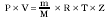 (2),

veličiny objem V, absolútny tlak P a termodynamickú teplotu T nazývame stavové veličiny

1.2 plyn

vo všeobecnosti zmes reálnych plynov so známou koncentráciou jej zložiek xj, pri známych molárnych hmotnostiach jednotlivých zložiek Mj, pre molárnu hmotnosť zmesi plynov M potom platí:

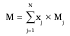 (3)

1.3 prevádzkové podmienky (podmienky merania)

hodnoty veličín charakterizujúcich stav plynu, pri ktorom je merané jeho množstvo

1.4 základné podmienky

stanovené hodnoty stavových veličín meraného plynu používané na vyjadrenie jeho objemu Vb alebo energie Eb nezávisle od podmienok merania;

ak nie je uvedené inak, základné podmienky sú určené takto:

Pb = 101,325 kPa, Tb = 288,15 K (= 15 oC) , Φb = 0 %

1.5 kompresibilitný faktor plynu Z

bezrozmerné číslo vyjadrujúce odlišné správanie reálneho plynu vo vzťahu k správaniu ideálneho plynu v tých istých podmienkach merania; funkčná závislosť kompresibilitného faktora Z = f(P, T, xj) od stavových veličín a zloženia vykurovacích plynov je uvedená v slovenských technických normách

1.6 stupeň kompresibility K

bezrozmerné číslo definované ako podiel hodnôt kompresibilitného faktora plynu v prevádzkových podmienkach a jeho kompresibilitného faktora pri základných podmienkach, t. j.:

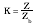 (4)

1.7 stavové číslo C (prepočítavacie číslo)

bezrozmerné číslo vyjadrujúce veľkosť zmeny jednotkového objemu daného plynu pri zmene jeho tlaku a teploty z prevádzkových podmienok na podmienky základné; zo stavovej rovnice reálneho plynu (1) v prevádzkových a základných podmienkach a pri súčasnom uplatnení zákona o zachovaní hmoty pre stavové číslo C platí:

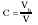 (5)

alebo

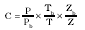 (6)

alebo pri použití definície hustoty plynu a úpravou pravej strany rovnice (2) aj v tvare:

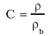 (7)

1.8 prepočet objemu

objem meraný v prevádzkových podmienkach V sa prepočíta na objem pri základných podmienkach Vb podľa vzťahu:

Vb = V x C (8)

1.9 merací systém pretečeného množstva plynu

súbor meracích zariadení zostavený na účely merania, stanovenia a indikácie pretečeného množstva (objemu alebo energie) plynu pri základných podmienkach plynu; merací systém sa skladá z meracích prevodníkov a počítača pretečeného množstva plynu; môže obsahovať aj prídavné zariadenia (napr. procesný chromatrograf, kalorimeter a pod.) na stanovenie špecifikovaných vstupných veličín

1.10 počítač pretečeného množstva plynu (ďalej len „prietokový počítač“)

elektronický súčtový merací prístroj stanovujúci pretečené množstvo plynu pri základných podmienkach na základe údajov meracích prevodníkov, prípadne aj špecifikovaných prídavných zariadení; počítač pretečeného množstva spracúva signál o jednotlivých dávkach pretečeného množstva plynu pri prevádzkových podmienkach; tie prepočíta na príslušné dávky množstva pri základných podmienkach a následne ich sumarizuje

1.11 merací prevodník meracieho systému

merací prostriedok transformujúci snímanú veličinu na elektrický výstupný signál, ktorý vstupuje do prietokového počítača; meracie systémy môžu obsahovať okrem meracieho prevodníka prietoku alebo pretečeného množstva plynu aj meracie prevodníky veličín (napr. tlaku, teploty, prevádzkovej hustoty, základnej hustoty a pod.) určujúcich stav meraného plynu

1.12 výstupný elektrický signál prevodníka

môže byť analógový, číslicový alebo frekvenčný

1.13 merací prevodník množstva plynu

plynomer poskytujúci elektrický výstupný signál priamo zo snímača (rotor, rušivé teliesko, ultrazvuková sonda a pod.) alebo z mechanického počítadla, ktorý je v určenom vzťahu k meranému pretečenému množstvu plynu (konštanta alebo funkčná závislosť)

1.14 impulzné číslo A

definuje počet impulzov prislúchajúcich jednotke množstva pretečeného plynu v podmienkach merania (napr. imp . m-3, imp . kg-1); používa sa pre prevodníky pretečeného množstva plynu s frekvenčným výstupom

1.15 prepočítavač objemového množstva plynu (ďalej len „prepočítavač“)

prietokový počítač, ktorý spracúva signál z meracieho prevodníka pretečeného množstva plynu; v tomto prípade spracúvané dávky pretečeného množstva v prevádzkových podmienkach sú konštantné

1.16 stavový prepočítavač

prepočítavač, ktorý na prepočet objemu používa údaje meracích prevodníkov stavových veličín, t. j. pri prepočte používa stavové číslo vyjadrené vzťahom (6)

1.17 hustotový prepočítavač

prepočítavač, ktorý na prepočet objemu spracúva údaje meracích prevodníkov základnej a prevádzkovej hustoty, t. j. pri prepočte používa stavové číslo vyjadrené vzťahom (7)

1.18 prepočítavač energie

prepočítavač, stavový alebo hustotový, ktorý jednotlivé dávky objemového množstva pri základných podmienkach pred sumarizáciou vynásobí hodnotou spaľovacieho tepla, prípadne výhrevnosti plynu vztiahnutého k jednotke objemu pri základných podmienkach; t. j. energia obsiahnutá v pretečenom množstve plynu je daná vzťahom:

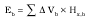 (9)

kde ∆Vb – dávka objemového množstva plynu (m3),

Hx,b– spaľovacie teplo alebo výhrevnosť plynu (MJ . m-3);

spaľovacie teplo alebo výhrevnosť plynu vstupuje do výpočtu ako zadaná konštanta alebo ako elektrický signál z prídavného zariadenia (kalorimetra alebo chromatografu)

1.19 ovplyvňujúca veličina

veličina, ktorá nie je meranou veličinou, ale má vplyv na výsledok merania (napr. teplota okolia, napájacie napätie)

1.20 pracovné (funkčné) podmienky meradla

podmienky používania, pri ktorých sa predpokladá, že špecifikované metrologické charakteristiky meradla sa nachádzajú v určených medziach; pracovné podmienky sa vo všeobecnosti špecifikujú predpísanými rozsahmi hodnôt meraných veličín plynu a predpísanými hodnotami ovplyvňujúcich veličín

1.21 referenčné podmienky meradla

predpísané podmienky používania meradla pri jeho skúšaní alebo pri vzájomnom porovnávaní výsledkov meraní v laboratórnych priestoroch (napr. kalibrácia, overovanie)

1.22 medzné podmienky

extrémne podmienky, ktorým sa meradlo môže podrobiť bez poškodenia a bez znehodnotenia špecifikovaných metrologických charakteristík pri ďalšom používaní v pracovných podmienkach. Medzné podmienky môžu byť rôzne na skladovanie, dopravu a na používanie. Pod medznými hodnotami sa môžu rozumieť medzné hodnoty meraných veličín alebo ovplyvňujúcich veličín

1.23 merací rozsah

súbor hodnôt meranej veličiny, pre ktorý sa predpokladá, že chyby meracieho prístroja ležia v predpísaných medziach

1.24 merací rozsah prepočítavača

je daný meracími rozsahmi použitých meracích prevodníkov meracieho systému, oborom platnosti použitej funkčnej závislosti výpočtu kompresibilitného faktora Z a zloženia plynu

1.25 označenie meradla

umiestnenie overovacích a zabezpečovacích značiek na meradlo v súlade s predpismi; značky môžu byť vyrazené razidlom (kliešťami) alebo lepené vo forme nálepiek

1.26 overovacia značka

značka umiestnená na meradle, ktorá potvrdzuje, že meradlo je v zhode so schváleným typom, že vyhovelo predpísaným skúškam pri overení a zamedzuje nepovolenému ovplyvňovaniu údaja meranej veličiny

1.27 zabezpečovacia značka

značka udávajúca, že určité časti meradla sú zabezpečené proti nepovolenému ovplyvňovaniu údaja meranej veličiny a že nemôže byť zabezpečená overovacou značkou (napr. vzhľadom na úkony spojené s inštaláciou meradla)

1.28 skúška prepočítavača

súhrn postupov určených na zistenie, či metrologické vlastnosti meradla spĺňajú predpísané požiadavky; pri skúške sú všetky vstupné signály meracích prevodníkov systému simulované náhradnými zdrojmi zodpovedajúcich signálov

1.29 skúška prevodníka s prepočítavačom objemu plynu

vykoná sa vtedy, keď daný merací prevodník systému

a) nemá unifikovaný elektrický výstupný signál,

b) nemá vydané samostatné rozhodnutie o schválení typu (len v spojení s prepočítavačom),

c) je umiestnený v skrinke prepočítavača,

d) vyžaduje kalibráciu v zapojení s prepočítavačom (jeho elektronická kalibrácia)

1.30 zobrazovacie (indikačné) zariadenie

časť meradla, ktorá poskytuje informáciu o hodnote meranej veličiny

1.31 Použité označenie:

V – objem pretečeného množstva plynu m 3

C – stavové číslo –

A – impulzné číslo imp .m-3 (imp . kg-1)

P – absolútny tlak plynu Pa, bar

T – termodynamická teplota K

t – teplota plynu oC

Z – kompresibilitný faktor plynu –

K – stupeň kompresibility K = Zb. Z -1–

Q – prietok plynu m3 . h-1

E – energia J

U – napájacie napätie V

f – frekvencia napájacieho napätia Hz

S – unifikovaný signál meracieho prevodníka (podľa prevodníka)

φ– relatívna vlhkosť plynu | %

e – najväčšia dovolená chyba %

1.32 Indexy:

b – hodnota veličiny pri základných podmienkach,

min – najmenšia hodnota veličiny,

max – najväčšia hodnota veličiny,

atm – hodnota veličiny pri atmosférických podmienkach,

nom – menovitá hodnota veličiny,

IV – vstupný obvod prepočítavača na spracovanie výstupného signálu prevodníka pretečeného množstva plynu,

IT – vstupný obvod prepočítavača na spracovanie výstupného signálu prevodníka teploty,

IP – vstupný obvod prepočítavača na spracovanie výstupného signálu prevodníka tlaku,

AV – platí pre algoritmus výpočtu,

FC – platí pre prepočítavač,

MS – platí pre merací systém,

TV – platí pre prevodník pretečeného množstva plynu,

TP – platí pre prevodník tlaku,

TT – platí pre prevodník teploty,

PP – platí pre prepočítavač s prevodníkmi stavových veličín.

2 Technické požiadavky na prepočítavače

2.1 Všeobecne

Príloha sa vzťahuje na tri druhy stavových prepočítavačov:

2.1.1 Prepočítavač PTZ – umožňuje pripojenie a aktívne spracovanie výstupných signálov meracích prevodníkov pretečeného množstva, tlaku a teploty, pričom hodnotu kompresibilitného faktora plynu pri prevádzkových podmienkach Z počíta priebežne. Parametre zloženia plynu na výpočet kompresibilitného faktora Z vstupujú do výpočtu spracovaním samostatných signálov z prídavného zariadenia alebo sa zadávajú ako konštanty. Hodnota kompresibilitného faktora pri základných podmienkach Zb sa obvykle vypočíta len pri zadaní aktuálneho zloženia meraného plynu. Do tejto skupiny možno zaradiť prepočítavače, kde v prepočte množstva plynu je použitá hodnota stupňa kompresibility K vyhľadaná na základe aktuálnych hodnôt tlaku a teploty plynu z predvolenej tabuľky hodnôt uloženej v pamäti počítača. Tabuľky K sú obvykle spracované pre viacero reprezentatívnych zložení plynu, z ktorých sa SW alebo HW zvolí tá tabuľka, ktorej zloženie je najbližšie k zloženiu meraného plynu.

2.1.2 Prepočítavač PT – umožňuje pripojenie a aktívne spracovanie výstupných signálov meracích prevodníkov pretečeného množstva, tlaku a teploty, pričom hodnotu kompresibilitného faktora plynu považuje za konštantu. V reálnych podmienkach sa do prepočítavača namiesto hodnoty kompresibilitného faktora Z zadáva hodnota stupňa kompresibility K vypočítaná zo stredných hodnôt prevádzkových podmienok a zloženia meraného plynu, teda K ≠ 1. Pri pretlaku plynu menšom ako 100 kPa možno použiť hodnotu K = 1. Pre stavové číslo potom platí:

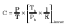 (10)

2.1.3 Prepočítavač T – umožňuje pripojenie a aktívne spracovanie výstupných signálov meracích prevodníkov pretečeného množstva a teploty, pričom absolútny tlak a stupeň kompresibility plynu sa do prepočítavača zadáva ako konštanta vypočítaná zo stredných hodnôt prevádzkových podmienok a zloženia meraného plynu. Pre stavové číslo potom platí:

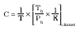 (11)

2.2 Konštrukcia prepočítavačov

2.2.1 Všetky konštrukčné prvky prepočítavača sa zhotovujú tak, aby zaručovali stálosť jeho metrologických vlastností a spoľahlivosť jeho funkcie pri dlhodobom používaní.

2.2.2 Materiály konštrukčných prvkov prepočítavača majú odolávať rôznym formám korózie a opotrebovania, ktoré sa vyskytujú pri jeho používaní v pracovných podmienkach. Pripojené meracie prevodníky systému majú odolávať za každých okolností a bez obmedzenia správnej funkcie tlaku a teplote médií, pre ktoré sú určené.

2.2.3 Skrinka (puzdro) prepočítavača má chrániť jeho elektronickú časť pred nepriaznivým vplyvom prostredia, do ktorého je určený na používanie.

2.2.4 Prepočítavač zabezpečuje napájanie najmenej toľkých meracích prevodníkov, koľko má vstupných obvodov na spracovanie vstupných signálov. Stabilita napájania má byť taká, aby v celom rozsahu pracovných podmienok prepočítavača neboli ovplyvnené meracie vlastnosti pripojiteľných meracích prevodníkov.

2.2.5 Na prepočítavače určené na použitie v prostredí s nebezpečenstvom výbuchu sa vzťahujú príslušné požiadavky všeobecne záväzných právnych predpisov, ktoré sa týkajú nevýbušných elektrických zariadení.

2.2.6 Prepočítavač má byť vybavený namenej jedným impulzným vstupom a má byť schopný bezchybne spracovať každý impulz o dávke pretečeného množstva vyslaný prevodníkom pretečeného množstva plynu. Požiadavky na impulzné vstupy prepočítavača sú v tabuľke č. 1.

2.2.7 Prepočítavače môžu byť vybavené komunikačným rozhraním na pripojenie prídavných zariadení (napr. tlačiareň, elektronický záznamník údajov, modem, ručný terminál, chromatograf) alebo na prepojenie prepočítavačov do komunikačnej siete. Toto rozhranie nemá ovplyvňovať meracie vlastnosti prepočítavača.

2.2.8 Prepočítavače môžu byť vybavené elektrickými výstupmi na pripojenie periférnych zariadení (napr. externých počítadiel, indikátorov prietoku a pod.). Tieto výstupy nemajú ovplyvňovať meracie vlastnosti prepočítavača.

Tabuľka č. 1 – Impulzný vstup prepočítavača

Druh signálu | Druh snímača | Charakteristika |

Nízka frekvencia (LF) | Bezpotenciálový spínací kontakt | Frekvencia impulzov | f £ 1 Hz

| | Šírka impulzu | ³ 50 ms

| | Šírka medzery | ³ 100 ms

| | Konštrukcia vstupu prepočítavača vylučuje vplyv prechodových javov pri spínaní a rozopínaní kontaktu v trvaní | £ 10 ms

Stredná a vysoká frekvencia (MF) a (HF) | Elektronický snímač | Impulzy majú vyhovovať požiadavkám príslušných slovenských technických noriem |

2.3 Počítadlo a indikačné zariadenie

2.3.1 Prepočítavač má byť vybavený súčtovým počítadlom pretečeného množstva plynu v základných a prevádzkových podmienkach.

2.3.2 Ako počítadlá prepočítavača môžu byť použité:

a) elektromechanické valčekové počítadlá,

b) elektronické zobrazovacie prvky (napr. LED, LCD).

2.3.3 Ak je v prepočítavači použité elektromechanické počítadlo, posun číslice určitého rádu sa vykoná počas zmeny číslice nižšieho rádu z čísla deväť na nulu. Posun číslic má byť smerom nahor. Počítadlo nemá byť nulovateľné.

2.3.4 Ak je v prepočítavači použité elektronické počítadlo, všetky zobrazovacie miesta naľavo od čísla udávajúceho hodnotu aktuálneho objemu majú zobrazovať nulu. Údaj elektronického počítadla pretečeného množstva plynu pri základných podmienkach nemá byť SW ani HW dodatočne upravovateľný bez porušenia overovacej značky. Údaj elektronického počítadla pretečeného množstva plynu v prevádzkových podmienkach sa môže dodatočne upravovať (zadanie hodnoty zhodnej so stavom počítadla plynomera). Po prekročení kapacity počítadla (každé zobrazovacie miesto obsahuje číslicu 9) sa počítadlo má automaticky vynulovať a pokračovať vo vzostupnom sčítavaní množstva. Súčasne má SW umožňovať kontrolu bezchybného zobrazovania všetkých segmentov počítadla.

2.3.5 Rozmer číslic počítadla (výška x šírka) nemá byť menší ako 4 x 2,4 mm.

2.3.6 Počítadlo má byť najmenej osemmiestne s možnosťou voľby mierky stupnice počítadla v dekadických násobkoch objemu najmenej v rozsahu (0,01 až 1 000) m3 tak, aby v prevádzkových podmienkach Qmax, Pmax a Tmin počas 2 000 h nedochádzalo k prekročeniu jeho kapacity alebo pri elektromechanických počítadlách k pretočeniu všetkých valčekov.

2.3.7 Mierka stupnice počítadla a symbol jednotky objemu majú byť vyznačené v bezprostrednej blízkosti číselného údaja počítadla.

2.3.8 Všetky údaje (čísla, nápisy, symboly) na počítadlách sú zreteľné, trvalé a dobre čitateľné.

2.3.9 Prepočítavač môže byť vybavený prídavným zariadením na indikáciu ďalších informácií, napríklad aktuálnych hodnôt meraných vstupných veličín, aktuálnych hodnôt zadaných parametrov na prepočet objemu (impulzné číslo a zloženie plynu), vypočítaných hodnôt prietoku v prevádzkových a základných podmienkach, stavového čísla C, stupňa kompresibility K, návestí poruchových stavov a pod.

2.3.10 Počítadlo pretečeného množstva plynu a prídavné indikačné zariadenie podľa bodu 2.3.9 môžu byť zlúčené do jedného celku. Indikačné zariadenie potom spĺňa podmienky stanovené pre počítadlo pretečeného množstva plynu podľa bodov 2.3.3 až 2.3.8.

2.4 Napájanie prepočítavača

2.4.1 Prepočítavače môžu byť napájané

a) z elektrickej siete,

b) nezávisle od siete z akumulátora alebo od vymeniteľnej batérie so zaručenou životnosťou najmenej 3 roky v prevádzkových podmienkach meraného plynu Qmax, Pmax, Tmin, pri teplote okolitého prostredia Tmin a bez použitia komunikačného rozhrania.

2.4.2 Prepočítavač napájaný z elektrickej siete má byť konštruovaný tak, aby v prípade poruchy napájania ostali zachované v pamäti všetky zadané, ostatne zmerané a vypočítané údaje vrátane poruchových návestí najmenej 30 dní. Po obnovení napájania prepočítavač automaticky pokračuje v meraní.

2.4.3 Prepočítavač napájaný z akumulátora alebo z vymeniteľnej batérie má signalizovať potrebu nového nabitia alebo výmeny batérie najneskôr po uplynutí 90 % z odhadnutej životnosti zdroja. Súčasne od začiatku tejto signalizácie má zaručovať bezporuchovú prevádzku systému v trvaní najmenej 30 dní.

2.4.4 Konštrukcia prepočítavača má umožňovať výmenu akumulátora alebo batérie bez porušenia overovacích značiek. Počas výmeny zdroja sa v prepočítavači majú uchovávať všetky zadané, ostatne zmerané a vypočítané údaje vrátane poruchových návestí. Môžu sa použiť len akumulátory alebo batérie odporúčané výrobcom.

2.5 Programové vybavenie na riadenie činnosti prepočítavača (FW)

2.5.1 Programové vybavenie prepočítavača (FW) má poskytovať informácie o

a) aktuálnych hodnotách meraných vstupných veličín,

b) aktuálnych hodnotách parametrov zadávaných na prepočet pretečeného množstva (napr. impulzné číslo, zloženie plynu),

c) vypočítaných hodnotách stavového čísla C, stupňa kompresibility K, prietoku pri prevádzkových a stavových podmienkach,

d) návestiach poruchových stavov

prostredníctvom indikačného zariadenia alebo komunikačného rozhrania.

2.5.2 Programové vybavenie prepočítavača (FW) má zisťovať a návesťou indikovať poruchy, výpadok alebo prekročenie meracieho rozsahu výstupného signálu ktoréhokoľvek meracieho prevodníka na vstupe do prepočítavača s výnimkou prevodníka pretečeného množstva.

2.5.3 Pri aktívnej poruche sa pretečené množstvo plynu pri základných podmienkach môže sumarizovať počítadlom pretečeného množstva Vb len v prípade, ak prepočítavač disponuje samostatnou pamäťou pre záznam poruchových stavov a súčasne pre záznam histórie prevádzky, v ktorom sú hodnoty veličín zaťažené poruchou jednoznačne rozlíšené. V tomto prípade sa pri výpadku výstupného signálu meracieho prevodníka môže použiť jeho ostatná platná hodnota pred poruchou alebo predvolená hodnota zodpovedajúca strednej hodnote prevádzkových podmienok. V iných prípadoch sa pretečené množstvo pri základných podmienkach ignoruje alebo sumarizuje samostatným počítadlom Vb pri poruchových stavoch. Odporúča sa, aby prepočítavač zaznamenával druh poruchy, dátum, čas jej vzniku a zániku do samostatnej časti pamäte poruchových udalostí s kapacitou najmenej 50 záznamov pre jeden merací rad. Ostatný záznam z pamäte poruchových udalostí (najnovší) má byť zobrazovaný vždy ako prvý. Pri naplnení kapacity pamäte a vzniku ďalšej poruchovej udalosti sa má z pamäte automaticky vylúčiť najstarší záznam.

2.6 Ochrana nastavenia prepočítavača

2.6.1 Prepočítavač má byť konštruovaný tak, aby bez porušenia overovacích značiek alebo zabezpečovacích značiek neumožňoval taký zásah, ktorým by sa zmenili jeho metrologické parametre, údaje počítadiel Vb alebo údaje v jeho pamäti, ak sa táto zmena nevykoná podľa bodu 2.6.2.

2.6.2 Ak prepočítavač umožňuje užívateľovi prostredníctvom klávesnice alebo komunikačného rozhrania meniť hodnoty parametrov, ktoré ovplyvňujú výpočet pretečeného množstva plynu, potom prepočítavač má súčasne spĺňať tieto podmienky:

a) zmenu hodnoty parametra možno akceptovať len v prípade, ak sa predtým z klávesnice alebo cez komunikačné rozhranie zadalo platné prístupové heslo užívateľa,

b) zadanie zmeny hodnoty parametra má byť umožnené len ovládačom, ktorým sa zadalo platné prístupové heslo užívateľa (t. j. pri zadaní hesla z klávesnice komunikačné rozhranie zostáva v režime ochrany a naopak),

c) zmena hodnoty každého parametra sa automaticky zaznamenáva v samostatnej „pamäti zmien“ s kapacitou najmenej pre 100 záznamov,

d) každý záznam obsahuje dátum a čas vykonania zmeny, identifikáciu meneného parametra (opis alebo kód), jeho pôvodnú a novozadanú hodnotu; pod zmenou parametra sa rozumie aj SW zadanie konštantnej hodnoty meranej veličiny, ako aj jej spätné uvoľnenie,

e) po naplnení kapacity pamäte zmien sa zadávanie ďalších zmien automaticky zablokuje,

f) zadávanie ďalších zmien parametrov sa má odblokovať zadaním samostatného prístupového hesla (určené pre zástupcu štátnej metrológie) alebo prepnutím samostatného HW kľúča chráneného overovacou značkou,

g) záznamy v pamäti zmien sú chránené proti vymazaniu alebo dodatočnému prepísaniu; po prvom zaplnení kapacity a následnom odblokovaní zadávania zmien sa ďalší záznam uloží vždy na jej vrchol, predtým uložené záznamy sa posunú o jednu pozíciu nižšie, pričom najstarší záznam sa vylúči.

2.6.3 Po skončení zadávania zmien parametrov a následnom uplynutí nastaveného času (najviac 5 min) sa má príslušný ovládač prepočítavača automaticky nastaviť do režimu ochrany.

2.6.4 Pri zapojení viacerých prepočítavačov do komunikačnej siete má mať každý z nich individuálne prístupové heslo užívateľa.

2.7 Inštalácia a meracie prevodníky

2.7.1 Výstupné signály meracích prevodníkov a vstupy prepočítavača daného meracieho systému majú byť vzájomne kompatibilné.

2.7.2 Merací systém sa má používať v klimatických podmienkach, ktoré zodpovedajú pracovným podmienkam špecifikovaným výrobcami každej jeho časti.

2.7.3 Meracie prevodníky meracieho systému určené na použitie v prostredí s nebezpečenstvom výbuchu majú vyhovovať požiadavkám príslušných všeobecne záväzných právnych predpisov, ktoré sa týkajú nevýbušných elektrických zariadení.

2.7.4 Prepojovacie vodiče medzi prepočítavačom a meracími prevodníkmi sú neoddeliteľnou súčasťou meracieho systému. Parametre použitých prepojovacích vodičov a ich dĺžka majú byť v súlade so špecifikáciou výrobcov jednotlivých častí meracieho systému tak, aby bola zaručená jeho bezpečnosť a presnosť merania.

2.7.5 Merací prevodník pretečeného množstva plynu použitý v meracom systéme má spĺňať požiadavky príslušnej prílohy.

2.7.6 Meracie prevodníky stavových veličín použité v meracom systéme majú spĺňať požiadavky príslušných príloh.

2.7.7 Merací prevodník teploty má byť umiestnený tak, aby bol omývaný prúdom meraného plynu, a aktívna časť jeho snímača má byť v hĺbke 1/3 až 2/3 priemeru potrubia. Ak je inštalovaný priamo v telese prevodníka pretečeného množstva plynu (plynomera), má to byť uvedené v rozhodnutí o schválení typu prevodníka pretečeného množstva plynu. Teplomerné puzdro má byť naplnené tepelne vodivým médiom. Odporúča sa, aby v blízkosti meracieho prevodníka teploty bolo nezávislé teplomerné puzdro na zabezpečenie kontroly prevodníka teploty na mieste.

2.7.8 Ak má prepočítavač vstupný obvod na spracovanie signálu odporového teplomera so štvorvodičovým zapojením, môže namiesto prevodníka používať priamo pripojený odporový teplomer.

2.7.9 K meraciemu prevodníku tlaku má byť pripojený pneumatický signál prevádzkového tlaku snímaný prednostne z Pr odberu (Pr – referenčný bod merania tlaku na telese prevodníka pretečeného množstva plynu) prevodníka pretečeného množstva plynu alebo z odberu pred prevodníkom pretečeného množstva plynu. Odporúča sa signálne potrubie vybaviť uzatváracou armatúrou a prostriedkami na jednoduché pripojenie kontrolného meradla na zabezpečenie kontroly prevodníka na mieste.

2.7.10 V meracom systéme sa prednostne používajú meracie prevodníky absolútneho tlaku, aby sa zabránilo zavedeniu prídavných chýb do výpočtu objemu spôsobených zmenami atmosférického tlaku. Merací prevodník relatívneho tlaku sa môže použiť len vtedy, ak pre prevádzkový pretlak meraného plynu platí Pmin ≥ 2 MPa. V takom prípade priemerná hodnota atmosférického tlaku sa má zadať do prepočítavača ako konštanta.

2.8 Nápisy a značky

2.8.1 Na skrinke prepočítavača sa na viditeľnom mieste umiestňuje štítok s týmito údajmi:

a) meno alebo značka výrobcu,

b) typové označenie prepočítavača,

c) výrobné číslo,

d) rok výroby,

e) značka schváleného typu,

f) identifikačná značka na používanie v prostredí SNV, keď je určený na používanie v tomto prostredí,

g) použité základné podmienky plynu,

h) medzné hodnoty teploty okolia (tam, min až tam, max) oC,

i) označenie elektrického krytia IPxx,

j) ďalšie údaje určené v rozhodnutí o schválení typu meradla.

2.8.2 Na meracích prevodníkoch jednotlivých veličín, pre ktoré neplatí bod 1.29, sa uvádzajú údaje podľa rozhodnutia o schválení ich typu.

2.8.3 Všetky prevodníky meracieho systému, ktoré netvoria integrálnu súčasť prepočítavača, sa zabezpečujú overovacou značkou na viditeľnom mieste.

2.8.4 Po montáži meracieho systému pretečeného množstva plynu užívateľ umiestni zabezpečovacie značky na také miesta, aby bola znemožnená nepovolená výmena alebo demontáž jeho častí z pracovného miesta. Značky sa umiestňujú hlavne na

a) skrinke prepočítavača – kryt svorkovnice, resp. iného uzáveru umožňujúceho prístup k nej,

b) meracích prevodníkoch jednotlivých veličín v mieste ich pripojenia.

3 Metrologické požiadavky na prepočítavače

3.1 Merací rozsah prepočítavača

Merací rozsah prepočítavača je definovaný v bode 1.24.

3.2 Merací rozsah prevodníkov teploty a tlaku

3.2.1 Merací rozsah prevodníka teploty meracieho systému má spĺňať jednu z týchto požiadaviek:

a) normálny rozsah: -20 až +50 oC,

b) obmedzený rozsah: najmenší rozsah 40 oC kdekoľvek v hraniciach normálneho rozsahu,

c) rozšírený rozsah: aspoň jedna hranica normálneho rozsahu je prekročená – určí výrobca.

3.2.2 Merací rozsah prevodníka tlaku má byť kalibrovaný tak, aby platilo: Pmax/Pmin > 2.

3.3 Referenčné podmienky

Referenčné podmienky sú definované podľa tabuľky č. 2.

Tabuľka č. 2

Parameter | Prípustný rozsah | Prípustná zmena počas skúšky

Teplota okolia | 18 až 25 °C | ±1 °C

Relatívna vlhkosť vzduchu | 35 až 85 % | nie viac ako 10 %

3.4 Pracovné podmienky

Správna funkcia prepočítavača má byť zaručená v pracovných podmienkach špecifikovaných výrobcom.

3.5 Najväčšie dovolené chyby

3.5.1 Chyba merania sa vyjadruje relatívnou hodnotou v percentách ako pomer rozdielu medzi udanou hodnotou skúšaného meradla a konvenčne pravou hodnotou etalónového meradla ku konvenčne pravej hodnote etalónového meradla.

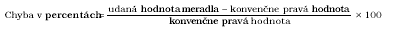 (12)

Pri výpočte hodnoty chyby merania ako relatívnej hodnoty pri meracom prevodníku teploty sa používa termodynamická hodnota teploty v K.

3.5.2 Najväčšia dovolená chyba meracieho systému sa určí ako súčet absolútnych hodnôt najväčších dovolených chýb jednotlivých častí meracieho systému, t. j.:

eMS = ½eTV½ +½ eFC½ + ½eTP½ + ½eTT½ | (13),

kde eTV – najväčšia dovolená chyba prevodníka pretečeného množstva plynu,

eFC – najväčšia dovolená chyba prepočítavača,

eTP – najväčšia dovolená chyba meracieho prevodníka tlaku,

eTT – najväčšia dovolená chyba meracieho prevodníka teploty.

3.5.3 Najväčšia dovolená chyba prepočítavača sa určí ako súčet absolútnych hodnôt najväčších dovolených chýb vstupných obvodov jednotlivých veličín prepočítavača eIV, eIT, eIP a najväčšej dovolenej chyby eAV, t. j.:

½eIV½+ ½eIT½+ ½eIP½ + ½eAV½£ eFC | (14),

kde eIV– najväčšia dovolená chyba vstupného obvodu prepočítavača na spracovanie výstupného signálu prevodníka pretečeného množstva plynu,

eIT – najväčšia dovolená chyba vstupného obvodu prepočítavača na spracovanie výstupného signálu meracieho prevodníka teploty,

eIP – najväčšia dovolená chyba vstupného obvodu prepočítavača na spracovanie výstupného signálu meracieho prevodníka tlaku,

eAV– najväčšia dovolená chyba algoritmu výpočtu,

eFC – najväčšia dovolená chyba prepočítavača.

3.5.4 Podľa najväčších dovolených chýb eFC sa prepočítavače rozdeľujú do dvoch skupín:

a) eFC ≤ 0,1 %,

b) 0,1 < eFC ≤ 0,3 %.

3.5.5 Najväčšie dovolené chyby použitých meracích prevodníkov majú spĺňať požiadavky uvedené v príslušných prílohách.

3.5.6 Podľa konštrukčného vyhotovenia prepočítavača a k nemu pripojiteľných prevodníkov sa pri vyhodnotení najväčšej dovolenej chyby meracieho systému môže súčet dovolených chýb prepočítavača a prevodníkov stavových veličín vyjadriť samostatne, alebo jednou sumárnou hodnotou ePP, t. j. vzťah (13) bude mať tvar:

eMS = ½eTV½+ ½ePP½ | (15)

3.5.7 Podľa najväčších dovolených chýb ePP sa prepočítavače s prevodníkmi stavových veličín rozdeľujú do dvoch skupín:

a) ePP ≤ 0,5 %,

b) 0,5 < ePP ≤ 1,0 %.

3.5.8 Najväčšie dovolené chyby uvedené v bodoch 3.5.4 a 3.5.7 platia pre skúšky v referenčných podmienkach. V pracovných podmienkach sú prípustné dvojnásobné hodnoty týchto chýb.

3.6 Ovplyvňujúce činitele

Prepočítavač nemá prekročiť najväčšiu dovolenú chybu pri pôsobení ovplyvňujúcich činiteľov, ktoré zodpovedajú jeho pracovným podmienkam. Účinok ovplyvňujúcich veličín má byť predmetom technických skúšok pri schvaľovaní typu meradla.

3.7 Rušenia

Rozdiely medzi výsledkami merania pred pôsobením a po pôsobení nasledovných rušení nemajú prekročiť najväčšiu dovolenú chybu uvedenú v bode 3.5.4, resp. 3.5.7:

a) krátkodobé prerušenie sieťového napájania (pri prepočítavačoch napájaných zo siete),

b) prípadne ďalšie rušenia stanovené výrobcom.

4 Metrologická kontrola prepočítavačov

Prepočítavače podliehajú týmto druhom metrologickej kontroly:

4.1 Schválenie typu prepočítavača

Pri schvaľovaní typu prepočítavača sa vykonajú všetky skúšky uvedené v bode 5 najmenej na jednej vzorke prepočítavača.

4.2 Prvotné overenie

Pri prvotnom overení prepočítavača sa vykonajú skúšky podľa bodu 5.1.1 písm. a) až c) a bodov 5.1.2, 5.1.3 písm. b) a 5.1.4.

4.3 Následné overenie

Metódy skúšania pri následnom overení sú zhodné s metódami pri prvotnom overení.

5 Metódy skúšania prepočítavačov

5.1 Všeobecne

5.1.1 Pri technických skúškach pri schvaľovaní typu a pri overení sa vykonávajú tieto skúšky prepočítavača:

a) vonkajšia obhliadka,

b) kontrola funkcií,

c) skúška správnosti,

d) skúška s pôsobením ovplyvňujúcich činiteľov a rušení (len pri schvaľovaní typu).

5.1.2 Vonkajšia obhliadka sa vykonáva pred začatím skúšky správnosti a obsahuje kontrolu zhody prepočítavača s jeho schváleným typom. Zisťuje sa hlavne, či

a) prepočítavač nie je mechanicky poškodený,

b) konštrukčné vyhotovenie prepočítavača zodpovedá schválenému typu vrátane kontroly schváleného typu prevodníkov, ktoré sú integrálnou súčasťou prepočítavača,

c) sú úplné a správne údaje na štítku, prípadne v pamäti prepočítavača.

5.1.3 Kontrola funkcií prepočítavača sa vykoná v plnom rozsahu v súlade s dokumentáciou prepočítavača dodanou jeho výrobcom s dôrazom:

a) pri technickej skúške pri schvaľovaní typu na

1. správnosť funkcie počítadiel pretečeného množstva pri základných a prevádzkových podmienkach po prekročení ich kapacity (pretočení),

2. kontrolu výpočtového postupu,

3. kontrolu indikácie poruchových stavov,

4. ochranu zadaných, meraných a vypočítaných údajov v pamäti prepočítavača,

5. správnosť prenosu údajov cez komunikačné rozhranie, ak je ním prepočítavač vybavený;

b) pri overení na

1. kontrolu indikácie poruchových stavov,

2. ochranu zadaných, meraných a vypočítaných údajov v pamäti prepočítavača.

5.1.4 Skúškou správnosti prepočítavačov sa zisťuje chyba výpočtu pretečeného množstva plynu pri základných podmienkach. Podľa typu prepočítavača sa skúška vykoná najmenej jedným z týchto spôsobov:

a) simulovaním výstupných elektrických signálov všetkých meracích prevodníkov systému v skúšobných bodoch so stanovenými hodnotami stavových veličín (∆V, P, T),

b) pôsobením stavových veličín na meracie prevodníky v stanovených skúšobných bodoch (∆V, P, T).

5.1.5 Technické skúšky pri schvaľovaní typu sa vykonajú aj pri pôsobení ovplyvňujúcich činiteľov a rušení.

5.2 Podmienky počas skúšky správnosti

Skúška správnosti prepočítavačov sa vykonáva v referenčných podmienkach podľa bodu 3.3 v laboratóriách s čo najmenšou prašnosťou. Pri skúške sa súčasne dodržiavajú podmienky na používanie jednotlivých skúšobných prístrojov a pomôcok podľa pokynov ich výrobcov.

5.3 Opis skúšok

5.3.1 Skúška správnosti prepočítavača pri jeho overení sa vykoná v skúšobných bodoch stanovených na základe meracích rozsahov prevodníkov konkrétneho meracieho systému.

5.3.2 Pri technických skúškach pri schvaľovaní typu sa skúška správnosti vykoná s najväčším meracím rozsahom z radu použiteľných prevodníkov stanovených výrobcom.

5.3.3 Nastavenie skúšobných bodov pretečeného množstva plynu

Skúška sa vykoná simuláciou impulzného signálu prevodníka pretečeného množstva zodpovedajúceho fmax prepočítavača. Najmenšie skúšobné množstvo pri prevádzkových podmienkach V má spĺňať:

a) pri skúške správnosti výpočtu stupňa kompresibility K a stavového čísla C:

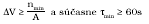 (16),

kde τmin – najmenší čas skúšky,

nmin = 10 – najmenší počet prijatých impulzov počas skúšky,

b) pri skúške správnosti počítadiel objemu plynu:

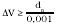(17),

kde dp – najmenšia odčítateľná hodnota objemu pri prevádzkových podmienkach.

5.3.4 Nastavenie skúšobných bodov teploty

5.3.4.1 Pri skúške správnosti sa použijú tieto body:

a) pri normálnom a rozšírenom meracom rozsahu prevodníka teploty (bod 3.2.1) sa skúška vykoná v troch skúšobných bodoch zodpovedajúcich teplotám t1, t2 a t3 tak, aby platilo:

tmin £ t1 < (tmin + ∆t) | (18)

(tmax- ∆t) < t2£ tmax | (19)

t3= 0 oC ± ∆t | (20)

b) pri obmedzenom meracom rozsahu prevodníka teploty (3.2.1) sa skúška vykoná v dvoch skúšobných bodoch zodpovedajúcich teplotám t1, t2 podľa (18) a (19). Keď tmin < 0 oC, skúška sa vykoná aj v bode t3.

5.3.4.2 Pre povolenú odchýlku nastavenia skúšobného bodu v obidvoch prípadoch platí:

∆t = 2,5 oC | (21)

5.3.5 Nastavenie skúšobných bodov tlaku

5.3.5.1 Pri skúške správnosti meracích prevodníkov tlaku, ktoré sú súčasťou prepočítavača, t. j. vzťahujú sa naň podmienky definované v bode 1.29, sa použijú tieto body:

Pj = dj. (Pmax - Patm,min) + Patm,min | (22),

kde j – poradie skúšobného bodu, j = 1 až 5,

dj – súčiniteľ, ktorého hodnota sa postupne rovná: 0,00; 0,25; 0,50; 0,75 a 1,00,

Patm, min – pri simulácii sa dosadí najmenšia hodnota atmosférického tlaku Patm, min = 90 kPa,

alebo pri skúške s prevodníkom atmosférický tlak.

5.3.5.2 Nastavenie jednotlivých hodnôt skúšobných bodov sa nemá líšiť od požadovanej hodnoty o viac ako ± 3 %.

5.3.6 Pri skúške správnosti meracích prevodníkov meracieho systému pretečeného množstva plynu, ktoré nie sú súčasťou prepočítavača, t. j. neplatia podmienky definované v bode 1.29, sa skúška správnosti vykoná podľa príslušnej prílohy.

5.3.7 Nastavenie zloženia plynu

Pri skúške sa do prepočítavača zadá zloženie plynu špecifikované vykonávateľom skúšky s prihliadnutím na metódu výpočtu kompresibilitného faktora plynu.

5.3.8 Simulovanie stavovej veličiny

V prípade simulovania stavovej veličiny pri skúške sa hodnota elektrického signálu Sx simulovanej stavovej veličiny určí dosadením hodnoty daného skúšobného bodu veličiny do vzťahu, napríklad pre teplotu tx:

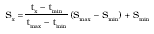 (23),

kde Smin, Smax – najmenšia a najväčšia hodnota rozsahu unifikovaného signálu vstupného obvodu prepo-

čítavača (meracieho prevodníka) zodpovedajúce najmenšej a najväčšej hodnote meracieho

rozsahu príslušného meracieho prevodníka.

5.3.9 Skúška správnosti výpočtu stupňa kompresibility

5.3.9.1 Skúška správnosti výpočtu stupňa kompresibility sa vykoná pri technickej skúške pri schvaľovaní typu meradla, a to najmenej pri dvoch zloženiach plynu a v skúšobných bodoch t1, P1až P5 a t2, P1 až P5.

5.3.9.2 Jednotlivé hodnoty skúšobných bodov tlaku a teploty sa simulujú elektrickými signálmi na vstupných obvodoch prepočítavača alebo sa SW nastavia ako konštantné hodnoty – ak to prepočítavač umožňuje. Počas skúšky sa simulujú impulzy prevodníka pretečeného množstva s prírastkom ∆V podľa bodu 4.3.1.

5.3.9.3 Relatívna chyba stupňa kompresibility sa určí podľa vzťahu:

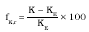 (24),

kde konvenčne pravá hodnota stupňa kompresibility KE sa určí podľa slovenskej technickej normy.

5.3.9.4 Ak prepočítavač umožňuje voľbu výpočtu stupňa kompresibility podľa viacerých algoritmov, skúška správnosti výpočtu stupňa kompresibility sa vykoná podľa všetkých algoritmov.

5.3.9.5 Pre chybu výpočtu stupňa kompresibility má platiť fK, r ≤ 0,02 %.

5.3.10 Skúška správnosti prepočtu pretečeného množstva

5.3.10.1 Skúška správnosti prepočtu pretečeného množstva sa vykoná podľa bodu 5.1.4 písm. a) v skúšobných bodoch:

a) pri skúške pri schvaľovaní typu: ∆V, t1, P1 až P5; ∆V, t2, P1 až P5; prípadne ∆V, t3, P1 až P5,

b) pri overení: ∆V, t1, P1 až P5, ∆V, t2, P1 až P5 a v jednom bode ∆V, t3, P3.

Hodnoty ∆V, tj a Pj a im zodpovedajúce signály sa určia podľa bodov 5.3.3 až 5.3.7 pri použití jedného zloženia plynu.

5.3.10.2 Skúška správnosti prepočtu pretečeného množstva sa vykoná podľa bodu 5.1.4 písm. b) v skúšobných bodoch:

a) pri skúške pri schvaľovaní typu: ∆V, t1, P1 až P5; ∆V, t2, P1 až P5; prípadne ∆V, t3, P1 až P5 vo všetkých prípadoch vzostupne a zostupne,

b) pri overení: ∆V, t1, P1 až P5 vzostupne, ∆V, t2, P5 až P1 zostupne a v jednom bode V, t3, P3.

Pred skúškou pri klesajúcom tlaku treba merací prevodník tlaku nechať zaťažený na 5 minút tlakom P5.

5.3.10.3 Pred skúškou pri klesajúcom tlaku treba merací prevodník tlaku nechať zaťažený na 5 minút tlakom P5.

5.3.10.4 Keď prepočítavač poskytuje indikáciu stavového čísla C s rozlíšením aspoň na 4 desatinné miesta – pri použitom algoritme výpočtu s pohyblivou rádovou čiarkou jednoduchej presnosti alebo na 8 desatinných miest – pri dvojnásobnej presnosti, správnosť prepočtu objemu možno vyhodnotiť na základe výpočtu stavového čísla.

Relatívna chyba prepočtu objemu fVb,r sa potom vypočíta zo vzťahu:

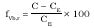 (percentá) (25),

kde konvenčne pravá hodnota stavového čísla CE sa určí dosadením príslušných hodnôt daného skúšobného bodu do vzťahu (5) vrátane výpočtu hodnoty stupňa kompresibility.

5.3.11 Skúška správnosti pretečeného množstva plynu

5.3.11.1 Najmenej v jednom skúšobnom bode ∆V, t1, P5 treba vykonať skúšku správnosti prepočtu pretečeného množstva vyhodnotením z prírastkov počítadiel pretečeného množstva pri základných a prevádzkových podmienkach. V tomto prípade najmenšie skúšobné množstvo ΔV skúšobného bodu má spĺňať podmienku danú vzťahom (17).

Relatívna chyba prepočtu pretečeného množstva fVb,r sa vypočíta zo vzťahu:

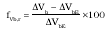 (percentá) (26)

5.3.11.2 Keď prepočítavač neindikuje hodnotu stavového čísla C s dostatočným rozlíšením, správnosť prepočtu pretečeného množstva sa vyhodnotí vo všetkých skúšobných bodoch z prírastkov počítadiel pretečeného množstva pri základných a prevádzkových podmienkach, pričom pre ∆V platí (17).

5.3.11.3 Chyby fVb,r vo všetkých skúšobných bodoch majú vyhovovať požiadavkám podľa bodu 3.5.4 alebo 3.5.7.

5.3.12 Skúška prepočítavačov pri pôsobení ovplyvňujúcich činiteľov.

5.3.12.1 Skúška sa vykonáva pri skúške schvaľovania typu.

5.3.12.2 Skúška sa vykoná vo vhodnom zariadení (napr. klimatizačná komora), kde sa nastavia hraničné hodnoty ovplyvňujúcich veličín podľa údajov výrobcu.

5.3.12.3 Pri skúške sa postupuje podobne ako pri referenčných podmienkach (pozri body 5.3.3 až 5.3.9), pričom údaje z prepočítavača sa snímajú pomocou komunikačného rozhrania. Chyby vo všetkých skúšobných bodoch majú vyhovovať požiadavkám podľa bodu 3.5.8.

5.4 Vyhodnotenie nameraných výsledkov

5.4.1 Určenie kombinovanej štandardnej neistoty overenia prepočítavača sa vykoná postupom stanovovania a vyhodnocovania neistôt pri meraniach.

5.4.2 Kombinovaná štandardná neistota overenia nemá prekročiť 1/4 najväčšej dovolenej chyby prepočítavača.

5.5 Spracovanie výsledkov skúšok

5.5.1 Meradlá, ktoré spĺňajú technické a metrologické požiadavky podľa bodov 2 a 3, požiadavky stanovené v rozhodnutí o schválení typu meradla a ktoré vyhoveli skúškam podľa tejto prílohy, sa označia overovacou značkou na miestach a spôsobom určeným v rozhodnutí o schválení typu meradla.

5.5.2 Ak počas skúšok nevyhovie prepočítavač niektorým požiadavkám podľa bodu 5.5.1, v ďalších skúškach sa nepokračuje. Prepočítavač sa neoverí a vráti sa žiadateľovi spolu so zamietacím listom.

6 Skúška meracieho systému na mieste inštalácie

Pri stavových prepočítavačoch pretečeného množstva plynu po inštalácii prepočítavača a počas jeho prevádzky s časovou periódou 1 rok sa vykonávajú skúšky meracích prevodníkov tlaku a teploty. Skúšky vykonáva autorizovaná osoba. Najväčšie chyby pre uvedené skúšky sú podľa bodu 3.5.8 najväčšími chybami pri pracovných podmienkach.

Príloha č. 36

k vyhláške č. 403/2000 Z. z.

VLHKOMERY OBILNÍN A OLEJNÍN

Prvá časť

Vymedzenie meradiel a spôsob ich metrologickej kontroly

1. Táto príloha sa vzťahuje na vlhkomery obilnín a olejnín I. triedy presnosti (ďalej len „vlhkomer“), ktoré sa používajú na statické meranie vlhkosti obilnín, vlhkosti olejnín a na meranie obsahu prchavých látok v olejninách v obchodnom styku ako určené meradlá podľa § 8 zákona.

2. Vlhkomery pred uvedením na trh podliehajú schváleniu typu a prvotnému overeniu. Metódy technických skúšok pri schvaľovaní typu a metódy skúšania pri overení sú uvedené v druhej časti.

3. Vlhkomery schváleného typu výrobca alebo dovozca označí značkou schváleného typu.

4. Vlhkomery, ktoré pri overení vyhovejú ustanoveným požiadavkám, sa označia overovacou značkou.

5. Vlhkomery počas ich používania ako určené meradlá podliehajú následnému overeniu.

Druhá časť

Technické požiadavky, metrologické požiadavky, metódy technických skúšok a metódy skúšania pri overení vlhkomerov obilnín a olejnín

1 Technické a metrologické požiadavky

1.1 Najväčšia dovolená chyba

Najväčšia dovolená chyba pre vlhkomery je daná rovnicou:

δw = ± (a0 + a1. wv),

kde δw – najväčšia dovolená chyba vlhkomera (%),

wv – vlhkomerom nameraná hodnota vlhkosti (%),

a0 a a1 – koeficienty s hodnotami uvedenými v tabuľke č. 1 pre určité rozsahy vlhkosti.

Tabuľka č. 1

Druh | wv (%) | a0 (%) | a1(-)

Obilniny a olejniny okrem kukurice, ryže a slnečnice | ≤ 10 | 0,7 | 0

| > 10 | 0,4 | 0,03

Kukurica, ryža a slnečnica | ≤ 10 | 0,8 | 0

| > 10 | 0,4 | 0,04

1.2 Konštrukcia

Vlhkomer sa konštrukčne navrhuje tak, aby jeho jednotlivé diely boli dostatočne pevné a chemicky stále. Plášť má byť pevný a tesne uzatvorený, aby hlavné časti meradla boli chránené pred prachom a vlhkosťou.

1.3 Analógové indikačné zariadenie

Dielik stupnice vlhkomera má byť 0,1 % vlhkosti alebo 0,2 % vlhkosti tak, aby chyba ľubovoľnej hodnoty vlhkosti indikovanej priamo alebo vlhkosti získanej nepriamo z údajov vlhkomera bola menšia alebo rovná polovici najväčšej dovolenej chyby vlhkomera.

1.4 Analógové indikačné zariadenie – stupnica s indexom

Dĺžka dielika stupnice má byť najmenej 1,25 mm. Značky stupnice sú rovnako hrubé. Ukazovateľ indikačného zariadenia má byť jasne viditeľný s hrúbkou najviac 1/5 dĺžky dielika. Jeho koniec prekrýva približne 1/2 dĺžky najkratšej čiarky stupnice. Nulový a kontrolný bod sa dá nastaviť v rozsahu 1/2 dielika stupnice. Značky celočíselných hodnôt sú dlhšie a označené číselnou hodnotu. Nulová hodnota má byť vyznačená čiarkou a výchylka ručičky pod túto hodnotu má byť menšia ako 0,2 %.

1.5 Číslicové indikačné zariadenie

Číslicové indikačné zariadenie má byť najmenej 4 mm vysoké. Čítanie údaja má byť priame alebo nepriame.

1.6 Nastavovacie prvky zariadenia, ktorých činnosť by mohla ovplyvniť výsledky merania, sa konštruujú tak, aby sťažili akýkoľvek náhodný alebo nesprávny zásah a aby takýto zásah zviditeľnili všetkým zúčastneným stranám.

1.7 Vlhkomery indikujú správny údaj pri zmene menovitej hodnoty napätia zdroja v rozsahu od -15 % do +10 % a pri zmene frekvencie ±2 %.

1.8 V návode na použitie a na štítku prístroja má byť vyznačený rozsah pracovných teplôt a špecifikácia hraničných podmienok, v ktorých rámci vedľajšie veličiny (hydrometria, elektromagnetická interferencia) neovplyvnia výsledky merania.

1.9 Vlhkomery využívajúce princíp gravimetrie majú spĺňať tieto požiadavky:

a) hmotnosť vzorky je aspoň 5 g,

b) presnosť váh a závaží zodpovedá triede presnosti požadovanej výrobcom,

c) misky na sušenie a váženie sú vyrobené z nehrdzavejúceho materiálu, ktorý neabsorbuje vlhkosť,

d) najväčšie rozdiely teploty v sušiacom zariadení sú špecifikované na štítku. Tieto rozdiely neovplyvňujú výsledky merania,

e) ak nie je meranie automatické, skončenie sušenia je indikované vizuálnym alebo akustickým signálom.

1.10 Vlhkomery sú plne automatické, integrálne zariadenia obsahujúce všetky súčasti potrebné na spracovanie (mletie, sušenie, atď.), na meranie fyzikálnych alebo chemických parametrov vzorky potrebných na určenie hodnoty vlhkosti (vážiace zariadenie, snímač teploty, atď.). Triediace a čistiace zariadenie nemá byť integrálnou súčasťou.

1.11 Vlhkomery s kontinuálnou indikáciou sa vybavujú tlačiarenským zariadením umiestneným čo najbližšie k vlhkomeru alebo tvoriacim integrálnu súčasť vlhkomera. Výsledky merania zodpovedajú údaju na indikačnom zariadení zaokrúhlené na najbližší dielik stupnice. Digitálny vlhkomer vytlačí údaj identický s výsledkom zobrazeným na displeji. V prípade selektívnej voľby druhov plodín sa s výsledkami merania vytlačia aj názvy plodín.

1.12 Tlač výsledkov pri použití

a) analógového indikátora zariadenie neumožní tlač výsledku pred skončením merania,

b) číslicového indikátora zariadenie neumožní indikáciu ani tlač výsledku pred skončením merania.

1.13 Merací rozsah

Vlhkomery neindikujú hodnoty mimo meracieho rozsahu uvedeného v rozhodnutí o schválení typu meradla. Takéto hodnoty vlhkomer signalizuje (napríklad svetelným signálom pri digitálnom indikátore alebo farebným vyznačením plochy pri analógovom indikátore).

1.14 Konštrukcia vlhkomera má byť taká, aby nebolo možné vykonať nové meranie pred úplným vyprázdnením meracej komory.

1.15 Vlhkomery, ktoré využívajú sušenie, sa vybavujú vizuálnym alebo akustickým zariadením, ktoré upozorní, že ďalšie meranie sa nedá vykonávať, kým sa nedosiahnu predpísané parametre (najmä teplota na začiatku sušenia). Indikačné zariadenie nezobrazuje výsledky merania pred skončením sušenia.

1.16 Parametre vlhkomerov zapojených do kalibračnej siete sa dajú kontrolovať a prípadne aj korigovať cez riadiaci počítač.

1.17 Na štítku pripevnenom k vlhkomeru sa zreteľne a nezmazateľne vyznačujú tieto údaje:

a) názov alebo značka výrobcu,

b) typové označenie a výrobné číslo,

c) trieda presnosti: I,

d) značka schváleného typu, resp. identifikačné číslo typu meradla.

1.18 V sprievodnej dokumentácii alebo na štítku podľa bodu 1.17 má byť navyše uvedené:

a) druhy plodín, pre ktoré je vlhkomer určený, a ich meracie rozsahy,

b) teplotný rozsah.

2 Technické skúšky pri schvaľovaní typu

2.1 Skúška správnosti v referenčných podmienkach

Pri tejto skúške sa zisťuje, či chyby údajov vlhkomera v referenčných podmienkach neprekračujú najväčšie dovolené chyby podľa bodu 1.1.

2.2 Výber vzoriek

Skúšky sa vykonajú so všetkými druhmi plodín (výber odrody alebo zmesi odrôd, ktoré sú najrozšírenejšie), pre ktoré sa vlhkomer používa.

2.3 Hygienický stav vzoriek

Skúšobné vzorky sa zbavujú nečistôt a poškodených, klíčiacich alebo prehriatych zŕn.

2.4 Voľba vlhkosti vzoriek

Pre každý druh plodiny sa pripraví 3 až 5 vzoriek s rozdielnym obsahom vody, aby sa skontroloval celý rozsah stupnice v pravidelných intervaloch.

2.5 Skúšobný postup

Technické skúšky sa vykonajú na 1 až 2 vlhkomeroch. S každou vzorkou sa vykoná séria 5 meraní. Ak je meranie nedeštruktívne, každá vzorka sa vráti späť do nádoby, ktorá sa pred ďalším odberom intenzívne premieša. Na začiatku a na konci každej série sa výberový priemer 5 meraní vlhkosti porovná s hodnotou stanovenou referenčnou gravimetrickou metódou. Celý postup sa zopakuje po týždni so vzorkami, ktorých vlhkosť sa najviac približuje vlhkosti pôvodných vzoriek.

2.6 Vplyv teplotných zmien

Skúšaný typ vlhkomera, ako aj príslušné vzorky plodín uzavreté v nádobách sa v klimatizačnej komore vytemperujú na medzné teploty zodpovedajúce teplotnému rozsahu. Pri obidvoch teplotách má byť výsledok merania v súlade s najväčšou dovolenou chybou uvedenou v bode 1.1.

2.7 Protokol o technických skúškach pri schvaľovaní typu

Výsledky technických skúšok sa spracujú vo forme protokolu, v ktorom sa uvedú parametre vlhkomera, ktoré sa môžu meniť v závislosti od princípu jeho činnosti alebo vyhotovenia, od toho, či ide o automatickú alebo poloautomatickú činnosť.

V protokole má byť uvedené:

a) merací rozsah podľa druhu obilnín a olejnín,

b) hmotnosť plodín vkladaných do meracej komory; ak táto hmotnosť ovplyvňuje výsledok merania, uvádza sa spolu s presnosťou váh,

c) pri vlhkomeroch pracujúcich na princípe gravimetrie sa uvádzajú aj podmienky sušenia stanovené pre každý druh plodiny, ako aj presnosť dosahovania predpísaných teplôt alebo ich programovania, ak sa teplota sušenia priebežne mení.

3 Metódy skúšania pri overení

3.1 Prvotné a následné overenie vlhkomera pozostáva z vonkajšej obhliadky a kontroly technického stavu, kontroly správnej činnosti a skúšky správnosti vlhkomera.

Pri vonkajšej obhliadke a kontrole technického stavu sa preverí, či

a) konštrukčné a výrobné vyhotovenie vlhkomera zodpovedá predpísaným požiadavkám podľa bodov 1.1 až 1.18 a schválenému typu meradla,

b) predpísané údaje, nápisy a značky na vlhkomere sú čitateľné, správne a úplné.

3.2 Kontrola správnej činnosti vlhkomera sa vykonáva podľa pokynov výrobcu uvedených v technickej dokumentácii meradla.

3.3 Skúška správnosti

Skúškou správnosti vlhkomera sa zisťuje absolútna chyba vlhkomera pre skúšanú vzorku plodiny. Absolútna chyba vlhkomera je rozdiel medzi výsledkom merania a konvenčne pravou hodnotou vlhkosti získanou pomocou referenčnej metódy. Je definovaná vzťahom:

d = wv - we,

kde: wv – vlhkosť vzorky nameraná vlhkomerom (%),

we – vlhkosť vzorky stanovená referenčnou metódou (%).

3.4 Skúška správnosti sa vykoná v laboratóriu za týchto podmienok:

a) relatívna vlhkosť okolia najviac 80 %,

b) atmosférický tlak od 86 kPa do 106 kPa,

c) teplota okolia od 22 oC do 24 oC,

a to na vzorkách požadovaných druhov plodín v rozsahu, pre ktorý je vlhkomer v súlade s rozhodnutím o schválení typu určený.

3.5 Rozšírená neistota merania vlhkosti pri prvotnom a následnom overení neprekročí 1/3 najväčšej dovolenej chyby vlhkomera. Pri výpočte rozšírenej neistoty sa použije koeficient pokrytia 2.

3.6 Aby nedochádzalo ku kondenzácii alebo k odparovaniu vody, vzorky majú počas merania rovnakú teplotu ako vlhkomer, čo sa dosiahne tým, že vzorky a skúšaný vlhkomer sa umiestnia na 16 hodín pred začatím meraní do tej istej miestnosti.

3.7 S každou premiešanou vzorkou sa vykonajú tieto operácie:

a) vlhkosť vzorky sa stanoví referenčnou metódou,

b) vlhkosť vzorky sa 5-krát zmeria vlhkomerom.

Ak sa používa celé zrno, každá vzorka sa vráti späť do nádoby, v ktorej sa pred ďalším odberom intenzívne premieša.

Ak sa používajú mleté vzorky, treba postupovať podľa pokynov výrobcu a po meraní rozomletú vzorku vylúčiť z ďalšieho používania.

3.8 Stanovenie vlhkosti vzorky referenčnou metódou (gravimetricky) sa vykoná za podmienok podľa tabuľky č. 2 s piatimi vzorkami rovnakej vlhkosti.

Tabuľka č. 2

Podmienky | Obilniny | Olejniny | Kukurica

Teplota predsušenia (°C) | 130 ± 1 | - | 60-80

Čas predsušenia (min) | 10 | - | 360

Hmotnosť vzorky (g) | 10 | - | 10

Teplota sušenia (°C) | 130 ± 1 | 103 ± 1 | 103 ± 1

Čas sušenia (min) | 120 | 180*) | 240

Hmotnosť vzorky (g) | 5 | 8 | 5

*) Čas sušenia sa opakovane predlžuje o 60 min, ak rozdielĺ dvoch vážení nepresahuje 0,005 g.

3.9 Kontrola vlhkomerov v kalibračnej sieti sa vykoná jedenkrát ročne pomocou referenčnej vzorky.

3.10 Referenčnou vzorkou sa skontroluje jednotnosť nastavenia vnútornej kalibrácie vlhkomera, nastavenie elektrických parametrov váhy a komory elektrického kapacitného snímača podľa technickej dokumentácie výrobcu.

3.11 Kontrola konštánt kalibračných kriviek

Vlhkosť vybratých vzoriek rôznej vlhkosti jednotlivých plodín sa stanoví referenčnou metódou a meraním na pracovnom etalóne. V prípade rozdielov nevyhovujúcej presnosti treba vykonať korekciu konštánt kalibračnej krivky a opäť krivku skontrolovať podľa predchádzajúceho bodu.

3.12 Upravené kalibračné krivky možno naprogramovať do vlhkomerov zapojených v kalibračnej sieti.
