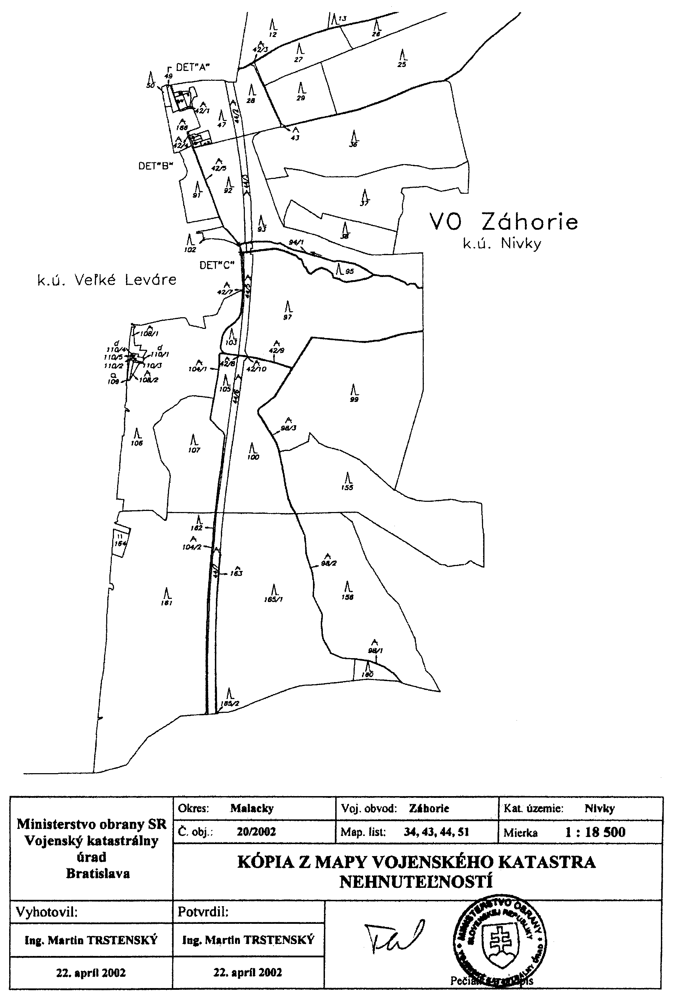
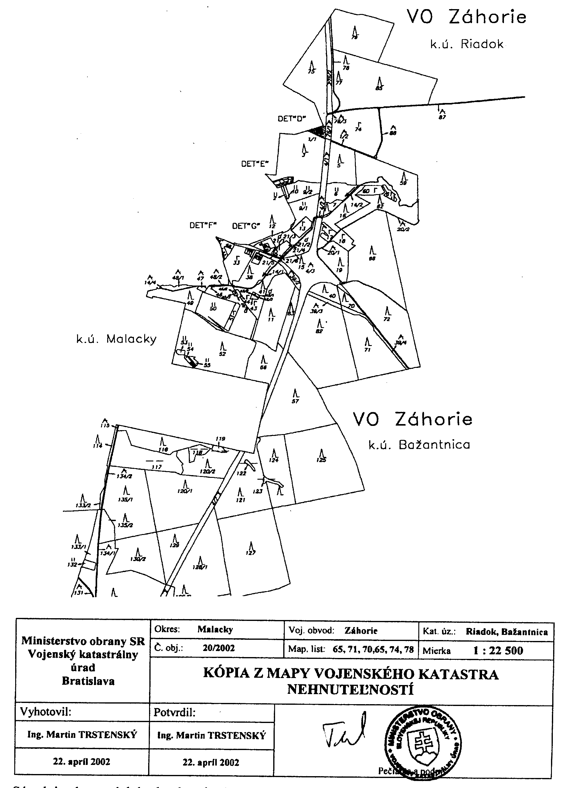
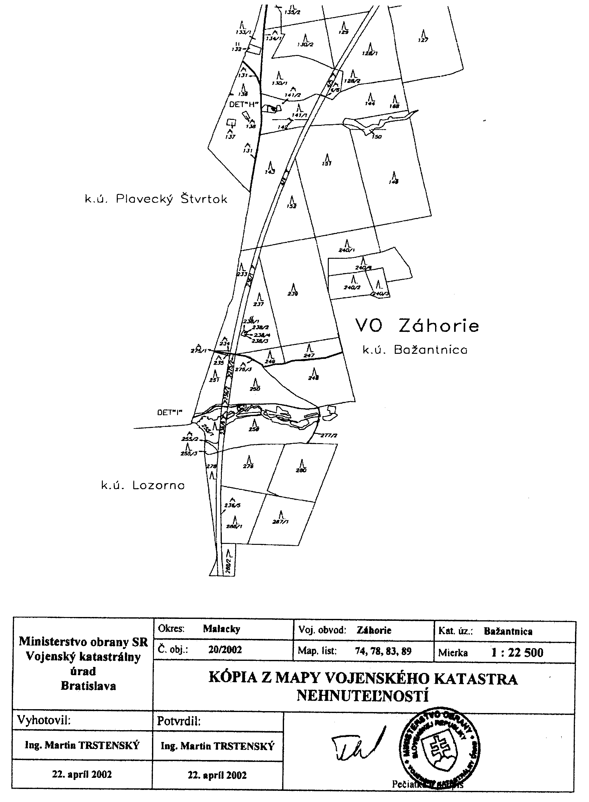
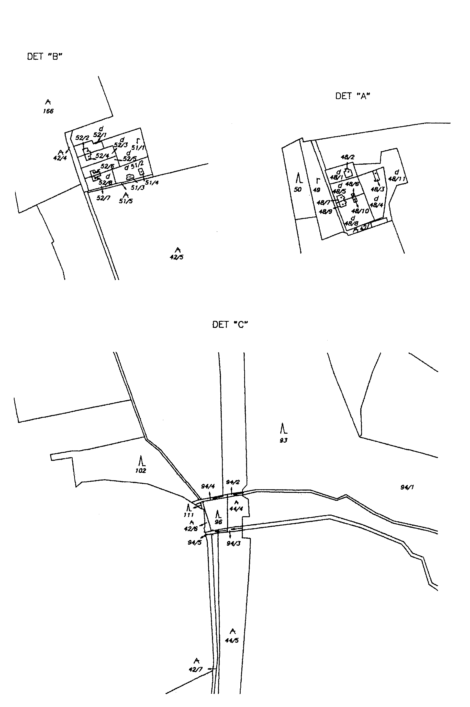
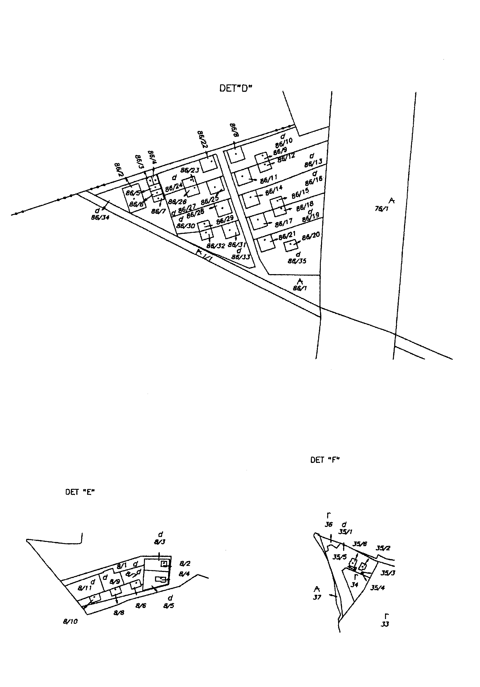
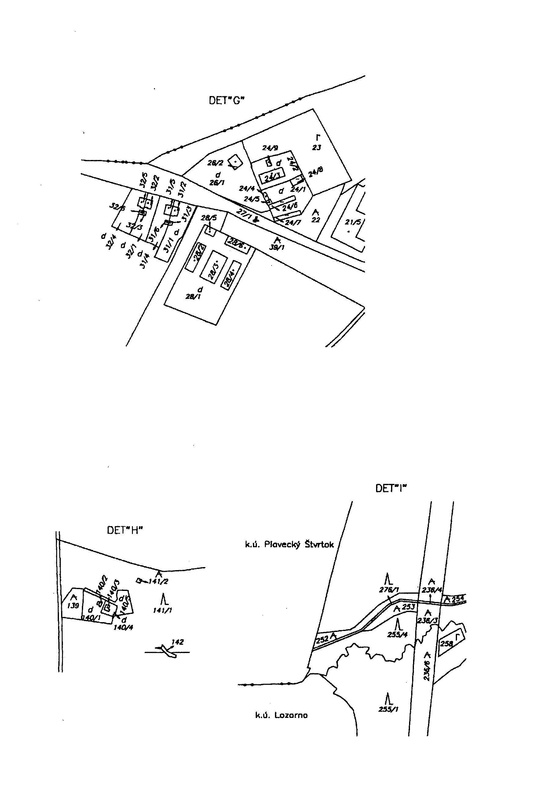

Príloha č. 4 k nariadeniu vlády č. 410/2000 Z. z. 

Súradnice lomových bodov hranice VO Záhorie sú určené v súradnicovom systéme S-JTSK.

Súradnice lomových bodov hranice VO Záhorie sú určené v súradnicovom systéme S-JTSK.

Súradnice lomových bodov hranice VO Záhorie sú určené v súradnicovom systéme S-JTSK.

