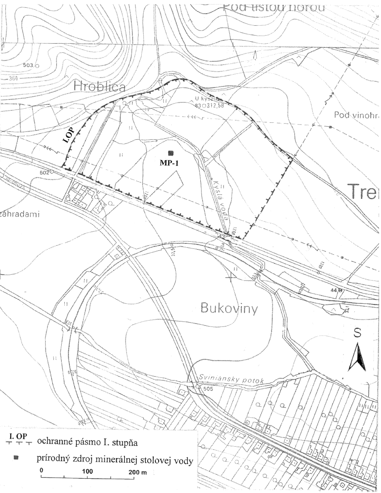
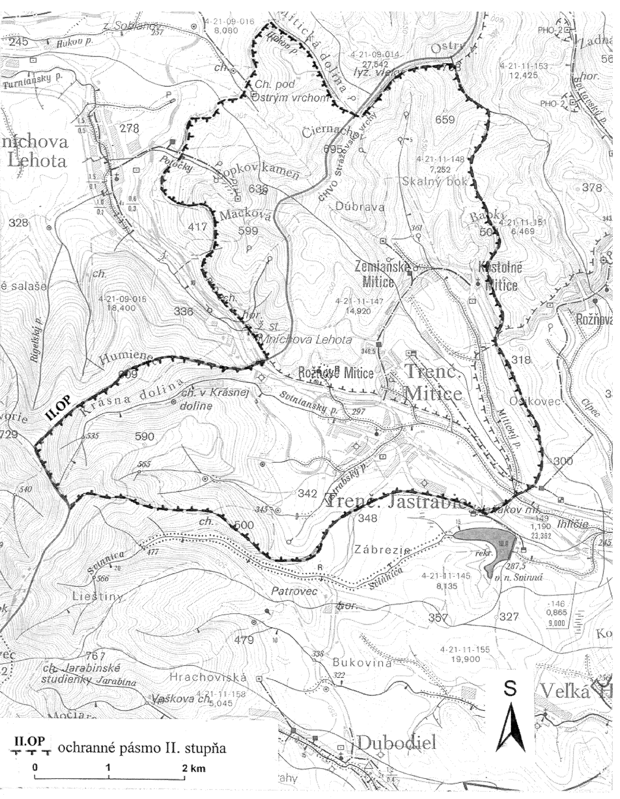

Príloha č. 1 k vyhláške č. 66/2000 Z. z. OCHRANNÉ PÁSMO I. STUPŇA PRÍRODNÝCH ZDROJOV MINERÁLNYCH STOLOVÝCH VÔD V TRENČIANSKYCH MITICIACH

Príloha č. 2 k vyhláške č. 66/2000 Z. z.

OCHRANNÉ PÁSMO II. STUPŇA PRÍRODNÝCH ZDROJOV MINERÁLNYCH STOLOVÝCH VÔD V TRENČIANSKYCH MITICIACH

Príloha č. 3 k vyhláške č. 66/2000 Z. z.

POPIS HRANÍC OCHRANNÝCH PÁSIEM PRÍRODNÝCH ZDROJOV MINERÁLNYCH STOLOVÝCH VÔD V TRENČIANSKYCH MITICIACH

Ochranné pásmo I. stupňa

Ochranné pásmo I. stupňa je vyznačené v mapovom podklade – Štátna mapa odvodená v mierke 1:5 000, listy Trenčín 7-7, Trenčín 7-6.

Ochranné pásmo I. stupňa chráni výverovú oblasť. Južné ohraničenie sa začína pri existujúcej zástavbe severovýchodne nad časťou Nad záhradami. Pokračuje ľavostrannou hranicou štátnej cesty Mníchova Lehota – Svinná a končí sa až za križovaním potoka Kyslá voda s touto cestou. Pokračuje kolmo severovýchodným smerom k vrstevnici 320. Na spojnici s poľnou cestou sa stáča na severozápad a prebieha po ľavostrannej vonkajšej hranici poľnej cesty smerom k časti Hroblica, tvoriac tak severnú hranicu ochranného pásma (v podstate sleduje vrstevnicu 315). Od miesta ohybu poľnej cesty nad prameňom Červený hostinec vedie hranica severovýchodno-juhozápadným smerom po vrstevnici 320 až k štátnej ceste, kde sa napája na južné ohraničenie.

Ochranné pásmo II. stupňa

Ochranné pásmo II. stupňa je vyznačené v mapovom podklade – Vodohospodárska mapa Slovenskej republiky v mierke 1:50 000, list Bánovce nad Bebravou 35-23.

Ochranné pásmo II. stupňa chráni akumulačnú oblasť. Západné ohraničenie sa začína pri horárni v Mitickej doline, pokračuje po západnej hranici pásma hygienickej ochrany druhého stupňa poza železničnú stanicu Mníchova Lehota po hranicu oddeľujúcu povodia 4-21-09 a 4-21-11. Po nej vedie ďalej cez kótu Humienec severovýchodno-juhozápadným smerom až ku kóte Javorie, obchádza ju z východnej strany a pokračuje juhovýchodným smerom. Ďalej vedie po hranici medzi čiastkovými povodiami 4-21-11-147 a 4-21-11-145, ktorá tvorí južné až juhovýchodné ohraničenie. Pokračuje severovýchodným a severným smerom po hranici čiastkových povodí 4-21-11-148 a 4-21-11-151 po kótu Ostrý vrch. Severnú hranicu tvorí hranica Chránenej krajinnej oblasti Strážovské vrchy až po Mitickú dolinu, ktorou pokračuje do východiskového miesta k horárni.

Príloha č. 4 k vyhláške č. 66/2000 Z. z.

POPIS HYDROGEOLOGICKEJ ŠTRUKTÚRY PRÍRODNÝCH ZDROJOV MINERÁLNYCH STOLOVÝCH VÔD V TRENČIANSKYCH MITICIACH

Ochranné pásma sú vymedzené na základe výsledkov hydrogeologického prieskumu a geologického návrhu v záverečnej správe G. Vandrová: Trenčianske Mitice – vrt MP-1 (prečistenie vrtu, HDS a geologické práce potrebné na vyhlásenie vrtu MP-1 za prírodný zdroj minerálnej stolovej vody), rok 1999.

Záujmové územie je zaradené do hydrogeologickej štruktúry – hydrogeologický masív s krasovo-puklinovou priepustnosťou (jadrové pohorie – neogén a mezozoikum).

Hydrogeologická štruktúra prírodných minerálnych vôd v Trenčianskych Miticiach sa charakterizuje ako otvorená (infiltračná, akumulačná a výverová oblasť), výverová oblasť ako polozakrytá. Z hydraulického hľadiska ide o štruktúru s napätou hladinou podzemnej vody (artézskou) s pozitívnou výtlačnou výškou.

Na základe regionálneho geologického členenia Západných Karpát sa vrt MP-1 nachádza na kontakte dvoch jadrových pohorí fatranského pásma – Považského Inovca a Strážovských vrchov.

Vhodné podmienky na infiltráciu zrážkových vôd vytvárajú predovšetkým mohutné dolomity stredného triasu s vložkami wetternsteinských vápencov a vrchnotriasové členy chočského príkrovu v nadloží málo priepustných mladších členov krížňanského príkrovu.

Na tektonickom kontakte chočského a krížňanského príkrovu je lokalizovaný rad prameňov obyčajných podzemných vôd. Pravdepodobne analogická, aj keď v menšom rozsahu, je situácia na styku dolomitov a vápencov (anis-karn) bazálnej časti krížňanského príkrovu s podložnými spodnokriedovými a strednokriedovými členmi obalovej jednotky.

Rozhodujúci vplyv na akumuláciu a obeh podzemných vôd má paleogénna a popaleogénna tektonika, ktorou vznikla rozsiahla sieť zlomov a priebežných vrásových štruktúr. Zvlnenie a tektonické porušenie príkrovových plôch neskoroalpinskou kompresiou je sprevádzané smernými zdvihmi a prešmykmi. Pohyb vody usmerňujú najmä zdvihy jednotlivých pozdĺžnych krýh premenlivej hrúbky. Osobitný význam majú smerné zlomy pri okraji bánovskej kotliny, kde zlomy severovýchodno-juhozápadného smeru koso usekávajú priebeh neskoroalpínskych štruktúr. Hydrogeologicky sú významné priečne zlomy vyššieho rádu a hlbšieho dosahu severozápadno-juhovýchodného smeru (jastrabský, timoradzský, peťovský), ktoré oddeľujú väčšie kryhy jednostranného sklonu a vytvárajú kaskádovitý štýl stavby.

Práve miesta, kde sa jastrabský priečny zlom, resp. jeho laterálne zlomy pretínajú s tzv. mitickými zlomami severojužného smeru na styku juhozápadnej časti Strážovských vrchov a Bánovskej kotliny, predstavovali miesta výstupu prírodných minerálnych vôd v Trenčianskych Miticiach.

Za infiltračnú oblasť prírodných minerálnych vôd sa považujú strednotriasové karbonátové komplexy chočského príkrovu. Jednotlivé tektonické kryhy, ktoré môžu vytvárať relatívne samostatné režimy a ktoré poklesávajú smerom do bánovskej kotliny, umožňujú vstup vôd do nižších horizontov, možno aj do krížňanskej jednotky. V miestach tektonického kontaktu s neogénom bánovskej kotliny sa časť vôd odvodňuje v podobe bariérových prameňov (prameň Červený Hostinec) a časť podzemných vôd sa pretláča do priepustnejších polôh eggenburgu (brekcie, kryštalické karbonáty, rekryštalizované karbonáty a dolomity, resp. hrubší detrit). Zlomami najmä hlbšieho založenia sa privádza voľný oxid uhličitý, ktorý umožňuje vyššiu rozpúšťaciu schopnosť vody a podmieňuje výstup vody po zlomoch smerom na povrch.

Výverová oblasť v Trenčianskych Miticiach je orientovaná na južnú až juhozápadnú časť Strážovských vrchov a čiastočne na severovýchodnú časť Považského Inovca. Z geologického hľadiska ju budujú predovšetkým horniny mezozoika, ktoré sú v týchto miestach prekryté sedimentmi neogénu a kvartéru. Podložie mezozoika tvoria horniny kryštalinika, ktoré sa v severovýchodnej časti Považského Inovca vynárajú na povrch. Mezozoikum na západnom okraji prieskumného územia utvára príbradlová manínska jednotka a vo vlastnej výverovej oblasti krížňanská jednotka a chočská jednotka.

Načrtnutá schéma tvorby a obehu prírodných minerálnych vôd umožňuje pochopiť vedľa seba existujúce obehy (pramene) obyčajných podzemných vôd a prírodných minerálnych vôd obohatených oxidom uhličitým.

Z genetického hľadiska sú prírodné minerálne vody v Trenčianskych Miticiach zrážkového pôvodu (vadózne vody). Podľa tvorby chemického obsahu a výsledného chemického zloženia sú to vody petrogénne. Rozhodujúcim procesom formovania chemického zloženia prírodnej minerálnej vody je rozpúšťanie karbonátov.
