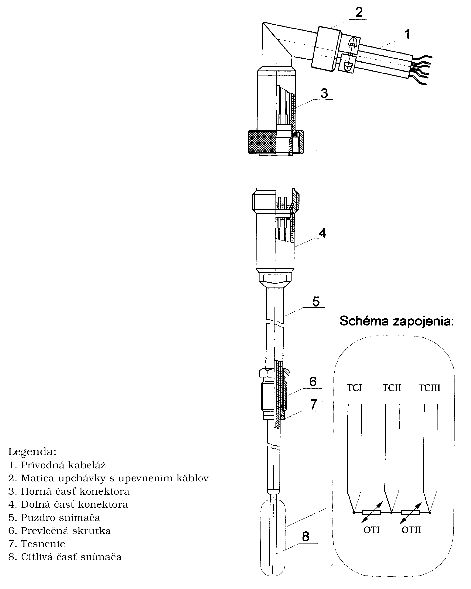

Príloha č. 54 k vyhláške č. 133/2001 Z. z.

- KOMBINOVANÉ SNÍMAČE TEPLOTY URČENÉ PRE JADROVÉ ELEKTRÁRNE TYPU VVER 440

  - Prvá časť Všeobecné ustanovenia, vymedzenie meradiel a spôsob ich metrologickej kontroly

    - 1. Táto príloha sa vzťahuje na kombinované snímače teploty určené pre jadrové elektrárne typu VVER 440 (ďalej len „kombinovaný snímač teploty“) ako určené meradlá podľa § 8 zákona.

    - 2. Kombinované snímače teploty sa používajú na určenie vstupnej a výstupnej teploty chladiva jadrového reaktora. Využívajú sa v kontrolnom meracom systéme (ďalej len „kontrolný systém“) teplôt chladiva jadrového reaktora, ktorý slúži na nastavovanie a prevádzkovú kontrolu dlhodobých meraní teplôt chladiva vo vetvách chladiacich slučiek a na výstupe z palivových kaziet.

    - 3. Kombinované snímače teploty pred uvedením na trh podliehajú schváleniu typu a prvotnému overeniu. Metódy technických skúšok pri schvaľovaní typu a metódy skúšania pri overení sú uvedené v druhej časti.

    - 4. Kombinované snímače teploty, ktoré pri overení vyhovejú ustanoveným požiadavkám, sa označia overovacou značkou a ku každému sa vydá doklad o overení.

    - 5. Kombinované snímače teploty počas ich používania ako určených meradiel podliehajú následnej prevádzkovej kontrole a dlhodobému sledovaniu správnosti merania. Opis prevádzkovej kontroly a dlhodobého sledovania správnosti merania je uvedený v druhej časti.

  - Druhá časť Technické požiadavky, metrologické požiadavky, metódy technických skúšok, metódy skúšania pri overení a pri prevádzkovej kontrole kombinovaných snímačov teploty

    - 1. Termíny a definície

    - 1.1 Kombinovaný snímač teploty je snímač teploty s konektorom, pozostávajúci z dvoch meracích odporov a troch termoelektrických článkov. Schéma zapojenia meracích odporov a termoelektrických článkov v kombinovanom snímači teploty je na obrázku.

    - 1.2 Chladiaca slučka reaktora je ucelená časť chladiaceho systému reaktora, ktorou preteká chladivo.

    - 1.3 Studená vetva je časť chladiacej slučky reaktora, ktorou sa privádza chladivo do reaktora. Horúca vetva je časť chladiacej slučky reaktora, ktorou sa odvádza chladivo z reaktora.

    - 1.4 Kváziizotermický stav reaktora je teplotne vyrovnaný režim reaktora pri jeho najmenšom výkone, počas ktorého je teplota chladiva na úrovni 260 oC ±10 oC a stredný ohrev chladiva na reaktore neprekročí 0,3 oC, pri ktorom odvod tepla z primárneho okruhu je minimalizovaný na najnižšiu dosiahnuteľnú mieru a teplota chladiva sa mení najviac o 0,2 oC za hodinu iba v dôsledku prívodu tepla z čerpacej práce čerpadiel v chladiacich slučkách.

    - 1.5 OTIj a OTIIj (OTIi a OTIIi) sú meracie odpory I a II kombinovaného snímača teploty na j-tej vetve (na i-tej slučke).

    - 1.6 TCIj, TCIIj a TCIIIj (TCIi, TCIIi a TCIIIi) sú termoelektrické články I, II a III kombinovaného snímača teploty na j-tej vetve (na i-tej slučke).

    - 1.7 Použité označenie:

    - 2. Pracovný merací rozsah

      - Pracovný merací rozsah kombinovaných snímačov teploty je od 0 oC do 400 oC.

    - 3. Technické požiadavky a metrologické požiadavky

    - 3.1 Konštrukčné vyhotovenie kombinovaného snímača teploty a schéma zapojenia sú na obrázku. V puzdre kombinovaného snímača teploty je keramická izolácia, dvojitý merací odpor a 3 ks termoelektrických článkov, pripojených na dolnú časť konektora. Kombinovaný snímač teploty je rozoberateľný a meracie prvky vymeniteľné. V zmontovanom stave je kombinovaný snímač teploty s konektorom vodotesný. Do tuľajky sa snímač upevňuje pomocou prevlečnej skrutky alebo pripájacích skrutiek na prírube.

    - 3.2 Puzdro kombinovaného snímača teploty je zhotovené z nehrdzavejúcej ocele a jeho povrch je matne upravený. Meracie odpory sú zhotovené z platiny. Ako elektródy termoelektrických článkov sa používajú chromel-alumel (typ K) alebo chromel-kopel (typ L). Termoelektrické články slúžia nielen na meranie teploty, ale aj na napájanie meracích odporov a meranie napäťových úbytkov na meracích odporoch. Krytie kombinovaného snímača teploty s nasadeným protikusom konektora vyhovuje odolnosti proti prachu a vode podľa IP 68, podľa príslušnej slovenskej technickej normy. Z hľadiska bezpečnosti práce a vyhotovenia vyhovujú kombinované snímače teploty príslušným slovenským technickým normám.

    - 3.3 Hodnota základného odporu meracieho odporu je 100 Ω pri teplote 0 oC.

    - 3.4 Základná hodnota pomeru R100/R0 meracieho odporu je 1,385055 pre Medzinárodnú teplotnú stupnicu ITS-90.

    - 3.5 Odporučená hodnota napájacieho prúdu meracích odporov je 0,5 mA, najvyššia prípustná hodnota je 5 mA.

    - 3.6 Termoelektrické články použité v kombinovaných snímačoch teploty zodpovedajú svojimi technickými charakteristikami požiadavkám príslušnej slovenskej technickej normy.

    - 3.7 Termoelektrické napätie na nesúhlasných elektródach prívodných vodičov zodpovedá príslušnej slovenskej technickej norme.

    - 3.8 Dovolené odchýlky základného odporu R0 meracích odporov sú do ±0,12 %.

    - 3.9 Základné hodnoty odporu meracích odporov Rt zodpovedajú hodnotám vypočítaným podľa vzťahu

      - Rt = Wt . R0 ,

      - kde hodnoty pomerného odporu Wt sú uvedené v príslušnej slovenskej technickej norme.

    - 3.10 Dovolené odchýlky elektrického odporu meracích odporov od základných hodnôt Rt, vyjadrené v oC, zodpovedajú hodnotám

      - ± (0,30 + 0,005.|t|),

      - kde |t| je absolútna hodnota meranej teploty.

    - 3.11 Zmena hodnoty elektrického odporu meracích odporov pri skúške stability nie je väčšia ako 1,2.10-4.R0.

    - 3.12 Hodnota izolačného odporu kombinovaného snímača teploty je väčšia ako 2 MΩ pri teplote 395 oC ±5 oC a väčšia ako 10 MΩ pri teplote 300 oC ±5 oC pri skúšobnom jednosmernom elektrickom napätí najmenej 20 V a najviac 50 V. Izolačný odpor kombinovaného snímača teploty sa nezmení ani po skúške tesnosti.

    - 3.13 Kombinovaný snímač teploty treba chrániť pred nárazmi a pred ohybom pri doprave a montáži. Počas prevádzky nevyžaduje žiadnu údržbu. V prípade nutnosti rekalibrácie treba ho po odpojení a vybratí z tuľajky umyť pod tečúcou vodou, prípadne v dekontaminačnom roztoku, a nechať skontrolovať rádioaktívnu kontamináciu. Kombinovaný snímač teploty sa skladuje v suchom prostredí pri teplote +5 oC až +35 oC a pri relatívnej vlhkosti do 75 %. Kombinované snímače teploty sa ukladajú tak, aby boli chránené pred nečistotami, mechanickým poškodením a pred namáhaním na ohyb.

    - 3.14 Hraničné hodnoty parametrov prostredia, v ktorom sa kombinovaný snímač teploty prevádzkuje, sú:

      - a) teplota okolitého vzduchu 85 oC,

      - b) relatívna vlhkosť okolitého vzduchu 90 %,

      - c) teplota meraného média 400 oC.

    - 4. Nápisy a značky

      - Na každom kombinovanom snímači teploty je štítok s týmito údajmi:

      - a) značka výrobcu alebo jeho meno,

      - b) druh a počet meracích odporov a termočlánkov,

      - c) rok výroby,

      - d) výrobné číslo.

    - 5. Metódy technických skúšok pri schvaľovaní typu

      - Pri technickej skúške pri schvaľovaní typu kombinovaných snímačov teploty sa vykonávajú rovnaké skúšky ako pre platinové odporové snímače teploty s týmito doplnkovými skúškami:

    - 5.1 Vizuálna obhliadka, pri ktorej sa zisťujú nedostatky identifikovateľné zrakom. Pri vizuálnej obhliadke sa zisťuje aj správnosť zapojenia konektora a polarita vývodov podľa schémy na obrázku 1 a úplnosť predpísaného označenia.

    - 5.2 Skúška odporu elektrickej izolácie. Postup skúšky a namerané hodnoty spĺňajú požiadavky príslušnej slovenskej technickej normy. Izolačný odpor sa meria jednosmerným elektrickým napätím najmenej 20 V a najviac 100 V pri teplote okolia 20 oC ±5 oC a jednosmerným elektrickým napätím najmenej 20 V a najviac 50 V pri teplote 300 oC ±5 oC a 395 oC ±5 oC.

    - 5.3 Skúška stability meracích odporov OTI, OTII. Postup skúšky a namerané hodnoty musia spĺňať požiadavky príslušnej slovenskej technickej normy.

    - 5.4 Skúška tesnosti, ktorá sa vykonáva tak, že sa snímač s kompletným konektorom ponorí do vody na 24 hodín tak, aby bol pod vodou ponorený celý snímač s konektorom a časť kabeláže (približne 100 mm). Izolačný odpor sa nezmení o viac, ako je chyba merania.

    - 5.5 Skúška slučkových odporov termoelektrických článkov sa vykoná podľa bodu 6.7.

    - 6. Metódy skúšania pri overení

    - 6.1 Vizuálna obhliadka.

      - Pri vizuálnej obhliadke sa zisťuje, či kombinovaný snímač teploty nie je poškodený, alebo nie sú na ňom viditeľné chyby.

    - 6.2 Skúška odporu elektrickej izolácie.

      - Odpor elektrickej izolácie (Riz_KST) kombinovaného snímača teploty sa skúša jednosmerným napätím najmenej 20 V a najviac 50 V. Hodnota Riz_KST je pri teplote 300 oC ±5 oC viac ako 107 Ω.

    - 6.3 Skúška stability meracích odporov OTI, OTII.

      - Skúška stability meracích odporov sa vykonáva podľa slovenskej technickej normy pre platinové odporové snímače teploty. Zmena odporu meracích odporov nie je vyššia ako ± 1,2.10-4.R0.

    - 6.4 Výsledky skúšky teplotnej závislosti odporu meracích odporov vyhovujú podmienkam slovenskej technickej normy pre platinové odporové snímače teploty – etalóny 3. rádu. Teplotná závislosť odporu sa meria pri troch teplotách. Prvá teplota je 300 oC ± 5 oC, druhá teplota je 260 oC ± 5 oC, tretia teplota je 0 oC. Zo zistených hodnôt odporov a teplôt sa vypočítajú konštanty A, B (A1, B1 pre merací odpor č. 1; A2, B2 pre merací odpor č. 2) polynómu na výpočet teploty meracieho odporu podľa základného vzťahu

      - Rt= R0(1 + At + Bt2),

      - kde Rt – hodnota odporu v Ω pri teplote t podľa ITS'90,

      - R0– hodnota odporu v Ω pri teplote 0 oC, |

      - A – konštanta meracieho odporu (oC)-1,

      - B – konštanta meracieho odporu (oC)-2,

      - t – teplota podľa ITS'90 (oC).

    - 6.5 Skúška teplotnej závislosti termoelektrického napätia termoelektrických článkov TCI, TCII, TCIII.

      - Závislosť termoelektrického napätia od teploty sa skúša pri teplote 300 oC ± 5 oC. Po inštalovaní v prevádzke sa termoelektrické články (TCII) kalibrujú v skutočných podmienkach meracími odpormi v rámci každého kombinovaného snímača teploty podľa príslušnej slovenskej technickej normy.

    - 6.6 Skúška tesnosti.

      - Na kombinovaných snímačoch teploty sa skúša tesnosť, ak izolačný odpor nevyhovuje podmienkam podľa bodu 6.2. Kombinovaný snímač teploty sa skúša s konektorom tak, že sa ponorí do vody celý snímač aj s konektorom a časťou kabeláže (približne 100 mm) na 24 hodín. Meria sa izolačný odpor, ktorého hodnota sa nezníži pod 108 Ω pri teplote 23 oC ± 10 oC.

    - 6.7 Skúška slučkových odporov termočlánkov.

      - Meria sa odpor jednotlivých slučiek TCI, TCII, TCIII pri teplote 23 oC ± 10 oC. Namerané hodnoty odporu musia jednoznačne preukázať, že nie je prerušená ani jedna slučka.

    - 6.8 Po vykonaní skúšok sa ku každému kombinovanému snímaču teploty vydá „Doklad o overení“ a označí sa overovacou značkou.

      - Doklad o overení okrem údajov podľa § 6 ods. 4 obsahuje tieto údaje:

      - a) identifikácia použitých predpisov a postupov,

      - b) podmienky pri overení,

      - c) tabuľka nameraných hodnôt s uvedenými chybami,

      - d) konštanty A, B pre každý merací odpor,

      - e) údaj o hodnote Riz_KST kombinovaného snímača teploty pri uvedenej teplote,

      - f) hodnoty slučkových odporov TCI, TCII, TCIII pri teplote 23 oC ± 10 oC.

    - 7. Metódy skúšania pri prevádzkovej kontrole

      - Kontrolný systém pozostáva z dvanástich kombinovaných snímačov teploty, predlžovacích vedení a meracieho a vyhodnocovacieho zariadenia. Kontrolný systém merania teploty zabezpečí meranie elektrického odporu s chybou menšou ako 40 mΩ a meranie napätia s chybou menšou ako 10 µV. Odporový normál RN a analógovo číslicový prevodník sú kalibrované.

      - Prvá prevádzková kontrola (nastavenie kontrolného systému) sa vykonáva na začiatku novej kampane reaktora počas kváziizotermického stavu reaktora pri teplote chladiva 260 oC ± 10 oC. Pretože nároky na správnosť merania teploty na reaktore z pohľadu jadrovej bezpečnosti a ekonomiky prevádzky sú vysoké a pravidelné overenie alebo kontrola snímačov v laboratórnych podmienkach sú technicky náročné (dôvody sú spojené s demontážou snímačov z chladiacich slučiek), vykonáva sa ich kontrola v prevádzkových podmienkach počas kváziizotermického stavu reaktora. Pri kontrole sa využíva meracie a vyhodnocovacie zariadenie kontrolného systému a štatistické spracovanie súboru nameraných údajov. Kontroluje sa stálosť charakteristík súboru snímačov, t.j. dodržiavanie najväčších prípustných hodnôt teplotných rozdielov, ohrevov a ich smerodajných odchýlok za stanovených medzných podmienok.

      - Druhá prevádzková kontrola (nastavenie kontrolného systému) sa vykonáva na začiatku novej kampane reaktora, po prvom dosiahnutí ustáleného nominálneho výkonu. Dlhodobé prevádzkové sledovanie troch parametrov správnosti kontrolného systému na výkonových stavoch sa uskutočňuje počas celej kampane reaktora v každom meracom cykle. Ide o parametre sMOT, δ∆t, δt.

      - Prevádzkové kontroly vykonáva autorizovaná osoba podľa § 24 zákona, ktorá vykonala posledné overenie kombinovaného snímača teploty podľa bodu 6.

    - 7.1 Kontrola počas kváziizotermického stavu pozostáva z kontroly

      - a) správnosti nastavenia kváziizotermického stavu reaktora,

      - b) správnosti merania s meracími odpormi OTIj, OTIIj,

      - c) správnosti merania s termoelektrickými článkami TCIIj,

      - d) izolačného odporu kontrolného systému,

      - e) parazitných napätí na trasách meracích odporov.

    - 7.1.1 Kontrola správnosti nastavenia kváziizotermického stavu reaktora pozostáva zo stanovenia

      - a) stredného ohrevu chladiva na reaktore ∆tROT,

      - b) smerodajnej odchýlky teplôt horúcich vetiev sHOT,

      - c) smerodajnej odchýlky teplôt studených vetiev sSOT.

    - 7.1.2 Kváziizotermický stav reaktora je nastavený správne, ak stanovené hodnoty |∆tROT|, sHOT , sSOT sú menšie ako 0,3 oC.

    - 7.1.3 Kontrola správnosti merania meracích odporov OTIj, OTIIj pozostáva zo stanovenia

      - a) rozdielov meraných teplôt z dvoch meracích odporov umiestnených v jednom kombinovanom snímači teploty na j-tej vetve ∆tMOTj ,

      - b) smerodajnej odchýlky vyjadrujúcej náhodnú chybu merania sMOT,

      - c) rozdielov teplôt (tHOTIi – tHOT), (tHOTIIi – tHOT), (tSOTIi– tSOT), (tSOTIIi – tSOT).

    - 7.1.4 Výsledky kontroly správnosti merania meracích odporov OTIj (OTIIj) pri kváziizotermickom stave sú správne, ak

      - a) absolútna hodnota |∆tMOTj| je menšia ako 0,3 oC,

      - b) dvojnásobok smerodajnej odchýlky 2 . sMOTsa rovná 0,18 oC, alebo je menší,

      - c) absolútne hodnoty rozdielov teplôt |tHOTIi – tHOT|, |tHOTIIi – tHOT|, |tSOTIi – tSOT|, |tSOTIIi – tSOT| sú menšie ako 0,5 oC,

      - d) v čase merania teplôt, z ktorých sa vychádza pri kontrole správnosti meracích odporov, sú splnené podmienky na správne nastavenie kváziizotermického stavu podľa bodu 7.1.2.

    - 7.1.5 Kontrola správnosti merania termoelektrických článkov TCIIj vrátane požiadaviek podľa bodu 3.6 pozostáva zo stanovenia

      - a) rozdielov ohrevov chladiva meraných termoelektrickými článkami a meracími odpormi na jednej slučke (∆tRTCIIi – ∆tROTi ),

      - b) rozdielov teplôt chladiva meraných termoelektrickými článkami a meracími odpormi na jednej vetve (tRTCIIj – tROTj).

    - 7.1.6 Výsledky kontroly termoelektrických článkov TCII sú správne, ak absolútne hodnoty rozdielov ohrevov chladiva na jednotlivých slučkách |∆tRTCIIi – ∆tROTi| sú menšie ako 2 oC a absolútne hodnoty rozdielov teplôt chladiva na jednotlivých vetvách |tRTCIIj – tROTj| sú menšie ako 8 oC.

    - 7.1.7 Kontrola izolačného odporu kontrolného systému.

      - Kontrolný systém spĺňa podmienku správnosti merania, ak Riz_KMS > 107 Ω.

    - 7.1.8 Kontrola parazitných napätí na trasách meracích odporov.

      - Kontrola pozostáva z merania parazitných napätí na trasách meracích odporov a zavedení nameraných hodnôt do výpočtov za vzťažné parazitné napätia.

    - 7.1.9 Výsledky merania pri kontrole kombinovaných snímačov teploty sa uvedú v zázname o kontrole počas kváziizotermického stavu.

    - 7.1.10 Záznam o kontrole obsahuje tieto údaje:

      - a) dátum a čas kontroly,

      - b) čísla kontrolovaných kombinovaných snímačov teploty,

      - c) namerané hodnoty tOTIj, tOTIIj a izolačný odpor kontrolného systému Riz_KMS,

      - d) hodnoty ∆tROT , sHOT , sSOT , ∆tMOTj , sMOT , |tHOTIi – tHOT|, |tHOTIIi – tHOT|, |tSOTIi – tSOT|, |tSOTIIi – tSOT|, |∆tRTCIIi – ∆tROTi|, |tRTCIIj – tROTj|, Riz_KMS; hodnoty parazitných napätí.

    - 7.1.11 Ak kombinované snímače teploty vyhoveli požiadavkám podľa bodov 7.1.4, 7.1.6 a 7.1.7, možno ich ďalej prevádzkovať, pričom konštanty platinových meracích odporov uvedené v dokladoch o ich overení zostávajú v platnosti.

    - 7.1.12 Tie kombinované snímače, ktoré nevyhoveli požiadavkám bodu 7.1.4 alebo 7.1.6 pri nábehu bloku jadrovej elektrárne na novú kampaň, sú demontované a odoslané na overenie v laboratórnych podmienkach.

    - 7.1.13 Kontrolu správnosti merania kombinovaných snímačov teploty v prevádzkových podmienkach podľa bodov 7.1.1 až 7.1.11 je prípustné vykonať najviac pri dvoch po sebe idúcich kampaniach reaktora počas kváziizotermického stavu. Pri nasledujúcej tretej kampani (v poradí po dvoch za sebou nasledujúcich kontrolách správnosti v prevádzkových podmienkach) treba kombinované snímače teploty znovu overiť v laboratóriu.

    - 7.2 Kontrola kombinovaných snímačov teploty a kontrolného systému počas prvého dosiahnutia nominálneho výkonu Nnom pozostáva z

      - a) kontroly stredného ohrevu chladiva ∆tROT,

      - b) kontroly smerodajnej odchýlky sMOT,

      - c) kontroly parazitných napätí na predlžovacích vedeniach meracích odporov,

      - d) určenia systematických chýb merania ohrevu a teploty chladiva reaktora, ktoré sa môžu vyskytnúť v priebehu kampane reaktora počas každého meracieho cyklu δ∆t, δt,

      - e) dlhodobého sledovania správnosti počas výkonových stavov v priebehu celej kampane reaktora sMOT, δ∆t, δt.

    - 7.2.1 Kontrola správnosti nastavenia nominálneho výkonu sa vykonáva podľa stredného ohrevu chladiva ∆tROT. Pre každý blok je určená limitná hodnota ∆tROT pre nominálny výkon.

    - 7.2.2 Kontrola náhodnej chyby merania kontrolného systému sa vykonáva prostredníctvom smerodajnej odchýlky sMOT. Ak je dvojnásobok smerodajnej odchýlky 2 . sMOT ≤ 0,18 oC, správnosť merania kontrolného systému z hľadiska náhodných chýb je vyhovujúca.

    - 7.2.3 Kontrola parazitných napätí na trasách meracích odporov. Kontrola pozostáva zo zmerania parazitných napätí na trasách meracích odporov a zavedení nameraných hodnôt do výpočtov za vzťažné parazitné napätia.

    - 7.2.4 Určia sa veľkosti systematických chýb merania ohrevu a teploty chladiva na reaktore pri prvom dosiahnutí nominálneho výkonu reaktora na začiatku novej kampane (δ∆t)0, (δt)0. Na určenie veľkosti týchto systematických chýb sa vzťahujú požiadavky na veľkosť náhodnej chyby merania podľa bodu 7.2.2.

    - 7.3 Dlhodobé sledovanie parametrov správnosti kontrolného systému merania teplôt počas kampane jadrového reaktora.

    - 7.3.1 Dlhodobé sledovanie správnosti merania počas kampane reaktora v každom meracom cykle sa vykonáva prostredníctvom stanovenia veľkosti náhodnej chyby merania sMOT, prostredníctvom stanovenia výskytu systematickej chyby merania ohrevu chladiva reaktora počas kampane reaktora δ∆t a prostredníctvom stanovenia výskytu systematickej chyby merania teploty chladiva δt. Správnosť merania je vyhovujúca, ak

      - 2 . sMOT ≤ 0,18 oC,

      - |δ∆t| ≤ 0,30 oC,

      - |∆t| ≤ 0,30 oC.

    - 7.3.2 Hodnoty ∆tROT, sMOT, δ∆t a δt sa archivujú minimálne raz za deň.

      - Obrázok

      - Výkres a schéma zapojenia kombinovaného snímača teploty určeného pre jadrové elektrárne typu VVER 440

    - 
