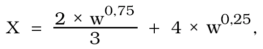
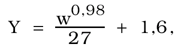
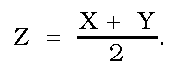

Príloha č. 56 k vyhláške č. 133/2001 Z. z.

- SKÚŠOBNÉ SITÁ

  - Prvá časť Vymedzenie meradiel a spôsob ich metrologickej kontroly

    - 1. Táto príloha sa vzťahuje na skúšobné sitá (ďalej len „sito“), ktoré sa používajú ako určené meradlá podľa § 8 zákona.

    - 2. Podľa druhu použitého materiálu sa sitá členia na sitá z

      - a) kovovej tkaniny so štvorcovými otvormi,

      - b) dierovaného plechu so štvorcovými alebo kruhovými otvormi,

      - c) elektroformovanej fólie so štvorcovými alebo kruhovými otvormi.

    - 3. Sitá pred uvedením na trh podliehajú prvotnému overeniu. Metódy skúšania pri overení sú uvedené v druhej časti.

    - 4. Sitá, ktoré pri overení vyhovejú ustanoveným požiadavkám, sa označia overovacou značkou.

    - 5. Sitá počas ich používania ako určené meradlá podliehajú následnému overeniu. Postup pri následnom overení je zhodný s postupom pri prvom overení.

  - Druhá časť Technické požiadavky, metrologické požiadavky a metódy skúšania pri overení sít

    - 1. Sitá z kovovej tkaniny

    - 1.1 Sitá z kovovej tkaniny sa označujú menovitými rozmermi otvorov v kovovej drôtenej tkanine.

    - 1.2 Menovité veľkosti otvorov 1 mm a viac sa udávajú v milimetroch (mm), menovité veľkosti pod 1 mm sa udávajú v mikrometroch (µm). Medzné odchýlky veľkosti otvorov a priemeru drôtov sú uvedené v tabuľkách č. 1 a 2.

    - 1.3 Medzné odchýlky veľkosti otvorov X, Y a Z obsahujú tabuľky č. 1 a 2. Stĺpce 4 až 6 platia pre veľkosť otvorov nameranú na osiach otvorov v smere osnovy a útku.

    - 1.4 Veľkosť otvorov nepresiahne menovitú veľkosť otvorov w o viac ako o hodnotu X:

    - 

      - kde X a w sú vyjadrené v mikrometroch.

    - 1.5 Priemerná veľkosť otvorov sa neodchýli od menovitej veľkosti o viac ako o hodnotu ±Y:

    - 

      - kde Y a w sú vyjadrené v mikrometroch.

    - 1.6 Veľkosť medzi hodnotami w + X a w + Z nemá viac ako 6 % z celkového počtu otvorov, kde

    - 

      - Ak má sito menej ako 50 otvorov, môže byť veľkosť najviac troch otvorov medzi hodnotami w + X a w + Z.

    - 1.7 Priemer drôtu

    - 1.7.1 Na kovové tkaniny možno použiť drôt zodpovedajúci priemerom uvedeným v tabuľkách č. 1 a 2.

    - 1.7.2 Prednostne sa používa drôt s priemerom uvedeným v tabuľke č. 1 stĺpci 7 a v tabuľke č. 2 stĺpci 7.

    - 1.7.3 Drôty použité v site majú rovnaký priemer v smere osnovy aj útku.

      - Tabuľka č. 1

      - Medzné odchýlky veľkosti otvorov a priemery drôtov (rozmery v mm)

    - Menovitá veľkosť otvorov w | | | Medzné odchýlky veľkosti otvorov | | | Priemer drôtu d | |

    - Základné veľkosti | Doplnkové veľkosti | | Pre veľkosť jednotlivého otvoru | Pre priemernú veľkosť otvorov | Stredná medzná odchýlka | Odporúčané veľkosti | Dovolené rozpätie |

    - R 20/3 | R 20 | R 40/3 | +X | ±Y | +Z | dmen | dmax | dmin

    - (1) | (2) | (3) | (4) | (5) | (6) | (7) | (8) | (9)

    - 125 | 125 | 125 | 4,51 | 3,66 | 4,09 | 8 | 9,2 | 6,8

    - | 112 | | 4,15 | 3,29 | 3,72 | 8 | 9,2 | 6,8

    - | | 106 | 3,99 | 3,12 | 3,55 | 6,3 | 7,2 | 5,4

    - | 100 | | 3,82 | 2,94 | 3,38 | 6,3 | 7,2 | 5,4

    - 90 | 90 | 90 | 3,53 | 2,66 | 3,09 | 6,3 | 7,2 | 5,4

    - | 80 | | 3,24 | 2,37 | 2,8 | 6,3 | 7,2 | 5,4

    - | | 75 | 3,09 | 2,22 | 2,65 | 6,3 | 7,2 | 5,4

    - | 71 | | 2,97 | 2,1 | 2,54 | 5,6 | 6,4 | 4,8

    - 63 | 63 | 63 | 2,71 | 1,87 | 2,29 | 5,6 | 6,4 | 4,8

    - | 56 | | 2,49 | 1,67 | 2,08 | 5 | 5,8 | 4,3

    - | | 53 | 2,39 | 1,58 | 1,99 | 5 | 5,8 | 4,3

    - | 50 | | 2,29 | 1,49 | 1,89 | 5 | 5,8 | 4,3

    - 45 | 45 | 45 | 2,12 | 1,35 | 1,73 | 4,5 | 5,2 | 3,8

    - | 40 | | 1,94 | 1,2 | 1,57 | 4,5 | 5,2 | 3,8

    - | | 37,5 | 1,85 | 1,13 | 1,49 | 4,5 | 5,2 | 3,8

    - | 35,5 | | 1,78 | 1,07 | 1,42 | 4 | 4,6 | 3,4

    - 31,5 | 31,5 | 31,5 | 1,63 | 0,95 | 1,29 | 4 | 4,6 | 3,4

    - | 28 | | 1,5 | 0,85 | 1,17 | 3,55 | 4,1 | 3

    - | | 26,5 | 1,44 | 0,8 | 1,12 | 3,55 | 4,1 | 3

    - | 25 | | 1,38 | 0,76 | 1,07 | 3,55 | 4,1 | 3

    - 22,4 | 22,4 | 22,4 | 1,27 | 0,68 | 0,98 | 3,55 | 4,1 | 3

    - | 20 | | 1,17 | 0,61 | 0,89 | 3,15 | 3,6 | 2,7

    - | | 19 | 1,13 | 0,58 | 0,85 | 3,15 | 3,6 | 2,7

    - | 18 | | 1,08 | 0,55 | 0,82 | 3,15 | 3,6 | 2,7

    - 16 | 16 | 16 | 0,99 | 0,49 | 0,74 | 3,15 | 3,6 | 2,7

    - | 14 | | 0,9 | 0,43 | 0,67 | 2,8 | 3,2 | 2,4

    - | | 13,2 | 0,86 | 0,41 | 0,64 | 2,8 | 3,2 | 2,4

    - | 12,5 | | 0,83 | 0,39 | 0,61 | 2,5 | 2,9 | 2,1

    - 11,2 | 11,2 | 11,2 | 0,77 | 0,35 | 0,56 | 2,5 | 2,9 | 2,1

    - | 10 | | 0,71 | 0,31 | 0,51 | 2,5 | 2,9 | 2,1

    - | | 9,5 | 0,68 | 0,3 | 0,49 | 2,24 | 2,6 | 1,9

    - | 9 | | 0,65 | 0,28 | 0,47 | 2,24 | 2,6 | 1,9

    - 8 | 8 | 8 | 0,6 | 0,25 | 0,43 | 2 | 2,3 | 1,7

    - | 7,1 | | 0,55 | 0,22 | 0,38 | 1,8 | 2,1 | 1,5

    - | | 6,7 | 0,53 | 0,21 | 0,37 | 1,8 | 2,1 | 1,5

    - | 6,3 | | 0,51 | 0,2 | 0,35 | 1,8 | 2,1 | 1,5

    - 5,6 | 5,6 | 5,6 | 0,47 | 0,18 | 0,32 | 1,6 | 1,9 | 1,3

    - | 5 | | 0,43 | 0,16 | 0,29 | 1,6 | 1,9 | 1,3

    - | | 4,75 | 0,41 | 0,15 | 0,28 | 1,6 | 1,9 | 1,3

    - | 4,5 | | 0,4 | 0,14 | 0,27 | 1,4 | 1,7 | 1,2

    - 4 | 4 | 4 | 0,37 | 0,13 | 0,25 | 1,4 | 1,7 | 1,2

    - | 3,55 | | 0,34 | 0,11 | 0,23 | 1,25 | 1,5 | 1,06

    - | | 3,35 | 0,32 | 0,11 | 0,22 | 1,25 | 1,5 | 1,06

    - | 3,15 | | 0,31 | 0,1 | 0,21 | 1,25 | 1,5 | 1,06

    - 2,8 | 2,8 | 2,8 | 0,29 | 0,09 | 0,19 | 1,12 | 1,3 | 0,95

    - | 2,5 | | 0,26 | 0,08 | 0,17 | 1 | 1,15 | 0,85

    - | | 2,36 | 0,25 | 0,08 | 0,17 | 1 | 1,15 | 0,85

    - | 2,24 | | 0,24 | 0,07 | 0,16 | 0,9 | 1,04 | 0,77

    - 2 | 2 | 2 | 0,23 | 0,07 | 0,15 | 0,9 | 1,04 | 0,77

    - | 1,8 | | 0,21 | 0,06 | 0,14 | 0,8 | 0,92 | 0,68

    - | | 1,7 | 0,2 | 0,06 | 0,13 | 0,8 | 0,92 | 0,68

    - | 1,6 | | 0,19 | 0,05 | 0,12 | 0,8 | 0,92 | 0,68

    - 1,4 | 1,4 | 1,4 | 0,18 | 0,05 | 0,11 | 0,71 | 0,82 | 0,6

    - | 1,25 | | 0,16 | 0,04 | 0,1 | 0,63 | 0,72 | 0,54

    - | | 1,18 | 0,16 | 0,04 | 0,1 | 0,63 | 0,72 | 0,54

    - | 1,12 | | 0,15 | 0,04 | 0,1 | 0,56 | 0,64 | 0,48

    - 1 | 1 | 1 | 0,14 | 0,03 | 0,09 | 0,56 | 0,64 | 0,48

    - Poznámka: Všetky veľkosti otvorov platia pre plátnovú väzbu.

      - Tabuľka č. 2

      - Medzné odchýlky veľkosti otvorov a priemery drôtov (rozmery v µm)

    - Menovitá veľkosť otvorov w | | | Medzné odchýlky veľkosti otvorov | | | Priemer drôtu d | |

    - Základné veľkosti | Doplnkové veľkosti | | Pre veľkosť jednotlivého otvoru | Pre priemernú veľkosť otvorov | Stredná medzná odchýlka | Odporúčané veľkosti | Dovolené rozpätie |

    - R 20/3 | R 20 | R 40/3 | +X | ±Y | +Z | dmen | dmax | dmin

    - (D | (2) | (3) | (4) | (5) | (6) | (7) | (8) | (9)

    - | 900 | | 131 | 31 | 81 | 500 | 580 | 430

    - | | 850 | 127 | 29 | 78 | 500 | 580 | 430

    - | 800 | | 122 | 28 | 75 | 450 | 520 | 380

    - 710 | 710 | 710 | 112 | 25 | 69 | 450 | 520 | 380

    - | 630 | | 104 | 22 | 63 | 400 | 460 | 340

    - | | 600 | 101 | 21 | 61 | 400 | 460 | 340

    - | 560 | | 96 | 20 | 58 | 355 | 410 | 300

    - 500 | 500 | 500 | 89 | 18 | 54 | 315 | 360 | 270

    - | 450 | | 84 | 16 | 50 | 280 | 320 | 240

    - | | 425 | 81 | 16 | 48 | 280 | 320 | 240

    - | 400 | | 78 | 15 | 47 | 250 | 290 | 210

    - 355 | 355 | 355 | 72 | 13 | 43 | 224 | 260 | 190

    - | 315 | | 67 | 12 | 40 | 200 | 230 | 170

    - | | 300 | 65 | 12 | 38 | 200 | 230 | 170

    - | 280 | | 62 | 11 | 37 | 180 | 210 | 150

    - 250 | 250 | 250 | 58 | 9,9 | 34 | 160 | 190 | 130

    - | 224 | | 54 | 9 | 32 | 160 | 190 | 130

    - | | 212 | 52 | 8,7 | 30 | 140 | 170 | 120

    - | 200 | | 50 | 8,3 | 29 | 140 | 170 | 120

    - 180 | 180 | 180 | 47 | 7,6 | 27 | 125 | 150 | 106

    - | 160 | | 44 | 6,9 | 25 | 112 | 130 | 95

    - | | 150 | 43 | 6,6 | 25 | 100 | 115 | 85

    - | 140 | | 41 | 6,3 | 24 | 100 | 115 | 85

    - 125 | 125 | 125 | 38 | 5,8 | 22 | 90 | 104 | 77

    - | 112 | | 36 | 5,4 | 21 | 80 | 92 | 68

    - | | 106 | 35 | 5,2 | 20 | 71 | 82 | 60

    - | 100 | | 34 | 5 | 19 | 71 | 82 | 60

    - 90 | 90 | 90 | 32 | 4,6 | 18 | 63 | 72 | 54

    - | 80 | | 30 | 4,3 | 17 | 56 | 64 | 48

    - | | 75 | 29 | 4,1 | 17 | 50 | 58 | 43

    - | 71 | | 28 | 4 | 16 | 50 | 58 | 43

    - 63 | 63 | 63 | 26 | 3,7 | 15 | 45 | 52 | 38

    - | 56 | | 25 | 3,5 | 14 | 40 | 46 | 34

    - | | 53 | 24 | 3,4 | 14 | 36 | 41 | 31

    - | 50 | | 23 | 3,3 | 13 | 36 | 41 | 31

    - 45 | 45 | 45 | 22 | 3,1 | 13 | 32 | 37 | 27

    - | 40 | | 21 | 3 | 12 | 32 | 37 | 27

    - | | 38 | 20 | 2,9 | 11 | 30 | 35 | 24

    - R´10 | 36 | | 20 | 2,8 | 11 | 30 | 35 | 24

    - 32 | | | 19 | 2,7 | 11 | 28 | 33 | 23

    - 25 | | | 16 | 2,5 | 9 | 25 | 29 | 21

    - 20 | | | 14 | 2,3 | 8 | 20 | 23 | 17

    - Poznámka: Všetky veľkosti otvorov platia pre plátnovú väzbu. Veľkosti otvorov 63 μm a menšie platia aj pre keprovú väzbu.

      - Tabuľka č. 3

      - Odporúčané tvary a veľkosti (rozmery v mm)

    - Sito | | Priemer alebo dĺžka skutočne preosievaného povrchu | | Približná hĺbka sita

    - Tvar | Menovitá veľkosť | najmenšie | najväčšie |

    - Kruhový | 200 | 185 | 200 | 50

    - Kruhový | 300 | 275 | 300 | 75

    - Štvorcový | 300 | 275 | 300 | 75

    - 1.8 Metódy skúšania

      - Pri sitách, ktoré majú najviac 20 otvorov, sa merajú všetky otvory. Pri sitách, ktoré majú viac ako 20 otvorov, sa merajú otvory takýmto postupom:

      - a) prehliadkou stavu kovovej tkaniny,

      - b) metodickým premeraním jednotlivých otvorov a následne

      - c) premeraním veľkosti otvorov a zistením dodržania medzných odchýlok veľkosti otvorov.

        - Pri skúškach sa meria veľkosť otvorov vhodným meradlom, ktoré má presnosť odčítania hodnôt aspoň 2,5 µm a menej alebo 1/10 strednej medznej odchýlky pre menovitý otvor.

    - 1.8.1 Prehliadka stavu kovovej tkaniny sita

      - Kovová tkanina sita sa prezrie proti rovnomerne osvetlenému pozadiu. V prípade zistenia zrejmých odchýlok v pravidelnosti otvorov, napríklad poškodenia vo väzbe tkaniny, záhybov, vrások, cudzieho materiálu, sito nevyhovuje.

    - 1.8.2 Prehliadka a meranie otvorov z hľadiska medznej odchýlky X

      - Kontroluje sa vzhľad všetkých otvorov pre prípadné zistenie nadrozmerných otvorov pre nasledujúce meranie. Otvory, ktorých rozmer sa od priemernej hodnoty odlišuje o 10 %, možno rozpoznať voľným okom. Možno zistiť aj miestne nepravidelnosti v tkanine, ktoré sa javia ako deformácie otvorov. Ak veľkosť ktoréhokoľvek otvoru presiahne medznú odchýlku X, sito nevyhovuje.

    - 1.8.3 Určenie počtu otvorov presahujúcich strednú medznú odchýlku w + Z a w + X

      - Spočíta sa množstvo alebo sa určí podiel otvorov, ktorých veľkosť je medzi dovolenými odchýlkami w + Z a w + Y na meranom počte otvorov. Ak počet alebo podiel otvorov je väčší, ako je uvedené v bode 1.6, sito nevyhovuje.

    - 1.8.4 Meranie priemerných hodnôt veľkosti otvorov a priemeru drôtu

      - Ak sito vyhovelo skúškam podľa bodov 1.8.1 až 1.8.3, vykoná sa meranie na zistenie priemernej hodnoty veľkosti jeho otvorov a priemerov drôtu na častiach vzorky tkaniny. Zistí sa priemerná veľkosť najmenej 10 otvorov v smere osnovy a útku na dvoch miestach vzorky kovovej tkaniny spolu s meraním priemeru drôtu. Ak priemerná veľkosť otvorov a priemeru drôtu nezodpovedá hodnotám uvedeným v tabuľkách č. 1 a 2, sito nevyhovuje.

    - 1.8.5 Prehliadka rámu sita

      - Prehliadkou rámu sita sa vylúčia z procesu skúšania tie sitá, ktoré majú rám skorodovaný, odretý, zdeformovaný alebo inak poškodený. Sitá sa majú na seba ľahko nasadzovať. Odporúča sa kruhový rám s priemerom 200 mm osobitne pre kovovú tkaninu a menovitý rozmer otvorov nad 1 mm. Pri menšom rozmere otvorov sa môžu použiť aj menšie rámy. Pri menovitých rozmeroch otvorov nad 25 mm sa použijú rámy s priemerom 300 mm a pri väčšom množstve materiálu ešte väčšie rámy, napríklad štvorcové 500 mm × 500 mm. Tvar a veľkosť rámu sita nemá vplyv na výsledky operácie preosievania.

    - 2. Sitá z dierovaného plechu

    - 2.1 Sitá z dierovaného plechu sa členia na sitá, ktoré majú

      - a) kruhové otvory a veľkosti otvorov od 1 mm do 125 mm,

      - b) štvorcové otvory a veľkosti otvorov od 4 mm do 125 mm.

    - 2.2 Sitá z dierovaného plechu sa označujú menovitými rozmermi otvorov v plechu. Menovité veľkosti otvorov sa vyjadrujú v milimetroch (mm).

    - 2.3 Medzné odchýlky veľkosti otvorov a vzdialenosť otvorov medzi sebou (rozstup) sú uvedené v tabuľke č. 4 a odporúčaná hrúbka plechu je uvedená v tabuľke č. 5.

    - 2.4 Medzné odchýlky jednotlivých veľkostí otvorov

      - Medzné odchýlky veľkosti otvorov podľa tabuľky č. 4 stĺpca 4 platia pre šírku strednej časti štvorcových otvorov a pre priemery kruhových otvorov.

    - 2.5 Rozstup otvorov

      - Rozstup otvorov uvedený v tabuľke č. 4 sa používa pri štvorcových aj pri kruhových otvoroch. Odporúčajú sa menovité rozstupy uvedené v tabuľke č. 4 stĺpci 5.

    - 2.6 Hrúbka plechu

      - Odporúčajú sa menovité hrúbky plechu uvedené v tabuľke č. 5 stĺpci 2. Iné hrúbky, ktoré sa môžu odlišovať od týchto hodnôt, sú v rozmedzí určenom hodnotami v stĺpcoch 3 a 4.

    - 2.7 Usporiadanie otvorov v dierovanom plechu v sitách môže byť takéto:

      - a) stredy kruhových otvorov ležia na vrcholoch rovnostranných trojuholníkov (T-usporiadanie),

      - b) stredy štvorcových otvorov ležia v priamke na vrcholoch štvorcov (U-usporiadanie).

        - Hrany štvorcových otvorov môžu byť zaoblené s najväčším dovoleným polomerom určeným podľa vzťahu

        - Fmax= 0,05 . w ± 0,3,

        - kde Fmax- najväčší polomer zaoblenia v milimetroch (mm),

        - w - menovitá veľkosť otvoru v milimetroch (mm).

        - Tabuľka č. 4

        - Medzné odchýlky veľkosti jednotlivých otvorov a rozstupov (rozmery v mm)

      - Menovitá veľkosť otvorov w | | | Medzné odchýlky veľkosti jednotlivých otvorov ± | Rozstup P | |

      - Základné veľkosti | Doplnkové veľkosti | | | Odporúčané veľkosti | Dovolené rozpätie |

      - R 20/3 | R 20 | R 40/3 | | Pmen | Pmax | Pmin

      - (1) | (2) | (3) | (4) | (5) | (6) | (7)

      - 125 | 125 | 125 | 1 | 160 | 184 | 143

      - | 112 | | 0,95 | 140 | 161 | 126

      - | | 106 | 0,9 | 132 | 152 | 119

      - | 100 | | 0,85 | 125 | 144 | 113

      - 90 | 90 | 90 | 0,8 | 112 | 129 | 101

      - | 80 | | 0,7 | 100 | 115 | 90

      - | | 75 | 0,7 | 95 | 109 | 85

      - | 71 | | 0,65 | 90 | 103 | 81

      - 63 | 63 | 63 | 0,6 | 80 | 92 | 72

      - | 56 | | 0,55 | 71 | 82 | 63,5

      - | | 53 | 0,55 | 67 | 77 | 60

      - | 50 | | 0,55 | 63 | 72,5 | 56,5

      - 45 | 45 | 45 | 0,5 | 56 | 64,5 | 50,5

      - | 40 | | 0,45 | 50 | 57,5 | 45

      - | | 37,5 | 0,45 | 47,5 | 54,6 | 42,5

      - | 35,5 | | 0,4 | 45 | 51,7 | 40,5

      - 31,5 | 31,5 | 31,5 | 0,4 | 40 | 46 | 36

      - | 28 | | 0,35 | 35,5 | 40,8 | 31,8

      - | | 26,5 | 0,35 | 33,5 | 38,5 | 30

      - | 25 | | 0,35 | 31,5 | 36 | 28,5

      - 22,4 | 22,4 | 22,4 | 0,3 | 28 | 32,2 | 25,5

      - | 20 | | 0,3 | 25 | 29 | 22,5

      - | | 19 | 0,29 | 23,6 | 27,1 | 21,3

      - | 18 | | 0,28 | 22,4 | 25,8 | 20,2

      - 16 | 16 | 16 | 0,27 | 20 | 23 | 18

      - | 14 | | 0,26 | 18 | 20,7 | 16

      - | | 13,2 | 0,25 | 17 | 19,5 | 15,1

      - | 12,5 | | 0,24 | 16 | 18,4 | 14,3

      - 11,2 | 11,2 | 11,2 | 0,23 | 14 | 16,1 | 12,6

      - | 10 | | 0,21 | 12,6 | 14,5 | 11,3

      - | | 9,5 | 0,21 | 12,1 | 13,8 | 10,2

      - | 9 | | 0,2 | 11,6 | 13,3 | 9,8

      - 8 | 8 | 8 | 0,19 | 10,4 | 12 | 9,2

      - | 7,1 | | 0,18 | 9,4 | 10,8 | 8

      - | | 6,7 | 0,17 | 8,9 | 10,2 | 7,5

      - | 6,3 | | 0,17 | 8,5 | 9,8 | 7,2

      - 5,6 | 5,6 | 5,6 | 0,15 | 7,7 | 8,9 | 6,6

      - | 5 | | 0,14 | 6,9 | 7,9 | 5,9

      - | | 4,75 | 0,14 | 6,6 | 7,6 | 5,6

      - | 4,5 | | 0,14 | 6,3 | 7,2 | 5,3

      - 4 | 4 | 4 | 0,13 | 5,8 | 6,7 | 4,9

      - Najmenšia medzná menovitá veľkosť štvorcových otvorov je 4 mm.

        - Tabuľka č. 5

        - Hrúbka plechu (rozmery v mm)

      - Menovitá veľkosť otvorov w | Hrúbka plechu | |

      - | odporúčaná hrúbka | dovolené rozpätie |

      - | | max. | min.

      - (1) | (2) | (3) | (4)

      - 125 ≥ w ≥ 50 | 3 | 4 | 2,5

      - 45 ≥ w ≥ 16 | 2 | 2,5 | 1,5

      - 14 ≥ w ≥ 8 | 1,5 | 2 | 1,0

      - 7,1 ≥ w ≥ 2 | 1 | 1,25 | 0,8

      - w < 2 | 0,5 | 0,63 | 0,4

    - 2.8 Metódy skúšania

    - 2.8.1 Prehliadka stavu kovovej tkaniny sita

      - Dierovaný plech sita sa prezrie proti rovnomerne osvetlenému pozadiu. V prípade zistenia zrejmých odchýlok v pravidelnosti otvorov alebo iného poškodenia sito nevyhovuje.

    - 2.8.2 Meranie veľkosti otvorov a rozstupov

      - V prípade kruhových a štvorcových otvorov sa meria vzdialenosť otvorov a rozstupov vo vybraných miestach plechu v dvoch pruhoch rôznych smerov, pričom každý pruh je najmenej 10 cm dlhý a zaberá najmenej 5 otvorov v každom smere.

      - Uhol medzi týmito dvoma pruhmi je

      - a) 90o alebo 60o pre kruhové otvory,

      - b) 90o pre štvorcové otvory.

        - Pri štvorcových otvoroch sa môžu rozmery otvorov a rozstupov merať v jednom smere po uhlopriečke, ale v takom prípade je dĺžka uhlopriečky najmenej 15 cm a zaberá najmenej 8 otvorov. Ak v plechu v jednom alebo v oboch smeroch nie je dostatočný počet otvorov predpísaných na skúšku, skontrolujú sa všetky otvory sita.

    - 2.8.3 Prehliadka rámu sita

      - Pri prehliadke sa vylúčia z procesu skúšania tie sitá, ktoré majú rám skorodovaný, odretý, zdeformovaný alebo inak poškodený. Sitá sa majú na seba ľahko nasadzovať. Odporúča sa kruhový rám s priemerom 200 mm, pri menšom rozmere otvorov a menšom množstve materiálu sa môžu použiť aj menšie rámy. Pri väčších menovitých rozmeroch otvorov nad 25 mm sa použijú rámy s priemerom 300 mm a pri väčšom množstve materiálu ešte väčšie rámy, napríklad štvorcové 500 mm × 500 mm. Tvar a veľkosť rámu sita nemá vplyv na výsledky operácie preosievania.

    - 3. Sitá z elektroformovanej fólie

      - Sitá z elektroformovanej fólie majú kruhové alebo štvorcové otvory s rozmermi od 5 µm do 500 µm. Tieto sitá vyžadujú zvýšenú starostlivosť, pretože jemné otvory nie sú viditeľné voľným okom.

    - 3.1 Sitá z elektroformovanej fólie sa označujú tvarom otvorov (kruhový alebo štvorcový), menovitým rozmerom otvorov v mikrometroch (µm) a slovom “elektroformované„.

    - 3.2 Elektroformovaná fólia v site nemá žiadne nepravidelnosti, poškodenie ani zvlnenie.

    - 3.3 Usporiadanie otvorov

      - Kruhové otvory sú usporiadané tak, aby ich stredy ležali na vrcholoch rovnostranných trojuholníkov. Štvorcové otvory sú usporiadané v priamke, aby ich stredy ležali na vrcholoch štvorcov.

    - 3.4 Rozmery otvorov

      - Menovité veľkosti otvorov, odporúčané rozstupy a odporúčaná hrúbka elektroformovanej fólie sú uvedené v tabuľke č. 6.

    - 3.5 Medzné odchýlky veľkosti otvorov

      - Medzné odchýlky priemernej veľkosti otvorov pri všetkých meraných otvoroch neprekročia hodnotu ±2 µm. Tieto medzné odchýlky platia pre strednú hodnotu prierezu štvorcových otvorov a priemeru kruhových otvorov meraných na osievanej strane.

    - 3.6 Rozstup otvorov

      - Veľkosť rozstupu uvedená v tabuľke č. 6 stĺpci 4 sa použije pri kruhových a štvorcových otvoroch prednostne. Ostatné použité rozstupy sú v rozsahu hodnôt alebo v rozsahu veľkostí uvedených v tabuľke č. 6 stĺpcoch 5 a 6.

    - 3.7 Hrúbka fólie

      - Odporúčané hrúbky fólie ustanovuje tabuľka č. 6 v stĺpci 7 a použijú sa pre elektroformovanú fóliu s kruhovými aj štvorcovými otvormi. Ak má fólia výstuž, meria sa hrúbka fólie bez výstuže.

      - Tabuľka č. 6

      - Menovité veľkosti otvorov, rozstupy a hrúbky fólie (rozmery v µm)

    - Menovitá veľkosť otvorov w | | | Rozstup P | | | Odporúčaná hrúbka fólie

    - Základné veľkosti | Doplnkové veľkosti | | Odporúčané veľkosti | Dovolené rozpätie | |

    - R 20/3 | R 20 | R 40/3 | Pmen | Pmax | Pmin | e

    - (1) | (2) | (3) | (4) | (5) | (6) | (7)

    - 500 | 500 | 500 | 620 | 710 | 530 | 50

    - | 450 | | 560 | 645 | 475 |

    - | | 425 | 530 | 610 | 450 | 45

    - | 400 | | 490 | 555 | 425 |

    - 355 | 355 | 355 | 450 | 510 | 380 |

    - | 315 | | 395 | 480 | 335 |

    - | 300 | 380 | 440 | 320 | |

    - | 280 | | 355 | 420 | 300 | 30

    - 250 | 250 | 250 | 320 | 385 | 270 |

    - | 224 | | 275 | 340 | 250 |

    - | | 212 | 270 | 320 | 240 |

    - | 200 | | 260 | 305 | 225 | 25

    - 180 | 180 | 180 | 240 | 270 | 200 |

    - | 160 | | 210 | 255 | 180 |

    - | | 150 | 200 | 230 | 170 | 20 až 25

    - | 140 | | 190 | 230 | 160 |

    - 125 | 125 | 125 | 170 | 205 | 140 |

    - | 112 | | 155 | 205 | 135 |

    - | | 106 | 150 | 205 | 130 |

    - | 100 | | 140 | 170 | 120 | 15 až 25

    - 90 | 90 | 90 | 130 | 170 | 110 |

    - | 80 | | 115 | 170 | 100 |

    - | | 75 | 110 | 140 | 95 |

    - | 71 | | 105 | 140 | 90 |

    - 63 | 63 | 63 | 95 | 140 | 90 |

    - | 56 | | 90 | 140 | 75 | 12 až 25

    - | | 53 | 85 | 100 | 70 |

    - | 50 | | 80 | 100 | 70 |

    - 45 | 45 | 45 | 75 | 100 | 65 |

    - | 40 | | 70 | 90 | 60 |

    - | | 38 | 65 | 85 | 55 | 12 až 25

    - | 36 | | 65 | 85 | 55 |

    - R´10 | | | | | |

    - 32 | | | 60 | 85 | 50 |

    - 25 | | | 50 | 65 | 45 |

    - 20 | | | 45 | 65 | 40 | 10 až 25

    - 16 | | | 40 | 65 | 35 |

    - 10 | | | 30 | 50 | 25 |

    - 5 | | | 25 | 40 | 20 | 8 až 25

    - 3.8 Metódy skúšania

    - 3.8.1 Prehliadka stavu fólie

      - Pri prehliadke sa elektroformovaná fólia prezrie proti rovnomerne osvetlenému pozadiu a súčasne sa sitom otáča okolo osi rovnobežne s radom otvorov. Takýmto spôsobom sa zistia nerovnomernosti otvorov. Ak sa zistia nerovnomernosti otvorov už voľným okom, sito nevyhovuje.

    - 3.8.2 Meranie veľkosti otvorov

      - Na sitách, ktoré vyhoveli pri prehliadke podľa bodu 3.8.1, sa vykoná meranie veľkosti otvorov. Zmerajú sa otvory v deviatich určených poliach. V každom poli sa meria najmenej 5 otvorov. Žiadny zmeraný otvor nesmie prekročiť medznú odchýlku veľkosti otvoru určenú v bode 3.5. Na meranie veľkosti otvorov sa použije vhodné zariadenie, ktoré má presnosť odčítania hodnôt 1 µm a menej.

    - 3.8.3 Prehliadka rámu sita

      - Pri prehliadke rámu sita sa vylúčia z procesu skúšania tie sitá, ktoré majú rám skorodovaný, odretý, zdeformovaný alebo inak poškodený. Sitá sa majú na seba ľahko nasadzovať. Odporúča sa kruhový rám s priemerom 75 mm, 100 mm alebo 200 mm. Ak sa vyžaduje výstuha fólie, nosná mriežka je s fóliou spojená, pričom otvory v mriežke aj vo fólii sú umiestnené v jednom smere, aby sa predchádzalo tvorbe vreciek, v ktorých by sa mohol materiál zachytávať. Tvar a veľkosť rámu sita má vplyv na výsledky operácie preosievania.

    - 4. Označovanie sít

      - Na ráme sita sa umiestnia tieto údaje:

      - a) tvar otvorov - kruhový alebo štvorcový, len pri sitách z elektroformovanej fólie,

      - b) menovitá veľkosť otvorov,

      - c) odkaz na slovenskú technickú normu, podľa ktorej je sito vyrobené,

      - d) materiál fólie a rámu,

      - e) meno výrobcu alebo dovozcu sita,

      - f) identifikačné číslo.

    - 5. Metódy skúšania pri prvotnom a následnom overení

    - 5.1 Pri prvotnom a následnom overení sít sa postupuje v závislosti od druhu sita podľa bodov 1.8, 2.8 alebo 3.8.

    - 5.2 Sitá, ktoré pri skúškach vyhoveli, sa označia overovacou značkou vo forme štítku a vystaví sa doklad o ich overení.

    - 5.3 Postup pri prvotnom a následnom overení ustanovuje príslušná slovenská technická norma.
