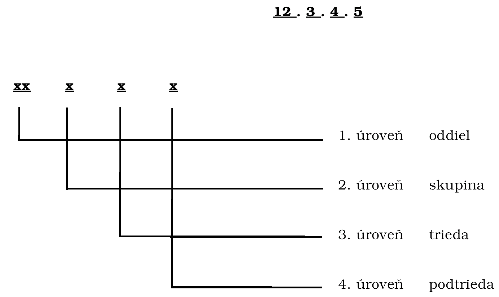

Príloha k opatreniu č. 160/2001 Z. z.

- KLASIFIKÁCIA VÝDAVKOV VEREJNEJ SPRÁVY

  - 01 VŠEOBECNÉ VEREJNÉ SLUŽBY

  - 01.1 Výdavky verejnej správy, finančná a rozpočtová oblasť, zahraničná oblasť

  - 01.1.1 Výdavky verejnej správy

  - 01.1.1.1 Kancelária Národnej rady Slovenskej republiky

  - 01.1.1.2 Kancelária prezidenta Slovenskej republiky

  - 01.1.1.3 Úrad vlády Slovenskej republiky

  - 01.1.1.4 Krajské úrady a okresné úrady

  - 01.1.2 Finančná a rozpočtová oblasť

  - 01.1.2.1 Ministerstvo financií Slovenskej republiky

  - 01.1.2.2 Najvyšší kontrolný úrad Slovenskej republiky

  - 01.1.2.3 Štátny dlh

  - 01.1.2.4 Úrad pre finančný trh

  - 01.1.3 Zahraničná oblasť

  - 01.1.3.1 Ministerstvo zahraničných vecí Slovenskej republiky

  - 01.1.3.2 Zastupiteľské úrady Slovenskej republiky v zahraničí

  - 01.1.3.3 Iné úrady Slovenskej republiky v zahraničí

  - 01.1.3.4 Obchodno-ekonomické oddelenia v zahraničí

  - 01.2 Zahraničná hospodárska pomoc

  - 01.2.1 Hospodárska pomoc rozvojovým krajinám a krajinám v procese transformácie

  - 01.2.2 Hospodárska pomoc smerovaná cez medzinárodné organizácie

  - 01.3 Všeobecné služby

  - 01.3.1 Všeobecné personálne služby

  - 01.3.2 Rámcové plánovacie a štatistické služby

  - 01.3.2.1 Štatistický úrad Slovenskej republiky

  - 01.3.3 Iné všeobecné služby

  - 01.3.3.1 Úrad geodézie, kartografie a katastra Slovenskej republiky

  - 01.3.3.2 Úrad pre verejné obstarávanie

  - 01.3.3.3 Ministerstvo pre správu a privatizáciu národného majetku Slovenskej republiky

  - 01.4 Základný výskum

  - 01.4.0 Základný výskum

  - 01.4.0.1 Základný výskum - Slovenská akadémia vied

  - 01.4.0.2 Slovenská akadémia vied - organizácie výskumu a vývoja

  - 01.4.0.3 Slovenská akadémia vied - ostatné organizácie

  - 01.4.0.4 Základný výskum na vysokých školách

  - 01.4.0.5 Základný výskum v ostatných štátnych a neštátnych subjektoch

  - 01.5 Výskum a vývoj v oblasti všeobecných verejných služieb

  - 01.5.0 Výskum a vývoj v oblasti všeobecných verejných služieb

  - 01.6 Všeobecné verejné služby inde neklasifikované

  - 01.6.0 Všeobecné verejné služby inde neklasifikované

  - 01.7 Transakcie verejného dlhu

  - 01.7.0 Transakcie verejného dlhu

  - 01.8 Transfery všeobecnej povahy medzi rôznymi úrovňami verejnej správy

  - 01.8.0 Transfery všeobecnej povahy medzi rôznymi úrovňami verejnej správy

  - 02 OBRANA

  - 02.1 Vojenská obrana

  - 02.1.0 Vojenská obrana

  - 02.1.0.1 Ministerstvo obrany Slovenskej republiky

  - 02.1.0.2 Železničné vojsko

  - 02.1.0.3 Vojenské spravodajstvo

  - 02.2 Civilná ochrana

  - 02.2.0 Civilná ochrana

  - 02.3 Zahraničná vojenská pomoc

  - 02.3.0 Zahraničná vojenská pomoc

  - 02.4 Výskum a vývoj v oblasti obrany

  - 02.4.0 Výskum a vývoj v oblasti obrany

  - 02.5 Obrana inde neklasifikovaná

  - 02.5.0 Obrana inde neklasifikovaná

  - 03 VEREJNÝ PORIADOK A BEZPEČNOSŤ

  - 03.1 Policajné služby

  - 03.1.0 Policajné služby

  - 03.2 Požiarna ochrana

  - 03.2.0 Požiarna ochrana

  - 03.3 Súdy

  - 03.3.0 Súdy

  - 03.3.0.1 Ústavný súd Slovenskej republiky

  - 03.3.0.2 Najvyšší súd Slovenskej republiky

  - 03.4 Väzenstvo

  - 03.4.0 Väzenstvo

  - 03.4.0.1 Vedľajšie hospodárstvo Zboru väzenskej a justičnej stráže Slovenskej republiky

  - 03.5 Výskum a vývoj v oblasti verejného poriadku a bezpečnosti

  - 03.5.0 Výskum a vývoj v oblasti verejného poriadku a bezpečnosti

  - 03.6 Verejný poriadok a bezpečnosť inde neklasifikované

  - 03.6.0 Verejný poriadok a bezpečnosť inde neklasifikované

  - 03.6.0.1 Ministerstvo vnútra Slovenskej republiky

  - 03.6.0.2 Ministerstvo spravodlivosti Slovenskej republiky

  - 03.6.0.3 Slovenská informačná služba

  - 03.6.0.4 Generálna prokuratúra Slovenskej republiky

  - 03.6.0.5 Železničná polícia

  - 04 EKONOMICKÁ OBLASŤ

  - 04.1 Všeobecná ekonomická, obchodná a pracovná oblasť

  - 04.1.1 Všeobecná ekonomická a obchodná oblasť

  - 04.1.1.1 Ministerstvo hospodárstva Slovenskej republiky

  - 04.1.1.2 Úrad priemyselného vlastníctva Slovenskej republiky

  - 04.1.1.3 Úrad pre normalizáciu, metrológiu a skúšobníctvo Slovenskej republiky

  - 04.1.1.4 Protimonopolný úrad Slovenskej republiky

  - 04.1.2 Všeobecná pracovná oblasť

  - 04.2 Poľnohospodárstvo, lesníctvo, rybárstvo a poľovníctvo

  - 04.2.1 Poľnohospodárstvo

  - 04.2.1.1 Ministerstvo pôdohospodárstva Slovenskej republiky

  - 04.2.1.2 Skúšobne a kontrolné ústavy

  - 04.2.1.3 Veterinárna oblasť

  - 04.2.1.4 Pozemkové úpravy

  - 04.2.1.5 Agentúra SAPARD

  - 04.2.1.6 Školské podniky

  - 04.2.2 Lesníctvo

  - 04.2.3 Rybárstvo a poľovníctvo

  - 04.3 Palivá a energia

  - 04.3.1 Uhlie a iné nerastné suroviny (energetické)

  - 04.3.2 Ropa a zemný plyn

  - 04.3.3 Jadrové palivo

  - 04.3.3.1 Úrad jadrového dozoru Slovenskej republiky

  - 04.3.4 Ostatné palivá

  - 04.3.5 Elektrina

  - 04.3.6 Energia iná ako elektrická

  - 04.4 Ťažba, výroba a výstavba

  - 04.4.1 Ťažba nerastných surovín (neenergetických)

  - 04.4.2 Výroba

  - 04.4.3 Výstavba

  - 04.4.3.1 Ministerstvo výstavby a regionálneho rozvoja Slovenskej republiky

  - 04.5 Doprava

  - 04.5.1 Cestná doprava

  - 04.5.1.1 Ministerstvo dopravy, pôšt a telekomunikácií Slovenskej republiky

  - 04.5.1.2 Výstavba a oprava diaľnic a ciest

  - 04.5.1.3 Správa a údržba ciest

  - 04.5.1.4 Slovenská správa ciest

  - 04.5.1.5 Ústav cestnej dopravy

  - 04.5.2 Vodná doprava

  - 04.5.2.1 Štátna plavebná správa

  - 04.5.2.2 Vyčistenie plavebnej dráhy Dunaja

  - 04.5.3 Železničná doprava

  - 04.5.4 Letecká doprava

  - 04.5.5 Potrubná a iná doprava

  - 04.6 Komunikácie

  - 04.6.0 Komunikácie

  - 04.7 Iné odvetvia

  - 04.7.1 Distribučné siete a skladovanie

  - 04.7.1.1 Správa štátnych hmotných rezerv Slovenskej republiky

  - 04.7.1.2 Štátne hmotné rezervy - hmotné rezervy

  - 04.7.1.3 Štátne hmotné rezervy - mobilizačné rezervy

  - 04.7.1.4 Štátne hmotné rezervy - osobitné zásoby

  - 04.7.2 Hotely a reštaurácie

  - 04.7.3 Cestovný ruch

  - 04.7.4 Viacúčelové rozvojové projekty

  - 04.8 Výskum a vývoj v ekonomickej oblasti

  - 04.8.1 Výskum a vývoj v ekonomickej, obchodnej a pracovnej oblasti

  - 04.8.2 Výskum a vývoj v oblasti poľnoshospodárstva, lesníctva, rybárstva a poľovníctva

  - 04.8.3 Výskum a vývoj v oblasti palív a energie

  - 04.8.4 Výskum a vývoj v oblasti ťažby, výroby a výstavby

  - 04.8.5 Výskum a vývoj v oblasti dopravy

  - 04.8.6 Výskum a vývoj v oblasti komunikácií

  - 04.8.7 Výskum a vývoj v iných odvetviach

  - 04.9 Ekonomická oblasť inde neklasifikovaná

  - 04.9.0 Ekonomická oblasť inde neklasifikovaná

  - 04.9.0.1 Národná agentúra pre rozvoj malého a stredného podnikania

  - 05 OCHRANA ŽIVOTNÉHO PROSTREDIA

  - 05.1 Nakladanie s odpadmi

  - 05.1.0 Nakladanie s odpadmi

  - 05.2 Nakladanie s odpadovými vodami

  - 05.2.0 Nakladanie s odpadovými vodami

  - 05.3 Znižovanie znečisťovania

  - 05.3.0 Znižovanie znečisťovania

  - 05.4 Ochrana prírody a krajiny

  - 05.4.0 Ochrana prírody a krajiny

  - 05.5 Výskum a vývoj v oblasti ochrany životného prostredia

  - 05.5.0 Výskum a vývoj v oblasti ochrany životného prostredia

  - 05.6 Ochrana životného prostredia inde neklasifikovaná

  - 05.6.0 Ochrana životného prostredia inde neklasifikovaná

  - 05.6.0.1 Ministerstvo životného prostredia Slovenskej republiky

  - 06 BÝVANIE A OBČIANSKA VYBAVENOSŤ

  - 06.1 Rozvoj bývania

  - 06.1.0 Rozvoj bývania

  - 06.2 Rozvoj obcí

  - 06.2.0 Rozvoj obcí

  - 06.3 Zásobovanie vodou

  - 06.3.0 Zásobovanie vodou

  - 06.4 Verejné osvetlenie

  - 06.4.0 Verejné osvetlenie

  - 06.5 Výskum a vývoj v oblasti bývania a občianskej vybavenosti

  - 06.5.0 Výskum a vývoj v oblasti bývania a občianskej vybavenosti

  - 06.6 Bývanie a občianska vybavenosť inde neklasifikované

  - 06.6.0 Bývanie a občianska vybavenosť inde neklasifikované

  - 07 ZDRAVOTNÍCTVO

  - 07.1 Zdravotnícke výrobky, prístroje a zariadenia

  - 07.1.1 Farmaceutické výrobky

  - 07.1.2 Iné zdravotnícke výrobky

  - 07.1.3 Terapeutické pomôcky a vybavenie

  - 07.2 Služby pre ambulantných pacientov

  - 07.2.1 Všeobecné lekárske služby

  - 07.2.2 Špecializované lekárske služby

  - 07.2.3 Stomatologické služby

  - 07.2.4 Zdravotnícke služby

  - 07.3 Nemocničné služby

  - 07.3.1 Všeobecné nemocničné služby

  - 07.3.2 Špecializované nemocničné služby

  - 07.3.3 Služby medicínskych centier a pôrodníc

  - 07.3.4 Služby opatrovateľských domov a zotavovní

  - 07.4 Verejné zdravotné služby

  - 07.4.0 Verejné zdravotné služby

  - 07.4.0.1 Štátne zdravotné ústavy

  - 07.5 Výskum a vývoj v oblasti zdravotníctva

  - 07.5.0 Výskum a vývoj v oblasti zdravotníctva

  - 07.6 Zdravotníctvo inde neklasifikované

  - 07.6.0 Zdravotníctvo inde neklasifikované

  - 07.6.0.1 Ministerstvo zdravotníctva Slovenskej republiky

  - 07.6.0.2 Štátny ústav pre kontrolu liečiv

  - 07.6.0.3 Ústav zdravotníckych informácií a štatistiky

  - 07.6.0.4 Slovenská lekárska knižnica

  - 08 REKREÁCIA, KULTÚRA A NÁBOŽENSTVO

  - 08.1 Rekreačné a športové služby

  - 08.1.0 Rekreačné a športové služby

  - 08.2 Kultúrne služby

  - 08.2.0 Kultúrne služby

  - 08.2.0.1 Divadlá

  - 08.2.0.2 Umelecké súbory

  - 08.2.0.3 Klubové a špeciálne kultúrne zariadenia

  - 08.2.0.4 Odborno-metodické zariadenia

  - 08.2.0.5 Knižnice

  - 08.2.0.6 Múzeá a galérie

  - 08.2.0.7 Pamiatková starostlivosť

  - 08.2.0.8 Národnostná kultúra

  - 08.2.0.9 Ostatné kultúrne služby

  - 08.3 Vysielacie a vydavateľské služby

  - 08.3.0 Vysielacie a vydavateľské služby

  - 08.4 Náboženské a iné spoločenské služby

  - 08.4.0 Náboženské a iné spoločenské služby

  - 08.5 Výskum a vývoj v oblasti rekreácie, kultúry a náboženstva

  - 08.5.0 Výskum a vývoj v oblasti rekreácie, kultúry a náboženstva

  - 08.6 Rekreácia, kultúra a náboženstvo inde neklasifikované

  - 08.6.0 Rekreácia, kultúra a náboženstvo inde neklasifikované

  - 08.6.0.1 Ministerstvo kultúry Slovenskej republiky

  - 09 VZDELÁVANIE

  - 09.1 Predškolská výchova a základné vzdelanie

  - 09.1.1 Predškolská výchova

  - 09.1.2 Základné vzdelanie

  - 09.2 Stredoškolské vzdelávanie

  - 09.2.1 Osemročné gymnáziá

  - 09.2.2 Gymnáziá

  - 09.2.3 Športové gymnáziá

  - 09.2.4 Stredné odborné školy

  - 09.2.5 Stredné odborné školy umeleckého zamerania

  - 09.2.6 Stredné odborné učilištia a odborné učilištia

  - 09.2.7 Združené školy

  - 09.3 Pomaturitné vzdelávanie

  - 09.3.0 Pomaturitné vzdelávanie

  - 09.4 Vysokoškolské vzdelávanie

  - 09.4.1 Prvý stupeň vysokoškolského vzdelávania

  - 09.4.2 Druhý stupeň vysokoškolského vzdelávania

  - 09.5 Vzdelávanie nedefinovateľné podľa úrovne

  - 09.5.0 Vzdelávanie nedefinovateľné podľa úrovne

  - 09.6 Služby pridružené ku školstvu

  - 09.6.0 Služby pridružené ku školstvu

  - 09.6.0.1 Školské stravovanie

  - 09.6.0.2 Domovy mládeže

  - 09.6.0.3 Školské stravovanie a ubytovanie v špeciálnych školách

  - 09.6.0.4 Zariadenia na záujmové vzdelávanie

  - 09.6.0.5 Metodické centrá, zariadenia výchovného poradenstva

  - 09.6.0.6 Zariadenia výchovnej prevencie

  - 09.7 Výskum a vývoj v oblasti vzdelávania

  - 09.7.0 Výskum a vývoj v oblasti vzdelávania

  - 09.8 Vzdelávanie inde neklasifikované

  - 09.8.0 Vzdelávanie inde neklasifikované

  - 09.8.0.1 Ministerstvo školstva Slovenskej republiky

  - 10 SOCIÁLNE ZABEZPEČENIE

  - 10.1 Choroba, invalidita a ťažké zdravotné postihnutie

  - 10.1.1 Choroba

  - 10.1.2 Invalidita a ťažké zdravotné postihnutie

  - 10.1.2.1 Peňažné príspevky na kompenzáciu ťažkého zdravotného postihnutia

  - 10.1.2.2 Zariadenia sociálnych služieb - invalidita a ťažké zdravotné postihnutie

  - 10.1.2.3 Ďalšie sociálne služby - invalidita a ťažké zdravotné postihnutie

  - 10.1.2.4 Príspevky neštátnym subjektom - invalidita a ťažké zdravotné postihnutie

  - 10.2 Staroba

  - 10.2.0 Staroba

  - 10.2.0.1 Zariadenia sociálnych služieb - staroba

  - 10.2.0.2 Ďalšie sociálne služby - staroba

  - 10.2.0.3 Príspevky neštátnym subjektom - staroba

  - 10.3 Pozostalí

  - 10.3.0 Pozostalí

  - 10.4 Rodina a deti

  - 10.4.0 Rodina a deti

  - 10.4.0.1 Štátne sociálne dávky - rodina a deti

  - 10.4.0.2 Zariadenia sociálnych služieb - rodina a deti

  - 10.4.0.3 Ďalšie sociálne služby - rodina a deti

  - 10.4.0.4 Príspevky neštátnym subjektom - rodina a deti

  - 10.4.0.5 Ďalšie dávky sociálneho zabezpečenia - rodina a deti

  - 10.5 Nezamestnanosť

  - 10.5.0 Nezamestnanosť

  - 10.6 Bývanie

  - 10.6.0 Bývanie

  - 10.7 Sociálna pomoc občanom v hmotnej a sociálnej núdzi

  - 10.7.0 Sociálna pomoc občanom v hmotnej a sociálnej núdzi

  - 10.7.0.1 Dávky sociálnej pomoci - pomoc občanom v hmotnej a sociálnej núdzi

  - 10.7.0.2 Zariadenia sociálnych služieb - pomoc občanom v hmotnej a sociálnej núdzi

  - 10.7.0.3 Ďalšie sociálne služby - pomoc občanom v hmotnej a sociálnej núdzi

  - 10.7.0.4 Príspevky neštátnym subjektom - pomoc občanom v hmotnej a sociálnej núdzi

  - 10.8 Výskum a vývoj v oblasti sociálneho zabezpečenia

  - 10.8.0 Výskum a vývoj v oblasti sociálneho zabezpečenia

  - 10.9 Sociálne zabezpečenie inde neklasifikované

  - 10.9.0 Sociálne zabezpečenie inde neklasifikované

  - 10.9.0.1 Ministerstvo práce, sociálnych vecí a rodiny Slovenskej republiky

  - 10.9.0.2 Tvorba a realizácia vládnej politiky v oblasti sociálneho zabezpečenia

  - 10.9.0.3 Organizácie vykonávajúce poradenstvo

  - VYSVETLIVKY K SYSTÉMU KÓDOVANIA KLASIFIKÁCIE VÝDAVKOV VEREJNEJ SPRÁVY

  - Klasifikácia výdavkov verejnej správy je štvorúrovňová a pre jednotlivé úrovne sa používa toto označenie:

  - 1. úroveň - oddiel - označený dvojmiestnym kódom

  - 2. úroveň - skupina - označená trojmiestnym kódom

  - 3. úroveň - trieda - označená štvormiestnym kódom

  - 4. úroveň - podtrieda - označená päťmiestnym kódom

    - Schéma číselného kódu:

  - 

    - Klasifikácia výdavkov verejnej správy je do tretej úrovne identická s medzinárodným štandardom COFOG, štvrtá úroveň zohľadňuje národné špecifiká triedenia výdavkov verejnej správy podľa účelu ich použitia. Výnimku predstavuje skupina 09.2, kde národné špecifiká sú zohľadnené už na 3. úrovni.

  - VYSVETLIVKY KU KLASIFIKÁCII VÝDAVKOV VEREJNEJ SPRÁVY

  - (uvádzajú sa len rámcovo)

  - 01 VŠEOBECNÉ VEREJNÉ SLUŽBY

  - 01.1 Výdavky verejnej správy, finančná a rozpočtová oblasť, zahraničná oblasť

  - 01.1.1 Výdavky verejnej správy

    - Riadenie, prevádzka alebo podpora verejnej správy.

    - Táto trieda zahŕňa: výdavky na činnosť obecných úradov a obecných zastupiteľstiev (mestských úradov, mestských zastupiteľstiev), poslancov Národnej rady Slovenskej republiky, knižníc a na iné služby slúžiace najmä orgánom verejnej správy na prístup k informáciám (internetové miestnosti a pod.), stravovanie pre výkonné a legislatívne orgány, technické služby Úradu vlády Slovenskej republiky; zákonodarným zborom vytvorené trvalé alebo účelové komisie, stále alebo dočasné orgány, výbory a tie, ktoré konajú v jeho mene.

    - V tejto triede nie sú zahrnuté: výdavky na činnosť ministerstiev a ostatných ústredných orgánov štátnej správy Slovenskej republiky, poradných orgánov vlády Slovenskej republiky, útvarov orgánov miestnej štátnej správy a samosprávy, ktoré sa zaoberajú určitou činnosťou (triedia sa podľa príslušnej funkcie).

  - 01.1.1.1 Kancelária Národnej rady Slovenskej republiky

  - 01.1.1.2 Kancelária prezidenta Slovenskej republiky

  - 01.1.1.3 Úrad vlády Slovenskej republiky

  - 01.1.1.4 Krajské úrady a okresné úrady

  - 01.1.2 Finančná a rozpočtová oblasť

    - Správa finančných a rozpočtových vecí a služieb; správa verejných fondov a verejného dlhu; operácie súvisiace so správou daní; prevádzka štátnej pokladnice; prevádzka Ministerstva financií Slovenskej republiky, daňových úradov, správ finančnej kontroly; účtovnícke a kontrolné služby, provízia za distribúciu a predaj kolkov.

    - Vytváranie a rozširovanie všeobecných informácií a štatistických údajov o finančnej a rozpočtovej oblasti.

    - Táto trieda zahŕňa: výdavky na činnosť Daňového riaditeľstva Slovenskej republiky, správ finančnej kontroly; finančné a rozpočtové veci na všetkých úrovniach verejnej správy, poplatky Národnej banke Slovenska a iným finančným inštitúciám za služby pre štátny rozpočet.

    - V tejto triede nie sú zahrnuté: platby úrokov z vládnych pôžičiek (01.7.0), štátny dozor nad bankami (04.1.1).

  - 01.1.2.1 Ministerstvo financií Slovenskej republiky

  - 01.1.2.2 Najvyšší kontrolný úrad Slovenskej republiky

  - 01.1.2.3 Štátny dlh

  - 01.1.2.4 Úrad pre finančný trh

  - 01.1.3 Zahraničná oblasť

    - Riadenie zahraničných vecí a služieb.

    - Prevádzka Ministerstva zahraničných vecí Slovenskej republiky, diplomatických a konzulárnych zastupiteľstiev v zahraničí alebo pri úradoch medzinárodných organizácií; prevádzka obchodno-ekonomických oddelení v zahraničí, ktoré sú v správe Ministerstva hospodárstva Slovenskej republiky; prevádzka alebo podpora informačných a kultúrnych služieb na účel ich rozšírenia do zahraničia; prevádzka a podpora knižníc, čitární a informačných služieb umiestnených v zahraničí, obchodné výstavy a trhy v zahraničí.

    - Pravidelné a špeciálne príspevky na členstvo v medzinárodných organizáciách, ktoré vyplývajú z medzinárodných dohôd, príspevky na programy vedecko-technickej spolupráce a programy medzinárodnej spolupráce v oblasti vzdelávania.

    - V tejto triede nie sú zahrnuté: výdavky na hospodársku pomoc rozvojovým krajinám a krajinám v procese transformácie (01.2.1); misie hospodárskej pomoci akreditované pri zahraničných vládach (01.2.1); príspevky na programy pomoci pod správou medzinárodných alebo regionálnych organizácií (01.2.2); vojenské jednotky umiestnené v zahraničí (02.1.0); vojenská pomoc cudzím krajinám (02.3.0); všeobecná ekonomická a obchodná oblasť v zahraničí (04.1.1); služby v oblasti cestovného ruchu vrátane turistiky (04.7.3).

  - 01.1.3.1 Ministerstvo zahraničných vecí Slovenskej republiky

  - 01.1.3.2 Zastupiteľské úrady Slovenskej republiky v zahraničí

  - 01.1.3.3 Iné úrady Slovenskej republiky v zahraničí

  - 01.1.3.4 Obchodno-ekonomické oddelenia v zahraničí

    - Táto podtrieda zahŕňa: výdavky na činnosť obchodno-ekonomických oddelení v zahraničí, ktoré sú v pôsobnosti Ministerstva hospodárstva Slovenskej republiky.

  - 01.2 Zahraničná hospodárska pomoc

  - 01.2.1 Hospodárska pomoc rozvojovým krajinám a krajinám v procese transformácie

    - Riadenie hospodárskej spolupráce s rozvojovými krajinami a krajinami v procese transformácie.

    - Prevádzkovanie misií hospodárskej pomoci akreditovaných pri zahraničných vládach; prevádzka alebo podpora programov technickej pomoci, školiacich, postgraduálnych a štipendijných programov; hospodárska pomoc vo forme hotovostných alebo naturálnych grantov alebo pôžičiek (bez ohľadu na platbu úrokov).

    - V tejto triede nie sú zahrnuté: príspevky do fondov hospodárskeho rozvoja pod správou medzinárodných alebo regionálnych organizácií (01.2.2), výdavky na vojenskú pomoc cudzím krajinám (02.3.0).

  - 01.2.2 Hospodárska pomoc smerovaná cez medzinárodné organizácie

    - Správa hospodárskej pomoci smerovaná cez medzinárodné organizácie; príspevky v hotovosti alebo v naturáliách do fondov hospodárskej pomoci pod správou medzinárodných, regionálnych alebo iných nadnárodných organizácií.

    - V tejto triede nie sú zahrnuté: výdavky na pomoc medzinárodným mierovým organizáciám (02.3.0).

  - 01.3 Všeobecné služby

    - Do tejto skupiny patria služby, ktoré nesúvisia so žiadnou špecifickou funkciou a ktoré sa spravidla uskutočňujú na rôznych úrovniach verejnej správy. Patria sem tiež služby súvisiace s konkrétnou funkciou, ktoré vykonávajú takéto centrálne úrady - zostavovanie štatistiky priemyslu, životného prostredia, zdravia alebo vzdelania, ľudí, domov a bytov štatistickým úradom.

  - 01.3.1 Všeobecné personálne služby

    - Administrácia a vykonávanie všeobecných personálnych služieb vrátane rozvoja a realizácie rámcových personálnych stratégií a postupov pokrývajúcich výber, propagáciu, hodnotiace metódy, opisy, oceňovanie a zaraďovanie pracovných miest, administráciu predpisov týkajúcich sa civilnej služby a podobné služby.

    - V tejto triede nie sú zahrnuté: výdavky na personálnu administratívu a služby spojené so špecifickou funkciou (triedia sa podľa funkcie).

  - 01.3.2 Rámcové plánovacie a štatistické služby

    - Administrácia a vykonávanie rámcových hospodárskych a sociálnych plánovacích služieb a rámcových štatistických služieb vrátane zostavovania, koordinovania a monitorovania rámcových hospodárskych a sociálnych plánov a programov a rámcových štatistických plánov a programov.

    - Táto trieda zahŕňa: výdavky na štatistickú činnosť, budovanie štátneho informačného systému, štatistické služby, sčítanie ľudu, domov a bytov.

    - V tejto triede nie sú zahrnuté: výdavky na hospodárske a sociálne plánovacie služby a štatistické služby súvisiace so špecifickou funkciou (triedia sa podľa funkcie).

  - 01.3.2.1 Štatistický úrad Slovenskej republiky

  - 01.3.3 Iné všeobecné služby

    - Administrácia a vykonávanie iných všeobecných služieb, ako sú služby centralizovaného zásobovania a predaja, údržba a uchovávanie vládnych záznamov, evidencií a archívov (vrátane územných), prevádzky budov, centrálnych vozových parkov, tlačiarní, ktoré spravuje a prevádzkuje vláda, geodézie, kartografie, katastra, výpočtových stredísk.

    - Táto trieda zahŕňa: výdavky na činnosť Datacentra, Centra vedecko-technických informácií Slovenskej republiky, Centra pre rozvoj, vedu a technológie, vedeckých knižníc; ochranu osobných údajov v informačnom systéme.

    - V tejto triede nie sú zahrnuté: výdavky na iné všeobecné služby spojené so špecifickou funkciou (triedia sa podľa funkcie).

  - 01.3.3.1 Úrad geodézie, kartografie a katastra Slovenskej republiky

  - 01.3.3.2 Úrad pre verejné obstarávanie

  - 01.3.3.3 Ministerstvo pre správu a privatizáciu národného majetku Slovenskej republiky

  - 01.4 Základný výskum

    - Základný výskum je experimentálna alebo teoretická činnosť zameraná predovšetkým na získavanie nových poznatkov o podstate javov a pozorovateľných faktov, predbežne bez konkrétnej aplikácie alebo bezprostredného využitia.

  - 01.4.0 Základný výskum

    - Riadenie a prevádzkovanie organizácií zriadených zákonom na vykonávanie základného výskumu vrátane pracovísk výskumu a vývoja na štátnych vysokých školách.

    - Granty, pôžičky a dotácie na podporu základného výskumu v inom ako vládnom sektore (neštátne vysoké školy, výskumné ústavy alebo pracoviská výskumu a vývoja v podnikateľskom sektore a pod.).

    - Táto trieda zahŕňa: výdavky na činnosť rozpočtových organizácií výskumu a vývoja a príspevok pre príspevkové organizácie výskumu a vývoja štátneho sektora a sektora vysokých škôl vykonávajúcich základný výskum, štátnu pomoc na základný výskum vykonávaný organizáciami podnikateľského sektora.

    - V tejto triede nie sú zahrnuté: výdavky na aplikovaný výskum a experimentálny vývoj (triedia sa podľa funkcie).

  - 01.4.0.1 Základný výskum - Slovenská akadémia vied

  - 01.4.0.2 Slovenská akadémia vied - organizácie výskumu a vývoja

  - 01.4.0.3 Slovenská akadémia vied - ostatné organizácie

  - 01.4.0.4 Základný výskum na vysokých školách

  - 01.4.0.5 Základný výskum v ostatných štátnych a neštátnych subjektoch

  - 01.5 Výskum a vývoj v oblasti všeobecných verejných služieb

    - Aplikovaný výskum je výskum orientovaný na praktické využitie znalostí a objavovanie nových poznatkov s cieľom ich využitia v hospodárskej a spoločenskej praxi.

    - Vývoj je systematické využívanie vedeckých poznatkov zamerané na výrobu úžitkových materiálov, zariadení, systémov, metód a procesov vrátane konštrukcie vývoja prototypov.

  - 01.5.0 Výskum a vývoj v oblasti všeobecných verejných služieb

    - Riadenie a prevádzkovanie organizácií zriadených zákonom zapojených do aplikovaného výskumu a experimentálneho vývoja v oblasti všeobecných verejných služieb. Granty, pôžičky a dotácie na podporu aplikovaného výskumu a experimentálneho vývoja v oblasti všeobecných verejných služieb, ktorý sa realizuje v inom ako vládnom sektore (neštátne vysoké školy, výskumné ústavy alebo pracoviská výskumu a vývoja v podnikateľskom sektore a pod.).

    - Táto trieda zahŕňa: príspevok pre príspevkové organizácie výskumu a vývoja štátneho sektora vykonávajúcich aplikovaný výskum a experimentálny vývoj v oblasti všeobecných verejných služieb, štátnu pomoc na aplikovaný výskum a štátnu pomoc na vývoj vykonávaný organizáciami podnikateľského sektora.

    - V tejto triede nie sú zahrnuté: výdavky na základný výskum (01.4.0).

  - 01.6 Všeobecné verejné služby inde neklasifikované

  - 01.6.0 Všeobecné verejné služby inde neklasifikované

    - Riadenie, vykonávanie alebo podpora všeobecných verejných služieb, ako je registrácia voličov, organizovanie volieb, referend a podobne.

    - Táto trieda zahŕňa: výdavky na všeobecné verejné služby, ktoré nemožno zaradiť do (01.1), (01.2), (01.3), (01.4) a (01.5).

    - V tejto triede nie sú zahrnuté: transakcie verejného dlhu (01.7); transfery všeobecného charakteru medzi rôznymi úrovňami verejnej správy (01.8).

  - 01.7 Transakcie verejného dlhu

  - 01.7.0 Transakcie verejného dlhu

    - Platby úrokov a výdavky na upisovanie a emitovanie pôžičiek na všetkých úrovniach verejnej správy.

    - V tejto triede nie sú zahrnuté: administratívne výdavky na správu verejného dlhu (01.1.2).

  - 01.8 Transfery všeobecnej povahy medzi rôznymi úrovňami verejnej správy

  - 01.8.0 Transfery všeobecnej povahy medzi rôznymi úrovňami verejnej správy

    - Transfery medzi rôznymi úrovňami verejnej správy, ktoré majú všeobecný charakter a nemožno ich priradiť ku konkrétnej funkcii.

    - Verejná správa má dve úrovne - ústrednú a miestnu (obce). Ústredná správa zahŕňa ústredné rozpočtové organizácie, štátne fondy, Sociálnu poisťovňu, zdravotné poisťovne, Fond národného majetku Slovenskej republiky, Národný úrad práce, príspevkové organizácie.

  - 02 OBRANA

  - 02.1 Vojenská obrana

  - 02.1.0 Vojenská obrana

    - Riadenie vecí a služieb vojenskej obrany; prevádzkovanie pozemných, vzdušných a vesmírnych obranných síl; prevádzkovanie technických, dopravných, komunikačných, spravodajských, personálnych a iných nebojových obranných síl; prevádzka alebo podpora zálohových a pomocných síl systému obrany.

    - Táto trieda zahŕňa: výdavky na Armádu Slovenskej republiky, vojenské spravodajstvo, prípravu teritória štátu na obranu, hospodársku mobilizáciu, železničné vojsko, úrady vojenských pridelencov pôsobiacich v zahraničí, poľné nemocnice.

    - V tejto triede nie sú zahrnuté: výdavky na misie vojenskej pomoci (02.3.0), vojenské školy a fakulty s osnovami podobnými osnovám civilných inštitúcií, i keď dochádzka môže byť obmedzená na vojenský personál a rodiny členov vojenského personálu (09.1), (09.2), (09.3) alebo (09.4), nemocnice na základniach (07.3), dôchodkové systémy (programy) pre vojenský personál (10.2).

  - 02.1.0.1 Ministerstvo obrany Slovenskej republiky

  - 02.1.0.2 Železničné vojsko

  - 02.1.0.3 Vojenské spravodajstvo

  - 02.2 Civilná ochrana

  - 02.2.0 Civilná ochrana

    - Riadenie vecí a služieb civilnej ochrany; zostavovanie plánov pre výnimočné situácie; organizácie cvičení, do ktorých sú zapojené civilné inštitúcie a obyvateľstvo. Prevádzkovanie alebo podpora síl civilnej ochrany.

    - V tejto triede nie sú zahrnuté: výdavky na horskú záchrannú službu, mestské a obecné požiarne zbory (03.2.0); nákup a skladovanie potravín, zariadenia a iných zásob na núdzové použitie v prípade katastrof počas mieru (10.9.0).

  - 02.3 Zahraničná vojenská pomoc

  - 02.3.0 Zahraničná vojenská pomoc

    - Riadenie vojenskej pomoci a prevádzkovanie misií vojenskej pomoci akreditovaných pri cudzích vládach alebo pričlenených k medzinárodným vojenským organizáciám alebo alianciám; pomoc vo forme finančnej alebo naturálnej, poskytovanie úverov alebo zapožičania vybavenia; príspevky medzinárodným mierovým silám vrátane pridelenia ľudských síl.

  - 02.4 Výskum a vývoj v oblasti obrany

    - Charakteristiky základného výskumu, aplikovaného výskumu a experimentálneho vývoja sú uvedené v (01.4) a (01.5).

  - 02.4.0 Výskum a vývoj v oblasti obrany

    - Riadenie a prevádzkovanie organizácií riadených vládou zapojených do aplikovaného výskumu a experimentálneho vývoja v oblasti obrany.

    - Granty, pôžičky a dotácie na podporu aplikovaného výskumu a experimentálneho vývoja v oblasti obrany realizovaného neštátnymi vysokými školami, výskumnými ústavmi alebo pracoviskami výskumu a vývoja v podnikateľskom sektore.

    - Táto trieda zahŕňa: príspevok pre príspevkové organizácie výskumu a vývoja štátneho sektora vykonávajúce aplikovaný výskum a experimentálny vývoj v oblasti obrany, štátnu pomoc na aplikovaný výskum a štátnu pomoc na vývoj vykonávaný organizáciami podnikateľského sektora v oblasti obrany.

    - V tejto triede nie sú zahrnuté: výdavky na základný výskum (01.4.0).

  - 02.5 Obrana inde neklasifikovaná

  - 02.5.0 Obrana inde neklasifikovaná

    - Riadenie, prevádzkovanie alebo podpora činností, ako sú zostavovanie, riadenie, koordinácia a monitorovanie celkových stratégií, plánov, programov a rozpočtov na obranu; vytváranie a rozširovanie všeobecných informácií, technickej dokumentácie a štatistík za oblasť obrany.

    - Táto trieda zahŕňa: výdavky na stredné vojenské školy a vysoké vojenské školy, vojenskú prokuratúru a vojenské súdy, služby v oblasti obrany, ktoré nemožno zaradiť do (02.1), (02.2), (02.3), (02.4).

    - V tejto triede nie sú zahrnuté: výdavky na riadenie oblasti týkajúcej sa vojnových veteránov (10.2).

  - 03 VEREJNÝ PORIADOK A BEZPEČNOSŤ

  - 03.1 Policajné služby

  - 03.1.0 Policajné služby

    - Riadenie policajných vecí a služieb vrátane registrácie cudzincov, vydávania pracovných a cestovných dokladov prisťahovalcom, vedenie evidencie väzňov a štatistík súvisiacich s prácou polície, riadenie a kontrola cestnej premávky, vydávanie vodičských preukazov a prevencia pašovania. Prevádzkovanie riadnych a pomocných policajných služieb, prístavných, hraničných a pobrežných hliadok a iných špeciálnych policajných síl prevádzkovaných štátnymi orgánmi; prevádzkovanie policajných laboratórií; prevádzkovanie alebo podpora výcvikových programov pre políciu.

    - Táto trieda zahŕňa: výdavky na políciu, pomocné dopravné hliadky, obecnú políciu, stredné školy a vysoké školy zriadené Ministerstvom vnútra Slovenskej republiky, automobilové opravovne a tlačiarne Ministerstva vnútra Slovenskej republiky.

    - V tejto triede nie sú zahrnuté: výdavky na policajné akadémie poskytujúce okrem policajného výcviku aj všeobecné vzdelanie (09.1), (09.2), (09.3), (09.4) a (09.8.0), na vojenskú políciu (02.1.0).

  - 03.2 Požiarna ochrana

  - 03.2.0 Požiarna ochrana

    - Riadenie vecí a služieb požiarnej ochrany a hasiacich zásahov; prevádzkovanie požiarnych zborov v správe štátnych orgánov; prevádzkovanie alebo podpora výcvikových programov pre požiarnikov, prevádzkovanie požiarnických laboratórií.

    - Podpora činností na predchádzanie požiarom, preventívno-výchovné pôsobenie v oblasti požiarnej ochrany a podpora činností združení pôsobiacich na úseku ochrany pred požiarmi.

    - Táto trieda zahŕňa: výdavky na horskú záchrannú službu, evakuáciu zaplavených oblastí, obecné (mestské) požiarne zbory.

    - V tejto triede nie sú zahrnuté: výdavky na civilnú ochranu (02.2.0).

  - 03.3 Súdy

  - 03.3.0 Súdy

    - Riadenie, prevádzka, výkon súdnictva (civilného, trestného, správneho, obchodného) na účel zabezpečenia rozhodovania o právach, povinnostiach a právom chránených záujmoch fyzických osôb, právnických osôb a štátu, o vine obžalovaného a o ukladaní zákonom ustanovených trestov, preskúmavanie zákonných rozhodnutí orgánov verejnej správy a iných orgánov.

    - Táto trieda zahŕňa: výdavky na súdy, ochranu svedka, súdne a mimosúdne rehabilitácie, realizáciu súdnych a exekučných rozhodnutí, správu pre veci majetkové, verejného ochrancu práv.

    - V tejto triede nie sú zahrnuté: výdavky na správu väzníc (03.4.0).

  - 03.3.0.1 Ústavný súd Slovenskej republiky

  - 03.3.0.2 Najvyšší súd Slovenskej republiky

  - 03.4 Väzenstvo

  - 03.4.0 Väzenstvo

    - Riadenie, prevádzkovanie alebo podpora väzníc a iných miest na zadržiavanie alebo nápravu trestancov, ako sú nápravné ústavy, nápravné zariadenia, ústavy pre duševne chorých väzňov, nemocnice pre obvinených a odsúdených.

    - Táto trieda zahŕňa: výdavky na činnosť generálneho riaditeľstva Zboru väzenskej a justičnej stráže, Zboru väzenskej a justičnej stráže Slovenskej republiky (ďalej len „zbor“), vedľajšieho hospodárstva zboru, automobilové opravovne zboru, tlačiarne a archívy zboru, zariadenia náhradnej výchovy, strednej školy zriadenej Ministerstvom spravodlivosti Slovenskej republiky.

  - 03.4.0.1 Vedľajšie hospodárstvo Zboru väzenskej a justičnej stráže Slovenskej republiky

  - 03.5 Výskum a vývoj v oblasti verejného poriadku a bezpečnosti

    - Charakteristiky základného výskumu, aplikovaného výskumu a experimentálneho vývoja sú uvedené v (01.4) a (01.5).

  - 03.5.0 Výskum a vývoj v oblasti verejného poriadku a bezpečnosti

    - Riadenie a prevádzkovanie organizácií zriadených vládou, ktoré sa zaoberajú aplikovaným výskumom a experimentálnym vývojom v oblasti verejného poriadku a bezpečnosti. Podpora aplikovaného výskumu a experimentálneho vývoja týkajúceho sa tejto oblasti, ktorý uskutočňujú neštátne vysoké školy, výskumné ústavy alebo pracoviská výskumu a vývoja v podnikateľskom sektore.

    - Táto trieda zahŕňa: príspevok pre príspevkové organizácie výskumu a vývoja štátneho sektora vykonávajúce aplikovaný výskum a experimentálny vývoj v oblasti verejného poriadku a bezpečnosti, štátnu pomoc na aplikovaný výskum a štátnu pomoc na vývoj vykonávaný organizáciami podnikateľského sektora v oblasti verejného poriadku a bezpečnosti.

    - V tejto triede nie sú zahrnuté: výdavky na základný výskum (01.4.0).

  - 03.6 Verejný poriadok a bezpečnosť inde neklasifikované

  - 03.6.0 Verejný poriadok a bezpečnosť inde neklasifikované

    - Riadenie, prevádzkovanie alebo podpora činností, ako je zostavovanie, správa, koordinácia a monitorovanie rámcových stratégií, plánov, programov a rozpočtov v oblasti verejného poriadku a bezpečnosti; príprava a zavádzanie legislatívy a noriem na uplatňovanie verejného poriadku a bezpečnosti; plnenie úloh vo veciach ochrany ústavného zriadenia, vnútorného poriadku a bezpečnosti štátu, príprava a rozširovanie všeobecných informácií, technickej dokumentácie a štatistík v oblasti verejného poriadku a bezpečnosti.

    - Táto trieda zahŕňa: výdavky na prokuratúry, inšpekčnú činnosť verejného poriadku, veci a služby v oblasti verejného poriadku a bezpečnosti, ktoré nemožno zaradiť do (03.1), (03.2), (03.3), (03.4) a (03.5).

  - 03.6.0.1 Ministerstvo vnútra Slovenskej republiky

  - 03.6.0.2 Ministerstvo spravodlivosti Slovenskej republiky

  - 03.6.0.3 Slovenská informačná služba

  - 03.6.0.4 Generálna prokuratúra Slovenskej republiky

  - 03.6.0.5 Železničná polícia

  - 04 EKONOMICKÁ OBLASŤ

  - 04.1 Všeobecná ekonomická, obchodná a pracovná oblasť

  - 04.1.1 Všeobecná ekonomická a obchodná oblasť

    - Riadenie všeobecných ekonomických a obchodných vecí a služieb vrátane všeobecných vecí zahraničného obchodu (colníc a podobne); zostavovanie a zavádzanie všeobecných ekonomických a obchodných stratégií; spolupráca na rôznych úrovniach verejnej správy a medzi verejnou správou a podnikmi.

    - Riadenie alebo podpora všeobecných ekonomických a obchodných aktivít, ako je vývoz a dovoz ako celok, trh s komoditami a akciami, kontrola príjmov, aktivity na zvýšenie obchodovania vo všeobecnosti, všeobecná regulácia monopolov a iné obmedzenia obchodovania a vstupu na trh, štátny dozor nad bankami, metrologický dozor.

    - Prevádzka alebo podpora inštitúcií, ktoré sa zaoberajú patentmi, obchodnými značkami, autorskými právami, normami, registráciou právnických osôb a živnostníkov, meteorológiou, hydrologickými prieskumami, geodetickými prieskumami, environmentálnymi, geologickými prieskumami, štátnou štandardizáciou a podobne.

    - Granty, pôžičky alebo dotácie na propagáciu rámcových hospodárskych a obchodných stratégií a programov.

    - Táto trieda zahŕňa: výdavky na Colné riaditeľstvo Slovenskej republiky, Puncový úrad Slovenskej republiky, Slovenskú obchodnú inšpekciu, Slovenský ústav technickej normalizácie, výchovu a ochranu spotrebiteľa, výdavky spojené s prevádzkou vlastnej jedálne.

    - V tejto triede nie sú zahrnuté: výdavky na ekonomickú a obchodnú oblasť určitého odvetvia ekonomiky (04.2) - (04.7).

  - 04.1.1.1 Ministerstvo hospodárstva Slovenskej republiky

  - 04.1.1.2 Úrad priemyselného vlastníctva Slovenskej republiky

  - 04.1.1.3 Úrad pre normalizáciu, metrológiu a skúšobníctvo Slovenskej republiky

  - 04.1.1.4 Protimonopolný úrad Slovenskej republiky

  - 04.1.2 Všeobecná pracovná oblasť

    - Riadenie všeobecných pracovných vecí a služieb; zostavovanie a zavádzanie všeobecných stratégií a národných plánov zamestnanosti; štátny dozor nad zabezpečovaním politiky trhu práce; dohľad nad pracovnými podmienkami (pracovný čas, mzdy a platy, bezpečnosť a ochrana zdravia pri práci a podobne), výkon inšpekcie práce; spolupráca na rôznych úrovniach verejnej správy a medzi vládou a rámcovými priemyselnými, obchodnými organizáciami a odborovými organizáciami.

    - Prevádzkovanie alebo podpora všeobecných programov alebo projektov zameraných na uľahčenie pracovnej mobility, odstraňovanie (znižovanie) diskriminácie (pohlavie, rasa, vek), na znižovanie nezamestnanosti v nerozvinutých alebo chudobných regiónoch, na sociálnu a pracovnú rehabilitáciu zdravotne postihnutých občanov, na podporu zamestnanosti znevýhodnených alebo iných skupín, pre ktoré je charakteristická vysoká miera nezamestnanosti, realizácia pracovných výmen, realizácia a podpora sprostredkovateľských služieb pri riešení kolektívnych sporov v procese kolektívneho vyjednávania.

    - Vytváranie a rozširovanie všeobecných informácií, technickej dokumentácie a štatistických údajov o práci, mzdách, platoch a pracovných podmienkach.

    - Granty, pôžičky alebo dotácie na podporu propagácie všeobecných pracovných stratégií a programov.

    - Táto trieda zahŕňa: výdavky na Národný inšpektorát práce, inšpektoráty práce, vzťahy k výrobným a spotrebným družstvám a k družstevnej únii.

    - V tejto triede nie sú zahrnuté: výdavky na pracovnú oblasť určitého odvetvia zaradené do (04.2) - (04.7), poskytovanie sociálnej ochrany vo forme dávok v hotovosti alebo dávok v naturáliách nezamestnaným (10.5.0).

  - 04.2 Poľnohospodárstvo, lesníctvo, rybárstvo a poľovníctvo

  - 04.2.1 Poľnohospodárstvo

    - Riadenie poľnohospodárskych vecí a služieb; ochrana a udržiavanie kvality pôdy, zúrodňovanie a rozširovanie poľnohospodárskeho pôdneho fondu, ornej pôdy, dohľad nad poľnohospodárstvom a riadenie poľnospodárstva.

    - Výstavba alebo prevádzkovanie ochrany proti záplavám, zavlažovacie a odvodňovacie systémy vrátane grantov, pôžičiek alebo dotácií na tieto práce.

    - Podporné a ochranné opatrenia na vyrovnanie prirodzených hospodárskych nevýhod podnikania a rizík v poľnohospodárstve; prevádzkovanie alebo podpora doplnkových a veterinárnych služieb (kontrola veterinárnych liečiv a biopreparátov, veterinárna prevencia a ochrana štátneho územia, hygienický dozor nad potravinami živočíšneho pôvodu); kontrola a ničenie škodcov; kontrola úrody a určovanie akosti úrody (kategorizácia).

    - Vytváranie a rozširovanie všeobecných informácií, technickej dokumentácie a štatistických údajov o poľnohospodárstve.

    - Podpora podnikateľom hospodáriacim na pôde v poľnohospodársky znevýhodnených oblastiach, podpora štrukturálnych zmien poľnohospodárstva, podpora osobitných ekologických požiadaviek v poľnohospodárskej výrobe.

    - Táto trieda zahŕňa: výdavky na činnosť regionálnych odborov Ministerstva pôdohospodárstva Slovenskej republiky, Štátnej skúšobne poľnohospodárskych a lesníckych strojov Slovenskej republiky, Ústredného kontrolného a skúšobného ústavu poľnohospodárskeho, Slovenskej poľnohospodárskej a potravinárskej inšpekcie, Plemenárskej inšpekcie, Štátneho plemenárskeho ústavu, Štátnej veterinárnej správy Slovenskej republiky, krajských veterinárnych správ a regionálnych veterinárnych správ, Ústavu štátnej kontroly veterinárnych biopreparátov a liečiv; školské poľnohospodárske podniky, reštitúcie v poľnohospodárstve.

    - V tejto triede nie sú zahrnuté: výdavky na viacúčelové rozvojové projekty (04.7.4).

  - 04.2.1.1 Ministerstvo pôdohospodárstva Slovenskej republiky

    - Táto podtrieda zahŕňa: výdavky na regionálne odbory.

  - 04.2.1.2 Skúšobne a kontrolné ústavy

  - 04.2.1.3 Veterinárna oblasť

    - Táto podtrieda zahŕňa: výdavky na veterinárnu činnosť vrátane organizácií, ktoré túto činnosť vykonávajú.

  - 04.2.1.4 Pozemkové úpravy

  - 04.2.1.5 Agentúra SAPARD

  - 04.2.1.6 Školské podniky

  - 04.2.2 Lesníctvo

    - Riadenie vecí a služieb lesného hospodárstva; konzervovanie, rozširovanie a racionálne využívanie lesných zdrojov; dozor nad hospodárením v lesoch a dohľad na odbornú správu lesov; vydávanie povolení na ťažbu dreva (výrub stromov).

    - Vykonávanie alebo podpora odlesňovacích prác, kontrola škodcov a chorôb, boj s lesnými požiarmi, prevencia pred lesnými požiarmi.

    - Vytváranie a rozširovanie všeobecných informácií, technickej dokumentácie a štatistických údajov o veciach a službách v oblasti lesníctva.

    - Granty, pôžičky alebo dotácie na podporu obchodných aktivít v lesnom hospodárstve.

    - Táto trieda zahŕňa: výdavky na štátne lesy, neštátne lesy, školské lesné podniky a školské hospodárstva, výnosy z lesa okrem dreva použitého na ďalšie spracovanie.

  - 04.2.3 Rybárstvo a poľovníctvo

    - Riadenie vecí a služieb súvisiacich s obchodným alebo športovým rybolovom, poľovaním a odchytom zveri.

    - Veci a služby v oblasti rybárstva a poľovníctva, ktoré sa vykonávajú alebo uskutočňujú mimo národných parkov a prírodných rezervácií.

    - Riadenie vecí a služieb v oblasti rybárstva a poľovníctva; ochrana, rozširovanie a racionálne využívanie zdrojov rýb a divej zveri; dohľad a usmerňovanie rybolovu, rybích hospodárstiev, poľovania vo voľnej prírode a vydávanie rybárskych a poľovníckych povolení.

    - Prevádzka alebo podpora rybích liahní vrátane výstavby, doplnkových služieb, zásobovacích alebo zberných činností.

    - Vytváranie a rozširovanie všeobecných informácií, technickej dokumentácie a štatistických údajov týkajúcich sa rybárstva a poľovníctva.

    - V tejto triede nie sú zahrnuté: výdavky na riadenie, prevádzku alebo podporu národných parkov a prírodných rezervácií (05.4.0).

  - 04.3 Palivá a energia

  - 04.3.1 Uhlie a iné nerastné suroviny (energetické)

    - Do tejto triedy patrí uhlie všetkých kategórií, lignit a rašelina, bez ohľadu na spôsob ich ťažby alebo používania a premena týchto palív na iné formy ako koks, plyn a podobne.

    - Riadenie vecí a služieb v oblasti nerastných surovín; konzervácia, vyhľadávanie a geologický prieskum, rozvoj a racionálne využívanie zdrojov nerastných surovín; dohľad nad ťažbou, spracovaním, distribúciou a používaním nerastných surovín.

    - Vytváranie a rozširovanie všeobecných informácií, technickej dokumentácie a štatistických údajov v oblasti nerastných surovín.

    - Granty, pôžičky alebo dotácie na podporu priemyslu nerastných surovín a výroby koksu, brikiet alebo priemyselne spracovaného plynu.

    - V tejto triede nie sú zahrnuté: výdavky na dopravu nerastných surovín (zaradené do príslušnej triedy skupiny 04.5).

  - 04.3.2 Ropa a zemný plyn

    - Do tejto triedy patrí zemný plyn, skvapalnené ropné plyny a rafinované plyny, ropa z vrtov alebo iných zdrojov, ako sú ílovité bridlice alebo piesky nasýtené ropou, a distribúcia svietiplynu (bez ohľadu na jeho zloženie); riadenie vecí a služieb v oblasti ropy a zemného plynu, konzervácia, vyhľadávanie a geologický prieskum, ktorým sa zisťujú a overujú geologické podmienky na zriaďovanie a prevádzku podzemných zásobníkov; rozvoj a racionálne využívanie zdrojov ropy a zemného plynu, dohľad nad ťažbou, spracovaním, distribúciou a používaním ropy a zemného plynu.

    - Vytváranie a rozširovanie všeobecných informácií, technickej dokumentácie a štatistických údajov v oblasti ropy a zemného plynu.

    - Granty, pôžičky alebo dotácie na podporu ťažby ropy a na spracovanie surovej ropy a nadväzných kvapalných a plynných produktov.

    - V tejto triede nie sú zahrnuté: výdavky na dopravu ropy a zemného plynu (zaradené do príslušnej triedy skupiny 04.5).

  - 04.3.3 Jadrové palivo

    - Riadenie vecí a služieb v oblasti ťažby a spracovania jadrových materiálov, výroby komponentov; konzervácia; vyhľadávanie a geologický prieskum; rozvoj a racionálne využívanie zdrojov jadrových materiálov; dohľad nad ťažbou a spracovaním jadrových materiálov, nad výrobou, distribúciou a používaním palivových článkov.

    - Vytváranie a rozširovanie všeobecných informácií, technickej dokumentácie a štatistických údajov v oblasti jadrového paliva.

    - Granty, pôžičky alebo dotácie na podporu ťažby jadrových materiálov a spracovanie týchto materiálov.

    - V tejto triede nie sú zahrnuté: výdavky na dopravu jadrového paliva (zaradené do príslušnej triedy skupiny 04.5), nakladanie s rádioaktívnym odpadom (05.1.0).

  - 04.3.3.1 Úrad jadrového dozoru Slovenskej republiky

  - 04.3.4 Ostatné palivá

    - Riadenie vecí a služieb v súvislosti s takými palivami, ako je lieh, drevo, drevný odpad, repné odrezky a iné neobchodné palivá.

    - Vytváranie a rozširovanie všeobecných informácií, technickej dokumentácie a štatistických údajov o dostupnosti, výrobe a používaní takýchto palív.

    - Podpora využívania takýchto palív na výrobu energie.

    - V tejto triede nie sú zahrnuté: výdavky na lesníctvo (04.2.2), veternú a solárnu energiu (04.3.6), geotermálne zdroje (04.3.6).

  - 04.3.5 Elektrina

    - Do tejto triedy patria tradičné zdroje výroby elektriny (vodné a tepelné elektrárne) a novšie zdroje, ako je vietor a slnko.

    - Riadenie vecí a služieb v oblasti elektriny, konzervácia, rozvoj a racionálne využívanie dodávok elektriny, dohľad nad výrobou a rozvodom elektriny.

    - Budovanie alebo prevádzkovanie systémov nepodnikateľského typu na dodávku elektrickej energie.

    - Vytváranie a rozširovanie všeobecných informácií, technickej dokumentácie a štatistických údajov v oblasti elektriny.

    - Granty, pôžičky alebo dotácie na podporu výroby a rozvodu elektriny vrátane výdavkov na budovanie priehrad a iných diel projektovaných na výrobu elektriny.

    - Táto trieda zahŕňa: výdavky na činnosť jadrových elektrární, Štátnej energetickej inšpekcie a Slovenskej energetickej agentúry.

    - V tejto triede nie sú zahrnuté: výdavky na energiu inú ako elektrickú, vyrobenú vetrom alebo slnečným teplom (04.3.6).

  - 04.3.6 Energia iná ako elektrická

    - Riadenie vecí a služieb v oblasti energie inej ako elektrickej, predovšetkým geologického prieskumu, výroby, distribúcie a využívania tepla vo forme pary, suchého tepla, horúcej vody a horúceho vzduchu.

    - Budovanie alebo prevádzkovanie systémov nepodnikateľského typu na dodávku energie inej ako elektrickej.

    - Vytváranie a rozširovanie všeobecných informácií, technickej dokumentácie a štatistických údajov o dostupnosti, výrobe a využívaní energie inej ako elektrickej.

    - Podpora rozširovania využívania energie inej ako elektrickej.

    - Táto trieda zahŕňa: výdavky na geotermálne zdroje, neelektrickú energiu vyrobenú vetrom alebo slnečným teplom.

  - 04.4 Ťažba, výroba a výstavba

  - 04.4.1 Ťažba nerastných surovín (neenergetických)

    - Do tejto triedy patria rudy, nerudy, nerastné suroviny na výrobu chemikálií, umelých hnojív a podobne.

    - Riadenie vecí a služieb v oblasti geologického prieskumu a ťažby nerastných surovín, vyhľadávanie, rozvoj a racionálne využívanie nerastných surovín; konzervácia, dohľad nad vykonávaním prieskumu, ťažbou, predajom pri výrobe nerastných surovín.

    - Tvorba a rozširovanie všeobecných informácií, technickej dokumentácie a štatistických údajov v oblasti geologického prieskumu, ťažobníctva a zdrojov nerastných surovín.

    - Podpora obchodných geologických a banských aktivít.

    - Táto trieda zahŕňa: výdavky na činnosť Hlavného banského úradu, výdavky na vydávanie licencií a zmlúv o prenájme, reguláciu výrobných kvót, kontrolu dodržiavania bezpečnostných predpisov v baniach.

    - V tejto triede nie sú zahrnuté: výdavky na veci a služby v oblasti priemyslu spracovania uhlia (04.3.1), rafinérskeho ropného priemyslu (04.3.2), priemyslu na výrobu jadrového paliva (04.3.3).

  - 04.4.2 Výroba

    - Riadenie vecí a služieb v oblasti výroby; rozvoj, rozširovanie, zdokonaľovanie výroby; dohľad nad zakladaním a prevádzkovaním výrobných závodov a riadenie týchto činností; spolupráca so združeniami výrobcov a ostatnými organizáciami, ktoré sa zaoberajú službami v oblasti výroby.

    - Vytváranie a rozširovanie všeobecných informácií, technickej dokumentácie a štatistických údajov o výrobných činnostiach a vyrábaných produktoch.

    - Podpora výrobných podnikov.

    - Táto trieda zahŕňa: výdavky na kontrolu výrobných budov v súvislosti s plnením bezpečnostných predpisov, ochranu spotrebiteľov proti nebezpečným výrobkom.

    - V tejto triede nie sú zahrnuté: výdavky na veci a služby v oblasti priemyslu spracovania uhlia (04.3.1), rafinérskeho ropného priemyslu (04.3.2), priemyslu na výrobu jadrového paliva (04.3.3).

  - 04.4.3 Výstavba

    - Riadenie vecí a služieb v oblasti prípravy a realizácie výstavby, verejných prác, stavebných výrobkov. Metodické usmerňovanie rozvoja stavebnej výroby a výroby stavebných látok a činnosti dozorných orgánov pôsobiacich vo všetkých týchto oblastiach a štátna expertízna činnosť.

    - Dohľad nad odvetvím stavebníctva, vytváranie a regulácia stavebných noriem. Vytváranie a rozširovanie všeobecných informácií, technickej dokumentácie a štatistických údajov týkajúcich sa výstavby. Obstarávanie územnoplánovacích nástrojov, projektovej dokumentácie vrátane geologickej, technických noriem, štatistických údajov v oblasti územného plánovania, výstavby a stavebníctva, verejných prác a stavebných výrobkov; získavanie stavebných pozemkov a stavieb.

    - Táto trieda zahŕňa: výdavky na činnosť Útvaru hlavného architekta; výdavky na vydávanie osvedčení s povolením na činnosť, kontrolu stavenísk z hľadiska dodržiavania bezpečnostných predpisov, investorskú a inžiniersku činnosť.

    - V tejto triede nie sú zahrnuté: granty, pôžičky a dotácie na bytovú výstavbu, výstavbu priemyselných objektov, ciest, na občiansku vybavenosť, kultúrne zariadenia (klasifikujú sa podľa funkcie); výdavky na vytváranie a riadenie noriem v oblasti bývania (06.1.0).

  - 04.4.3.1 Ministerstvo výstavby a regionálneho rozvoja Slovenskej republiky

  - 04.5 Doprava

  - 04.5.1 Cestná doprava

    - Riadenie vecí a služieb v súvislosti s geologickým prieskumom, výstavbou, prevádzkovaním a údržbou cestných dopravných systémov a zariadení (cesty, mosty, tunely, parkovacie zariadenia, autobusové stanice a podobne).

    - Dohľad nad používateľmi ciest (vydávanie osvedčení o technickom stave vozidiel, bezpečnostné kontroly vozidiel, ochrana prepravovaného nákladu, stanovenie veľkosti a zaťaženia pre osobnú a nákladnú dopravu, regulovanie pracovného času vodičov autobusov, autokarov, nákladných vozidiel, dopravné značenie a podobne), kontrola a usmerňovanie prevádzky systémov cestnej dopravy (udeľovanie koncesií, schvaľovanie prepravy nebezpečných tovarov a materiálov, prepravných taríf a cestovného, prevádzkových hodín a frekvencie služieb a podobne) a výstavby a údržby ciest a riadenia všetkých týchto činností.

    - Geologický prieskum, výstavba a prevádzkovanie cestných dopravných systémov a zariadení nie obchodného typu.

    - Vytváranie a rozširovanie všeobecných informácií, technickej dokumentácie a štatistických údajov o prevádzke cestných dopravných systémov a o činnostiach spojených s výstavbou ciest.

    - Podpora prevádzky, výstavby, údržby alebo skvalitňovania cestných dopravných systémov.

    - Táto trieda zahŕňa: výdavky na diaľnice, cesty, ulice, cyklistické trasy a chodníky.

    - V tejto triede nie sú zahrnuté: výdavky na riadenie cestnej premávky (03.1.0), granty, pôžičky alebo dotácie určené výrobcom cestných vozidiel (04.4.2), výdavky na čistenie ulíc (05.1.0), výstavbu protihlukových bariér, plotov a iných protihlukových zariadení vrátane úpravy povrchu časti ciest materiálmi znižujúcimi hlučnosť (05.3.0), verejné osvetlenie (06.4.0).

  - 04.5.1.1 Ministerstvo dopravy, pôšt a telekomunikácií Slovenskej republiky

  - 04.5.1.2 Výstavba a oprava diaľnic a ciest

  - 04.5.1.3 Správa a údržba ciest

  - 04.5.1.4 Slovenská správa ciest

  - 04.5.1.5 Ústav cestnej dopravy

  - 04.5.2 Vodná doprava

    - Riadenie vecí a služieb súvisiacich s prevádzkou, používaním, budovaním a údržbou vnútrozemských a pobrežných vodných dopravných systémov a zariadení (prístavy, lodenice, doky, navigačná pomoc a vybavenie, prieplavy, kanály, vlnolamy, móla, tunely, prístavné hrádze, terminály a podobne).

    - Dohľad nad používateľmi vodnej dopravy (registrácia, udeľovanie povolení a kontrola plavidiel a posádok, predpisy týkajúce sa bezpečnosti cestujúcich a nákladov, schvaľovanie prepravy nebezpečných tovarov, materiálov a podobne), nad prevádzkou vodného dopravného systému (udeľovanie koncesií, schvaľovanie nákladných taríf a cestovného pre osoby a počtu hodín a frekvencie servisu) a nad výstavbou a údržbou vodných zariadení.

    - Výstavba alebo prevádzka vodných dopravných systémov a zariadení nie obchodného typu (takých ako trajekty).

    - Vytváranie a rozširovanie všeobecných informácií, technickej dokumentácie a štatistických údajov o prevádzke vodných dopravných systémov a o činnostiach súvisiacich s výstavbou zariadení pre vodnú dopravu.

    - Granty, pôžičky alebo dotácie na podporu prevádzky, výstavby, údržby alebo zvyšovania kvality vodných dopravných systémov.

    - Táto trieda zahŕňa: výdavky na rádiové a satelitné navigačné pomôcky, záchranné a odťahovacie služby.

    - V tejto triede nie sú zahrnuté: granty, pôžičky alebo dotácie výrobcom lodí (04.4.2).

  - 04.5.2.1 Štátna plavebná správa

  - 04.5.2.2 Vyčistenie plavebnej dráhy Dunaja

  - 04.5.3 Železničná doprava

    - Riadenie vecí a služieb v súvislosti s geologickým prieskumom, výstavbou, využívaním, prevádzkovaním a údržbou železničných dopravných systémov a zariadení (koľajové lôžka, terminály, tunely, mosty, násypy, priekopy, stanice a podobne).

    - Dohľad nad používateľmi železničnej dopravy (stav vozového parku, bezpečnosť cestujúcich, prepravovaného nákladu a podobne); dohľad nad prevádzkou systémov železničnej dopravy (udeľovanie koncesií, prepravných taríf a cestovného pre cestujúcich, počtu hodín, frekvencie poskytovania služieb a podobne) a nad výstavbou a údržbou železníc.

    - Geologický prieskum, výstavba alebo prevádzkovanie železničných dopravných systémov a zariadení nie obchodného typu.

    - Vytváranie a rozširovanie všeobecných informácií, technickej dokumentácie a štatistických údajov o prevádzke železničného dopravného systému a činnostiach spojených s výstavbou železníc.

    - Granty, pôžičky alebo dotácie na podporu prevádzky, výstavby, údržby alebo skvalitňovania železničných dopravných systémov a zariadení.

    - Táto trieda zahŕňa: výdavky na činnosť Štátneho dráhového úradu; výdavky na diaľkové a medzimestské železničné dopravné systémy, mestské dopravné rýchlodráhy a cestné železničné dopravné systémy; nadobúdanie a údržbu vozového parku.

    - V tejto triede nie sú zahrnuté: pôžičky, dotácie výrobcom koľajníc alebo komponentov pre traťové podlažia a výrobcom vozňového parku (04.4.2), výdavky na budovanie zvukových bariér, živých plotov a iných protizvukových zariadení vrátane úpravy povrchov železničných tratí so zníženou hlučnosťou (05.3.0).

  - 04.5.4 Letecká doprava

    - Riadenie vecí a služieb v súvislosti s prevádzkou, používaním, výstavbou a údržbou leteckých dopravných systémov a zariadení (letiská, pristávacie dráhy, terminály, hangáre, navigačné pomôcky a vybavenie, vybavenie letovej kontroly a pod.).

    - Dohľad nad používateľmi leteckej dopravy (registrácia, prideľovanie povolení a kontrola lietadiel, pilotov, posádok, pozemného personálu, predpisy o bezpečnosti cestujúcich, vyšetrovanie leteckých nehôd a pod.), schvaľovanie prepravy nebezpečných tovarov a materiálov. Dohľad nad prevádzkou leteckého dopravného systému (prideľovanie trás, schvaľovanie nákladných taríf a cestovného pre osoby a počtu hodín, frekvencie servisu a pod.) a nad výstavbou a údržbou zariadení leteckej dopravy.

    - Výstavba alebo prevádzkovanie verejných leteckých dopravných systémov a zariadení nie obchodného typu.

    - Vytváranie a rozširovanie všeobecných informácií, technickej dokumentácie a štatistických údajov o prevádzke leteckých dopravných systémov a o činnostiach spojených s výstavbou zariadení leteckej dopravy.

    - Granty, pôžičky alebo dotácie na podporu prevádzky, výstavby, údržby alebo zvyšovania kvality leteckých dopravných systémov a zariadení.

    - Táto trieda zahŕňa: výdavky na činnosť Leteckého úradu Slovenskej republiky; výdavky na rádiové a satelitné navigačné pomôcky, záchranné služby, služby osobnej a nákladnej prepravy podľa letového poriadku a mimo neho, riadenie a kontrolu lietania súkromných osôb.

    - V tejto triede nie sú zahrnuté: granty, pôžičky alebo dotácie pre výrobcov lietadiel (04.4.2).

  - 04.5.5 Potrubná a iná doprava

    - Riadenie vecí a služieb súvisiacich s prevádzkou, používaním, výstavbou a údržbou potrubnej dopravy a ostatných dopravných systémov (lanovky, kabínkové lanové dráhy, výťahy, kombinovaná doprava a pod.). Dohľad nad používateľmi potrubnej dopravy a iných dopravných systémov (registrácia, udeľovanie povolení, kontrola zariadení, školenie odborného personálu, bezpečnostné normy a pod.). Dohľad nad prevádzkou potrubných a ostatných dopravných systémov (udeľovanie koncesií, schvaľovanie taríf, frekvencia a úroveň služieb) a nad výstavbou a údržbou zariadení potrubnej dopravy.

    - Výstavba a prevádzkovanie potrubnej dopravy a ostatných dopravných systémov nie obchodného typu.

    - Vytváranie a rozširovanie všeobecných informácií, technickej dokumentácie a štatistických údajov o prevádzke a výstavbe potrubnej dopravy a ostatných dopravných systémov.

    - Granty, pôžičky alebo dotácie na podporu prevádzky, výstavby, údržby alebo zvyšovania kvality potrubnej dopravy a ostatných dopravných systémov.

  - 04.6 Komunikácie

  - 04.6.0 Komunikácie

    - Riadenie vecí a služieb v oblasti výstavby, rozširovania, zdokonaľovania prevádzky a údržby komunikačných systémov (poštové, telefónne, telegrafné, káblové, bezdrôtové a satelitné komunikačné systémy). Riadenie prevádzky komunikačných systémov (udeľovanie koncesií, prideľovanie frekvencií, určenie trhov, ktoré má systém obsluhovať, a taríf, ktoré sa majú inkasovať).

    - Vytváranie a rozširovanie všeobecných informácií, technickej dokumentácie a štatistických údajov v oblasti komunikácií.

    - Granty, pôžičky alebo dotácie na podporu výstavby, prevádzky, údržby alebo zvyšovania kvality komunikačných systémov.

    - Táto trieda zahŕňa: výdavky na činnosť Telekomunikačného úradu Slovenskej republiky.

    - V tejto triede nie sú zahrnuté: výdavky na rádiové a satelitné navigačné pomôcky pre vodnú dopravu (04.5.2) a leteckú dopravu (04.5.4), systémy rozhlasového a televízneho vysielania (08.3.0).

  - 04.7 Iné odvetvia

  - 04.7.1 Distribučné siete a skladovanie

    - Riadenie vecí a služieb v oblasti distribučných sietí a skladovania. Dohľad nad veľkoobchodom a maloobchodom (udeľovanie povolení, označovanie baleného tovaru a iných tovarov určených na spotrebu v domácnostiach, kontroly váh, ostatných meracích zariadení a pod.) a dohľad nad skladovaním (vrátane udeľovania povolení a kontrol colných skladov).

    - Riadenie cenových kontrol a racionalizačných programov cez maloobchod alebo veľkoobchod bez ohľadu na druh tovaru alebo predpokladaného spotrebiteľa. Riadenie a poskytovanie potravín a iných prídelov širokej verejnosti.

    - Vytváranie a rozširovanie informácií pre obchod a verejnosť o cenách, dostupnosti tovarov a iných hľadiskách distribučných sietí a skladovania, zostavovanie a publikovanie štatistiky o distribučných sieťach a skladovaní.

    - Granty, pôžičky alebo dotácie na podporu distribučných sietí alebo skladovania.

    - V tejto triede nie sú zahrnuté: výdavky na cenové regulácie a iné kontrolné opatrenia u výrobcov (triedia sa podľa funkcie), potravinové a iné prídely pre konkrétne skupiny obyvateľstva alebo jednotlivcov (10).

  - 04.7.1.1 Správa štátnych hmotných rezerv Slovenskej republiky

  - 04.7.1.2 Štátne hmotné rezervy - hmotné rezervy

  - 04.7.1.3 Štátne hmotné rezervy - mobilizačné rezervy

  - 04.7.1.4 Štátne hmotné rezervy - osobitné zásoby

  - 04.7.2 Hotely a reštaurácie

    - Riadenie vecí a služieb v oblasti výstavby, rozširovania, skvalitňovania, prevádzky a údržby hotelov a reštaurácií.

    - Dohľad nad prevádzkou hotelov a reštaurácií (cenové predpisy, predajné predpisy a čistota, udeľovanie povolení na prevádzkovanie hotelov, reštaurácií a pod.).

    - Vytváranie a rozširovanie všeobecných informácií, technickej dokumentácie a štatistických údajov v oblasti hotelov a reštaurácií.

    - Granty, pôžičky alebo dotácie na podporu výstavby, prevádzky, údržby alebo skvalitňovania hotelov a reštaurácií.

  - 04.7.3 Cestovný ruch

    - Riadenie vecí a služieb v oblasti cestovného ruchu vrátane turistiky, propagácia a rozvoj cestovného ruchu vrátane turistiky, spolupráca s prevádzkovateľmi dopravy, hotelov a reštaurácií a inými odvetviami, ktoré majú prospech z prítomnosti turistov.

    - Prevádzka cestovných kancelárií doma a v zahraničí, organizovanie reklamných kampaní vrátane vydávania a rozširovania propagačnej literatúry.

    - Zostavovanie a publikovanie štatistických ukazovateľov z oblasti cestovného ruchu.

  - 04.7.4 Viacúčelové rozvojové projekty

    - Viacúčelové rozvojové projekty spravidla pozostávajú z integrovaných zariadení na výrobu energie, protipovodňovú ochranu, zavlažovanie, plavbu a rekreáciu (Vodné dielo Gabčíkovo).

    - Riadenie vecí a služieb v oblasti výstavby, rozširovania, skvalitňovania, prevádzkovania a údržby viacúčelových rozvojových projektov.

    - Vytváranie a rozširovanie všeobecných informácií, technickej dokumentácie a štatistických údajov v oblasti viacúčelových rozvojových projektov.

    - Granty, pôžičky alebo dotácie na podporu výstavby, prevádzky, údržby alebo skvalitnenia viacúčelových rozvojových projektov.

    - V tejto triede nie sú zahrnuté: výdavky na projekty, pri ktorých je jedna funkcia hlavná a ostatné len okrajové (triedia sa podľa funkcie).

  - 04.8 Výskum a vývoj v ekonomickej oblasti

    - Charakteristiky základného výskumu, aplikovaného výskumu a experimentálneho vývoja sú uvedené v (01.4) a (01.5).

  - 04.8.1 Výskum a vývoj v ekonomickej, obchodnej a pracovnej oblasti

    - Riadenie a prevádzkovanie organizácií zriadených zákonom zapojených do aplikovaného výskumu a experimentálneho vývoja vo všeobecnej ekonomickej, obchodnej a pracovnej oblasti.

    - Granty, pôžičky alebo dotácie na podporu aplikovaného výskumu a experimentálneho vývoja vo všeobecnej ekonomickej, obchodnej a pracovnej oblasti realizovaného neštátnymi vysokými školami, výskumnými ústavmi alebo pracoviskami výskumu a vývoja v podnikateľskom sektore.

    - Táto trieda zahŕňa: výdavky na výskum a vývoj v oblasti bezpečnosti práce, metrológie, príspevok pre príspevkové organizácie výskumu a vývoja štátneho sektora vykonávajúce aplikovaný výskum a experimentálny vývoj vo všeobecnej ekonomickej, obchodnej a pracovnej oblasti, štátnu pomoc na aplikovaný výskum a štátnu pomoc na vývoj vykonávaný organizáciami podnikateľského sektora vo všeobecnej ekonomickej, obchodnej a pracovnej oblasti.

    - V tejto triede nie sú zahrnuté: výdavky na základný výskum (01.4.0).

  - 04.8.2 Výskum a vývoj v oblasti poľnoshospodárstva, lesníctva, rybárstva a poľovníctva

    - Riadenie a prevádzkovanie organizácií zriadených zákonom zaoberajúcich sa aplikovaným výskumom a experimentálnym vývojom v oblasti poľnohospodárstva, lesníctva, rybárstva a poľovníctva.

    - Granty, pôžičky alebo dotácie na podporu aplikovaného výskumu a experimentálneho vývoja v oblasti poľnohospodárstva, lesníctva, rybárstva realizovaného neštátnymi vysokými školami, výskumnými ústavmi alebo pracoviskami výskumu a vývoja v podnikateľskom sektore.

    - Táto trieda zahŕňa: príspevok pre príspevkové organizácie výskumu a vývoja štátneho sektora vykonávajúce aplikovaný výskum a experimentálny vývoj v oblasti poľnohospodárstva, lesníctva, rybárstva a poľovníctva, štátnu pomoc na aplikovaný výskum a štátnu pomoc na vývoj vykonávaný organizáciami podnikateľského sektora v oblasti poľnohospodárstva, lesníctva, rybárstva a poľovníctva.

    - V tejto triede nie sú zahrnuté: výdavky na základný výskum (01.4.0).

  - 04.8.3 Výskum a vývoj v oblasti palív a energie

    - Riadenie a prevádzkovanie organizácií zriadených zákonom zaoberajúcich sa aplikovaným výskumom a experimentálnym vývojom v oblasti palív a energie.

    - Granty, pôžičky alebo dotácie určené na podporu aplikovaného výskumu a experimentálneho vývoja v oblasti palív a energie realizovaného neštátnymi vysokými školami, výskumnými ústavmi alebo pracoviskami výskumu a vývoja v podnikateľskom sektore.

    - Táto trieda zahŕňa: príspevok pre príspevkové organizácie výskumu a vývoja štátneho sektora vykonávajúce aplikovaný výskum a experimentálny vývoj v oblasti palív a energie, štátnu pomoc na aplikovaný výskum a štátnu pomoc na vývoj vykonávaný organizáciami podnikateľského sektora v oblasti palív a energie.

    - V tejto triede nie sú zahrnuté: výdavky na základný výskum (01.4.0).

  - 04.8.4 Výskum a vývoj v oblasti ťažby, výroby a výstavby

    - Riadenie a prevádzkovanie organizácií zriadených zákonom zaoberajúcich sa aplikovaným výskumom a experimentálnym vývojom v oblasti ťažby, výroby a výstavby.

    - Granty, pôžičky alebo dotácie na podporu aplikovaného a experimentálneho vývoja v oblasti ťažby, výroby a výstavby realizovaného neštátnymi vysokými školami, výskumnými ústavmi alebo pracoviskami výskumu a vývoja v podnikateľskom sektore.

    - Táto trieda zahŕňa: príspevok pre príspevkové organizácie výskumu a vývoja štátneho sektora vykonávajúce aplikovaný výskum a experimentálny vývoj v oblasti ťažby, výroby a výstavby, štátnu pomoc na aplikovaný výskum a štátnu pomoc na vývoj vykonávaný organizáciami podnikateľského sektora v oblasti ťažby, výroby a výstavby.

    - V tejto triede nie sú zahrnuté: výdavky na základný výskum (01.4.0).

  - 04.8.5 Výskum a vývoj v oblasti dopravy

    - Riadenie a prevádzkovanie organizácií zriadených zákonom zaoberajúcich sa aplikovaným výskumom a experimentálnym vývojom v oblasti dopravy.

    - Granty, pôžičky alebo dotácie na podporu aplikovaného výskumu a experimentálneho vývoja v oblasti dopravy realizovaného neštátnymi vysokými školami, výskumnými ústavmi alebo pracoviskami výskumu a vývoja v podnikateľskom sektore.

    - Táto trieda zahŕňa: príspevok pre príspevkové organizácie výskumu a vývoja štátneho sektora vykonávajúce aplikovaný výskum a experimentálny vývoj v oblasti dopravy, štátnu pomoc na aplikovaný výskum a štátnu pomoc na vývoj vykonávaný organizáciami podnikateľského sektora v oblasti dopravy.

    - V tejto triede nie sú zahrnuté: výdavky na základný výskum (01.4.0).

  - 04.8.6 Výskum a vývoj v oblasti komunikácií

    - Riadenie a prevádzkovanie organizácií zriadených zákonom zaoberajúcich sa aplikovaným výskumom a experimentálnym vývojom v oblasti komunikácií.

    - Granty, pôžičky alebo dotácie na podporu aplikovaného výskumu a experimentálneho vývoja v oblasti komunikácií realizovaného neštátnymi vysokými školami, výskumnými ústavmi alebo pracoviskami výskumu a vývoja v podnikateľskom sektore.

    - Táto trieda zahŕňa: príspevok pre príspevkové organizácie výskumu a vývoja štátneho sektora vykonávajúce aplikovaný výskum a experimentálny vývoj v oblasti komunikácií, štátnu pomoc na aplikovaný výskum a štátnu pomoc na vývoj vykonávaný organizáciami podnikateľského sektora v oblasti komunikácií.

    - V tejto triede nie sú zahrnuté: výdavky na základný výskum (01.4.0).

  - 04.8.7 Výskum a vývoj v iných odvetviach

    - Riadenie a prevádzkovanie organizácií zriadených zákonom zaoberajúcich sa aplikovaným výskumom a experimentálnym vývojom týkajúcim sa iných odvetví.

    - Granty, pôžičky alebo dotácie na podporu aplikovaného výskumu a experimentálneho vývoja týkajúceho sa iných odvetví, realizovaného neštátnymi vysokými školami, výskumnými ústavmi alebo pracoviskami výskumu a vývoja v podnikateľskom sektore.

    - Táto trieda zahŕňa: výdavky na distribučné siete, skladovanie, hotely a reštaurácie, cestovný ruch a viacúčelové rozvojové projekty, príspevok pre príspevkové organizácie výskumu a vývoja štátneho sektora vykonávajúce aplikovaný výskum a experimentálny vývoj v oblasti iných odvetví, štátnu pomoc na aplikovaný výskum a štátnu pomoc na vývoj vykonávaný organizáciami podnikateľského sektora v oblasti iných odvetví.

    - V tejto triede nie sú zahrnuté: výdavky na základný výskum (01.4.0).

  - 04.9 Ekonomická oblasť inde neklasifikovaná

  - 04.9.0 Ekonomická oblasť inde neklasifikovaná

    - Riadenie, prevádzkovanie alebo podpora činností vo všeobecnej a odvetvovej ekonomickej oblasti, ktoré nie je možné zaradiť pod (04.1), (04.2), (04.3), (04.4), (04.5), (04.6), (04.7) a (04.8).

    - Táto trieda zahŕňa: výdavky na činnosť Úradu pre reguláciu prirodzených monopolov.

  - 04.9.0.1 Národná agentúra pre rozvoj malého a stredného podnikania

  - 05 OCHRANA ŽIVOTNÉHO PROSTREDIA

    - Triedenie životného prostredia je založené na Klasifikácii činností súvisiacich s ochranou životného prostredia (CEPA - Classification of Environmental Protection Activities) vypracovanej v Európskom systéme pre zber ekonomických údajov týkajúcich sa životného prostredia Štatistickým úradom Európskeho spoločenstva (Eurostat).

  - 05.1 Nakladanie s odpadmi

    - Do tejto skupiny patrí zber, preprava, zhodnocovanie a zneškodňovanie odpadu vrátane rádioaktívneho.

    - Zber odpadu zahŕňa zhromažďovanie, triedenie alebo zmiešavanie odpadu na účel jeho prepravy. Patrí sem i nakladanie s odpadom vznikajúcim pri činnosti obce, pri čistení verejných komunikácií a priestranstiev, ktoré sú v správe obce, a pri údržbe verejnej zelene vrátane parkov a cintorínov.

    - Zhodnocovanie odpadu zahŕňa všetky metódy alebo procesy zamerané na zmenu fyzikálnej, chemickej alebo biologickej povahy alebo zloženia akéhokoľvek druhu odpadu tak, aby ho neutralizovali, odstránili jeho nebezpečnosť, urobili ho bezpečnejším pre dopravu, prispôsobili ho pre obnovenie, skladovanie alebo uloženie alebo znížili jeho objem.

    - Zneškodňovanie odpadu je také nakladanie s odpadom, ktoré nespôsobuje poškodzovanie životného prostredia alebo ohrozovanie zdravia ľudí. Zahŕňa spaľovanie odpadu, skládkovanie odpadu a podobne.

    - Táto trieda zahŕňa: výdavky na geologický prieskum pre oblasť odpadového hospodárstva.

  - 05.1.0 Nakladanie s odpadmi

    - Riadenie, dohľad, kontrola, prevádzkovanie alebo podpora systémov na zber, zhodnocovanie a zneškodňovanie odpadov.

    - Granty, pôžičky alebo dotácie na podporu prevádzky, budovania, údržby alebo skvalitňovania takýchto systémov.

    - Táto trieda zahŕňa: výdavky na zhodnocovanie a zneškodňovanie jadrového odpadu.

  - 05.2 Nakladanie s odpadovými vodami

    - Do tejto skupiny patrí prevádzkovanie kanalizačných sústav vrátane čistenia odpadových vôd.

    - Prevádzkovanie kanalizačných sústav zahŕňa správu a výstavbu stokových sietí a pridružených objektov umožňujúcich neškodné odvádzanie komunálnych, splaškových, priemyselných a dažďových odpadových vôd do čistiarne odpadových vôd a do recipientu.

    - Čistenie odpadových vôd zahŕňa všetky mechanické, biologické, chemické a iné procesy čistenia odpadových vôd tak, aby spĺňali príslušné normy životného prostredia alebo iné kvalitatívne normy.

  - 05.2.0 Nakladanie s odpadovými vodami

    - Riadenie, dohľad, kontrola, prevádzkovanie kanalizačných sústav a systémov na čistenie odpadových vôd.

    - Granty, pôžičky alebo dotácie na podporu prevádzky, budovania, údržby alebo skvalitňovania takýchto systémov.

  - 05.3 Znižovanie znečisťovania

    - Do tejto skupiny patria činnosti súvisiace s ochranou krajiny, ovzdušia a ozónovej vrstvy Zeme, povrchových a podzemných vôd, horninového prostredia a pôdy pred znečistením, s ochranou pred nepriaznivými vplyvmi chemických látok, prevenciou havárií spôsobených chemickými látkami, so znižovaním hlučnosti a vibrácií a s ochranou pred radiáciou.

    - Medzi tieto činnosti patrí budovanie, údržba a prevádzkovanie monitorovacích systémov a staníc (iných než meteorologických), výstavba protihlukových bariér, živých plotov a ostatných protihlukových zariadení vrátane úpravy časti povrchov prímestských diaľnic alebo železničných tratí materiálmi znižujúcimi hlučnosť; opatrenia na zníženie znečistenia povrchových a podzemných vôd, na kontrolu alebo predchádzanie emisiám plynov spôsobujúcich skleníkový efekt a látok, ktoré nepriaznivo vplývajú na kvalitu ovzdušia; na kontrolu a predchádzanie závažným haváriám; výstavba, údržba a prevádzka zariadení na dekontamináciu znečistenej pôdy a skladovanie produktov spôsobujúcich znečisťovanie; preprava produktov spôsobujúcich znečisťovanie.

  - 05.3.0 Znižovanie znečisťovania

    - Riadenie, dohľad, kontrola, prevádzkovanie alebo podpora činností súvisiacich so znižovaním a kontrolou znečisťovania.

    - Granty, pôžičky alebo dotácie na podporu činností súvisiacich so znižovaním alebo kontrolou znečisťovania.

    - Táto trieda zahŕňa: výdavky na činnosť Slovenskej inšpekcie životného prostredia.

  - 05.4 Ochrana prírody a krajiny

    - Zahŕňa činnosti súvisiace s ochranou drevín, chránených stromov, všeobecne alebo osobitne chránených rastlín, živočíchov, nerastov a skamenelín vrátane opätovného zavádzania vyhynutých druhov a druhov ohrozených vyhynutím, záchranných chovov, záchytných centier, činnosti súvisiace s ochranou chránených území vrátane ich správy (správy národných parkov, správy chránených krajinných oblastí, národné prírodné pamiatky a pod.), ochranou krajiny vrátane ochrany prírodných zdrojov a obnovy poškodenej krajiny na účel posilnenia jej ekologickej stability, zabezpečovanie banských diel, starých banských diel, kameňolomov.

    - Táto trieda zahŕňa: výdavky na geologický prieskum zosuvných území a ich sanáciu.

  - 05.4.0 Ochrana prírody a krajiny

    - Riadenie, dohľad, kontrola, prevádzkovanie alebo podpora činností súvisiacich s ochranou prírody a krajiny.

    - Granty, pôžičky alebo dotácie na podporu činností súvisiacich s ochranou prírody a krajiny.

  - 05.5 Výskum a vývoj v oblasti ochrany životného prostredia

    - Charakteristiky základného výskumu, aplikovaného výskumu a experimentálneho vývoja sú uvedené v (01.4) a (01.5).

  - 05.5.0 Výskum a vývoj v oblasti ochrany životného prostredia

    - Riadenie a prevádzkovanie organizácií zriadených zákonom zaoberajúcich sa aplikovaným výskumom a experimentálnym vývojom v oblasti starostlivosti o životné prostredie.

    - Granty, pôžičky alebo dotácie na podporu aplikovaného výskumu a experimentálneho vývoja v oblasti starostlivosti a ochrany životného prostredia realizovaného neštátnymi vysokými školami, výskumnými ústavmi alebo pracoviskami výskumu a vývoja v podnikateľskom sektore.

    - Táto trieda zahŕňa: príspevok pre príspevkové organizácie výskumu a vývoja štátneho sektora vykonávajúce aplikovaný výskum a experimentálny vývoj v oblasti ochrany životného prostredia, štátnu pomoc na aplikovaný výskum a štátnu pomoc na vývoj vykonávaný organizáciami podnikateľského sektora v oblasti ochrany životného prostredia.

    - V tejto triede nie sú zahrnuté: výdavky na základný výskum (01.4.0).

  - 05.6 Ochrana životného prostredia inde neklasifikovaná

  - 05.6.0 Ochrana životného prostredia inde neklasifikovaná

    - Riadenie, správa, regulácia, dohľad, plánovanie, monitorovanie, projektovanie, dokumentovanie, propagovanie, hodnotenie, prevádzkovanie a podpora činností zameraných najmä na stratégie, koncepcie, programy, plány, projekty a rozpočty na zlepšovanie životného prostredia; na legislatívu a uplatňovanie predpisov a noriem týkajúcich sa starostlivosti o životné prostredie; vytváranie a rozširovanie všeobecných a špeciálnych environmentálnych informácií, odbornej dokumentácie a štatistických údajov o starostlivosti o životné prostredie; zisťovanie a overovanie geologických a iných environmentálnych činiteľov, informatika, posudzovanie vplyvov na životné prostredie a činnosti spojené s plnením rozhodnutí uložených podľa stavebného zákona vo verejnom záujme.

    - Táto trieda zahŕňa: výdavky na činnosť Slovenskej agentúry životného prostredia; výdavky na služby v oblasti ochrany životného prostredia, ktoré nemožno zaradiť do (05.1), (05.2), (05.3), (05.4) a (05.5).

  - 05.6.0.1 Ministerstvo životného prostredia Slovenskej republiky

  - 06 BÝVANIE A OBČIANSKA VYBAVENOSŤ

  - 06.1 Rozvoj bývania

  - 06.1.0 Rozvoj bývania

    - Riadenie vecí a služieb v oblasti rozvoja bývania; propagácia, monitorovanie a vyhodnocovanie činností v oblasti rozvoja bývania, či už sú to činnosti pod gestorstvom orgánov verejnej správy, alebo nie. Vývoj a regulácia noriem bývania. Výstavba, nákup a prestavba obytných jednotiek pre širokú verejnosť alebo pre ľudí so zvláštnymi potrebami. Získavanie pozemkov potrebných na výstavbu.

    - Vytváranie a rozširovanie verejných informácií, technickej dokumentácie a štatistických údajov v oblasti rozvoja bývania.

    - Granty, pôžičky alebo dotácie na podporu rozširovania a zlepšovania bytového fondu.

    - Táto trieda zahŕňa: dotácie na podporu výstavby bytov, dotácie na výstavbu a prestavbu nájomných bytov a rodinných domov, technickú vybavenosť a obnovu bytového fondu, štátnu prémiu k stavebnému sporeniu, podporu hypotekárneho úverovania bytovej výstavby.

    - V tejto triede nie sú zahrnuté: výdavky na vytváranie a reguláciu stavebných noriem (04.4.3), dávky v hotovosti a v naturáliách s cieľom pomôcť domácnostiam kryť náklady na bývanie (10.6.0).

  - 06.2 Rozvoj obcí

  - 06.2.0 Rozvoj obcí

    - Riadenie vecí a služieb súvisiacich so spoločenským rozvojom, riadenie zákonov o územnom plánovaní.

    - Plánovanie nových obcí alebo obnovených spoločenstiev, plánovanie skvalitňovania vybavenosti a rozvoja takých zariadení, ako je bývanie, priemysel, verejnoprospešné zariadenia (služby), zdravotníctvo, školstvo, kultúra, rekreácia; zriaďovanie a udržovanie parkov, sadov, lesoparkov vrátane detských ihrísk na verejných priestranstvách; obradné siene pre obce. Príprava programov na financovanie plánovaného rozvoja obcí.

    - Vytváranie a rozširovanie všeobecných informácií, technickej dokumentácie a štatistických údajov v oblasti spoločenského rozvoja.

    - Táto trieda zahŕňa: výdavky na činnosť Úradu pre štátnu pomoc.

    - V tejto triede nie sú zahrnuté: výdavky na realizáciu plánu - skutočná výstavba obytných jednotiek, priemyselných budov, ulíc, podnikov verejných služieb, kultúrnych zariadení (triedi sa podľa funkcie), výdavky na agrárnu reformu a opätovné osídľovanie (04.2.1), riadenie stavebných noriem (04.4.3) a noriem bývania (06.1.0).

  - 06.3 Zásobovanie vodou

  - 06.3.0 Zásobovanie vodou

    - Riadenie oblasti geologického prieskumu a zásobovania vodou. Dohľad nad všetkými aspektmi zásobovania pitnou vodou vrátane kontroly čistoty, ceny a množstva vody. Hodnotenie budúcich potrieb a určovanie dostupnosti v súvislosti s týmito potrebami.

    - Budovanie alebo prevádzkovanie systémov na dodávku vody nie obchodného typu.

    - Vytváranie a rozširovanie všeobecných informácií, technickej dokumentácie a štatistických údajov v oblasti zásobovania vodou.

    - Granty, pôžičky alebo dotácie na podporu prevádzkovania, budovania, údržby alebo skvalitňovania systémov na zásobovanie vodou.

    - V tejto triede nie sú zahrnuté: výdavky na zavlažovacie systémy (04.2.1), viacúčelové projekty (04.7.4), zber a spracovanie odpadových vôd (05.2.0).

  - 06.4 Verejné osvetlenie

  - 06.4.0 Verejné osvetlenie

    - Riadenie oblasti verejného osvetlenia; vytváranie a riadenie noriem pre oblasť verejného osvetlenia.

    - Inštalácia, prevádzkovanie, údržba, skvalitňovanie verejného osvetlenia.

    - V tejto triede nie sú zahrnuté: výdavky na veci a služby týkajúce sa osvetlenia v súvislosti s budovaním a prevádzkou diaľnic (04.5.1).

  - 06.5 Výskum a vývoj v oblasti bývania a občianskej vybavenosti

    - Charakteristiky základného výskumu, aplikovaného výskumu a experimentálneho vývoja sú uvedené v (01.4) a (01.5).

  - 06.5.0 Výskum a vývoj v oblasti bývania a občianskej vybavenosti

    - Riadenie a prevádzkovanie organizácií zriadených zákonom zaoberajúcich sa aplikovaným výskumom a experimentálnym vývojom v oblasti bývania a občianskej vybavenosti.

    - Granty, pôžičky alebo dotácie na podporu aplikovaného výskumu a experimentálneho vývoja v oblasti bývania a občianskej vybavenosti realizovaného neštátnymi vysokými školami, výskumnými ústavmi alebo pracoviskami výskumu a vývoja v podnikateľskom sektore.

    - Táto trieda zahŕňa: príspevok pre príspevkové organizácie výskumu a vývoja štátneho sektora vykonávajúce aplikovaný výskum a experimentálny vývoj v oblasti bývania a občianskej vybavenosti, štátnu pomoc na aplikovaný výskum a štátnu pomoc na vývoj vykonávaný organizáciami podnikateľského sektora v oblasti bývania a občianskej vybavenosti.

    - V tejto triede nie sú zahrnuté: výdavky na základný výskum (01.4.0), aplikovaný výskum a experimentálny vývoj v oblasti stavebných metód alebo materiálov (04.8.4).

  - 06.6 Bývanie a občianska vybavenosť inde neklasifikované

  - 06.6.0 Bývanie a občianska vybavenosť inde neklasifikované

    - Riadenie, vykonávanie alebo podpora takých činností, ako je zostavovanie, správa, koordinácia a monitorovanie rámcových stratégií, plánov, programov a rozpočtov v súvislosti s bývaním a občianskou vybavenosťou. Príprava a zavádzanie legislatívy a noriem v oblasti bývania a občianskej vybavenosti.

    - Vytváranie a rozširovanie všeobecných informácií, technickej dokumentácie a štatistických údajov o bývaní a občianskej vybavenosti.

    - Táto trieda zahŕňa: výdavky na riadenie, vykonávanie alebo podporu činností súvisiacich s bývaním a občianskou vybavenosťou, ktoré nemožno zaradiť do (06.1), (06.2), (06.3), (06.4) a (06.5).

  - 07 ZDRAVOTNÍCTVO

    - Medzi výdavky verejnej správy na zdravotníctvo patria výdavky na služby poskytované jednotlivcom a výdavky na služby poskytované na kolektívnej báze. Výdavky na služby jednotlivcom sa zaraďujú do skupín (07.1) až (07.4), výdavky na kolektívne služby sa zaraďujú do skupín (07.5) a (07.6).

    - Kolektívne zdravotnícke služby sa týkajú takých činností, ako je zostavovanie a riadenie vládnej stratégie, vytváranie a zavádzanie noriem pre lekársky a zdravotnícky personál a pre nemocnice, kliniky, chirurgické pracoviská, riadenie a udeľovanie povolení poskytovateľom zdravotníckych služieb; aplikovaný výskum a experimentálny vývoj v oblasti medicíny a zdravia, geologický prieskum prírodných liečivých zdrojov a zdrojov minerálnych vôd. Režijné náklady súvisiace s riadením a fungovaním skupiny nemocníc, kliník, chirurgických pracovísk sa považujú za výdavky pre jednotlivcov a klasifikujú sa v skupinách (07.1) až (07.4).

  - 07.1 Zdravotnícke výrobky, prístroje a zariadenia

    - Do tejto skupiny patria lieky, protézy, lekárske prístroje a zariadenia a iné zdravotnícke výrobky, ktoré dostávajú jednotlivci alebo domácnosti na predpis alebo bez predpisu obvykle od lekárnikov, farmaceutov alebo dodávateľov lekárskeho vybavenia. Sú určené na spotrebu alebo použitie mimo zdravotníckeho zariadenia alebo inštitúcie. Tieto výrobky, ktoré priamo ambulantným pacientom poskytujú lekári, stomatológovia, zdravotnícki špecialisti alebo hospitalizovaným pacientom nemocnice, sa začleňujú medzi služby pre ambulantných pacientov (07.2) a nemocničné služby (07.3).

  - 07.1.1 Farmaceutické výrobky

    - Poskytovanie farmaceutických výrobkov, ako sú liečebné prípravky, liečebné narkotiká, špeciálne liečivá, séra a vakcíny, vitamíny a minerály, tuk z treščej pečene, tuk z platesovej pečene, orálne antikoncepčné prostriedky.

    - Riadenie, vykonávanie alebo podpora poskytovania farmaceutických výrobkov.

  - 07.1.2 Iné zdravotnícke výrobky

    - Poskytovanie zdravotníckych výrobkov, ako sú klinické teplomery, priľnavé a nepriľnavé obväzy, striekačky, súpravy pre prvú pomoc, fľaše na teplú vodu a vrecká na ľad, zdravotnícky pletiarsky tovar, ako sú elastické pančuchy a chrániče kolien, tehotenské testy, kondómy a iné mechanické antikoncepčné prostriedky.

    - Riadenie, vykonávanie alebo podpora poskytovania iných zdravotníckych výrobkov na predpis.

  - 07.1.3 Terapeutické pomôcky a vybavenie

    - Poskytovanie terapeutických pomôcok a vybavenia, ako sú korekčné okuliare a kontaktné šošovky, sklené očné protézy, načúvacie pomôcky, protézy končatín a iné protetické prípravky, ortopedické výstuže a podpery, ortopedická obuv, chirurgické pásy, prípravky na pripútanie a podpery, krčné výstuže, lekárske masážne prístroje a zdravotné lampy, kolieskové kreslá na elektrický pohon alebo bez neho a invalidné vozíky, „špeciálne“ postele, barly, elektronické a iné zariadenia na monitorovanie krvného tlaku a podobne.

    - Riadenie, vykonávanie alebo podpora poskytovania terapeutických pomôcok a vybavenia na predpis.

    - Táto trieda zahŕňa: výdavky na zubné protézy, ale nie cenu za ich nasadenie; výdavky na opravy terapeutických pomôcok a vybavenia.

    - V tejto triede nie sú zahrnuté: výdavky na prenájom terapeutického vybavenia (07.2.4).

  - 07.2 Služby pre ambulantných pacientov

    - Do tejto skupiny patria lekárske, stomatologické a zdravotnícke služby, ktoré ambulantným pacientom poskytujú lekári, stomatológovia a zdravotnícki špecialisti a odborníci v pomocných oblastiach. Tieto služby sa môžu poskytovať doma, v konzultačných zariadeniach pre jednotlivcov alebo skupiny, v ošetrovniach alebo ambulantných klinikách nemocníc.

    - Medzi služby pre ambulantných pacientov patria liečivá, protézy, lekárske pomôcky a vybavenie a iné zdravotnícke výrobky, ktoré ambulantným pacientom priamo poskytujú lekári, stomatológovia a zdravotnícki špecialisti a odborníci v pomocných oblastiach.

    - Lekárske, stomatologické a zdravotnícke služby poskytované hospitalizovaným pacientom v nemocniciach sú zahrnuté v nemocničných službách (07.3).

  - 07.2.1 Všeobecné lekárske služby

    - Do tejto triedy patria služby, ktoré poskytujú lekárske kliniky a praktickí lekári.

    - Všeobecné lekárske kliniky sa definujú ako zariadenia poskytujúce najmä služby ambulantným pacientom, ktoré nie sú obmedzené na určitú medicínsku špecializáciu a ktoré poskytujú najmä kvalifikovaní lekári. Praktickí lekári nie sú špecializovaní na určitý lekársky odbor.

    - Poskytovanie všeobecných lekárskych služieb.

    - Riadenie, kontrola, vykonávanie alebo podpora všeobecných lekárskych služieb, ktoré poskytujú všeobecné lekárske kliniky a praktickí lekári.

    - V tejto triede nie sú zahrnuté: výdavky na služby lekárskych analytických laboratórií a röntgenové pracoviská (07.2.4).

  - 07.2.2 Špecializované lekárske služby

    - Do tejto triedy patria služby špecializovaných lekárskych kliník a lekárskych špecialistov.

    - Špecializované lekárske kliniky a lekárski špecialisti sa líšia od všeobecných lekárskych kliník a praktických lekárov v tom, že ich služby sú obmedzené na liečenie určitého stavu, choroby, na lekársky postup alebo triedu pacienta.

    - Poskytovanie špecializovaných lekárskych služieb.

    - Riadenie, kontrola, prevádzkovanie alebo podpora špecializovaných lekárskych služieb, ktoré poskytujú špecializované lekárske kliniky.

    - Táto trieda zahŕňa: výdavky na služby odborníkov na ortodonciu.

    - V tejto triede nie sú zahrnuté: výdavky na stomatologické kliniky a stomatológov (07.2.3); výdavky na služby lekárskych analytických laboratórií a röntgenových pracovísk (07.2.4).

  - 07.2.3 Stomatologické služby

    - Do tejto triedy patria služby všeobecných alebo špecializovaných stomatologických kliník a stomatológov, odborníkov na hygienu ústnej dutiny a iných výkonných stomatologických zariadení.

    - Stomatologické kliniky poskytujú služby pre ambulantných pacientov. Nemusia ich nevyhnutne viesť alebo v nich pracovať stomatológovia, môžu to byť odborníci na hygienu ústnej dutiny alebo odborníci v pomocných oblastiach.

    - Poskytovanie stomatologických služieb ambulantným pacientom.

    - Riadenie, kontrola, vykonávanie alebo podpora stomatologických služieb, ktoré poskytujú všeobecné alebo špecializované stomatologické kliniky a stomatológovia, odborníci na hygienu ústnej dutiny alebo iní odborníci v pomocných stomatologických oblastiach.

    - Táto trieda zahŕňa: cenu za nasadenie zubnej protézy.

    - V tejto triede nie sú zahrnuté: výdavky na zubné protézy (07.1.3); služby ortodontických špecialistov (07.2.2); služby lekárskych analytických laboratórií a röntgenových pracovísk (07.2.4).

  - 07.2.4 Zdravotnícke služby

    - Poskytovanie zdravotníckych služieb ambulantným pacientom.

    - Riadenie, kontrola, vykonávanie alebo podpora zdravotníckych služieb, ktoré poskytujú kliniky pod dohľadom sestričiek, pôrodných asistentiek, fyzioterapeutov, terapeutov pre choroby z povolania, logopédov a iného zdravotníckeho personálu a iných zdravotníckych služieb poskytovaných sestričkami, pôrodnými asistentkami a zdravotníckym personálom v neambulantných priestoroch, doma u pacientov alebo v iných nezdravotníckych inštitúciách.

    - Táto trieda zahŕňa: výdavky na vykonávateľov akupunktúry, pedikérov, chiropraktikov, optometristov, prevádzkovateľov tradičnej medicíny, laboratóriá na lekárske analýzy a röntgenové pracoviská, výdavky na prenájom terapeutického vybavenia, lekárom predpísanú terapiu pomocou korektívnej gymnastiky, ambulantné termálne kúpele, ambulantné služby alebo iné ako ambulantné služby vykonávané v nemocniciach.

    - V tejto triede nie sú zahrnuté: výdavky na laboratóriá verejnej zdravotnej služby (07.4.0), laboratóriá zapojené do výskumu príčin ochorení (07.5.0).

  - 07.3 Nemocničné služby

    - Hospitalizácia sa definuje ako udalosť, keď je pacient počas liečenia umiestnený v nemocnici. Patrí sem denná nemocničná starostlivosť a liečenie nemocničného typu v domácnosti, ako aj služby hospicov pre dlhodobo chorých pacientov.

    - Do tejto skupiny patria služby všeobecných a špecializovaných nemocníc, služby medicínskych centier, pôrodníc, domov opatrovateľskej služby a zotavovní, ktoré poskytujú najmä služby hospitalizovaným pacientom, služby nemocníc na vojenských základniach, služby inštitúcií slúžiacich starým ľuďom, v ktorých je lekársky dohľad najdôležitejšou službou a služby rehabilitačných centier, ktoré poskytujú zdravotnícku starostlivosť a rehabilitačnú terapiu hospitalizovaným pacientom, pričom cieľom je vyliečenie pacienta, a nie poskytovanie dlhodobej pomoci.

    - Za nemocnice sa považujú také inštitúcie, ktoré ponúkajú hospitalizovanému pacientovi liečenie pod priamym dohľadom kvalifikovaných lekárov. Medicínske centrá, pôrodnice, domy opatrovateľskej služby a zotavovne taktiež poskytujú starostlivosť hospitalizovaným pacientom, ale ich služby sú pod dohľadom a často ich poskytuje i personál s nižšou kvalifikáciou, akú majú lekári.

    - Táto trieda zahŕňa: výdavky na liečivá, protézy, lekárske prístroje, vybavenie a iné zdravotnícke výrobky, ktoré sa poskytujú nemocničným pacientom; výdavky nemocníc nemedicínskeho charakteru na administratívu, na iný než zdravotnícky personál (nezdravotnícky personál), potraviny a nápoje, ubytovanie (vrátane ubytovania personálu).

    - V tejto triede nie sú zahrnuté: výdavky na zariadenia, ako sú vojenské poľné nemocnice (02.1), chirurgické pracoviská, kliniky a liečebne, ktoré sa venujú výlučne starostlivosti o ambulantných pacientov (07.2), ústavy pre invalidov a rehabilitačné centrá poskytujúce predovšetkým dlhodobú pomoc (10.1.2), domovy pre starých ľudí (10.2.0), platby pacientom za stratu príjmov v dôsledku hospitalizácie (10.1.1).

  - 07.3.1 Všeobecné nemocničné služby

    - Poskytovanie všeobecných nemocničných služieb.

    - Riadenie, kontrola, prevádzkovanie alebo podpora nemocníc, ktoré neobmedzujú svoje služby na určitú medicínsku špecializáciu.

    - V tejto triede nie sú zahrnuté: výdavky na medicínske centrá, ktoré nie sú pod priamym dohľadom kvalifikovaných lekárov (07.3.3).

  - 07.3.2 Špecializované nemocničné služby

    - Špecializované nemocnice sa líšia od všeobecných nemocníc tým, že ich služby sú obmedzené na liečenie určitých stavov, chorôb alebo triedy pacientov, napríklad chorôb hrudníka a tuberkulózy, malomocenstva, rakoviny, otorinolaryngologických (krčných, nosných, ušných) chorôb, v psychiatrii, pôrodníctve, pediatrii.

    - Poskytovanie špecializovaných nemocničných služieb.

    - Riadenie, kontrola, prevádzkovanie alebo podpora nemocníc, ktoré obmedzujú svoje služby na určitú medicínsku špecializáciu.

    - V tejto triede nie sú zahrnuté: výdavky na pôrodnice, ktoré nie sú pod priamym dohľadom kvalifikovaných lekárov (07.3.3).

  - 07.3.3 Služby medicínskych centier a pôrodníc

    - Poskytovanie služieb medicínskych centier a pôrodníc.

    - Riadenie, kontrola, prevádzkovanie alebo podpora služieb medicínskych centier a pôrodníc.

  - 07.3.4 Služby opatrovateľských domov a zotavovní

    - Opatrovateľské domy a zotavovne poskytujú služby hospitalizovaným pacientom, osobám, ktoré sa zotavujú po chirurgickom zákroku, z vyčerpávajúcej choroby alebo zo stavu, ktorý vyžaduje najmä dohľad a podávanie liekov, aplikovanie fyzioterapie a cvičenia, ktoré majú kompenzovať stratu funkcie alebo odpočinok.

    - Poskytovanie služieb opatrovateľských domov a zotavovní.

    - Riadenie, kontrola, poskytovanie alebo podpora služieb opatrovateľských domov a zotavovní.

    - Táto trieda zahŕňa: výdavky na inštitúcie pre starých ľudí, v ktorých lekárska starostlivosť je hlavnou zložkou činnosti; výdavky na rehabilitačné centrá poskytujúce zdravotnú starostlivosť a rehabilitačnú terapiu hospitalizovaným pacientom, pričom cieľom je liečenie pacienta, a nie poskytovanie dlhodobej pomoci.

  - 07.4 Verejné zdravotné služby

  - 07.4.0 Verejné zdravotné služby

    - Poskytovanie verejných zdravotných služieb.

    - Riadenie, kontrola, poskytovanie alebo podpora verejných zdravotných služieb, ako je prevádzka krvnej banky (odber, spracovanie, skladovanie, preprava), zisťovanie chorôb (rakovina, tuberkulóza, kožné ochorenia, cievne ochorenia), preventívne služby (imunizácia, očkovanie), monitorovanie (výživa dojčiat, zdravie detí), zber epidemiologických údajov, služby v oblasti plánovaného rodičovstva.

    - Príprava a rozširovanie informácií v oblasti zdravia verejnosti.

    - Táto trieda zahŕňa: výdavky na verejné zdravotné služby, ktoré nesúvisia s nemocnicami, klinikami alebo praktickými lekármi; výdavky na verejné zdravotné služby, ktoré neposkytujú kvalifikovaní lekári, laboratóriá verejných zdravotných služieb, štátne zdravotné ústavy.

    - V tejto triede nie sú zahrnuté: výdavky na zdravotné analytické laboratóriá (07.2.4), laboratóriá zaoberajúce sa určovaním príčin chorôb (07.5.0).

  - 07.4.0.1 Štátne zdravotné ústavy

  - 07.5 Výskum a vývoj v oblasti zdravotníctva

  - Charakteristiky základného výskumu, aplikovaného výskumu a experimentálneho vývoja sú uvedené v (01.4) a (01.5).

  - 07.5.0 Výskum a vývoj v oblasti zdravotníctva

    - Riadenie a prevádzkovanie organizácií zriadených zákonom zapojených do aplikovaného výskumu a experimentálneho vývoja v oblasti zdravotníctva.

    - Granty, pôžičky alebo dotácie na podporu aplikovaného výskumu a experimentálneho vývoja v oblasti zdravotníctva, ktorý vykonávajú neštátne vysoké školy, výskumné ústavy alebo pracoviská výskumu a vývoja v podnikateľskom sektore.

    - Táto trieda zahŕňa: výdavky na laboratóriá zapojené do určovania príčin ochorení, príspevok pre príspevkové organizácie výskumu a vývoja štátneho sektora vykonávajúce aplikovaný výskum a experimentálny vývoj v oblasti zdravotníctva, štátnu pomoc na aplikovaný výskum a štátnu pomoc na vývoj vykonávaný organizáciami podnikateľského sektora v oblasti zdravotníctva.

    - V tejto triede nie sú zahrnuté: výdavky na základný výskum (01.4.0).

  - 07.6 Zdravotníctvo inde neklasifikované

  - 07.6.0 Zdravotníctvo inde neklasifikované

    - Riadenie, vykonávanie alebo podpora takých činností, ako je zostavovanie, riadenie, koordinácia a dohľad nad rámcovými zdravotnými stratégiami, plánmi, programami a rozpočtami; príprava a uplatňovanie legislatívy a noriem na poskytovanie zdravotných služieb vrátane udeľovania povolení pre medicínske organizácie a pre lekársky a zdravotnícky personál; vytváranie a rozširovanie všeobecných informácií, technickej dokumentácie a štatistických údajov z oblasti zdravotníctva; geologický prieskum prírodných liečivých zdrojov a zdrojov minerálnych stolových vôd.

    - Táto trieda zahŕňa: výdavky na činnosť Štátneho ústavu kontroly liečiv, Inšpektorátu kúpeľov a žriedel, Ústavu zdravotníckych informácií a štatistiky, Centra pre podporu zdravia, Slovenskej lekárskej knižnice; štátom platené poistné na zdravotné poistenie za určené skupiny osôb, ochranné a liečebné akcie, výdavky na oblasti a služby v zdravotníctve, ktoré nemožno zaradiť do (07.1), (07.2), (07.3), (07.4) a (07.5).

  - 07.6.0.1 Ministerstvo zdravotníctva Slovenskej republiky

  - 07.6.0.2 Štátny ústav pre kontrolu liečiv

  - 07.6.0.3 Ústav zdravotníckych informácií a štatistiky

  - 07.6.0.4 Slovenská lekárska knižnica

  - 08 REKREÁCIA, KULTÚRA A NÁBOŽENSTVO

    - Výdavky verejnej správy na rekreáciu, kultúru a náboženstvo zahŕňajú výdavky na služby poskytované jednotlivcom a domácnostiam a výdavky na služby poskytované na kolektívnej báze. Individuálne výdavky sa klasifikujú do skupín (08.1) a (08.2), výdavky na kolektívne služby sa klasifikujú do skupín (08.3) až (08.6).

    - Kolektívne služby sa poskytujú spoločnosti (obci) ako celku. Zahŕňajú také činnosti, ako je zostavovanie a riadenie vládnej politiky (stratégie); zostavovanie a uplatňovanie zákonov a iných noriem na poskytovanie rekreačných a kultúrnych služieb, aplikovaný výskum a experimentálny vývoj v oblasti rekreácie, kultúry a náboženstva.

  - 08.1 Rekreačné a športové služby

  - 08.1.0 Rekreačné a športové služby

    - Poskytovanie športových a rekreačných služieb, riadenie športových a rekreačných činností, dohľad nad športovými zariadeniami a ich riadenie.

    - Prevádzkovanie alebo podpora zariadení na aktívnu športovú činnosť alebo športové podujatia (športové ihriská, tenisové kurty - dvorce), squashové kurty, bežecké dráhy, golfové ihriská, boxerské ringy, zimné štadióny, telocvične); prevádzkovanie alebo podpora zariadení na pasívnu športovú činnosť alebo podujatia (najmä špeciálne vybavené miesta na kartové hry, stolné hry); prevádzkovanie alebo podpora zariadení na rekreačnú športovú činnosť (parky, pláže, kempingy a s nimi spojené ubytovacie priestory prevádzkované na neobchodnom základe, bazény, plavárne, verejné očistné kúpele a pod.).

    - Granty, pôžičky alebo dotácie na podporu hráčskych družstiev alebo jednotlivých pretekárov alebo hráčov.

    - Táto trieda zahŕňa: výdavky na zariadenia na ubytovanie divákov; výdavky na národné, oblastné alebo miestne športové reprezentačné družstvá, vratky finančných prostriedkov prevádzkovateľom lotérií.

    - V tejto triede nie sú zahrnuté: výdavky na zoologické alebo botanické záhrady, akváriá, arboréta a podobné zariadenia (08.2.0); výdavky na športové a rekreačné zariadenia spojené so vzdelávacími inštitúciami (triedia sa podľa príslušnej triedy oddielu 09).

  - 08.2 Kultúrne služby

  - 08.2.0 Kultúrne služby

    - Poskytovanie kultúrnych služieb; riadenie kultúrnych činností; dohľad nad kultúrnymi zariadeniami a ich riadenie.

    - Riadenie alebo podpora zariadení na kultúrne podujatia (knižnice, múzeá, umelecké galérie, divadlá, výstavné siene, osvetové strediská, pamätníky, historické budovy a miesta, zoologické a botanické záhrady, akváriá, arboréta, hvezdárne, planetáriá a pod.); produkcia, prevádzkovanie alebo podpora kultúrnych udalostí (koncerty, divadelné, estrádne a filmové predstavenia, umelecké výstavy a pod.).

    - Granty, pôžičky alebo dotácie jednotlivým umelcom, spisovateľom, dizajnérom, skladateľom a iným osobám, ktoré pôsobia v umení, alebo organizáciám, ktoré sa zúčastňujú na propagácii kultúrnych aktivít.

    - V tejto triede nie sú zahrnuté: výdavky na kultúrne podujatia určené na prezentáciu v zahraničí (01.1.3); výdavky na národné, oblastné alebo miestne slávnosti zamerané na prilákanie turistov (04.7.3); výdavky na výrobu kultúrneho materiálu na šírenie prostredníctvom vysielania (08.3.0).

  - 08.2.0.1 Divadlá

  - 08.2.0.2 Umelecké súbory

  - 08.2.0.3 Klubové a špeciálne kultúrne zariadenia

  - 08.2.0.4 Odborno-metodické zariadenia

  - 08.2.0.5 Knižnice

  - 08.2.0.6 Múzeá a galérie

  - 08.2.0.7 Pamiatková starostlivosť

  - 08.2.0.8 Národnostná kultúra

  - 08.2.0.9 Ostatné kultúrne služby

  - 08.3 Vysielacie a vydavateľské služby

  - 08.3.0 Vysielacie a vydavateľské služby

    - Riadenie oblastí vysielania a vydavateľstva; dohľad nad vysielacími a vydavateľskými službami.

    - Prevádzkovanie alebo podpora vysielacích a vydavateľských služieb.

    - Granty, pôžičky alebo dotácie na podporu výstavby alebo získavania zariadení na televízne alebo rozhlasové vysielanie; na výstavbu alebo získanie strojového zariadenia, vybavenia alebo materiálov na vydávanie novín, časopisov alebo kníh; výrobu materiálu pre vysielanie a prezentáciu tohto materiálu prostredníctvom vysielania; zbieranie správ a ostatných informácií, distribúcia vydaných diel.

    - Táto trieda zahŕňa: vzťahy k Slovenskému rozhlasu, Slovenskej televízii a k Tlačovej agentúre Slovenskej republiky.

    - V tejto triede nie sú zahrnuté: výdavky na tlačiarne prevádzkované vládou (01.3.3); výdavky na poskytovanie vzdelávania prostredníctvom rozhlasového alebo televízneho vysielania (09).

  - 08.4 Náboženské a iné spoločenské služby

  - 08.4.0 Náboženské a iné spoločenské služby

    - Riadenie náboženských a iných spoločenských oblastí.

    - Poskytovanie zariadení a vybavenia (obradné siene a pod.) pre náboženské a iné spoločenské služby vrátane podpory ich prevádzkovania, údržby a opráv.

    - Výplaty duchovným a iným činiteľom náboženských inštitúcií; podpora vykonávania náboženských obradov a charitatívnych služieb.

    - Granty, pôžičky alebo dotácie na podporu bratských, civilných, mládežníckych a sociálnych organizácií alebo odborov a politických strán.

    - Táto trieda zahŕňa: výdavky na Slovenský červený kríž, Slovenskú lekársku spoločnosť.

  - 08.5 Výskum a vývoj v oblasti rekreácie, kultúry a náboženstva

    - Charakteristiky základného výskumu, aplikovaného výskumu a experimentálneho vývoja sú uvedené v (01.4) a (01.5).

  - 08.5.0 Výskum a vývoj v oblasti rekreácie, kultúry a náboženstva

    - Riadenie a prevádzkovanie organizácií zriadených zákonom zaoberajúcich sa aplikovaným výskumom a experimentálnym vývojom v oblasti rekreácie, kultúry a náboženstva.

    - Granty, pôžičky alebo dotácie na podporu aplikovaného výskumu a experimentálneho vývoja v oblasti rekreácie, kultúry a náboženstva realizovaného neštátnymi vysokými školami, výskumnými ústavmi alebo pracoviskami výskumu a vývoja v podnikateľskom sektore.

    - Táto trieda zahŕňa: príspevok príspevkovým organizáciám výskumu a vývoja štátneho sektora vykonávajúcim aplikovaný výskum a experimentálny vývoj v oblasti rekreácie, kultúry a náboženstva, štátnu pomoc na aplikovaný výskum a štátnu pomoc na vývoj vykonávaný organizáciami podnikateľského sektora v oblasti rekreácie, kultúry a náboženstva.

    - V tejto triede nie sú zahrnuté: výdavky na základný výskum (01.4.0).

  - 08.6 Rekreácia, kultúra a náboženstvo inde neklasifikované

  - 08.6.0 Rekreácia, kultúra a náboženstvo inde neklasifikované

    - Riadenie, vykonávanie alebo podpora takých činností, ako je zostavovanie, riadenie, koordinácia a monitorovanie rámcových stratégií, plánov, programov a rozpočtov na propagáciu športu, rekreácie, kultúry a náboženstva; príprava a uplatňovanie právnych noriem na poskytovanie rekreačných a kultúrnych služieb; vytváranie a rozširovanie všeobecných informácií, technickej dokumentácie a štatistických údajov o rekreácii, kultúre a náboženstve.

    - Táto trieda zahŕňa: výdavky na činnosti v oblasti rekreácie, kultúry a náboženstva, ktoré nemožno zaradiť do (08.1), (08.2), (08.3), (08.4) a (08.5).

  - 08.6.0.1 Ministerstvo kultúry Slovenskej republiky

  - 09 VZDELÁVANIE

    - Služby jednotlivým žiakom a študentom, služby poskytované na kolektívnej báze vrátane všetkých typov škôl a školských zariadení (štátnych, obecných, cirkevných, súkromných). Individuálne služby sa zaraďujú do skupín (09.1) až (09.6). Kolektívne služby sa zaraďujú do skupín (09.7) a (09.8).

    - Kolektívne vzdelávacie služby sa týkajú takých činností, ako je zostavovanie a riadenie vládnej politiky (stratégie); vytváranie a uplatňovanie noriem; udeľovanie povolení a dohľad nad vzdelávacími inštitúciami; aplikovaný výskum a experimentálny vývoj v oblasti vzdelávania. Režijné výdavky spojené s riadením a fungovaním skupiny škôl, fakúlt sa považujú za individuálne výdavky a zaraďujú sa do skupín (09.1) až (09.6).

    - Členenie školstva je vypracované na základe národných potrieb.

  - 09.1 Predškolská výchova a základné vzdelanie

  - 09.1.1 Predškolská výchova

    - Poskytovanie predškolského vzdelania v materských školách a v špeciálnych predškolských zariadeniach.

    - Riadenie, kontrola, prevádzkovanie alebo podpora škôl a iných inštitúcií, ktoré poskytujú predškolskú výchovu.

    - V tejto triede nie sú zahrnuté: výdavky na služby pridružené ku školstvu (09.6.0).

  - 09.1.2 Základné vzdelanie

    - Poskytovanie základného vzdelania (základná škola 1. - 9. ročník).

    - Riadenie, kontrola, prevádzkovanie alebo podpora škôl poskytujúcich základné vzdelanie v základných školách, v špeciálnych školách a pomocných školách 1. - 9. ročník.

    - V tejto triede nie sú zahrnuté: výdavky na služby pridružené ku školstvu, zabezpečované v príslušných školských zariadeniach (09.6.0).

  - 09.2 Stredoškolské vzdelávanie

    - Poskytovanie stredoškolského vzdelania v gymnáziách (8- aj 4-ročných), stredných odborných školách, na konzervatóriách (1. - 4. ročník), v stredných odborných učilištiach (študijné i učebné odbory), v odborných učilištiach, v nadstavbovom štúdiu.

    - Riadenie, kontrola, prevádzkovanie alebo podpora škôl, ktoré poskytujú stredné vzdelanie.

    - Štipendiá a príplatky na podporu žiakov stredného vzdelávania.

  - 09.2.1 Osemročné gymnáziá

    - Táto trieda zahŕňa: výdavky na vzdelanie na osemročných gymnáziách.

    - V tejto triede nie sú zahrnuté: výdavky na služby pridružené ku školstvu (09.6.0).

  - 09.2.2 Gymnáziá

    - Táto trieda zahŕňa: výdavky na vzdelanie na štvorročných gymnáziách a špeciálnych gymnáziách.

    - V tejto triede nie sú zahrnuté: výdavky na služby pridružené ku školstvu (09.6.0).

  - 09.2.3 Športové gymnáziá

    - Táto trieda zahŕňa: výdavky na vzdelanie na športových gymnáziách.

    - V tejto triede nie sú zahrnuté: výdavky na služby pridružené ku školstvu (09.6.0).

  - 09.2.4 Stredné odborné školy

    - Táto trieda zahŕňa: výdavky na vzdelanie na stredných odborných školách, stredných odborných školách v rámci špeciálnych škôl.

    - V tejto triede nie sú zahrnuté: výdavky na služby pridružené ku školstvu (09.6.0), na stredné odborné školy zriadené Ministerstvom obrany Slovenskej republiky (02.5.0) a Ministerstvom vnútra Slovenskej republiky (03.6.0).

  - 09.2.5 Stredné odborné školy umeleckého zamerania

    - Táto trieda zahŕňa: výdavky na vzdelanie na konzervatóriách a na školách umeleckého výtvarníctva.

    - V tejto triede nie sú zahrnuté: výdavky na služby pridružené ku školstvu (09.6.0), na stredné odborné školy zriadené Ministerstvom obrany Slovenskej republiky (02.5.0) a Ministerstvom vnútra Slovenskej republiky (03.6.0).

  - 09.2.6 Stredné odborné učilištia a odborné učilištia

    - Táto trieda zahŕňa: výdavky na vzdelanie na stredných odborných učilištiach a odborných učilištiach vrátane nadstavbového štúdia. Vzdelávanie na špeciálnych školách tohto typu.

    - V tejto triede nie sú zahrnuté: výdavky na služby pridružené ku školstvu (09.6.0), na stredné odborné učilištia zriadené Ministerstvom obrany Slovenskej republiky (02.5.0) a Ministerstvom vnútra Slovenskej republiky (03.6.0).

  - 09.2.7 Združené školy

    - Táto trieda zahŕňa: výdavky na vzdelanie na združených školách.

    - V tejto triede nie sú zahrnuté: výdavky na služby pridružené ku školstvu (09.6.0).

  - 09.3 Pomaturitné vzdelávanie

  - 09.3.0 Pomaturitné vzdelávanie

    - Poskytovanie pomaturitného vzdelávania, ktoré vedie k zvyšovaniu profesionálnej kvalifikácie v jednotlivých odboroch, ako je financovanie, ekonomika, informatika a cestovný ruch.

    - Riadenie, kontrola, prevádzkovanie alebo podpora škôl a iných inštitúcií, ktoré poskytujú pomaturitné vzdelávanie vo forme zdokonaľovacieho štúdia, rôznych kurzov v rámci ďalšieho alebo celoživotného vzdelávania.

    - Štipendiá, dotácie, pôžičky a príplatky na podporu študentov pomaturitného vzdelávania.

    - Táto trieda zahŕňa: výdavky na mimoškolské pomaturitné vzdelávanie pre dospelých a mladých ľudí.

    - V tejto triede nie sú zahrnuté: výdavky na služby pridružené ku školstvu (09.6.0).

  - 09.4 Vysokoškolské vzdelávanie

  - 09.4.1 Prvý stupeň vysokoškolského vzdelávania

    - Poskytovanie vysokoškolského vzdelávania na základe zákona o vysokých školách.

    - Riadenie, kontrola, prevádzkovanie alebo podpora univerzít a iných inštitúcií, ktoré poskytujú vysokoškolské vzdelávanie - bakalárske, magisterské, inžinierske a doktorské štúdium.

    - Štipendiá, dotácie, pôžičky a príplatky na podporu študentov vysokoškolského vzdelávania.

    - V tejto triede nie sú zahrnuté: výdavky na služby pridružené ku školstvu (09.6.0), vysoké školstvo zriadené Ministerstvom obrany Slovenskej republiky (02.5.0) a Ministerstvom vnútra Slovenskej republiky (03.6.0).

  - 09.4.2 Druhý stupeň vysokoškolského vzdelávania

    - Poskytovanie vysokoškolského vzdelávania - doktorandské štúdium.

    - Riadenie, kontrola, prevádzkovanie alebo podpora univerzít a iných inštitúcií, ktoré poskytujú toto vzdelávanie.

    - Štipendiá, dotácie, pôžičky a príplatky na podporu študentov tohto vzdelávania.

    - V tejto triede nie sú zahrnuté: výdavky na služby pridružené ku školstvu (09.6.0).

  - 09.5 Vzdelávanie nedefinovateľné podľa úrovne

  - 09.5.0 Vzdelávanie nedefinovateľné podľa úrovne

    - Poskytovanie vzdelávania nedefinovateľného podľa úrovne, vzdelávacie programy, najmä pre dospelých, ktoré nevyžadujú žiadne predchádzajúce vzdelanie, najmä odborný výcvik a kultúrny rozvoj.

    - Riadenie, kontrola, prevádzkovanie alebo podpora inštitúcií, ktoré poskytujú vzdelávanie nedefinovateľné podľa úrovne.

    - Štipendiá, dotácie, pôžičky a príplatky na podporu študentov vzdelávacích programov nedefinovateľných podľa úrovne.

  - 09.6 Služby pridružené ku školstvu

  - 09.6.0 Služby pridružené ku školstvu

    - Poskytovanie pomocných služieb pridružených ku školstvu.

    - Riadenie, kontrola, prevádzkovanie alebo podpora služieb z oblasti dopravy, stravovania, ubytovania, lekárskej a stomatologickej starostlivosti a nadväzných pridružených služieb žiakom a študentom.

    - V tejto triede nie sú zahrnuté: výdavky na školské služby monitorovania zdravia a prevencia (07.4.0), štipendiá, dotácie, pôžičky a príplatky žiakom a študentom (09.1), (09.2), (09.3), (09.4) a (09.5).

  - 09.6.0.1 Školské stravovanie

    - Táto podtrieda zahŕňa: výdavky na poskytovanie stravy v zariadeniach školského stravovania v základných, stredných a vysokých školách.

    - V tejto podtriede nie sú zahrnuté: výdavky na stravovanie v špeciálnych školách.

  - 09.6.0.2 Domovy mládeže

    - Táto podtrieda zahŕňa: výdavky na ubytovacie zariadenia stredných a vysokých škôl.

    - V tejto podtriede nie sú zahrnuté: výdavky na ubytovacie zariadenia špeciálnych škôl.

  - 09.6.0.3 Školské stravovanie a ubytovanie v špeciálnych školách

    - Táto podtrieda zahŕňa: výdavky na školské stravovanie a ubytovanie vo všetkých typoch špeciálnych škôl.

  - 09.6.0.4 Zariadenia pre záujmové vzdelávanie

    - Táto podtrieda zahŕňa: výdavky na záujmovú činnosť v základných umeleckých školách, v školských kluboch a družinách pri základných školách; výdavky na centrá voľného času, jazykové školy, školy v prírode.

  - 09.6.0.5 Metodické centrá, zariadenia výchovného poradenstva

    - Táto podtrieda zahŕňa: výdavky na metodické centrá a zariadenia výchovného poradenstva.

  - 09.6.0.6 Zariadenia výchovnej prevencie

    - Táto podtrieda zahŕňa: výdavky na centrum výchovnej a psychologickej prevencie, liečebno-výchovné sanatórium, diagnostické centrum (bez škôl).

  - 09.7 Výskum a vývoj v oblasti vzdelávania

    - Charakteristiky základného výskumu, aplikovaného výskumu a experimentálneho vývoja sú uvedené v (01.4) a (01.5).

  - 09.7.0 Výskum a vývoj v oblasti vzdelávania

    - Riadenie a prevádzkovanie organizácií zriadených zákonom zaoberajúcich sa aplikovaným výskumom a experimentálnym vývojom v oblasti vzdelávania.

    - Pôžičky, dotácie alebo granty na podporu aplikovaného výskumu a experimentálneho vývoja v oblasti vzdelávania, ktoré vykonávajú iné ako vysoké školy, výskumné ústavy alebo pracoviská výskumu a vývoja v podnikateľskom sektore.

    - Táto trieda zahŕňa: výdavky na aplikovaný výskum v oblasti vzdelávacích systémov, výučbových metód a postupov pre jednotlivé typy škôl a v oblasti ostatných foriem vzdelávania, príspevok pre príspevkové organizácie výskumu a vývoja štátneho sektora vykonávajúce aplikovaný výskum a experimentálny vývoj v oblasti vzdelávania, štátnu pomoc na aplikovaný výskum a štátnu pomoc na vývoj vykonávaný organizáciami podnikateľského sektora v oblasti vzdelávania.

    - V tejto triede nie sú zahrnuté: výdavky na základný výskum (01.4.0).

  - 09.8 Vzdelávanie inde neklasifikované

  - 09.8.0 Vzdelávanie inde neklasifikované

    - Riadenie, vykonávanie alebo podpora takých činností, ako je zostavovanie, riadenie, koordinácia a monitorovanie rámcových vzdelávacích stratégií, plánov, programov a rozpočtov; príprava a uplatňovanie legislatívy a noriem na poskytovanie vzdelávania vrátane udeľovania povolení pre vzdelávacie inštitúcie; vytváranie a rozširovanie všeobecných informácií, technickej dokumentácie a štatistických údajov z oblasti vzdelávania.

    - Táto trieda zahŕňa: výdavky na činnosť Štátnej školskej inšpekcie, Slovenskej pedagogickej akadémie medicíny, stredísk služieb škole, rezortných inštitútov pre ďalšie vzdelávanie zamestnancov.

  - 09.8.0.1 Ministerstvo školstva Slovenskej republiky

  - 10 SOCIÁLNE ZABEZPEČENIE

    - Výdavky verejnej správy na sociálne zabezpečenie zahŕňajú výdavky na služby a transfery poskytované jednotlivcom a domácnostiam a výdavky na služby poskytované na kolektívnej báze. Do vládnych výdavkov na sociálne zabezpečenie patria aj výdavky na poskytovanie sociálnych služieb, ktoré sú integrálnou súčasťou sociálnej pomoci.

    - Ide o výdavky na opatrovateľskú službu, prepravnú službu, starostlivosť v zariadeniach sociálnych služieb, organizovanie spoločného stravovania, sociálnu pôžičku. Tieto služby sú poskytované oprávneným osobám krajskými úradmi, okresnými úradmi, zariadeniami sociálnych služieb, obcami a ďalšími právnickými osobami a fyzickými osobami, ktoré poskytujú sociálne služby. Pokiaľ však ide o poskytovanie sociálnych služieb obcami a ďalšími neštátnymi subjektmi, do vládnych výdavkov sa zahŕňajú len výdavky na poskytovanie finančných príspevkov neštátnym subjektom a obciam na úhradu nákladov za sociálnu službu a jednorazové účelové príspevky neštátnym subjektom z prostriedkov štátneho rozpočtu.

    - Výdavky poskytované jednotlivcom sa zaraďujú do skupín (10.1) až (10.7) a výdavky na kolektívnej báze do skupín (10.8) a (10.9).

    - Služby poskytované na kolektívnej báze sa týkajú oblastí, ako je vytváranie a riadenie vládnej stratégie; vytváranie a uplatňovanie legislatívy a noriem na poskytovanie sociálneho zabezpečenia; aplikovaný výskum a experimentálny vývoj v oblasti sociálneho zabezpečenia.

    - Funkcie sociálneho zabezpečenia a ich definície vychádzajú z Európskeho systému integrovaných štatistických údajov o sociálnej ochrane z roku 1996 (ESSPROS-European System of integrated Social Protection Statistics) Štatistického úradu Európskeho spoločenstva (Eurostat).

    - Podľa ESSPROSu do oblasti sociálneho zabezpečenia patrí aj zdravotná starostlivosť, ale podľa našej klasifikácie patrí zdravotná starostlivosť do oddielu 07. Zdravotnícky tovar a služby poskytované osobám, ktoré poberajú dávky v hotovosti alebo dávky v naturáliách špecifikované v skupinách (10.1) až (10.7), sa teda zaraďujú do skupín (07.1), (07.2) alebo (07.3).

  - 10.1 Choroba, invalidita a ťažké zdravotné postihnutie

  - 10.1.1 Choroba

    - Poskytovanie sociálnej ochrany vo forme dávok v hotovosti alebo dávok v naturáliách, ktoré úplne alebo čiastočne nahrádzajú stratu zárobku pri vzniku takých sociálnych udalostí, akými sú choroba, úraz, tehotenstvo, materstvo a starostlivosť alebo ošetrovanie člena rodiny.

    - Riadenie, prevádzkovanie alebo podpora takýchto programov sociálneho zabezpečenia.

    - Vecný rozsah dávok nemocenského poistenia tvoria peňažné dávky (nemocenské, podpora pri ošetrovaní člena rodiny, vyrovnávací príspevok v tehotenstve a v materstve, peňažná pomoc v materstve) a vecná - fakultatívna dávka - kúpeľná starostlivosť.

    - Dávky v naturáliách, ako je pomoc pri plnení denných činností, poskytované osobám dočasne práceneschopným v dôsledku choroby alebo úrazu (pomoc v domácnosti, dopravné zariadenia a pod.).

    - Poskytovanie opatrovateľskej služby ako sociálnej služby z úrovne orgánov miestnej štátnej správy, ak ide o občana, ktorý v dôsledku choroby, ktorá je len dočasná, potrebuje pomoc inej osoby pri nevyhnutných životných úkonoch a nevyhnutných prácach v domácnosti. Ďalej ide o poskytovanie starostlivosti uvedenému okruhu osôb v zariadeniach opatrovateľskej služby.

    - Táto trieda zahŕňa: výdavky na finančné príspevky neštátnym subjektom a obciam, jednorazové účelové finančné príspevky neštátnym subjektom poskytované zo štátneho rozpočtu na opatrovateľskú službu a na starostlivosť v zariadeniach opatrovateľskej služby poskytovanú uvedenými subjektmi oprávneným dočasne chorým občanom.

  - 10.1.2 Invalidita a ťažké zdravotné postihnutie

    - Poskytovanie sociálneho zabezpečenia vo forme peňažných dávok alebo vecných príspevkov, alebo sociálnych služieb osobám, ktoré nie sú schopné vykonávať akékoľvek sústavné zamestnanie alebo sú ho schopné vykonávať iba za celkom mimoriadnych podmienok, alebo majú obmedzenú schopnosť výkonu sústavného zamestnania v porovnaní so zdravými občanmi, alebo majú sťažené všeobecné životné podmienky, alebo majú ťažké zdravotné postihnutie a toto obmedzenie bude trvať dlhšie než minimálne predpísané obdobie.

    - Riadenie, prevádzkovanie alebo podpora takýchto programov sociálneho zabezpečenia.

    - Dávky v hotovosti, ako sú invalidné dôchodky vyplácané osobám mladším, ako je štandardný dôchodkový vek, u ktorých invalidita poškodzuje schopnosť pracovať, predčasné dôchodkové dávky vyplácané starším zamestnancom, ktorí odchádzajú do dôchodku pred dosiahnutím štandardného dôchodkového veku v dôsledku zníženej schopnosti pracovať, príplatky na opatrovateľskú službu, príplatky pre invalidné osoby, ktoré vykonávajú prácu prispôsobenú ich stavu alebo absolvujú odborný výcvik, iné ako paušálne platby vyplácané invalidným osobám z dôvodov sociálnej ochrany.

    - Peňažné príspevky na kompenzáciu sociálnych dôsledkov ťažkého zdravotného postihnutia zo systému sociálnej pomoci.

    - Poskytovanie opatrovateľskej služby občanom invalidným, občanom s ťažkým zdravotným postihnutím ako forma kompenzácie sociálnych dôsledkov ťažkého zdravotného postihnutia, ktorí potrebujú pomoc inej osoby pri zabezpečovaní nevyhnutných životných úkonov, nevyhnutných prác v domácnosti alebo kontaktu so spoločenským prostredím, najmä sprievodom, tlmočením v posunkovej reči pre nepočujúce osoby a predčítaním pre nevidiacich.

    - Poskytovanie prepravnej služby občanom s ťažkým zdravotným postihnutím a výdavky na poskytovanie starostlivosti v zariadeniach sociálnych služieb, v domovoch sociálnych služieb, zariadeniach chráneného bývania, rehabilitačných strediskách, zariadeniach opatrovateľskej služby.

    - Táto trieda zahŕňa: výdavky na peňažné alebo vecné plnenia poskytované deťom s nariadenou ústavnou výchovou, ktorým sa poskytuje starostlivosť celoročne - vreckové, vecné dary a jednorazový peňažný príspevok na výučbu pri skončení starostlivosti v domove sociálnych služieb, výdavky na poskytovanie finančných príspevkov zo strany štátu pre obce a neštátne subjekty a jednorazové účelové príspevky neštátnym subjektom na poskytovanie sociálnych služieb, ktoré svojím obsahom zodpovedajú uvedeným sociálnym službám a sú poskytované občanom s ťažkým zdravotným postihnutím a invalidným občanom.

    - V tejto triede nie sú zahrnuté: dávky v hotovosti a dávky v naturáliách vyplácané invalidným osobám pri dosiahnutí štandardného dôchodkového veku (10.2.0).

  - 10.1.2.1 Peňažné príspevky na kompenzáciu ťažkého zdravotného postihnutia

    - Táto podtrieda zahŕňa: príspevky na prevádzku inštitútu pre pracovnú rehabilitáciu občanov so zmenenou pracovnou schopnosťou a rehabilitačného strediska pre zrakovo postihnutých.

  - 10.1.2.2 Zariadenia sociálnych služieb - invalidita a ťažké zdravotné postihnutie

    - Táto podtrieda zahŕňa: výdavky pre domovy sociálnych služieb, zariadenia chráneného bývania, rehabilitačné strediská.

  - 10.1.2.3 Ďalšie sociálne služby - invalidita a ťažké zdravotné postihnutie

    - Táto podtrieda zahŕňa: výdavky na opatrovateľskú službu, prepravnú službu, osobnú asistenciu.

  - 10.1.2.4 Príspevky neštátnym subjektom - invalidita a ťažké zdravotné postihnutie

    - Táto podtrieda zahŕňa: výdavky pre neštátne subjekty, ktoré poskytujú sociálne služby občanom s ťažkým zdravotným postihnutím.

  - 10.2 Staroba

  - 10.2.0 Staroba

    - Poskytovanie sociálnej ochrany vo forme dávok v hotovosti a dávok v naturáliách proti rizikám spojeným so starobou (strata príjmov, neprimerané príjmy, nedostatok samostatnosti pri vykonávaní každodenných činností, znížená účasť na živote spoločnosti a obce).

    - Riadenie, prevádzkovanie alebo podpora takýchto programov sociálneho zabezpečenia.

    - Dávky dôchodkového zabezpečenia, ako je starobný dôchodok, pomerný starobný dôchodok, dôchodok za výsluhu rokov, ktoré majú nahradiť občanovi stratu príjmu zo zárobkovej činnosti, ku ktorej došlo v dôsledku vzniku ustanovenej sociálnej udalosti, ako je staroba, nespôsobilosť na prácu a strata živiteľa.

    - Poskytovanie opatrovateľskej služby občanom, ktorí dosiahli vek rozhodný pre priznanie starobného dôchodku a pre svoj nepriaznivý zdravotný stav potrebujú pomoc inej osoby pri zabezpečovaní nevyhnutných životných úkonov a nevyhnutných prác v domácnosti. Ďalej ide o výdavky na poskytovanie starostlivosti v zariadeniach opatrovateľskej služby pre uvedený okruh občanov v domovoch dôchodcov a domovoch-penziónoch pre dôchodcov.

    - Ďalej ide o výdavky na poskytovanie finančných príspevkov neštátnym subjektom a obciam na špecializované činnosti, ktoré svojím obsahom zodpovedajú uvedeným sociálnym službám poskytovaným uvedenému okruhu občanov, a jednorazové účelové finančné príspevky neštátnym subjektom na uvedené účely poskytované zo štátneho rozpočtu.

    - Zahrnuté sú aj výdavky na poskytovanie finančných príspevkov neštátnym subjektom a obciam a jednorazové finančné príspevky neštátnym subjektom na organizovanie spoločného stravovania dôchodcov a na starostlivosť poskytovanú v kluboch dôchodcov a v jedálňach pre dôchodcov zo štátneho rozpočtu.

    - Sem patria aj dávky sociálnej pomoci v prípade, ak sa starý občan ocitne v stave hmotnej núdze v rámci systému sociálnej pomoci.

    - Táto trieda zahŕňa: výdavky na dôchodkové programy pre vojenský personál a pre zamestnancov vlády Slovenskej republiky.

    - V tejto triede nie sú zahrnuté: dávky vyplácané starším zamestnancom, ktorí odídu do dôchodku pred dosiahnutím štandardného dôchodkového veku v dôsledku invalidity (10.1.2).

  - 10.2.0.1 Zariadenia sociálnych služieb - staroba

    - Táto podtrieda zahŕňa: výdavky pre domovy dôchodcov, domovy-penzióny pre dôchodcov, zariadenia opatrovateľskej služby.

  - 10.2.0.2 Ďalšie sociálne služby - staroba

    - Táto podtrieda zahŕňa: výdavky na opatrovateľskú službu.

  - 10.2.0.3 Príspevky neštátnym subjektom - staroba

    - Táto podtrieda zahŕňa: príspevky neštátnym subjektom, ktoré poskytujú sociálne služby starým občanom, ktorí dosiahli vek rozhodný pre priznanie starobného dôchodku.

  - 10.3 Pozostalí

  - 10.3.0 Pozostalí

    - Poskytovanie sociálnej ochrany vo forme dávok v hotovosti a dávok v naturáliách osobám, ktoré sú pozostalými po zomretom (ako je partner, bývalý partner, deti, vnuci, rodičia a iní príbuzní).

    - Riadenie, prevádzkovanie alebo podpora takýchto programov sociálneho zabezpečenia.

    - Dávky v hotovosti, ako sú pozostalostné platby pozostalým alebo inej plnoletej fyzickej osobe.

    - Dávky v naturáliách, ako sú platby pohrebných nákladov, rôzne služby a tovary poskytované pozostalým.

  - 10.4 Rodina a deti

  - 10.4.0 Rodina a deti

    - Priame jednorazové finančné príspevky - príspevok pri narodení dieťaťa, príspevok rodičom, ktorým sa súčasne narodili 3 deti alebo viac detí alebo ktorým sa v priebehu dvoch rokov opakovane narodili dvojčatá, jednorazové príspevky pestúnskej starostlivosti.

    - Priame opakované finančné príspevky - prídavky na deti a príplatok k prídavkom na deti (prídavky na deti sa pretransformujú na prídavok na dieťa), rodičovský príspevok, zaopatrovací príspevok, opakovaný príspevok na úhradu potrieb dieťaťa zvereného do pestúnskej starostlivosti, odmena pestúna, sociálny príplatok; poskytovanie sociálnej pomoci vo forme sociálnej prevencie, sociálneho poradenstva, dávky sociálnej pomoci a sociálnych služieb.

    - Riadenie, prevádzkovanie alebo podpora takýchto programov sociálnej pomoci.

    - Dávky sociálnej pomoci občanom v hmotnej núdzi.

    - Naturálne požitky, ako je poskytovanie sociálneho poradenstva, sociálnej prevencie, sociálno-právnej ochrany, poskytovanie opatrovateľskej služby, poskytovanie starostlivosti v zariadeniach sociálnych služieb (bývanie, stravovanie, zaopatrenie, výchova, liečebno-výchovná starostlivosť a ďalšia starostlivosť), najmä v detských domovoch, v domovoch pre osamelých rodičov, v staniciach opatrovateľskej služby, v zariadeniach pestúnskej starostlivosti, v krízových strediskách, v resocializačných strediskách, útulkoch, ako aj pomoc deťom odkázaným na pomoc spoločnosti vrátane sprostredkovania náhradnej rodinnej starostlivosti deťom, o ktoré sa ich vlastní rodičia nemôžu, nevedia alebo nechcú starať (osvojenie, pestúnska starostlivosť, opatrovníctvo, zverenie do výchovy iného občana než rodiča).

    - Peňažné alebo vecné plnenia poskytované deťom, ktorým sa poskytuje starostlivosť v detskom domove - vreckové, vecné dary a jednorazový peňažný príspevok na výbavu pri skončení starostlivosti v detskom domove.

    - Finančné príspevky neštátnym subjektom a obciam, jednorazové účelové finančné príspevky neštátnym subjektom.

    - Táto trieda zahŕňa: výdavky na Centrum pre medzinárodnoprávnu ochranu detí a mládeže.

    - V tejto triede nie sú zahrnuté: výdavky na služby v oblasti plánovania rodičovstva (07.4.0).

  - 10.4.0.1 Štátne sociálne dávky - rodina a deti

    - Táto podtrieda zahŕňa: príspevok pri narodení dieťaťa, príspevok rodičom, ktorým sa súčasne narodili 3 deti alebo viac detí alebo ktorým sa v priebehu dvoch rokov opakovane narodili dvojčatá, zaopatrovací príspevok, príspevky pestúnskej starostlivosti, odmeny pestúnom.

  - 10.4.0.2 Zariadenia sociálnych služieb - rodina a deti

    - Táto podtrieda zahŕňa: výdavky pre detské domovy, domovy pre osamelých rodičov, zariadenia pestúnskej starostlivosti.

  - 10.4.0.3 Ďalšie sociálne služby - rodina a deti

    - Táto podtrieda zahŕňa: výdavky na opatrovateľskú službu, sociálne poradenstvo, sociálnu prevenciu.

  - 10.4.0.4 Príspevky neštátnym subjektom - rodina a deti

  - 10.4.0.5 Ďalšie dávky sociálneho zabezpečenia - rodina a deti

    - Táto podtrieda zahŕňa: prídavky na deti, rodičovský príspevok, náhradu zárobku.

  - 10.5 Nezamestnanosť

  - 10.5.0 Nezamestnanosť

    - Správa a prevádzka systému poistenia v nezamestnanosti a systému sociálneho zabezpečenia nezamestnaných, podpora programov sociálneho zabezpečenia a programov podpory vytvárania pracovných príležitostí pre nezamestnaných.

    - Poskytovanie sociálnej pomoci občanom, ktorí sa ocitli v hmotnej núdzi, ak si vlastným pričinením nemôžu zabezpečiť alebo zvýšiť príjem, najmä vlastnou prácou.

    - Peňažné dávky, ako je dávka sociálnej pomoci, naturálne požitky, ako sociálna prevencia, sociálne poradenstvo, starostlivosť v zariadeniach sociálnych služieb.

    - Dávky v naturáliách, ako sú platby za mobilitu a presídlenie, odborný výcvik poskytovaný osobám bez práce alebo rekvalifikácia poskytovaná osobám, u ktorých existuje riziko straty zamestnania, ubytovanie, strava alebo ošatenie poskytované nezamestnaným osobám a ich rodinám.

    - V tejto triede nie sú zahrnuté: výdavky na všeobecné plány alebo programy zamerané na zvyšovanie pracovnej mobility, znižovanie miery nezamestnanosti alebo zvyšovanie zamestnanosti znevýhodnených alebo iných skupín charakteristických vysokou nezamestnanosťou (04.1.2); dávky v hotovosti a dávky v naturáliách vyplácané nezamestnaným osobám pri dosiahnutí štandardného dôchodkového veku (10.2.0).

  - 10.6 Bývanie

  - 10.6.0 Bývanie

    - Poskytovanie sociálneho zabezpečenia vo forme dávok v hotovosti a dávok v naturáliách s cieľom pomôcť domácnostiam uhrádzať náklady na bývanie (u poberateľov týchto dávok sa zisťuje potrebnosť).

    - Riadenie, prevádzkovanie alebo podpora takýchto programov sociálneho zabezpečenia.

    - Priamy finančný opakovaný príspevok - príspevok na bývanie.

  - 10.7 Sociálna pomoc občanom v hmotnej a sociálnej núdzi

  - 10.7.0 Sociálna pomoc občanom v hmotnej a sociálnej núdzi

    - Poskytovanie sociálnej pomoci vo forme peňažnej dávky alebo vo forme naturálnych požitkov občanom, ktorí sa ocitli alebo sa môžu ocitnúť v sociálnej núdzi (občania, ktorí nemajú zabezpečené základné životné podmienky, občania, ktorým bol výkon trestu odňatia slobody podmienečne odložený, ktorí boli prepustení z výkonu trestu odňatia slobody alebo z výkonu väzby, drogovo závislí vrátane prepustených zo zdravotníckych zariadení na liečbu drogových závislostí alebo zo zariadení na resocializáciu, utečenci, odídenci a pod.).

    - Riadenie, prevádzkovanie alebo podpora takýchto programov sociálnej pomoci.

    - Peňažné dávky, ako dávka sociálnej pomoci, naturálne požitky, ako sociálna prevencia, sociálne poradenstvo, sociálno-právna ochrana, sociálne služby, najmä poskytovanie starostlivosti v zariadeniach sociálnych služieb, ako je najmä útulok, resocializačné stredisko.

    - Finančné príspevky neštátnym subjektom a obciam, jednorazové účelové finančné príspevky neštátnym subjektom.

  - 10.7.0.1 Dávky sociálnej pomoci - pomoc občanom v hmotnej a sociálnej núdzi

  - 10.7.0.2 Zariadenia sociálnych služieb - pomoc občanom v hmotnej a sociálnej núdzi

    - Táto podtrieda zahŕňa: výdavky pre útulky, resocializačné strediská.

  - 10.7.0.3 Ďalšie sociálne služby - pomoc občanom v hmotnej a sociálnej núdzi

    - Táto podtrieda zahŕňa: výdavky na sociálnu prevenciu, sociálne poradenstvo, sociálno-právnu ochranu.

  - 10.7.0.4 Príspevky neštátnym subjektom - pomoc občanom v hmotnej a sociálnej núdzi

  - 10.8 Výskum a vývoj v oblasti sociálneho zabezpečenia

    - Charakteristiky základného výskumu, aplikovaného výskumu a experimentálneho vývoja sú uvedené v (01.4) a (01.5).

  - 10.8.0 Výskum a vývoj v oblasti sociálneho zabezpečenia

    - Riadenie a prevádzkovanie organizácií zriadených zákonom zaoberajúcich sa aplikovaným výskumom a experimentálnym vývojom v oblasti sociálneho zabezpečenia.

    - Granty, dotácie, pôžičky na podporu aplikovaného výskumu a experimentálneho vývoja v oblasti sociálneho zabezpečenia, ktorý vykonávajú neštátne vysoké školy, výskumné ústavy alebo pracoviská výskumu a vývoja v podnikateľskom sektore.

    - Táto trieda zahŕňa: príspevok pre príspevkové organizácie výskumu a vývoja štátneho sektora vykonávajúce aplikovaný výskum a experimentálny vývoj v oblasti sociálneho zabezpečenia, štátnu pomoc na aplikovaný výskum a štátnu pomoc na vývoj vykonávaný organizáciami podnikateľského sektora v oblasti sociálneho zabezpečenia.

    - V tejto triede nie sú zahrnuté: výdavky na základný výskum (01.4.0).

  - 10.9 Sociálne zabezpečenie inde neklasifikované

  - 10.9.0 Sociálne zabezpečenie inde neklasifikované

    - Riadenie, prevádzkovanie alebo podpora takých činností, ako je zostavovanie, správa, koordinácia a monitorovanie rámcových stratégií, plánov, programov a rozpočtov v oblasti sociálneho zabezpečenia; príprava a zavádzanie legislatívy a noriem na poskytovanie sociálneho zabezpečenia, príprava a rozširovanie všeobecných informácií, technickej dokumentácie a štatistických údajov v oblasti sociálneho zabezpečenia.

    - Táto trieda zahŕňa: poskytovanie sociálneho zabezpečenia vo forme dávok v hotovosti a dávok v naturáliách obetiam požiarov, záplav, zemetrasení a iných katastrof v čase mieru; výdavky na nákup a skladovanie potravín, vybavenia, výstroja a iných zásob na použitie v núdzových situáciách v prípade katastrof v čase mieru; výdavky na iné služby sociálneho zabezpečenia, ktoré nemožno zaradiť do (10.1), (10.2), (10.3), (10.4), (10.5), (10.6), (10.7) a (10.8).

  - 10.9.0.1 Ministerstvo práce, sociálnych vecí a rodiny Slovenskej republiky

  - 10.9.0.2 Tvorba a realizácia vládnej politiky v oblasti sociálneho zabezpečenia

  - 10.9.0.3 Organizácie vykonávajúce poradenstvo

    - Táto podtrieda zahŕňa: výdavky na správu a prevádzku organizácií vykonávajúcich poradenstvo pre jednotlivca, pár a rodinu, činnosť sociálno-právnej ochrany detí a mládeže.
