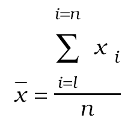
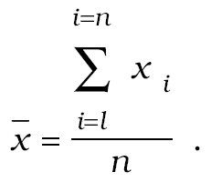
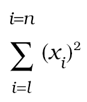
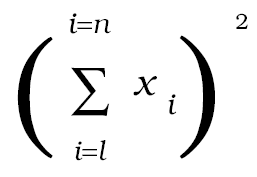
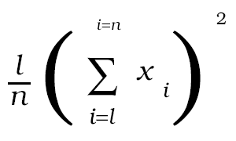
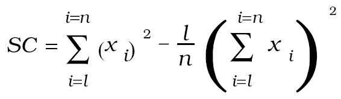
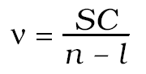
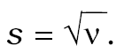

# Čl. I

Vyhláška Úradu pre normalizáciu, metrológiu a skúšobníctvo Slovenskej republiky č. 207/2000 Z. z. o označenom spotrebiteľskom balení sa mení a dopĺňa takto:

- 1. § 1 vrátane nadpisu znie:

- 㤠1

- Označené spotrebiteľské balenie

- Táto vyhláška sa vzťahuje na označené spotrebiteľské balenie výrobkov, ktorých druhy sú uvedené v § 4 a ktorých menovité množstvo výrobku

- a)

- sa rovná hodnote vopred určenej tým, kto výrobok zabalil,

- b)

- je vyjadrené v jednotkách hmotnosti alebo objemu,

- c)

- je najmenej 5 g alebo 5 ml a najviac 10 kg alebo 10 l.“.

- 2. § 2 vrátane nadpisu znie:

- 㤠2

- Požiadavky na označené spotrebiteľské balenie

- Požiadavky na označené spotrebiteľské balenie sú uvedené v prílohe č. 1.“.

- 3. § 4 vrátane nadpisu znie:

- 㤠4

- Druhy výrobkov v označených spotrebiteľských baleniach

- (1)

- Výrobkom v označenom spotrebiteľskom balení sa na účely tejto vyhlášky rozumie

- a)

- kvapalný výrobok, ktorý je uvedený v prílohe č. 3, okrem výrobkov uvedených v bode 1.a), uchovávaných, plnených do fliaš a označených menovitým objemom nepresahujúcim 0,25 l, určených na profesionálne použitie a výrobkov uvedených v bodoch 2.a) a 4, určených na spotrebu na palubách lietadiel, lodí, vo vlakoch a na predaj v bezcolných obchodoch,

- b)

- výrobok predávaný

- 1.

- podľa hmotnosti alebo podľa objemu uvedený v prílohe č. 4 okrem výrobkov, ktoré sú uvedené v bodoch 2 a 3; v prílohe č. 4 je pre každý z týchto výrobkov určený rad menovitých množstiev výrobku v označenom spotrebiteľskom balení,

- 2.

- podľa hmotnosti alebo podľa objemu umiestnený do pevných obalových nádob uvedený v prílohe č. 5 okrem výrobkov uvedených v prílohe č. 4; v prílohe č. 5 je pre tieto výrobky určený rad objemov pevných obalových nádob, dovolené objemy pevných obalových nádob ustanovujú slovenské technické normy okrem prípadov, ak výrobky a objemy obalov v nich uvedené sa odlišujú od objemov uvedených v prílohe č. 5,

- 3.

- v aerosólovom balení;2) v prílohe č. 5a sú uvedené objemy kvapalnej fázy týchto výrobkov a objemy kovových obalových nádobiek.

- (2)

- Výrobky v označenom spotrebiteľskom balení uvedené v prílohe č. 3 v bodoch 1.a) a b), 2.a) a 4 môžu byť uvedené na trh, len ak majú v nej ustanovený menovitý objem.

- (3)

- Hodnoty menovitých množstiev výrobku uvedené v prílohách č. 4 až 5a sa nevzťahujú na spotrebiteľské balenia určené na profesionálne použitie. Ak to zodpovedá obchodným zvyklostiam, pri výrobkoch podľa odseku 1 písm. b) možno použiť aj hodnoty odlišné od hodnôt ustanovených v prílohách č. 4 až 5a.

- (4)

- Pri výrobku podľa odseku 1 písm. b) bodov 2 a 3 na obale musí byť vyznačený aj menovitý objem obalu, a to tak, aby nedošlo k zámene s údajom o menovitom množstve výrobku v obale alebo odkaz na príslušnú slovenskú technickú normu.

- (5)

- Ak nie sú ustanovené menovité množstvá ostatných výrobkov v označených spotrebiteľských baleniach, ktoré nie sú uvedené v prílohách č. 3 až 5a, určuje ich ten, kto výrobok zabalil.

- (6)

- Ak v spotrebiteľskom balení je viac jednotlivých označených spotrebiteľských balení, potom hodnoty uvedené v prílohách č. 3 až 5a sa vzťahujú na tieto jednotlivé označené spotrebiteľské balenia.

- (7)

- Ak v spotrebiteľskom balení sú dve jednotlivé balenia alebo viac jednotlivých balení, ktoré nie sú určené na predaj po jednom kuse, hodnoty uvedené v prílohách č. 3 až 5a sa vzťahujú na spotrebiteľské balenie ako celok.

- (8)

- Ustanoveniami tejto vyhlášky týkajúcimi sa menovitých množstiev výrobku v spotrebiteľských baleniach a označovania spotrebiteľských balení nie sú dotknuté požiadavky na balenie a označovanie výrobkov podľa osobitných predpisov.3)

- (9)

- Výrobky predávané v aerosólovom balení, ktoré spĺňajú požiadavky tejto vyhlášky, nemusia byť označené údajom o menovitej hmotnosti ich obsahu.“.

- Poznámky pod čiarou k odkazom 2 a 3 znejú:

- „2) Zákon č. 163/2001 Z. z. o chemických látkach a chemických prípravkoch.

- 3) Napríklad zákon č. 229/1995 Z. z. o spotrebnej dani z liehu v znení neskorších predpisov, zákon č. 163/2001 Z. z.“.

- 4. V prílohe č. 2 bode 2.3.1 prvá rovnica znie:

- 

- 5. V prílohe č. 2 bode 2.3.1 predposledný riadok znie:

- „s odhad smerodajnej odchýlky skutočných obsahov v dávke,“.

- 6. V prílohe č. 2 bod 2.3.2.1 znie:

- „2.3.2.1 výberový priemer nameraných hodnôt sa vypočíta podľa rovnice

- 

- Odhad smerodajnej odchýlky s sa vypočíta takto:

- a) suma štvorcov nameraných hodnôt:

- 

- b) štvorec sumy nameraných hodnôt:

- 

- potom

- 

- c) korigovaný súčet:

- 

- d) odhad rozptylu:

- 

- Odhad smerodajnej odchýlky:

- .“.

- 7. Príloha č. 3 vrátane nadpisu znie:

- „RAD MENOVITÝCH OBJEMOV OBSAHU KVAPALNÝCH VÝROBKOV

- Druh kvapalného výrobku | Menovitý objem obsahu v litroch |

- | povolený trvalo (hodnoty v EU) | povolený dočasne v SR

- 1. a) Víno z čerstvého hrozna; čerstvý hroznový mušt, ktorého kvasenie bolo zastavené pridaním alkoholu, vrátane vína vyrobeného z nekvasenej hroznovej šťavy v zmesi s alkoholom, okrem vín uvedených v 2. a) a likérových vín; hroznový mušt kvasiaci alebo s kvasením zastaveným iným spôsobom ako pridaním alkoholu | 0,10 - 0.1871) - 0,25 - 0,375 - 0,50 - 0,75 - 1 - 1,5 - 2 - 3 - 4 - 5 - 6 - 8 - 9 - 10 | 0,7 do 31. 12. 2002

- b) „Žlté” vína oprávnené používať toto označenie pôvodu: „Côtes du Jura”, „Arbois", „ĽÉtoile” a „Cha teu-Chalon” | 0,62 |

- c) iné nesýtené nápoje, napríklad jablčný mušt, hruškový mušt a medovina | 0,10 - 0,25 - 0,375 - 0,50 - 0,75 -1-1,5 - 2 - 3 - 5 dočasne 0,35 - 0,70 |

- d) vermúty a iné vína z čerstvého hrozna aromatizované aromatickými výťažkami, likérové vína | 0,05 až 0,10 0,10 - 0,20 - 0,375 - 0,50 - 0,75 -1 - 1,5 - 3 - 5 | 0,7 do 31. 12. 2002

- 2. a) - šumivé vína | 0,125 - 0,20 - 0,375 - 0,75 - 1,5 - |

- - vína vo fľašiach so zátkami tvaru hríbika, ktoré sú pridržiavané na mieste pomocou priviazania alebo upevnenia (pásky alebo spony), a vína inak udržiavané pod pretlakom najmenej 1 bar, ale menším ako 3 bary meraným pri teplote 20 °C | 3 - 4,5 - 6 - 9 |

- b) iné kvasené šumivé nápoje, napr. jablčný, hruškový mušt a medovina | 0,10 - 0,20 - 0,375 - 0,75 - 1 -1,5 - 3 dočasne 0,125 |

- 3. a) pivo vyrobené zo sladu, okrem kvasinkových pív (so samokvasením) | 0,25 - 0,33 - 0,50 - 0,75 - 1 - 2 - 3 - 4 - 5 dočasne 0,35 |

- b) kvasinkové pivá (so samokvasením), gueuze, | 0,25 - 0,375 - 0,75 |

- 4. liehoviny, likéry a iné alkoholické nápoje, zmiešané alkoholické prípravky známe ako „koncentrované extrakty” na výrobu nápojov | 0,02 - 0,03 - 0,04 - 0,05 - 0,102) -0,20 - 0,35 - 0,50 - 0,70 - 1 -1,1253) - 1,5 - 2 - 2,5 - 3 - 4,5 - 53) - 103) | 0,75

- 5. ocot a náhrady za ocot | 0,25 - 0,50 - 0,75 - 1 - 2 - 5 |

- 6. olivové oleje, iné jedlé oleje | 0,25 - 0,50 - 0,75 - 1 - 2 - 3 - 5 -10 |

- 7. - mlieko nezahustené a nesladené, okrem jogurtov, kefírov, kyslého mlieka, srvátky a iných druhov fermentovaného alebo okysleného mlieka, - mliečne nápoje | 0,20 - 0,25 - 0,50 - 0,75 - 1 - 2 dočasne 0,1 |

- 8. a) vody vrátane minerálnych vôd a vôd sýtených oxidom uhličitým | 0,125 - 0,20 - 0,25 - 0,33 - 0,50 -0,75- 1 - 1,5-2 dočasne všetky objemy pod 0,20 - 0,35 - 0,45 - 0,46 - 0,70 - 0,90 - 0,92 - 1,25 |

- b) limonáda, minerálne vody s príchuťou a vody s príchuťou sýtené oxidom uhličitým a iné nealkoholické nápoje neobsahujúce mlieko alebo mliečne tuky, okrem ovocných a zeleninových štiav a koncentrátov | 0,125 - 0,20 - 0,25 - 0,33 - 0,50 -0,75 - 1 - 1,5 - 2 dočasne všetky objemy pod 0,20 - 0,70 |

- c) nápoje označené ako nealkoholické aperitívy | 0,1 |

- 9. ovocné šťavy (vrátane hroznových muštov) alebo zeleninové šťavy s prídavkom alebo bez prídavku cukru, ale nekvasené a bez obsahu alkoholu, ovocný nektár | 0,125 - 0,20 - 0,25 - 0,33 - 0,50 -0,75 - 1 - 1,5 - 2 dočasne všetky menšie objemy 0,125 - 0,70 - 0,18 - 0,35, (len v plechovkách) |

- “.

- 8. Príloha č. 4 vrátane nadpisu znie:

- „RAD MENOVITÝCH MNOŽSTIEV OBSAHU OZNAČENÝCH SPOTREBITEĽSKÝCH BALENÍ

- 1. Potravinárske výrobky predávané podľa hmotnosti

- (množstvo v g)

- 1.1 Maslo, margarín a neemulgované rastlinné tuky alebo zmesné tuky vrátane nízkotučných nátierok

- 125 - 250 - 500 -1 000 - 1 500 - 2 000 - 2 500 - 5 000.

- 1.2 Čerstvé syry okrem "petits suisses" a iné syry ponúkané na predaj rovnakým spôsobom

- 62,5 - 125 - 250 - 500 - 1 000 - 2 000 - 5 000.

- 1.3 Stolová a kuchynská soľ

- 125 - 250 - 500 - 750 - 1 000 - 1 500 - 5 000.

- 1.4 Práškový cukor, čiastočne rafinovaný cukor alebo čiastočne nerafinovaný cukor, alebo nerafinovaný cukor

- 125 - 250 - 500 - 750 - 1 000 - 1 500 - 2 000 - 2 500 - 3 000 - 4000 - 5000.

- 1.5 Výrobky z obilia (okrem potravín pre dojčatá)

- 1.5.1 Obilninová múka, krúpy, vločky a ovsená múka a drvené obilie, ovsené vločky (okrem výrobkov uvedených v 1.5.4)

- 125 - 250 - 500 - 1 000 - 1 500 - 2 000 - 2 5001) - 5 000 - 10 000.

- 1.5.2 Cestoviny

- 125 - 250 - 500 - 1 000 - 1 500 - 2 000 - 3 000 - 4 000 - 5 000 - 10 000.

- 1.5.3 Ryža

- 125 - 250 - 500 - 1 000 - 2 000 - 2 500 - 5 000.

- 1.5.4 Upravené potraviny získané podobnými spôsobmi, ako je napučanie alebo praženie obilnín alebo obilninových výrobkov (burizony, pražené kukuričné vločky a podobné výrobky)

- 250 - 375 - 500 - 750 - 1 000 - 1 500 - 2 000.

- 1.6 Sušená zelenina,2) sušené ovocie

- 125 - 250 - 500 - 1 000 - 1 500 - 2 000 - 5 000 - 7 500 - 10 000.

- 1.7 Mletá alebo nemletá pražená káva, cigória a náhradky kávy

- 125 - 250 - 500 - 1 000 - 2 000 - 3 000 - 4 000 - 5 000 - 10 000.

- 1.8 Mrazené výrobky

- 1.8.1 Ovocie a zelenina a predsmažené zemiakové hranolčeky

- 150 - 300 - 450 - 600 - 750 - 1 000 - 1 500 - 2 000 - 2 500.

- 1.8.2 Rybie filé a porciované ryby, obaľované alebo neobaľované

- 100 - 200 - 300 - 400 - 500 - 600 - 800 - 1 000 - 2 000.

- 1.8.3 Rybie prsty

- 150 - 300 - 450 - 600 - 900 - 1 200 - 1 500 - 1 800.

- 2. Potraviny predávané podľa objemu

- (množstvo v ml)

- 2.1 Zmrzlina vo väčších množstvách ako 250 ml

- (okrem akejkoľvek zmrzliny, ktorej objem nie je určený tvarom obalovej nádoby)

- 300 - 500 - 750 - 1 000 - 1 500 - 2 000 - 2 500 - 3 000 - 4 000 - 5 000.

- 3. Suché krmivo pre psov a mačky3)

- (množstvo v g)

- 200 - 300 - 400 - 500 - 600 - 800 - 1 000 - 1 500 - 2 000 - 3 000 - 5 000 - 7 500 - 10 000.

- 4. Náterové farby a látky pripravené na použitie4)

- (s prídavkom alebo bez prídavku rozpúšťadla s výnimkou dispergovaných farbív a roztokov; množstvo v ml)

- 25 - 50 - 125 - 250 - 375 - 500 - 750 - 1 000 - 2 000 - 2 500 - 4 000 - 5 000 - 10 000.

- 5. Tuhé alebo práškové lepidlá a pojivá4)

- (množstvo v g)

- 25 - 50 - 125 - 250 - 500 - 1 000 - 2 500 - 5 000 - 8 000 - 10 000.

- 6. Čistiace prostriedky4)

- (tuhé a práškové látky - množstvo v g; tekuté látky a pasty - množstvo v ml)

- okrem iného prípravky na kožu a obuv, na drevo a podlahové krytiny, na rúry na pečenie a kovy vrátane použitia na automobily, na okná a zrkadlá vrátane použitia na automobily, prípravky na odstraňovanie škvŕn, na apretáciu a farbenie v domácnosti, prostriedky proti domácemu hmyzu, prípravky na odstraňovanie vodného kameňa, dezodoranty pre domácnosť, nefarmaceutické dezinfekčné prostriedky

- 25 - 50 - 75 - 100 - 150 - 200 - 250 - 375 - 500 - 750 - 1 000 - 1 500 - 2 000 - 5 000 - 10 000.

- 7. Kozmetika: skrášľovacie a toaletné prípravky

- (tuhé a práškové látky - množstvo v g; tekuté látky a pasty - množstvo v ml)

- 7.1 Prípravky na ošetrovanie pokožky a hygienu ústnej dutiny

- holiace krémy, univerzálne krémy a kozmetické vody, krémy a vody na ruky, prípravky na opaľovanie, prípravky používané pri hygiene ústnej dutiny (okrem zubnej pasty)

- 15 - 30 - 40 - 50 - 75 - 100 - 125 - 150 - 200 - 250 - 300 - 400 - 500 - 1 000.

- 7.2 Zubná pasta

- 25 - 50 - 75 - 100 - 125 - 150 - 200 - 250 - 300.

- 7.3 Výrobky na ošetrovanie vlasov (okrem farieb) a prípravky do kúpeľa

- lak, šampóny, prípravky na oplachovanie a tužidlá, brilantíny, vlasový krém (okrem vlasových vôd, ktoré sú uvedené v 7.4), peny do kúpeľa a iné penivé výrobky do kúpeľa a na sprchovanie

- 25 - 50 - 75 - 100 - 125 - 150 - 200 - 250 - 300 - 400 - 500 - 750 - 1 000 - 2 000.

- 7.4 Prípravky na báze alkoholu

- obsahujúce menej ako 3 % prírodného alebo syntetického voňavého oleja podľa objemu a menej ako 70 % čistého etylalkoholu podľa objemu: parfumy vody, vlasové vody, vody používané pred holením a po holení

- 15 - 25 - 30 - 40 - 50 - 75 - 100 - 125 - 150 - 200 - 250 - 300 - 400 - 500 - 750 - 1 000.

- 7.5 Dezodoranty a výrobky na osobnú hygienu

- 20 - 25 - 30 - 40 - 50 - 75 - 100 - 150 - 200.

- 7.6 Kozmetické púdre

- 50 - 75 - 100 - 150 - 200 - 250 - 500 - 1 000.

- 8. Prostriedky na umývanie a pranie4)

- 8.1 Tuhé toaletné a pracie mydlá (množstvo v g)

- 25 - 50 - 75 - 100 - 150 - 200 - 250 - 300 - 400 - 500 - 1 000.

- 8.2 Mazľavé mydlá (množstvo v g)

- 125 - 250 - 500 - 750 - 1 000 - 5 000 - 10 000.

- 8.3 Mydlové vločky a podobne (množstvo v g)

- 250 - 500 - 750 - 1 000 - 3 000 - 5 000 - 10 000.

- 8.4 Tekuté prostriedky na umývanie, pranie, čistenie a plákanie a pomocné prostriedky a chlórnanové prípravky4) (okrem prostriedkov, ktoré sú uvedené v bode 6) (množstvo v ml)

- 125 - 250 - 500 - 750 - 1 000 - 1 250 - 1 500 - 2 000 - 3 000 - 4 000 - 5 000 - 6 000 - 7 000 - 10 000.

- 8.5 Pracie prášky4) (množstvo v g)

- 250 - 500 - 750 - 1 000 - 10 000.

- 8.6 Prášky na predpieranie a namáčanie v práškovej forme4) (množstvo v g)

- 250 - 500 - 1 000 - 2 000 - 5 000 - 10 000.

- 9. Rozpúšťadlá4) (množstvo v ml)

- 25 - 50 - 75 - 125 - 250 - 500 - 1 000 - 1 500 - 2 500 - 5 000 - 10 000.

- 10. Mazacie oleje4) (množstvo v ml)

- 125 - 250 - 500 - 1 000 - 2 000 - 2 500 - 3 000 - 4 000 - 5 000 - 10 000.

- 11. Pletacie priadze (množstvo v g)

- vyrobené z prírodných vlákien (živočíšnych, rastlinných alebo minerálnych), z chemických vlákien alebo z ich zmesí.

- Hodnota v gramoch znamená suchú hmotnosť priadze upravenú pomocou zmluvných prirážok

- 10 - 20 - 50 - 100 - 150 - 200 - 250 - 300 - 350 - 400 - 450 - 500 - 1 000.“.

- 9. Príloha č. 5 vrátane nadpisu znie:

- „RAD OBJEMOV PEVNÝCH OBALOVÝCH NÁDOB

- 1. Konzervy a polokonzervy v plechovkách a v sklených obalových nádobách: rastlinné/zeleninové výrobky (ovocie, zelenina, paradajky, zemiaky; okrem špargle, polievok, ovocných alebo zeleninových štiav a ovocných nektárov) určené na konzumáciu

- 1.1 Plechovky a sklenené obalové nádoby (objem v ml)

- 106 - 156 - 212 - 228 - 314 - 370 - 425 - 446 - 580 - 720 - 850 - 1 062 - 1 700 - 2 650 - 3 100 - 4 250 - 10 200.

- 1.2 Objemy vybraných výrobkov (objem v ml)

- 1.2.1 Hľuzovky: 26 - 53 - 71 - 106 - 212 - 425 - 720 - 850,

- 1.2.2 Rajčiakové koncentráty: 71 - 142 - 212 - 370 - 425 - 720 - 850 - 3 100 - 4 250,

- 1.2.3 Rajčiaky lúpané alebo nelúpané: 236 - 370 - 425 - 720 - 850 - 2 650 - 3 100,

- 1.2.4 Ovocné koktaily, kompóty: 106 - 156 - 212 - 228 - 236 - 314 - 370 - 425 - 446 - 580 - 720 - 850 - 1 062 - 1 700 - 2 650 - 3 100 - 4 250 - 10 200.

- 2. Krmivo pre domáce mačky a psov (okrem suchého) (objem v ml)

- 212 - 228 - 314 - 425 - 446 - 850 - 1 062 - 1 700 - 2 650.

- 3. Prostriedky na umývanie, pranie a čistenie v práškovej forme

- Objemy pevných obalov:

- Označenie lepenkových krabíc: | Objem v ml

- E 0,5 | 375

- E 1 | 750

- E 2 | 1 500

- E 3 | 2 250

- E 5 | 3 750

- E 10 | 7 700

- E 15 | 11 450

- E 20 | 15 200

- E 25 | 18 950

- E 30 | 22 700

- Označenie bubnov: |

- E 5 | 3 950

- E 10 | 7 700

- E 15 | 11 450

- E 20 | 15 200

- E 25 | 18 950

- E 30 | 22 700.”.

- “.

- 10. Za prílohu č. 5 sa vkladá príloha č. 5a, ktorá vrátane nadpisu znie:

- „Príloha č. 5a k vyhláške č. 207/2000 Z. z.

- RAD OBJEMOV VÝROBKOV PREDÁVANÝCH V AEROSÓLOVOM BALENÍ OKREM KOZMETICKÝCH PRÍPRAVKOV NA BÁZE ALKOHOLU A LIEČIV

- 1.

- Výrobky predávané v kovových obalových nádobkách

- Objem kvapalnej fázy (ml) | Objem obalovej nádobky v ml pre: |

- | výrobky hnané skvapalneným plynom | a) výrobky hnané len stlačenými plynmi b) výrobky hnané len oxidom dusným alebo len oxidom uhličitým, alebo ich zmesou, ak Bunsenov koeficient výrobku nepresahuje 1,2

- 25 | 40 | 47

- 50 | 75 | 89

- 75 | 110 | 140

- 100 | 140 | 175

- 125 | 175 | 210

- 150 | 210 | 270

- 200 | 270 | 335

- 250 | 335 | 405

- 300 | 405 | 520

- 400 | 520 | 650

- 500 | 650 | 800

- 600 | 800 | 1 000

- 750 | 1 000 | -

- 2.

- Výrobky predávané v priehľadných alebo nepriehľadných sklenených alebo plastových obalových nádobkách (objem kvapalnej fázy v ml):

- 25 - 50 - 75 - 100 - 125 - 150.“.
