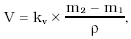
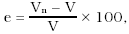

Príloha č. 47 k vyhláške č. 48/2001 Z. z.

- ODMERNÉ NÁDOBY KOVOVÉ

  - Prvá časť Všeobecné ustanovenia, vymedzenie meradiel a spôsob ich metrologickej kontroly

    - 1. Táto príloha sa vzťahuje na odmerné nádoby kovové (ďalej len „odmerné nádoby“) používané na meranie statického objemu kvapalín pri atmosférickom tlaku s menovitým objemom 0,01 l až 50 l ako určené meradlá podľa § 8 zákona.

    - 2. Odmerné nádoby pred uvedením na trh podliehajú schváleniu typu a prvotnému overeniu. Metódy technických skúšok pri schvaľovaní typu a metódy skúšania pri overení sú uvedené v druhej časti.

    - 3. Odmerné nádoby schváleného typu výrobca alebo dovozca označí značkou schváleného typu.

    - 4. Odmerné nádoby, ktoré pri overení vyhovejú ustanoveným požiadavkám, označia sa overovacou značkou.

    - 5. Odmerné nádoby počas ich používania ako určené meradlá podliehajú následnému overeniu. Postup pri následnom overení je zhodný s postupom pri prvotnom overení. Smaltované odmerné nádoby nepodliehajú následnému overeniu okrem prípadov porušenia alebo nečitateľnosti overovacej značky.

  - Druhá časť Technické požiadavky, metrologické požiadavky, metódy technických skúšok a metódy skúšania pri overení odmerných nádob

    - 1. Termíny a definície

    - 1.1 Menovitý objem – objem vyznačený na nádobe, na ktorý je zhotovená a ktorý má mať pri referenčných podmienkach.

    - 1.2 Skutočný objem – konvenčne pravá hodnota objemu, ktorý zaberá kvapalina pri referenčných podmienkach v nádobe naplnenej po objemovú značku.

    - 1.3 Odchýlka (chyba) údaja nádoby – rozdiel medzi menovitým objemom, resp. údajom nádoby a skutočným objemom nádoby. Ak je menovitý objem (resp. údaj nádoby) väčší ako skutočný objem kvapaliny v nádobe, odchýlka je kladná (+), ak je menší, odchýlka je záporná (-).

    - 1.4 Čiarková nádoba – objemová miera, ktorej menovitý objem určuje objemová značka, t. j. čiarka, ryska alebo iná značka.

    - 1.5 Koncová nádoba – objemová miera, ktorej menovitý objem ohraničuje rovina preložená horným okrajom miery.

    - 1.6 Nádoba so stupnicou – objemová miera, v ktorej meraný objem vymedzujú rysky na stupnici stavoznaku.

    - 2. Referenčné podmienky a menovité objemy

    - 2.1 Referenčná teplota nádoby je 15 oC a referenčný tlak je normálny atmosférický tlak (101 325 Pa). V odôvodnených prípadoch môže byť stanovená iná referenčná teplota.

    - 2.2 Menovitý objem odmernej nádoby zodpovedá hodnotám v tabuľke č. 1.

      - Tabuľka č. 1

    - Prípustné hodnoty menovitých objemov odmerných nádob | | |

    - 50 l | 5 l | 5 dl | 5 cl

    - 30 l | - | 3 dl | -

    - 25 l | - | - | -

    - 20 l | 2 l | 2 dl | 2 cl

    - 15 l | - | - | -

    - 10 l | 1 l | 1 dl | 1 cl

    - 2.3 V odôvodnených prípadoch môže úrad povoliť používanie a overovanie odmerných nádob s iným menovitým objemom.

    - 3. Metrologické požiadavky

      - Triedy presnosti a najväčšie dovolené chyby správnosti nových aj používaných odmerných nádob zodpovedajú hodnotám uvedeným v tabuľke č. 2. Neoznačené odmerné nádoby patria do triedy B.

      - Tabuľka č. 2

    - Trieda presnosti | A | B

    - Menovitý objem mernej nádoby V | Najväčšia dovolená chyba správnosti | v % menovitého objemu

    - 1 cl ≤ V ≤ 5 cl | ± 1 % | ±2 %

    - 1 dl ≤ V ≤ 5 dl | ±0,5 % | ±1 %

    - 1 l ≤ V ≤ 30 l | ±0,3 % | ±0,5 %

    - 50 l | ±0,2 % | ±0,3 %

    - 4. Technické požiadavky

    - 4.1 Materiál

    - 4.1.1 Odmerné nádoby sú vyrobené z dostatočne tvrdých a pevných materiálov vyhovujúcich danému účelu použitia (napr. nehrdzavejúca oceľ, oceľ, mosadz, hliník).

    - 4.1.2 Materiál odmernej nádoby a jeho spracovanie je také, aby zmena objemu odmernej nádoby pri zmenách teploty v rozsahu ±10 oC od referenčnej teploty nepresiahla polovicu absolútnej hodnoty najväčšej dovolenej chyby pre danú triedu presnosti podľa tabuľky č. 2.

    - 4.1.3 Odmerné nádoby na nápoje a iné kvapalné požívatiny sú vyrobené zo zdravotne neškodného kovu, alebo sú vhodne povrchovo upravené.

    - 4.1.4 Ak je odmerná nádoba z oceľového plechu smaltovaná, smalt je vždy svetlej farby.

    - 4.1.5 Smaltované odmerné nádoby sa nepoužívajú na meranie nápojov ani iných kvapalných potravín.

    - 4.2 Tvary a vyhotovenie

    - 4.2.1 Podľa spôsobu ohraničenia odmerného priestoru sa odmerné nádoby rozdeľujú na čiarkové, koncové a na odmerné nádoby so stupnicou.

    - 4.2.2 Odmerné nádoby toho istého typu vykazujú rovnaké konštrukčné vlastnosti.

    - 4.2.3 Odmerné nádoby sú tesné a nepriepustné.

    - 4.2.4 Odmerná nádoba postavená na vodorovnú podložku dobre stojí a jej rotačná os je zvislá.

    - 4.2.5 Roviny preložené horným a dolným okrajom odmernej nádoby, objemovými značkami a dnom odmernej nádoby sú navzájom rovnobežné a kolmé na os odmernej nádoby.

    - 4.2.6 Čiarkové odmerné nádoby s menovitým objemom 1 cl až 2 l môžu mať len tvar priameho valca. Odmerné nádoby s objemom 5 l a väčším môžu mať tvar valca, tvar valca s užším valcovým hrdlom a kužeľovitou strednou časťou (kanvový tvar), tvar zrezaného kužeľa alebo tvar zrezaného kužeľa s valcovým hrdlom.

    - 4.2.7 Koncové odmerné nádoby majú tvar priameho valca a menovitý objem od 1 dl do 1 l.

    - 4.2.8 Odmerné nádoby so stupnicou majú tvar valca alebo tvar valca s užším valcovým hrdlom a kužeľovitou strednou časťou a menovitý objem aspoň 10 l.

    - 4.2.9 Čiarkové odmerné nádoby môžu byť opatrené držadlami alebo uchami. Ich vyhotovenie a pripevnenie neprekáža správnemu používaniu ani skúšaniu nádob. Držadlá a uchá sú dostatočne pevné a spoľahlivo pripevnené k odmernej nádobe.

    - 4.2.10 Koncové odmerné nádoby, ktoré sú určené výhradne na meranie mlieka, sú opatrené hákmi na držanie. Hák môže byť opatrený závesom upraveným na zavesenie odmernej nádoby na kanvu, z ktorej sa mlieko odoberá.

    - 4.2.11 Hrúbka použitého plechu, ako aj vyhotovenie odmerných nádob zaručuje trvalú nepremennosť ich objemu pri naplnení kvapalinou aj pri používaní. V prípade potreby sa horný aj dolný okraj odmernej nádoby vystuží.

    - 4.2.12 Čiarkové odmerné nádoby tvaru valca, zrezaného kužeľa alebo zrezaného kužeľa s valcovým hrdlom môžu mať na hornom okraji výlevku.

    - 4.2.13 Objemové značky ohraničujúce objem odmerného priestoru odmernej nádoby sú

      - a) čiarky alebo rysky vyhotovené trvanlivým, výrazným a zreteľným spôsobom, napríklad rytím, vyrazením, brúsením, leptaním, pri smaltovaných mierach vypálením, na vnútornej stene odmernej nádoby pri čiarkových odmerných nádobách,

      - b) kužeľovité ukazovatele, pravouhlé zahnuté ukazovatele alebo vyhĺbenia v plechu pri čiarkových odmerných nádobách s menovitým objemom 5 l a s väčším,

      - c) horný okraj odmernej nádoby pri koncových odmerných nádobách,

      - d) rysky na stupnici stavoznaku pri odmerných nádobách so stupnicou.

    - 5. Nápisy a značky

    - 5.1 Odmerné nádoby sú upravené na vyznačenie overovacích značiek.

    - 5.2 Na štítku alebo priamo na odmernej nádobe sú zreteľne a nezmazateľne vyznačené

      - a) meno alebo značka výrobcu,

      - b) menovitý objem s meracou jednotkou,

      - c) trieda presnosti (len pri nádobách triedy A),

      - d) značka schváleného typu,

      - e) názov kvapaliny, na ktorú sa môže odmerná nádoba používať, napr. „na benzín“ (vyžaduje sa iba pri odmerných nádobách z mosadzného, zinkového alebo z pozinkovaného plechu, ktoré sa nesmú používať na meranie nápojov).

    - 5.3 Neodnímateľnosť štítku sa dá zabezpečiť overovacou značkou.

    - 5.4 Nápisy, ktoré môžu viesť k zámene s predpísanými, sú zakázané.

    - 6. Technická skúška pri schvaľovaní typu

    - 6.1 Pri technickej skúške pri schvaľovaní typu sa kontroluje vyhotovenie a rozmery odmernej nádoby, jej tesnosť a teplotná stálosť objemu, meraním sa zisťuje (ďalej len „vymeriava“) jej objem a smerodajná odchýlka objemu.

    - 6.2 Pri kontrole vyhotovenia sa preverí, či odmerná nádoba svojimi náležitosťami a rozmermi zodpovedá požiadavkám tejto prílohy, príslušnej slovenskej technickej norme a technickej dokumentácii.

    - 6.3 Vonkajšia obhliadka odmernej nádoby sa vykonáva vizuálne; na kontrolu rozmerov sa použijú vhodné dĺžkové meradlá – kovové pravítka so stupnicou a posuvné meradlá.

    - 6.4 Teplotná stálosť objemu odmernej nádoby sa skontroluje výpočtom na základe teplotného súčiniteľa objemovej rozťažnosti materiálu, z ktorého je odmerná nádoba vyhotovená.

    - 6.5 Pri skúške tesnosti odmerná nádoba naplnená po objemovú značku neprepúšťa počas predpísaného času skúšobnú kvapalinu ani nevykazuje iné znaky netesnosti.

    - 6.6 Vymeranie objemu sa vykoná objemovou alebo hmotnostnou metódou.

    - 6.7 Pri vymeriavaní objemovou metódou sa použije voda alebo vhodná náhradná kvapalina. Kvapalina použitá na skúšku odmerných nádob na požívatiny je čistá a zdravotne neškodná.

    - 6.8 Pri vymeriavaní hmotnostnou metódou sa použije destilovaná alebo upravená voda, ktorej hustota je s dostatočnou presnosťou známa.

    - 6.9 Rozšírená neistota stanovenia objemu (s koeficientom pokrytia k = 2) pri technickej skúške pri schvaľovaní typu odmernej nádoby neprekročí 1/5 najväčšej dovolenej chyby odmernej nádoby uvedenej pre danú triedu presnosti v tabuľke č. 2.

    - 6.10 Dovolený rozdiel medzi teplotou skúšobnej kvapaliny a referenčnou teplotou sa určí z podmienky, že príslušný príspevok štandardnej neistoty merania spôsobený teplotnou rozťažnosťou materiálu odmernej nádoby neprekročí 1/17 najväčšej dovolenej chyby presnosti uvedenej v tabuľke č. 2.

    - 6.11 Pri skúšaní objemovou metódou dovolený rozdiel medzi teplotou kvapaliny v skúšanej odmernej nádobe a teplotou kvapaliny v etalóne sa určí z podmienky, že príslušný príspevok štandardnej neistoty merania spôsobený rozťažnosťou skúšobnej kvapaliny neprekročí 1/17 najväčšej dovolenej chyby presnosti uvedenej v tabuľke č. 2.

    - 6.12 Ostatné podmienky skúšania ustanovuje príslušná slovenská technická norma podľa druhu odmernej nádoby, triedy presnosti a metódy skúšania tak, aby bola dodržaná požiadavka bodu 6.9.

    - 6.13 Vymeranie objemu pri technickej skúške pri schvaľovaní typu odmernej nádoby sa vykoná najmenej 10-krát. Zo získaných výsledkov sa vypočíta priemerná hodnota objemu odmernej nádoby pri referenčných podmienkach a smerodajná odchýlka skúšaného typu odmernej nádoby.

    - 6.14 Postup technických skúšok pri schvaľovaní typu ustanovuje príslušná slovenská technická norma.

    - 7. Vymeranie objemu objemovou metódou

    - 7.1 Pri vymeriavaní objemu objemovou metódou sa objem kvapaliny napúšťanej do odmernej nádoby odmeriava etalónovou odmernou nádobou, etalónovou odmernou bankou, nedelenou alebo delenou pipetou (ďalej len „etalón“) podľa veľkosti vymeriavaného objemu.

    - 7.2 Ak je objem použitého etalónu menší, ako je objem skúšanej odmernej nádoby, naplní sa a vypustí etalón postupne viackrát do skúšanej nádoby. Objem etalónu sa v takom prípade zvolí tak, aby počet plnení neprekročil 10.

    - 7.3 Skutočný objem odmernej nádoby (t. j. objem kvapaliny zodpovedajúci objemovej značke) sa rovná algebrickému súčtu objemov použitých etalónov.

    - 7.4 Ak nie sú dodržané podmienky bodu 6.10 alebo 6.11, teplota kvapaliny sa meria v etalóne a konečná teplota kvapaliny v skúšanej nádobe a s použitím nameraných hodnôt sa opraví objem na rozťažnosť materiálu odmernej nádoby a na rozťažnosť skúšobnej kvapaliny.

    - 8. Vymeranie objemu hmotnostnou metódou

    - 8.1 Pri vymeriavaní objemu hmotnostnou metódou sa vážením zistí hmotnosť prázdnej (vymokrenej) odmernej nádoby m1. Do odmernej nádoby sa napustí určené množstvo skúšobnej kvapaliny a opätovným odvážením sa zistí hmotnosť plnej odmernej nádoby m2.

    - 8.2 Ak je váživosť použitej váhy menšia ako hmotnosť obsahu skúšanej odmernej nádoby, použije sa podobný postup ako v bode 7.2, pričom obsah skúšanej odmernej nádoby sa postupne vylieva do pomocnej nádoby a tá sa váži. Maximálny počet dávok je 5.

    - 8.3 Objem kvapaliny v skúšanej odmernej nádobe V sa určí podľa vzorca

      - 

      - kde

      - m1, m2 – hmotnosť prázdnej a hmotnosť naplnenej skúšanej odmernej nádoby, resp. súčet hmotností prázd-

      - nej a súčet hmotností naplnenej pomocnej nádoby,

      - ρ – hustota skúšobnej kvapaliny,

      - kv – korekčný súčiniteľ na vztlak vzduchu pri vážení.

    - 9. Prvotné a následné overenie

    - 9.1 Prvotné a následné overenie nádoby pozostávajú z vonkajšej obhliadky, skúšky tesnosti a skúšky správnosti.

    - 9.2 Odmerné nádoby sa predkladajú na overenie čisté.

    - 9.3 Pri vonkajšej obhliadke odmernej nádoby sa vizuálne preverí, či jej vyhotovenie zodpovedá schválenému typu, požiadavkám príslušnej slovenskej technickej normy, či odmerná nádoba nie je mechanicky poškodená, deformovaná alebo či nemá iné nedostatky, a skontroluje sa čitateľnosť, správnosť a úplnosť predpísaných nápisov.

    - 9.4 Pri skúške tesnosti odmerná nádoba naplnená po objemovú značku neprepustí počas 15 minút skúšobnú kvapalinu ani nevykazuje iné znaky netesnosti.

    - 9.5 Rozšírená neistota stanovenia objemu odmernej nádoby (s koeficientom pokrytia k = 2) pri prvotnom a následnom overení neprekročí 1/3 najväčšej dovolenej chyby podľa tabuľky č. 2.

    - 9.6 Skúškou správnosti sa zisťuje, či menovitý objem sa zhoduje so skutočným objemom v rámci hraníc najväčšej dovolenej chyby. Relatívna odchýlka údaja odmernej nádoby e v percentách sa vypočíta podľa vzorca

      - 

      - kde

      - Vn – údaj skúšanej odmernej nádoby,

      - V – skutočný objem kvapaliny v odmernej nádobe.

    - 9.7 Určenie skutočného objemu odmernej nádoby pri skúške správnosti sa vykoná kvapalinami, metódami a postupmi uvedenými v bodoch 6.6 až 6.8, 6.10 až 6.12 a 7 a 8.

    - 9.8 Zistená relatívna odchýlka údaja odmernej nádoby vypočítaná podľa bodu 9.6 neprekročí najväčšiu dovolenú chybu uvedenú pre danú triedu presnosti v tabuľke č. 2.

    - 9.9 Skúška správnosti pri overení odmernej nádoby sa vykoná najmenej 2-krát.

    - 9.10 Postup pri prvotnom a následnom overení ustanovuje príslušná slovenská technická norma.
