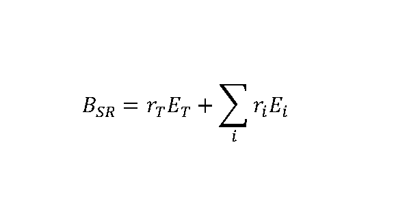

# § 33e

(1) Národná banka Slovenska rozhodne o určení vankúša vlastného kapitálu Tier 1 na krytie systémového rizika pre banky. Národná banka Slovenska môže vyžadovať od banky na individuálnom základe, konsolidovanom základe alebo subkonsolidovanom základe v súlade s osobitným predpisom,30y) aby udržiavala vankúš podľa prvej vety pre finančný sektor, jeden alebo viacero podsúborov tohto sektora pri všetkých expozíciách alebo ich podsúbore podľa odseku 2 s cieľom predchádzať makroprudenciálnym rizikám alebo systémovým rizikám vrátane makroprudenciálnych rizík alebo systémových rizík vyplývajúcich zo zmeny klímy, na ktoré sa nevzťahuje osobitný predpis30x) a § 33c a 33d, a zmierňovať ich tak, aby nedochádzalo k riziku narušenia finančného systému s potenciálnymi vážnymi negatívnymi dôsledkami na finančný sektor a hospodárstvo Slovenskej republiky. Na výpočet vankúša na krytie systémového rizika sa použije tento vzorec:

kde

BSR je vankúš na krytie systémového rizika,

rT je miera vankúša, ktorá sa vzťahuje na celkovú výšku rizikovej expozície banky,

ET je celková výška rizikovej expozície banky vypočítaná podľa osobitného predpisu,30v)

i je index označujúci podsúbor expozícií podľa odseku 2,

ri je miera vankúša uplatniteľná na výšku rizikovej expozície podsúboru expozícií i,

Ei je výška rizikovej expozície pre podsúbor expozícií i vypočítaná podľa osobitného predpisu.30v)

(2) Vankúš na krytie systémového rizika sa môže uplatňovať na

- a) expozície umiestnené v Slovenskej republike,

- b) sektorové expozície umiestnené v Slovenskej republike v členení

  - 1. expozície voči fyzickým osobám, ktoré sú zabezpečené nehnuteľnosťami určenými na bývanie,

  - 2. expozície voči právnickým osobám, ktoré sú zabezpečené nehnuteľnosťami určenými na podnikanie,

  - 3. expozície voči fyzickým osobám okrem expozícií podľa prvého bodu,

  - 4. expozície voči právnickým osobám okrem expozícií podľa prvého bodu,

- c) expozície umiestnené v iných členských štátoch, ak odseky 9 a 13 neustanovujú inak,

- d) sektorové expozície v členení podľa písmena b) umiestnené v inom členskom štáte, pre ktorý Národná banka Slovenska uznala mieru vankúša podľa § 33f,

- e) expozície umiestnené v inom ako členskom štáte,

- f) podsúbory expozícií podľa písmena b).

(3) Národná banka Slovenska určí vankúš na krytie systémového rizika na všetky expozície alebo podsúbory expozícií podľa odseku 2 pre všetky banky alebo pre jednu alebo viacero podskupín bánk postupne na základe úprav o 0,5 percentuálneho bodu alebo jeho násobku. Národná banka Slovenska môže určiť rôzne vankúše na krytie systémového rizika pre jednotlivé banky a podsúbory expozícií. Vankúš na krytie systémového rizika sa nevzťahuje na riziká, ktoré sú kryté vankúšmi podľa § 33c a 33d.

(4) Národná banka Slovenska pri určení vankúša na krytie systémového rizika zabezpečí, aby vankúš na krytie systémového rizika nespôsoboval neprimerané negatívne účinky na celý finančný systém alebo jeho časti v iných členských štátoch alebo v Európskej únii ako celku a nepredstavoval alebo nevytváral tak prekážku fungovaniu vnútorného trhu Európskej únie. Národná banka Slovenska prehodnocuje vankúš na krytie systémového rizika najmenej raz za dva roky. Vankúš na krytie systémového rizika sa nepoužije na riešenie rizík, ktoré sú kryté vankúšmi podľa § 33c a 33d, a rizík, ktoré sú kryté požiadavkou určenou výpočtom podľa osobitného predpisu.30xa) Ak sa vankúš na krytie systémového rizika uplatňuje na celkovú hodnotu rizikovej expozície banky a pre túto banku sa stane záväznou spodná hranica pre výstupné hodnoty, Národná banka Slovenska preskúma v lehote podľa druhej vety požiadavku na vankúš na krytie systémového rizika pre túto banku s cieľom zachovať jej primeranú kalibráciu.

(5) Národná banka Slovenska pred uverejnením oznámenia podľa odseku 10 informuje Európsky výbor pre systémové riziká o určení alebo úprave vankúša na krytie systémového rizika. Ak je banka, na ktorú sa uplatňuje jedna alebo viacero mier vankúša na krytie systémového rizika, dcérskou spoločnosťou, ktorej materská spoločnosť má sídlo v inom členskom štáte, Národná banka Slovenska postúpi oznámenie aj dotknutým príslušným orgánom dohľadu a určeným orgánom príslušného členského štátu. Ak sa miera vankúša na krytie systémového rizika uplatňuje na expozície nachádzajúce sa mimo Európskej únie, Národná banka Slovenska informuje Európsky výbor pre systémové riziká. Oznámenie obsahuje

- a) opis systémového rizika alebo makroprudenciálneho rizika v Slovenskej republike,

- b) dôvody, pre ktoré rozsah systémového rizika alebo makroprudenciálneho rizika ohrozuje stabilitu finančného systému v Slovenskej republike a ktoré odôvodňujú mieru vankúša na krytie systémového rizika,

- c) dôvody, pre ktoré sa vankúš na krytie systémového rizika považuje za účinný a primeraný prostriedok, ktorým možno znížiť riziko,

- d) posúdenie pravdepodobného pozitívneho vplyvu alebo pravdepodobného negatívneho vplyvu vankúša na krytie systémového rizika na vnútorný trh Európskej únie na základe informácií dostupných Národnej banke Slovenska,

- e) mieru alebo miery vankúša na krytie systémového rizika, ktorú Národná banka Slovenska požaduje, a expozície, na ktoré sa takéto miery vzťahujú, spolu s určením bánk, ktorých sa tieto miery týkajú,

- f) dôvody, pre ktoré sa vankúš na krytie systémového rizika nepovažuje za duplicitný k vankúšu pre O-SII, ktorý sa uplatňuje podľa § 33d, ak sa miera vankúša na krytie systémového rizika vzťahuje na všetky expozície.

(6) Ak prijatie rozhodnutia o určení miery vankúša na krytie systémového rizika vedie k zníženiu miery tohto vankúša, ktorá bola určená skôr, alebo sa táto miera nemení, Národná banka Slovenska postupuje podľa odseku 5.

(7) Národná banka Slovenska pred určením alebo zmenou miery vankúša na krytie systémového rizika pre akýkoľvek súbor alebo podsúbor expozícií podľa odseku 2, na ktoré sa vzťahuje jeden alebo viacero vankúšov na krytie systémového rizika, ktoré vedie k zavedeniu miery kombinovaného vankúša na krytie systémového rizika nižšej ako 3 % pri ktorejkoľvek z týchto expozícií, informuje v súlade s odsekom 5 Európsky výbor pre systémové riziká jeden mesiac pred uverejnením oznámenia podľa odseku 10. Do limitu kombinovaného vankúša na krytie systémového rizika podľa prvej vety sa nezapočítava uznanie miery vankúša na krytie systémového rizika podľa § 33f.

(8) Národná banka Slovenska pred určením alebo zmenou miery vankúša na krytie systémového rizika pre akýkoľvek súbor alebo podsúbor expozícií podľa odseku 2, na ktoré sa vzťahuje jeden alebo viacero vankúšov na krytie systémového rizika, ktoré vedie k zavedeniu miery kombinovaného vankúša na krytie systémového rizika od 3 % do 5 % pri ktorejkoľvek z týchto expozícií, požiada Komisiu a Európsky výbor pre systémové riziká v oznámení podľa odseku 5 o stanovisko. Ak je stanovisko Komisie negatívne, Národná banka Slovenska postupuje v súlade s týmto stanoviskom alebo uvedie dôvody, pre ktoré podľa stanoviska Komisie nepostupuje. Ak je stanovisko príslušných alebo určených orgánov dohľadu materskej spoločnosti negatívne a ak je stanovisko Komisie a Európskeho výboru pre systémové riziká negatívne, Národná banka Slovenska môže požiadať Európsky orgán dohľadu (Európsky orgán pre bankovníctvo) o pomoc podľa osobitného predpisu19) a určí mieru vankúša na krytie systémového rizika v súlade s rozhodnutím Európskeho orgánu dohľadu (Európskeho orgánu pre bankovníctvo).

(9) Národná banka Slovenska pred určením alebo zmenou miery vankúša na krytie systémového rizika pre akýkoľvek súbor alebo podsúbor expozícií podľa odseku 2, na ktoré sa vzťahuje jeden alebo viacero vankúšov na krytie systémového rizika, ktoré vedie k zavedeniu miery kombinovaného vankúša na krytie systémového rizika vyššej ako 5 % pri ktorejkoľvek z týchto expozícií, požiada Komisiu o povolenie a určí mieru vankúša na krytie systémového rizika v súlade s rozhodnutím Komisie.

(10) Národná banka Slovenska zverejní na svojom webovom sídle oznámenie o určení alebo úprave vankúša na krytie systémového rizika. Oznámenie obsahuje

- a) mieru alebo miery vankúša na krytie systémového rizika,

- b) banky, na ktoré sa vankúš na krytie systémového rizika vzťahuje,

- c) expozície, na ktoré sa miera alebo miery vankúša na krytie systémového rizika vzťahujú,

- d) odôvodnenie pre určenie alebo zmenu miery alebo mier vankúša na krytie systémového rizika,

- e) dátum, od ktorého musia banky uplatňovať určený alebo zmenený vankúš na krytie systémového rizika,

- f) názvy štátov, v ktorých sa nachádzajú rizikové expozície, na ktoré sa uplatňuje vankúš na krytie systémového rizika.

(11) Ak by zverejnenie informácie podľa odseku 10 písm. d) mohlo ohroziť stabilitu finančného systému, takáto informácia sa v oznámení neuvedie.

(12) Ak banka neplní v celom rozsahu požiadavku podľa odseku 1, podlieha obmedzeniam týkajúcim sa rozdeľovania podľa § 33k ods. 2 a 3. Ak uplatňovanie týchto obmedzení týkajúcich sa rozdeľovania nevedie vzhľadom na systémové riziko k uspokojivému zlepšeniu vlastného kapitálu Tier 1 banky, Národná banka Slovenska môže v súlade s § 50 a 63 prijať dodatočné opatrenia.

(13) Ak Národná banka Slovenska rozhodne o určení vankúša na krytie systémového rizika pre expozície umiestnené v iných členských štátoch, musí byť sadzba vankúša na krytie systémového rizika rovnaká pre všetky členské štáty okrem sadzby určenej podľa § 33f.

(14) Na účely odsekov 8 a 9 sa uznanie miery vankúša na krytie systémového rizika ustanovené v inom členskom štáte podľa § 33f nezapočítava do prahovej hodnoty podľa odseku 8 prvej vety alebo odseku 9 prvej vety.
