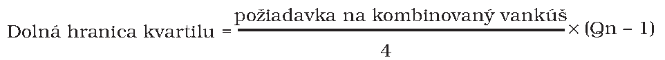
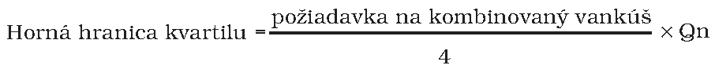

# § 33k

(1) Banka, ktorá spĺňa požiadavku na kombinovaný vankúš, nesmie vykonávať rozdeľovanie vlastného kapitálu Tier 1, ak by týmto rozdeľovaním došlo k zníženiu jej vlastného kapitálu Tier 1 na úroveň, na ktorej by už požiadavka na kombinovaný vankúš nebola splnená.

(2) Banka, ktorá nespĺňa požiadavku na kombinovaný vankúš, vypočíta maximálnu rozdeliteľnú sumu podľa odseku 4 a vypočítanú maximálnu rozdeliteľnú sumu oznámi Národnej banke Slovenska. Banka do vykonania výpočtu maximálnej rozdeliteľnej sumy a jej oznámenia Národnej banke Slovenska nesmie

- a) vykonať rozdeľovanie vlastného kapitálu Tier 1,

- b) zaviesť povinnosť uhradiť pohyblivú zložku odmeňovania alebo dobrovoľné platby dôchodkového zabezpečenia alebo uhradiť pohyblivú zložku odmeňovania, ak povinnosť úhrady vznikla v čase, keď banka nespĺňala požiadavku na kombinovaný vankúš,

- c) uskutočniť platbu v súvislosti s nástrojmi dodatočného kapitálu Tier 1.

(3) Banka počas obdobia, v ktorom nespĺňa alebo neprekračuje požiadavku na kombinovaný vankúš, môže konať podľa odseku 2 iba do výšky maximálnej rozdeliteľnej sumy vypočítanej podľa odseku 4. Ak banka vykoná ktorékoľvek opatrenie podľa odseku 2 písm. a), b) alebo c), má to za následok zníženie maximálnej rozdeliteľnej sumy.

(4) Banka vypočítava maximálnu rozdeliteľnú sumu ako súčin sumy vypočítanej podľa odseku 5 a koeficientu určeného podľa odseku 6. Maximálna rozdeliteľná suma sa musí znížiť o sumu vyplývajúcu z opatrenia podľa odseku 2.

(5) Suma, ktorá sa má podľa odseku 4 vynásobiť, je súčtom predbežného zisku nezahrnutého do vlastného kapitálu Tier 1 podľa osobitného predpisu,30zh) ktorý je znížený o rozdelený zisk alebo platbu vyplývajúcu z opatrení podľa odseku 2, a koncoročného zisku nezahrnutého do vlastného kapitálu Tier 1 podľa osobitného predpisu,30zh) ktorý je znížený o rozdelený zisk alebo platbu vyplývajúcu z opatrení podľa odseku 2, znížený o sumu, ktorá by bola splatnou daňou, ak by predbežný zisk a koncoročný zisk neboli rozdelené.

(6) Koeficient je

- a) 0, ak vlastný kapitál Tier 1 držaný bankou, ktorý sa nepoužije na splnenie požiadavky na vlastné zdroje podľa osobitného predpisu30bc) a opatrenia na nápravu podľa § 50 ods. 1 písm. m) týkajúceho sa osobitnej požiadavky na vlastné zdroje podľa § 29b na riešenie iných rizík, ako je riziko nadmerného využívania finančnej páky, vyjadrený ako percentuálny podiel celkovej rizikovej expozície vypočítanej podľa osobitného predpisu,30v) je v prvom kvartile požiadavky na kombinovaný vankúš,

- b) 0,2, ak vlastný kapitál Tier 1 držaný bankou, ktorý sa nepoužije na splnenie požiadavky na vlastné zdroje podľa osobitného predpisu30bc) a opatrenia na nápravu podľa § 50 ods. 1 písm. m) týkajúceho sa osobitnej požiadavky na vlastné zdroje podľa § 29b na riešenie iných rizík, ako je riziko nadmerného využívania finančnej páky, vyjadrený ako percentuálny podiel celkovej rizikovej expozície podľa osobitného predpisu,30v) je v druhom kvartile požiadavky na kombinovaný vankúš,

- c) 0,4, ak vlastný kapitál Tier 1 držaný bankou, ktorý sa nepoužije na splnenie požiadavky na vlastné zdroje podľa osobitného predpisu30bc) a opatrenia na nápravu podľa § 50 ods. 1 písm. m) týkajúceho sa osobitnej požiadavky na vlastné zdroje podľa § 29b na riešenie iných rizík, ako je riziko nadmerného využívania finančnej páky, vyjadrený ako percentuálny podiel celkovej rizikovej expozície podľa osobitného predpisu,30v) je v treťom kvartile požiadavky na kombinovaný vankúš,

- d) 0,6, ak vlastný kapitál Tier 1 držaný bankou, ktorý sa nepoužije na splnenie požiadavky na vlastné zdroje podľa osobitného predpisu30bc) a opatrenia na nápravu podľa § 50 ods. 1 písm. m) týkajúceho sa osobitnej požiadavky na vlastné zdroje podľa § 29b na riešenie iných rizík, ako je riziko nadmerného využívania finančnej páky, vyjadrený ako percentuálny podiel celkovej rizikovej expozície podľa osobitného predpisu,30v) je vo štvrtom kvartile požiadavky na kombinovaný vankúš, alebo je vyšší ako horná hranica štvrtého kvartilu.

(7) Na výpočet dolnej hranice kvartilu požiadavky na kombinovaný vankúš sa použije tento vzorec:

kde Qn je radová číslovka príslušného kvartilu.

(8) Na výpočet hornej hranice kvartilu požiadavky na kombinovaný vankúš sa použije tento vzorec:

kde Qn je radová číslovka príslušného kvartilu.

(9) Na účely odsekov 1 a 2 rozdeľovanie vlastného kapitálu Tier 1 zahŕňa

- a) platenie peňažných dividend,

- b) rozdeľovanie plne platených alebo čiastočne platených prémiových akcií alebo iných kapitálových nástrojov uvedených v osobitnom predpise,30zj)

- c) vyplatenie alebo kúpu svojich vlastných akcií alebo iných kapitálových nástrojov uvedených v osobitnom predpise30zj) bankou,

- d) splatenie súm zaplatených v spojení s kapitálovými nástrojmi uvedenými v osobitnom predpise,30zj)

- e) rozdeľovanie položiek uvedených v osobitnom predpise.30zk)

(10) Ak banka nespĺňa požiadavku na kombinovaný vankúš a plánuje rozdeliť svoj rozdeliteľný zisk alebo postupovať podľa odseku 2, oznámi to Národnej banke Slovenska.

Oznámenie obsahuje

- a) výšku kapitálu držaného bankou v členení na

  - 1. vlastný kapitál Tier 1,

  - 2. dodatočný kapitál Tier 1,

  - 3. kapitál Tier 2,

- b) výšku predbežného zisku a koncoročného zisku banky,

- c) maximálnu rozdeliteľnú sumu vypočítanú podľa odseku 4,

- d) sumu rozdeliteľného zisku, ktorú banka plánuje prideliť na

  - 1. platby dividend,

  - 2. spätné odkupovanie akcií,

  - 3. platby v súvislosti s nástrojmi v rámci dodatočného kapitálu Tier 1,

  - 4. platby pohyblivej zložky odmeňovania, alebo dobrovoľných platieb dôchodkového zabezpečenia z dôvodu vzniku novej povinnosti platby alebo platby na základe povinnosti platiť, ktorá vznikla v čase, keď banka nespĺňala požiadavky na kombinovaný vankúš.

(11) Banka je povinná prijať opatrenia na zabezpečenie presného výpočtu výšky rozdeliteľného zisku a maximálnej rozdeliteľnej sumy a Národnej banke Slovenska preukáže na vyžiadanie presnosť výpočtu.

(12) Obmedzenia podľa odsekov 1 až 11 sa vzťahujú len na platby, ktorých výsledkom je zníženie vlastného kapitálu Tier 1 alebo zníženie ziskov, pričom pozastavenie platieb alebo nevykonanie úhrad nepredstavuje zlyhanie ani podmienku na začatie konania v režime platobnej neschopnosti.

(13) Banka nespĺňa požiadavku na kombinovaný vankúš, ak nemá vlastné zdroje vo výške a kvalite potrebnej na súčasné splnenie požiadavky na kombinovaný vankúš a každej z požiadaviek podľa

- a) ustanovení osobitného predpisu30zka) a opatrenia na nápravu podľa § 50 ods. 1 písm. m) týkajúceho sa osobitnej požiadavky na vlastné zdroje podľa § 29b na riešenie iných rizík, ako je riziko nadmerného využívania finančnej páky,

- b) ustanovení osobitného predpisu30zkb) a opatrenia na nápravu podľa § 50 ods. 1 písm. m) týkajúceho sa osobitnej požiadavky na vlastné zdroje podľa § 29b na riešenie iných rizík, ako je riziko nadmerného využívania finančnej páky,

- c) ustanovení osobitného predpisu30zkc) a opatrenia na nápravu podľa § 50 ods. 1 písm. m) týkajúceho sa osobitnej požiadavky na vlastné zdroje podľa § 29b na riešenie iných rizík, ako je riziko nadmerného využívania finančnej páky.
