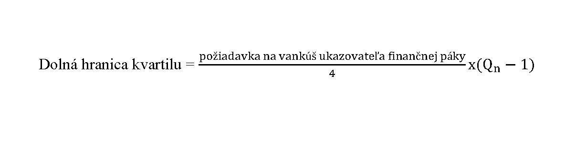
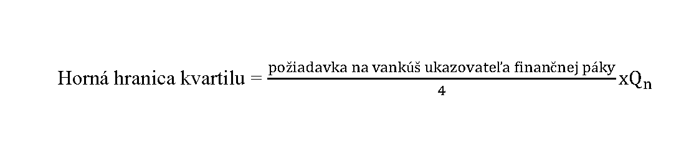

# § 33ka

(1) Banka, ktorá spĺňa požiadavku na vankúš ukazovateľa finančnej páky, nesmie vykonávať rozdeľovanie kapitálu Tier 1, ak by týmto rozdeľovaním došlo k zníženiu jej kapitálu Tier 1 na úroveň, na ktorej by už požiadavka na vankúš ukazovateľa finančnej páky nebola splnená.

(2) Banka, ktorá nespĺňa požiadavku na vankúš ukazovateľa finančnej páky, vypočíta maximálnu rozdeliteľnú sumu vzťahujúcu sa na ukazovateľ finančnej páky podľa odseku 4 a oznámi ju Národnej banke Slovenska. Banka do vykonania výpočtu maximálnej rozdeliteľnej sumy vzťahujúcej sa na ukazovateľ finančnej páky a jej oznámenia Národnej banke Slovenska nesmie

- a) vykonať rozdeľovanie vlastného kapitálu Tier 1,

- b) zaviesť povinnosť uhradiť pohyblivú zložku celkovej odmeny alebo dobrovoľné platby dôchodkového zabezpečenia alebo uhradiť pohyblivú zložku celkovej odmeny, ak povinnosť úhrady vznikla v čase, keď banka nespĺňala požiadavku na vankúš ukazovateľa finančnej páky, alebo

- c) uskutočniť platbu v súvislosti s nástrojmi dodatočného kapitálu Tier 1.

(3) Banka počas obdobia, v ktorom nespĺňa alebo neprekračuje požiadavku na vankúš ukazovateľa finančnej páky, môže konať podľa odseku 2 iba do výšky maximálnej rozdeliteľnej sumy vzťahujúcej sa na ukazovateľ finančnej páky vypočítanej podľa odseku 4. Ak banka vykoná ktorékoľvek opatrenie podľa odseku 2, zníži sa maximálna rozdeliteľná suma vzťahujúca sa na ukazovateľ finančnej páky.

(4) Banka vypočítava maximálnu rozdeliteľnú sumu vzťahujúcu sa na ukazovateľ finančnej páky ako súčin sumy vypočítanej podľa odseku 5 a koeficientu určeného podľa odseku 6. Maximálna rozdeliteľná suma vzťahujúca sa na ukazovateľ finančnej páky sa musí znížiť o sumu vyplývajúcu z opatrenia podľa odseku 2 druhej vety.

(5) Suma, ktorá sa má podľa odseku 4 vynásobiť, je súčtom predbežného zisku nezahrnutého do vlastného kapitálu Tier 1 podľa osobitného predpisu,30zh) ktorý je znížený o rozdelený zisk alebo platbu vyplývajúcu z opatrení podľa odseku 2 druhej vety, a koncoročného zisku nezahrnutého do vlastného kapitálu Tier 1 podľa osobitného predpisu,30zh) ktorý je znížený o rozdelený zisk alebo platbu vyplývajúcu z opatrení podľa odseku 2, znížený o sumu, ktorá by bola splatnou daňou, ak by predbežný zisk a koncoročný zisk neboli rozdelené.

(6) Koeficient je

- a) 0, ak kapitál Tier 1 držaný bankou, ktorý sa nepoužije na splnenie požiadavky na vlastné zdroje podľa osobitného predpisu30bd) a opatrenia na nápravu podľa § 50 ods. 1 písm. m) týkajúceho sa osobitnej požiadavky na vlastné zdroje podľa § 29b, ak riziko nadmerného pákového efektu nie je dostatočne kryté podľa osobitného predpisu,30bd) vyjadrený ako percentuálny podiel z veľkosti celkovej rizikovej expozície vypočítanej podľa osobitného predpisu,30zkd) je v prvom kvartile požiadavky na vankúš ukazovateľa finančnej páky,

- b) 0,2, ak kapitál Tier 1 držaný bankou, ktorý sa nepoužije na splnenie požiadavky na vlastné zdroje podľa osobitného predpisu30bd) a opatrenia na nápravu podľa § 50 ods. 1 písm. m) týkajúceho sa osobitnej požiadavky na vlastné zdroje podľa § 29b, ak riziko nadmerného pákového efektu nie je dostatočne kryté podľa osobitného predpisu,30bd) vyjadrený ako percentuálny podiel z veľkosti celkovej rizikovej expozície vypočítanej podľa osobitného predpisu,30zkd) je v druhom kvartile požiadavky na vankúš ukazovateľa finančnej páky,

- c) 0,4, ak kapitál Tier 1 držaný bankou, ktorý sa nepoužije na splnenie požiadavky na vlastné zdroje podľa osobitného predpisu30bd) a opatrenia na nápravu podľa § 50 ods. 1 písm. m) týkajúceho sa osobitnej požiadavky na vlastné zdroje podľa § 29b, ak riziko nadmerného pákového efektu nie je dostatočne kryté podľa osobitného predpisu,30bd) vyjadrený ako percentuálny podiel z veľkosti celkovej rizikovej expozície vypočítanej podľa osobitného predpisu,30zkd) je v treťom kvartile požiadavky na vankúš ukazovateľa finančnej páky,

- d) 0,6, ak kapitál Tier 1 držaný bankou, ktorý sa nepoužije na splnenie požiadavky na vlastné zdroje podľa osobitného predpisu30bd) a opatrenia na nápravu podľa § 50 ods. 1 písm. m) týkajúceho sa osobitnej požiadavky na vlastné zdroje podľa § 29b, ak riziko nadmerného pákového efektu nie je dostatočne kryté podľa osobitného predpisu,30bd) vyjadrený ako percentuálny podiel z veľkosti celkovej rizikovej expozície vypočítanej podľa osobitného predpisu,30zkd) je v štvrtom kvartile požiadavky na vankúš ukazovateľa finančnej páky alebo je vyšší ako horná hranica štvrtého kvartilu.

(7) Na výpočet dolnej hranice kvartilu požiadavky na vankúš ukazovateľa finančnej páky sa použije tento vzorec:

kde Qn je radová číslovka príslušného kvartilu.

(8) Na výpočet hornej hranice kvartilu požiadavky na vankúš ukazovateľa finančnej páky sa použije tento vzorec:

kde Qn je radová číslovka príslušného kvartilu.

(9) Na účely odsekov 1 a 2 sa na rozdeľovanie kapitálu Tier 1 použijú ustanovenia § 33k ods. 9.

(10) Ak banka nespĺňa požiadavku na vankúš ukazovateľa finančnej páky a plánuje rozdeliť svoj rozdeliteľný zisk alebo postupovať podľa odseku 2, oznámi to Národnej banke Slovenska. Oznámenie obsahuje informácie podľa § 33k ods. 10 okrem informácie podľa § 33k ods. 10 písm. a) tretieho bodu a maximálnu rozdeliteľnú sumu vzťahujúcu sa na ukazovateľ finančnej páky vypočítanú podľa odseku 4.

(11) Banka je povinná prijať opatrenia na zabezpečenie presného výpočtu výšky rozdeliteľného zisku a maximálnej rozdeliteľnej sumy vzťahujúcej sa na ukazovateľ finančnej páky a Národnej banke Slovenska preukáže na vyžiadanie presnosť tohto výpočtu.

(12) Obmedzenia podľa odsekov 1 až 11 sa vzťahujú len na platby, ktorých výsledkom je zníženie kapitálu Tier 1 alebo zníženie ziskov, pričom pozastavenie platieb alebo nevykonanie úhrad nepredstavuje zlyhanie ani podmienku na začatie konania v režime platobnej neschopnosti.

(13) Banka nespĺňa požiadavku na vankúš ukazovateľa finančnej páky na účely odsekov 1 až 12, ak neudržiava kapitál Tier 1 vo výške potrebnej na súčasné splnenie požiadavky na vankúš ukazovateľa finančnej páky, požiadavky podľa osobitného predpisu30bd) a opatrenia na nápravu podľa § 50 ods. 1 písm. m) týkajúceho sa osobitnej požiadavky na vlastné zdroje podľa § 29b, ak riziko nadmerného využívania finančnej páky nie je dostatočne kryté požiadavkou podľa osobitného predpisu.30bd)
