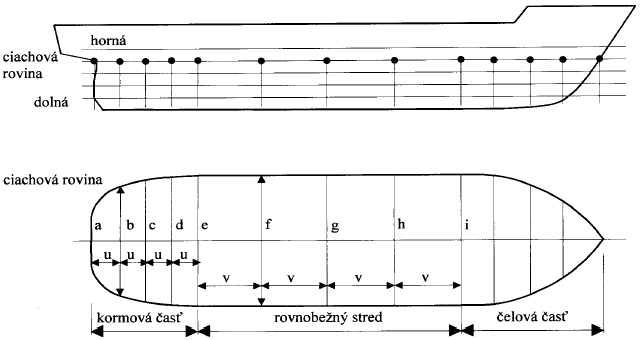

Príloha č. 1 k vyhláške č. 59/2001 Z. z.

- Simpsonovo pravidlo na výpočet plôch ohraničených krivkami 

  - Čiastočné plochy vodorysiek:

  - A1 = u/3 . (a + 4b + 2c + 4d + e), A2 = v/3 . (e + 4f +2g +4h +i), ...

  - Celková plocha vodorysky:

  - A = A1 +A2 + ...
