Príloha č. 51 k vyhláške č. 75/2001 Z. z.

- MERAČE TEPLA

  - Prvá časť Vymedzenie meradiel a spôsob ich metrologickej kontroly

    - 1. Táto príloha sa vzťahuje na merače tepla s teplonosnými médiami – kvapalinou, prehriatou alebo sýtou vodnou parou a parným kondenzátom (ďalej len „merač tepla“), ktoré sa používajú na meranie spotrebovaného alebo odovzdaného tepla v súvislosti s platbami za teplo, ako určené meradlá podľa § 8 zákona. Príloha sa vzťahuje aj na členy meračov tepla, ak tvoria súčasť merača tepla.

    - 2. Merače tepla pred uvedením na trh podliehajú schváleniu typu a prvotnému overeniu. Metódy technických skúšok pri schvaľovaní typu a metódy skúšania pri overení sú uvedené v druhej časti.

    - 3. Merače tepla schváleného typu výrobca alebo dovozca označí značkou schváleného typu.

    - 4. Merače tepla, ktoré pri overení spĺňajú ustanovené požiadavky, sa označia overovacou značkou.

    - 5. Prvotne overené merače tepla možno uvádzať na trh do konca roka nasledujúceho po roku, v ktorom bolo prvotné overenie vykonané, za predpokladu, že je zaručené, že sa nezmenia parametre, ktoré majú vplyv na presnosť merania po uvedení na trh.

    - 6. Merače tepla počas ich používania ako určené meradlá podliehajú následnému overeniu.

  - Druhá časť Technické požiadavky, metrologické požiadavky, metódy technických skúšok a metódy skúšania pri overení meračov tepla

    - ODDIEL I MERAČ TEPLA S TEPLONOSNÝM MÉDIOM – KVAPALINOU

      - 1 Termíny a definície

      - 1.1 Merač tepla je merací prístroj určený na meranie množstva tepla, ktoré je vo výmenníku tepla odovzdané alebo odobrané teplonosnej kvapaline.

      - 1.2 Výmenník tepla je teplovýmenné zariadenie, ktoré je súčasťou odovzdávacej stanice, alebo odberné tepelné zariadenie, ktoré je súčasťou objektu.

      - 1.3 Elektrický merač tepla je merač tepla, ktorý prijíma a spracúva merané hodnoty pomocou elektrických prvkov a obvodov.

      - 1.4 Člen merača tepla je súčasť merača tepla, ktorá sníma fyzikálne veličiny potrebné na určenie tepla alebo tieto snímané veličiny prijíma a matematicky spracúva; členmi merača tepla sú prietokomer ako člen merača tepla, snímače teploty a kalorimetrické počítadlo.

      - 1.5 Prietokomer ako člen merača tepla je súčasť merača tepla, cez ktorú preteká teplonosná kvapalina v prívodnom alebo vo vratnom potrubí v okruhu výmenníka tepla vysielajúca signál, ktorý je funkciou objemu, hmotnosti alebo objemového, prípadne hmotnostného prietoku.

      - 1.6 Párované snímače teploty sú súčasťou merača tepla (inštalované s puzdrom alebo bez neho) a snímajú teplotu teplonosnej kvapaliny v prívodnom alebo vo vratnom potrubí v okruhu výmenníka tepla.

      - 1.7 Kalorimetrické počítadlo je súčasť merača tepla, ktorá prijíma signály z prietokomera, teplotného snímača a vypočítava a udáva odovzdané množstvo tepla.

      - 1.8 Menovitý teplotný rozsah je rozsah teplôt teplonosnej kvapaliny medzi najvyššou teplotou v prívodnom potrubí a najnižšou teplotou vo vratnom potrubí, v ktorom merač tepla alebo jeho členy pracujú bez prekročenia hodnôt najväčších dovolených chýb.

      - 1.9 Horná hranica teplotného rozsahu (menovitá teplota) je najvyššia teplota teplonosnej kvapaliny, pri ktorej merač tepla alebo jeho členy pracujú bez prekročenia hodnôt najväčších dovolených chýb.

      - 1.10 Dolná hranica teplotného rozsahu je najnižšia teplota teplonosnej kvapaliny, pri ktorej merač tepla alebo jeho členy pracujú bez prekročenia hodnôt najväčších dovolených chýb.

      - 1.11 Teplotný rozdiel je absolútna hodnota rozdielu teplôt teplonosnej kvapaliny v prívodnom a vo vratnom potrubí.

      - 1.12 Menovitý teplotný rozdiel je najväčší teplotný rozdiel, pre ktorý je merač tepla určený a pri ktorom nie sú prekročené hodnoty najväčších dovolených chýb.

      - 1.13 Najmenší teplotný rozdiel je najmenší teplotný rozdiel, pre ktorý je merač tepla určený a pri ktorom nie sú prekročené hodnoty najväčších dovolených chýb.

      - 1.14 Menovitý tepelný výkon je najväčší tepelný výkon pri menovitom teplotnom rozdiele a pri menovitom prietoku teplonosnej kvapaliny za predpokladu, že nižšia teplota teplonosnej kvapaliny v okruhu výmenníka tepla sa rovná dolnej medzi teplotného rozsahu; pri tomto výkone plní merač tepla svoju funkciu nepretržite, bez prekročenia hodnôt najväčších dovolených chýb.

      - 1.15 Menovitý prietok je najväčší prietok, pri ktorom môže prietokomer pracovať pri bežnom používaní, t. j. za stálych a prerušovaných pracovných podmienok, bez poškodenia a bez prekročenia najväčších dovolených chýb a najväčšej dovolenej hodnoty straty tlaku. Je vyjadrený v kubických metroch za hodinu a používa sa na označenie prietokomera.

      - 1.16 Prevádzkový tlak je tlak teplonosnej kvapaliny v okruhu výmenníka tepla bezprostredne pred prietokomerom ako členom merača tepla.

      - 1.17 Menovitý tlak je najvyšší prevádzkový tlak, na ktorý výrobca určí merač tepla alebo jeho členy.

      - 1.18 Merací rozsah merača tepla je daný meracími rozsahmi použitých členov merača tepla a rozsahom platnosti výpočtu parametrov teplonosného média v kalorimetrickom počítadle.

      - 1.19 Kompaktný merač tepla je merač tepla, ktorý nemá oddeliteľné členy.

      - 1.20 Kombinovaný merač tepla je merač tepla, ktorý je zostavený z oddeliteľných členov.

      - 1.21 Merač tepla s neoddeliteľnými členmi je merač tepla, ktorého dva členy tvoria neoddeliteľný celok.

      - 2 Technické požiadavky a metrologické požiadavky

      - 2.1 Všeobecné požiadavky

      - 2.1.1 Všetky konštrukčné prvky merača tepla sa zhotovujú tak, aby zaručovali požadovanú stálosť metrologických vlastností a spoľahlivú funkciu v dlhodobej prevádzke, najmenej však medzi dvoma overeniami.

      - 2.1.2 Materiály konštrukčných prvkov odolávajú rôznym formám korózie a opotrebovania, ktoré sa vyskytujú za bežných pracovných podmienok, osobitne spôsobených nečistotami v teplonosnom médiu. Správne zabudované merače tepla odolávajú pôsobeniu vonkajšieho prostredia, pre ktoré sú určené. Merače tepla za každých okolností a bez obmedzenia správnej funkcie odolávajú menovitému tlaku a teplote, pre ktoré sú určené.

      - 2.1.3 Smer prúdenia teplonosného média sa vyznačí na meracom prístroji šípkou alebo opisom, napríklad zhora nadol.

      - 2.1.4 Skrinka (puzdro) merača tepla chráni jeho vnútorné časti alebo jeho členy pred striekajúcou vodou a prachom.

      - 2.1.5 Chvenie vysielača impulzov prietokomera ako člena merača tepla alebo prietokomera nespôsobí zmenu indikácie na kalorimetrickom počítadle.

      - 2.1.6 Merače tepla neregistrujú teplo, ak teplonosné médium neprúdi.

      - 2.1.7 Pomer medzi menovitým a najmenším teplotným rozdielom merača tepla je najmenej 10. Najmenší teplotný rozdiel je najviac 10 oC.

      - 2.1.8 Kalorimetrické počítadlo má zariadenie, ktoré signalizuje alebo indikuje prietok teplonosného média.

      - 2.1.9 Merač tepla sa vybaví počítadlom tepla.

      - 2.1.10 Merač tepla sa môže vybaviť aj zariadením na indikáciu objemu, hmotnosti, prietoku, teploty, teplotného rozdielu, tepelného výkonu, prevádzkového času, prípadne iných údajov.

      - 2.1.11 Ak je elektrický merač tepla napájaný z batérie, môže sa pri výrobe použiť iba taká batéria, s ktorou výrobca zaručí, že počas piatich rokov nepretržitého používania merača tepla chyby merania z dôvodu poklesu napätia batérie neprekročia najväčšie dovolené chyby.

      - 2.1.12 Merače tepla sa môžu vybaviť rozhraním, ktoré umožňuje pripojenie diaľkových prenosov a prídavných zariadení bez ovplyvnenia metrologických vlastností merača tepla.

      - 2.1.13 Elektrické merače tepla na účely racionálnych skúšok umožňujú zrýchlenú skúšku. Na túto skúšku majú zodpovedajúci výstup umožňujúci indikovať merané množstvo tepla s potrebnou rozlišovacou schopnosťou.

      - 2.2 Požiadavky na zariadenie na indikáciu množstva tepla

      - 2.2.1 Merač tepla indikuje meranú tepelnú energiu v jouloch, watthodinách alebo v desatinných podieloch, alebo v násobkoch týchto jednotiek. Názov alebo symbol jednotky, v ktorej je teplo merané, sa vyznačí na indikačnom zariadení v bezprostrednej blízkosti stupnice.

      - 2.2.2 Indikačné zariadenie sa vyhotovuje ako číslicová alebo poločíslicová stupnica. V prípade poruchy napájania merača tepla z elektrickej siete uchováva hodnoty meraného tepla najmenej počas troch nasledujúcich dní po výpadku. Po obnovení napájania indikačné zariadenie automaticky pokračuje v meraní.

      - 2.2.3 Čítanie indikovanej hodnoty je bezpečné, ľahké a jednoznačné pri všetkých polohách počítadla.

      - 2.2.4 Intervaly stupnice indikačného zariadenia sa vyjadrujú v jednotkách tepelnej energie, vo forme 1 x 10n, 2 x 10n alebo 5 x 10n, kde n je kladné alebo záporné celé číslo alebo nula.

      - 2.2.5 Skutočná alebo zdanlivá výška číslic na indikačnom zariadení je najmenej 4 mm.

      - 2.2.6 Ak je indikačné zariadenie vyhotovené ako valčekové počítadlo, posun číslice určitého rádu sa vykoná počas zmeny číslice nižšieho rádu z deväť na nulu. Valček s číslicami najnižšieho rádu sa môže pohybovať kontinuálne a jeho posuv pri pozorovaní spredu je zdola nahor.

      - 2.2.7 Zariadenie indikujúce teplo má takú kapacitu, aby postačovala na registrovanie energie počas 3 000 hodín nepretržitej prevádzky pri menovitom tepelnom výkone.

      - 2.2.8 Teplo, ktoré zmeria merač tepla pri menovitom tepelnom výkone za jednu hodinu, spôsobí zmenu najmenej jednej číslice najnižšieho rádu indikačného zariadenia.

      - 2.3 Požiadavky na prietokomery ako členy merača tepla sú uvedené v prílohe č. 53.

      - 2.4 Požiadavky na snímače teploty

      - 2.4.1 Snímače teploty, ktoré sú členmi elektrických meračov tepla, sa dodávajú a používajú v spárovaných dvojiciach, ak nie sú priamo naprogramované konštanty každého snímača v kalorimetrickom počítadle.

      - 2.4.2 Na snímače teploty sa vzťahujú technické požiadavky pre odporové snímače teploty uvedené v prílohe č. 37 a v slovenských technických normách pre triedu presnosti A alebo B. Snímače triedy presnosti C nie je dovolené používať.

      - 2.4.3 Snímače teploty sa vyhotovujú tak, aby pri skúšaní umožnili ponor do pracovnej kvapaliny termostatizovaných kúpeľov bez ich poškodenia počas skúšok pri prvotnom a následnom overení.

      - 2.4.4 Snímače teploty sa vyhotovujú tak, aby zabezpečili požadované metrologické vlastnosti počas najmenej 10 h pri najvyššej teplote zvýšenej o 10 oC.

      - 2.4.5 Zmena odporu ΔRo nie je väčšia ako hodnota odporu zodpovedajúca 0,025 oC. Zmena odporu ΔRo je vyjadrená vzťahom:

        - ΔRo = Ro – R'o,

        - kde Ro – odpor snímača teploty na začiatku meraní pri teplote 0 oC alebo 40 oC v Ω,

        - R'o – odpor snímača teploty pri teplote 0 oC alebo 40 oC v Ω po meraní teplotnej závislosti pri predpísaných teplotách.

      - 2.4.6 Odpor spojovacieho vedenia každého snímača teploty pri dvojvodičovom zapojení je taký, že jeho teplotný ekvivalent je najviac 0,5 oC. V prípade rôznych dĺžok spojovacieho vedenia spárovaných snímačov teploty sa na odpor vedenia vzťahujú technické požiadavky, ktoré sú uvedené v rozhodnutí o schválení typu merača tepla.

      - 2.5 Najväčšie dovolené chyby

      - 2.5.1 Najväčšie dovolené chyby uvedené v bodoch 2.5.2 až 2.5.8 sa vzťahujú na tieto pracovné podmienky:

        - a) teplota okolia od 5 oC do 55 oC,

        - b) relatívna vlhkosť vzduchu najviac 93 %,

        - c) kolísanie napájacieho napätia elektrického merača tepla +10 % až –15 % nominálnej hodnoty,

        - d) kolísanie frekvencie napájacieho napätia ± 2 % nominálnej hodnoty.

          - Referenčné podmienky pri technických skúškach pri schvaľovaní typu okrem podmienok uvedených v bode 2.5.1 určí ich vykonávateľ, pri ostatných skúškach sa určia po dohode vykonávateľa a objednávateľa.

      - 2.5.2 Merače tepla sa delia do troch tried presnosti: 2, 4, a 5.

      - 2.5.3 Najväčšie dovolené chyby meračov tepla (kladné alebo záporné) v pomere ku konvenčne pravej hodnote tepla sú dané ako relatívne chyby a sú funkciou teplotného rozdielu.

      - 2.5.4 Najväčšie dovolené chyby E meračov tepla pre jednotlivé triedy presnosti sú uvedené v tabuľke č. 1. Čísla v zátvorkách označujú najväčšie dovolené chyby pri prietokoch teplonosnej kvapaliny, ktoré sa rovnajú alebo sú väčšie ako najmenší prietok a menšie ako 0,1 menovitého prietoku, kde menovitý prietok neprekračuje 3 m3/h.

        - Tabuľka č. 1

      - Teplotný rozdiel | E | |

      - | trieda 2 | trieda 4 | trieda 5

      - ∆t < 10 °C | ±4 % | ±6 % (8 %) | ±8 % (10 %)

      - 10 °C ≤ ∆t < 20 °C | ±3 % | ±5 % (7 %) | ±7 % (9 %)

      - 20 °C ≤ ∆t | ±2 % | ±4 % (6 %) | ±5 % (7 %)

      - 2.5.5 Najväčšie dovolené chyby meračov tepla tried presnosti 4 a 5 podľa bodu 2.5.4 sú určené pre kompaktné prístroje a pre kombinované prístroje. Najväčšie dovolené chyby triedy presnosti 2 sú určené pre kompaktné prístroje.

      - 2.5.6 Najväčšie dovolené chyby členov meračov tepla triedy presnosti 4 alebo ich kombinácií:

        - a) prietokomer ako člen merača tepla ± 3 %; pre prietokomery Qn ≤ 3 m3/h; ± 5 % pre prietoky v rozsahu Qmin až Qt,

        - b) kalorimetrické počítadlo spolu so snímačmi teploty

          - ± (|E| – 3 %) alebo

          - ± (|E| – 5 %) pre podmienky uvedené v bode 2.5.8,

        - c) kalorimetrické počítadlo bez snímačov teploty

          - ± 1 % pre 3 oC ≤ Δt < 20 oC,

          - ± 0,5 % pre 20 oC ≤ Δt,

        - d) pri snímačoch teploty zhoda údajov oboch snímačov teploty zaradených do vymeniteľného páru je pri ľubovoľnej teplote v menovitom teplotnom rozsahu väčšia ako 0,05 oC.

      - 2.5.7 Najväčšie dovolené chyby členov meračov tepla triedy presnosti 5 alebo ich kombinácií:

        - a) prietokomer ako člen merača tepla ± 3 %; pre prietokomery Qn ≤ 3 m3/h; ± 5 % pre prietoky v rozsahu Qmin až Qt,

        - b) kalorimetrické počítadlo spolu so snímačmi teploty

          - ± (|E| – 3 %) alebo

          - ± (|E| – 5 %) pre podmienky uvedené v bode 2.5.8,

        - c) kalorimetrické počítadlo bez snímačov teploty

          - ± 1,5 % pre 3 oC ≤ ∆t < 20 oC,

          - ± 1 % pre 20 oC ≤ ∆t,

        - d) pri snímačoch teploty zhoda údajov oboch snímačov teploty zaradených do vymeniteľného páru je pri ľubovoľnej teplote v menovitom teplotnom rozsahu väčšia ako 0,1 oC.

      - 2.6 Konvenčne pravá hodnota tepla

      - 2.6.1 Konvenčne pravá hodnota tepla je definovaná rovnicou:

        - 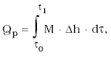

        - kde M – hmotnostný prietok teplonosnej kvapaliny prechádzajúcej cez merač tepla,

        - ∆h – rozdiel medzi špecifickými entalpiami teplonosnej kvapaliny pri vstupnej a výstupnej teplote v okruhu výmenníka tepla,

        - τ – čas.

      - 2.6.2 Konvenčne pravá hodnota tepla môže byť vyjadrená tiež rovnicou:

        - 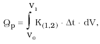

        - kde ∆t – rozdiel teplôt teplonosnej kvapaliny na vstupe do okruhu výmenníka tepla a výstupe z neho,

        - V – objem teplonosnej kvapaliny,

        - K(1,2) | – súčiniteľ, ktorý je funkciou vlastností teplonosnej kvapaliny závislých od jej teplôt a tlaku. Tento súčiniteľ môže byť vyjadrený rovnicami

        - a) pri meraní prietoku alebo objemu teplonosnej kvapaliny v prívodnom potrubí:

          - 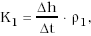

        - b) pri meraní prietoku alebo objemu teplonosnej kvapaliny vo vratnom potrubí:

          - 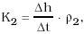

          - kde ρ1 – hustota teplonosnej kvapaliny v prívodnom potrubí,

          - ρ2 – hustota teplonosnej kvapaliny vo vratnom potrubí.

      - 2.7 Najväčšie dovolené chyby v prevádzke sa rovnajú 1,5-násobku najväčších dovolených chýb podľa bodu 2.5.

      - 3 Nápisy a značky

      - 3.1 Ak sa merač tepla vyhotoví ako kompaktný prístroj, má na dobre čitateľnom, nezmazateľnom a vhodne umiestnenom štítku uvedené tieto údaje:

        - a) označenie typu,

        - b) výrobné číslo doplnené rokom výroby (môže byť uvedený samostatne),

        - c) značku schváleného typu,

        - d) menovitý teplotný rozsah uvedený v oC,

        - e) najmenší a menovitý teplotný rozdiel uvedený v tvare:

          - Δtmin = p oC,

          - Δtmax = r oC,

        - f) menovitý tlak,

        - g) hraničné hodnoty objemového alebo hmotnostného prietoku,

        - h) charakteristické označenie teplonosnej kvapaliny v prípade, ak nemá termodynamické vlastnosti vody bez prísad,

        - i) označenie triedy presnosti 2, 4 alebo 5,

        - j) menovitá svetlosť potrubia, v ktorom prúdi teplonosná kvapalina, pre ktorú je merač určený,

        - k) definované zabudovanie prietokomera ako člena merača tepla v polohe horizontálnej alebo vertikálnej, v prívodnom alebo vo vratnom potrubí,

        - l) ak má merač tepla zabudované zariadenie na indikáciu prevádzkového času a táto indikácia je závislá od frekvencie napájacieho napätia, uvedenie tejto skutočnosti,

        - m) horná hranica tepelného výkonu, ak je väčší ako menovitý tepelný výkon.

      - 3.2 Ak sa merač tepla vyhotoví ako kombinovaný prístroj, jednotlivé členy majú na dobre čitateľnom, nezmazateľnom, vhodne umiestnenom štítku uvedené tieto údaje:

      - 3.2.1 Kalorimetrické počítadlo:

        - a) údaje uvedené v bode 3.1 písm. a) až e), h), i), l), m),

        - b) hodnota vstupného signálu z prietokomerného člena merača tepla (napríklad Imp./m3),

        - c) druh snímačov teploty, ktoré sa s kalorimetrickým počítadlom môžu používať (napríklad Pt 100),

        - d) definované zabudovanie prietokomera ako člena merača tepla v prívodnom alebo vo vratnom potrubí.

      - 3.2.2 Prietokomer ako člen merača tepla:

        - a) údaje uvedené v bode 3.1 písm. a) až c), f) až h), j),

        - b) menovitá teplota kvapaliny, do ktorej môže byť prietokomer ako člen merača tepla použitý, hodnota výstupného signálu vstupujúceho do kalorimetrického počítadla (napríklad Imp./m3).

      - 3.2.3 Snímače teploty:

        - a) údaje uvedené v bode 3.1 písm. a) až d),

        - b) druh snímača (napríklad Pt 100),

        - c) jednoznačná príslušnosť dvoch snímačov zaradených do páru (napríklad pri nových snímačoch je vhodné označenie tým istým výrobným číslom lomeným pri jednom číslom 1 – snímač montovaný do prívodného potrubia, pri druhom číslom 2 – snímač montovaný do vratného potrubia v okruhu výmenníka tepla),

        - d) trieda presnosti snímača teploty.

      - 4 Umiestnenie overovacích a montážnych značiek

      - 4.1 Na kompaktných prístrojoch sa umiestni overovacia značka na viditeľnom mieste na puzdre tej časti merača tepla, ktorá indikuje teplo.

      - 4.2 Na kombinovaných prístrojoch sa opatria všetky členy merača tepla overovacou značkou umiestnenou na viditeľnom mieste. Tieto značky zabezpečujú jednotlivé členy proti neoprávnenému zásahu.

      - 4.3 Po montáži kompaktných a kombinovaných prístrojov do okruhu výmenníka tepla sa umiestňujú zabezpečovacie značky na takých miestach, aby indikovali svojvoľnú výmenu komponentov alebo ich neoprávnené demontovanie z pracovného miesta. Značky sa umiestňujú na

        - a) kalorimetrickom počítadle na kryte svorkovnice alebo inom uzávere umožňujúcom k nej prístup,

        - b) prietokomere ako člene merača tepla, na spojovacích prírubách (skrutkových spojoch) s potrubím, na vysielači elektrických signálov, ktoré sú vstupnou veličinou do kalorimetrického počítadla,

        - c) snímačoch teploty v mieste ich pripojenia s teplomerovým puzdrom.

      - 5 Technické skúšky pri schvaľovaní typu

      - 5.1 Oblasť skúšania je určená menovitým teplotným rozsahom, menovitým a najmenším teplotným rozdielom, hraničnými hodnotami tepelného výkonu a prietoku teplonosnej kvapaliny, pre ktoré je skúšaný merač tepla určený.

      - 5.2 Pri technických skúškach pri schvaľovaní typu sa preverujú metrologické parametre meračov tepla

        - a) samostatnými skúškami členov meračov tepla

      - 1. prietokomerov ako členov merača tepla,

      - 2. kalorimetrických počítadiel,

      - 3. snímačov teploty;

        - tieto skúšky sa môžu vykonávať pri kombinovaných prístrojoch,

        - b) spoločnými skúškami dvoch členov (napríklad kalorimetrického počítadla so snímačmi teploty) a samostatnou skúškou jedného člena (napríklad prietokomera ako člena merača tepla),

        - c) skúškami kompaktných prístrojov.

      - 5.3 Skúšky členov meračov tepla okrem kalorimetrického počítadla sa vykonávajú podľa príloh č. 37 a 53.

      - 5.4 Skúšky kalorimetrického počítadla sa vykonávajú postupom podľa bodu 7.2, pričom skúšobné body určí vykonávateľ skúšky.

      - 5.5 Skúšky kompaktných meračov tepla sa vykonávajú postupom podľa bodu 8, skúšobné body určí vykonávateľ skúšky.

      - 5.6 Účinky ovplyvňujúcich veličín

        - Prídavné skúšky účinkov ovplyvňujúcich veličín na údaje merača tepla alebo jeho členov sa vykonávajú podľa príloh č. 37 a 53 a podľa príslušných slovenských technických noriem.

      - 6 Metódy skúšania pri overení

      - 6.1 Pri overení sa merače tepla môžu skúšať

        - a) samostatnými skúškami členov meračov tepla

      - 1. prietokomerov ako členov merača tepla,

      - 2. kalorimetrických počítadiel,

      - 3. snímačov teploty;

        - tieto skúšky sa môžu vykonávať pri kombinovaných prístrojoch,

        - b) spoločnými skúškami dvoch členov (napríklad kalorimetrického počítadla so snímačmi teploty) a samostatnou skúškou jedného člena (napríklad prietokomera ako člena merača tepla),

        - c) skúškami kompaktných prístrojov.

      - 7 Skúšky členov meračov tepla

      - 7.1 Prietokomer ako člen merača tepla

        - Skúška prietokomera ako člena merača tepla sa vykoná podľa prílohy č. 53.

      - 7.2 Kalorimetrické počítadlá elektrických meračov tepla

      - 7.2.1 Pri overení kalorimetrických počítadiel sa vykonáva

        - a) vonkajšia obhliadka,

        - b) skúška správnosti,

        - c) vyhodnotenie meraní.

      - 7.2.2 Vonkajšia obhliadka

        - Vonkajšou obhliadkou kalorimetrického počítadla sa zisťuje, či

        - a) vyhovuje schválenému typu,

        - b) sú na počítadle uvedené všetky údaje podľa bodu 3.2.1,

        - c) nemá porušené časti na umiestnenie overovacích a montážno-zabezpečovacích značiek, ktoré boli určené pri schvaľovaní typu,

        - d) skrinka počítadla nie je mechanicky poškodená,

        - e) počítadlo nemá žiadnu ďalšiu viditeľnú chybu.

          - Ak kalorimetrické počítadlo uvedeným požiadavkám nevyhovuje, vyradí sa z ďalších skúšok.

      - 7.2.3 Skúška správnosti

      - 7.2.3.1 Na skúšané kalorimetrické počítadlo sa pred začatím skúšky pripoja prístroje simulujúce signály prietokomera ako člena merača tepla a snímačov teploty.

      - 7.2.3.2 Pre objem alebo prietok sa simulujú elektrické signály, ktoré zodpovedajú menovitému prietoku teplonosnej kvapaliny. Ak sa pri schvaľovaní typu preukáže závislosť chyby kalorimetrického počítadla od veľkosti prietoku, skúšky sa vykonávajú tiež pri simulovaných prietokoch teplonosnej kvapaliny, ktoré boli stanovené pri schvaľovaní typu.

      - 7.2.3.3 Teploty v prívodnom a vo vratnom potrubí sa simulujú elektrickými odpormi tak, aby sa skúšky vykonali pri týchto teplotných rozdieloch:

        - a) Δtmin ≤ Δt ≤ Δtmin + 1 oC,

        - b) Δtmax – 5 oC ≤ Δt ≤ Δtmax,

        - c) Δt = 10 oC ± 0,5 oC,

        - d) Δt = 20 oC ± 0,5 oC,

          - kde Δtmin – najmenší teplotný rozdiel v oC,

          - Δtmax – menovitý teplotný rozdiel v oC.

          - Dovolené odchýlky menovitých hodnôt elektrických odporov môžu byť také, aby odchýlky od uvedených teplôt boli najviac ± 0,5 oC.

          - Teplota vo vratnom potrubí sa simuluje v rozsahu od 20 oC do 80 oC.

          - Táto teplota sa simuluje aj pri inej hodnote, ak si to vyžaduje menovitý teplotný rozsah skúšaného typu kalorimetrického počítadla. Táto skutočnosť je uvedená v príslušnej dokumentácii rozhodnutia o schválení typu.

      - 7.2.3.4 Dĺžka trvania skúšky v každom skúšobnom bode závisí od konštrukčného riešenia kalorimetrického počítadla a skúšobného zariadenia. V prípade racionálnych skúšok (bod 2.1.13), keď výstupom pre merané teplo sú impulzy, počet impulzov simulujúcich objem alebo prietok teplonosnej kvapaliny je v každom skúšobnom bode volený tak, aby merané teplo zodpovedalo najmenej 1 000 impulzom na výstupe z kalorimetrického počítadla.

        - Pri týchto skúškach sa porovná najmenej v jednom skúšobnom bode teplo udané indikačným zariadením s teplom vypočítaným z elektrických signálov. Pritom merané teplo spôsobí zmenu údaja indikačného zariadenia najmenej o 10-násobok najnižšie odčítateľnej hodnoty.

      - 7.2.3.5 Pri spoločných skúškach kalorimetrických počítadiel elektrických meračov tepla so snímačmi teploty sú skúšobné teploty volené tak, aby sa skúšky vykonali pri všetkých teplotných rozdieloch stanovených v bode 7.2.3.3.

      - 7.2.4 Vyhodnotenie konvenčne pravej hodnoty tepla

      - 7.2.4.1 Pri skúškach v jednotlivých skúšobných bodoch – pri dodržaní konštantných hodnôt veličín simulujúcich prietok teplonosnej kvapaliny a vstupnú a vratnú teplotu – sa konvenčne pravá hodnota tepla Qp, ktorú má kalorimetrické počítadlo indikovať, vyjadruje rovnicou:

        - Qp = m . (h1 – h2) [J],

        - kde m je hmotnosť teplonosnej kvapaliny, ktorá by pri simulovaných elektrických signáloch pretiekla cez prietokomer ako člen merača tepla, vypočítaná zo vzťahu:

        - m = V . ρ [kg]

        - alebo

        - m = M . tau [kg],

        - kde hl – špecifická entalpia teplonosnej kvapaliny pri teplote t1 [J . kg-1],

        - h2 – špecifická entalpia teplonosnej kvapaliny pri teplote t2 [J . kg-1],

        - V – objem teplonosnej kvapaliny pretečenej cez prietokomer ako člen merača tepla [m3],

        - ρ – hustota teplonosnej kvapaliny pri teplote t2; v prípade zabudovania prietokomera ako člena merača tepla do prívodného potrubia pri teplote t1 [kg . m-1],

        - M – hmotnostný prietok teplonosnej kvapaliny [kg . s-1],

        - tau-doba trvania skúšky [s],

        - t1 – skúšobná teplota zodpovedajúca teplote teplonosnej kvapaliny v prívodnom potrubí [oC],

        - t2 – skúšobná teplota zodpovedajúca teplote teplonosnej kvapaliny vo vratnom potrubí [oC].

        - Hodnoty h1, h2, r sa zistia z tabuliek pre vodu pri absolútnom tlaku 1,6 MPa pre príslušné teploty. V prípade inej teplonosnej kvapaliny sa hodnoty zistia z tabuliek platných pre túto kvapalinu pri tlaku uvedenom výrobcom merača tepla.

      - 7.2.4.2 Konvenčne pravú hodnotu tepla, pri dodržaní podmienok uvedených v bode 7.2.4.1, možno tiež vyjadriť rovnicou:

        - Qp = K(1,2) . V . Δt [J],

        - kde Δt – rozdiel skúšobných teplôt t1 – t2,

        - K(1, 2) | – súčiniteľ, ktorý je funkciou vlastností teplonosnej kvapaliny závislých od jej teplôt a tlaku a môže byť vyjadrený rovnicami

        - a) pri meraní prietoku alebo objemu teplonosnej kvapaliny v prívodnom potrubí

          - 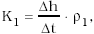

        - b) pri meraní prietoku alebo objemu teplonosnej kvapaliny vo vratnom potrubí

          - 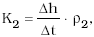

          - kde Δh – rozdiel špecifických entalpií h1 – h2,

          - ρ1 – hustota teplonosnej kvapaliny pri teplote t1 [kg . m-3],

          - ρ2 – hustota teplonosnej kvapaliny pri teplote t2 [kg . m-3].

      - 7.2.5 Vyhodnotenie chýb kalorimetrických počítadiel pri skúšaní

      - 7.2.5.1 Pri skúškach kalorimetrických počítadiel sa v každom skúšobnom bode vyhodnocujú ich relatívne chyby podľa rovnice:

        - 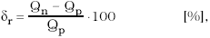

        - kde δr – relatívna chyba kalorimetrického počítadla [%],

        - Qn – prírastok údajov kalorimetrického počítadla počas trvania skúšky [J],

        - Qp – konvenčne pravá hodnota tepla [J].

      - 7.2.5.2 Kalorimetrické počítadlo pri skúškach správnosti vyhovie, so zohľadnením príslušných neistôt, ak vo všetkých skúšobných bodoch platí

        - δr ≤ δd ,

        - kde δd – najväčšia dovolená chyba kalorimetrického počítadla so snímačmi teploty alebo bez snímačov teploty podľa bodov 2.5.6 a 2.5.7.

      - 7.2.6 Overenie

      - 7.2.6.1 Kalorimetrické počítadlá, ktoré vyhoveli všetkým skúškam podľa tohto oddielu, sa opatria overovacími značkami na miestach určených v rozhodnutí o schválení typu meradla.

      - 7.2.6.2 Ak výrobca udáva na počítadle triedu presnosti 4 a vyhodnotenie preukáže vlastnosti zaraďujúce počítadlo do triedy presnosti 5, táto skutočnosť sa nezmazateľne vyznačí na vhodnom mieste kalorimetrického počítadla.

      - 7.3 Odporové snímače teploty

        - Pri overení odporových snímačov teploty sa vykonáva

        - a) vonkajšia obhliadka,

        - b) skúška odporu izolácie,

        - c) skúška závislosti odporu od teploty.

      - 7.3.1 Podmienky pri skúšaní

      - 7.3.1.1 Pri skúšaní sa dodržia podmienky ustanovené slovenskou technickou normou.

      - 7.3.1.2 Ak sú svorky odporových meracích vložiek premostené linearizačným obvodom, premostenie sa pri meraní nezruší a namerané hodnoty sa porovnajú s predpísanými hodnotami.

      - 7.3.2 Vonkajšia obhliadka

      - 7.3.2.1 Vonkajšou obhliadkou odporového snímača teploty sa zisťuje, či

        - a) vyhovuje schválenému typu,

        - b) sú na snímači uvedené všetky údaje podľa bodu 3.2.3,

        - c) nemá porušené časti na umiestnenie overovacích a montážno-zabezpečovacích značiek, ktoré boli určené pri schvaľovaní typu,

        - d) odporový snímač teploty nie je poškodený, napríklad, či nie sú voľným okom zistiteľné nedostatky na hlavici, ochrannej rúrke, vnútornom vedení, meracom odpore a jeho uchytení.

      - 7.3.2.2 Ak snímače teploty nevyhovujú uvedeným požiadavkám, vyradia sa z ďalších skúšok.

      - 7.3.3 Skúška odporu izolácie sa vykoná podľa slovenskej technickej normy pri teplote okolia 25 oC ± 5 oC.

      - 7.3.4 Skúška závislosti odporu od teploty

      - 7.3.4.1 Najmenší ponor snímača teploty pri skúšaní je taký, aby zmena ponoru o 10 mm nespôsobila zmenu jeho údaja väčšiu ako 0,03 oC.

      - 7.3.4.2 Odporové snímače teploty sa skúšajú pri teplotách

        - a) 0 oC alebo 40 oC,

        - b) 80 oC až 105 oC,

        - c) tmax –5 oC,

          - kde tmax– najväčšia teplota použitia snímačov podľa údajov výrobcu.

      - 7.3.4.3 Následnosť meraní pri skúške závislosti odporu od teploty je 0 oC alebo 40 oC, 80 oC až 105 oC; tmax, 0 oC alebo 40 oC. Tieto skúšky sa vykonávajú porovnávacou metódou.

      - 7.3.4.4 Podrobný postup skúšky závislosti odporu od teploty ustanovuje slovenská technická norma.

      - 7.3.5 Overenie

        - Snímače, ktoré vyhoveli požiadavkám a všetkým požadovaným skúškam, sa podľa tohto oddielu opatria overovacou značkou na mieste určenom v rozhodnutí o schválení typu.

      - 8 Skúšky kompaktných meračov tepla

        - Pri overení kompaktných meračov tepla sa vykonáva

        - a) vonkajšia obhliadka,

        - b) skúška správnosti,

        - c) vyhodnotenie meraní.

      - 8.1 Vonkajšia obhliadka

      - 8.1.1 Vonkajšou obhliadkou kompaktného merača tepla sa zisťuje, či

        - a) vyhovuje schválenému typu,

        - b) sú na všetkých členoch merača tepla uvedené všetky predpísané údaje,

        - c) nie sú porušené časti na umiestnenie overovacích a montážno-zabezpečovacích značiek, ktoré boli určené pri schvaľovaní typu,

        - d) nie sú viditeľné ďalšie chyby, ktoré znemožňujú správnu funkciu a overenie merača tepla.

      - 8.1.2 Ak kompaktný merač tepla nevyhovie požiadavkám bodu 8.1.1, vyradí sa z ďalších skúšok.

      - 8.2 Skúška správnosti

      - 8.2.1 Skúška správnosti sa vykonáva pri týchto kombináciách prietokov Q1 až Q3 a teplotných rozdieloch Δt:

        - a) Q1 = (1,0 až 1,1) Qmin, Δtmax –5 oC ≤ Δt ≤ Δtmax,

          - kde Qmin – najmenší prietok,

        - b) Q2 = (0,225 až 0,25) Qmax, Δt = 20 oC ± 0,5 oC,

        - c) Q3 = (0,45 až 0,5) Qmax, Δtmin ≤ Δt ≤ Δtmin +1 oC,

          - Δt = 10 oC ± 0,5 oC,

          - Δt = 20 oC ± 0,5 oC,

          - kde Qmax – najväčšie prípustné krátkodobé zaťaženie, pri ktorom sa neprekročí najväčšia dovolená chyba.

          - Hodnoty Δt sú uvedené v bode 7.2.3.3.

      - 8.2.2 Doplňujúce požiadavky na skúšky pri overení kompaktných meračov tepla sú uvedené v bodoch 7.2.3.3 a 7.2.3.4.

      - 8.3 Vyhodnotenie meraní

        - Vyhodnotenie meraní sa vykonáva podľa bodov 7.2.5.1 a 7.2.5.2. Najväčšie dovolené chyby kompaktných meračov tepla sú uvedené v bode 2.5.4.

      - 8.4 Overenie

        - Kompaktné merače tepla, ktoré vyhoveli požiadavkám a predpísaným skúškam podľa tohto oddielu, sa opatria overovacími značkami na miestach určených v rozhodnutí o schválení typu.

    - ODDIEL II MERAČE TEPLA S TEPLONOSNÝM MÉDIOM VODNOU PAROU

      - 1 Termíny a definície

      - 1.1 Merač tepla je merací prístroj určený na meranie množstva tepla, ktoré je vo výmenníku tepla odovzdané vodnou parou.

      - 1.2 Výmenník tepla je teplovýmenné zariadenie, ktoré je súčasťou odovzdávacej stanice, alebo odberné tepelné zariadenie, ktoré je súčasťou objektu.

      - 1.3 Elektrický merač tepla je merač tepla, ktorý prijíma a spracúva merané hodnoty pomocou elektrických prvkov a obvodov.

      - 1.4 Člen merača tepla je súčasť merača tepla, ktorá sníma fyzikálne veličiny potrebné na určenie tepla alebo tieto snímané veličiny prijíma a matematicky spracúva; členmi merača tepla sú: prietokomer ako člen merača tepla, snímače teploty, kalorimetrické počítadlo a prevodník tlaku.

      - 1.5 Prietokomer ako člen merača tepla na meranie pretečeného množstva pary je súčasť merača tepla v prívodnom potrubí výmenníka tepla, cez ktorú preteká para, vysielajúca signál úmerný pretečenému objemovému alebo hmotnostnému množstvu pary.

      - 1.6 Prietokomer ako člen merača tepla na meranie pretečeného množstva kondenzátu je súčasť merača tepla, cez ktorú preteká kondenzát v odvodnom potrubí výmenníka tepla, vysielajúca signál úmerný pretečenému objemovému alebo hmotnostnému množstvu kondenzátu.

      - 1.7 Snímač teploty je člen merača tepla, ktorý sníma teplotu vodnej pary v prívodnom potrubí výmenníka tepla.

      - 1.8 Kalorimetrické počítadlo je člen merača tepla, ktorý prijíma signály z prietokomeru, prevodníka tlaku, teplotného snímača a ktorý vypočítava a udáva odovzdané množstvo tepla.

      - 1.9 Prevodník tlaku je člen merača tepla, ktorý meria tlak pary v prívodnom potrubí výmenníka tepla.

      - 1.10 Menovitý teplotný rozsah je interval teplôt vodnej pary, v ktorom merač tepla alebo jeho členy pracujú bez prekročenia hodnôt najväčších dovolených chýb.

      - 1.11 Horná hranica teplotného rozsahu (menovitá teplota) je najvyššia teplota vodnej pary, pri ktorej merač tepla alebo jeho členy pracujú bez prekročenia hodnôt najväčších dovolených chýb.

      - 1.12 Dolná hranica teplotného rozsahu je najnižšia teplota vodnej pary, pri ktorej merač tepla alebo jeho členy pracujú bez prekročenia hodnôt najväčších dovolených chýb.

      - 1.13 Menovitý tepelný výkon je tepelný výkon pri menovitom prietoku a pri menovitom tlaku vodnej pary; pri tomto výkone plní merač tepla svoju funkciu nepretržite, bez prekročenia hodnôt najväčších dovolených chýb.

      - 1.14 Menovitý prietok je najväčší prietok, pri ktorom môže prietokomer pracovať pri bežnom používaní, t. j. za stálych a prerušovaných pracovných podmienok, bez poškodenia a bez prekročenia najväčších dovolených chýb a najväčšej dovolenej hodnoty straty tlaku. Je vyjadrený v kubických metroch za hodinu a používa sa na označenie prietokomeru.

      - 1.15 Prevádzkový tlak je tlak vodnej pary bezprostredne pred prietokomerom ako členom merača tepla.

      - 1.16 Menovitý tlak je najvyšší prevádzkový tlak, na ktorý výrobca určí merač tepla alebo jeho členy.

      - 2 Metódy merania tepla v pare

      - 2.1 Definície metód merania tepla v pare

      - 2.1.1 Priama metóda stanovenia množstva tepla v prehriatej vodnej pare je metóda využívajúca stanovené hmotnostné množstvo vodnej pary a entalpiu prehriatej vodnej pary. Množstvo tepla sa stanoví podľa vzorca:

        - Qp = mp. hp,

        - kde Qp – množstvo tepla v prehriatej vodnej pare,

        - mp – hmotnostné množstvo prehriatej vodnej pary,

        - hp – entalpia prehriatej vodnej pary.

      - 2.1.2 Nepriama metóda stanovenia množstva tepla v prehriatej vodnej pare je metóda využívajúca stanovené hmotnostné množstvo kondenzátu (vzniknutého po úplnej kondenzácii vodnej pary) a entalpiu prehriatej vodnej pary. Množstvo tepla sa stanoví podľa vzorca:

        - Qp = mk . hp,

        - kde Qp – množstvo tepla v prehriatej vodnej pare,

        - mk – hmotnostné množstvo kondenzátu,

        - hp – entalpia prehriatej vodnej pary.

        - Táto metóda využíva rovnosť hmotnostných množstiev pary a kondenzátu mp = mk.

      - 2.1.3 Metóda stanovenia množstva tepla v kondenzáte je metóda využívajúca stanovené hmotnostné množstvo kondenzátu a entalpiu kondenzátu. Množstvo tepla sa stanoví podľa vzorca:

        - Qk = mk. hk,

        - kde Qk – množstvo tepla v kondenzáte,

        - mk – hmotnostné množstvo kondenzátu,

        - hk – entalpia kondenzátu.

        - Ak sa meria objem kondenzátu, hmotnostné množstvo kondenzátu sa vypočíta takto:

        - 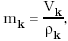

        - kde Vk – objem kondenzátu,

        - ρk – hustota kondenzátu pri danej teplote.

      - 2.2 Opis metód merania tepla v pare

      - 2.2.1 Priama metóda používa

        - a) meranie objemového množstva vodnej pary s následným prepočtom na hmotnostné množstvo za pomoci hustoty vodnej pary (vyžaduje meranie teploty a tlaku pary) alebo meranie hmotnostného množstva vodnej pary,

        - b) meranie tlaku a teploty vodnej pary a následné stanovenie entalpie vodnej pary.

          - Schéma priamej metódy je na obrázku č. 1.

          - 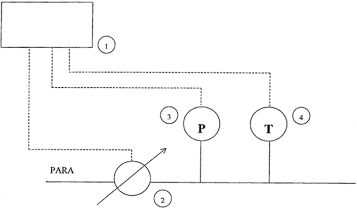

          - LEGENDA:

          - 1. vyhodnocovacia jednotka,

          - 2. meradlo pretečeného množstva pary,

          - 3. snímač tlaku pary,

          - 4. snímač teploty pary.

          - Obrázok č. 1: Priama metóda (pre prehriatu vodnú paru).

      - 2.2.2 Nepriama metóda používa

        - a) meranie objemového množstva kondenzátu (vzniknutého po úplnej kondenzácii vodnej pary) s následným prepočtom na hmotnostné množstvo za pomoci hustoty kondenzátu (vyžaduje meranie teploty kondenzátu),

        - b) meranie tlaku a teploty vodnej pary a následné stanovenie entalpie vodnej pary.

          - Použitie nepriamej metódy je prípustné iba v prípade, ak prietok kondenzátu je meraný kontinuálne tak, aby rozdiel okamžitých prietokov na vstupe a výstupe výmenníka tepla nemal vplyv na presnosť merania tepla a nedochádzalo k priamej spotrebe kondenzátu, napríklad na dopĺňanie sekundárneho systému, alebo k inej technologickej spotrebe (sušenie a pod.).

          - Schéma nepriamej metódy je na obrázku č. 2.

          - 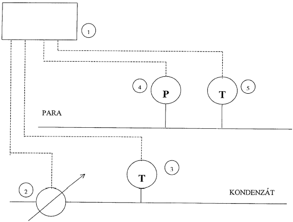

          - LEGENDA:

          - 1. vyhodnocovacia jednotka,

          - 2. meradlo pretečeného množstva kondenzátu,

          - 3. snímač teploty kondenzátu,

          - 4. snímač tlaku pary,

          - 5. snímač teploty pary.

          - Obrázok č. 2: Nepriama metóda (pre prehriatu vodnú paru).

      - 2.2.3 Metóda stanovenia množstva tepla v kondenzáte používa

        - a) meranie objemového množstva kondenzátu s následným prepočtom na hmotnostné množstvo za pomoci hustoty kondenzátu (vyžaduje meranie teploty kondenzátu),

        - b) meranie teploty kondenzátu.

          - Schéma metódy merania tepla v kondenzáte je na obrázku č. 3.

          - 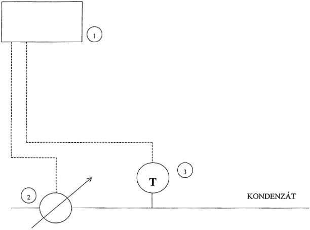

          - LEGENDA:

          - 1. vyhodnocovacia jednotka,

          - 2. meradlo pretečeného množstva kondenzátu,

          - 3. snímač teploty kondenzátu.

          - Obrázok č. 3: Metóda merania tepla v kondenzáte.

      - 3 Technické požiadavky a metrologické požiadavky

      - 3.1 Všeobecné požiadavky

        - Všeobecné požiadavky v tomto oddiele sú zhodné s požiadavkami uvedenými v oddiele I bodoch 2.1.1 až 2.1.6 a 2.1.8 až 2.2.8.

      - 3.2 Požiadavky na prietokomery ako členy meračov tepla sú uvedené v prílohe č. 53.

      - 3.3 Požiadavky na snímače teploty

      - 3.3.1 Požiadavky uvedené v tomto oddiele sú zhodné s požiadavkami uvedenými v oddiele I bodoch 2.4.1 až 2.4.5.

      - 3.3.2 Snímače teploty merajúce teplotu pary sa vyhotovujú tak, aby zabezpečovali požadované metrologické vlastnosti počas najmenej 10 h pri najvyššej teplote zvýšenej o 50 oC.

      - 3.4 Najväčšie dovolené chyby

      - 3.4.1 Najväčšie dovolené chyby, ktoré sú uvedené v bode 3.4.2, sa vzťahujú na tieto pracovné podmienky:

        - a) teplota okolia od 5 oC do 55 oC,

        - b) relatívna vlhkosť vzduchu najviac 93 %,

        - c) kolísanie napájacieho napätia elektrického merača tepla 230 V ± 15 V,

        - d) kolísanie frekvencie napájacieho napätia 50 Hz ± 1 Hz.

          - Referenčné podmienky pri skúškach, ktoré sa vykonávajú v rámci schvaľovania typu, okrem podmienok uvedených v bode 3.4.1 určí ich vykonávateľ, pri ostatných skúškach sa určia po dohode vykonávateľa a objednávateľa.

      - 3.4.2 Najväčšia dovolená chyba kalorimetrického počítadla pre teplonosné médium vodná para je

        - ± 0,5 % (trieda presnosti 0,5),

        - ± 0,8 % (trieda presnosti 0,8),

        - ± 1,0 % (trieda presnosti 1,0)

        - z meranej hodnoty tepla. Takto vyjadrená najväčšia dovolená chyba je nezávislá od prietoku teplonosného média.

      - 3.4.3 Najväčšie dovolené chyby členov meračov tepla v prípade použitia priamej metódy pre

        - a) prietokomer ako člen merača tepla je ± 5 % z meranej hodnoty pretečeného množstva pary (príloha č. 53),

        - b) snímač teploty pary, pre triedu presnosti A a B, sú uvedené v prílohe č. 37 a v slovenských technických normách,

        - c) prevodník tlaku pary s najväčšou dovolenou chybou 0,25 % z hornej hranice meracieho rozsahu Pmax, pričom meraný tlak je väčší, alebo sa rovná 0,2 . Pmax.

          - Ak sa použije nepriama metóda alebo metóda stanovenia množstva tepla v kondenzáte, vzťahujú sa na najväčšie dovolené chyby prietokomerov ako členov merača tepla požiadavky uvedené v oddiele I.

      - 3.4.4 Najväčšie dovolené chyby v prevádzke sa rovnajú 1,5-násobku najväčších dovolených chýb podľa bodov 3.4.2 a 3.4.3.

      - 3.5 Vyhodnotenie výsledkov skúšok

      - 3.5.1 Vyhodnotenie konvenčne pravej hodnoty tepla pre médium vodná para.

        - Pri skúškach v jednotlivých bodoch, pri dodržaní konštantných hodnôt vstupov do počítadla pri simulácii, je konvenčne pravá hodnota tepla Qp, ktorú má kalorimetrické počítadlo indikovať, vyjadrená týmito vzťahmi:

      - 3.5.1.1 Konvenčne pravá hodnota tepla Qp, ktoré je privedené parou, sa vypočíta podľa vzorca:

        - Qp = ms. hs [kJ],

        - kde ms – hmotnosť pary v kg, ktorej pretečenie je počas skúšky simulované na vstupe počítadla,

        - hs – špecifická entalpia pary v kJ/kg, ktorej hodnota je ako funkcia pri simulovanej teplote a tlaku uvedená v tabuľkách vodnej pary.

        - Vyššie uvedený vzťah je na vyhodnotenie výsledkov skúšok podľa bodu 7.5. Pri tejto metóde sa konvenčne pravá hodnota tepla Qp rovná Qs.

      - 3.5.1.2 Ak sa použije nepriama metóda, pri vyhodnotení výsledkov skúšok je potrebné prepočítať objem kondenzátu na hmotnosť kondenzátu mnk podľa vzťahu:

        - mnk = V . ρ [kg],

        - kde V – objem kondenzátu v m3, ktorého pretečenie sa počas skúšky simuluje na vstupe počítadla,

        - ρ – hustota kondenzátu v kg/m3, ktorej hodnota alebo jej obrátená hodnota (merný objem v = 1/r) je ako funkcia pri simulovanej teplote a tlaku 1,6 MPa uvedená v tabuľkách vodnej pary, a zároveň platí, že ms = mnk, Qp = Qs.

      - 3.5.1.3 Ak sa použije pri meraní kombinácia metód, pri vyhodnotení výsledkov skúšok sa stanoví konvenčne pravá hodnota tepla Qk odvedená kondenzátom podľa vzorca:

        - Qk = mk . hk [kJ],

        - kde mk – hmotnosť kondenzátu v kg, ktorého pretečenie sa počas skúšky simuluje na vstupe počítadla,

        - hk – špecifická entalpia kondenzátu v kJ/kg, ktorej hodnota je ako funkcia pri simulovanej teplote tlaku 1,6 MPa uvedená v tabuľkách vodnej pary.

        - Pri tejto metóde platí, že konvenčne pravá hodnota tepla Qp sa rovná Qs– Qk.

      - 3.5.2 Vyhodnotenie chýb kalorimetrického počítadla pri skúšaní

        - Pri skúškach počítadiel sa v každom skúšobnom bode vyhodnocujú ich relatívne chyby podľa vzorca:

        - 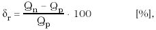

        - kde Qn– prírastok údajov kalorimetrického počítadla počas trvania skúšky v kJ,

        - Qp – konvenčne pravá hodnota tepla v kJ stanovená podľa bodu 3.5.1.

      - 3.5.3 Vyhodnotenie chýb kalorimetrického počítadla z údajov entalpie alebo tepelného výkonu

      - 3.5.3.1 Ak počítadlo umožňuje odčítať entalpiu pary alebo tepelný výkon s väčšou presnosťou, ako je 0,1 % z indikovanej hodnoty, môže sa časť skúšok vyhodnotiť porovnaním indikovaných údajov s konvenčne pravými údajmi podľa týchto vzťahov:

        - 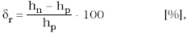

        - alebo

        - 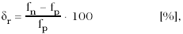

        - kde hn– entalpia pary indikovaná kalorimetrickým počítadlom počas trvania skúšky v kJ/kg,

        - hp – konvenčne pravá hodnota entalpie prehriatej pary v kJ/kg, ktorej hodnota je ako funkcia pri simulovanej teplote a tlaku uvedená v tabuľkách vodnej pary,

        - fn – tepelný výkon pary v kJ/s, indikovaný kalorimetrickým počítadlom počas trvania skúšky,

        - fp – konvenčne pravá hodnota tepelného výkonu prehriatej pary v kJ/s, ktorej hodnota sa vypočíta z konvenčne pravej hodnoty hmotnostného prietoku a z konvenčne pravej hodnoty entalpie, ktorá je ako funkcia pri simulovanej teplote a tlaku uvedená v tabuľkách vodnej pary.

      - 3.5.3.2 Tepelný výkon pary sa vypočíta podľa vzorca:

        - f = q . h [kJ/s],

        - kde q – hmotnostný prietok teplonosného média v kg/s,

        - h – entalpia pary v kJ/kg.

      - 3.5.4 Vyhodnotenie neistôt pri skúšaní kalorimetrických počítadiel

        - Vyhodnotenie neistôt sa vykoná podľa platných predpisov na stanovenie neistôt pri meraní. Rozšírená neistota merania U sa vypočíta podľa vzorca:

        - U = uc . ku [%], |

        - kde uc – kombinovaná štandardná neistota v %,

        - ku – koeficient rozšírenia, kde ku = 2.

      - 3.5.5 Vyhodnotenie výsledku skúšky

        - Kalorimetrické počítadlo vyhovie vo všetkých bodoch, ak platí, že

        - δr ≤ (δd – U),

        - kde ρr ,U – uvedené v predchádzajúcom texte,

        - ρd – najväčšia dovolená chyba kalorimetrického počítadla, ktorá je pre kalorimetrické počítadlá pre teplonosné médium vodná para rovnaká pre všetky triedy presnosti: ρd = 0,8 %.

      - 4 Nápisy a značky

      - 4.1 Jednotlivé členy merača tepla majú na dobre čitateľnom, nezmazateľnom, vhodne umiestnenom štítku uvedené tieto údaje:

      - 4.1.1 Kalorimetrické počítadlo:

        - a) označenie typu,

        - b) výrobné číslo doplnené rokom výroby (môže byť uvedený samostatne),

        - c) značku schváleného typu,

        - d) menovitý teplotný rozsah uvedený v oC,

        - e) rozsah tlaku,

        - f) hraničné hodnoty prietoku,

        - g) ak má merač zabudované zariadenie na indikáciu prevádzkového času a táto indikácia je závislá od frekvencie napájacieho napätia, uvedenie tejto skutočnosti.

      - 4.1.2 Prietokomer ako člen merača tepla podľa prílohy č. 53.

      - 4.1.3 Snímače teploty podľa prílohy č. 37.

      - 4.1.4 Prevodník tlaku podľa prílohy č. 33.

      - 5 Umiestnenie overovacích a montážnych značiek

      - 5.1 Na kalorimetrickom počítadle sa overovacia značka umiestňuje na viditeľné miesto na puzdre tej časti meradla, ktorá indikuje množstvo tepla.

      - 5.2 Ostatné členy merača tepla sa opatria overovacou značkou umiestnenou na viditeľnom mieste. Tieto značky indikujú nesprávny zásah do člena merača tepla.

      - 5.3 Po montáži meračov tepla do okruhu výmenníka sa zabezpečovacie značky umiestnia na takých miestach, aby indikovali svojvoľnú výmenu komponentov alebo ich neoprávnené demontovanie z pracovného miesta. Značky sa umiestňujú na

        - a) kalorimetrickom počítadle na kryte svorkovnice alebo na inom uzávere umožňujúcom k nej prístup,

        - b) prietokomery ako členy merača tepla na spojovacích prírubách (skrutkových spojoch) s potrubím, na vysielači elektrických signálov, ktoré sú vstupnou veličinou do kalorimetrického počítadla,

        - c) snímači teploty v miestach spojenia s teplomerovým puzdrom,

        - d) prevodníku tlaku v mieste pripojenia k odberu tlaku.

      - 6 Technické skúšky pri schvaľovaní typu

      - 6.1 Oblasť skúšania je určená menovitým teplotným rozsahom, hraničnými hodnotami tepelného výkonu, hraničnými hodnotami tlaku a prietoku pary a prípadne kondenzátu, pre ktoré je skúšaný merač tepla určený.

      - 6.2 Pri technických skúškach pri schvaľovaní typu sa preverujú metrologické parametre

        - a) prietokomerov ako členov merača tepla,

        - b) kalorimetrických počítadiel,

        - c) snímačov teploty,

        - d) prevodníkov tlaku.

      - 6.3 Skúšky členov meračov tepla okrem kalorimetrického počítadla sa vykonávajú podľa príloh č. 33, 37 a 53.

      - 6.4 Skúšky kalorimetrického počítadla sa vykonávajú postupom uvedeným v bode 7.4 s tým, že počet skúšobných bodov sa rozšíri o body, ktoré určí vykonávateľ skúšky.

      - 6.5 Účinky ovplyvňujúcich veličín.

        - Prídavné skúšky účinkov ovplyvňujúcich veličín na údaje merača tepla alebo jeho členov sa vykonávajú podľa príloh č. 33, 37 a 53 a podľa príslušných slovenských technických noriem.

      - 7 Metódy skúšania pri overení

      - 7.1 Pri overení meračov tepla sa vykonáva

        - a) vonkajšia obhliadka,

        - b) skúška správnosti,

        - c) vyhodnotenie meraní.

      - 7.2 Vonkajšia obhliadka

        - Vonkajšou obhliadkou merača tepla sa zisťuje, či

        - a) vyhovuje schválenému typu,

        - b) sú na počítadle uvedené všetky údaje,

        - c) nemá porušené časti na umiestnenie overovacích a montážno-zabezpečovacích značiek, ktoré boli určené pri schvaľovaní typu,

        - d) nie je mechanicky poškodený,

        - e) nemá žiadny ďalší viditeľný nedostatok.

          - Ak merač tepla uvedeným požiadavkám nevyhovuje, vyradí sa z ďalších skúšok.

      - 7.3 Skúšky členov merača tepla okrem kalorimetrického počítadla sa vykonajú podľa príloh č. 33, 37 a 53.

      - 7.4 Skúška správnosti kalorimetrického počítadla

        - Skúška správnosti kalorimetrického počítadla sa vykonáva

        - a) priamou metódou určenia množstva tepla v prehriatej pare,

        - b) nepriamou metódou určenia množstva tepla v prehriatej pare pomocou hmotnostného množstva kondenzátu,

        - c) metódou určenia množstva tepla v kondenzáte.

          - Konkrétnu metódu alebo kombinácie metód, ktoré sa môžu použiť pri skúške správnosti počítadla sa stanovuje v rozhodnutí o schválení typu počítadla. V závislosti od metódy pri skúške správnosti sa postupuje takto:

      - 7.5 Skúška správnosti počítadla pri priamej metóde

      - 7.5.1 Ak počítadlo umožňuje odčítať entalpiu pary alebo tepelný výkon s väčšou presnosťou, ako je 0,1 % z indikovanej hodnoty, hmotnostný prietok pary sa simuluje na najvyššej hodnote meracieho rozsahu pripájaného prietokomera a hodnoty tlaku a teploty sa simulujú takto:

        - a) tlak a teplota sa simulujú v hornej hranici meracích rozsahov, pričom daný bod leží v oblasti prehriatej pary. Ak to neplatí, zníži sa simulovaný tlak na hodnotu zodpovedajúcu prehriatej pare,

        - b) tlak a teplota sa simulujú v dolnej hranici meracích rozsahov, pričom daný bod leží v oblasti prehriatej pary. Ak to neplatí, zvýši sa simulovaná teplota na hodnotu zodpovedajúcu prehriatej pare,

        - c) tlak a teplota sa simulujú v dvoch hodnotách z meracieho rozsahu, pričom hodnoty tlaku a teploty sa volia tak, že všetky štyri kombinácie vstupných hodnôt ležia v oblasti prehriatej pary.

          - Nastavenie hodnôt pri simulácii tlaku a teploty sa vykonáva pri hodnotách, ktoré sú číselne uvedené v príslušných tabuľkách pary, pričom presnosť nastavenia je ± 0,1 % z príslušnej hodnoty simulovaného signálu.

          - Pri týchto skúškach sa správnosť počítadla vyhodnocuje počítadlom indikovanej entalpie pary alebo tepelného výkonu. Ak počítadlo neumožňuje odčítať entalpiu pary alebo tepelný výkon s uvedenou presnosťou, skúšky uvedené v tomto bode sa vykonajú spôsobom integrácie množstva tepla.

      - 7.5.2 Ďalej sa kontroluje správnosť integrácie množstva tepla.

      - 7.5.2.1 Ak je vstup hmotnostného prietoku do počítadla frekvenčný alebo impulzný, správnosť sa kontroluje v jednom bode týmto spôsobom: teplota sa simuluje v hornej hranici meracieho rozsahu a tlak v dolnej hranici meracieho rozsahu, hmotnostný prietok pary sa simuluje na najvyššej hodnote meracieho rozsahu pripájaného prietokomera ako člena merača tepla.

      - 7.5.2.2 Ak je vstup hmotnostného prietoku do počítadla prúdový, správnosť sa kontroluje v dvoch bodoch týmto spôsobom:

        - a) teplota sa simuluje v hornej hranici meracieho rozsahu a tlak v dolnej hranici meracieho rozsahu, hmotnostný prietok pary sa simuluje na najvyššej hodnote meracieho rozsahu pripájaného prietokomera,

        - b) teplota sa simuluje v hornej hranici meracieho rozsahu a tlak v dolnej hranici meracieho rozsahu, hmotnostný prietok pary sa simuluje na hodnote, ktorá zodpovedá 25 % z rozsahu prúdového vstupu.

      - 7.5.2.3 Pri uvedených skúškach sa meria čas simulácie, t. j. čas od prvej zmeny údaja počítadla po nastavení prietoku až po poslednú zmenu pred zastavením simulácie prietoku. Čas skúšky sa volí tak, aby zmena údaja o jednotku na pravom krajnom mieste počítadla pri údaji merania tepla spôsobila zmenu chyby odčítania menšiu ako 0,1 % z meraného údaja. Správnosť počítadla sa vyhodnocuje počítadlom indikovaného množstva tepla.

      - 7.5.3 Blokovanie integrácie tepla pri podmienkach mimo oblasti prehriatej pary sa kontroluje týmto spôsobom:

        - a) tlak sa simuluje pri ľubovoľných dvoch hodnotách z meracieho rozsahu, odporúčajú sa horné a dolné krajné hodnoty tlaku, pri ktorých sa bude počítadlo používať,

        - b) teplota sa simuluje tak, aby z hodnoty nad medzou sýtosti klesla na hodnotu, ktorá je nižšia ako teplota na medzi sýtosti pri danom tlaku, o hodnotu 0,6 oC alebo o hodnotu uvedenú v rozhodnutí o schválení typu meradla, ktorá je zväčšená o 0,1 oC.

          - Pri danej skúške je nastavená ľubovoľná hodnota prietoku s výnimkou hodnoty nula a sleduje sa na počítadle údaj tepla.

      - 7.6 Skúška správnosti počítadla pri nepriamej metóde

      - 7.6.1 Ak počítadlo umožňuje odčítať entalpiu pary alebo tepelný výkon s väčšou presnosťou, ako je 0,1 % z indikovanej hodnoty, prietok kondenzátu sa simuluje na najvyššej hodnote meracieho rozsahu pripájaného prietokomera ako člena merača tepla a hodnoty tlaku a teploty pary sa simulujú takto:

        - a) tlak a teplota sa simulujú v hornej hranici meracích rozsahov, pričom daný bod leží v oblasti prehriatej pary. Ak to neplatí, zníži sa simulovaný tlak na hodnotu zodpovedajúcu prehriatej pare,

        - b) tlak a teplota sa simulujú v dolnej hranici meracích rozsahov, pričom daný bod leží v oblasti prehriatej pary. Ak to neplatí, zvýši sa simulovaná teplota na hodnotu zodpovedajúcu prehriatej pare,

        - c) tlak a teplota sa simulujú v dvoch hodnotách z meracieho rozsahu, pričom sa hodnoty tlaku a teploty volia tak, aby všetky štyri kombinácie vstupných hodnôt ležali v oblasti prehriatej pary.

          - Pri uvedených skúškach sa správnosť počítadla vyhodnocuje počítadlom indikovanej entalpie pary alebo tepelného výkonu.

          - Nastavenie hodnôt pri simulácii tlaku a teploty sa vykonáva pri hodnotách, ktoré sú číselne uvedené v príslušných tabuľkách pary, pričom presnosť nastavenia je ± 0,1 % z príslušnej hodnoty simulovaného signálu.

          - Pri uvedených skúškach sa správnosť počítadla vyhodnocuje počítadlom indikovanej entalpie pary alebo tepelného výkonu. V prípade, že počítadlo neumožňuje odčítať entalpiu pary alebo tepelný výkon s danou presnosťou, skúšky uvedené v tomto bode sa vykonajú spôsobom integrácie množstva tepla.

      - 7.6.2 Ďalej sa kontroluje správnosť integrácie množstva tepla v dvoch bodoch týmto spôsobom:

        - a) teplota pary sa simuluje v hornej hranici meracieho rozsahu a tlak pary v dolnej hranici meracieho rozsahu, prietok kondenzátu sa simuluje na najvyššej hodnote meracieho rozsahu pripájaného prietokomera ako člena merača tepla,

        - b) teplota kondenzátu sa nastaví na hodnotu 80 oC a pri druhom meraní na hodnotu 30 oC.

          - Pri uvedených skúškach sa meria čas simulácie, t. j. čas od prvej zmeny údaja počítadla po nastavení prietoku až po poslednú zmenu pred zastavením simulácie prietoku. Čas skúšky sa volí najmenej taký, aby zmena údaja o jednotku na pravom krajnom mieste počítadla pri údaji merania tepla spôsobila zmenu chyby odčítania menšiu ako 0,1 % z meraného údaja. Správnosť sa vyhodnocuje počítadlom indikovaného množstva tepla.

      - 7.6.3 Blokovanie integrácie tepla v podmienkach mimo oblasti prehriatej pary sa kontroluje takýmto spôsobom:

        - a) tlak pary sa simuluje pri ľubovoľných dvoch hodnotách z meracieho rozsahu, odporúčajú sa horné a dolné krajné hodnoty tlaku, pri ktorých sa bude počítadlo používať,

        - b) teplota pary sa simuluje tak, aby z hodnoty nad medzou sýtosti klesla na hodnotu, ktorá je nižšia ako teplota na medzi sýtosti pri danom tlaku o hodnotu 0,6 oC alebo o hodnotu uvedenú v rozhodnutí o schválení typu počítadla, ktorá je zväčšená o 0,1 oC.

          - Pri danej skúške je nastavená ľubovoľná nenulová hodnota prietoku a sleduje sa na počítadle údaj tepla.

      - 7.7 Skúška správnosti počítadla, ktoré používa pri meraní kombináciu metód

      - 7.7.1 Ak počítadlo stanovuje množstvo tepla ako kombináciu priamej metódy [metóda v bode 7.4 písm. a)] a metódy stanovenia množstva tepla v kondenzáte [metóda v bode 7.4 písm. c)], skúška sa vykoná takto:

        - a) vstupné veličiny pary sa simulujú postupom podľa bodu 7.5. Pritom prietok kondenzátu sa simuluje tak, aby hmotnostný prietok kondenzátu sa rovnal hmotnostnému prietoku pary, ktorý je nastavený podľa bodu 7.5. Hodnota teploty kondenzátu sa pri tejto skúške simuluje na 80 oC,

        - b) prietok kondenzátu sa simuluje na hodnotách 25 % a 75 % z hodnoty najväčšieho hmotnostného prietoku pary. Hodnota teploty kondenzátu sa simuluje na 30 oC. Hmotnostný prietok pary sa v oboch prípadoch simuluje na 50 % z hodnoty najväčšieho hmotnostného prietoku pary. Tlak a teplota pary sa simulujú na jednej hodnote, ktorá zodpovedá polovici meracieho rozsahu, pričom hodnoty tlaku a teploty pary sa volia tak, aby ležali v oblasti prehriatej pary.

          - Vyhodnotenie meraného údaja tepla pri tejto kombinácii metód sa vykoná podľa bodu 7.5 s tým rozdielom, že od meraného údaja tepla získaného priamym meraním sa odpočíta teplo obsiahnuté vo vratnom kondenzáte, ktoré sa stanoví meraním množstva tepla v kondenzáte.

      - 7.7.2 Ak počítadlo určuje množstvo tepla ako kombináciu nepriamej metódy [metóda v bode 7.4 písm. b)] a metódy stanovenia množstva tepla v kondenzáte [metóda v bode 7.4 písm. c)], skúška sa vykoná a vstupné veličiny pary sa simulujú postupom podľa bodu 7.6.

        - Vyhodnotenie meraného údaja tepla pri tejto kombinácii metód sa vykoná podľa bodu 7.6 s tým rozdielom, že od meraného údaja tepla získaného priamym meraním sa odpočíta teplo obsiahnuté vo vratnom kondenzáte, ktoré sa stanoví meraním množstva tepla v kondenzáte.

      - 8 Overenie

        - Merač tepla, ktorý vyhovel požiadavkám a predpísaným skúškam podľa bodu 7, sa opatrí overovacími značkami na miestach určených v rozhodnutí o schválení typu meradla.
