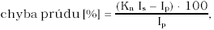
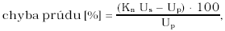
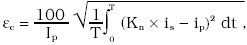
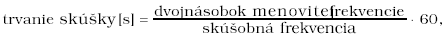
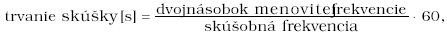

Príloha č. 52 k vyhláške č. 75/2001 Z. z.

- MERACIE TRANSFORMÁTORY PRÚDU A NAPÄTIA POUŽÍVANÉ V SPOJENÍ S ELEKTROMERMI

  - Prvá časť Vymedzenie meradiel a spôsob ich metrologickej kontroly

    - 1. Táto príloha sa vzťahuje na meracie transformátory používané v spojení s elektromermi (ďalej len „merací transformátor“), ktoré sa používajú ako určené meradlá podľa § 8 zákona.

    - 2. Meracie transformátory sa členia na meracie transformátory

      - a) prúdu používané v spojení s elektromermi,

      - b) napätia používané v spojení s elektromermi,

      - c) prúdu a napätia (kombinované) používané v spojení s elektromermi.

    - 3. Meracie transformátory pred uvedením na trh podliehajú schváleniu typu a prvotnému overeniu. Metódy technických skúšok pri schvaľovaní typu a metódy skúšania pri overení sú uvedené v druhej časti.

    - 4. Meracie transformátory schváleného typu výrobca alebo dovozca označí značkou schváleného typu.

    - 5. Meracie transformátory, ktoré pri overení vyhovejú ustanoveným požiadavkám, sa označia overovacou značkou.

  - Druhá časť Technické požiadavky, metrologické požiadavky, metódy technických skúšok a metódy skúšania pri overení meracích transformátorov

    - 1 Termíny a definície

    - 1.1 Prístrojový merací transformátor je zariadenie, ktoré vo vhodnom rozsahu hodnôt transformuje primárny prúd alebo napätie s požadovanou presnosťou na hodnotu sekundárnu, vhodnú na napájanie meracích alebo istiacich prístrojov.

    - 1.2 Merací transformátor prúdu je prístrojový transformátor, v ktorom je sekundárny prúd za bežných podmienok používania v podstatnej miere priamo úmerný primárnemu prúdu a odlišuje sa od neho o uhol, ktorý je pri vhodnom spôsobe zapojenia približne nulový.

    - 1.3 Merací transformátor napätia je prístrojový transformátor, v ktorom je sekundárne napätie za bežných podmienok používania v podstate priamo úmerné primárnemu napätiu a odlišuje sa od neho o uhol, ktorý je pri vhodnom spôsobe zapojenia približne nulový.

    - 1.4 Merací transformátor kombinovaný je prístrojový transformátor, ktorý v jednom konštrukčnom celku obsahuje meracie transformátory prúdu a napätia.

    - 1.5 Neuzemnený transformátor napätia je merací transformátor napätia, ktorý má všetky časti primárneho vinutia vrátane svoriek odizolované od zeme na úroveň zodpovedajúcu jeho menovitej izolačnej hladine.

    - 1.6 Uzemnený transformátor napätia je jednofázový merací transformátor napätia, ktorého jeden koniec primárneho vinutia je určený na priame uzemnenie, alebo trojfázový merací transformátor napätia, ktorého spoločný bod hviezdy primárneho vinutia je určený na priame uzemnenie.

    - 1.7 Primárne vinutie je pre meracie transformátory napätia vinutie, ku ktorému je pripojené napätie, ktoré sa má transformovať, a pre meracie transformátory prúdu vinutie, ktorým preteká prúd, ktorý sa má transformovať.

    - 1.8 Sekundárne vinutie je vinutie, ktoré napája prúdové obvody alebo ku ktorému sa pripoja napäťové obvody meracích prístrojov.

    - 1.9 Primárny obvod je obvod, v ktorom je pripojené primárne vinutie meracieho transformátora.

    - 1.10 Sekundárny obvod je vonkajší obvod napájaný sekundárnym vinutím meracieho transformátora.

    - 1.11 Menovitý primárny prúd je hodnota primárneho prúdu, na ktorú sa vzťahujú vlastnosti meracieho transformátora.

    - 1.12 Menovitý sekundárny prúd je hodnota sekundárneho prúdu, na ktorú sa vzťahujú vlastnosti meracieho transformátora.

    - 1.13 Menovité primárne napätie je hodnota primárneho napätia, ktorá je uvedená na štítku transformátora a na ktorú sa vzťahujú vlastnosti meracieho transformátora.

    - 1.14 Menovité sekundárne napätie je hodnota sekundárneho napätia, ktorá je uvedená na štítku transformátora a na ktorú sa vzťahujú vlastnosti meracieho transformátora.

    - 1.15 Skutočný prevod meracieho transformátora je pomer skutočného primárneho prúdu alebo napätia ku skutočnému sekundárnemu prúdu alebo napätiu.

    - 1.16 Menovitý prevod meracieho transformátora je pomer menovitého primárneho prúdu alebo napätia k menovitému sekundárnemu prúdu alebo napätiu.

    - 1.17 Chyba prúdu (chyba prevodu) je chyba, ktorú vnáša merací transformátor do merania prúdu; vyplýva z toho, že skutočný prevod meracieho transformátora sa nerovná menovitému prevodu meracieho transformátora.

      - Chyba prúdu vyjadrená v percentách sa počíta podľa vzorca:

      - 

      - kde Kn – menovitý prevod meracieho transformátora,

      - Ip – skutočný primárny prúd,

      - Is – skutočný sekundárny prúd, keď Ip preteká podľa podmienok merania.

    - 1.18 Chyba napätia (chyba prevodu) je chyba, ktorú merací transformátor vnáša do merania napätia; vyplýva z toho, že skutočný prevod meracieho transformátora sa nerovná menovitému prevodu meracieho transformátora.

      - Chyba napätia vyjadrená v percentách sa počíta podľa vzorca:

      - 

      - kde Kn – menovitý prevod meracieho transformátora,

      - Up – skutočné primárne napätie,

      - Us – skutočné sekundárne napätie, ak je Up pripojené podľa podmienok merania.

    - 1.19 Chyba fázového posunu (chyba uhla) je rozdiel fáz medzi primárnym a sekundárnym prúdovým fázorom alebo medzi primárnym a sekundárnym napäťovým fázorom; smer fázorov je zvolený tak, aby uhol bol nulový pri ideálnom meracom transformátore.

      - Fázový posun sa považuje za kladný, ak fázor sekundárneho prúdu alebo fázor sekundárneho napätia je pred fázorom primárneho prúdu alebo pred fázorom primárneho napätia. Zvyčajne sa vyjadruje v minútach alebo centiradiánoch.

    - 1.20 Trieda presnosti je označenie priradené meraciemu transformátoru prúdu alebo napätia, ktorého chyby sú vnútri stanovených hraníc za predpísaných podmienok používania.

    - 1.21 Záťaž meracieho transformátora prúdu je impedancia sekundárneho obvodu v ohmoch pri danom účinníku.

    - 1.22 Záťaž meracieho transformátora napätia je admintácia sekundárneho obvodu vyjadrená v siemensoch pri danom účinníku (induktívneho alebo kapacitného charakteru). Záťaž sa zvyčajne vyjadruje ako zdanlivý výkon vo voltampéroch, ktorý je spotrebovaný pri stanovenom účinníku a pri menovitom sekundárnom prúde alebo napätí.

    - 1.23 Menovitá záťaž je hodnota záťaže, na ktorú sa vzťahujú požiadavky na presnosť uvedené v tejto prílohe.

    - 1.24 Menovitý výkon je hodnota zdanlivého výkonu (vo voltampéroch pri danom účinníku), ktorú by transformátor mal dodať do sekundárneho obvodu pri menovitom sekundárnom prúde alebo napätí pripojenej menovitej záťaži.

    - 1.25 Najvyššie napätie sústavy je najvyššia efektívna hodnota združeného napätia, na ktoré je merací transformátor prúdu alebo napätia navrhnutý s prihliadnutím na jeho izoláciu.

    - 1.26 Menovitá izolačná hladina je kombinácia napäťových hodnôt, ktorá charakterizuje izoláciu meracieho transformátora prúdu alebo napätia s prihliadnutím na jeho schopnosť odolať namáhaniu dielektrika.

    - 1.27 Systém s izolovaným stredným vodičom (sieť IT) je systém, kde stredný vodič nie je zámerne spojený so zemou okrem vysoko impedančných spojení na účely ochrany alebo merania.

    - 1.28 Systém s pevne uzemneným stredným vodičom (sieť TN) je systém, ktorého stredný vodič je priamo uzemnený.

    - 1.29 Systém s impedančne uzemneným stredným vodičom (sieť TT) je systém, ktorého stredný vodič je uzemnený cez impedancie ohraničujúce uzemňovacie poruchové prúdy.

    - 1.30 Systém s rezonančne uzemneným stredným vodičom (kompenzovaná sieť) je systém, ktorého stredný vodič je na jednom mieste alebo na viacerých miestach uzemnený cez reaktancie, ktoré približne kompenzujú kapacitnú zložku jednofázového uzemňovacieho poruchového prúdu. Pri rezonančnom uzemnení systémov je zvyškový chybový prúd obmedzený do takej miery, že (elektrický) oblúk vo vzduchu sa sám uhasí.

    - 1.31 Koeficient zemného spojenia je pomer vo vybranom mieste trojfázového systému pre danú konfiguráciu systému medzi najvyšším efektívnym fázovým napätím sieťovej frekvencie na nespojenej fáze počas zemného spojenia, ktoré ovplyvňuje jednu fázu alebo viac fáz v ľubovoľnom mieste systému, a efektívnym fázovým napätím sieťovej frekvencie, ktoré by sa dosiahlo vo zvolenom mieste, keby nedošlo k zemnému spojeniu.

    - 1.32 Systém s uzemneným stredným vodičom je systém, v ktorom je stredný vodič pripojený k zemi priamo alebo cez odpor, prípadne cez reaktanciu s dostatočne nízkou hodnotou na obmedzenie prechodových oscilácií a poskytnutie dostatočného prúdu na selektívnu ochranu pred chybami uzemnenia:

      - a) systém s účinne uzemneným stredným vodičom v danom mieste charakterizuje koeficient zemného spojenia v tomto mieste, ktorý neprekračuje 1,4; táto podmienka je vo všeobecnosti dosiahnutá, keď pre všetky konfigurácie systému je pomer nulovej zložky reaktancie k súslednej zložke reaktancie menší ako 3 a pomer nulovej zložky odporu k súslednej zložke reaktancie je menší ako 1,

      - b) systém s neúčinne uzemneným stredným vodičom v danom mieste charakterizuje koeficient zemného spojenia v tomto mieste, ktorý môže presiahnuť 1,4.

    - 1.33 Inštalácia vystavená vplyvu prostredia je inštalácia, v ktorej sú prístroje podrobené účinkom atmosférických prepätí. Takáto inštalácia je zvyčajne pripojená k vzdušným prenosovým vedeniam priamo alebo krátkym káblom.

    - 1.34 Inštalácia nevystavená vplyvu prostredia je inštalácia, v ktorej prístroje nie sú podrobené účinkom atmosférických prepätí. Takáto inštalácia je zvyčajne pripojená ku káblovým sieťam.

    - 1.35 Menovitá frekvencia je hodnota frekvencie, na ktorú sa vzťahujú požiadavky tejto prílohy.

    - 1.36 Menovitý krátkodobý tepelný prúd (Ith) je efektívna hodnota primárneho prúdu, ktorý transformátor vydrží počas jednej sekundy bez škodlivého ovplyvnenia a pri skratovaných svorkách sekundárneho vinutia.

    - 1.37 Menovitý dynamický prúd (Idyn) je špičková hodnota primárneho prúdu, ktorú transformátor vydrží bez elektrického alebo mechanického poškodenia následkom elektromagnetických síl pri skratovaných svorkách sekundárneho vinutia.

    - 1.38 Menovitý trvalý tepelný prúd je najvyšší prúd, ktorý môže trvalo pretekať primárnym vinutím pri pripojení menovitej záťaže na svorky sekundárneho vinutia bez prekročenia dovolenej hodnoty oteplenia.

    - 1.39 Budiaci prúd je efektívna hodnota prúdu odoberaného sekundárnym vinutím transformátora prúdu, ak je na sekundárne svorky privedené sínusové napätie menovitej frekvencie, pričom primárne a ostatné vinutia sú rozpojené.

    - 1.40 Celková chyba je za ustálených podmienok efektívna hodnota rozdielu medzi okamžitými hodnotami primárneho prúdu a okamžitými hodnotami skutočného sekundárneho prúdu vynásobeného menovitým prevodom meracieho transformátora; kladné znamienka primárneho a sekundárneho prúdu zodpovedajú dohodnutému označovaniu svoriek.

      - Celková chyba εc sa vo všeobecnosti vyjadruje ako percentuálna efektívna hodnota primárneho prúdu podľa vzorca:

      - 

      - kde Kn – menovitý prevod meracieho transformátora,

      - Ip – efektívna hodnota primárneho prúdu,

      - ip – okamžitá hodnota primárneho prúdu,

      - is – okamžitá hodnota sekundárneho prúdu,

      - T – trvanie jednej periódy.

    - 1.41 Menovitý primárny nadprúd (IPL) je najmenšia hodnota primárneho prúdu, pri ktorej celková chyba meracieho transformátora prúdu sa rovná 10 % alebo je väčšia, pričom sekundárna záťaž sa rovná menovitej záťaži.

    - 1.42 Nadprúdové číslo prístroja (FS) je pomer menovitého primárneho nadprúdu prístroja a menovitého primárneho prúdu. Bezpečnosť prístrojov napájaných meracím transformátorom prúdu v prípade poruchy je najvyššia vtedy, keď hodnota menovitého nadprúdového čísla prístroja (FS) je nízka.

    - 1.43 Medzné sekundárne elektromotorické napätie je súčin nadprúdového čísla prístroja FS, menovitého sekundárneho prúdu a fázorového súčtu menovitej záťaže a impedancie sekundárneho vinutia.

      - a) Podľa definície má vypočítané medzné sekundárne elektromotorické napätie vyššiu hodnotu ako reálna hodnota.

        - Na základe dohody medzi výrobcami a odberateľmi sa môžu použiť iné metódy výpočtu.

      - b) Na výpočet medzného sekundárneho elektromotorického napätia sa má odpor sekundárneho vinutia prepočítať na teplotu 75 oC.

    - 1.44 Menovitý napäťový činiteľ je koeficient, ktorého súčin s menovitým primárnym napätím určuje najväčšie napätie, pri ktorom transformátor vyhovuje príslušným požiadavkám na oteplenie počas predpísaného času pri splnení príslušných požiadaviek na presnosť.

    - 2 Technické požiadavky

    - 2.1 Podmienky používania

    - 2.1.1 Teplota okolitého vzduchu

      - Meracie transformátory prúdu alebo napätia sa rozdeľujú do troch kategórií podľa tabuľky č. 1.

      - Tabuľka č. 1

      - Teplotné kategórie

    - Kategória | Najnižšia teplota (°C) | Najvyššia teplota (°C)

    - -5/40 | -5 | 40

    - -25/40 | -25 | 40

    - -40/40 | -40 | 40

    - 2.1.2 Nadmorská výška

      - Do 1 000 m nadmorskej výšky.

    - 2.1.3 Vibrácie a zemské otrasy

      - Vplyv vibrácií vonkajšieho pôvodu alebo zemských otrasov na meracie transformátory prúdu alebo napätia je zanedbateľný.

    - 2.1.4 Ďalšie podmienky používania meracích transformátorov prúdu alebo napätia na vnútornú montáž sú:

      - a) vplyv slnečného žiarenia, ktorý možno zanedbať,

      - b) vzduch okolia, ktorý nie je významne znečistený prachom, dymom, korozívnymi plynmi, parami alebo slanou hmlou,

      - c) podmienky vlhkosti:

    - 1. priemerná hodnota relatívnej vlhkosti meranej počas 24 hodín, ktorá neprekračuje 95 %,

    - 2. priemerná hodnota tlaku vodnej pary meraného počas 24 hodín, ktorá neprekračuje 2,2 kPa,

    - 3. priemerná hodnota relatívnej vlhkosti za obdobie jedného mesiaca, ktorá neprekračuje 90 %,

    - 4. priemerná hodnota tlaku vodnej pary za obdobie jedného mesiaca, ktorá neprekračuje 1,8 kPa.

      - Pri týchto podmienkach sa občas môže vyskytnúť kondenzácia. Kondenzácia sa môže vyskytnúť pri prudkých zmenách teploty počas vysokej relatívnej vlhkosti vzduchu. Pri možnosti výskytu vplyvu vysokej relatívnej vlhkosti a kondenzácie, ako je prieraz izolácie alebo korózia mechanických častí, sa použijú meracie transformátory prúdu alebo napätia, ktoré boli skonštruované do takých podmienok. Kondenzácii sa dá zabrániť špeciálnou konštrukciou zapuzdrenia, vhodnou ventiláciou, vyhrievaním alebo použitím zariadenia na odstránenie vlhkosti.

    - 2.1.5 Ďalšie podmienky používania meracích transformátorov prúdu alebo napätia na vonkajšiu montáž sú:

      - a) priemerná hodnota teploty okolitého vzduchu meraná počas 24 hodín, ktorá neprekračuje 35 oC,

      - b) slnečné žiarenie až do úrovne 1 000 W/m2 (napoludnie slnečného dňa),

      - c) vzduch okolia, ktorý môže byť znečistený prachom, dymom, korozívnymi plynmi, parami alebo slanou hmlou; úrovne znečistenia sú ustanovené v príslušných slovenských technických normách,

      - d) tlak vetra, ktorý nepresahuje 700 Pa (zodpovedá rýchlosti vetra 34 m/s),

      - e) prítomnosť kondenzácie alebo zrážok.

    - 2.2 Osobitné podmienky používania

      - Ak sa majú meracie transformátory prúdu alebo napätia používať v podmienkach odlišných od bežných podmienok používania uvedených v bode 2.1, požiadavky používateľov zodpovedajú týmto ustanoveniam:

    - 2.2.1 Teplota vzduchu okolia

      - Inštalácie na miestach, kde teplota okolia môže byť významne mimo rozsahu podmienok používania uvedených v bode 2.1.1, uprednostňujú rozsahy najnižších a najvyšších teplôt, ktoré sa môžu špecifikovať:

      - a) od –50 oC do 40 oC pre veľmi studené klimatické pásma,

      - b) od –5 oC do 50 oC pre veľmi horúce klimatické pásma.

        - V určitých regiónoch s častým výskytom horúcich vlhkých vetrov sa môžu vyskytnúť náhle zmeny teploty, ktoré môžu vyvolať kondenzáciu dokonca vo vnútorných priestoroch. Pri určitých podmienkach slnečného žiarenia sa vykonajú určité opatrenia, napríklad použije sa prístrešok, tlaková ventilácia, vzdialenie od okolitých zariadení a pod.

    - 2.2.2 Nadmorská výška

      - Inštaláciám vo výškach nad 1 000 m sa určí oblúková (prierazná) vzdialenosť vynásobením hodnôt odolných napätí pre normalizované referenčné atmosférické podmienky činiteľom ustanoveným v príslušných slovenských technických normách. V prípade vnútornej izolácie jej pevnosť nie je ovplyvnená nadmorskou výškou. Spôsob kontroly vonkajšej izolácie sa dohodne medzi výrobcom a odberateľom.

    - 2.3 Uzemnenie systému

      - Možné uzemnenia systému sú:

      - a) systém s izolovaným stredným vodičom (bod 1.27),

      - b) systém s rezonančne uzemneným stredným vodičom (bod 1.30),

      - c) systém s uzemneným stredným vodičom (bod 1.32),

      - d) systém s pevne uzemneným stredným vodičom (bod 1.28),

      - e) systém s impedančne uzemneným stredným vodičom (bod 1.29).

    - 3 Rozsahy meracích transformátorov

    - 3.1 Rozsahy meracích transformátorov prúdu

    - 3.1.1 Normalizované hodnoty menovitých primárnych prúdov:

      - a) Transformátory s jedným prevodom

        - Normalizované hodnoty menovitých primárnych prúdov sú:

        - 10 – 12,5 – 15 – 20 – 25 – 30 – 40 – 50 – 60 – 75 (A)

        - a ich dekadické násobky a zlomky. Podčiarknuté hodnoty sú prednostné.

      - b) Transformátory s viacerými prevodmi

        - Normalizované hodnoty uvedené v bode 3.1.1 písm. a) sa vzťahujú na najnižšie hodnoty menovitých primárnych prúdov.

    - 3.1.2 Normalizované hodnoty menovitých sekundárnych prúdov

      - Normalizované hodnoty menovitých sekundárnych prúdov sú 1 A, 2 A a 5 A, ale prednostnou hodnotou je 5 A. Pre meracie transformátory prúdu určené na zapojenie do trojuholníka sú normalizovanými hodnotami aj hodnoty delené √3.

    - 3.1.3 Menovitý trvalý tepelný prúd

      - Ak nie je stanovené inak, menovitý trvalý tepelný prúd sa rovná menovitému primárnemu prúdu (bod 6.3).

    - 3.1.4 Normalizované hodnoty menovitého výkonu do 30 VA sú:

      - 2,5 – 5,0 – 10 – 30 (VA).

      - Môžu sa zvoliť aj hodnoty nad 30 VA, ak to aplikácia vyžaduje. Ak je jedna z hodnôt menovitého výkonu daného transformátora normalizovaná a priradená normalizovanej triede presnosti, nie je vylúčené určenie iných menovitých výkonov, ktoré nie sú normalizovanými hodnotami, ale sú priradené iným normalizovaným triedam presnosti.

    - 3.1.5 Menovité krátkodobé nadprúdy

      - Na meracie transformátory prúdu napájané pevným primárnym vinutím alebo vodičom sa vzťahujú tieto požiadavky:

      - a) Menovitý krátkodobý tepelný prúd (Ith)

        - Pre transformátor sa stanoví menovitý krátkodobý tepelný prúd (Ith) (bod 1.36).

      - b) Menovitý dynamický prúd (Idyn)

        - Hodnota menovitého dynamického prúdu (Idyn) je 2,5 násobku menovitého krátkodobého tepelného prúdu (Ith) a uvedie sa na štítku transformátora, ak je odlišná od tejto hodnoty (bod 1.37).

    - 3.2 Rozsahy meracích transformátorov napätia

    - 3.2.1 Normalizované hodnoty menovitých primárnych napätí

      - Normalizované hodnoty menovitého primárneho napätia trojfázových transformátorov a jednofázových transformátorov na použitie v jednofázových sieťach alebo v sieťach združeného napätia na použitie v trojfázovej sústave zodpovedajú niektorej z hodnôt radu menovitých napätí ustanovených v príslušných slovenských technických normách. Normalizované hodnoty menovitého primárneho napätia jednofázového transformátora zapojeného medzi fázou trojfázovej sústavy a zemou alebo medzi stredným vodičom sústavy a zemou sú 1/√3-násobkom jednej z hodnôt radu menovitých napätí ustanovených v príslušných slovenských technických normách.

    - 3.2.2 Menovité sekundárne napätia

      - Menovité sekundárne napätie sa vyberie podľa praxe v mieste umiestnenia použitého transformátora. Hodnoty, ktoré sú uvedené ďalej, sa považujú za normalizované hodnoty pre jednofázové transformátory v jednofázových sústavách alebo pre trojfázové transformátory zapojené na združené napätie v trojfázových sústavách:

      - a) 100 V a 110 V,

      - b) 200 V pre rozsiahle sekundárne obvody.

        - Pre jednofázové transformátory určené na zapojenie medzi fázou a zemou v trojfázových sústavách, kde menovité primárne napätie zodpovedá zvolenej hodnote delenej √3, menovité sekundárne napätie je jednou z uvedených hodnôt delenou √3, aby sa zachovala hodnota menovitého prevodového pomeru.

    - 3.2.3 Normalizované hodnoty menovitého výkonu

      - Normalizované hodnoty menovitého výkonu pri účinníku 0,8 induktívneho charakteru vyjadrené vo voltampéroch sú:

      - 10 – 15 – 25 – 30 – 50 – 75 –100 – 150 – 200 – 300 – 400 – 500 (VA).

      - Podčiarknuté hodnoty sú prednostné. Menovitý výkon trojfázového transformátora je menovitým výkonom vo fáze. Pre daný transformátor, ktorý má jednu z hodnôt menovitého výkonu normalizovanú a spojenú s hodnotou normalizovanej triedy presnosti, nie je vylúčené uvedenie iných menovitých výkonov, ktoré môžu mať nenormalizované hodnoty, ale sú spojené s inými normalizovanými triedami presnosti.

    - 3.2.4 Normalizované hodnoty menovitého napäťového činiteľa

      - Napäťový činiteľ je určený najväčším prevádzkovým napätím, ktoré je závislé od sústavy a podmienok uzemnenia primárneho vinutia transformátora napätia.

      - Normalizované napäťové činitele zodpovedajúce rozličným podmienkam uzemnenia a dovoleným časom trvania najväčšieho prevádzkového napätia sú uvedené v tabuľke č. 2.

      - Tabuľka č. 2

      - Normalizované hodnoty menovitých napäťových činiteľov

    - Menovitý napäťový činiteľ | Menovitý čas | Spôsob zapojenia primárneho vinutia a podmienky uzemnenia systému

    - 1,2 | Trvalé | Medzi fázami v ľubovoľnej sieti Medzi uzlom transformátora a zemou v ľubovoľnej sieti

    - 1,2 | Trvalé | Medzi fázou a zemou v systéme s účinne uzemneným stredným vodičom

    - 1,5 | 30 s |

    - 1,2 | Trvalé | Medzi fázou a zemou v systéme s neúčinne uzemneným stredným vodičom s automatickým vypínaním zemného spojenia

    - 1,9 | 30 s |

    - 1,2 | Trvalé | Medzi fázou a zemou v systéme s izolovaným stredným vodičom bez automatického vypínania zemného spojenia alebo v systéme s rezonančné uzemneným stredným vodičom s automatickým vypínaním zemného spojenia

    - 1,9 | 8 h |

      - Skrátené menovité časy sú dovolené na základe dohody medzi výrobcom a odberateľom.

    - 3.3 Hranice oteplenia

      - a) Oteplenie meracieho transformátora prúdu, ktorým preteká primárny prúd rovnajúci sa menovitému trvalému tepelnému prúdu pri záťaži s jednotkovým účinníkom zodpovedajúcej menovitému výkonu, nepresiahne príslušné hodnoty uvedené v tabuľke č. 3. Tieto hodnoty sa vzťahujú na podmienky používania uvedené v bode 2.1.

      - b) Oteplenie meracieho transformátora napätia, ak nie je stanovené inak, pri stanovenom napätí, pri menovitej frekvencii a menovitej záťaži alebo pri najvyššej menovitej záťaži, pri viacerých menovitých záťažiach, pri ľubovoľnom účinníku medzi 0,8 ind. a jednotkou neprekročí príslušnú hodnotu uvedenú v tabuľke č. 3. Tieto hodnoty sa vzťahujú na podmienky používania uvedené v bode 2.1.

        - Na napätie, ktoré sa má pripojiť k transformátoru, sa vzťahuje jedna z týchto požiadaviek:

    - 1. Všetky meracie transformátory napätia bez ohľadu na napäťový činiteľ a časový rozsah sa skúšajú pri 1,2-násobku menovitého primárneho napätia. Ak je stanovené teplotné obmedzenie výkonu, transformátor sa pri menovitom primárnom napätí skúša pri záťaži zodpovedajúcej teplotne obmedzenému výkonu pri účinníku rovnajúcom sa jednej bez zaťaženia pomocného vinutia. Ak je stanovené teplotné obmedzenie výkonu pre jedno sekundárne vinutie alebo viac sekundárnych vinutí, transformátor sa skúša osobitne s každým z týchto vinutí pripojeným postupne na záťaže zodpovedajúce príslušnému teplotne obmedzenému výkonu pri účinníku rovnajúcom sa jednej. Skúška trvá tak dlho, kým teplota transformátora nedosiahne ustálený stav.

    - 2. Transformátory s napäťovým činiteľom 1,5 s časom 30 s alebo s napäťovým činiteľom 1,9 s časom 30 s sa skúšajú pri príslušnom napäťovom činiteli počas 30 s po dosiahnutí ustálenej teploty pri 1,2 násobku menovitého napätia; oteplenie pritom neprekročí hodnotu uvedenú v tabuľke č. 3 o viac ako 10 K.

      - Alternatívne sa môžu takéto transformátory skúšať pri ich príslušnom napäťovom činiteli počas 30 s, pričom skúška sa začína v studenom stave; oteplenie vinutia neprekročí 10 K.

      - Skúška sa môže vynechať, ak sa dá preukázať inými prostriedkami, že transformátor v týchto podmienkach vyhovuje.

    - 3. Transformátory s napäťovým činiteľom 1,9 s časom 8 h sa skúšajú pri 1,9 násobku menovitého napätia počas 8 h po dosiahnutí ustálenej teploty pri 1,2 násobku menovitého napätia; oteplenie neprekročí hodnotu uvedenú v tabuľke č. 3 o viac ako 10 K.

      - Ak sú stanovené teploty okolia presahujúce hodnoty uvedené v bode 2.1, dovolené oteplenie v tabuľke č. 3 sa zníži o prírastok teploty okolia.

      - Ak je merací transformátor prúdu alebo napätia určený na prevádzku vo výškach presahujúcich 1 000 m a skúša sa vo výškach pod 1 000 m, hranice oteplenia uvedené v tabuľke č. 3 sa znížia o tieto hodnoty za každých 100 m, o ktoré výška prevádzky presahuje 1 000 m:

      - a) olejové transformátory 0,4 %,

      - b) suché transformátory 0,5 %.

        - Oteplenie vinutí je obmedzené najnižšou triedou teplotnej odolnosti izolácie samého vinutia alebo okolitého média, v ktorom sa nachádza. Najväčšie oteplenia pre jednotlivé teplotné triedy izolácie sú uvedené v tabuľke č. 3.

        - Tabuľka č. 3

        - Hranice oteplenia vinutí

      - Teplotná trieda izolácie | Najväčšie oteplenie (K)

      - Všetky triedy transformátorov ponorených do oleja | 60

      - Všetky triedy transformátorov ponorených do oleja a hermeticky uzavretých | 65

      - Všetky triedy transformátorov zaliatych v živičnej hmote | 50

      - Triedy transformátorov neponorených do oleja alebo nezaliatych do živičnej hmoty |

      - Y | 45

      - A | 60

      - E | 75

      - B | 85

      - F | 110

      - H | 135

      - Pri niektorých výrobkoch (napríklad gume) výrobca urči príslušnú teplotnú triedu izolácie. |

        - Ak je transformátor vybavený zásobníkom a má inertný plyn nad olejom alebo ak je hermeticky uzavretý, oteplenie oleja v hornej časti zásobníka alebo puzdra neprekročí 55 K. Ak transformátor nemá zásobník ani uvedené usporiadanie, oteplenie oleja v hornej časti zásobníka alebo puzdra neprekročí 50 K. Oteplenie izolácie merané na vonkajšom povrchu jadra a na iných mechanických častiach, ktoré sú s ním v kontakte alebo v jeho blízkosti, neprekročí hodnotu z tabuľky č. 3.

    - 4 Konštrukčné požiadavky

    - 4.1 Izolačné požiadavky

      - Tieto požiadavky sú určené pre meracie transformátory prúdu alebo napätia.

    - 4.1.1 Menovité izolačné hladiny pre primárne vinutia

      - Menovitá izolačná hladina primárneho vinutia prúdového alebo napäťového transformátora vychádza z najvyššieho napätia Um.

    - 4.1.1.1 Pre vinutia s Um = 0,72 kV alebo 1,2 kV je menovitá izolačná hladina určená skúšobným napätím podľa tabuľky č. 4 pri menovitej sieťovej frekvencii.

    - 4.1.1.2 Pre vinutia s Um = 3,6 kV alebo vyšším do 300 kV je menovitá izolačná hladina určená skúšobnými napätiami rázového impulzu podľa tabuľky č. 4.

      - Tabuľka č. 4

      - Menovité izolačné hladiny pre primárne vinutia transformátora s najvyšším napätím zariadenia Um < 300 kV

    - Najvyššie napätie zariadenia um (efektívna hodnota) (kV) | Menovité skúšobné napätie sieťovej frekvencie (efektívna hodnota) (kV) | Menovité skúšobné napätie rázového impulzu (špičkové) (kV)

    - 0,72 | 3 | -

    - 1,2 | 6 | -

    - 3,6 | 10 | 20 40

    - 7,2 | 20 | 40 60

    - 12 | 28 | 60 75

    - 17,5 | 38 | 75 95

    - 24 | 50 | 95 125

    - 36 | 70 | 145 170

    - 52 | 95 | 250

    - 72,5 | 140 | 325

    - 100 | 185 | 450

    - 123 | 185 | 450

    - | 230 | 550

    - 145 | 230 | 550

    - | 275 | 650

    - 170 | 275 | 650

    - | 325 | 750

    - 245 | 395 | 950

    - | 460 | 1 050

    - 4.1.1.3 Pre vinutia s Um vyšším alebo rovnajúcim sa 300 kV je menovitá izolačná hladina určená menovitým skúšobným napätím spínacieho alebo rázového impulzu podľa tabuľky č. 5.

      - Tabuľka č. 5

      - Menovité izolačné hladiny pre primárne vinutia transformátora s najvyšším napätím zariadenia Um ≥ 300 kV

    - Najvyššie napätie zariadenia Um (efektívna hodnota) (kV) | Menovité skúšobné napätie spínacieho impulzu (špičkové) (kV) | Menovité skúšobné napätie rázového impulzu (špičkové) (kV)

    - 300 | 750 | 950

    - | 850 | 1 050

    - 362 | 850 | 1 050

    - | 950 | 1 175

    - 420 | 1 050 | 1 300

    - | 1 050 | 1 425

    - 525 | 1 050 | 1 425

    - | 1 175 | 1 550

    - 765 | 1 425 | 1 950

    - | 1 550 | 2 100

      - Pre inštalácie vystavené vonkajším vplyvom sa odporúča zvoliť najvyššie izolačné hladiny.

    - 4.1.2 Ďalšie požiadavky na izoláciu primárneho vinutia

    - 4.1.2.1 Skúšobné napätie sieťovej frekvencie

      - Vinutie s najvyšším napätím zariadenia Um ≥ 300 kV odolá skúšobnému napätiu sieťovej frekvencie zodpovedajúcemu zvolenému skúšobnému napätiu rázového impulzu podľa tabuľky č. 6.

    - 4.1.2.2 Skúšobné napätie sieťovej frekvencie pre uzemňovaciu svorku

      - Svorka primárneho vinutia určená na uzemnenie, ak je odizolovaná od puzdra alebo od kostry, odolá krátkodobému pôsobeniu skúšobného napätia sieťovej frekvencie s hodnotou 3 kV (efektívna hodnota).

      - Tabuľka č. 6

      - Menovité skúšobné napätia sieťovej frekvencie pre primárne vinutia transformátora s najvyšším napätím zariadenia Um ≥ 300 kV

    - Menovité skúšobné napätie rázového impulzu (špičkové) (kV) | Menovité skúšobné napätie sieťovej frekvencie (efektívna hodnota) (kV)

    - 950 | 395

    - 1 050 | 460

    - 1 175 | 510

    - 1 300 | 570

    - 1 425 | 630

    - 1 550 | 680

    - 1 950 | 880

    - 2 100 | 975

    - 4.1.2.3 Čiastkové výboje

      - Požiadavky na čiastkové výboje sa vzťahujú na transformátory prúdu s Um ≥ 7,2 kV. Úroveň čiastkových výbojov neprekročí hranice stanovené v tabuľke č. 7 pri skúšobných napätiach stanovených v tejto tabuľke. Pri skúške sa aplikuje predpätie podľa postupu v bode 9.2.2.

      - Tabuľka č. 7

      - Skúšobné napätia čiastkových výbojov (ČV) a dovolené úrovne

    - Typ uzemnenia systému | Skúšobné napätie ČV (efektívna hodnota) (kV) | Dovolené úrovne ČV (pC) |

    - | | Typ izolácie |

    - | | ponorená do tekutiny | pevná

    - Sústava s účinne uzemneným uzlom (uzemňovací činiteľ ≤ 1,5) | Um | 10 | 50

    - | 1,2 Um/√3 | 5 | 20

    - Izolovaná alebo neúčinne uzemnená sústava (uzemňovací činiteľ > 1 , 5) | 1,2Um | 10 | 50

    - | 1,2Um/√3 | 5 | 20

    - 1. Ak nie je definovaný uzemňovací systém, platia hodnoty pre izolované alebo neúčinne uzemnené sústavy.

    - 2. Dovolená úroveň ČV platí aj pre frekvencie odlišné od menovitej frekvencie.

    - 4.1.2.4 Razový odseknutý impulz

      - Primárne vinutie odolá razovému napätiu s odseknutým impulzom so špičkovou hodnotou 115 % plného napätia razového impulzu. Nižšie hodnoty skúšobného napätia sa môžu dohodnúť medzi výrobcom a odberateľom.

    - 4.1.2.5 Kapacita a činiteľ dielektrických strát

      - Tieto požiadavky sú určené len pre transformátory s primárnym vinutím izolovaným ponorením do kvapaliny s Um ≥ 72,5 kV.

      - Hodnoty kapacity a činiteľa dielektrických strát (tg δ) sa vzťahujú na menovitú frekvenciu a na napäťovú úroveň v rozsahu od 10 kV do Um/√3.

    - 1. Cieľom je kontrola zhody výroby. Hranice dovolených zmien môžu byť predmetom dohody medzi výrobcom a odberateľom.

    - 2. Činiteľ dielektrických strát závisí od konštrukcie izolácie a od napätia a teploty. Jeho hodnoty pri Um/√3 a pri teplote okolia bežne neprekračujú hodnotu 0,005.

    - 4.1.2.6 Viacnásobné odseknuté impulzy

      - Meracie transformátory prúdu s primárnym vinutím ponoreným do oleja s Um ≥ 300 kV odolajú viacnásobným odseknutým impulzom na kontrolu správania pri vysokofrekvenčných rušivých vplyvoch, ktoré sa očakávajú v prevádzke.

    - 4.1.3 Požiadavky na izoláciu medzi sekciami

      - Pre primárne a sekundárne vinutie rozdelené do dvoch alebo viacerých sekcií je menovité skúšobné napätie sieťovej frekvencie pri skúške izolácie medzi sekciami 3 kV (efektívna hodnota).

    - 4.1.4 Izolačné požiadavky na sekundárne vinutie

      - Menovité skúšobné napätie sieťovej frekvencie pre izoláciu sekundárneho vinutia je 3 kV (efektívna hodnota).

    - 4.1.5 Požiadavky na medzizávitovú izoláciu

      - Menovité skúšobné napätie medzizávitovej izolácie je v špičke 4,5 kV. Pri niektorých typoch transformátorov sa môžu prijať nižšie hodnoty podľa skúšobného postupu uvedeného v bode 9.4.

    - 4.1.6 Požiadavky na vonkajšiu izoláciu

      - Pri meracích transformátoroch prúdu určených na vonkajšiu montáž s keramickým izolátorom, ktorý sa môže kontaminovať, sú povrchové cesty pre dané znečistenie ustanovené v príslušných slovenských technických normách.

    - 4.2 Odolnosť proti skratu

      - Merací transformátor napätia sa navrhuje a konštruuje tak, aby v stave pripojenia na menovité napätie odolal mechanickým a tepelným účinkom vonkajšieho skratu v trvaní 1 s.

    - 4.3 Mechanické požiadavky

      - a) Tieto požiadavky sú určené len pre meracie transformátory prúdu s najvyšším napätím zariadenia 72,5 kV a vyšším. V tabuľke č. 8 sa uvádza prehľad statických záťaží, ktorým odolá merací transformátor prúdu. Čísla zahŕňajú aj záťaže následkom vetra a ľadu. Určené skúšobné záťaže sa aplikujú v ľubovoľnom smere na primárne svorky. Súčet záťaží, ktoré pôsobia pri individuálnych funkčných podmienkach, neprekročí 50 % stanovenej skúšobnej záťaže. Meracie transformátory prúdu odolajú zriedkavo sa vyskytujúcim extrémnym dynamickým záťažiam (napríklad skratom), ktoré neprekračujú 1,4-násobku statickej skúšobnej záťaže. Pre niektoré aplikácie môže byť určená odolnosť proti otáčaniu primárnych svoriek.

        - Tabuľka č. 8

        - Statické skúšobné záťaže

      - Najvyššie napätie zariadenia Um (kV) | Statická skúšobná záťaž FR (N) |

      - | záťaž triedy I | záťaž triedy II

      - od 72,5 do 100 | 1 250 | 2 500

      - od 123 do 170 | 2 000 | 3 000

      - od 245 do 362 | 2 500 | 4 000

      - ≥ 420 | 4 000 | 6 000

      - b) Tieto požiadavky sú určené len pre meracie transformátory napätia s najvyšším napätím zariadenia 72,5 kV a vyšším. V tabuľke č. 9 sa uvádza prehľad statických záťaží, ktorým merací transformátor napätia odolá. Čísla zahŕňajú aj záťaže následkom vetra a ľadu. Určené skúšobné záťaže sa majú aplikovať v ľubovoľnom smere na primárne svorky. Súčet záťaží, ktoré pôsobia pri bežných podmienkach používania, neprekročí 50 % stanovenej skúšobnej záťaže. V niektorých aplikáciách meracie transformátory napätia odolajú zriedkavo sa vyskytujúcim extrémnym dynamickým záťažiam cez prúdové svorky (napríklad skratom), ktoré neprekračujú 1,4-násobku statickej skúšobnej záťaže. Pri niektorých aplikáciách sa môže určiť odolnosť proti otáčaniu primárnych svoriek.

        - Tabuľka č. 9

        - Statické skúšobné záťaže

      - Najvyššie napätie zariadenia Um (kV) | Statická skúšobná záťaž FR (N) | |

      - | Transformátory napätia | |

      - | s napäťovými svorkami | cez prúdové svorky |

      - | | Záťaž triedy I | Záťaž triedy II

      - 72,5 až 100 | 500 | 1 250 | 2 500

      - 123 až 170 | 1 000 | 2 000 | 3 000

      - 245 až 362 | 1 250 | 2 500 | 4 000

      - ≥ 420 | 1 500 | 4 000 | 5 000

    - 5 Označovanie meracích transformátorov

    - 5.1 Označovanie na štítku meracieho transformátora prúdu

      - Všetky meracie transformátory prúdu majú tieto označenia:

      - a) meno výrobcu alebo jeho značku,

      - b) výrobné číslo alebo označenie typu, prednostne obidva údaje,

      - c) menovitý primárny a sekundárny prúd, t. j.:

        - Kn = Ipn / Isn A (napríklad Kn = 100/5 A),

      - d) menovitú frekvenciu (napríklad 50 Hz),

      - e) menovitý výstupný výkon a zodpovedajúcu triedu presnosti, ak je to potrebné, označí sa druh sekundárneho vinutia (napríklad 1 S, 15 VA, trieda presnosti 0,5; 2 S, 30 VA, trieda presnosti 1),

      - f) najvyššie napätie zariadenia (napríklad 1,2 kV alebo 145 kV),

      - g) menovitú izolačnú hladinu [napríklad 6/-kV*) alebo 275/650 kV].

        - Označenia písmen f) a g) sa môžu skombinovať do jedného [napríklad 1,2/6/-kV*) alebo 145/275/650 kV].

        - Všetky informácie sa označia nezmazateľným spôsobom na samom meracom transformátore prúdu alebo na jeho štítku bezpečne pripevnenom na transformátore.

        - Ak je na štítku miesto, uvedú sa tieto informácie:

      - h) menovitý krátkodobý tepelný prúd (Ith) a menovitý dynamický prúd, ak sa odlišuje od 2,5-násobku menovitého krátkodobého tepelného prúdu (napríklad 13 kA alebo 13/40 kA),

      - i) teplotná trieda izolácie, ak je odlišná od triedy A; ak sa použili izolačné materiály niekoľkých teplotných tried izolácie, uvedie sa trieda, ktorá ohraničuje oteplenie daného vinutia,

      - j) na transformátoroch s dvoma sekundárnymi vinutiami použitie každého vinutia a jemu zodpovedajúce svorky.

    - 5.2 Označovanie svoriek meracieho transformátora prúdu

      - Označenie svoriek určuje

      - a) primárne a sekundárne vinutia,

      - b) sekcie vinutia, ak existujú,

      - c) relatívne polarity vinutí a sekcií vinutí,

      - d) odbočky, ak sú vyvedené.

    - 5.2.1 Spôsob označovania

      - Svorky sa označia jasne a nezmazateľne na ich povrchu alebo tesne v ich blízkosti. Označenie pozostáva z kombinácie písmen a čísiel. Použijú sa písmená veľkej abecedy.

    - 5.2.2 Označovanie

      - Označenie svoriek meracieho transformátora prúdu zodpovedá požiadavkám ustanoveným v príslušných slovenských technických normách.

    - 5.2.3 Svorky meracieho transformátora prúdu označené rovnakými písmenami veľkej a malej abecedy majú v tom istom čase rovnakú polaritu.

    - 5.3 Označovanie na štítku meracieho transformátora napätia

      - Na meracích transformátoroch napätia sa uvádzajú tieto údaje:

      - a) meno výrobcu alebo jeho značka,

      - b) výrobné číslo alebo označenie typu, prednostne obidva údaje,

      - c) menovité primárne a sekundárne napätie (napríklad 66/0,11 kV),

      - d) menovitá frekvencia (napríklad 50 Hz),

      - e) menovitý výkon a zodpovedajúca trieda presnosti (napríklad 50 VA v tr. p. 1,0), ak má transformátor dve oddelené sekundárne vinutia, označenie udáva výstupný rozsah každého sekundárneho vinutia vo VA, zodpovedajúca trieda presnosti a menovité napätie každého vinutia,

      - f) najvyššie napätie siete (napríklad 72,5 kV),

      - g) menovitá izolačná hladina (napríklad 140/325 kV).

        - Označenia písmen f) a g) sa môžu kombinovať do jedného (napríklad 72,5/140/325 kV). Všetky údaje sa označia nezmazateľným spôsobom priamo na transformátore napätia alebo na jeho štítku bezpečne pripevnenom na transformátore.

        - Okrem toho na ľubovoľnom mieste sú označené ďalšie údaje:

      - h) menovitý napäťový činiteľ a zodpovedajúci čas trvania prepätia,

      - i) teplotná trieda izolácie, keď je odlišná od triedy A; ak sa použilo niekoľko teplotných tried izolácie, uvedie sa tá, ktorá obmedzuje oteplenie daného vinutia,

      - j) na transformátoroch s viac ako jedným sekundárnym vinutím použitie každého vinutia a zodpovedajúce svorky.

    - 5.4 Označovanie svoriek meracieho transformátora napätia

    - 5.4.1 Všeobecné pravidlá

      - Označenia sa vzťahujú na jednofázové meracie transformátory napätia, ako aj na zostavy jednofázových meracích transformátorov napätia zostavených do jednej jednotky a zapojených ako trojfázový merací transformátor napätia alebo na trojfázový merací transformátor napätia so spoločným jadrom pre tri fázy.

    - 5.4.2 Označovanie svoriek

      - Prednostné označenia svoriek meracích transformátorov napätia sú ustanovené v príslušných slovenských technických normách.

    - 5.4.3 Svorky meracích transformátorov napätia označené rovnakými písmenami veľkej a malej abecedy majú v tom istom čase rovnakú polaritu.

      - 6 Metrologické požiadavky

    - 6.1 Stanovenie triedy presnosti pre meracie transformátory prúdu a napätia

      - Pre meracie transformátory prúdu alebo napätia je trieda presnosti stanovená najvyššou dovolenou percentuálnou chybou prúdu alebo napätia pri menovitom prúde alebo napätí predpísanom pre príslušnú triedu presnosti.

    - 6.1.1 Normalizované triedy presnosti

      - Normalizované triedy presnosti pre meracie transformátory prúdu sú:

      - 0,1 – 0,2 – 0,5 – 1 – 3 – 5.

      - Normalizované triedy presnosti pre meracie transformátory napätia sú:

      - 0,1 – 0,2 – 0,5 – 1,0 – 3,0.

    - 6.2 Najväčšie dovolené chyby prúdu a najväčšie dovolené chyby fázového posunu meracích transformátorov prúdu

    - 6.2.1 Pre triedy presnosti 0,1 – 0,2 – 0,5 a 1 najväčšie dovolené chyby prúdu a fázového posunu pri menovitej frekvencii a pri 5 %, 20 %, 100 % a 120 % menovitého prúdu neprekročia hodnoty uvedené v tabuľke č. 10, keď sekundárna záťaž má ľubovoľnú hodnotu medzi 25 % až 100 % menovitej záťaže.

    - 6.2.2 Pre triedy presnosti 0,2 S a 0,5 S najväčšie dovolené chyby prúdu a fázového posunu meracích transformátorov prúdu na špeciálne použitie (predovšetkým v spojení so špeciálnymi elektromermi, ktoré presne merajú prúd medzi 50 mA a 6 A, čo je medzi 1 % a 120 % menovitého prúdu 5 A) pri menovitej frekvencii neprekročia hodnoty uvedené v tabuľke č. 11, keď sekundárna záťaž dosahuje ľubovoľnú hodnotu medzi 25 % až 100 % menovitej záťaže. Tieto triedy presnosti sa predovšetkým používajú na prevody 25/5, 50/5 a 100/5 a ich dekadické násobky a len pre menovité sekundárne prúdy 5 A.

    - 6.2.3 Pre triedy presnosti 3 a 5 najväčšie dovolené chyby prúdu pri menovitej frekvencii neprekročia hodnoty uvedené v tabuľke č. 12, keď sekundárna záťaž má ľubovoľnú hodnotu od 50 % do 100 % menovitej záťaže. Sekundárna záťaž používaná na skúšobné účely má účinník 0,8 ind. okrem prípadov, keď záťaž je menšia ako 5 VA. Vtedy je účinník 1,0. V žiadnom prípade nie je skúšobná záťaž nižšia ako 1 VA. Najväčšie dovolené chyby fázového posunu pre triedy presnosti 3 a 5 nie sú stanovené.

    - 6.2.4 Vo všeobecnosti najväčšie dovolené chyby prúdu a fázového posunu platia pre akúkoľvek polohu vonkajšieho vodiča umiestneného vo vzduchovej vzdialenosti nie menšej, ako je vzdialenosť požadovaná pre izoláciu vo vzduchu pri najvyššom napätí zariadenia (Um). Osobitné podmienky použitia vrátane prístrojov s menším rozsahom prevádzkových napätí spojených s vyššími prúdovými hodnotami sú predmetom dohody medzi výrobcom a odberateľom.

      - Tabuľka č. 10

      - Najväčšie dovolené chyby prúdu a fázového posunu meracích transformátorov prúdu

      - (triedy presnosti od 0,1 do 1)

    - Trieda presnosti | Najväčšie dovolené chyby prúdu (prevodu) uvedené v % (±) | | | | Najväčšie dovolené chyby fázového posunu (±) | | | | | | |

    - | | | | | Minúty | | | | Centiradiány | | |

    - | 5 % Im | 20 % Im | 100 % Im | 120 % Im | 5 % Im | 20 % Im | 100 % Im | 120 % Im | 5 % Im | 20 % Im | 100 % Im | 120 % Im

    - 0,1 | 0,4 | 0,2 | 0,1 | 0,1 | 15 | 8 | 5 | 5 | 0,45 | 0,24 | 0,15 | 0,15

    - 0,2 | 0,75 | 0,35 | 0,2 | 0,2 | 30 | 15 | 10 | 10 | 0,9 | 0,45 | 0,3 | 0,3

    - 0,5 | 1,5 | 0,75 | 0,5 | 0,5 | 90 | 45 | 30 | 30 | 2,7 | 1,35 | 0,9 | 0,9

    - 1,0 | 3,0 | 1,5 | 1,0 | 1,0 | 180 | 90 | 60 | 60 | 5,4 | 2,7 | 1,8 | 1,8

      - Tabuľka č. 11

      - Najväčšie dovolené chyby prúdu a fázového posunu meracích transformátorov prúdu na špeciálne použitie

    - Trieda presnosti | Najväčšie dovolené chyby prúdu (prevodu) uvedené v % (±) | | | | | Najväčšie dovolené chyby fázového posunu (±) | | | | | | | | |

    - | | | | | | Minúty | | | | | Centiradiány | | | |

    - | 1 % Im | 5 % Im | 20 % Im | 100 % Im | 120 % Im | 1 % Im | 5 % Im | 20 % Im | 100 % Im | 120 % Im | 1 % Im | 5 % Im | 20 % Im | 100 % Im | 120 % Im

    - 0,2S | 0,75 | 0,35 | 0,2 | 0,2 | 0,2 | 30 | 15 | 10 | 10 | 10 | 0,9 | 0,45 | 0,3 | 0,3 | 0,3

    - 0,5S | 1,5 | 0,75 | 0,5 | 0,5 | 0,5 | 90 | 45 | 30 | 30 | 30 | 2,7 | 1,35 | 0,9 | 0,9 | 0,9

      - Tabuľka č. 12

      - Najväčšie dovolené chyby prúdu meracích transformátorov prúdu (triedy presnosti 3 a 5)

    - Trieda presnosti | Najväčšie dovolené chyby prúdu (prevodu) uvedené v % |

    - | 50 % Im | 120 % Im

    - 3 | ± 3 | ± 3

    - 5 | ± 5 | ± 5

    - 6.3 Rozšírené prúdové rozsahy

      - Normalizované hodnoty menovitého rozšíreného primárneho prúdu sú 120 %, 150 % a 200 % menovitého primárneho prúdu.

      - Meracie transformátory prúdu triedy presnosti 0,1 až 1 spĺňajú požiadavky na rozšírený prúdový rozsah za predpokladu, že

      - a) menovitý trvalý tepelný prúd sa rovná niektorým menovitým rozšíreným primárnym prúdom v percentách menovitého primárneho prúdu,

      - b) najväčšie dovolené chyby prúdu a fázového posunu predpísané pre 120 % menovitého primárneho prúdu v tabuľke č. 10 sú určené až po menovitý rozšírený primárny prúd.

    - 6.4 Najväčšie dovolené chyby napätia a fázového posunu meracích transformátorov napätia

      - Prípustné hodnoty najväčších dovolených chýb napätia a fázového posunu pri menovitej frekvencii sú uvedené v tabuľke č. 13 pri ľubovoľnom napätí v rozsahu od 80 % do 120 % menovitého napätia a so záťažou od 25 % do 100 % menovitej hodnoty pri účinníku 0,8 ind.

      - Najväčšie dovolené chyby sú na svorkách transformátora a zahŕňajú vplyv poistiek alebo rezistorov, ktoré sú súčasťou transformátorov.

      - Tabuľka č. 13

      - Najväčšie dovolené chyby napätia a fázového posunu meracích transformátorov napätia

    - Trieda presnosti | Najväčšie dovolené chyby napätia v % | Najväčšie dovolené chyby fázového posunu |

    - | | Minúty | Centiradiány

    - 0,1 | ±0,1 | ±5 | ±0,15

    - 0,2 | ±0,2 | ±10 | ±0,3

    - 0,5 | ±0,5 | ±20 | ±0,6

    - 1,0 | ±1,0 | ±40 | ±1,2

    - 3,0 | ±3,0 | nie je stanovené | nie je stanovené

    - 6.5 Pri objednávke transformátorov s dvoma oddelenými sekundárnymi vinutiami vzhľadom na ich vzájomnú závislosť používateľ špecifikuje dva výstupné rozsahy, každý samostatne pre každé vinutie, s hornou hranicou každého výstupného rozsahu zodpovedajúcou normalizovanej menovitej výstupnej hodnote. Vinutie spĺňa požiadavky na presnosť vo svojom výkonovom rozsahu, zatiaľ čo v rovnakom čase druhé vinutie má výkon s ľubovoľnou hodnotou od nuly do 100 % hornej hranice výstupného rozsahu určeného pre toto druhé vinutie. Na overenie zhody s týmito požiadavkami stačí skúška len s krajnými hodnotami. Ak nie sú stanovené výstupné rozsahy, predpokladá sa, že sa pohybujú od 25 % do 100 % menovitého výkonu pre každé vinutie. Ak je jedno z vinutí zaťažené len občas a krátko alebo ak sa používa len ako pomocné vinutie, jeho vplyv na iné vinutia sa môže zanedbať.

    - 7 Druhy skúšok

      - a) technická skúška pri schvaľovaní typu vykonávaná na každom type transformátora, ktorá má preukázať, že všetky transformátory vyrobené podľa rovnakej špecifikácie vyhovujú požiadavkám, ktoré nie sú zahrnuté do kusovej skúšky. Technická skúška pri schvaľovaní typu sa môže považovať za platnú, ak sa vykonáva na transformátore, ktorý má najmenšie odchýlky od pôvodného vyhotovenia. Tieto odchýlky sa dohodnú medzi výrobcom a odberateľom,

      - b) kusová skúška, ktorá sa vykonáva na každom meracom transformátore,

      - c) špeciálna skúška, iná ako typová alebo kusová skúška dohodnutá medzi výrobcom a odberateľom,

      - d) skúška pri prvotnom overení obsahuje posúdenie zhody so schváleným typom a vybrané kusové skúšky.

    - 7.1 Technická skúška pri schvaľovaní typu

    - 7.1.1 Technická skúška pri schvaľovaní typu meracích transformátorov prúdu pozostáva z týchto skúšok:

      - a) krátkodobá prúdová skúška (bod 8.1),

      - b) skúška oteplenia (bod 8.2),

      - c) impulzná rázová skúška (bod 8.3.2),

      - d) skúška spínacím impulzom (bod 8.3.3),

      - e) vlhkostná skúška pre vonkajšie typy transformátorov (bod 8.4),

      - f) zistenie chýb (bod 8.6).

    - 7.1.2 Technická skúška pri schvaľovaní typu meracích transformátorov napätia pozostáva z týchto skúšok:

      - a) skúška oteplenia (bod 8.5),

      - b) skúška odolnosti proti skratu (bod 8.6),

      - c) impulzná rázová skúška (bod 8.3.2),

      - d) skúška spínacím impulzom (bod 8.3.3),

      - e) skúška za dažďa vonkajších typov transformátorov (bod 8.4),

      - f) zistenie chýb (bod 8.7).

        - Všetky skúšky dielektrika sa vykonávajú na tom istom transformátore, ak nie je pri skúške stanovené inak.

    - 7.2 Kusová skúška

    - 7.2.1 Kusová skúška sa vzťahuje na každý jednotlivý merací transformátor prúdu a pozostáva z

      - a) kontroly úplnosti, správnosti a čitateľnosti údajov na štítku transformátora,

      - b) kontroly označenia svoriek (bod 9.1),

      - c) skúšky odolnosti primárneho vinutia pri sieťovej frekvencii (bod 9.2.1.1),

      - d) merania čiastkových výbojov (bod 9.2.2.1),

      - e) skúšky odolnosti sekundárnych vinutí pri sieťovej frekvencii (bod 9.3),

      - f) skúšky odolnosti medzi sekciami pri sieťovej frekvencii (bod 9.3),

      - g) prepäťovej skúšky medzizávitovej izolácie (bod 9.4),

      - h) zistenia chýb (bod 8.6).

        - Poradie skúšok nie je normalizované, ale stanovenie chýb sa vykonáva až po ostatných skúškach. Opakované skúšky primárnych vinutí pri sieťovej frekvencii sa vykonávajú pri 80 % stanoveného skúšobného napätia.

    - 7.2.2 Kusová skúška sa vzťahuje na každý jednotlivý merací transformátor napätia a pozostáva z

      - a) kontroly úplnosti, správnosti a čitateľnosti údajov na štítku transformátora,

      - b) overenia správnosti označenia svoriek (bod 9.1),

      - c) skúšky odolnosti primárneho vinutia pri sieťovej frekvencii (bod 9.2.1.2),

      - d) merania čiastkového výboja (bod 9.2.2.2),

      - e) skúšky odolnosti sekundárneho vinutia pri sieťovej frekvencii (bod 9.3),

      - f) skúšky odolnosti medzi sekciami vinutia pri sieťovej frekvencii (bod 9.3),

      - g) zistenia chýb (bod 8.7).

        - Poradie skúšok nie je normalizované, ale stanovenie chýb sa vykonáva až po ostatných skúškach. Opakované skúšky primárnych vinutí pri sieťovej frekvencii sa vykonávajú pri 80 % stanoveného skúšobného napätia.

    - 7.2.3 Chyby meracích transformátorov prúdu a napätia podľa bodov 8.6 a 8.7 sa zisťujú pri

      - a) menovitej frekvencii 50 Hz ±1 %,

      - b) teplote laboratória 15 oC až 25 oC,

      - c) relatívnej vlhkosti 30 % až 80 %,

      - d) najväčšom skreslení prúdu alebo napätia 5 %.

    - 7.3 Špeciálne skúšky

      - Špeciálne skúšky sa vykonajú podľa dohody medzi výrobcom a odberateľom:

      - a) rázová skúška odseknutým impulzom (bod 10.1),

      - b) meranie kapacity a činiteľa dielektrických strát (bod 10.2),

      - c) mechanické skúšky (bod 10.4).

    - 7.4 Skúšky pri prvotnom overení:

      - a) posúdenie zhody so schváleným typom,

      - b) kontrola úplnosti, správnosti a čitateľnosti údajov na štítku transformátora,

      - c) kontrola označenia svoriek (bod 9.1),

      - d) zistenie chýb (body 8.6 a 8.7).

    - 8 Skúšky typu

    - 8.1 Krátkodobé prúdové skúšky

      - Pri skúške tepelného krátkodobého prúdu Ith má merací transformátor prúdu na začiatku skúšky ustálenú teplotu medzi 10 oC a 40 oC. Táto skúška sa vykonáva pri skratovaných svorkách sekundárneho vinutia a pri prúde I v čase t tak, že (I2t) nie je menšie ako (Ith)2, a za predpokladu, že t má hodnotu medzi 0,5 s a 5 s. Dynamická skúška sa vykonáva pri skratovaných svorkách sekundárneho vinutia a v špičkovej hodnote primárneho prúdu, ktorá nie je menšia ako menovitý dynamický prúd (Idyn) aspoň v jednej špičke. Dynamická skúška sa môže kombinovať s teplotnou skúškou za predpokladu, že prvý hlavný špičkový prúd tejto skúšky nie je menší ako menovitý dynamický prúd (Idyn). Merací transformátor prúdu sa temperuje a vyhovuje tejto skúške, ak po ochladení na teplotu okolia (v rozmedzí od 10 oC do 40 oC) spĺňa tieto požiadavky:

      - a) nie je viditeľne poškodený,

      - b) jeho chyby po odmagnetovaní sa nelíšia od chýb zaznamenaných pred skúškami o viac ako o polovicu najväčších dovolených chýb stanovených pre príslušnú triedu presnosti,

      - c) odolá izolačným skúškam stanoveným v bodoch 9.2, 9.3 a 9.4, ale so skúšobnými napätiami alebo prúdmi zníženými na 90 % predpísaných hodnôt,

      - d) pri kontrole izolácia nevykazuje v blízkosti povrchu vodičov významné poškodenie (napríklad zuhoľnatenie).

        - Kontrola podľa písmena d) sa nevyžaduje, ak prúdová hustota v primárnom vinutí zodpovedajúca menovitému krátkodobému tepelnému prúdu neprekračuje:

    - 8.1.1 180 A/mm2, ak je vinutie medené s vodivosťou najmenej 97 % hodnoty uvedenej v príslušnej slovenskej technickej norme vzťahujúcej sa na meracie transformátory,

    - 8.1.2 120 A/mm2, ak je vinutie hliníkové s vodivosťou najmenej 97 % hodnoty uvedenej v príslušnej slovenskej technickej norme vzťahujúcej sa na meracie transformátory.

    - 8.2 Skúška oteplenia

      - Skúška sa vykonáva na účel overenia splnenia požiadaviek určených v bode 3.3. Teplota meracieho transformátora prúdu alebo napätia sa považuje za ustálenú, ak jej nárast nepresiahne 1 K za hodinu.

      - Teplota okolia v mieste skúšky je v rozsahu od 10 oC do 30 oC.

      - Meracie transformátory pri skúške sú zapojené tak, ako sú umiestnené v bežnej prevádzke.

      - Ak to podmienky dovoľujú, oteplenie vinutia sa zistí metódou merania prírastku odporu. Pre vinutia s veľmi nízkym odporom sa môžu použiť aj termočlánky.

      - Oteplenie iných častí, ako je vinutie, sa môže merať teplomermi alebo termočlánkami.

    - 8.3 Impulzné skúšky na primárnom vinutí

    - 8.3.1 Všeobecne

      - Impulzná skúška sa vykonáva podľa príslušných slovenských technických noriem. Skúšobné napätie sa privedie medzi svorky primárneho vinutia (spojené navzájom) a zem. Kostra, puzdro (ak je použité) a jadro (ak sa má uzemniť) a všetky svorky sekundárneho vinutia sa pripoja k zemi. Impulzná skúška vo všeobecnosti pozostáva z privedenia napätia na referenčnej a menovitej úrovni. Napätie referenčného impulzu je medzi 50 % a 75 % menovitého skúšobného impulzného napätia. Špičková hodnota a tvar priebehu impulzu sa zaznamenajú. Dôkaz o poruche izolácie následkom skúšky môže byť daný zmenou priebehu pri referenčnom a menovitom skúšobnom napätí. Zlepšenie zisťovania chýb sa dá dosiahnuť záznamom zemného prúdu ako doplnku k záznamu napätia.

    - 8.3.2 Impulzné rázové skúšky

      - Skúšobné napätie má príslušnú hodnotu uvedenú v tabuľkách č. 4 alebo 5 v závislosti od najvyššieho napätia zariadenia a od stanovenej izolačnej hladiny.

    - 8.3.2.1 Vinutia s Um< 300 kV

      - Skúška sa vykonáva pri kladnej aj zápornej polarite. Privedie sa pätnásť po sebe nasledujúcich impulzov každej polarity bez korekcie na atmosférické podmienky.

      - Merací transformátor prúdu alebo napätia vyhovie skúške, ak sa pre každú polaritu

      - a) nevyskytne žiaden výboj s prierazom v neobnoviteľnej vnútornej izolácii,

      - b) nevyskytne žiaden preskok v neobnoviteľnej vonkajšej izolácii,

      - c) nevyskytnú viac ako dva preskoky v obnoviteľnej vonkajšej izolácii,

      - d) nezistí žiaden iný dôkaz zlyhania izolácie (napríklad zmeny časového priebehu zaznamenaných veličín).

        - Pre neuzemnené meracie transformátory napätia sa na každú fázovú svorku postupne pripojí približne polovica počtu impulzov, pričom iná fázová svorka je uzemnená. Použitie 15 kladných a 15 záporných impulzov je špecifikované na skúšanie vonkajšej izolácie. Ak sa dohodnú ďalšie skúšky medzi výrobcom a odberateľom na kontrolu vonkajšej izolácie, počet razových impulzov sa môže obmedziť na tri pri každej polarite bez korekcie na atmosférické podmienky.

    - 8.3.2.2 Vinutia s Um ≥ 300 kV

      - Skúška sa vykonáva s kladnou aj zápornou polaritou. Privedú sa tri po sebe nasledujúce impulzy bez korekcie na atmosférické podmienky.

      - Merací transformátor prúdu alebo napätia vyhovie skúške, ak sa

      - a) nevyskytne žiaden výboj s prierazom,

      - b) nezistí žiaden iný dôkaz poruchy izolácie (napríklad zmeny časového priebehu zaznamenaných veličín).

    - 8.3.3 Skúška spínacím impulzom

      - Skúšobné napätie zodpovedá hodnote uvedenej v tabuľke č. 5 v závislosti od najvyššieho napätia zariadenia a stanovenej izolačnej hladiny. Skúška sa vykonáva s kladnou polaritou. Privedie sa 15 za sebou nasledujúcich impulzov korigovaných na atmosférické podmienky. Pre meracie transformátory na vonkajšiu montáž sa skúška vykonáva za podmienok podľa bodu 8.4.

      - Merací transformátor prúdu alebo napätia vyhovie skúške, ak sa

      - a) nevyskytne žiaden výboj s prierazom v neobnoviteľnej vnútornej izolácii,

      - b) nevyskytne žiaden preskok v neobnoviteľnej vonkajšej izolácii,

      - c) nevyskytnú viac ako dva preskoky v obnoviteľnej vonkajšej izolácii,

      - d) nezistí žiaden iný dôkaz poruchy izolácie (napríklad zmeny časového priebehu zaznamenaných veličín).

        - Impulzy s preskokmi na steny alebo na strop laboratória sa neberú do úvahy.

    - 8.4 Skúška za dažďa pre typy meracích transformátorov prúdu alebo napätia určených na vonkajšiu montáž

      - Postup skúšky za dažďa zodpovedá príslušným slovenským technickým normám. Pre vinutia s Um < 300 kV sa skúška vykonáva s napätím sieťovej frekvencie s príslušnou hodnotou podľa tabuľky č. 4 v závislosti od najvyššieho napätia zariadenia s korekciou na atmosférické podmienky. Pre vinutia s Um ≥ 300 kV sa skúška vykonáva s napätím spínacieho impulzu s kladnou polaritou s príslušnou hodnotou podľa tabuľky č. 5 v závislosti od najvyššieho napätia zariadenia a menovitej izolačnej hladiny.

    - 8.5 Skúška odolnosti proti skratu

      - Táto skúška sa vykonáva podľa bodu 4.2. Na začiatku skúšky je teplota meracieho transformátora napätia medzi 10 oC a 30 oC. Merací transformátor napätia sa napája z primárnej strany a sekundárne svorky sú skratované. Skrat trvá 1 s. Táto požiadavka sa uplatňuje aj vtedy, ak sú poistky integrálnou súčasťou meracieho transformátora napätia. Počas skratu nie je efektívna hodnota pripojeného napätia na svorkách meracieho transformátora napätia nižšia ako menovité napätie. Ak merací transformátor napätia má viac ako jedno sekundárne vinutie alebo sekcie, prípadne odbočky, skúšobné zapojenie sa dohodne medzi výrobcom a odberateľom. Pre meracie transformátory napätia sa môže skúška vykonať napájaním sekundárneho vinutia a skratovaním primárnych svoriek. Merací transformátor napätia sa považuje za vyhovujúci tejto skúške, ak po schladení na teplotu okolia vyhovuje týmto požiadavkám:

      - a) nie je viditeľne poškodený,

      - b) jeho chyby sa neodlišujú od chýb zaznamenaných pred skúškami o viac ako polovicu hraníc chýb v jeho triede presnosti,

      - c) vyhovuje skúškam izolácie stanoveným v bodoch 9.2 a 9.3, ale so zníženým skúšobným napätím na 90 % predpísanej hodnoty,

      - d) pri prehliadke izolácie pri povrchu primárneho a sekundárneho vinutia nie je viditeľné významné poškodenie (napríklad stopy zuhoľnatenia).

        - Kontrola podľa písmena d) sa nevyžaduje, ak prúdová hustota vo vinutí neprekračuje 160 A/mm2 pri medenom vinutí, ktorého vodivosť je nižšia ako 97 % hodnoty uvedenej v príslušnej slovenskej technickej norme. Prúdová hustota sa stanoví na základe merania efektívnej hodnoty symetrického skratového prúdu v sekundárnom vinutí (deleného menovitou hodnotou transformačného prevodu v prípade primárneho vinutia).

    - 8.6 Skúšky zistenia chýb meracích transformátorov prúdu

      - Skúšky zistenia chýb na overenie zhody s bodom 6.2 sa v prípade meracích transformátorov prúdu tried 0,1 až 1 vykonáva pri každej hodnote prúdu uvedenej v tabuľke č. 10 pri 25 % a pri 100 % menovitej záťaži (najmenej 1 VA). Meracie transformátory prúdu triedy presnosti 0,2S a 0,5S sa skúšajú pri hodnotách prúdu uvedených v tabuľke č. 11 pri 25 % a pri 100 % menovitej záťaži (najmenej 1 VA). Meracie transformátory prúdu s rozšíreným prúdovým rozsahom nad 120 % sa skúšajú pri menovitom rozšírenom primárnom prúde. Meracie transformátory prúdu triedy presnosti 3 a 5 sa skúšajú pri dvoch hodnotách prúdu uvedených v tabuľke č. 12 pri 50 % a pri 100 % menovitej záťaže (najmenej 1 VA).

    - 8.7 Skúšky zistenia chýb meracích transformátorov napätia

      - Skúšky zistenia chýb na overenie zhody s bodom 6.4 sa vykonajú pri 80 %, 100 % a 120 % menovitého napätia, pri menovitej frekvencii a pri 25 % a 100 % menovitej záťaži, pričom zistené chyby neprekročia hodnoty uvedené v tabuľke č. 13.

    - 9 Kusové skúšky

    - 9.1 Kontrola označenia svoriek

    - 9.1.1 Skontroluje sa, či označenie svoriek je v súlade s bodom 5.2 alebo 5.4.

    - 9.1.2 Pri kontrole správnosti označenia svoriek

      - a) pri transformátoroch prúdu sa postupuje tak, že skúšaný transformátor a etalón v meracej súprave sa zapoja tak, aby oboma prechádzal primárny prúd rovnakým smerom. Ak pri tomto zapojení možno meracou súpravou merať chyby skúšaného transformátora, označenie svoriek je správne.

      - b) pri transformátoroch napätia sa postupuje tak, že skúšaný transformátor a etalón v meracej súprave sa zapoja paralelne k zdroju. Ak pri tomto zapojení možno meracou súpravou merať chyby skúšaného transformátora, označenie svoriek je správne.

    - 9.2 Skúšky odolnosti primárnych vinutí pri sieťovej frekvencii a meranie čiastkových výbojov

    - 9.2.1 Skúšky odolnosti pri sieťovej frekvencii

    - 9.2.1.1 Skúška odolnosti pri sieťovej frekvencii pre merací transformátor prúdu sa vykonáva podľa príslušných slovenských technických noriem. Skúšobné napätie zodpovedá hodnote uvedenej v tabuľke č. 4 alebo č. 6 v závislosti od najvyššieho napätia zariadenia. Skúška trvá 60 s. Skúšobné napätie sa privedie medzi skratované primárne vinutie a zem. Skratované svorky sekundárneho vinutia, kostra, puzdro (ak ho merací transformátor prúdu má) a jadro (ak je vybavené špeciálnou uzemňovacou svorkou) sú pripojené k zemi.

    - 9.2.1.2 Skúška odolnosti pri sieťovej frekvencii pre transformátor napätia sa vykonáva podľa príslušných slovenských technických noriem. Skúška odolnosti priloženým napätím trvá 60 s. Pre skúšku odolnosti indukovaným napätím môže byť frekvencia skúšobného napätia zvýšená nad menovitú hodnotu, aby sa zabránilo nasýteniu jadra. Skúška trvá 60 s. Ak frekvencia prekročí dvojnásobok menovitej frekvencie, trvanie skúšky sa môže redukovať zo 60 s podľa vzťahu:

      - 

    - 9.2.1.2.1 Skúšobné napätia pre vinutia s Um < 300 kV zodpovedajú príslušným hodnotám uvedeným v tabuľke č. 4 v závislosti od najvyššieho napätia zariadenia. Ak existuje značný rozdiel medzi stanoveným najvyšším napätím zariadenia (Um) a stanoveným menovitým primárnym napätím, indukované napätie je obmedzené na päťnásobok menovitého primárneho napätia.

    - 9.2.1.2.2 Na neuzemnených meracích transformátoroch napätia sa vykoná

      - a) skúška napäťovej odolnosti priloženým napätím

        - Skúšobné napätie sa privedie medzi zem a všetky svorky primárneho vinutia spojené navzájom. Kostra, puzdro (ak je použité), jadro (ak je vybavené špeciálnou uzemňovacou svorkou) a všetky svorky sekundárneho vinutia sú spojené navzájom a uzemnené.

      - b) skúška odolnosti indukovaným napätím

        - Skúška sa vykonáva napájaním sekundárneho vinutia napätím s dostatočnou veľkosťou na indukovanie stanoveného skúšobného napätia v primárnom vinutí alebo napájaním primárneho vinutia priamo stanoveným skúšobným napätím. Skúšobné napätie sa meria v každom prípade na vysokonapäťovej strane. Kostra, puzdro (ak je použité), jadro (ak je určené na uzemnenie), jedna svorka každého sekundárneho vinutia a jedna svorka primárneho vinutia sú spojené navzájom a uzemnené. Skúška sa môže vykonať privedením skúšobného napätia na každú fázovú svorku na polovičný čas oproti požadovanému, najmenej 15 s na každú svorku.

    - 9.2.1.2.3 Na uzemnených meracích transformátoroch napätia sa vykoná

      - a) skúška priloženým napätím (ak prichádza do úvahy)

        - Skúšobné napätie zodpovedá hodnotám bodu 4.1.2.2 medzi primárnou napäťovou svorkou určenou na uzemnenie a zemou.

        - Kostra, puzdro (ak je použité), jadro (ak je určené na uzemnenie) a všetky sekundárne napäťové svorky sú spojené navzájom a uzemnené.

      - b) skúška odolnosti indukovaným napätím

        - Skúška sa vykonáva podľa bodu 9.2.1.2.2. Svorka primárneho napätia, ktorá bude v prevádzke uzemnená, sa počas skúšky uzemní.

    - 9.2.1.2.4 Vinutia s Um ≥ 300 kV. Na meracom transformátore napätia sa vykoná

      - a) skúška napäťovej odolnosti priloženým napätím (ak prichádza do úvahy)

        - Skúšobné napätie zodpovedá hodnotám uvedeným v bode 4.1.2.2 a skúška sa vykonáva podľa bodu 9.2.1.2.3 pre uzemnené meracie transformátory napätia.

      - b) skúška odolnosti indukovaným napätím

        - Skúšobné napätie zodpovedá hodnote uvedenej v tabuľke č. 6 v závislosti od menovitej hodnoty napätia razového impulzu. Skúška sa vykonáva podľa bodu 9.2.

    - 9.2.2 Meranie čiastkových výbojov

    - 9.2.2.1 Skúšobný obvod a prístroje

      - Skúšobný obvod a použité prístroje zodpovedajú príslušným slovenským technickým normám. Použitý prístroj meria zdanlivý náboj q vyjadrený v pikocoulomboch (pC). Jeho kalibrácia sa vykonáva v skúšobnom obvode. Široko rozsahový prístroj má šírku pásma najmenej 100 kHz s hornou hraničnou frekvenciou nepresahujúcou 1,2 MHz. Úzko pásmové prístroje majú svoju rezonančnú frekvenciu v rozsahu od 0,15 MHz do 2 MHz. Hodnoty sú prednostne v rozsahu od 0,5 MHz do 2 MHz, ale ak je to možné, merania sa vykonajú na frekvencii, ktorá umožňuje najvyššiu citlivosť. Citlivosť umožňuje zisťovanie úrovne čiastkových výbojov s hodnotou 5 pC.

    - 9.2.2.2 Postup skúšky čiastkového výboja

    - 9.2.2.2.1 Pre meracie transformátory prúdu

      - Skúšobné napätia čiastkového výboja stanovené v tabuľke č. 7 sa dosiahnu podľa postupov A a B. Úrovne čiastkového výboja sa merajú v čase do 30 s. Hladiny meraného čiastkového výboja nepresiahnu hranice stanovené v tabuľke č. 7.

      - Postup A:

      - Napätia čiastkového výboja sa dosiahnu počas znižovania napätia po skúške pri sieťovej frekvencii.

      - Postup B:

      - Skúška čiastkového výboja sa vykonáva po skúške pri sieťovej frekvencii. Privedené napätie sa zvýši na 80 % skúšobného napätia sieťovej frekvencie a udržiava sa najmenej 60 s; potom sa zníži bez prerušenia na stanovené skúšobné napätie čiastkového výboja.

    - 9.2.2.2.2 Pre meracie transformátory napätia

      - a) pre uzemnené meracie transformátory napätia

        - Skúšobné napätia čiastkového výboja stanovené v tabuľke č. 7 sa dosiahnu podľa postupu A alebo B. Úrovne čiastkového výboja sa merajú v čase do 30 s. Hladiny meraného čiastkového výboja nepresiahnu hranice stanovené v tabuľke č. 7.

        - Postup A:

        - Skúšobné napätie čiastkového výboja sa dosiahne počas znižovania napätia po skúške odolnosti indukovaným napätím.

        - Postup B:

        - Skúška čiastkového výboja sa vykonáva po skúške odolnosti indukovaným napätím. Privedené napätie sa zvýši na 80 % indukovaného napätia a udržiava sa najmenej 60 s; potom sa zníži bez prerušenia na stanovené skúšobné napätie čiastkového výboja.

      - b) pre neuzemnené meracie transformátory napätia

        - Skúšobný obvod pre neuzemnené meracie transformátory napätia je rovnaký ako pre uzemnené meracie transformátory napätia. Vykonajú sa dve skúšky postupným privedením napätia na každú z vysokonapäťových svoriek spojených navzájom alebo na vysokonapäťovú svorku spojenú s nízkonapäťovou svorkou, kostrou a puzdrom (ak je použité).

    - 9.3 Skúšky odolnosti pri sieťovej frekvencii medzi sekciami primárnych a sekundárnych vinutí a na sekundárnych vinutiach

      - Skúšobné napätie s príslušnou hodnotou uvedenou v bode 4.1.3 alebo 4.1.4 sa privedie počas 60 s medzi skratované svorky sekcie každého vinutia alebo medzi každé sekundárne vinutie a zem. Kostra, puzdro (ak ho merací transformátor prúdu alebo napätia má), jadro (ak je vybavené osobitnou uzemňovacou svorkou) a svorky všetkých ostatných vinutí alebo sekcií sú navzájom spojené a uzemnené.

    - 9.4 Prepäťová skúška medzizávitovej izolácie

      - Prepäťová skúška medzizávitovej izolácie sa vykonáva podľa jedného z týchto postupov:

      - Postup A:

      - Pri rozpojených sekundárnych vinutiach alebo pripojených na prístroj s vysokou impedanciou, ktorý odčítava špičkové napätie a pri sínusovom prúde s frekvenciou medzi 40 Hz a 60 Hz podľa príslušných slovenských technických noriem a s efektívnou hodnotou rovnajúcou sa menovitému primárnemu prúdu alebo rozšírenému rozsahu menovitého prúdu, ak je určený podľa bodu 6.3 pripojenému počas 60 s k primárnemu vinutiu. Privedený prúd sa obmedzí, ak sa špičkové skúšobné napätie 4,5 kV získa pred dosiahnutím menovitého prúdu alebo rozšíreného rozsahu menovitého prúdu.

      - Postup B:

      - Pri rozpojenom obvode primárneho vinutia sa počas 60 s privedie predpísané skúšobné napätie (pri vhodnej frekvencii) k svorkám každého sekundárneho vinutia za predpokladu, že efektívna hodnota sekundárneho prúdu neprekročí menovitý sekundárny prúd alebo rozšírený rozsah menovitého prúdu. Hodnota skúšobnej frekvencie nie je vyššia ako 400 Hz. Pri tejto frekvencii, ak dosiahnutá hodnota napätia pri menovitom sekundárnom prúde alebo rozšírenom rozsahu menovitého prúdu je nižšia ako špičkových 4,5 kV, sa získané napätie považuje za skúšobné napätie. Ak frekvencia presiahne dvojnásobok menovitej frekvencie, trvanie skúšky sa môže redukovať zo 60 s takto:

      - 

    - 9.5 Skúšky zistenia chýb meracích transformátorov

      - Skúšky zistenia chýb pri kusovej skúške sú v zásade rovnaké ako pri skúškach typu uvedených v bode 8.6 alebo 8.7, ale môžu sa vykonať pri obmedzenom počte hodnôt prúdov alebo napätí a/alebo záťaží, ak pri skúškach typu na podobnom transformátore bolo preukázané, že obmedzený počet skúšobných bodov je dostatočný na overenie zhody podľa bodu 8.6 alebo 8.7.

    - 10 Špeciálne skúšky

    - 10.1 Skúška primárneho vinutia odseknutým impulzom

      - Skúška sa vykonáva pri zápornej polarite v kombinácii so skúškou razovým impulzom. Napätie má tvar normalizovaného razového impulzu odseknutého medzi 2 µs a 5 µs. Skúšobný obvod sa usporiada tak, že amplitúda prekmitu do opačnej polarity skutočného skúšobného impulzu je obmedzená približne na 30 % špičkovej hodnoty. Skúšobné napätie plných impulzov má príslušnú hodnotu uvedenú v tabuľke č. 4 alebo č. 5 v závislosti od najvyššieho napätia zariadenia a stanovenej izolačnej hladiny. Skúšobné napätie odseknutého impulzu zodpovedá hodnotám podľa bodu 4.1.2.4.

      - Poradie použitých impulzov:

      - a) pre vinutie s Um < 300 kV

        - 1. jeden plný impulz,

        - 2. dva odseknuté impulzy,

        - 3. štrnásť plných impulzov.

      - b) pre vinutie s Um ≥ 300 kV

        - 1. jeden plný impulz,

        - 2. dva odseknuté impulzy,

        - 3. dva plné impulzy.

        - Transformátor vyhovel skúške, ak v tvare priebehu pri aplikácii plného impulzu pred odseknutými impulzmi a po nich sú rozdiely. Preskoky počas odseknutých impulzov pozdĺž vonkajšej izolácie sa neberú do úvahy pri zhodnotení stavu izolácie.

    - 10.2 Meranie kapacity a činiteľa dielektrických strát

      - Skúška sa vykonáva podľa bodu 4.1.2.5 po skúške odolnosti pri sieťovej frekvencii na primárnych vinutiach. Skúšobné napätie sa privedie medzi skratované svorky primárneho vinutia a zem. Vo všeobecnosti skratované sekundárne vinutie, každé tienenie a izolované kovové puzdro sú pripojené k meraciemu mostíku. Ak má merací transformátor prúdu osobitné zariadenie (svorku) vhodné na toto meranie, ostatné nízkonapäťové svorky sú skratované a navzájom prepojené s uzemneným kovovým puzdrom alebo s tienením meracieho mostíka. V niektorých prípadoch je nevyhnutné spojiť zem s inými bodmi mostíka. Skúšky na meracom transformátore napätia alebo prúdu sa vykonajú pri teplote okolia, ktorej hodnota sa zaznamená.

    - 10.3 Mechanické skúšky

      - Skúšky sa vykonávajú na preukázanie toho, že merací transformátor prúdu alebo napätia vyhovuje požiadavkám stanoveným v bode 4.3. Merací transformátor prúdu alebo napätia sa kompletne zmontuje a nainštaluje vo vertikálnej polohe s pevne pripevnenou kostrou. Meracie transformátory prúdu alebo napätia ponorené do kvapaliny sú naplnené špeciálnym izolačným médiom a podrobené pracovnému tlaku. Skúšobné záťaže sa aplikujú 60 s za všetkých podmienok uvedených v príslušnej slovenskej technickej norme. Merací transformátor prúdu alebo napätia sa považuje za vyhovujúci pri skúškach, ak nie je žiadny dôkaz jeho poškodenia (deformácie, zlomenia alebo priesaky).

    - 11 Prvotné overenie

    - 11.1 Pri prvotnom overení sa zisťuje, či sa merací transformátor zhoduje so schváleným typom a či spĺňa technické a metrologické požiadavky platné ku dňu schválenia typu.

    - 11.2 Pri meracích transformátoroch prúdu alebo napätia predložených na overenie sa kontroluje úplnosť, správnosť a čitateľnosť údajov na štítku transformátora podľa príslušnej slovenskej technickej normy.

    - 11.3 Kontrola označenia svoriek meracích transformátoroch prúdu alebo napätia sa vykonáva podľa bodu 9.1.

    - 11.4 Skúška zistenia chýb meracích transformátoroch prúdu alebo napätia sa vykonáva podľa bodu 8.6 alebo 8.7.
