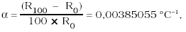

Príloha č. 37 k vyhláške č. 9/2001 Z. z.

- SNÍMAČE TEPLOTY A PREVODNÍKY TEPLOTY

  - Prvá časť

  - Vymedzenie meradiel a spôsob ich metrologickej kontroly

  - 1. Táto príloha sa vzťahuje na odporové snímače teploty (ďalej len „snímač teploty“) a na prevodníky teploty (ďalej len „prevodník“), ktoré sa používajú v meračoch tepla, v kafilériových zariadeniach a v prístrojoch na stanovenie spalného tepla pri bilančných meraniach ako určené meradlá podľa § 8 zákona.

  - 2. Snímače teploty a prevodníky spĺňajú technické požiadavky a metrologické požiadavky, ktorých podrobnosti sú uvedené v druhej časti.

  - 3. Snímače teploty a prevodníky podliehajú pred uvedením na trh schváleniu typu a prvotnému overeniu. Metódy technických skúšok pri schvaľovaní typu a metódy skúšania pri overení sú uvedené v druhej časti.

  - 4. Snímače teploty a prevodníky schváleného typu označí výrobca alebo dovozca značkou schváleného typu.

  - 5. Snímače teploty a prevodníky, ktoré pri overení spĺňajú ustanovené požiadavky, sa označia overovacou značkou.

  - 6. Snímače teploty a prevodníky počas ich používania ako určené meradlá podliehajú následnému overeniu. Postup pri následnom overení je zhodný s postupom pri prvotnom overení.

  - Druhá časť

  - Technické požiadavky, metrologické požiadavky, metódy technických skúšok a metódy skúšania pri overení snímačov teploty a prevodníkov

  - ODDIEL I

  - SNÍMAČE TEPLOTY

  - 1 Všeobecné charakteristiky

  - 1.1 Platinový snímač teploty

  - Platinový snímač teploty pozostáva z teplotne závislého meracieho odporu v ochrannom puzdre, vnútorných vodičov a vonkajších svoriek na pripojenie k elektrickému meraciemu zariadeniu. Súčasťou môže byť pripojenie hlavice snímača teploty.

  - 1.2 Vzťahy vyjadrujúce závislosť teploty a elektrického odporu snímača teploty

  - 1.2.1 Pre snímač teploty platia tieto vzťahy vyjadrujúce závislosť elektrického odporu od jeho teploty:

    - a) pre rozsah teplôt od -200 oC do 0 oC:

    - Rt = R0 [1+At + Bt2 + C (t -100 oC) t3],

    - b) pre rozsah teplôt od 0 oC do 850 oC:

    - Rt = R0 (1+At + Bt2),

  - kde Rt je odpor snímača teploty pri teplote t,

  - R0 je odpor snímača teploty pri teplote t = 0 oC.

  - 1.2.2 Na vyjadrenie kvality platiny používanej na priemyselné snímače teploty v rovniciach podľa bodu 1.2.1 sa použijú tieto konštanty:

  - A = 3,908 3 .10-3 oC-1,

  - B = -5,775 .10-7 oC-2,

  - C = -4,183 .10-12 oC-4.

  - 1.2.3 Snímač teploty, ktorý spĺňa obidva vzťahy podľa bodu 1.2.1, má teplotný koeficient

  - 

  - kde R100 je odpor pri 100 oC,

  - R0 je odpor pri 0 oC.

  - 1.2.4 Hodnoty odporu snímača teploty v závislosti od teploty vyjadrenej v Medzinárodnej teplotnej stupnici ITS-1990 na základe rovníc uvedených v bode 1.2.1 sú uvedené v príslušnej slovenskej technickej norme.

  - 2 Metrologické požiadavky a technické požiadavky

  - 2.1 Metrologické požiadavky sa vzťahujú na snímače teploty, ktorých elektrický odpor je definovaný ako funkcia teploty, ktorej rozsah je od -200 oC do + 850 oC.

  - 2.2 Triedy presnosti snímačov teploty

  - Snímače teploty sa podľa najväčších dovolených chýb zaraďujú do dvoch tried presnosti.

  - Trieda presnosti | Najväčšie dovolené chyby (°C)

  - A | 0,15 + 0,002 x |t|*)

  - B | 0,3 + 0,005 x |t|

  - *) |t| je absolútna hodnota teploty v ^>oC bez ohľadu na znamienko.

  - 2.3 Snímače teploty triedy presnosti A nemožno použiť pri teplotách nad 650 oC. Snímače teploty s dvoma vnútornými vodičmi, pri ktorých vonkajšie prívodné vedenie má iba dva vodiče, sa nezaradia do triedy presnosti A.

  - 2.4 Snímač teploty sa konštruuje tak, aby bol vhodný na použitie v meracom systéme používajúcom jednosmerný alebo striedavý prúd pri frekvencii do 500 Hz.

  - 2.5 Snímače teploty sa konštruujú s rôznym usporiadaním vnútorných vodičov, ktoré si vyžaduje ich označenie a identifikáciu svoriek.

  - 3 Označenie snímačov teploty

  - Každý snímač teploty sa označí menovitým odporom, triedou presnosti, druhom pripojenia a teplotným rozsahom, napríklad takto:

  - Pt 100 /A/ 3 -100/+ 200.

  - Ak teplomer obsahuje viac ako jeden snímač teploty, výrobca jednoznačne identifikuje snímače teploty.

  - 4 Technické skúšky pri schvaľovaní typu

  - 4.1 Technické skúšky pri schvaľovaní typu snímača teploty sa vykonajú na každú oblasť teplôt, na ktorú je typ snímača teploty určený. Skúšky sa členia na skúšky vykonávané na všetkých druhoch snímačov teploty a na prídavné skúšky snímačov teploty používaných v prostredí so sťaženými podmienkami.

  - 4.2 Skúška snímača teploty triedy presnosti A sa vykoná najmenej pri dvoch teplotách; ak skúška pri dvoch teplotách nestačí, vykoná sa pri viacerých teplotách v pracovnom rozsahu snímača teploty.

  - Skúška snímača teploty triedy presnosti B sa vykoná pri jednej teplote, obvykle v nulovom bode. Snímače teploty s menovitou hodnotou odporu 100 Ω sa majú skúšať a zaradiť do tried presnosti podľa stupňa zhody s hodnotami uvedenými v príslušnej slovenskej technickej norme pri zohľadnení najväčších dovolených chýb uvedených v tabuľke č. 1.

  - Tabuľka č. 1

  - Najväčšie dovolené chyby snímača teploty s menovitou hodnotou odporu 100 Ω

- Teplota(°C) | Najväčšie dovolené chyby | | |

- | Trieda presnosti A | | Trieda presnosti B |

- | (C°) | (Ω) | (°C) | (Ω)

- -200 | ±0,55 | ±0,24 | ± 1,3 | ±0,56

- - 100 | ±0,35 | ±0,14 | ±0,8 | ±0,32

- 0 | ±0,15 | ±0,06 | ±0,3 | ±0,12

- 100 | ±0,35 | ±0,13 | ±0,8 | ±0,30

- 200 | ±0,55 | ±0,20 | ± 1,3 | ±0,48

- 300 | ±0,75 | ±0,27 | ± 1,8 | ±0,64

- 400 | ±0,95 | ±0,33 | ±2,3 | ±0,79

- 500 | ± 1,15 | ±0,38 | ±2,8 | ±0,93

- 600 | ± 1,35 | ±0,43 | ±3,3 | ± 1,06

- 650 | ± 1,45 | ±0,46 | ±3,6 | ± 1,13

- 700 | — | — | ±3,8 | ± 1,17

- 800 | — | — | ±4,3 | ± 1,28

- 850 | — | — | ±4,6 | ± 1,34

  - 4.3 Ak je snímač teploty zabudovaný do ochranného puzdra, zmeria sa izolačný odpor medzi každým prívodom a ochranným puzdrom. Izolačný odpor medzi každou svorkou a puzdrom nesmie byť menší, ako je uvedené v tabuľke č. 2.

  - Tabuľka č. 2

- Interval teplôt (°C) | Najmenší izolačný odpor (MΩ)

- 100 až 300 | 10

- 301 až 500 | 2

- 501 až 850 | 0,5

  - 4.4 Pri meraní odporu snímača teploty sa snímač teploty ponára do média najmenej do hĺbky ponoru určenej výrobcom.

  - 4.5 Merací prúd sa nastavuje tak, že vznikajúce straty, ktoré spôsobujú samoohrev snímača teploty, nevyvolávajú zmenu jeho odporu viac ako o ekvivalent 1/5 najväčšej dovolenej chyby snímača teploty.

  - 4.6 Skúšky snímača teploty sa vykonajú pri dostatočnom počte rozličných teplôt tak, aby sa potvrdilo, že hodnota odporu snímača teploty v celom teplotnom rozsahu je v súlade s najväčšími dovolenými chybami snímača teploty.

  - 4.7 Po vystavení snímača teploty teplote zodpovedajúcej hornej aj dolnej hraničnej hodnote jeho teplotného rozsahu počas 250 hodín sa odpor snímača teploty pri 0 oC nemá zmeniť pri triede presnosti A viac ako o 0,15 oC a pri triede presnosti B viac ako o 0,3 oC.

  - Ak je dolná hraničná hodnota teplotného rozsahu nižšia ako teplota varu kvapalného dusíka, teplota pre túto skúšku sa môže zmeniť.

  - 4.8 Prídavné skúšky snímačov teploty používaných v ťažkých podmienkach prostredia sa vykonávajú podľa príslušnej slovenskej technickej normy. Rozsah skúšok sa dohodne medzi výrobcom a používateľom s prihliadnutím na prostredie.

  - 5 Metódy skúšania pri prvotnom a následnom overení

  - 5.1 Podmienky pri skúšaní

  - Snímače teploty sa pred meraním temperujú najmenej 12 hodín pri teplote 22,5 ( ± 1,5) oC s relatívnou vlhkosťou vzduchu menšou ako 80 %.

  - 5.2 Postup pri overení

  - 5.2.1 Vonkajšia obhliadka

  - Pri vonkajšej obhliadke sa zisťuje, či snímač teploty nie je poškodený. Pri vonkajšej obhliadke sa zisťuje aj úplnosť predpísaného označenia.

  - 5.2.2 Skúška odporu izolácie

  - Ak je meraný odpor zabudovaný do ochranného puzdra, odpor medzi každým prívodom a ochranným puzdrom sa má merať pri teplote okolia 15 až 35 oC a relatívnej vlhkosti vzduchu nie väčšej ako 80 %. Meranie sa zopakuje po zmene polarity meracieho prúdu. Izolačný odpor má po stabilizovaní hodnotu najmenej 100 MΩ.

  - Ďalšie skúšky sa vykonajú pri zodpovedajúcej najväčšej teplote pri jednosmernom napätí nepresahujúcom 10 V.

  - 5.2.3 Stanovenie chýb snímača teploty

  - 5.2.3.1 Pri meraní odporu snímača teploty sa snímač teploty ponorí do média najmenej do hĺbky ponoru určenej výrobcom. Merací prúd sa zvolí tak, že vznikajúce straty, ktoré spôsobujú samoohrev snímača teploty, nevyvolávajú zmenu jeho odporu viac ako o ekvivalent 1/5 najväčšej dovolenej chyby snímača teploty.

  - 5.2.3.2 Skúšky snímača teploty sa vykonajú pri dostatočnom počte bodov tak, aby sa potvrdilo, že hodnota odporu snímača teploty v celom teplotnom rozsahu je v súlade s najväčšími dovolenými chybami snímača teploty.

  - 5.2.4 Chyba spôsobená zmenou hĺbky ponoru

  - Snímač teploty sa skúša ponorený do predpísanej hĺbky ponoru. Skúška spočíva v pomalom zmenšovaní hĺbky ponoru, ak nie sú indikované teplotné zmeny okolo 0,1 oC. Táto hĺbka ponoru sa odmeria a zaznamená sa ako najmenšia použiteľná hĺbka ponoru.

  - 5.2.5 Každá hodnota výsledku skúšky sa určí ako stredná hodnota výsledkov najmenej troch meraní. Žiadna z nameraných hodnôt sa nesmie odchyľovať od strednej hodnoty viac ako o ± 10 %.

  - ODDIEL II

  - PREVODNÍKY

  - 1 Termíny a definície

  - 1.1 Prevodník

  - Prevodník je súčasť meracieho zariadenia, ktorý meranú teplotu prevádza na výstupný unifikovaný elektrický signál s predpísanou závislosťou od hodnoty meranej teploty.

  - 1.2 Opakovateľnosť

  - Opakovateľnosť vyjadruje tesnosť zhody po sebe nasledujúcich výsledkov meraní výstupného signálu pre tú istú hodnotu vstupného signálu za tých istých podmienok a pri rovnakom smere zmeny vstupného signálu.

  - 1.3 Mŕtve pásmo

  - Mŕtve pásmo je najväčšia hodnota vstupného signálu, ktorá ešte nespôsobí zistiteľnú zmenu výstupného signálu.

  - 1.4 Hysteréza

  - Hysteréza je vlastnosť prevodníka vyjadrujúca rozdiel výstupného signálu pre tú istú hodnotu vstupného signálu pri vzrastajúcej a klesajúcej teplote.

  - 1.5 Zariadenie na nastavenie nuly

  - Zariadenie na nastavenie nuly je zariadenie, ktoré je súčasťou prevodníka a umožňuje nastavenie skutočnej charakteristiky tak, aby pri nulovej hodnote meranej teploty výstupný signál zodpovedal jeho dolnej hraničnej hodnote.

  - 1.6 Zariadenie na nastavenie hornej hraničnej hodnoty výstupného signálu

  - Zariadenie na nastavenie hornej hraničnej hodnoty výstupného signálu je zariadenie, ktoré je súčasťou prevodníka a umožňuje nastavenie skutočnej charakteristiky tak, aby pri hornej hraničnej hodnote rozsahu meranej teploty zodpovedal výstupný signál jeho hornej hraničnej hodnote.

  - 2 Metrologické požiadavky

  - 2.1 Triedy presnosti

  - Prevodníky sa zaraďujú do tried presnosti A a B podľa stupňa zhody s hodnotami uvedenými v príslušnej slovenskej technickej norme pri zohľadnení najväčších dovolených chýb uvedených v tabuľke č. 1.

  - 2.2 Hraničné hodnoty vstupného a výstupného signálu

  - Hraničným hodnotám vstupného signálu zodpovedajú hraničné hodnoty výstupného signálu.

  - 2.3 Najväčšie dovolené chyby

  - Najväčšie dovolené chyby prevodníkov pre jednotlivé triedy presnosti sú zhodné s najväčšími dovolenými chybami snímačov teploty uvedenými v tabuľke č. 1. Najväčšie dovolené chyby prevodníkov pri schvaľovaní typu, pri prvotnom overení a pri následnom overení sú zhodné.

  - 2.4 Hysteréza a mŕtve pásmo nepresahujú absolútnu hodnotu najväčšej dovolenej chyby pre danú triedu presnosti.

  - 2.5 Prevodník spĺňa špecifikácie uvedené v rozhodnutí o schválení typu meradla.

  - 3 Technické požiadavky

  - Prevodníky sa vyhotovujú tak, aby si zachovali v podmienkach prevádzky, na aké sú určené, svoje metrologické parametre najmenej počas platnosti overenia.

  - 4 Nápisy a značky

  - 4.1 Na puzdre prevodníka sa uvádzajú najmenej tieto údaje:

    - a) meno alebo označenie výrobcu,

    - b) typ prevodníka,

    - c) výrobné číslo,

    - d) merací rozsah,

    - e) trieda presnosti,

    - f) výstupný signál,

    - g) napájanie,

    - h) značka schváleného typu meradla.

  - 4.2 Ďalšie označenia môžu byť určené v rozhodnutí o schválení typu meradla.

  - 4.3 Umiestnenie overovacej značky je určené v rozhodnutí o schválení typu meradla.

  - 4.4 Ochrana proti neoprávneným zásahom

  - Prevodníky sa chránia proti neoprávnenému zásahu zabezpečovacími značkami. Zabezpečovacie značky sa na prevodníky umiestnia po vykonaní skúšok pri overení. Túto funkciu môžu plniť aj overovacie značky.

  - 5 Skúšky pri schvaľovaní typu

  - Skúšky pri schvaľovaní typu sa vykonajú najmenej na dvoch vzorkách prevodníka. Vykonajú sa úkony podľa bodov 5.1 a 5.2.

  - 5.1 Pri vonkajšej prehliadke sa kontroluje vzhľad a stav prevodníka. Ďalej sa preverí kompletnosť predloženej dokumentácie.

  - 5.2 Pri overení zhody prevodníka sa zisťuje, či spĺňa ustanovené technické požiadavky a metrologické požiadavky. Vykonajú sa skúšky podľa bodov 5.2.1 a 5.2.2.

  - 5.2.1 Stanovenie chýb údajov prevodníka

  - Na stanovenie chýb je potrebné vykonať porovnanie s etalónovým snímačom teploty v celom meracom rozsahu prevodníka vrátane nuly. Z nameraných hodnôt sa posúdi zhoda údajov prevodníka s údajmi etalónového teplomera, hysteréza, opakovateľnosť a mŕtve pásmo prevodníka.

  - 5.2.2 Účinky ovplyvňujúcich veličín

  - Skúšky účinkov ovplyvňujúcich veličín na údaje prevodníka sa vykonávajú podľa príslušnej slovenskej technickej normy. Rozsah skúšok sa dohodne medzi výrobcom a používateľom s prihliadnutím na osobitosti prostredia.

  - 5.3 Postup technických skúšok pri schvaľovaní typu ustanovuje príslušná slovenská technická norma.

  - 6 Metódy skúšania pri prvotnom a následnom overení

  - 6.1 Vonkajšia prehliadka

  - Vonkajšia prehliadka sa vykoná podľa bodu 5.1. Ďalej sa kontroluje, či prevodník zodpovedá schválenému typu.

  - 6.2 Určenie metrologických charakteristík

  - Pri overení sa vykonajú skúšky podľa bodu 5.2.

  - 6.3 Postup pri prvotnom a následnom overení ustanovuje príslušná slovenská technická norma.
