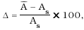
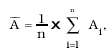
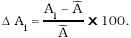

Príloha č. 39 k vyhláške č. 9/2001 Z. z.

- MERACIE ZARIADENIA NA MERANIE PLOŠNÉHO OBSAHU USNÍ

  - Prvá časť

  - Vymedzenie meradiel a spôsob ich metrologickej kontroly

  - 1. Táto príloha sa vzťahuje na meracie zariadenia, ktoré sa používajú na zisťovanie plošného obsahu nepravidelne ohraničených usní (ďalej len „meracie zariadenie“) ako určené meradlá podľa § 8 zákona.

  - 2. Meracie zariadenia sa členia na

  - a) dotykové, pri ktorých meranie sprostredkúvajú stopovacie kolíky rovnomerne rozdelené po obvodoch meracích kotúčov,

  - b) bezdotykové, pri ktorých meranie sprostredkúvajú bezdotykové snímače.

  - 3. Meracie zariadenia podliehajú pred uvedením na trh schváleniu typu a prvotnému overeniu. Metódy technických skúšok pri schvaľovaní typu a metódy skúšania pri overení sú uvedené v druhej časti.

  - 4. Meracie zariadenia schváleného typu označí výrobca alebo dovozca značkou schváleného typu.

  - 5. Meracie zariadenia, ktoré pri overení vyhovejú ustanoveným požiadavkám, označia sa overovacou značkou.

  - 6. Meracie zariadenia počas ich používania ako určené meradlá podliehajú následnému overeniu.

  - Druhá časť

  - Technické požiadavky, metrologické požiadavky, metódy skúšok a metódy skúšania pri overení meracích zariadení

  - 1 Termíny a definície

  - 1.1 Meracie zariadenia dotykové sú integračné meradlá, pri ktorých je meraná plocha rozdelená na určitý počet rovnako širokých pruhov, ktorých dĺžka sa meria odvaľovaním meracích kotúčov s výsuvnými stopovacími kolíkmi, samočinne sa sčítava podľa Simpsonovho pravidla a prenáša na číselník počítadla. Súčet dĺžok je priamo úmerný k celému plošnému obsahu a hodnoty na číselníku udávajú priamo veľkosť plošného obsahu.

  - 1.2 Meracie zariadenia bezdotykové sú meradlá, pri ktorých je meraná plocha fiktívne rozdelená na určitý počet rovnako širokých pruhov daných počtom bezdotykových prvkov snímacieho radu. Pruhy sú delené na rovnako dlhé úseky zariadením pracujúcim synchrónne s rýchlosťou podávacieho mechanizmu meracieho zariadenia. Takto vytvorené elementárne plôšky sú elektronicky sčítané a meraný plošný obsah vyhodnocovaný v príslušných meracích jednotkách (dm2). Hodnoty sa vysielajú na optický ukazovateľ, do tlačiarenského zariadenia, elektronického sčítacieho zariadenia, prípadne do počítača.

  - 2 Vyhotovenie a používanie meracích zariadení na meranie plošného obsahu usní

  - 2.1 Meracie zariadenia na meranie plošného obsahu usní a ich príslušenstvo sa vyrábajú z dostatočne trvanlivých a stabilných materiálov, ktoré sú za bežných podmienok používania odolné proti vplyvu prostredia.

  - 2.2 Meracie zariadenie sa umiestňuje v suchej miestnosti s teplotou 20 (± 5) oC, zbavenej prachu a škodlivých výparov.

  - 2.3 Na meranie je potrebné zvoliť meracie zariadenie s meracím rozsahom zodpovedajúcim meranému plošnému obsahu a s takou pracovnou šírkou meracieho zariadenia, aby ním useň bezpečne prechádzala.

  - 3 Technické požiadavky na meracie zariadenia dotykové

  - 3.1 Meracie zariadenia dotykové sa vyrábajú vhodnej a pevnej konštrukcie.

  - 3.2 Meracie zariadenia dotykové sa vyrábajú vo veľkostiach a vo vyhotoveniach podľa tabuľky č. 1.

  - Tabuľka č. 1

- Merací rozsah | | Dolná medza zaručenej správnosti 1% (l/10 hornej medze meracieho rozsahu) | Odporučený merací rozsah | Pracovná šírka meracieho zariadenia | Priechod usne*)

- Veľkosť meracieho zariadenia (horná medza meracieho rozsahu) | Dolná medza meracieho rozsahu (1/20 hornej medze meracieho rozsahu) | | | |

- dm2 | | | | mm |

- 150 | 7,5 | 15 | 10 až 150 | 810 | vratný

- 225 | 11,25 | 22,5 | 15 až 225 | 1 220 | vratný

- 300 | 15 | 30 | 20 až 300 | 1 625 | vratný

- | | | | | vratný aj priebežný

- 450 | 22,5 | 45 | 30 až 450 | 2440 | vratný aj priebežný

- 600 | 30 | 60 | 40 až 600 | 3250 | vratný aj priebežný

- *) Podľa vyhotovenia môže byť meracie zariadenie na vratný priechod (obsluha jednou osobou) alebo na vratný aj priebežný priechod (obsluha jednou alebo dvoma osobami).

  - 3.3 Stupnica počítadla meracieho zariadenia sa vyznačuje zreteľne a trvalým spôsobom na kovovej doske alebo na doske z plastickej hmoty, ktorá môže byť priesvitná, aby sa mohla zo zadnej strany presvetľovať. Teplo vznikajúce pri presvetľovaní nemá stupnicu deformovať.

  - 3.4 Meracie zariadenia môžu mať počítadlá s dvoma stupnicami, ktorých údaje sú vždy zhodné.

  - 3.5 Na číselníku meracieho zariadenia sa uvádza meracia jednotka slovami štvorcový decimeter alebo symbolom dm2.

  - 3.6 Stupnica sa delí na dm2. Čiarka stupnice udávajúca najväčšiu hodnotu meracieho rozsahu môže byť totožná s čiarkou zodpovedajúcou nule. Vzdialenosť čiarky stupnice zodpovedajúcej 1/20 meracieho rozsahu (dolná medza meracieho rozsahu) od čiarky zodpovedajúcej nule je aspoň 50 mm. Vzdialenosťou sa rozumie dĺžka oblúka preloženého stredom dĺžky najkratších čiarok stupnice.

  - 3.7 Ak je meracie zariadenie vybavené zariadením zaručujúcim odstránenie chvenia ukazovateľa a vylúčenie vôle v ozubení segmentu a pastorka, ktoré majú vplyv na výsledok merania, vzdialenosť čiarok stupnice zodpovedajúcich hodnote 1 dm2 je najmenej 2,5 mm. Ak meracie zariadenie nie je vybavené takým zariadením, vzdialenosť čiarok stupnice je najmenej 4 mm.

  - 3.8 Šírka čiarok stupnice a konca ukazovateľa nemá byť väčšia ako 0,5 mm. Čiarky stupnice určujúce desaťnásobky dm2 sa majú od ostatných líšiť dĺžkou a sú označené číselnými hodnotami udávajúcimi príslušnú veľkosť plošného obsahu. Číslice na číselníku sú vzhľadom na pozorovateľa vo zvislej polohe. Výška číslic je najmenej 10 mm.

  - 3.9 Stupnica počítadla sa delí rovnomerne. Vzdialenosť ukazovateľa od stupnice nie je väčšia ako 2 mm.

  - 3.10 Meracie zariadenie je vybavené zariadením, ktorým sa dá merací mechanizmus po skončení merania uvoľniť tak, aby sa celý merací mechanizmus vrátane ukazovateľa uviedol do východiskového postavenia (do nulovej polohy).

  - 3.11 Počítadlá sú vybavené zariadením na nastavenie ukazovateľa na nulu.

  - 3.12 Konštrukčné vyhotovenie meracieho zariadenia má zaručovať, že meracie kotúče sa na meranej usni bezpečne a bez prešmyku odvalia. Rýchlosť otáčania podávacieho valca je 60 (± 2) otáčok za minútu pri priemere podávacieho valca 100 mm.

  - 3.13 Konštrukcia meracích prvkov má zaručovať správnosť meracieho zariadenia pri použití akýchkoľvek skupín meracích prvkov a bez ohľadu na hrúbku meranej usne. Vzdialenosť jednotlivých meracích prvkov aj šírka meracích kotúčov je rovnaká.

  - 3.14 Meracie prvky majú na ukazovateľ prenášať rovnomerne a navzájom nezávisle dráhu, ktorú meracie kotúče odvaľujú na meranej usni.

  - 3.15 Pri chode meracieho zariadenia naprázdno má zostať ukazovateľ v pokoji.

  - 3.16 Na nastavenie správnosti sa meracie zariadenie vybavuje justovacím zariadením, ktoré sa upravuje tak, aby sa znemožnila manipulácia s ním po overení meracieho zariadenia.

  - 3.17 Meracie zariadenie sa môže vybaviť zariadením na rovnomerné vedenie usní.

  - 3.18 Na výrobnom štítku pripevnenom na meracom zariadení sa zreteľne a nezmazateľne vyznačujú tieto údaje:

    - a) typ meracieho zariadenia,

    - b) meno alebo značka výrobcu meracieho zariadenia a jeho sídlo,

    - c) výrobné číslo a rok výroby,

    - d) merací rozsah a symbol meracej jednotky [dm2],

    - e) značka schváleného typu meradla.

  - 3.19 Štítok sa umiestňuje na prednej strane meracieho zariadenia tak, aby ho nebolo možné odstrániť bez porušenia overovacích značiek.

  - 3.20 Ku každému meraciemu zariadeniu sa prikladá návod na používanie a prevádzkový merací hárok podľa tabuľky č. 2.

  - Tabuľka č. 2

- Veľkosť meracieho zariadenia (horná medza meracieho rozsahu) | dm2 | 150 | 225 | 300 | 450 | 600

- Veľkosť meracieho hárka | dm2 | 50 | | | 100 |

  - 3.21 Merací hárok sa zhotovuje z tenkého materiálu, ktorý je taký pružný, aby nedošlo k trvalej deformácii ani pri priehybe pri nesprávnom zavedení do meracieho zariadenia. Jeho lineárne rozmery sa vo všetkých smeroch môžu meniť iba tak, aby sa plošný obsah hárka nezmenil o viac ako 0,1 % jeho pôvodného skutočného plošného obsahu. Najvhodnejším materiálom na merací hárok je bavlnený pogumovaný textil.

  - 4 Technické požiadavky na bezdotykové meracie zariadenia

  - 4.1 Konštrukčné vyhotovenie bezdotykových meracích zariadení zaručuje, že podávacie zariadenie podá meraný materiál miestom merania bez prešmyku pri podávacej rýchlosti do 0,5 m/s.

  - 4.2 Konštrukcia usporiadania snímacích bezdotykových prvkov v snímacom rade zaručuje správnosť meracieho zariadenia. Vzdialenosti jednotlivých svetlovodičov aj ich priemery majú byť rovnaké.

  - 4.3 Intenzita osvetlenia snímacieho radu zabezpečuje spoľahlivé snímanie a rovnomernosť rozloženia po celej šírke nad snímacím radom.

  - 4.4 Konštrukčné usporiadanie snímacieho zariadenia zabezpečuje bezchybné nasnímanie svetla zo všetkých snímacích bezdotykových prvkov.

  - 4.5 Všetky elektrické impulzy zo snímacieho zariadenia sa prenášajú bez chýb do elektronického vyhodnocovacieho zariadenia.

  - 4.6 Vyhodnocovacie zariadenie správne sčíta všetky elektrické impulzy vyslané fototranzistormi snímacieho zariadenia, zaokrúhli a vyhodnotí meraný plošný obsah v meracom prvku.

  - 4.7 Tlačiarenské zariadenie vytlačí čísla presne podľa výsledkov vyhodnocovacieho zariadenia, zaručuje čitateľné vytlačenie veľkosti odmeraného plošného obsahu.

  - 4.8 Meracie zariadenie môže byť vybavené jedným alebo dvoma optickými ukazovateľmi hodnôt odmeraného plošného obsahu umiestnenými tak, aby hodnoty na každom optickom ukazovateli boli dobre čitateľné z miesta obsluhy. Optický ukazovateľ má typy čísiel s výškou najmenej 15 mm.

  - 4.9 Meracie zariadenie možno vybaviť počítadlom kusov odmeraného materiálu. Počítadlo kusov sa dá vynulovať.

  - 4.10 Meracie zariadenie sa vybavuje zariadením na vynulovanie všetkých počítacích obvodov pred začatím merania.

  - 4.11 Všetky prvky meracieho zariadenia, ktorými možno ovplyvniť jeho správnosť, sú upravené tak, aby po overení meracieho zariadenia nebolo možné s nimi manipulovať.

  - 4.12 Na výrobnom štítku pripevnenom na meracom zariadení sa zreteľne a nezmazateľne vyznačujú tieto údaje:

    - a) typ meracieho zariadenia,

    - b) meno alebo značka výrobcu meracieho zariadenia a jeho sídlo,

    - c) výrobné číslo a rok výroby,

    - d) merací rozsah a symbol meracej jednotky [dm2],

    - e) značka schváleného typu meradla.

  - 4.13 Štítok sa umiestňuje na prednej strane meracieho zariadenia tak, aby ho nebolo možné odstrániť bez porušenia overovacích značiek.

  - 4.14 Ku každému meraciemu zariadeniu sa dodáva návod na používanie s potrebnou sprievodnou dokumentáciou a meracie hárky vo veľkosti 50 dm2 a 100 dm2 na kontrolu meracieho zariadenia obsluhou.

  - 4.15 Meracie zariadenie možno vybaviť zariadením na vytlačenie veľkosti odmeraného plošného obsahu na meraný materiál, ktoré má umožňovať ľahkú zmenu farby tlače.

  - 5 Metrologické požiadavky

  - Stredná hodnota údajov (aritmetický priemer) počítadla meracieho zariadenia zistená meraním meracieho hárka a vypočítaná z desiatich opakovaných meraní tej istej plochy vykonaných striedavo na celej pracovnej šírke meracieho zariadenia sa môže líšiť od správnej hodnoty najviac o ± 1 %. Výsledky jednotlivých meraní sa môžu od strednej hodnoty líšiť najviac o ± 2 %.

  - 6 Overovacie značky

  - Na umiestnenie overovacej značky sa vyhradzuje miesto tak, aby sa zabezpečila neodnímateľnosť výrobného štítku meracieho zariadenia.

  - 7 Schválenie typu, prvotné a následné overenie

  - Pri schvaľovaní typu sa kontroluje vyhotovenie a správnosť funkcie meracieho zariadenia a vykoná sa skúška jeho správnosti.

  - 7.1 Skúšky pri schvaľovaní typu

  - 7.1.1 Pri kontrole vyhotovenia sa preverí, či meracie zariadenie svojimi náležitosťami zodpovedá požiadavkám uvedeným v bodoch 3 a 4, príslušnej slovenskej technickej norme a technickej dokumentácii.

  - 7.1.2 Pri kontrole správnosti funkcie meracieho zariadenia sa preverí

    - a) snímacie zariadenie,

    - b) funkcia tlačiarenského zariadenia,

    - c) funkcia snímacieho a vyhodnocovacieho zariadenia,

    - d) nulovanie údajov.

  - 7.1.3 Pri skúške správnosti meracieho zariadenia sa kladú obdĺžnikové etalónové hárky na dopravník meradla vždy šikmo tak, aby vstupovali pod snímacie zariadenie niektorým svojím rohom. Najmenšia vzdialenosť kladenia hárkov od okraja podávacieho zariadenia je 5 cm. Pri použití niekoľkých hárkov na vytvorenie potrebného plošného obsahu treba dbať na to, aby medzi jednotlivými hárkami v smere pohybu podávacieho zariadenia nebola žiadna medzera. Počas snímania plošného obsahu hárkov sa tieto hárky vyrovnávajú do roviny podávacieho zariadenia.

  - 7.1.4 Skúškou pri schvaľovaní typu meradla sa zisťuje správnosť meracieho zariadenia v týchto bodoch jeho meracieho rozsahu:

    - a) pri dolnej medzi meracieho rozsahu,

    - b) pri veľkostiach plošného obsahu: 30, 40, 50, 60, 70, 80, 90, 100, 150, 200, 250, 300, 350, 400, 450, 500, 550, 600, 650, 700, 750, 800, 950 dm2,

    - c) pri hornej medzi meracieho rozsahu.

  - Do veľkosti plošného obsahu 200 dm2 sa použijú jednotlivé veľkosti etalónových meracích hárkov. Plošné obsahy nad 200 dm2 sa skúšajú pri použití vhodnej kombinácie jednotlivých veľkostí etalónových meracích hárkov podľa bodu 7.1.8.

  - 7.1.5 Každá predpísaná veľkosť plošného obsahu určená v bode 7.1.4 sa pri schvaľovaní typu meradla meria 20-krát, pričom sa hárky po každom meraní kladú na iné miesto podávacieho zariadenia.

  - 7.1.6 Po skúške správnosti meracieho zariadenia podľa bodu 7.1.4 sa výsledky merania vyhodnotia podľa bodu 7.1.7.

  - 7.1.7 Vyhodnotením výsledkov merania sa určí relatívna chyba meradla Δ pre každý meraný plošný obsah podľa vzťahu:

  - [%],

  - kde Ā – stredná hodnota plošného obsahu opakovaných meraní toho istého hárka:

  - ,

  - kde n – počet meraní,

  - Ai – nameraná hodnota i-teho merania,

  - As – skutočný plošný obsah reprezentovaný etalónovým hárkom.

  - Hodnota Δ nemá prekročiť hodnotu najväčšej dovolenej chyby, t. j. ± 1 %.

  - Relatívna chyba jednotlivých meraní je daná vzťahom:

  - .[%]

  - Hodnota Ai jednotlivého merania sa môže líšiť od strednej hodnoty najviac o ± 2 % nameranej hodnoty plošného obsahu.

  - 7.1.8 Pri určovaní skladby hárkov sa postupuje takto:

    - a) na kontrolu správnosti meracieho zariadenia sa najskôr použijú jednotlivé hárky zodpovedajúce veľkosti podľa bodu 7.1.4 písm. b), ak ich menovitá veľkosť zodpovedá skúšobným bodom meracieho rozsahu,

    - b) ostatné skúšobné body meracieho rozsahu sa kontrolujú skladbou dvoch, troch alebo štyroch hárkov zavedených do meracieho zariadenia bezprostredne za sebou. Za skutočnú hodnotu plošného obsahu sa považuje súčet skutočných hodnôt použitých hárkov. Z nameraných hodnôt veľkosti plošného obsahu sa určia chyby podľa bodu 7.1.7.

  - 7.1.9 Rozšírená neistota stanovenia plošného obsahu pri skúške typu meracieho zariadenia neprekročí 1/5 najväčšej dovolenej chyby meracieho zariadenia. Pri výpočte rozšírenej neistoty sa použije koeficient pokrytia k = 2.

  - 7.1.10 Postup skúšok pri schvaľovaní typu ustanovuje príslušná slovenská technická norma.

  - 7.2 Skúška pri prvotnom a následnom overení

  - 7.2.1 Prvotné a následné overenie meracieho zariadenia pozostáva z vonkajšej obhliadky, kontroly správnosti funkcie meracieho zariadenia a zo skúšky správnosti meracieho zariadenia.

  - 7.2.2 Pred samotným meraním sa uskutoční vonkajšia obhliadka meracieho zariadenia, pri ktorej sa zisťuje

    - a) úplnosť všetkých častí meracieho zariadenia, ktoré sú predpísané v bode 3 alebo 4,

    - b) či je meracie zariadenie funkčne spôsobilé na skúšku,

    - c) či nemá viditeľné poškodenie znemožňujúce skúšku.

  - 7.2.3 Pri kontrole správnosti funkcie meracieho zariadenia sa preverí

    - a) snímacie zariadenie,

    - b) funkcia tlačiarenského zariadenia,

    - c) funkcia snímacieho a vyhodnocovacieho zariadenia,

    - d) nulovanie údajov.

  - 7.2.4 Pri prvotnom a následnom overení sa zisťuje správnosť meracieho zariadenia v týchto bodoch jeho meracieho rozsahu:

    - a) pri dolnej medzi meracieho rozsahu,

    - b) pri veľkostiach plošného obsahu: 30, 50, 100, 150, 200, 300 dm2,

    - c) pri hornej medzi meracieho rozsahu.

  - Pritom je potrebné voliť vždy takú menovitú veľkosť plošného obsahu, ktorá je najbližšie realizovateľná k určenému bodu meracieho rozsahu pri použití vhodných rozmerov hárkov alebo pri skladbe hárkov podľa bodu 7.2.6.

  - 7.2.5 Každá predpísaná veľkosť plošného obsahu určená v bode 7.2.3 sa meria 10-krát, pričom sa hárky po každom meraní kladú na iné miesto podávacieho zariadenia.

  - 7.2.6 Po skúške správnosti meracieho zariadenia podľa bodu 7.2.3 sa výsledky merania vyhodnotia podľa bodu 7.1.7.

  - 7.2.7 Pri určovaní skladby hárkov sa postupuje takto:

    - a) na kontrolu správnosti meracieho zariadenia sa najskôr použijú jednotlivé hárky zodpovedajúce veľkosti podľa bodu 7.1.4 písm. b), ak ich menovitá veľkosť zodpovedá skúšobným bodom meracieho rozsahu,

    - b) ostatné skúšobné body meracieho rozsahu sa kontrolujú skladbou dvoch, troch alebo štyroch hárkov zavedených do meracieho zariadenia bezprostredne za sebou. Za skutočnú hodnotu plošného obsahu sa považuje súčet skutočných hodnôt použitých hárkov. Z nameraných hodnôt veľkosti plošného obsahu sa určia chyby podľa bodu 7.1.7.

  - 7.2.8 Rozšírená neistota stanovenia plošného obsahu pri prvotnom a následnom overení meracieho zariadenia neprekročí 1/3 najväčšej dovolenej chyby meracieho zariadenia. Pri výpočte rozšírenej neistoty sa použije koeficient pokrytia k = 2.

  - 7.2.9 Postup pri prvotnom a následnom overení ustanovuje príslušná slovenská technická norma.
