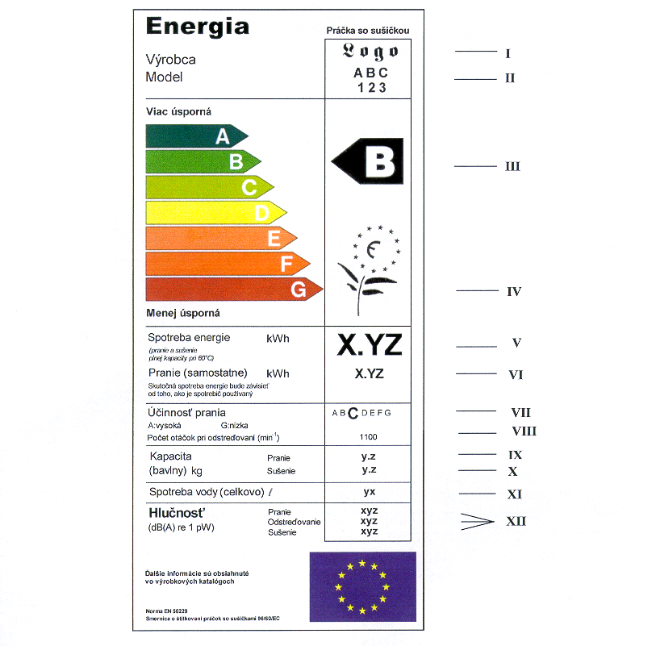
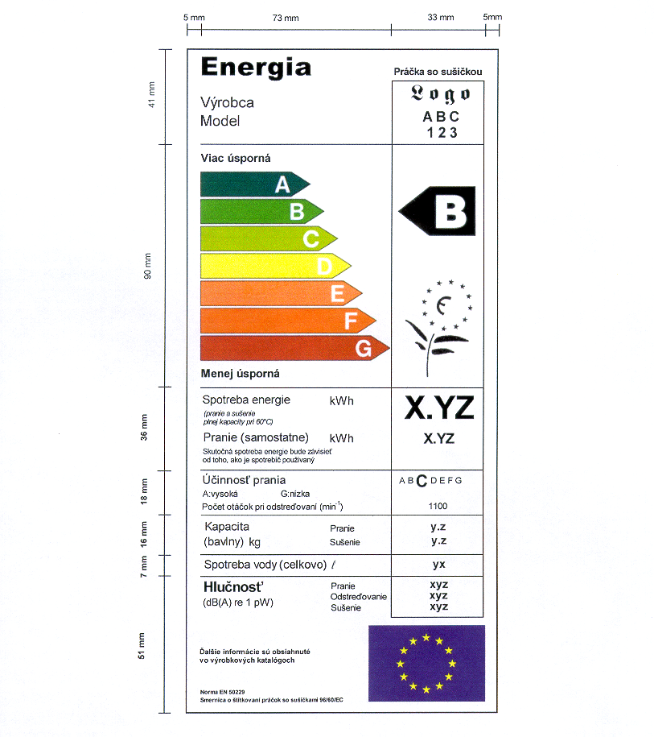

Príloha č. 1 k nariadeniu vlády č. 210/2002 Z. z.

- ENERGETICKÝ ŠTÍTOK

- Údaje na energetickom štítku

  - I. Názov a ochranná značka výrobcu.

  - II. Identifikačný kód kombinovanej práčky so sušičkou.

  - III. Trieda energetickej hospodárnosti podľa prílohy č. 4; trieda je uvedená vo výške príslušnej šípky.

  - IV. Ekologická značka EU (kvietok), ak bola kombinovanej práčke so sušičkou udelená.

  - V. Spotreba energie v kWh na kompletný štandardný pracovný cyklus (pranie, odstreďovanie a sušenie) pre bavlnu pri 60 oC podľa skúšobného postupu určeného v harmonizovaných normách.

  - VI. Spotreba energie v kWh na jeden štandardný pracovný cyklus (iba pranie a odstreďovanie) pre bavlnu pri 60 oC podľa skúšobného postupu určeného v harmonizovaných normách.

  - VII. Trieda účinnosti prania.

  - VIII. Najvyšší počet dosiahnutých otáčok pri odstreďovaní v rámci štandardného cyklu pre bavlnu pri 60 oC podľa skúšobného postupu určeného v harmonizovaných normách.

  - IX. Kapacita prania (v kg) pri štandardnom cykle pre bavlnu pri 60 oC (bez sušenia) určená podľa harmonizovaných noriem.

  - X. Kapacita sušenia (v kg) pri (sušiacom) cykle „sušenie bavlny“ určená podľa harmonizovaných noriem.

  - XI. Spotreba vody v litroch na kompletný štandardný pracovný cyklus (pranie, odstreďovanie a sušenie) pre bavlnu pri 60 oC a cyklus „sušenie bavlny“ podľa skúšobného postupu určeného v harmonizovaných normách.

  - XII. Hlučnosť sa meria podľa osobitného predpisu.2)

- Tlač

- Použité farby

- CMYK - tyrkysová, fialová, žltá, čierna.

- Príklad použitia farieb:

- 07X0: 0 % tyrkysová, 70 % fialová, 100 % žltá, 0 % čierna.

- Šípky:

- A: X0X0,

- B: 70X0,

- C: 30X0,

- D: 00X0,

- E: 03X0,

- F: 07X0,

- G: 0XX0.

- Farba rámčeka X070.

- Celý text je čierny. Podklad je biely.
