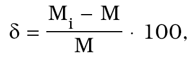
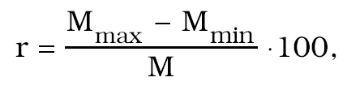
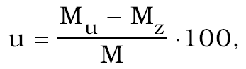

- Príloha č. 59 k vyhláške č. 27/2002 Z. z.

MOMENTOVÉ KĽÚČE

Prvá časť

Vymedzenie meradiel a spôsob ich metrologickej kontroly

1. Táto príloha sa vzťahuje na momentové kľúče určené na kontrolu presného dotiahnutia skrutiek a matíc spojov, ktoré sa používajú ako určené meradlá podľa § 8 zákona.

2. Momentové kľúče sa delia na

a) torzné s číselníkovým odchýlkomerom,

b) torzné a ohybové s elektronickým meracím systémom,

c) tenzometrické snímače s elektronickým výstupom.

3. Momentové kľúče pred uvedením na trh podliehajú prvotnému overeniu. Metódy skúšania pri overení sú uvedené v druhej časti.

4. Momentové kľúče, ktoré pri overení vyhovejú ustanoveným požiadavkám, sa označia overovacou značkou.

5. Momentové kľúče počas ich používania ako určené meradlá podliehajú následnému overeniu. Postup pri následnom overení je zhodný s postupom pri prvotnom overení.

Druhá časť

Metrologické požiadavky, technické požiadavky a metódy skúšania pri overení momentových kľúčov

1. Termíny a definície

1.1 Momentový kľúč je presný merací prístroj na kontrolu dotiahnutia skrutiek a matíc spojov stanoveným momentom sily v prípadoch, v ktorých môže dôjsť k ohrozeniu života alebo životného prostredia.

1.2 Snímač momentu sily je časť momentového kľúča, ktorá slúži na prevod meraného momentu sily na lineárnu pružnú deformáciu telesa snímača alebo na elektrický výstupný signál.

2. Metrologické požiadavky

2.1 Momentové kľúče sa zaraďujú do piatich tried presnosti podľa tejto tabuľky:

Trieda presnosti | Najväčšia dovolená chyba δM (%) | Najväčšie dovolené relatívne rozpätie rM (%) | Najväčšia dovolená relatívna odchýlka spätného chodu uM (%)

0,2 | 0,2 | 0,12 | 0,3

0,5 | 0,5 | 0,3 | 0,75

1 | 1 | 0,6 | 1,5

2 | 2 | 1,2 | 3

3 | 3 | 1,8 | 4,5

2.2 Momentové kľúče udávajú meranú hodnotu momentu sily v N . m.

2.3 Môžu sa používať aj jednotky mN .m alebo kN. m.

2.4 Momentové kľúče indikujúce meranú hodnotu v iných jednotkách ako N . m majú na ukazovateli aj hodnotu indikujúcu merané hodnoty v N m.

3. Technické požiadavky

3.1 Momentové kľúče sa vybavia priamym odčítaním z číselníkového ukazovateľa alebo z digitálneho ukazovateľa.

3.2 Momentové kľúče s číselníkovým ukazovateľom s ručičkou spoľahlivo ukazujú. Čiarky stupnice a číslice sú zreteľné a dobre čitateľné. Hrúbka ručičky a značiek stupnice sú najviac 0,3 mm a sú rovnakej hrúbky.

3.3 Momentové kľúče s výstupom digitálneho zobrazenia musia mať číslice zreteľné a dobre čitateľné zo vzdialenosti najmenej 0,5 m.

3.4 Momentové kľúče sa po úplnom odľahčení vrátia späť do nulovej polohy.

3.5 Momentové kľúče majú takú konštrukciu, ktorá umožňuje ich jednoduché nastavenie. Nastavenie sa dá spoľahlivo zaistiť, aby nemohlo dôjsť k svojvoľnému porušeniu nastavenia, a tým aj k zmene metrologických vlastností pri používaní.

3.6 Momentové kľúče indikujú moment sily ako okamžitú hodnotu momentu sily bez oneskorenia.

3.7 Momentové kľúče sa konštruujú tak, aby boli dostatočne pevné na daný merací rozsah. Pri najväčšom zaťažení nedochádza k deformácii žiadnej časti momentového kľúča.

4. Nápisy a značky

Momentové kľúče sa označia štítkom obsahujúcim tieto údaje:

a) výrobca,

b) typ,

c) výrobné číslo,

d) merací rozsah (prípadne maximálna hodnota zaťaženia).

5. Metódy skúšania pri overení

5.1 Overenie momentových kľúčov sa vykonáva na etalónovom zariadení momentu sily. Rozšírená neistota etalónového zariadenia nesmie prekročiť 1/3 najväčšej dovolenej chyby pre príslušnú triedu presnosti overovaného momentového kľúča.

5.2 Overenie momentových kľúčov sa vykoná po vyrovnaní ich teploty s teplotou okolia, ktorá je 20 oC ±5 oC.

5.3 Pred začatím skúšania sa momentový kľúč predbežne trikrát zaťaží na najväčšiu hodnotu meracieho rozsahu a odľahčí sa späť do nulovej polohy.

5.4 Skúšanie sa začína vždy z nulovej polohy a momentový kľúč sa rovnomerne zaťažuje až do hornej medze meracieho rozsahu. V priebehu zaťažovania sa odčítavajú hodnoty najmenej v piatich bodoch rozdelených rovnomerne v celom meracom rozsahu.

5.5 Ak sa vykonáva overenie spätného chodu momentového kľúča, po zaťažení na hornú medzu meracieho rozsahu pokračuje skúšanie rovnomerným odľahčením až po nulovú hodnotu. Merané hodnoty sa odčítavajú v tých istých bodoch ako pri zaťažovaní.

5.6 Meranie sa opakuje najmenej trikrát a priebeh merania je taký, aby v určených bodoch umožňoval presné odčítanie meranej hodnoty.

5.7 Ak má momentový kľúč smer zaťažovania pravý aj ľavý, vykoná sa skúška na obidva smery zaťaženia.

5.8 Momentové kľúče sa zaraďujú do triedy presnosti podľa nameraných hodnôt a na základe výpočtov podľa bodov 5.9 až 5.11.

5.9 Chyba δ momentových kľúčov sa vypočíta podľa vzťahu

kde Mi – hodnota momentu sily odčítaná zo stupnice momentového kľúča,

M – skutočná hodnota momentu sily odčítaná zo stupnice etalónu.

5.10 Relatívne rozpätie r momentových kľúčov sa vypočíta podľa vzťahu

kde Mmax – najväčšia hodnota momentu sily z troch sérií meraní,

Mmin – najmenšia hodnota momentu sily z troch sérií meraní,

M – skutočná hodnota momentu sily odčítaná zo stupnice etalónu.

5.11 Relatívna odchýlka spätného chodu momentových kľúčov sa vypočíta podľa vzťahu

kde Mu – hodnota momentu sily pri odľahčovaní,

Mz – hodnota momentu sily pri zaťažovaní,

M – skutočná hodnota momentu sily pre daný bod stupnice.

Relatívna odchýlka spätného chodu sa zisťuje iba v špeciálnych prípadoch, ak je potreba merania momentu sily v závislosti od spätného chodu.
