Príloha č. 61 k vyhláške č. 27/2002 Z. z.

ZARIADENIA NA MECHANICKÉ SKÚŠKY MATERIÁLOV

Prvá časť

Vymedzenie meradiel a spôsob ich metrologickej kontroly

1. Táto príloha sa vzťahuje na zariadenia na mechanické skúšky materiálov ako určené meradlá podľa § 8 zákona, ktoré sa používajú na statické skúšky materiálov ťahom, tlakom, ohybom, šmykom a tečením v ťahu a ktorých integrálnou súčasťou sú meradlá sily.

2. Zariadenia na mechanické skúšky materiálov sa členia na

a) skúšobné trhacie stroje a skúšobné lisy,

b) stroje na skúšanie tečenia materiálu v ťahu so zaťažovacím zariadením

1. pákovým a s priamym zaťažením,

2. pružinovým,

3. iným,

c) kyvadlové kladivá na skúšky vrubovej a rázovej húževnatosti materiálov.

3. Zariadenia na mechanické skúšky materiálov pred uvedením na trh podliehajú prvotnému overeniu. Metódy skúšania pri overení sú uvedené v druhej časti.

4. Zariadenia na mechanické skúšky materiálov, ktoré pri overení vyhovejú ustanoveným požiadavkám, označia sa overovacou značkou a vydá sa doklad o overení.

5. Zariadenia na mechanické skúšky materiálov počas ich používania ako určené meradlá podliehajú následnému overeniu. Postup pri následnom overení je zhodný s postupom pri prvotnom overení.

Druhá časť

Technické požiadavky, metrologické požiadavky a metódy skúšania pri overení zariadení na mechanické skúšky materiálov

Oddiel I

Skúšobné trhacie stroje, skúšobné lisy a stroje na skúšanie tečenia materiálu v ťahu

1. Termíny a definície

1.1 Skúšobný trhací stroj je skúšobný stroj, v ktorom sa pôsobením zaťažovacieho zariadenia zväčšuje vzdialenosť medzi spínacími čeľusťami. Je určený najmä na skúšky ťahom.

1.2 Skúšobný lis je skúšobný stroj určený najmä na skúšky tlakom a ohybom.

1.3 Stroj na skúšky ťahom a tlakom je skúšobný stroj zlučujúci funkcie strojov podľa bodov 1.1 a 1.2.

1.4 Stroj na skúšanie tečenia materiálu v ťahu je skúšobný stroj, v ktorom sú skúšobné telesá zaťažené ťahom stálou silou a pri stálej teplote.

1.5 Zaťažovacie zariadenie je časť skúšobného stroja alebo lisu určená na vyvodenie sily zaťažujúcej skúšobné teleso.

1.6 Skúšobné teleso je teleso vyrobené z materiálu, ktorý je predmetom skúšky.

1.7 Zaťažovacie teleso je súčasť zaťažovacieho zariadenia vyvodzujúceho silu pôsobením tiaže tohto telesa.

2. Technické požiadavky

2.1 Materiály skúšobných trhacích strojov, skúšobných lisov a strojov na skúšanie tečenia materiálu v ťahu a prevádzkové podmienky

2.1.1 Skúšobný trhací stroj, skúšobný lis a stroj na skúšanie tečenia materiálu v ťahu (ďalej len „skúšobný stroj“) a ich príslušenstvo sa vyrábajú z dostatočne trvanlivých a stabilných materiálov, ktoré za bežných podmienok používania odolávajú vplyvu prostredia.

2.1.2 Skúšobný stroj sa umiestňuje v suchej miestnosti zbavenej prachu a škodlivých výparov.

2.2 Vyhotovenie skúšobného stroja

2.2.1 Skúšobný stroj môže byť namontovaný na pevnom stojane alebo môže byť prenosný.

2.2.2 Prenosný skúšobný stroj má zariadenie umožňujúce jeho postavenie do správnej polohy a spoľahlivú olovnicu alebo vodováhu na kontrolu správneho postavenia.

2.2.3 Skúšobný stroj sa vybaví vyrovnávacím zariadením.

2.2.4 Zabezpečí sa, aby na skúšobný stroj nemali nepriaznivý vplyv podmienky okolia (vibrácie, účinok korózie, miestne kolísanie teploty atď.).

2.2.5 Konštrukcia a spínacie systémy umožňujú osové pôsobenie sily.

2.2.6 Pohybový mechanizmus dovoľuje stálu a plynulú zmenu sily a umožňuje nastavenie jednotlivých hodnôt sily s dostatočnou presnosťou.

2.2.7 Pohybový mechanizmus skúšobného stroja vyhovuje požiadavkám na rýchlosť deformácie skúšobného telesa pôsobením jednotlivej sily tak, aby umožňoval odčítať aktuálnu silu z indikačného zariadenia. Pri použití závaží je indikačným zariadením stupnica meracieho zariadenia sily skúšobného stroja a pri použití silomerov je to stupnica etalónu.

2.2.8 Konštrukcia skúšobného stroja zabezpečuje jeho stálosť, spoľahlivosť a tuhosť pri dlhodobom používaní.

2.2.9 Skúšobný stroj sa vybaví meracím zariadením sily.

2.2.10 Meracie zariadenie sily môže mať čiarkovú stupnicu, číslicovú stupnicu alebo registračné (grafické) zariadenie. Čiarková stupnica môže byť priama alebo nepriama.

2.2.11 Hrúbka značiek stupnice je rovnaká a šírka ukazovateľa alebo šírka stopy pri použití registračného zariadenia sa približne rovná hrúbke značiek stupnice.

2.2.12 Pri použití číslicovej stupnice sily sa horná medza meracieho rozsahu vyjadruje najmenej štyrmi číslicami.

2.2.13 Na štítku pripevnenom ku skúšobnému stroju sa vyznačia zreteľne a nezmazateľne tieto údaje:

a) typ meradla,

b) meno alebo značka výrobcu a jeho sídlo,

c) výrobné číslo,

d) merací rozsah.

2.2.14 Miesto na umiestnenie overovacej značky sa vyhradí na skúšobnom stroji tak, aby značka zaručovala neodstrániteľnosť výrobného štítku.

3. Metrologické požiadavky

3.1 Skúšobné trhacie stroje a skúšobné lisy sa zaraďujú do štyroch tried presnosti: 0,5, 1, 2 a 3.

3.2 Stroje na skúšanie tečenia materiálu v ťahu majú triedu presnosti 1.

3.3 Metrologické požiadavky na meracie zariadenie sily skúšobného stroja pre jednotlivé triedy presnosti sú uvedené v tabuľke č. 1.

Tabuľka č. 1

Trieda presnosti | Najväčšia dovolená relatívna hodnota v % | | | |

| Chyba meradla q | Opakovateľnosť b | Chyba spätného chodu u | Chyba nuly fo | Rozlíšiteľnosť a

0,5 | ±0,5 | 0,5 | 0,75 | ±0,05 | 0,25

1 | ±1,0 | 1,0 | 1,5 | ±0,1 | 0,5

2 | ±2,0 | 2,0 | 3,0 | ±0,2 | 1,0

3 | ±3,0 | 3,0 | 4,5 | ±0,3 | 1,5

3.4 Meracie zariadenie musí spĺňať metrologické požiadavky podľa bodu 3.3 najmenej v intervale medzi jednou pätinou meracieho rozsahu a menovitou hodnotou meracieho rozsahu.

3.5 Najväčšia dovolená relatívna chyba meradla je vyjadrená ako percentuálny zlomok skutočnej sily F.

4. Metódy skúšania pri overení

4.1 Kontroluje sa vyhotovenie a správnosť funkcie meracieho zariadenia a vykoná sa skúška meracieho zariadenia.

4.2 Pri kontrole vyhotovenia sa preverí, či skúšobný stroj svojou konštrukciou zodpovedá požiadavkám tejto prílohy a príslušnej slovenskej technickej normy a dokumentácii.

4.3 Skúška skúšobného stroja sa vykoná pre každý z použitých meracích rozsahov sily s najčastejšie používaným meracím zariadením sily. Používané dodatočné zariadenia (vlečný ukazovateľ, registračné zariadenie), ktoré môžu ovplyvniť meracie zariadenie sily, sa tiež preskúšajú.

4.4 Ak má skúšobný stroj niekoľko meracích zariadení sily, považuje sa každé meracie zariadenie za samostatný skúšobný stroj.

4.5 Skúška skúšobného stroja sa vykoná pomocou etalónových silomerov. Pre sily do 500 N vrátane sa odporúča použiť zaťažovacie telesá známej hmotnosti. V prípade skúšky pomocou zaťažovacích telies sa zaznamená hodnota miestneho tiažového zrýchlenia.

4.6 Ak to skúšobný stroj dovoľuje, všetky skúšky sa vykonajú pomaly narastajúcou silou.

4.7 Etalónové silomery použité pri skúške majú preukázanú nadväznosť.

4.8 Etalónové silomery vyhovujú požiadavkám príslušnej slovenskej technickej normy. Trieda presnosti etalónového silomera je vyššia, ako je trieda presnosti overovaného skúšobného stroja. V prípade použitia zaťažovacích telies sa relatívna chyba sily vyvinutej týmito telesami rovná ±0,1 %, alebo je menšia.

4.9 Pri overení skúšobného stroja sa určí rozlíšiteľnosť indikačného zariadenia skúšobného stroja, ktorá sa vyjadrí v jednotkách sily.

4.10 Rozlíšiteľnosť „r“ z indikačného zariadenia s analógovou stupnicou sa určí ako 1/10, 1/5 alebo 1/2 hodnoty dielika analógovej stupnice vyjadrenej v jednotkách sily v závislosti od pomeru medzi šírkou ukazovateľa alebo stopy a vzdialenosti medzi stredom dvoch susedných značiek stupnice (dĺžky dielika). Odporúča sa používať hodnotu rozlíšiteľnosti rovnajúcu sa 1/10 hodnoty analógového dielika, ak sa dĺžka dielika rovná 2,5 mm, alebo je väčšia.

4.11 Za rozlíšiteľnosť indikačného zariadenia s číslicovou indikáciou sa považuje tá hodnota indikačného zariadenia, ktorá sa pri nezaťaženom silomere nemení o viac ako o jednu číselnú hodnotu. Ak sa pri odľahčenom silomere indikácia na indikačnom zariadení mení viac ako o jednu číselnú hodnotu, považuje sa rozlíšiteľnosť za rovnajúcu sa 1/2 rozsahu kolísania.

4.12 Relatívna rozlíšiteľnosť „a“ indikačného zariadenia sily v percentách je definovaná vzťahom

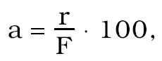

kde r je rozlíšiteľnosť stanovená v bodoch 4.9, 4.10 a 4.11,

F je sila v uvažovanom skúšobnom bode.

4.13 Relatívna rozlíšiteľnosť je overená pre všetky jednotlivé hodnoty sily stupnice nad 1/5 meracieho rozsahu. Relatívna rozlíšiteľnosť, relatívna chyba meradla, relatívna opakovateľnosť, relatívna chyba spätného chodu a relatívna chyba nuly neprekročia hodnoty uvedené v tabuľke č. 1 pre príslušnú triedu presnosti skúšobného stroja.

Dolná medza sa môže určiť aj nižšia ako 1/5 meracieho rozsahu. Skúšobný stroj vyhovuje triede presnosti vtedy, ak spĺňa požiadavky uvedené v tabuľke č. 1.

4.14 Meradlo sa na požiadanie preskúša aj pri spätnom chode. Rozdiel medzi hodnotami získanými pri vzrastajúcej sile a klesajúcej sile umožňuje vypočítať relatívnu chybu spätného chodu v percentách pomocou rovnice

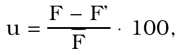

alebo v prípade preskúšania vykonaného pri konštantnej skutočnej sile podľa rovnice

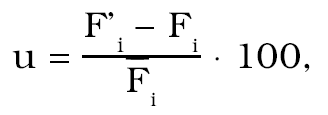

kde

F je skutočná sila udávaná silomerom alebo vyvinutá zaťažovacími telesami pri narastajúcej skúšobnej sile,

F' je skutočná sila udávaná silomerom alebo vyvinutá zaťažovacími telesami pri klesajúcej skúšobnej sile,

Fi je sila odčítaná na indikačnom zariadení sily skúšobného stroja pri narastajúcej skúšobnej sile,

F'i je sila odčítaná na indikačnom zariadení sily skúšobného stroja pri klesajúcej skúšobnej sile,

je aritmetický priemer meraní Fi a F pre jednotlivú silu.

4.15 Po skúške meradla sa výsledky merania vyhodnotia podľa týchto vzťahov:

Relatívna chyba meradla vyjadrená ako percentuálny zlomok skutočnej sily je daná rovnicou

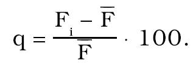

V prípade preskúšania vykonaného pomocou konštantnej skutočnej sily je relatívna chyba meradla daná rovnicou

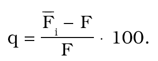

Relatívna opakovateľnosť je pre každú jednotlivú silu rozdiel medzi najväčšou (Fmax) a najmenšou (Fmin) nameranou silou vo vzťahu k priemeru (F). Je vyjadrená v percentách pomocou rovnice

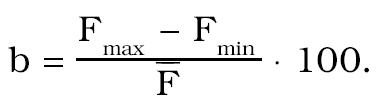

V prípade preskúšania vykonaného pomocou konštantnej skutočnej sily je relatívna opakovateľnosť daná rovnicou

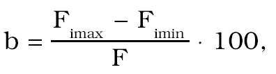

kde

Fimax, Fmax je najväčšia hodnota Fi alebo F pre jednotlivú silu,

Fimin, Fmin je najmenšia hodnota Fi alebo F pre jednotlivú silu.

4.16 Rozšírená neistota merania pri prvotnom a následnom overení neprekročí 1/3 najväčšej dovolenej chyby skúšobných strojov. Pri výpočte rozšírenej neistoty sa použije koeficient pokrytia k = 2.

Oddiel II

Kyvadlové kladivá na skúšky vrubovej a rázovej húževnatosti materiálov

1. Termíny a definície

1.1 Kyvadlové kladivá sú zariadenia, ktoré sa používajú na skúšku rázom v ohybe podľa Charpyho.

1.2 Kyvadlové kladivo na priemyselné účely sa používa na priemyselné alebo laboratórne skúšky kovových materiálov; tieto kyvadlové kladivá sa nepoužívajú na určenie referenčných hodnôt práce spotrebovanej na prerazenie referenčnej skúšobnej tyče.

1.3 Kyvadlové kladivo, ktoré sa používa na určenie hodnôt referenčných skúšobných tyčí, sa na tento účel špeciálne kalibruje. Požiadavky na kalibráciu tohto druhu kladiva sú prísnejšie ako požiadavky na kyvadlové kladivá určené na priemyselné účely v závislosti od požadovanej neistoty určenia referenčných hodnôt skúšobných tyčí.

1.4 Opora je časť kyvadlového kladiva tvoriaca zvislú rovinu, ktorá zadržuje skúšobnú tyč pri prerážaní. Rovina opôr je kolmá na rovinu podpier.

1.5 Podpera je časť kyvadlového kladiva tvoriaca vodorovnú rovinu, na ktorej leží skúšobná tyč pred prerazením kyvadlom. Rovina podpier je kolmá na rovinu opôr.

2. Technické požiadavky

2.1 Materiály kyvadlových kladív

2.1.1 Kyvadlové kladivo a jeho príslušenstvo sa vyrábajú z dostatočne trvanlivých a stabilných materiálov, ktoré za bežných podmienok používania odolávajú vplyvu prostredia.

2.1.2 Kyvadlové kladivo sa umiestňuje v suchej miestnosti zbavenej prachu a škodlivých výparov.

2.2 Vyhotovenie kyvadlových kladív

2.2.1 Hmotnosť rámu kyvadlového kladiva je najmenej 40-násobok hmotnosti kyvadla a uvádza sa v dokumentácii.

2.2.2 Nôž kyvadla má šírku od 10 mm do 18 mm.

2.2.3 Spúšťací mechanizmus kyvadla z jeho počiatočnej polohy pracuje voľne a spúšťa kyvadlo bez akéhokoľvek počiatočného trhnutia, oneskorenia alebo podnetu na priečnu vibráciu. Ak tento mechanizmus obsahuje brzdový systém, zamedzí sa nežiaduca činnosť brzdy.

2.2.4 Kyvadlové kladivá môžu mať referenčnú rovinu, od ktorej sa meria.

2.2.5 Kyvadlové kladivá sa nastavujú tak, aby referenčná rovina bola vodorovná s najväčším sklonom 0,11o.

2.2.6 Os otáčania kyvadla je rovnobežná s referenčnou rovinou, pričom odchýlka ich rovnobežnosti môže byť najviac 0,11o. Túto skutočnosť potvrdí výrobca.

2.2.7 Pri kyvadlových kladivách bez referenčnej roviny je os otáčania kyvadla vodorovná s najväčším sklonom 0,23o. Ak kyvadlové kladivo nemá obrobenú referenčnú rovinu, splnenie tejto požiadavky sa preskúša priamou metódou.

2.2.8 Ak je kyvadlo voľné, visí tak, aby nárazová hrana noža bola ±0,5 mm od miesta, v ktorom sa dotýka skúšobnej tyče.

2.2.9 Kyvadlo sa kýva v rovine kolmej na os otáčania, pričom odchýlka od kolmosti môže byť najviac 0,17o.

2.2.10 Nárazová hrana noža je v dotyku so skúšobnou tyčou pozdĺž celej jej dĺžky.

2.2.11 Kyvadlo sa usadí tak, aby stred nárazovej hrany noža splýval so strednou rovinou medzi oporami skúšobnej tyče na ±0,5 mm.

2.2.12 Axiálna vôľa ložísk kyvadla meraná v mieste noža neprekročí 0,25 mm, ak na stred noža pôsobí axiálna sila zodpovedajúca približne 4 % tiaže kyvadla.

2.2.13 Radiálna vôľa ložísk kyvadla neprekročí 0,08 mm, ak sa pôsobí silou 150 N ±10 N vo vzdialenosti L kolmo na rovinu kyvu.

2.2.14 Podpery ležia v jednej a tej istej rovine; vzdialenosť medzi rovinami podpier neprekročí 0,1 mm.

2.2.15 Podpery sú také, aby os skúšobnej tyče bola rovnobežná s osou otáčania kyvadla, pričom odchýlka rovnobežnosti osi skúšobnej tyče a osi otáčania kyvadla môže byť najviac 0,17o.

2.2.16 Opory ležia v jednej a tej istej rovine; vzdialenosť medzi oboma rovinami neprekročí 0,1 mm.

2.2.17 Uhol medzi rovinou opôr a rovinou podpier je 90o ±0,10o.

2.2.18 Vzdialenosť medzi oporami je (40+0,20) mm.

-0

2.2.19 Polomer zaoblenia opôr je (1+0,5) mm.

-0

2.2.20 Uhol sklonu opôr je 11o ±1o.

2.2.21 Svetlosť medzi oporami a kyvadlom je dostatočná, aby prerazené časti skúšobnej tyče spadli voľne z kyvadlového kladiva s najmenším vplyvom a bez spätného dopadu na kyvadlo skôr, ako dokončí kyv. Žiadna časť kyvadla, ktorá prechádza medzi oporami, nie je hrubšia ako 18 mm.

2.2.22 Pri kyvadle tvaru C prerazené časti skúšobnej tyče nedopadnú späť na kyvadlo, ak je vôľa na oboch koncoch skúšobnej tyče väčšia ako 13 mm.

2.2.23 Pri kyvadle tvaru U sa zabráni spätnému dopadu časti prerazenej skúšobnej tyče na kyvadlo.

2.2.24 Na kyvadlových kladivách, ktoré používajú kyvadlo tvaru U, sa inštalujú bezpečnostné plechové kryty spĺňajúce tieto požiadavky:

a) hrúbka približne 1,5 mm,

b) minimálna tvrdosť 45 HRC,

c) polomer zaoblenia hrán aspoň 1,5 mm,

d) poloha taká, aby vôľa medzi bezpečnostným plechovým krytom a kyvadlom neprekročila 1,5 mm.

2.2.25 Na štítku pripevnenom na kyvadlovom kladive sa zreteľne a nezmazateľne vyznačia tieto údaje:

a) typ meradla,

b) meno alebo značka výrobcu a jeho sídlo,

c) výrobné číslo a rok výroby,

d) merací rozsah.

2.2.26 Na umiestnenie overovacej značky sa na kyvadlovom kladive vyhradí miesto tak, aby značka zabezpečila neodstrániteľnosť výrobného štítku.

3. Metrologické požiadavky

3.1 Metrologické požiadavky pri skúške priamou metódou

Potenciálna energia (AP) sa neodlišuje od menovitej energie (AN) o viac ako ±1,0 %.

Chyba indikácie (AS) vyhovuje bodu 4.1.2.

Straty trením neprekročia 0,5 % menovitej energie AN.

Nárazová rýchlosť je v rozsahu medzi 5,0 m/s a 5,5 m/s. Pri strojoch vyrobených pred r. 1983 sú však dovolené hodnoty medzi 4,5 m/s a 7,0 m/s.

3.2 Metrologické požiadavky pri skúške nepriamou metódou

Najväčšie dovolené chyby a opakovateľnosti sú uvedené v tabuľke č. 2.

Tabuľka č. 2

Úroveň energie [J] | Opakovateľnosť [J] | Najväčšia dovolená chyba [J]

<40 | ≤6 | <4

≥40 | ≤15 % z E | <10 % z E

kde E je referenčná hodnota energie Charpyho referenčnej skúšobnej tyče s V-vrubom.

Opakovateľnosť sa vypočíta z energií spotrebovaných na prerazenie piatich skúšobných tyčí a je charakterizovaná hodnotou Emax – Emin.

4. Metódy skúšania pri overení

Kontroluje sa vyhotovenie a správnosť funkcie meracieho zariadenia a vykoná sa skúška meradla priamou alebo nepriamou metódou.

Pri kontrole vyhotovenia sa preverí, či meracie zariadenie svojou konštrukciou zodpovedá požiadavkám tejto prílohy a príslušnej slovenskej technickej normy a dokumentácii.

Priama metóda umožňuje statické a oddelené preskúšanie jednotlivých fyzikálnych a geometrických vlastností kyvadlového kladiva.

Nepriama metóda je celková metóda skúšania kyvadlového kladiva používajúca Charpyho referenčné skúšobné tyče s V-vrubom.

4.1 Skúška kyvadlového kladiva priamou metódou

4.1.1 Predmetom skúšky sú:

a) stojan kyvadlového kladiva,

b) kyvadlo,

c) poloha stojanu/kyvadla,

d) podpery a opory skúšobnej tyče,

e) poloha stredu nárazu,

f) zariadenie na indikáciu hodnoty energie,

g) počiatočná potenciálna energia,

h) chyba indikácie energie,

i) straty trením,

j) nárazová rýchlosť.

4.1.2 Pri skúške kyvadlového kladiva priamou metódou sa chyba indikovanej energie (AS) určí takto:

Preskúša sa delenie stupnice indikačného zariadenia energie zodpovedajúce 10 %, 20 %, 30 %, 50 % alebo 60 % a 80 % počiatočnej potenciálnej energie AN.

Preto treba zdvihnúť kyvadlo poháňajúce indikačné zariadenie, kým indikovaná hodnota energie nezodpovedá skúšanej hodnote stupnice. Zmeria sa uhol vzostupu β.

Toto meranie sa musí vykonať pomocou katetometra alebo uhlomernej libely s presnosťou ±0,065o.

Spotrebovaná energia sa rovná

kde

α je uhol pádu,

β je uhol vzostupu,

M je moment kyvadla určený z tiažovej sily kyvadla F a dĺžky kyvadla l2.

Rozdiel medzi indikovanou energiou AS a spotrebovanou energiou AV vypočítaný na základe nameraných hodnôt neprekročí ±1 % spotrebovanej energie AV alebo ±0,5 % potenciálnej energie AP. V každom prípade je dovolené vziať do úvahy vypočítanú hodnotu, ktorá je výhodnejšia.

To znamená, že

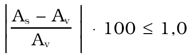 (od 80 % menovitej energie AN do 50 % menovitej energie AN vrátane),

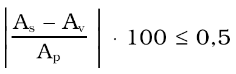 (pod 50 % menovitej energie AN).

Z presnosti požadovanej na odmeranie F, l2, α, β vyplýva pre AV celková stredná chyba približne ±0,3 % menovitej energie.

4.1.3 Straty trením

Práca spotrebovaná pri prerazení skúšobnej tyče sa rovná rozdielu medzi potenciálnou energiou a zostatkovou energiou indikovanou po vzostupe kyvadla, ak sa zoberú do úvahy straty energie, ktoré možno skutočne vypočítať:

a) straty trením spôsobené vlečením ukazovateľa,

b) straty následkom odporu vzduchu a trenia v ložiskách.

Tieto straty sa vypočítajú takto:

4.1.3.1 Straty trením spôsobené vlečením ukazovateľa

Ukazovateľ sa uvedie do polohy zodpovedajúcej nulovému uhlu vzostupu, kyvadlo sa nechá voľne prekyvnúť (uhol pádu α) bez vloženej skúšobnej tyče a odčíta sa uhol vzostupu β1 alebo priamo energia E1.

Potom, bez prestavenia ukazovateľa, sa nechá kyvadlo prekyvnúť druhýkrát z polohy zodpovedajúcej uhlu pádu a odčíta sa nový uhol vzostupu β2 alebo priamo energia E2.

Straty trením spôsobené vlečením ukazovateľa sa rovnajú

p = M . (cosβ1 - cosβ2), ak sa stupnica delí v stupňoch, alebo

p = E1 – E2, ak sa stupnica delí v jednotkách energie.

Pri tomto výpočte sa použijú stredné hodnoty β1 a β2 (alebo E1 – E2) z troch meraní.

4.1.3.2 Straty následkom odporu vzduchu a trenia v ložiskách

Tieto straty sa pre jeden kyv vypočítajú takto:

Po určení β2 alebo energie E2 (pozri bod 4.1.3.1) sa kyvadlo vráti do jeho počiatočnej polohy. Potom, bez opätovného nastavenia ukazovateľa, sa kyvadlo spustí a nechá sa, aby vykonalo 10 kyvov. Keď kyvadlo začne vykonávať 11. kyv, pohne sa ukazovateľom približne o 5 % späť z jeho maximálnej dosiahnutej polohy a zaznamená sa hodnota β3. Straty trením v ložiskách a následkom odporu vzduchu pre jeden kyv sú:

p'=1/10 M (cos β3 – cos β2), ak sa stupnica delí v stupňoch, alebo

p'=1/10 (E3 – E2), ak sa stupnica delí v jednotkách energie.

4.1.3.3 Celkové straty p + p' zmerané týmto spôsobom nesmú prekročiť 0,5 % menovitej energie AN.

Korekciu strát zodpovedajúcu uhlu vzostupu možno vypočítať za predpokladu, že straty sú úmerné prebehnutému uhlu, t. j.

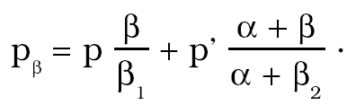

Táto približná hodnota sa blíži ku skutočnej korekčnej hodnote so znižovaním spotrebovanej práce.

4.1.4 Nárazová rýchlosť sa vypočíta

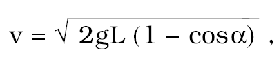

kde

v – nárazová rýchlosť v metroch za sekundu,

g – zrýchlenie voľného pádu (g = 9,81 m/s2),

α - uhol pádu,

L – vzdialenosť medzi stredom noža a osou otáčania v metroch.

Táto rýchlosť musí byť medzi 5,0 m/s a 5,5 m/s. Pri strojoch vyrobených pred r. 1983 sú však dovolené hodnoty medzi 4,5 m/s a 7,0 m/s a musia byť zaznamenané v doklade o overení.

4.1.5 Pri skúške priamou metódou kyvadlové kladivo vyhovuje, ak spĺňa požiadavky podľa bodu 3.1.

4.1.6 Skúška priamou metódou sa vykoná, ak

a) je kyvadlové kladivo inštalované, demontované alebo premiestnené a pri skončení času platnosti overenia,

b) skúška nepriamou metódou dáva nevyhovujúce výsledky.

Zjednodušená skúška priamou metódou týkajúca sa geometrických vlastností kyvadlového kladiva sa vykoná pred každou skúškou nepriamou metódou.

4.1.7 Rozšírená neistota merania pri prvotnom a následnom overení nesmie prekročiť ±0,3 %. Pri výpočte rozšírenej neistoty sa použije koeficient pokrytia k = 2.

4.2 Skúška kyvadlového kladiva nepriamou metódou

4.2.1 Pri tejto skúške sa určí spotrebovaná práca prerazením Charpyho referenčnej skúšobnej tyče s V-vrubom zo série tyčí, ktorých energia potrebná na prerazenie je známa. Berie sa do úvahy celková práca spotrebovaná na prerazenie skúšobnej tyče.

4.2.2 Celková spotrebovaná práca pozostáva z

a) práce spotrebovanej na prerazenie skúšobnej tyče,

b) vnútorných energetických strát kyvadlového kladiva pri prvom kyve z počiatočnej polohy.

4.2.3 Energetické straty sa rovnajú

a) odporu vzduchu a trenia v ložiskách a trenia spôsobeného vlečením ukazovateľa. Tieto straty možno určiť pomocou priamej metódy,

b) otrasom základu a chveniu stojana a kyvadla, pre ktoré neboli vyvinuté vhodné meracie metódy.

4.2.4 Pri výpočte sa neberú do úvahy nasledujúce práce:

a) práca spotrebovaná na deformáciu opôr a stredu noža,

b) práca spotrebovaná trením skúšobnej tyče na povrchu podpier.

4.2.5 Charpyho referenčné skúšobné tyče s V-vrubom, ktoré sa používajú pri overení kyvadlového kladiva nepriamou metódou, sú nadviazané na skúšobné tyče BCR.1) Referenčné skúšobné tyče sa použijú podľa pokynov dodávateľa.

4.2.6 Skúška nepriamou metódou sa vykoná takto:

Kyvadlové kladivo sa skúša nepriamou metódou po inštalácii a po akejkoľvek väčšej demontáži, po premiestnení alebo oprave pri skončení času platnosti overenia.

Skúška nepriamou metódou sa vykoná najmenej pre dve úrovne energie vo vnútri meracieho rozsahu kyvadlového kladiva, pre ktoré existujú Charpyho referenčné skúšobné tyče s V-vrubom. Tieto dve úrovne sú čo najbližšie medziam tohto rozsahu. Ak sa vykonajú skúšky pre viac ako dve úrovne energie, dodatočné úrovne sú rovnomerne rozdelené v meracom rozsahu s prihliadnutím na referenčné skúšobné tyče, ktoré sú k dispozícii.

Pre každú úroveň sa prerazí päť skúšobných tyčí. Skúška sa vykoná so skúšobnými tyčami pri teplote 20 oC ±2 oC.

4.2.7 Pri skúške nepriamou metódou kyvadlové kladivo vyhovuje, ak hodnota opakovateľnosti a hodnota chyby spĺňajú požiadavky podľa tabuľky č. 2.

4.2.8 Ak kyvadlové kladivo nespĺňa požiadavky na hodnotu opakovateľnosti a na hodnotu chyby, je vhodné zistiť príčinu použitím skúšky priamou metódou.
