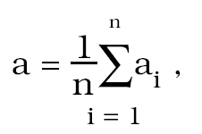

Príloha č. 63 k vyhláške č. 27/2002 Z. z.

TVRDOMERY NA BETÓN

Prvá časť

Vymedzenie meradiel a spôsob ich metrologickej kontroly

1. Táto príloha sa vzťahuje na Schmidtove tvrdomery na betón typu L, N, M (ďalej len „tvrdomer“), ktoré sa používajú na nedeštruktívne skúšky tvrdosti betónu ako určené meradlá podľa § 8 zákona.

2. Tvrdomery pred uvedením na trh podliehajú prvotnému overeniu. Metódy skúšania pri overení sú uvedené v druhej časti.

3. Tvrdomery, ktoré pri overení vyhovejú ustanoveným požiadavkám, sa označia overovacou značkou a vystaví sa doklad o overení.

4. Tvrdomery počas ich používania ako určené meradlá podliehajú následnému overeniu. Postup pri následnom overení je zhodný s postupom pri prvotnom overení.

Druhá časť

Metrologické požiadavky, technické požiadavky a metódy skúšania pri overení tvrdomerov

1. Termíny a definície

1.1 Tvrdomer je prístroj, ktorého pomocou sa vytvárajú pružné reakcie na povrchu betónu, ktoré možno merať a z ktorých možno vyhodnotiť ukazovateľ vlastnosti betónu.

1.2 Podľa energie úderu úderného zariadenia sa tvrdomery delia na tieto typy:

a) typ L 0,735 J,

b) typ N 2,207 J,

c) typ M 29,430 J.

1.3 Odraz je meraná dĺžka spätnej dráhy úderného zariadenia prístroja, ktorá závisí od pružnej reakcie betónu. Hodnota odrazu úderného zariadenia tvrdomeru sa indikuje v dielikoch. Hodnota odrazu je bezrozmerná veličina. Rozsah indikácie je od 0 dielikov odrazu do 100 dielikov odrazu.

1.4 Etalónová oceľová nákova je nákova s oceľovou vložkou, ktorej hodnota odrazu sa stanovuje kalibráciou. Tvrdosť oceľovej vložky je 5 000 N/mm2 podľa HB.

2. Metrologické požiadavky

2.1 Stredná hodnota odrazu na etalónovej oceľovej nákove zodpovedá hodnote uvedenej v doklade o kalibrácii etalónovej nákovy.

2.2 Odchýlka žiadnej z nameraných hodnôt odrazu od hodnoty odrazu uvedenej v doklade o kalibrácii pre etalónovú nákovu neprekročí najväčšiu dovolenú chybu, ktorá je pre všetky typy tvrdomerov ±2 dieliky.

2.3 Vzdialenosť tyčky vlečného ukazovateľa od záchytného výstupku vlečného ukazovateľa

a) typ L 4,5 mm,

b) typ N 3,5 mm,

c) typ M 5,5 mm.

2.4 Trenie vlečného ukazovateľa vyjadrené hmotnosťou skúšobných závaží sa nachádza pre jednotlivé typy tvrdomerov v rozsahu

a) typ L 30 g – 60 g,

b) typ N 50 g – 80 g,

c) typ M 100 g – 150 g.

2.5 Dĺžka stupnice s ukazovateľom alebo stupnice registračného zariadenia je najmenej 80 mm.

2.6 Delenie stupnice je také, aby dve susedné značky stupnice s ukazovateľom alebo stupnice registračného zariadenia zodpovedali najviac dvom dielikom odrazu. Rozlíšiteľnosť číslicového indikačného zariadenia je najviac dva dieliky odrazu.

2.7 Na meranie vzdialenosti tyčky vlečného ukazovateľa od záchytného výstupku vlečného ukazovateľa sa použije posuvné meradlo s možnosťou merania vnútorných rozmerov.

2.8 Na meranie trenia vlečného ukazovateľa sa použije sada skúšobných závaží s najväčšou dovolenou chybou ±1 g.

3. Technické požiadavky

3.1 Hodnoty odrazu sa indikujú na stupnici s ukazovateľom, na registračnom zariadení alebo na číslicovom indikačnom zariadení.

3.2 Guľová plocha úderníka je nepoškodená, bez viditeľných odchýlok.

3.3 Styčné plochy úderníka a úderného kladiva sú hladké a nepoškodené.

3.4 Odchýlka od priamosti povrchových priamok vodiacej tyče a tyče vlečného ukazovateľa je bez merateľných nerovností.

4. Skúšanie pri overení

4.1 Na tvrdomeroch sa kontroluje

a) vzhľad,

b) geometrický tvar špecifických častí,

c) veľkosť trenia vlečného ukazovateľa,

d) hodnota odrazu na etalónovej oceľovej nákove.

4.1.1 Vzhľad – zisťuje sa funkčnosť a stav tvrdomeru.

4.1.2 Kontrola geometrického tvaru špecifických častí. Zo špecifických častí meradla sa kontroluje geometrický tvar na

a) guľovej ploche úderníka; kontroluje sa pomocou polomerovej šablóny. Pre typ L a N sa používa polomerová šablóna r = 26 mm a pre typ M sa používa polomerová šablóna r = 52 mm. Správny tvar sa kontroluje vizuálne priložením polomerovej šablóny na úderník v dvoch na seba kolmých prierezoch. Guľová plocha je vyhovujúca, ak nie sú vizuálne zistené rozdiely medzi ňou a polomerovou šablónou,

b) styčných plochách úderníka a úderného kladiva; styčné plochy úderníka a úderného kladiva sú hladké a nepoškodené, kontrolujú sa vizuálne,

c) vodiacej tyči a tyči vlečného ukazovateľa; priamosť povrchových priamok vodiacej tyče a tyče vlečného ukazovateľa sa kontroluje otáčaním na rovinnej doske.

4.1.3 Veľkosť trenia vlečného ukazovateľa sa kontroluje pomocou skúšobných závaží postupným nakladaním závažia na záves uchytený o výstupok vlečného ukazovateľa. Vlečný ukazovateľ sa po tyčke pohybuje pomaly, bez zastavenia. Hmotnosť závažia, ktorá uvedie vlečný ukazovateľ do pohybu, je podľa typu tvrdomeru v rozsahu podľa bodu 2.4. Počas kontroly trenia vlečného ukazovateľa sa kontroluje aj vzdialenosť výstupku vlečného ukazovateľa od tyčky podľa bodu 2.3.

4.1.4 Hodnota odrazu na oceľovej nákove sa meria na kalibrovanej etalónovej oceľovej nákove umiestnenej na pevnom podklade. Vykoná sa séria najmenej dvadsiatich meraní a vypočíta sa stredná hodnota odrazu podľa vzťahu

kde

ai – namerané hodnoty odrazu pri jednotlivých úderoch,

i – poradové číslo merania,

n – počet meraní.

4.1.4.1 Žiadna nameraná hodnota odrazu ai neprekročí najväčšiu dovolenú chybu podľa bodu 2.2

│a1 - aE│< 2 dieliky.

4.1.4.2 Kontrola tvrdomerov s registračným zariadením sa vykonáva obdobne ako pri tvrdomeroch bez registračného zariadenia. Namerané hodnoty sa prenášajú na registračný papier. Počas skúšky sa vykoná skúška funkčnosti registračného zariadenia a skúška ručného otočenia registračného valca.

Príloha č. 64 k vyhláške č. 27/2002 Z. z.

MERAČE PRETEČENÉHO OBJEMU VODY S VOĽNOU HLADINOU

Prvá časť

Všeobecné ustanovenia, vymedzenie meradiel a spôsob ich metrologickej kontroly

1. Táto príloha sa vzťahuje na merače pretečeného objemu vody v otvorených prizmatických korytách a čiastočne zatopených potrubiach pri zabezpečení prúdenia vody s voľnou hladinou, ktoré sa používajú na meranie pretečeného objemu povrchových vôd, podzemných vôd, zrážkových vôd, odpadových vôd a osobitných vôd (ďalej len „merač“) ako určené meradlá podľa § 8 zákona. Podiel znečistenia v týchto kvapalinách, predovšetkým nerozpustených látok, nesmie ovplyvňovať ich newtonovské správanie.

2. Podľa princípu činnosti sa merače členia na merače založené na princípe

a) použitia stabilného primárneho merného zariadenia (ďalej len „primárne zariadenie“) konštruovaného ako stavba do prizmatického koryta bez sklonu, ktoré náhlou zmenou prietokového prierezu alebo sklonu dna kontrolovane vytvorí podmienku, že okamžitý prietok je jednoznačne určený energetickou výškou prierezu v mernom mieste. Prietokové pomery sú pritom zabezpečené tak, že zmena výšky hladiny v mernom mieste je nezávislá od hladiny pod týmto prierezom. Okamžitá výška hladiny v mernom mieste primárneho zariadenia sa meria sekundárnym merným zariadením (ďalej len „sekundárne zariadenie“), ktoré ďalej vypočítava zodpovedajúci okamžitý prietok, pretečený objem a zároveň archivuje aj zobrazuje tieto veličiny. Primárne zariadenie a sekundárne zariadenie vytvárajú merač s mernou krivkou prietokov,

b) súčasného merania strednej prietokovej rýchlosti vody a merania výšky hladiny v tom istom mernom profile, pričom je definovaná funkčná závislosť prietokovej plochy od výšky hladiny (ďalej len „merač pracujúci na princípe merania rýchlosti a plochy“).

3. Merače spĺňajú technické požiadavky a metrologické požiadavky, ktorých podrobnosti sú uvedené pre merače

a) s mernou krivkou prietokov v druhej časti oddiele I,

b) pracujúce na princípe merania rýchlosti a plochy v druhej časti oddiele II.

4. Kategórie meračov

Ak merač má najmenej počítadlo pretečeného objemu, počítadlo času a zobrazovač okamžitého prietoku a výšky hladiny a ak spĺňa požiadavky druhej časti oddielu I bodu 5 alebo druhej časti oddielu II bodu 3, zaraďuje sa do kategórie C.

Ak merač spĺňa požiadavky kategórie C a je vybavený aj záznamníkom reálneho času so záznamníkom týždenných alebo kratších pretečených množstiev s kapacitou jedného kalendárneho roka a najväčších hodinových prietokov, najmenej päť maxím s určením času v rámci jedného kalendárneho roka, zaraďuje sa do kategórie B.

Ak merač spĺňa požiadavky kategórie B a je vybavený aj záznamníkom reálneho času so záznamníkom údajov aktuálnych prietokov a pretečených množstiev s kapacitou najmenej 1 000 údajov s minimálnym časom odčítania 1 h, zaraďuje sa do kategórie A.

5. Použitie meračov

a) do prietoku Qmax5 l/s vrátane sa môžu použiť merače ľubovolnej kategórie definovanej v bode 4,

b) nad prietok Qmax 5 l/s a do prietoku Qmax 500 l/s vrátane sa môžu použiť merače kategórie A alebo B definované v bode 4,

c) nad prietok Qmax500 l/s sa môžu použiť merače kategórie A definované v bode 4.

6. Primárne zariadenia meračov s mernou krivkou prietokov sa na účely tejto prílohy členia na

a) typové primárne zariadenia,

b) individuálne primárne zariadenia.

7. Merače pracujúce na princípe merania rýchlosti a plochy, sekundárne zariadenia meračov s mernou krivkou prietokov ako súčasti meračov a typové primárne zariadenia meračov s mernou krivkou prietokov ako súčasti meračov pred uvedením na trh podliehajú schváleniu typu a prvotnému overeniu.

8. Individuálne primárne zariadenia meračov s mernou krivkou prietokov ako súčasti meračov pred uvedením na trh podliehajú prvotnému overeniu.

9. Metódy technických skúšok pri schvaľovaní typu a metódy skúšania pri overení sú uvedené v druhej časti.

10. Merač schváleného typu výrobca alebo dovozca označí značkou schváleného typu.

11. Merač, ktorý pri overení vyhovuje ustanoveným požiadavkám, označí sa overovacou značkou.

12. Merače počas ich používania ako určených meradiel podliehajú následnému overeniu.

Druhá časť

Technické požiadavky, metrologické požiadavky, metódy technických skúšok a metódy skúšania pri overení meračov

ODDIEL I

Merače s mernou krivkou prietokov

1. Termíny a definície

1.1 Objemový prietok (ďalej len „prietok“) je objem vody pretečený cez merač za jednotku času. Objem sa vyjadruje v metroch kubických alebo litroch a čas v hodinách, minútach alebo sekundách.

1.2 Merný objekt je objekt určený na meranie prietoku vôd s trvalo inštalovaným meračom, ktorý má platnú mernú krivku prietokov a umožňuje ručný alebo automatický odber vzoriek vôd, prípadne automatickú kontrolu ich kvality.

1.3 Pretečený objem je celkový objem vody, ktorý pretiekol cez merač za daný čas.

1.4 Merná krivka prietokov je funkčná závislosť okamžitého prietoku na výške hladiny odmeranej v mernom mieste primárneho zariadenia.

1.5 Merné miesto primárneho zariadenia je prierez v otvorenom prizmatickom koryte alebo potrubí, ku ktorému sa vzťahuje merná krivka prietokov, a spravidla je umiestnené v hydraulicky najvhodnejšom mieste.

1.6 Primárne zariadenie je objekt s platnou mernou krivkou prietokov, ako napríklad žľab alebo priepad, umiestnený v otvorenom prizmatickom koryte alebo v potrubí. Charakteristickou vlastnosťou primárnych zariadení je, že sú tu zabezpečené podmienky pre modulárny prietok, t. j., že na určenie prietoku treba merať iba výšku hladiny pretekajúcej vody v mernom mieste primárneho zariadenia. Dôležitou požiadavkou je, aby určitému rozdielu prietoku zodpovedal taký rozdiel výšok hladín, pri ktorom meradlo pracuje v rozsahu požadovanej neistoty.

1.7 Typové primárne zariadenie je primárne zariadenie, ktoré konštrukčne zodpovedá slovenskej technickej norme alebo inému technickému predpisu.

1.8 Individuálne primárne zariadenie je primárne zariadenie, ktoré má jeden parameter alebo viac parametrov odlišných od typového primárneho zariadenia.

1.9 Modulárny prietok je prietok primárnym zariadením, keď zmena hladiny v mernom mieste primárneho zariadenia je nezávislá od hladiny za týmto merným miestom a prúdenie nie je zároveň významne rušené tlakovými zmenami spôsobenými väčším zakrivením prúdových vlákien.

1.10 Sekundárne zariadenie je zariadenie, ktoré kontinuálne meria výšku hladiny vody v primárnom zariadení v jeho mernom mieste, vyhodnocuje túto hodnotu, koriguje tento údaj, vypočítava okamžitý prietok prepočtom cez mernú krivku prietokov, vypočítava pretečený objem, zobrazuje údaje na počítadle a zaznamenáva údaje do pamäte zariadenia.

1.11 Maximálny prietok (Qmax) je najväčší prietok, pri ktorom môže merač pracovať bez poškodenia a bez prekročenia najväčších dovolených chýb. Maximálny prietok sa používa na označenie primárneho zariadenia merača.

1.12 Minimálny prietok (Qmin) je najmenší prietok, pri ktorom môže merač pracovať bez prekročenia najväčších dovolených chýb. Minimálny prietok je stanovený ako funkcia Qmax.

1.13 Prechodový prietok (Qt) je prietok, ktorý rozdeľuje horný a dolný úsek rozsahu prietoku a je to prietok, pri ktorom nastáva zmena hraníc najväčších dovolených chýb.

1.14 Rozsah prietoku merača je ohraničený maximálnym prietokom a minimálnym prietokom (Qmax) a (Qmin). Je rozdelený na dva úseky nazývané horný a dolný, s rozdielnymi najväčšími dovolenými chybami.

1.15 Maximálna výška hladiny (hmax) je maximálna výška hladiny vody v primárnom zariadení v mernom mieste, ktorá sa dosiahne pri maximálnom prietoku (Qmax). Maximálna výška hladiny sa za bežnej prevádzky merného objektu nesmie prekročiť.

1.16 Minimálna výška hladiny (hmin) je minimálna výška hladiny vody v primárnom zariadení v mernom mieste, ktorá sa dosiahne pri minimálnom prietoku (Qmin).

1.17 Trieda presnosti merača vyjadruje schopnosť merača pracovať v definovanom rozsahu najväčších dovolených chýb.

1.18 Snímač sekundárneho zariadenia je časť sekundárneho zariadenia, ktorá meria výšku hladiny v primárnom zariadení, prípadne aj iné údaje a signál o výške hladiny vysiela do vyhodnocovacej jednotky sekundárneho zariadenia.

1.19 Vyhodnocovacia jednotka sekundárneho zariadenia je časť sekundárneho zariadenia, ktorá napája snímač sekundárneho zariadenia a spracováva údaje zo snímača sekundárneho zariadenia, vyhodnocuje ich, prepočítava, prípadne koriguje, zobrazuje a zaznamenáva v pamäti. Vyhodnocovacia jednotka môže byť vybavená aj externými výstupmi na ďalšie vyhodnocovanie a spracovanie údajov.

1.20 Držiak snímača sekundárneho zariadenia je nosník, ktorý zabezpečuje stabilnú polohu snímača sekundárneho zariadenia na stanovenom mieste merného miesta primárneho zariadenia.

1.21 Určený pevný bod merného objektu je bod, ku ktorému je určená poloha primárneho zariadenia.

1.22 Prevádzková teplota okolia je teplotný rozsah okolia ohraničený teplotami Tamin a Tamax, v ktorom primárne zariadenie a snímač sekundárneho zariadenia môžu trvalo pracovať s predpísanými metrologickými parametrami.

1.23 Prevádzková teplota meraného média je teplotný rozsah meraného média ohraničený teplotami Tmin a Tmax, v ktorom môže primárne zariadenie trvalo pracovať s predpísanými metrologickými parametrami.

1.24 Prevádzková teplota okolia vyhodnocovacej jednotky je teplotný rozsah okolia ohraničený teplotami Tomin a Tomax, v ktorom vyhodnocovacia jednotka sekundárneho zariadenia môže trvalo pracovať s predpísanými metrologickými parametrami.

1.25 Merací rozsah sekundárneho zariadenia je rozsah vzdialenosti od hladiny vody, pri ktorej je schopné sekundárne zariadenie pracovať s predpísanými metrologickými parametrami. Rozsah je daný najväčšou (Lmax) a najmenšou (Lmin) vzdialenosťou snímača od hladiny vody.

1.26 Nadhladinový snímač sekundárneho zariadenia je snímač výšky hladiny vody, ktorý sa inštaluje nad merné miesto primárneho zariadenia.

1.27 Podhladinový snímač sekundárneho zariadenia je snímač výšky hladiny, ktorý sa inštaluje na dne primárneho zariadenia.

2. Metrologické požiadavky

2.1 Triedy presnosti a najväčšie dovolené chyby

Na účely tohto oddielu sa rozlišujú triedy presnosti meračov 4, 5, 6 a 4a, 5a, 6a uvedené v tabuľke č. 1.

Tabuľka č. 1

Triedy presnosti | Rozsah | Najväčšia dovolená chyba v % | Triedy presnosti | Rozsah | Najväčšia dovolená chyba v %

4 | Qmin ≤ Q < Qt | ±8 | 4a | Qmin ≤ Q ≤ Qmax | ±4

| Qt ≤ Q ≤ Qmax | ±4 | | |

5 | Qmin ≤ Q < Qt | ±10 | 5a | Qmin ≤ Q ≤ Qmax | ±5

| Qt ≤ Q ≤ Qmax | ±5 | | |

6 | Qmin ≤ Q < Qt | ±12 | 6a | Qmin < Q < Qmax | ±6

| Qt ≤ Q ≤ Qmax | ±6 | | |

2.2 Rozsahy prietokov

Rozsah prietoku merača je rozdelený podľa hodnôt Qmin, Qt a Qmax definovaných v bodoch 1.11 až 1.13, pričom hodnoty Qmin a Qt pre jednotlivé triedy presnosti sú uvedené v tabuľke č. 2.

Tabuľka č. 2

Triedy presnosti 4, 5, 6 |

hodnota Qmin | 0,1 Qmax

hodnota Qt | 0,2 Qmax

Triedy presnosti 4a, 5a, 6a |

hodnota Qmin | 0,4 Qmax

Triedy presnosti 4a, 5a, 6a sa môžu použiť len v prípade, že merný objekt je prevádzkovaný nad hodnotou Qmin vo viac ako 95 % času prevádzky (do 30. júna 2002 vo viac ako 80 % času prevádzky). Do času prevádzky sa nezapočítava nulová prevádzka, pri ktorej je skutočný prietok meračom pod hodnotou 0,5 % z Qmax.

2.3 Merná krivka prietokov primárneho zariadenia

Merná krivka prietokov primárneho zariadenia musí byť taká, aby kombinovaná štandardná neistota merania výšky hladiny v mernom mieste sekundárnym zariadením nespôsobovala chybu väčšiu ako 1/2 najväčšej dovolenej chyby meradla.

2.4 Najväčšia dovolená chyba v prevádzke

Najväčšia dovolená chyba v prevádzke počas platnosti overenia sa rovná 1,5-násobku najväčšej dovolenej chyby podľa bodu 2.1.

3. Všeobecné požiadavky

Konštrukcia – všeobecné požiadavky

Merač sa vyrobí tak, aby zaručoval

a) dlhú životnosť a ochranu proti neoprávneným zásahom,

b) splnenie požiadaviek tohto oddielu za bežných prevádzkových podmienok.

4. Technické požiadavky na primárne zariadenie

4.1 Primárne zariadenie sa umiestni do koryta alebo potrubia tak, aby vznikol dostatočný manipulačný priestor umožňujúci vykonanie jeho skúšok, údržbu a kontrolu všetkých jeho častí bezpečne a bez obmedzení.

Ak sú primárne zariadenia vystavené krátkodobo vyššiemu prietoku ako je Qmax alebo spätnému prúdeniu, odolávajú týmto vplyvom bez trvalého zhoršenia alebo obmedzenia metrologických vlastností.

4.2 Materiály

Primárne zariadenie merača je zhotovené z materiálov, ktoré sú na účely používania merača primerane pevné a trvanlivé. Všetky materiály použité na výrobu primárnych zariadení sú odolné voči vnútornej a vonkajšej korózii a ak treba, chránia sa vhodnou povrchovou úpravou. Zmeny teploty vody a prostredia v rozsahu prevádzkovej teploty okolia a meraného média a korozívne vlastnosti vody neovplyvňujú škodlivo materiály, z ktorých je merač vyrobený.

4.3 Tesnosť primárneho zariadenia

Primárne zariadenie trvalo odoláva stálemu pôsobeniu vody bez zlyhania funkcie, bez netesnosti, bez presakovania cez steny alebo trvalej deformácie.

4.4 Prietok v mernom mieste primárneho zariadenia

Primárne zariadenie sa prevádzkuje tak, aby bol zabezpečený modulárny prietok v celom jeho rozsahu.

4.5 Prevádzkovanie zariadenia

Primárne zariadenie je prevádzkované tak, aby za bežných podmienok prevádzky nebol prekročený maximálny prietok.

5. Technické požiadavky na sekundárne zariadenie

5.1 Materiály

Kryt snímača a vyhodnocovacej jednotky sekundárneho zariadenia sa zhotoví z materiálov, ktoré odolávajú prostrediu v rozsahu teplôt okolia určených výrobcom. Kryt snímača sekundárneho zariadenia sa chráni krytím IP 68. Vyhodnocovacia jednotka sekundárneho zariadenia je osadená v prostredí, ktoré je určené výrobcom.

5.2 Vplyv teploty okolia

Zmeny teploty okolia a vlhkosti vzduchu v rozsahu prevádzkovej teploty okolia nevplývajú významne na výsledok merania.

5.3 Držiak nadhladinového snímača sekundárneho zariadenia

Ak je sekundárne zariadenie vybavené nadhladinovým snímačom, je skonštruovaný a osadený tak, aby bola zabezpečená jeho stabilná poloha v stanovenom mieste merného miesta. Tuhosť stojana je taká, aby sila s veľkosťou 50 N v ľubovoľnom smere na snímač sekundárneho zariadenia umiestnený na držiaku nespôsobila odchýlku jeho polohy o viac ako 1 mm. Upevnenie držiaka snímača sekundárneho zariadenia k primárnemu zariadeniu (prípadne k určenému pevnému bodu merného objektu) je také, aby zabezpečovalo stabilitu a nemennosť polohy držiaka.

5.4 Držiak podhladinového snímača sekundárneho zariadenia

Ak je sekundárne zariadenie vybavené podhladinovým snímačom, je skonštruovaný tak, aby jeho držiak ani iná časť nezasahovali významne do šírky prietokového prierezu merného objektu, aby nebola ovplyvnená hydraulika merného objektu. Upevnenie snímača sekundárneho zariadenia odoláva rýchlosti prúdenia vody rovnajúcej sa dvojnásobku rýchlosti prúdenia pri Qmax.

5.5 Počítadlo

5.5.1 Počítadlo pretečeného objemu

Objem pretečenej vody sa udáva odčítaním v rade za sebou idúcich číslic na displeji v jednom okienku alebo vo viacerých okienkach.

Skutočná alebo zdanlivá výška číslic je najmenej 4 mm.

Symbol jednotky m3 je vyznačený v bezprostrednej blízkosti číslicového displeja.

Na číslicových počítadlách mechanického typu je viditeľné premiestňovanie všetkých číslic smerom nahor. Posuv každej číselnej jednotky sa skončí za čas, počas ktorého susedná nižšia hodnota ukazuje pri svojom pohybe poslednú desiatku. Celé čísla udávajúce metre kubické sú zreteľne indikované.

Počítadlo umožňuje zaznamenanie objemu vyjadreného v metroch kubických zodpovedajúceho najmenej 1 999 hodinám prevádzky pri maximálnom prietoku bez návratu na nulu.

Počítadlo je vybavené prídavným zariadením alebo počítadlom na skúšku merača, ktoré môže byť vyhotovené

a) ako časť základného počítadla radom za sebou idúcich čísel,

b) prostredníctvom prídavného počítadla inštalovaného trvalo, prostredníctvom prepnutia počítadla do skúšobného módu alebo iného skúšobného počítadla,

c) prostredníctvom prídavného počítadla inštalovaného dočasne,

d) prostredníctvom elektronického impulzného výstupu,

e) kombináciou týchto systémov.

Tieto zariadenia však nemajú žiaden významný vplyv na metrologické vlastnosti merača.

Čitateľnosť dielika stupnice zariadenia na skúšku je taká, aby relatívna chyba pri skúške spôsobená čitateľnosťou dielika bola najviac 0,5 % a aby skúška pri minimálnom prietoku netrvala viac ako jeden a pol hodiny.

5.5.2 Počítadlo času

Merač je vybavený interným alebo externým počítadlom času, ktoré zaznamenáva čas jedným z týchto spôsobov:

a) počet hodín prevádzky merača, s minimálnou kapacitou počítadla 10 000 hodín,

b) aktuálne údaje o odpojení a pripojení merača na zdroj napätia v reálnom čase, pričom merač si pamätá najmenej 200 hodnôt o odpojení alebo pripojení v reálnom čase,

c) počet hodín odpojenia merača, s minimálnou kapacitou počítadla 10 000 hodín,

d) kombináciou uvedených spôsobov, pričom stačí, ak merač spĺňa požiadavku iba jedného spôsobu.

5.5.3 Zobrazovač okamžitého prietoku a výšky hladiny

Skutočná alebo zdanlivá výška číslic je najmenej 4 mm.

Symbol jednotky je vyznačený v bezprostrednej blízkosti číslicového displeja.

Čitateľnosť stupnice pre výšku hladiny je taká, aby jej hodnota bola rovná alebo menšia ako chyba merania výšky hladiny, pričom meradlo zobrazuje výšku hladiny v celom rozsahu výšok hladín. Čitateľnosť stupnice pre okamžitý prietok je taká, aby jej hodnota bola najmenej 1/5 hodnoty najväčšej dovolenej chyby merača.

5.6 Merače, ktoré sú napájané z externého zdroja a ich napájacie napätie prevyšuje 50 V, spĺňajú požiadavky príslušného všeobecne záväzného právneho predpisu.

5.7 Zabezpečovacie miesta

Miesta upevnenia držiaka snímača sekundárneho zariadenia, ako aj umiestnenia snímača k držiaku sú také, aby sa dala zabezpečiť ich poloha a neodnímateľnosť, napríklad montážnou značkou.

5.8 Vplyv teploty okolia vyhodnocovacej jednotky

Zmeny teploty okolia vyhodnocovacej jednotky v uvedenom rozsahu prevádzkovej teploty okolia vyhodnocovacej jednotky nevplývajú významne na výsledok merania.

6. Značky a nápisy

6.1 Identifikačné nápisy na primárnom zariadení

Na primárnom zariadení merača sa vyznačia – čitateľne a nezmazateľne, oddelene alebo spolu, tieto údaje:

a) meno alebo obchodné meno výrobcu alebo jeho obchodná značka,

b) maximálny prietok Qmax v m3/h,

c) rok výroby a výrobné číslo,

d) značka schváleného typu,

e) matematické vyjadrenie mernej krivky prietokov,

f) maximálna výška hladiny a minimálna výška hladiny hmax a hmin.

6.2 Identifikačné nápisy na sekundárnom zariadení

Na sekundárnom zariadení merača sa vyznačia – čitateľne a nezmazateľne, oddelene alebo spolu, tieto údaje:

a) meno alebo obchodné meno výrobcu alebo jeho obchodná značka,

b) metrologická trieda a maximálny prietok Qmax v m3/h,

c) rok výroby a výrobné číslo,

d) značka schváleného typu,

e) matematické vyjadrenie mernej krivky prietokov,

f) maximálna výška hladiny a minimálna výška hladiny hmax a hmin,

g) identifikácia merného objektu, na ktorý sa merná krivka vzťahuje,

h) napájacie napätie (ak je sekundárne zariadenie napájané z externého zdroja),

i) impulzné číslo (v tvare počet dm3 alebo m3 na impulz), ak je merač vybavený impulzným výstupom merača,

j) merací rozsah sekundárneho zariadenia Lmaxa Lmin,

k) prevádzková teplota okolia udaná Tamin a Tamax,

l) prevádzková teplota okolia vyhodnocovacej jednotky sekundárneho zariadenia udaná Tomina Tomax.

6.3 Umiestnenie overovacích značiek

Miesto na overovacie značky sa vyhradí na dôležitej časti merača, kde sú zreteľne viditeľné bez potreby demontáže merača.

6.4 Plombovanie

Merač a jeho súčasti sú vybavené ochranným zariadením, ktoré môže byť zaplombované tak, aby bola záruka, že ani pred, ani po správnej inštalácii merača nemohol byť merač ani jeho justovacie zariadenie demontované alebo zmenené bez poškodenia ochranného zariadenia. Predmetom plombovania je aj zabezpečenie polohy snímača sekundárneho zariadenia vzhľadom k primárnemu zariadeniu.

Ak je merač napájaný z elektrického externého zdroja a má externé počítadlo času prevádzky, potom je aj toto počítadlo predmetom plombovania.

7. Schválenie typu primárneho zariadenia

7.1 Počet (typových) primárnych zariadení určených na skúšanie

Výrobca alebo dovozca predloží na skúšky najmenej jeden kus primárneho zariadenia každého typu a každej veľkosti.

Ak ide o typové primárne zariadenie, pre ktoré bola preukázateľne stanovená hydraulickým výskumom geometria rozmerov a pre jeho každý veľkostný rad prislúchajúca merná krivka prietokov (ďalej len „zdokumentované primárne zariadenie“), potom môže vykonávateľ skúšky typu vykonať skúšky iba na vzorkách vybratých veľkostí. Najmenší počet predložených meradiel je jedno, ak výrobca vyrába menej ako päť veľkostí, a dve, ak výrobca vyrába viac ako päť veľkostí.

7.2 Skúšobné zariadenie

Skúšobné zariadenie pre primárne zariadenia a merače ako celok reprodukuje jednotku prietoku alebo pretečeného objemu s neistotou menšou, ako je hodnota 1/5 najväčšej dovolenej chyby meradla pre každý prietok. Jednotlivé komponenty skúšobného zariadenia a zariadenie ako celok sú preukázateľne nadviazané na národné etalóny Slovenskej republiky.

Kombinovaná štandardná neistota merania geometrických rozmerov musí byť menšia ako 0,3 % z meranej hodnoty.

Počas každej skúšky primárneho zariadenia a skúšky zariadenia ako celku pomerné kolísanie prietoku je najviac 1,5 %.

7.3 Technická skúška primárneho zariadenia pozostáva z týchto úkonov:

a) skúška tesnosti,

b) kontrola geometrických rozmerov,

c) stanovenie mernej krivky prietokov; nevykonáva sa pri zdokumentovaných primárnych zariadeniach,

d) stanovenie rozsahu prietokov; nevykonáva sa pri zdokumentovaných primárnych zariadeniach,

e) zistenie opakovateľnosti mernej krivky; nevykonáva sa pri zdokumentovaných primárnych zariadeniach,

f) posúdenie strmosti mernej krivky,

g) skúška teplotnej odolnosti; vykonáva sa len pri primárnych zariadeniach vyhotovených z plastu.

7.4 Hydraulické podmienky

Pre metrologické skúšky platí, že primárne zariadenie sa inštaluje za takých hydraulických podmienok, ktoré sú zhodné s hydraulickými podmienkami pri prevádzke.

7.5 Postup pri skúšaní primárneho zariadenia

Skúšky pozostávajú z týchto úkonov vykonaných v takomto poradí:

a) skúška tesnosti celého primárneho zariadenia,

b) skúška osadenia primárneho zariadenia do predpísanej polohy (bez sklonu) a do osi prizmatického koryta,

c) kontrola geometrických rozmerov,

d) zistenie parametrov Qmax, hmax, hmin a Qmin,

e) stanovenie mernej krivky prietokov v závislosti na výške hladiny vody v mernom mieste pri zohľadnení bežných podmienok inštalácie pre daný typ primárneho zariadenia (nevykonáva sa pri zdokumentovaných primárnych zariadeniach),

f) stanovenie strmosti mernej krivky,

g) kontrola stability geometrických rozmerov vzhľadom na teplotu média (vykonáva sa iba pri primárnych zariadeniach vyhotovených z plastu).

Výsledky skúšok podľa písmena e) poskytujú dostatočný počet bodov na presné vynesenie merných kriviek prietokov v celom rozsahu.

Pri skúške podľa písmena e) sa určí merná krivka prietokov ako minimálna požiadavka pri týchto hodnotách prietokov:

Qmin, Qt, 0,3 Qmax, 0,5 Qmax, 0,7 Qmax, Qmax,

pričom pri každom prietoku sa vypočíta ako priemer z troch hodnôt zo štyroch meraní (jedna odľahlá hodnota sa vylúči).

7.6 Podmienky schválenia typu

Typ primárneho zariadenia sa schváli, ak spĺňa tieto požiadavky:

a) je v zhode s administratívnymi, technickými a metrologickými požiadavkami tohto oddielu,

b) skúšky podľa bodu 7.5 písm. a) až f) preukážu zhodu s bodmi 2, 3 a 4, ak ide o metrologické charakteristiky a technické charakteristiky,

c) po skúške teplotnej odolnosti sa jednotlivé geometrické rozmery zmenia najviac o 0,6 % od pôvodných rozmerov.

8. Schválenie typu sekundárneho zariadenia

8.1 Počet sekundárnych zariadení určených na skúšanie

Výrobca alebo dovozca predloží na skúšku najmenej tri kusy predmetného typu sekundárneho zariadenia.

Ak ide o modifikované typy sekundárneho zariadenia, napríklad jeden kanálový pre jeden merný objekt a druhý kanálový pre dva merné objekty, potom výrobca alebo dovozca predloží najmenej jeden kus každej modifikácie.

8.2 Skúšobné zariadenie

Skúšobné zariadenie pre sekundárne zariadenia reprodukujú výšku hladiny s neistotou menšou, ako je hodnota 1/5 chyby merania výšky hladiny.

Počas každej skúšky sekundárneho zariadenia a skúšky zariadenia ako celku pomerné kolísanie prietoku je najviac 1,5 %.

Kombinovaná štandardná neistota stanovenia odchýlky polohy držiaka snímača je 0,3 mm.

8.3 Postup pri skúšaní sekundárneho zariadenia

Skúšky pozostávajú z týchto úkonov vykonaných v takomto poradí:

a) skúška reprodukovateľnosti mernej krivky prietokov (pri zmenených teplotách, meracích vzdialenostiach),

b) stanovenie najväčšej meracej vzdialenosti Lmax a najmenšej meracej vzdialenosti Lmin,

c) skúška opakovateľnosti mernej krivky prietokov,

d) skúška prevádzkovej teploty okolia,

e) skúška životnosti snímača sekundárneho zariadenia,

f) skúška prevádzkovej teploty okolia vyhodnocovacej jednotky,

g) skúška mechanickej pevnosti držiaka snímača.

Výsledky skúšok podľa písmen a), c) a d) poskytujú dostatočný počet bodov na presné vynesenie merných kriviek prietokov v celom rozsahu.

Pri skúške podľa písmena a) sa určí merná krivka prietokov ako najmenšia požiadavka pre najmenej tri druhy merných kriviek prietokov pri týchto hodnotách prietokov:

Qmin, 0,15 Qmax, Qt, 0,3 Qmax, 0,5 Qmax, 0,7 Qmax, 0,9 Qmax, Qmax, 1,1 Qmax,

pričom pre skúšku možno použiť simulačné zariadenie prietokov.

Pri skúške podľa písmena c) sa určí merná krivka prietokov ako najmenšia požiadavka pre najmenej dva druhy primárnych zariadení pri týchto hodnotách prietokov:

Qmin, Qt, 0,3 Qmax, 0,5 Qmax, 0,7 Qmax, Qmax.

Pri skúške podľa písmena d) sa určí závislosť mernej krivky prietokov vzhľadom na teplotu okolia.

Pred skúškou a po skúške podľa písmena e) sa vykoná skúška podľa písmena a). Pri skúške životnosti sa po skúške podľa písmena a) vykoná skúška teplotného šoku snímača vyhodnocovacej jednotky v rozsahu teplôt predpísaných výrobcom počtom 50 cyklov. Každý cyklus trvá najmenej 15 minút a najviac 30 minút. Cyklus pozostáva z umiestnenia snímača v prostredí s minimálnou teplotou okolia, z umiestenia snímača v prostredí so strednou teplotou okolia a z umiestnenia snímača v prostredí s maximálnou teplotou okolia. Čas umiestnenia snímača v prostredí s minimálnou a maximálnou teplotou okolia je dvojnásobný ako čas umiestnenia snímača v prostredí so strednou teplotou okolia.

Pri skúške podľa písmena f) sa zisťuje závislosť výsledkov merania na teplote okolia vyhodnocovacej jednotky.

Pri skúške podľa písmena g) sa vykoná meranie odchýlky polohy snímača v šiestich základných smeroch pôsobenia sily.

9. Prvotné a následné overenie

9.1 Podmienky na overenie

Prvotné a následné overenie sa vykonáva na mieste inštalácie merača alebo v stacionárnom skúšobnom zariadení.

Konštrukcia merného objektu umožňuje overenie v bezpečných a spoľahlivých podmienkach.

9.2 Skúšobné zariadenie

Skúšobné zariadenie pre primárne zariadenia a merače ako celok reprodukuje jednotku prietoku alebo pretečeného objemu s neistotou menšou ako je hodnota 1/4 najväčšej dovolenej chyby meradla pre každý prietok. Jednotlivé komponenty skúšobného zariadenia a zariadenie ako celok sú preukázateľne nadviazané na národné etalóny Slovenskej republiky.

Skúšobné zariadenie môže obsahovať automatické zariadenia, ktoré zaznamenávajú údaje z meraní, a spracovávať ich za predpokladu, že každý skúšobný komponent je jednoznačne definovaný a že ich možno kedykoľvek nadviazať a kontrolovať ich funkčnosť.

9.3 Požiadavky pri skúške

Kombinovaná štandardná neistota stanovenia výšky hladiny sekundárneho zariadenia pri skúške je menšia ako hodnota rovnajúca sa 1/4 dovolenej chyby merania výšky hladiny.

Počas každej skúšky primárneho zariadenia a skúšky zariadenia ako celku pomerné kolísanie prietoku je najviac 10 %.

Počas každej skúšky sekundárneho zariadenia pomerné kolísanie prietoku je najviac 5 %.

9.4 Časti skúšky

Overenie merača pozostáva zo zistenia geometrických rozmerov merného objektu, zistenia sklonu merného objektu pozdĺžneho a priečneho, zistenia podmienok pre modulárny prietok v celom rozsahu merača a z vlastnej skúšky mernej krivky.

Prevádzkovateľ primárneho a sekundárneho zariadenia počas ich skúšky zabezpečí splnenie požiadaviek na pomerné kolísanie prietoku podľa bodu 9.3.

Skúška merača sa vykoná týmto spôsobom:

a) skúška primárneho zariadenia a sekundárneho zariadenia oddelene; overenie každého komponentu sa vykoná zvlášť,

b) skúška merača ako celku.

9.5 Skúška typového primárneho zariadenia

Overenie primárneho zariadenia merača sa vykonáva stanovením bodov mernej krivky pri najmenej troch prietokoch

a) medzi 0,5 Qmax až Qmax,

b) medzi 0,8 Qtaž 1,2 Qt; táto skúška sa vynechá pri meračoch triedy presnosti 4a, 5a, 6a,

c) medzi Qmin až 1,2 Qmin,

pričom pri každom prietoku sa krivka vypočíta ako priemer z troch hodnôt.

Ak sú pre primárne zariadenia určené v rozhodnutí o schválení typu ďalšie hodnoty prietoku, skúška sa vykoná aj pri týchto prietokoch.

9.6 Skúška individuálneho primárneho zariadenia tried presnosti 4, 5, 6

Overenie individuálneho primárneho zariadenia meračov tried presnosti 4, 5, 6 sa vykonáva stanovením bodov mernej krivky pri najmenej šiestich prietokoch

a) medzi 0,8 Qmax až Qmax,

b) medzi 0,8 Qt až 1,2 Qt,

c) medzi Qmin až 1,2 Qmin,

d) v najmenej dvoch bodoch prietoku medzi hodnotami prietoku uvedenými v písmenách a) a b),

e) najmenej v jednom bode prietoku medzi hodnotami prietoku uvedenými v písmenách b) a c),

pričom pri každom prietoku sa krivka vypočíta ako priemer z troch hodnôt.

Skutočné hodnoty dvoch bodov prietoku pri skúškach podľa písmena d) sa odlišujú od seba a od bodov prietokov podľa písmen a) a b) o viac ako 10 % Qmax.

Skutočná hodnota jedného bodu prietoku pri skúškach podľa písmena e) sa odlišuje od bodov prietokov podľa písmen b) a c) o viac ako 3 % Qmax.

9.7 Skúška individuálneho primárneho zariadenia sekundárneho zariadenia tried presnosti 4a, 5a, 6a

Overenie individuálneho primárneho zariadenia meračov tried presnosti 4a, 5a, 6a sa vykonáva stanovením bodov mernej krivky pri najmenej štyroch prietokoch

a) medzi 0,8 Qmax až Qmax,

b) medzi Qmin až 1,2 Qmin,

c) v najmenej dvoch bodoch prietoku medzi hodnotami prietoku uvedenými v písmenách a) a b),

pričom pri každom prietoku sa krivka vypočíta ako priemer z troch hodnôt.

Skutočné hodnoty dvoch bodov prietoku pri skúškach podľa písmena c) sa odlišujú od seba a od bodov prietokov podľa písmen a) a b) o viac ako 10 % Qmax.

9.8 Skúška sekundárneho zariadenia

Skúška sekundárneho zariadenia merača sa vykoná pri výškach hladín zodpovedajúcich najmenej trom prietokom pri hladine medzi

a) 0,9 Qmax až Qmax,

b) 0,9 Qt až 1,1 Qt,

c) Qmin až 1,1 Qmin.

Ak sú pre sekundárne zariadenia určené v rozhodnutí o schválení typu ďalšie hodnoty prietoku a výšok hladín, skúška sa vykoná aj pri hladinách zodpovedajúcim týmto prietokom.

9.9 Skúška merača ako celku

Overenie merača ako celku sa vykoná pri najmenej troch prietokoch (pri skutočnom prietoku) medzi

a) 0,5 Qmax až 0,9 Qmax,

b) 0,8 Qt až 1,2 Qt; táto skúška sa vynechá pri meračoch triedy presnosti 4a, 5a, 6a,

c) Qmin až 1,2 Qmin

a pri simulovanej výške hladiny zodpovedajúcej prietoku medzi 0,9 Qmax až Qmax.

Ak sú pre primárne alebo sekundárne zariadenia určené v rozhodnutí o schválení typu ďalšie hodnoty prietoku, skúška sa vykoná aj pri týchto prietokoch.

9.10 Pri skúške individuálneho primárneho zariadenia sa uskutočnia aj ďalšie skúšky pri bodoch prietoku podľa bodu 9.6 alebo 9.7, pričom pri týchto bodoch sa môže skúška uskutočniť oddelene od sekundárneho zariadenia.

9.11 Pri skúške primárneho a sekundárneho zariadenia oddelene chyby každého z komponentov neprekročia 1/2 najväčšej dovolenej chyby pre príslušnú triedu presnosti podľa bodu 2.1.

9.12 Pri skúške merača ako celku chyby neprekročia najväčšie dovolené chyby pre príslušnú triedu presnosti podľa bodu 2.1.

9.13 Ak sa zistí, že všetky chyby ležia v jednom smere, merač sa nastaví tak, aby nie všetky chyby prekročili 1/2 najväčšej dovolenej chyby.

9.14 Pri skúške primárneho a sekundárneho zariadenia oddelene uvedie merač do prevádzky registrovaná osoba podľa § 27 zákona.

10. Prevádzkovanie merného objektu

Každý merný objekt má prevádzkovú knihu, ktorá je jeho súčasťou a v ktorej sa uvedú všetky činnosti vykonané v mernom objekte.

Ak sa merač prevádzkuje iba na určený čas, počas skúšobnej prevádzky merného objektu menej ako 21 dní, pri jeho plánovaných alebo neplánovaných opravách, haváriách a ostatných mimoriadnych udalostiach možno prevádzkovať merný objekt bez dodržania požiadaviek tohto oddielu najviac počas 21 dní za predpokladu, že budú vopred alebo okamžite vykonané všetky dostupné opatrenia, ktoré majú za cieľ zamedziť alebo zmierniť nepriaznivý vplyv takto prevádzkovaného merača na metrologické charakteristiky merača.

Podmienky prevádzkovania merača ustanovuje príslušná slovenská technická norma.

ODDIEL II

Merače pracujúce na princípe merania rýchlosti a plochy

1. Termíny a definície

1.1 Merný profil merača pracujúceho na princípe merania rýchlosti a plochy je prierez v otvorenom prizmatickom koryte alebo potrubí, ku ktorému sa vzťahujú parametre merača.

1.2 Maximálny prietok (Qmax) je najväčší prietok, pri ktorom môže merač pracovať bez poškodenia a bez prekročenia najväčších dovolených chýb. Maximálny prietok sa používa na označenie merača.

1.3 Maximálna výška hladiny (hmax) je maximálna výška hladiny vody v mernom profile, pri ktorej merač musí byť schopný pracovať pri bežnom používaní bez prekročenia najväčších dovolených chýb.

1.4 Minimálna výška hladiny (hmin) je minimálna výška hladiny vody v mernom profile, pri ktorej merač musí byť schopný pracovať pri bežnom používaní, nad ktorým nesmú byť prekročené najväčšie dovolené chyby.

1.5 Maximálna rýchlosť prúdenia (vmax) je maximálna stredná rýchlosť prúdenia vody v mernom profile, pri ktorej musí byť merač schopný pracovať pri bežnom používaní bez prekročenia najväčších dovolených chýb. Maximálna rýchlosť prúdenia za bežnej prevádzky nesmie byť prekročená.

1.6 Minimálna rýchlosť prúdenia (vmin) je minimálna stredná rýchlosť prúdenia vody v mernom profile, pri ktorej merač musí byť schopný pracovať pri bežnom používaní, nad ktorou nesmú byť prekročené najväčšie dovolené chyby.

1.7 Snímač výšky hladiny je časť merača, ktorá sníma a meria výšku hladiny v mernom profile (prípadne aj iné údaje) a signál o výške hladiny vysiela do vyhodnocovacej jednotky merača. Snímač výšky hladiny môže byť nadhladinový alebo podhladinový.

1.8 Snímač rýchlosti prúdenia je časť merača, ktorá sníma a meria rýchlosť prúdenia vody hladiny v mernom profile (prípadne aj iné údaje) a signál o rýchlosti prúdenia vody vysiela do vyhodnocovacej jednotky merača.

1.9 Vyhodnocovacia jednotka merača je časť merača, ktorá napája snímač a spracúva údaje zo snímačov, vyhodnocuje ich, prepočítava, prípadne koriguje, zobrazuje a zaznamenáva v pamäti. Vyhodnocovacia jednotka môže byť vybavená aj externými výstupmi pre ďalšie vyhodnocovanie a spracovanie údajov.

1.10 Držiak snímača výšky hladiny je nosník alebo upevňovacie zariadenie, ktoré zabezpečuje stabilnú polohu snímača výšky hladiny na stanovenom mieste merného profilu.

1.11 Držiak snímača rýchlosti prúdenia je upevňovacie zariadenie, ktoré zabezpečuje stabilnú polohu snímača rýchlosti prúdenia na stanovenom mieste merného profilu.

1.12 Prevádzková teplota okolia je teplotný rozsah okolia ohraničený teplotami Tamin a Tamax, v ktorom nadhladinový snímač výšky hladiny merača môže trvalo pracovať s predpísanými metrologickými parametrami.

1.13 Prevádzková teplota meraného média je teplotný rozsah meraného média ohraničený teplotami Tmin a Tmax, v ktorom môže snímač rýchlosti prúdenia a podhladinový snímač výšky hladiny trvalo pracovať s predpísanými metrologickými parametrami.

1.14 Prevádzková teplota okolia vyhodnocovacej jednotky je teplotný rozsah okolia ohraničený teplotami Tomin a Tomax, v ktorom vyhodnocovacia jednotka merača môže trvalo pracovať s predpísanými metrologickými parametrami.

1.15 Merací rozsah nadhladinového snímača výšky hladiny je rozsah vzdialeností, pri ktorom je merač schopný pracovať s predpísanými metrologickými parametrami. Rozsah je daný najväčšou (Lmax) a najmenšou (Lmin) vzdialenosťou hladiny vody od snímača.

1.16 Úroveň znečistenia vody je percentuálne množstvo nerozpustených častíc vo vode.

2. Metrologické požiadavky

2.1 Triedy presnosti a najväčšie dovolené chyby

Na účely tohto oddielu rozlišujeme triedy presnosti meračov 4, 5, 6 a 4a, 5a, 6a uvedené v tabuľke č. 1.

Tabuľka č. 1

Triedy presnosti | Rozsah | Najväčšia dovolená chyba v % | Triedy presnosti | Rozsah | Najväčšia dovolená chyba v %

4 | Qmin ≤ Q < Qt | ±8 | 4a | Qmin ≤ Q ≤ Qmax | ±4

| Qt ≤ Q ≤ Qmax | ±4 | | |

5 | Qmin ≤ Q < Qt | ±10 | 5a | Qmin ≤ Q ≤ Qmax | ±5

| Qt ≤ Q ≤ Qmax | ±5 | | |

6 | Qmin ≤ Q < Qt | ±12 | 6a | Qmin < Q < Qmax | ±6

| Qt ≤ Q ≤ Qmax | ±6 | | |

2.2 Rozsahy prietokov

Rozsah prietoku merača pre jednotlivé triedy presnosti je uvedený v tabuľke č. 2.

Tabuľka č. 2

Triedy presnosti 4, 5, 6 |

hodnota Qmin | 0,1 Qmax

hodnota Qt | 0,2 Qmax

Triedy presnosti 4a, 5a, 6a |

hodnota Qmin | 0,4 Qmax

Triedy presnosti 4a, 5a, 6a sa môžu použiť len v prípade, že merač je prevádzkovaný nad hodnotou Qmin vo viac ako 95 % času prevádzky (do 30. júna 2002 vo viac ako 80 % času prevádzky). Do času prevádzky sa nezapočítava nulová prevádzka, pri ktorej je skutočný prietok merným profilom nižší ako 1 % z Qmax.

2.3 Najväčšia dovolená chyba v prevádzke

Najväčšia dovolená chyba v prevádzke počas platnosti overenia sa rovná 1,5-násobku najväčšej dovolenej chyby podľa bodu 2.1.

3. Technické požiadavky

3.1 Konštrukcia – všeobecné požiadavky

Merač musí byť vyrobený tak, aby zaručoval

a) dlhú životnosť a ochranu proti neoprávneným zásahom,

b) splnenie požiadaviek tohto oddielu za bežných prevádzkových podmienok.

Ak sú snímače merača vystavené krátkodobo vyššiemu prietoku ako je Qmax, vyššej rýchlosti ako je vmax a vyššej výške hladiny ako hmax alebo spätnému prúdeniu, odolávajú týmto vplyvom bez trvalého zhoršenia alebo obmedzenia metrologických vlastností.

3.2 Materiály

Kryt vyhodnocovacej jednotky sa zhotoví z materiálov, ktoré odolávajú prostrediu v rozsahu teplôt okolia určených výrobcom. Kryty snímačov sú chránené krytím najmenej IP 68. Vyhodnocovacia jednotka sekundárneho zariadenia sa osadí v prostredí, ktoré je určené výrobcom.

3.3 Vplyv úrovne znečistenia vody

Zmeny úrovne znečistenia v uvedenom rozsahu znečistenia meraného média nevplývajú významne na výsledok merania.

3.4 Vplyv teploty okolia

Zmeny teploty okolia v rozsahu od –20 oC do +50 oC nevplývajú významne na výsledok merania. Vplyv vlhkosti vzduchu nevplýva významne na výsledok merania.

3.5 Vplyv teploty okolia vyhodnocovacej jednotky

Zmeny teploty okolia vyhodnocovacej jednotky v uvedenom rozsahu prevádzkovej teploty okolia vyhodnocovacej jednotky nevplývajú významne na výsledok merania.

3.6 Vplyv teploty meraného média

Zmeny teploty meraného média v uvedenom rozsahu prevádzkovej teploty meraného média nevplývajú významne na výsledok merania.

3.7 Držiak nadhladinového snímača výšky hladiny

Ak je snímač hladiny nadhladinový, skonštruuje a osadzuje sa tak, aby bola zabezpečená jeho stabilná poloha v stanovenom mieste merného profilu. Tuhosť stojana je taká, aby sila s veľkosťou 50 N v ľubovoľnom smere na snímač sekundárneho zariadenia umiestneného na držiaku nespôsobila odchýlku jeho polohy o viac ako 1 mm. Upevnenie držiaka snímača výšky hladiny je také, aby zabezpečovalo stabilitu a nemennosť polohy držiaka.

3.8 Upevňovacie zariadenie podhladinového snímača výšky hladiny a upevňovacie zariadenie snímača (snímačov) rýchlosti prúdenia

Upevňovacie zariadenia snímačov pod hladinou sú skonštruované tak, aby zariadenie nezasahovalo do šírky prietokového prierezu merného objektu. Upevnenie snímačov odoláva rýchlosti prúdenia vody rovnajúcej sa dvojnásobku rýchlosti prúdenia pri vmax.

3.9 Počítadlo

Počítadlo musí zodpovedať požiadavkám oddielu I bodu 5.5.

3.10 Merače, ktoré sú napájané z externého zdroja a ich napájacie napätie prevyšuje 50 V, spĺňajú požiadavky príslušného všeobecne záväzného právneho predpisu.

3.11 Zabezpečovacie miesta

Miesta upevnenia držiaka snímača(ov) a upevňovacích zariadení snímačov merača, ako aj umiestnenia snímača k držiaku sú také, aby sa dala zabezpečiť ich poloha a neodnímateľnosť, napríklad montážnou značkou.

4. Značky a nápisy

4.1 Identifikačné nápisy na merači

Na merači sú vyznačené – čitateľne a nezmazateľne, oddelene alebo spolu, tieto údaje:

a) meno alebo obchodné meno výrobcu alebo jeho obchodná značka,

b) metrologická trieda a maximálny prietok Qmax v m3/h,

c) rok výroby a výrobné číslo,

d) značka schváleného typu,

e) maximálna výška hladiny a minimálna výška hladiny hmax a hmin,

f) maximálna rýchlosť prúdenia a minimálna rýchlosť prúdenia vmax a vmin,

g) identifikácia merného profilu a rozsah úrovne znečistenia média,

h) prevádzková teplota meraného média udaná Tmin a Tmax,

i) napájacie napätie (ak je merač napájaný z externého zdroja),

j) impulzné číslo (v tvare počet dm3 alebo m3 na impulz), ak je merač vybavený impulzným výstupom merača,

k) merací rozsah nadhladinového snímača Lmax a Lmin,

l) prevádzková teplota okolia udaná Tamin a Tamax,

m) prevádzková teplota okolia vyhodnocovacej jednotky sekundárneho zariadenia udaná Tomin a Tomax.

4.2 Umiestnenie overovacích značiek

Miesto na overovacie značky sa vyhradí na dôležitej časti merača, kde sú zreteľne viditeľné bez potreby demontáže merača.

4.3 Plombovanie

Merač a jeho súčasti sú vybavené ochranným zariadením, ktoré môže byť zaplombované tak, aby bola záruka, že ani pred správnou inštaláciou merača ani po nej nemohol byť merač ani jeho justovacie zariadenie demontované alebo zmenené bez poškodenia ochranného zariadenia. Predmetom plombovania je aj zabezpečenie polohy snímača merača vzhľadom na merný profil.

Ak je merač napájaný z elektrického externého zdroja a má externé počítadlo času prevádzky, potom je aj toto počítadlo predmetom plombovania.

5. Schválenie typu

5.1 Počet meračov určených na skúšanie

Výrobca alebo dovozca predloží na skúšku najmenej tri kusy predmetného typu merača.

Ak ide o modifikované typy meračov, napríklad jeden kanálový pre jeden merný objekt a druhý kanálový pre dva merné objekty, potom výrobca alebo dovozca predloží najmenej jeden kus z každej modifikácie.

5.2 Skúšobné zariadenie

Skúšobné zariadenie reprodukuje hodnotu prietoku s neistotou menšou, ako je hodnota 1/5 chyby merača. Počas každej skúšky pomerné kolísanie prietoku je najviac 1,5 %. Kombinovaná štandardná neistota stanovenia odchýlky polohy držiaka snímača je 0,3 mm.

5.3 Postup pri skúšaní merača

Skúšky pozostávajú z týchto úkonov vykonaných v takomto poradí:

a) stanovenie kriviek chýb v závislosti na prietoku pri zohľadnení normálnych podmienok inštalácie pre daný typ merača (priame úseky potrubia pred a za meračom, zúženia, prekážky a podobne) uvedených výrobcom,

b) skúška opakovateľnosti kriviek chýb,

c) stanovenie meracieho rozsahu snímača Lmax a minimálnej meracej dĺžky Lmin,

d) skúšky chýb v rozsahu vmin až vmax a hmin až hmax,

e) skúška prevádzkovej teploty okolia,

f) skúška životnosti snímačov,

g) skúška prevádzkovej teploty okolia vyhodnocovacej jednotky,

h) skúška mechanickej pevnosti držiaka snímača a upevňovacieho zariadenia.

Výsledky skúšok podľa písmen a), b) a d) poskytnú dostatočný počet bodov na presné vynesenie merných kriviek prietokov v celom rozsahu.

Pri skúške podľa písmena a) sa určí merná krivka prietokov ako minimálna požiadavka, pre najmenej tri tvary merného profilu pri týchto hodnotách prietokov:

Qmin, 0,3 Qmax, 0,5 Qmax, 0,7 Qmax, Qmax.

Pri skúške podľa písmena b) sa určí merná krivka prietokov ako minimálna požiadavka pre najmenej dve úrovne znečistenia meraného média.

Pri skúške podľa písmena e) sa určí závislosť mernej krivky prietokov vzhľadom na teplotu okolia.

Pred skúškou a po skúške podľa písmena f) sa vykoná skúška podľa písmena a). Pri skúške životnosti sa po skúške podľa písmena a) vykoná skúška teplotného šoku snímača vyhodnocovacej jednotky v rozsahu teplôt predpísaných výrobcom počtom 50 cyklov. Každý cyklus trvá najmenej 15 minút a najviac 30 minút. Cyklus pozostáva z umiestnenia snímača v prostredí s minimálnou teplotou okolia, z umiestenia snímača v prostredí so strednou teplotou okolia a z umiestnenia snímača v prostredí s maximálnou teplotou okolia. Čas umiestnenia snímača v prostredí s minimálnou a maximálnou teplotou okolia je dvojnásobný, ako čas umiestnenia snímača v prostredí so strednou teplotou okolia.

Pri skúške podľa písmena g) sa zisťuje závislosť výsledkov merania na teplote okolia vyhodnocovacej jednotky.

Pri skúške podľa písmena h) sa vykoná meranie odchýlky polohy snímača v šiestich základných smeroch pôsobenia sily.

6. Prvotné a následné overenie

6.1 Podmienky na overenie

Prvotné a následné overenie sa vykoná na mieste inštalácie merača.

Konštrukcia merného miesta umožní overenie v bezpečných a spoľahlivých podmienkach.

6.2 Skúšobné zariadenie

Skúšobné zariadenie reprodukuje jednotku prietoku alebo pretečeného množstva s neistotou menšou ako je hodnota 1/4 najväčšej dovolenej chyby meradla pre každý prietok. Jednotlivé komponenty skúšobného zariadenia sú preukázateľne nadviazané na národné etalóny Slovenskej republiky.

Skúšobné zariadenie môže obsahovať automatické zariadenia, ktoré zaznamenávajú údaje z meraní, a spracovávať ich za predpokladu, že každý skúšobný komponent je jednoznačne definovaný, a že ich možno kedykoľvek nadviazať a kontrolovať ich funkčnosť.

6.3 Požiadavky pri skúške

Počas každej skúšky pomerné kolísanie prietoku je najviac 10 %.

6.4 Časti skúšky

Overenie merača pozostáva zo zistenia geometrických rozmerov merného profilu a vlastnej skúšky merača.

Prevádzkovateľ merača zabezpečí počas skúšky splnenie požiadaviek na pomerné kolísanie prietoku podľa bodu 6.3.

6.5 Skúška merača

Skúška merača sa vykonáva stanovením bodov chýb meradla pri najmenej štyroch bodoch prietokov

a) medzi 0,7 Qmax až Qmax,

b) kde výška hladiny je hmax a rýchlosť prúdenia je vmin,

c) medzi 0,5 Qmax až 0,6 Qmax,

d) medzi Qmin až 1,2 Qmin,

pričom pri každom prietoku sa krivka vypočíta ako priemer z troch hodnôt.

Ak sú pre merače určené v rozhodnutí o schválení typu ďalšie hodnoty prietoku, skúška sa vykoná aj pri týchto prietokoch.

Ak sa zistí, že všetky chyby ležia v jednom smere, merač sa nastaví tak, aby nie všetky chyby prekročili 1/2 najväčšej dovolenej chyby.

7. Prevádzkovanie merného objektu

Každý merač má prevádzkovú knihu, ktorá je jeho súčasťou a v ktorej sa uvedú všetky činnosti vykonané v mernom objekte.

Ak sa merač prevádzkuje iba na určený čas, počas skúšobnej prevádzky merného objektu menej ako 21 dní, pri ich plánovaných alebo neplánovaných opravách, haváriách a ostatných mimoriadnych udalostiach možno prevádzkovať merač bez dodržania požiadaviek tohto oddielu maximálne počas 21 dní za predpokladu, že budú vopred alebo okamžite vykonané všetky dostupné opatrenia, ktoré majú za cieľ zamedziť alebo zmierniť nepriaznivý vplyv takto prevádzkovaného merača na metrologické charakteristiky merača.

Podmienky prevádzkovania merača ustanovuje príslušná slovenská technická norma.
