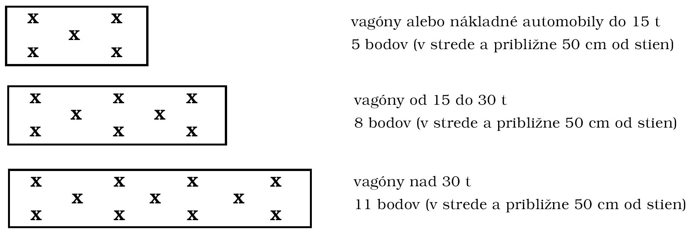

Príloha č. 5 k vyhláške č. 41/2002 Z. z.

RASTLINY, RASTLINNÉ PRODUKTY A INÉ PREDMETY PODLIEHAJÚCE RASTLINOLEKÁRSKEJ KONTROLE

Časť A

1. Základné požiadavky pri odbere vzoriek

a) Odber vzoriek môže vykonávať len fytoinšpektor alebo osoba, ktorá bola na túto činnosť vyškolená a poverená kontrolným ústavom. Fytoinšpektor alebo poverená osoba musí byť nezávislá od obchodných záujmov, ktoré by mohli mať vplyv na vykonávaný odber vzoriek a hodnotenie kvality rastlín alebo rastlinných produktov.

b) Zásielka rastlín alebo rastlinných produktov sa musí na odber vzoriek pripraviť tak, aby bola dobre prístupná.

c) Fytoinšpektor alebo poverená osoba musí mať k dispozícii potrebné technické pomôcky.

d) Fytoinšpektor alebo poverená osoba musí byť upozornená na morenie, plynovanie (uviesť použitý prípravok), napadnutie škodlivými organizmami, prípadne na iné okolnosti.

e) Vzorky rastlín alebo rastlinných produktov na účel vykonania rastlinolekárskej kontroly odoberá fytoinšpektor alebo poverená osoba pri dovoze na miestach, na ktorých sa vykonáva rastlinolekárska kontrola, alebo v mieste vykládky, pri vývoze v mieste nakládky alebo na miestach, na ktorých sa vykonáva rastlinolekárska kontrola.

f) Fytoinšpektor alebo poverená osoba odoberie z každej partie predpísaný počet čiastkových vzoriek. Zosypaním a premiešaním všetkých čiastkových vzoriek vznikne súhrnná vzorka, ktorá musí byť dostatočne veľká na vytvorenie laboratórnej vzorky (tab. č. 1).

g) Ak vznikne podozrenie zo zamorenia škodlivými organizmami, fytoinšpektor alebo poverená osoba je oprávnená odobrať vzorky na laboratórny rozbor aj z iných rastlín alebo rastlinných produktov, ktoré nie sú uvedené v prílohách č. 2 a 5, v potrebnom množstve. Hmotnosť alebo množstvo odobratej vzorky zapíše fytoinšpektor do prepravných dokladov a protokolu o rastlinolekárskej kontrole a do poznámky uvedie dôvod odberu.

h) Vzorky napadnuté škodlivými organizmami alebo podozrivé vzorky musia byť uskladnené oddelene vo vhodných obaloch tak, aby sa zabránilo rozšíreniu škodlivých organizmov.

i) Ak je v zásielke zemina, fytoinšpektor odoberie aj vzorku zeminy podľa bodu 2.6.

Vysvetlivky:

Partia je množstvo rastlín, rastlinných produktov a iných predmetov, ktoré majú rovnaké zloženie a pochádzajú z toho istého miesta produkcie alebo skladu.

Čiastková vzorka je približne rovnaké množstvo rastlín alebo rastlinných produktov, ktoré sa odoberie jedným odberom (napríklad množstvo získané jednou operáciou vzorkovača, množstvo odobraté z jednej obalovej jednotky alebo z jedného odberového miesta).

Súhrnná vzorka je vzorka, ktorá vznikne zosypaním a premiešaním všetkých čiastkových vzoriek tak, aby z nej bolo možné získať požadovaný počet priemerných vzoriek, t. j. laboratórnu vzorku a rezervnú vzorku.

Priemerná vzorka je zhomogenizovaná časť súhrnnej vzorky pripravená niektorou z predpísaných metód.

Laboratórna vzorka je priemerná vzorka určená na laboratórny rozbor.

Tabuľka č. 1: Hmotnosť alebo počet kusov súhrnných vzoriek z jednej partie zásielky potrebný na laboratórne rozbory:

Tovar | Množstvo v kg, ks alebo % | Poznámka

osivo tabaku, osivo kvetín, korenie a koreniny | 0,001 - 0,01 kg |

osivo zelenín | 0,05 kg | nevreckované

osivo tráv | 0,1 kg |

osivo cukrovej repy | 0,25 kg |

osivo v malospotrebiteľskom balení | 1 ks | na 100 balení

strukoviny, olejniny a pokrutiny, ľan a konope, osivo ďatelinovín | 0,5 kg |

obilniny a mlynárske výrobky | 1 kg | vrátane ryže a kukurice

buľvy cukrovej repy | 5 kg | neskladujú sa

hľuzy zemiaka (konzumné alebo na priemyselné spracovanie) | 5 kg |

hľuzy zemiaka (sadivo) | 200 ks |

kukurica v šúľkoch | 10 ks |

vegetatívny množiteľský materiál (podpníky, vrúble, očká, výpestky), sadenice jahôd, črepníkové rastliny | 5% | neskladujú sa

čerstvé ovocie a zelenina | 1-2 kg | neskladujú sa

bobuľoviny a ostatné ovocie | podozrivé alebo napadnuté plody | neskladujú sa

2. Postup pri odbere vzorky

2.1 Odber vzoriek všetkých druhov osiva poľných plodín

a) Pri tovare, ktorý sa dobre sype, sa čiastkové vzorky odoberajú:

aa) Z otvorených vriec - dvojplášťovým vzorkovačom takým dlhým, ako je výška vreca.

Odporúčané rozmery vzorkovača:

- pre obilniny, strukoviny a väčšie semená - dĺžka vzorkovača 762 mm, vonkajší priemer 25,4 mm, 6 otvorov,

- pre ďatelinoviny a drobnozrnné semená - dĺžka vzorkovača 762 mm, vonkajší priemer 12,7 mm, 9 otvorov.

Uzatvorený vzorkovač sa zasunie do vreca, rúrky sa pootočia tak, aby sa otvory na vonkajšej rúrke odkryli a zjednotili s otvormi na vnútornej rúrke. Po naplnení sa vzorkovač opatrne uzavrie, aby sa zrná na hranách neprerezali.

ab) Z uzatvorených vriec - hrotovým (Nobbeho) vzorkovačom, ktorý musí byť taký dlhý, aby jeho vtokový otvor zasahoval aspoň do stredu vreca. Odporúča sa vzorkovač s celkovou dĺžkou 500 mm a dĺžkou špičky od 60 mm do 85 mm. Vnútorný priemer vzorkovača má byť najmenej 2,5-násobku najdlhšieho rozmeru zŕn vzorkovaného materiálu (pre obilniny 16 mm, pre drobnozrnné druhy 10 mm). Pri odbere vzorky sa hrot vpichne do vreca pod uhlom 30o rukoväťou smerom dolu. Po dosiahnutí určeného miesta odberu vzoriek sa vzorkovač pohybuje v pozdĺžnom smere, aby sa dosiahlo rovnomerné sypanie osiva. Po vytiahnutí vzorkovača sa pletenie vreca hrotom vzorkovača upraví do pôvodného stavu. Pri odbere vzoriek z papierových vriec sa otvor po odbere prelepí samolepiacou páskou kontrolného ústavu alebo papierovou lepiacou páskou s odtlačkom pečiatky fytoinšpektora.

ac) Z voľne loženého tovaru sa čiastkové vzorky odoberajú dvojplášťovým vzorkovačom, ktorý má dĺžku rovnajúcu sa výške loženého materiálu; postupuje sa podľa bodu aa).

b) Pri druhoch, ktoré sa ťažko sypú, napríklad trávy, sa čiastkové vzorky odoberajú rukou. Pri veľkozrnných druhoch, napríklad bôb, sa čiastkové vzorky tiež odoberajú rukou, ak nie je k dispozícii vhodný vzorkovač s dostatočne veľkými otvormi. Pri odbere čiastkových vzoriek zo spodných častí vriec sa vrchná časť obsahu odsype. Vrecia, z ktorých sa odoberajú čiastkové vzorky, sa vyberajú náhodne.

c) Čiastkové vzorky osiva kvetín s veľmi malými semenami a osiva tabaku sa odoberajú lyžičkou z rôznych vrstiev.

2.1.1 Počet odobratých čiastkových vzoriek

a) Z voľne loženého osiva, najmä v sklade, vo vagóne, v ohradových paletách, z osiva baleného vo veľkokapacitných vakoch alebo z prúdu sypajúceho sa osiva sa odoberajú čiastkové vzorky v počte podľa tabuľky č. 2.

Tabuľka č. 2

Hmotnosť partie | Počet odobratých čiastkových vzoriek

do 500 kg | najmenej 5 čiastkových vzoriek

od 501 kg do 3 000 kg | 1 čiastková vzorka na každých 300 kg, najmenej však 5 čiastkových vzoriek

od 3 001 kg do 20 000 kg | 1 čiastková vzorka na každých 500 kg, najmenej však 10 čiastkových vzoriek

viac ako 20 000 kg | 1 čiastková vzorka na každých 700 kg, najmenej však 40 čiastkových vzoriek

Čiastkové vzorky sa odoberajú z náhodne zvolených, rovnomerne rozložených miest a z rôznej hĺbky. Z osiva uskladneného v silách sa vzorky odoberajú automatickým vzorkovačom.

b) Z osiva baleného vo vreciach alebo v podobných obaloch jednotnej veľkosti sa čiastkové vzorky odoberajú v počte podľa tabuľky č. 3.

Tabuľka č. 3

Počet obalov | Počet odobratých čiastkových vzoriek

od 1 do 5 | 1 čiastková vzorka z každého obalu, najmenej však 5 čiastkových vzoriek

od 6 do 30 | odber čiastkových vzoriek z 5 obalov alebo vždy najmenej 1 čiastková vzorka na 3 obaly, podľa toho, ktorý počet odberov je vyšší

od 31 do 400 | odber čiastkových vzoriek z 10 obalov alebo vždy najmenej 1 čiastková vzorka na 5 obalov podľa toho, ktorý počet odberov je vyšší

viac ako 400 | odber čiastkových vzoriek z 80 obalov alebo vždy najmenej 1 čiastková vzorka na 7 obalov podľa toho, ktorý počet odberov je vyšší

Obaly na odber čiastkových vzoriek sa vyberajú náhodne, pričom sa odber strieda z hornej, strednej a zo spodnej časti.

Čiastkové vzorky odobraté z jednotlivých miest dávky majú byť približne rovnakej veľkosti.

Na stanovenie škodlivých organizmov sa čiastkové vzorky odoberajú priamo do vhodných obalov zabraňujúcich úniku škodlivých organizmov. Čiastkové vzorky sa odoberajú striedavo

- zo spodnej tretiny obalu,

- zo strednej časti a z vrstvy priliehajúcej k obalu.

Z voľne uloženého osiva a z osiva v obaloch s veľkým objemom (ohradové palety, veľkoobjemové vaky) sa čiastkové vzorky odoberajú v miestach, kde sa predpokladá výskyt škodlivých organizmov, najmä z navlhnutých miest, miest pri podlahe, stenách a stĺpoch.

2.2 Odber vzoriek vegetatívneho množiteľského materiálu (rastlín určených na pestovanie) a črepníkových rastlín

Fytoinšpektor vizuálne kontroluje zdravotný stav zásielky a odoberie čiastkové vzorky tak, aby získal dostatočne veľkú súhrnnú vzorku podľa tabuľky č. 1. Ak je v zásielke zemina, odoberie aj vzorku zeminy podľa bodu 2.6.

Počty skontrolovaných jednotiek alebo balení a počty vzoriek pre

a) výpestky ovocných stromov a viniča, odrezky, vrúble a sadenice drobného ovocia (okrem sadeníc jahôd), výpestky okrasných stromov a kríkov, výpestky lesných drevín a črepníkové rastliny;

Tabuľka č. 4

Počet jednotiek v zásielke (v partii) | Počet vizuálne skontrolovaných jednotiek* | Počet odobratých vzoriek v ks

do 500 | všetky rastliny | 10

od 501 do 3 000 | každá 5. rastlina, najmenej však 300 | 15

od 3 001 do 10 000 | každá 20. rastlina, najmenej však 300 | 20

viac ako 10 000 | každá 100. rastlina, najmenej však 300 | 25

* rastliny, zväzky, obaly

b) cibule, hľuzy (okrem hľúz zemiakov), podzemky a rizómy určené na pestovanie, sadenice jahôd, sadenice okrasných a liečivých rastlín.

Tabuľka č. 5

Počet jednotlivých balení* v zásielke (v partii) | Počet skontrolovaných obalov | Počet odobratých vzoriek v kg, prípadne počet odobratých jednotiek

do 500 | každé 20. balenie, najmenej však 20 | 10

od 501 do 1 000 | každé 25. balenie | 20

viac ako 1 000 | každé 50. balenie | 30

* debničky, škatule, prepravky, zväzky a iné

2.3 Odber vzoriek sadiva zemiakov

Priemerná vzorka určená na rozbor musí mať minimálne 200 ks. Odoberá sa z množstva maximálne 25 ton. Keď množstvo sadiva je väčšie ako 25 ton, partia sa rozdelí na diely. Odoberie sa potrebný počet vzoriek. Každá vzorka reprezentuje jeden diel vzorkovaného množstva.

Vzorka sadiva sa musí odobrať tak, aby reprezentovala priemerný stav sadiva bez výberu nečistôt.

Tauľka č. 6

Uloženie sadiva | Počet čiastkových vzoriek | Spôsob odberu vzoriek

menšie obaly (vrecia a iné) | 10 | z 10 náhodne vybratých obalov striedavo z hornej, strednej a spodnej vrstvy, 3 vrecia sa musia vysypať

palety | 5 | z 5 náhodne vybratých paliet, a to 2 vzorky z hornej, 2 vzorky zo strednej a 1 vzorka zo spodnej vrstvy palety, ktorú treba vysypať

boxy, kopy | 10 | z 10 rovnomerne rozložených miest, striedavo z hornej, strednej a spodnej vrstvy

vagóny a iné dopravné prostriedky s voľne uloženým sadivom | 10 | z 5 miest úložnej plochy rozložených uhlopriečne, a to z hornej a strednej vrstvy a z 5 miest najviac ohrozených mrazom (1 vzorka sa odoberie z dna)

Čiastkové vzorky sa odoberajú rukami alebo vhodnou pomôckou, ktorou sa neovplyvní objektívnosť odberu vzoriek a výsledok laboratórneho testovania.

Odoslanie vzoriek do laboratória kontrolného ústavu zabezpečí žiadateľ v deň odberu alebo nasledujúci deň.

Vzorky sa skladujú 14 dní po získaní výsledkov v laboratóriu.

2.4 Odber vzoriek z rastlín alebo rastlinných produktov určených na konzumné a kŕmne účely alebo

na priemyselné spracovanie.

Pri odbere sypkých rastlinných materiálov sa postupuje podľa bodu 2.1.

V prípade jednotlivých zásielok sa rozboru podrobí každá zásielka.

V prípade zásielok z jednej krajiny a z jedného skladu alebo z jednej lode sa rozboru podrobí v poradí prvých 15 dopravných prostriedkov. Pri zistení bezchybnosti zásielky fytoinšpektor vizuálne kontroluje aj naďalej každú zásielku vrátane kontroly dokladov, ale rozboru sa podrobí v priemere každá dvadsiata piata zásielka.

Ak fytoinšpektor zistí napadnutie zásielky alebo má podozrenie, že zásielka je napadnutá škodlivými organizmami, skontroluje celú zásielku.

Ak fytoinšpektor odoberá vzorku z vagónov alebo z nákladných automobilov, odoberie vzorku z celého prierezu výšky vrstvy pomocou tyčového vzorkovača, a to v týchto bodoch:

Ak typ vagóna neumožňuje odber vzoriek týmto spôsobom, odber vzoriek sa vykoná pri vykládke tovaru.

V prípade lodnej zásielky sa čiastková vzorka odoberie z každých 25 m2 striedavo z hornej vrstvy (10 -15 cm pod povrchom) a strednej vrstvy (1 - 2 m pod povrchom).

Čiastková vzorka v prípade voľne loženej zásielky musí byť najmenej 100 g alebo 5 ks, v prípade balenej zásielky fytoinšpektor odoberie 100 - 250 g z obalu vybraného na odber vzoriek.

2.4.1 Postup stanovenia nečistôt vo vzorke obilnín určených na konzumné a kŕmne účely alebo na priemyselné spracovanie

A. Pšenica letná, pšenica tvrdá, raž a jačmeň

Laboratórna vzorka s hmotnosťou 250 g sa preoseje cez dve sitá so štrbinovými otvormi 3,5 mm a 1,0 mm. Materiál, ktorý sa zachytí na site s otvormi 3,5 mm a prejde cez sito s otvormi 1,0 mm, sa zosype a odváži. V prípade, že materiál zachytený na site s otvormi 3,5 mm obsahuje semená iných druhov obilnín alebo zvlášť veľké zrná príslušného druhu obilnín, tie sa vyberú a vrátia do preosiatej vzorky. Počas preosievania sa každá frakcia vzorky pozorne kontroluje na prítomnosť živých škodlivých organizmov.

Z preosiatej vzorky sa odoberie vzorka 50 - 100 g a presne sa odváži. Vzorka sa vysype na vhodnú podložku tak, aby zrná boli v jednej vrstve. Pomocou pinzety sa vytriedia tieto frakcie:

a) zlomkové zrná - všetky zrná, ktorých endosperm je čiastočne odokrytý, zrná poškodené mlátením a s poškodeným klíčkom, pri kukurici zrná alebo ich zlomky, ktoré prešli sitom s kruhovými otvormi s priemerom 4,5 mm, pri ciroku zrná alebo ich zlomky, ktoré prešli sitom s kruhovými otvormi s priemerom 1,8 mm;

b) zrnové nečistoty - zrná alebo semená základných druhov obilnín, strukovín alebo olejnín s odlišnou kvalitou, ktorá znižuje celkovú hodnotu partie,

ba) scvrknuté zrná - zrná, ktoré po odstránení všetkých ostatných frakcií prejdú cez sitá s otvormi týchto rozmerov: pšenica letná 2,0 mm, raž 1,8 mm, pšenica tvrdá 1,9 mm, jačmeň 2,2 mm a zrná poškodené mrazom a nezrelé (zelené) zrná,

bb) zrná iných druhov obilnín - všetky zrná, ktoré nepatria k druhom obilnín, z ktorých sa odoberá vzorka,

bc) zrná poškodené škodcami - zrná poškodené plošticami (Cimicidae), nahryzené a napadnuté hmyzom,

bd) zrná so zmenenou farbou klíčka - zrná s perikarpom sfarbeným do hneda až hnedočierna alebo klíčok má normálne sfarbenie, ale neklíči,

be) zrná prehriate počas sušenia - majú vonkajšie znaky spálenia, ale nie sú poškodené;

c) škvrnité zrná a zrná napadnuté fuzariózou - zrná napadnuté fuzariózou sú scvrknuté, zvráskavené a majú ružové alebo biele škvrny, ktoré nie sú zreteľne ohraničené,

d) naklíčené zrná - zrná s viditeľným korienkom alebo plumulou; pri niektorých druhoch treba brať do úvahy morfologické druhové špecifiká, napríklad pšenica tvrdá má vyčnievajúci klíček, ktorý sa podobá na vyklíčené zrná; v takom prípade nejde o naklíčené zrná;

e) iné nečistoty - účelovo nepoužiteľné alebo nežiaduce zložky v príslušnom druhu obilnín

ea) semená iných druhov rastlín - iné ako semená obilnín,

- semená jedovatých rastlín - semená jedovaté pre ľudí a zvieratá, semená, ktoré sťažujú alebo obmedzujú čistenie a mletie obilnín a semená, ktoré ovplyvňujú kvalitu výrobkov vyrábaných z obilnín, napríklad blen čierny (Hyoscyamus niger), čermeľ roľný (Melampyrum arvense), drchnička roľná (Anagallis arvensis), durman obyčajný (Datura stramonium), hlaváčik letný (Adonis aestivalis), lipkavec obyčajný (Galium aparine), ľuľok čierny (Solanum nigrum), konopnica napuchnutá (Galeopsis tetrahit), kúkoľ poľný (Agrostemma githago), mak vlčí (Papaver rhoeas), mätonoh mámivý (Lolium temulentum), ricín (Ricinus), stoklas obilný (Bromus secalinus), voškovník (Xanthium) a iné,

- iné semená,

eb) poškodené zrná - zrná nevyhovujúce na konzumáciu alebo kŕmenie z dôvodu ich hniloby, napadnutia hubami, baktériami alebo z iných príčin,

- zrná poškodené samovoľným zahriatím alebo vysokou teplotou počas sušenia; perikarp zŕn je sfarbený do sivohneda až čierna, endosperm je žltosivý až hnedočierny; zrná napadnuté byľomormi (Cecidomyidae) sa považujú za napadnuté zrná, ak je viac ako polovica zrna sfarbená do siva až čierna následkom kryptogamického napadnutia; ak sfarbenie pokrýva menej ako polovicu zrna, zrná sa zatriedia medzi zrná poškodené škodcami,

- ostatné zrná,

ec) cudzie látky - všetok materiál vo vzorke obilnín zachytený sitom s otvormi 4,5 mm na kukuricu, 3,5 mm na obilniny, 1,8 mm na cirok (okrem zŕn neuvedených druhov obilnín a zvlášť veľkých zŕn príslušného druhu obilnín, z ktorého bola odobratá vzorka) a ktoré prešli sitom s otvormi 1 mm vrátane kameňov, piesku, hliny, častí slamy a rastlín, ktoré prešli prvým sitom s otvormi 4,5 mm, 3,5 mm alebo 1,8 mm a boli zachytené na site s otvormi 1 mm,

ed) plevy - pri kukurici aj časti kukuričného klasu,

ee) námeľ - skleróciá kyjaničky purpurovej [Claviceps purpurea (Fr.) Tull.],

ef) mŕtvy hmyz a jeho časti vrátane exúvií.

Každá frakcia sa vyčlení samostatne a odváži sa. Ak skúmaná vzorka obsahuje zrná príslušného druhu obilnín s plevami, zrná sa musia ručne vylúskať a plevy sa začlenia do frakcie ed).

Po vyčlenení jednotlivých frakcií sa laboratórna vzorka preoseje cez sitá so štrbinovými otvormi 2,0 mm pri pšenici letnej, 1,8 mm pri raži, 1,9 mm pri pšenici tvrdej, 2,2 mm pri jačmeni. Materiál, ktorý prejde sitom s otvormi príslušnej veľkosti sa zaradí do frakcie scvrknuté zrná (ba).

B. Kukurica a cirok

Laboratórna vzorka kukurice s hmotnosťou 500 g a ciroku s hmotnosťou 250 g sa preoseje cez sito so štrbinovými otvormi s veľkosťou 1,0 mm. Počas preosievania sa každá frakcia vzorky pozorne kontroluje na prítomnosť živých škodlivých organizmov.

Z materiálu zachyteného na site sa pinzetou vyčlenia kamene, piesok, hlina, časti slamy a ostatné cudzorodé látky a spolu s materiálom, ktorý prešiel cez sito, sa odváži.

Z preosiatej vzorky sa odoberie vzorka kukurice s hmotnosťou 100 - 200 g alebo ciroku s hmotnosťou 25 - 50 g, ktorá sa presne odváži. Vzorka sa vysype na vhodnú podložku tak, aby zrná boli v jednej vrstve. Pomocou pinzety sa vytriedia jednotlivé frakcie, ktoré sa odvážia samostatne.

Po vyčlenení jednotlivých frakcií sa laboratórna vzorka preoseje cez sito s otvormi 4,5 mm pre kukuricu a 1,8 mm pre cirok. Materiál, ktorý prejde sitom s otvormi príslušnej veľkosti, sa zaradí do frakcie zlomkové zrná (a).

Jednotlivé frakcie vzorky sa odvážia a zaokrúhlia na 0,01 g a vypočíta sa ich percentuálny pomer vo vzorke, ktorý sa zaokrúhli na 0,1 %.

Každá vzorka sa analyzuje dvakrát. Rozdiel medzi analýzami nesmie byť väčší ako 10 %.

2.5 Odber vzoriek rastlín alebo rastlinných produktov zo skladov

V prípade voľne ložených rastlín alebo rastlinných produktov v skladoch fytoinšpektor odoberie čiastkové vzorky najmenej z piatich miest partie. Ak hmotnosť partie presiahne 20 ton, fytoinšpektor odoberie 1 čiastkovú vzorku z každých ďalších piatich ton.

Z prúdu sypajúceho sa rastlinného materiálu sa čiastkové vzorky odoberajú v časových intervaloch v závislosti od rýchlosti prúdu.

Vo veľkokapacitných čistiacich staniciach, v skladoch osív a v silách môže fytoinšpektor použiť na odber vzoriek automatický vzorkovač. Musí byť odskúšaný a povolený kontrolným ústavom.

2.6 Odber vzoriek zeminy

Vzorku zeminy odoberie fytoinšpektor vytrasením 5 % rastlín z jednej partie alebo zozbieraním zeminy z podlahy dopravného prostriedku alebo skladu.

V prípade zásielky prepravovanej vo vreciach sa obsah vriec vybraných na odber vzoriek zeminy vysype na igelitovú fóliu a vrece sa vytrasie.

V prípade voľne ložených hľúz, buliev a cibúľ sa vzorka odoberie zo zeminy na podlahe dopravného prostriedku alebo skladu.

V prípade voľne ložených zemiakov sa čiastková vzorka zemiakov odobratá podľa bodu 2.3 niekoľkokrát vytrasie v igelitovej taške. Ak sa takýmto spôsobom nezíska dostatočné veľká laboratórna vzorka na stanovenie háďatiek, súhrnná vzorka zemiakových hľúz sa premyje pod tečúcou vodou.

2.6.1 Postup stanovenia háďatiek vo vzorke zeminy

a) Vodná suspenzia

Súhrnná vzorka odobratá podľa bodu 2.3 sa premyje pod tečúcou vodou na site s veľkosťou ôk 0,2 mm (vyrobené z fotografickej misky 200 x 140 mm vyrezaním dna a nalepením mlynárského pletiva).

Sito s vyplaveným materiálom sa vloží do misky so svetlým dnom rozdeleným na pozdĺžne pásy so šírkou 10 mm a celá jeho plocha sa postupne (podľa vyznačených pruhov) prezrie pod binokulárnou lupou pri zväčšení 10 až 40-krát. Miesta so silnejšou vrstvou zachyteného materiálu sa rozhrnú preparačnou ihlou tak, aby sa nepoškodilo pletivo sita alebo nepretlačili tzv. mikrocysty okami sita. V prípade veľkého množstva zachyteného pevného materiálu sa časť slabým prúdom vody (napr. stričkou) oddelí na ďalšie sito, a to tak, aby neprišlo k stratám vyplaveného materiálu.

Nájdené cysty háďatiek sa vyberajú pomocou navlhčenej preparačnej ihly alebo pinzety. Ak sa ich determinácia nerobí hneď, presypú sa na dočasné uschovanie (v suchom stave) do skúmaviek alebo fľaštičiek.

Prezretý obsah a zvyšok zeminy sa v plechovom vedre asanuje. Potom sa dôkladne rozriedi vodou a vyleje do kanalizácie alebo na iné určené miesto.

b) Zo suchej zeminy (Flotačná metóda)

Suchá zmesná vzorka pôdy odobratá podľa bodu 2.6 sa vysype do misky na úpravu vzorky, ľahko sa rozdrvia hrudky a preoseje sa cez sito s veľkosťou ôk 2 mm.

Z preosiatej zeminy sa odoberie vzorka s hmotnosťou 100 - 200 g, vysype sa do Erlenmayerovej banky (priemer hrdla 48 mm, obsah 2 000 ml) s nadstavcom z umelej hmoty a so zariadením na prívod vody a miešanie suspenzie, naplnenej 0,3 - 0,5 l vody. Suspenzia počas plavenia predchádzajúcej vzorky sa odmočí vo vode a niekoľkokrát dôkladne zamieša.

Obsah banky sa preplavuje 3 - 5 minút prúdom vody, zavedením ku dnu banky trubicou (O 10 mm) s dýzami na rozvírenie suspenzie. Prúd vody je počas prvých sekúnd prudký (aby sa obsah dôkladne premiešal), a len čo hladina suspenzie vystúpi asi do polovice výšky banky, upraví sa na veľmi slabý (750 ml/min.). Ľahké organické častice spolu s cystami háďatka pretekajú k hornej časti banky nadstavcom na sito s veľkosťou ôk 0,2 mm a väčšina ťažkých minerálnych častíc zostáva v banke. Po skončení flotácie sa slabým prúdom vody všetky častice pôdy a zvyšky pevného materiálu uchytené na nadstavci banky spláchnu na sito. Po vyplavení každej vzorky sa banka a príslušenstvo dôkladne vypláchnu. Pri zisťovaní výskytu háďatiek vo vzorke sa postupuje podľa písmena a).

3. Doručenie vzoriek do určeného laboratória kontrolného ústavu

a) Vzorky určené na laboratórne rozbory musia byť zabalené v dostatočne pevnom vrecku alebo v papierovom vrecku s vnútornou voskovou vrstvou, prelepené samolepiacou páskou kontrolného ústavu alebo papierovou lepiacou páskou a označené odtlačkom pečiatky fytoinšpektora.

b) Vzorky na stanovenie živočíšnych škodcov sa musia odoslať v dokonale uzatvorených obaloch, ktoré zabránia úniku škodlivých organizmov.

c) K vzorkám určeným na laboratórne rozbory musí byť priložený čitateľne vyplnený záznam o odbere vzorky podpísaný fytoinšpektorom a výrobcom, dovozcom alebo vývozcom.

4. Prevzatie a uloženie vzoriek v laboratóriu

a) Pri doručení vzoriek určených na laboratórny rozbor sa musí prekontrolovať druh plomby, neporušenosť vzorky a jej obalov, údaje uvedené na obale vzorky a v zázname o odbere vzorky.

b) Prevzatá vzorka určená na laboratórny rozbor sa zapíše do protokolu a pridelí sa jej evidenčné číslo.

5. Vykonávanie rozboru rastlín alebo rastlinných produktov na miestach, na ktorých sa vykonáva rastlinolekárska kontrola

Fytoinšpektor vykonáva rastlinolekársku kontrolu, prípadne laboratórny rozbor každej partie zásielky podľa § 8 ods. 1 samostatne. Fytoinšpektor vizuálne skontroluje odobratú vzorku na prítomnosť škodlivých organizmov a prípadne vykoná laboratórny rozbor. V prípade potreby odošle vzorku do diagnostického laboratória.

Postup vykonania rastlinolekárskej kontroly a laboratórneho rozboru stanoví kontrolný ústav v metodikách kontrolného ústavu.

Rozbor sa vykonáva tak, že sa postupne vytriedi tovar s chybami, a to od najzávažnejších chýb až po najmenej závažné chyby. Každá rastlina a rastlinný produkt sa môže vytriediť zo vzorky len raz, a to pre najzávažnejšie chyby alebo pre prvú z menej závažných chýb. Chyby a ich rozsah zistené vo vzorke platia pre celú preverovanú zásielku.

Nenapadnuté vzorky množiteľského materiálu, rezaných a črepníkových kvetov sa neskladujú, a ak neboli podrobené laboratórnemu rozboru alebo rozboru v diagnostickom laboratóriu, vrátia sa do zásielky. Ostatné nenapadnuté vzorky sa skladujú počas dvoch mesiacov. Napadnuté vzorky sa skladujú oddelene v uzavretých obaloch tak, aby sa z nich škodlivé organizmy nemohli rozšíriť, a to počas 1 mesiaca.

Po uplynutí predpísanej doby skladovania sa vykoná komisionálny zosyp nepoužitých vzoriek. Komisia, ktorú tvoria najmenej traja pracovníci kontrolného ústavu, potvrdí, či počet a hmotnosť uložených vzoriek súhlasí s protokolom o rastlinolekárskej kontrole a evidenciou vzoriek a či sa nezistili žiadne chyby. Napadnuté alebo morené vzorky sa po uplynutí skladovacej lehoty komisionálne zlikvidujú.

Časť B

1. ČERSTVÉ OVOCIE

Druh tovaru | Požiadavky | Prípustné odchýlky

jablká, hrušky, dule, mišpule a jarabina a ich krížence a iné | musia byť zrelé, celé, zdravé, nepoškodené chorobami alebo škodcami, bez cudzích pachov | najviac 5 % plodov so zaschnutou červivosťou, najviac 5 % hmotnosti plodov môže byť mierne mechanicky poškodených, pri hruškách mierna kamienkovitosť

padané jablká | nesmú byť nahnité, plesnivé, poškodené mrazom, musia byť čisté, bez cudzích pachov | môžu byť mechanicky poškodené, červivé, poškodené chrastavitosťou, slabo znečistené zeminou

kôstkové ovocie (broskyne, marhule, čerešne, višne, slivky, slivy, mirabelky a iné) | musí byť zdravé, čisté, bez cudzích pachov | nesmú sa dodávať plody broskyňových semenáčov horkej chuti s dužinou neoddeliteľnou od kôstky a silno plstnaté, najviac 6 % červivých plodov

drobné ovocie (jahody, ríbezle, egreše, josty, maliny, ostružiny, moruše, borievky, drieň, šípky, brusnice, čučoriedky a iné) | musí byť zdravé, čisté, bez cudzích pachov | najviac 0,5 % prímesí (napr. listy, vetvičky), znečistenie zeminou najviac 5 % hmotnosti plodov

stolové hrozno | musí byť zdravé, čisté, bez cudzích pachov |

muštové hrozno | musí byť zdravé, čisté, technologicky vhodné na spracovanie na víno; roztriedené na biele, ružové, červené a modré | poškodenie plesňou sivou najviac do 5 %, hnilobou najviac 30 %

banány zelené | musia byť celé, zdravé, čerstvé, čisté, pevné, bez cudzích pachov, zelené alebo svetlozelené, nepodchladené a nezaparené | najviac 10 % hmotnosti plodov nezodpovedajúcich ustanoveným požiadavkám

banány žlté | musia byť celé, zdravé, čerstvé, čisté, pevné, bez cudzích pachov, žlté; stopka ani kŕčok nesmú byť napadnuté plesňami alebo hnilobou; plody s čiernou šupkou sa nesmú vyskytovať | najviac 10 % hmotnosti plodov nezodpovedajúcich stanoveným požiadavkám; drobná hnedá škvrnitosť šupky, ktorá je známkou plného vyzretia zdravých plodov, sa za chybu nepovažuje

citrusové a tropické ovocie (citróny, mandarínky, pomaranče, grapefruity, klementínky, limy, satsumasky a ich krížence) ananás a iné | musia byť celé, zdravé, neplesnivé, čisté, bez mechanického poškodenia a chýb, ktoré by znížili použiteľnosť ovocia |

2. SUŠENÉ OVOCIE

Druh tovaru | Požiadavky | Prípustné odchýlky

sušené ovocie (broskyne, marhule, slivky, hrozienka, datle, figy a iné) | musia byť zdravé, čisté, nesmú byť zatuchnuté, znečistené zeminou, nesmú javiť príznaky plesnivenia a liehového kvasenia, musia byť bez výskytu chorôb a živých škodcov a bez poškodenia spôsobeného chorobami a škodcami | najviac 3 mŕtvi škodcovia v 1 kg, najviac 15 % plodov škvrnitých a poškodených škodcami

škrupinové ovocie suché (orechy vlašské, lieskové orechy, mandle, gaštany, kokosové orechy, para orechy, pistácie, píniové orechy, kešu orechy a iné) | musia byť zrelé, čisté, zdravé bez výskytu chorôb a živých škodcov a bez poškodenia spôsobeného chorobami a škodcami | najviac 5 % jadier napadnutých škodcami a so zvyškami škodcov

3. ČERSTVÁ ZELENINA

Druh tovaru | Požiadavky | Prípustné odchýlky

hlúbová zelenina (kaleráb, kapusta, karfiol, brokolica, kel a iné) | musí byť celá, zdravá, čerstvá, čistá, bez výskytu chorôb a škodcov, bez poškodenia spôsobeného chorobami alebo škodcami, bez nadmernej povrchovej vlhkosti, bez cudzieho pachu a cudzej chuti, nesmie byť znečistená zeminou alebo zvyškami hnojív |

koreňová zelenina (mrkva, cvikla, čierny koreň, chren, okrúhlica, kozia brada pórolistá a iné) | | najviac 1 % zeminy

petržlen, zeler, reďkovka, reďkev čierna, paštrnák | | najviac 2 % zeminy

listová zelenina (šalát, špenát a iné) | |

struková zelenina (hrach, fazuľové struky a iné) | | najviac 5 % hrdzavých škvŕn a červivých zŕn

plodová zelenina (paprika, rajčiak, baklažán a iné) | |

cibuľová zelenina (cesnak, cibuľa a iné) | | najviac 11 % hmotnosti strúčikov napadnutých chorobami a škodcami

kôpor | | najviac 2 % hmotnosti burín vo zväzku

šampiňóny pestované | musia byť zdravé, čisté | najviac 1 % zeminy

huby čerstvé | musia byť čerstvé, zdravé, čisté, neprané, bez prímesí a nečistôt |

4. SUŠENÁ ZELENINA A KORENINY

Druh tovaru | Požiadavky | Prípustné odchýlky

huby sušené | | najviac 2 % plátkov s príznakmi po napadnutí škodcami

zelenina sušená | musí byt zdravá, čistá, bez výskytu chorôb a škodcov, bez poškodenia spôsobeného chorobami alebo škodcami, bez prímesí a nečistôt, bez nadmernej povrchovej vlhkosti, bez cudzieho pachu a cudzej chuti |

korenie | musí byť zdravé, bez výskytu chorôb a škodcov, bez prímesí a nečistôt, bez nadmernej povrchovej vlhkosti, bez cudzieho pachu a cudzej chuti | najviac 10 mŕtvych roztočov v 1 kg korenia

mletá koreninová paprika | |

majoránka | musí byť bez výskytu chorôb a škodcov, bez poškodenia spôsobeného chorobami alebo škodcami, bez prímesí a nečistôt, bez nadmernej povrchovej vlhkosti, bez cudzieho pachu a cudzej chuti | najviac 50 mŕtvych roztočov alebo pavší v 1 kg korenia

rasca, koriander, aníz, fenikel | | najviac 10 mŕtvych roztočov v 1 kg korenia

5. OSTATNÉ RASTLINNÉ PRODUKTY

Druh tovaru | Požiadavky

potravinárske obilniny (pšenica, jačmeň potravinársky a jačmeň sladovnícky, raž, súraž, pohánka, ovos, kukurica a iné) | zrno a šrot z neho musia byť zdravé, vyzreté, bez cudzích pachov, nesmú sa vyskytovať plesnivé, naplesnivené, snetivé a nahnité zrná a živé štádiá škodlivých organizmov*

kŕmne obilniny vrátane šrotov (pšenica, jačmeň, raž, súraž, tritikale, pohánka, ovos, kukurica a iné) |

strukoviny a olejnaté semená (repka olejka, slnečnica, horčica, sója, ľan a iné) vrátane šrotov a pokrutín | semená musia byť zdravé, vyzreté, bez cudzích pachov, nesmú páchnuť po rozklade tukov, kyslým alebo iným cudzím pachom a nesmú sa vyskytovať živé štádiá škodlivých organizmov*

čaje, liečivé rastliny (aj sušené), zelená káva, kakaové bôby | musia byť zdravé, bez výskytu chorôb a škodcov, bez prímesí a nečistôt, bez nadmernej povrchovej vlhkosti, bez cudzieho pachu a cudzej chuti

*Bruchophagusplatipterus, Bruchophagusroddi, črvotoč chlebový (Stegobiumpaniceum), črvotoč tabakový (Lasiodermaserricorne), moľa obilná (Nemapogongranellus), múčiar obyčajný (Tenebriomolitor), pakôrnik obilný (Rhizoperthadominica), plocháč múčny (Cryptolestesferrugineus), plocháč skladový (Oryzaephilussurinamenis), ploskáň skladový (Tenebroidesmauritanicus), potemník hnedý (Triboliumcastaneum), potemník ničivý (Triboliumdestructor), potemník skladový (Triboliumconfusum), psota obilná (Sitotrogacerealella), roztoč múčny (Acarussiro), rušník skladový (Trogodermagranarium), víjačka čokoládová (Ephestiaelutella), vijačka domová (Pyralisfarinalis), vijačka múčna (Ephestiakuehniella), vijačka papriková (Plodiainterpunctella), vŕtavec ničivý (Ptynusfur), vŕtavec plstnatý (Niptushololeucus), zrniar čierny (Sitophilusgranarius), zrniar kukuričný (Sitophiluszeamays), zrniar ryžový (Sitophilusoryzae), zrniarka fazuľová (Acanthoscelidesobsoletus), zrniarka hrachová (Bruchuspisorum) a iné.

| | Prípustné odchýlky | | | | |

| | pšenica tvrdá | pšenica letná | raz | jačmeň | kukurica | cirok

1. | zlomkové zrná | 6 % | 5 % | 5 % | 5 % | 10 % | 10 %

2. | zrnové nečistoty, iné ako uvedené v bode 3, z toho | 5 % | 7 % | 5 % | 12 % | 5 % | 5 %

| a) scvrknuté zrná | * | | | | -** | -

| b) zrná iných druhov obilnín | 3 % | | | } 5 % | |

| c) zrná poškodené škodcami | | | | | |

| d) zrná so zmenenou farbou klíčka | | | - | - | - | -

| e) zrná prehriate počas sušenia | 0,5 % | 0,5 % | 1,5 % | 3 % | 3 % | 3 %

3. | škvrnité zrná a zrná napadnuté fuzariózou, z toho | 5 % | - | - | - | - | -

| a) zrná napadnuté fuzariózou | 1,5 % | - | - | - | - | -

4. | naklíčené zrná | 4 % | 4 % | 4 % | 6 % | 6 % | 6 %

5. | iné nečistoty, z toho | 3 % | 3 % | 3 % | 3 % | 3 % | 3 %

| a) semená iných druhov rastlín | | | | | |

| - semená jedovatých rastlín | 0,1 % | 0,1 % | 0,1 % | 0,1 % | 0,1 % | 0,1 %

| - iné semená | | | | | |

| b) poškodené zrná | | | | | |

| - zrná poškodené samovoľným zahriatím alebo vysokou teplotou počas sušenia | 0,05 % | 0,05 % | | | |

| - ostatné zrná | | | | | |

| c) cudzie látky | | | | | |

| d) plevy | | | | | |

| e) námeľ | 0,05 % | 0,05 % | 0,05 % | - | - | -

| f) mŕtvy hmyz a jeho časti | | | | | |

* Ak v príslušnej kolónke nie je uvedený číselný údaj, prípustná odchýlka príslušnej frakcie po sčítaní odchýliek ostatných frakcií nesmie presiahnuť limit uvedený pod číslom 1 až 5.

** Ak je v príslušnej kolónke uvedená pomlčka, prípustná odchýlka pre príslušný druh obilnín sa nestanovuje.

6. KONZUMNÉ ZEMIAKY SKORÉ

Zemiaky musia byť pevné, čisté, zdravé, nepoškodené, nezelené, nenaklíčené, bez nadmernej povrchovej vlhkosti a bez cudzej vône a chuti, s ľahko olupujúcou sa šupkou.

Druh poškodenia | Prípustné odchýlky | Poznámky

chrastavitosť (obyčajná) | najviac 5 % hľúz |

hnedá (fytoftórová) hniloba | najviac 2 % hľúz | zisťuje sa na rozkrojených hľúzach

mokrá hniloba | nesmie sa vyskytovať | poškodené hľuzy silno páchnu

zelené hľuzy | najviac 1 % hľúz |

iné poškodenia a cudzie prímesi | najviac 2 % |

7. KONZUMNÉ ZEMIAKY NESKORÉ

Zemiaky musia byť pevné, čisté, zdravé, nepoškodené, nezelené, nenaklíčené, nenamrznuté, bez nadmernej povrchovej vlhkosti a bez cudzej vône a chuti.

Druh poškodenia | Prípustné odchýlky | Poznámky

chrastavitosť (obyčajná) | najviac 10 % hľúz |

suchá hniloba | najviac 2 % hľúz | zisťuje sa na rozkrojených hľúzach

mokrá hniloba | nesmie sa vyskytovať | poškodené hľuzy silno páchnu

namrznuté hľuzy | nesmú sa vyskytovať | zisťuje sa stláčaním podozrivých hľúz, ako aj na rozkrojených hľúzach

zelené a mechanicky poškodené hľuzy | najviac 5 % hľúz |

cudzie prímesi | najviac 2 % |

8. SADIVOVÉ ZEMIAKY

Druh poškodenia | Povolené odchýlky v % z hmotnosti zásielky

a) mrazom alebo zaparením | 0,25

b) mokrou hnilobou | 0,25

c) suchou hnilobou | 1,0

d) plesňou zemiakovou (Phytophthora infestans) | 1,0

e) mechanicky, škodcami a silno zdeformované | 3,0

f) chrastavitosťou viac ako 1/5 povrchu hľúz | 10,0

g) vločkovitosťou viac ako 1/10 povrchu hľúz | 5,0

h) silným sivením dužiny až černaním dužiny viac ako 1/3 rezu | 10,0

i) silnou hrdzavitosťou dužiny viac ako 1/10 rezu | 10,0

j) prímes zeminy a iných nečistôt | 1,0

Súčet odchýliek uvedených pod písm. a) až d) nesmie presahovať 2 % hmotnosti hľúz a súčet všetkých odchýliek nesmie presahovať 14 % hmotnosti hľúz.

Za mechanicky poškodené hľuzy sa považujú tie hľuzy, ktoré sú poškodené do hĺbky viac ako 5 mm vrátane poškodenia škodcami. Za poškodenie drôtovcami sa považuje hľuza najmenej s 3 otvormi do hĺbky viac ako 5 mm.

Za mokrú hnilobu sa považuje hniloba hľúz spôsobená baktériami Erwinia carotovora, hubou Pythium ultimum a ďalšími pôvodcami spôsobujúcimi mokrú hnilobu.

Za suchú hnilobu sa považuje hniloba hľúz spôsobená hubami Fusarium sp., Phoma sp. a ďalšími pôvodcami spôsobujúcimi suchú hnilobu.

Za vločkovitosť sa považuje choroba hľúz spôsobená hubou Rhizoctonia solani.

Sadivo, v ktorom sa vyskytujú karanténne škodlivé organizmy, nemožno použiť na sadivové účely.

9. SADIVO CIBUĽOVEJ ZELENINY

Druh tovaru | Požiadavky | Prípustné odchýlky | Z toho najviac

cibuľa sadzačka | musí byt suchá, vyzretá, v krčku zatiahnutá, zbavená nadbytočných šupiek, vňať nesmie byť dlhšia ako 50 mm | najviac 10 % hmotnosti cibuliek naklíčených, poškodených a neškodných prímesí | 5 % cibuliek napadnutých suchou alebo mokrou hnilobou

cesnak sadivo | vňať nesmie byt dlhšia ako 70 mm a korienky dlhšie ako 30 mm, nesmie obsahovať viac ako 3 % cibúľ podsadivových (pri paličiakoch sú podsadivové cibule s priemerom menším ako 35 mm a pri nepaličiakoch menším ako 30 mm), nesmie obsahovať viac než 5 % cibúľ naklíčených a rozpadnutých | najviac 10 % chybných cibúľ | 8 % mechanicky poškodených cibúľ, 6 % cibúľ poškodených suchou alebo mokrou hnilobou, z toho najviac 2 % cibúľ napadnutých háďatkom

Sadivo nesmie obsahovať živé škodce okrem roztočov.

10. OSIVO A SADIVO POĽNÝCH PLODÍN

Rastlina | Požiadavky | Prípustné odchýlky

obilniny a kukurica | osivo nesmie obsahovať živé škodce a semená regulovaných nekaranténnych burín |

strukoviny | osivo nesmie obsahovať semená regulovaných nekaranténnych burín, skleróciá a živé škodce okrem roztočov |

semenné okopaniny (cukrová repa, kŕmna repa, čakanka, kŕmna mrkva, kŕmny kaleráb, kŕmny kel, dreňový kel, kváka, vodnica a iné) | osivo nesmie obsahovať semená regulovaných nekaranténnych burín, živé škodce okrem roztočov a nesmie byť napadnuté chorobami, ktoré by mohli ohroziť jeho kvalitu |

olejniny a priadne rastliny (repka olejka, slnečnica, horčica biela, repica olejnatá, mak siaty, ľan siaty, konopa siata a iné) | osivo nesmie obsahovať semená kukučiny (Cuscuta sp.) a semená iných regulovaných nekaranténnych burín a živé škodce okrem roztočov | najviac 0,1 % hmotnosti osiva môžu tvoriť semená iných kultúrnych druhov a semená burín okrem semien regulovaných nekaranténnych burín

mak | nesmú sa vyskytovať semená blenu čierneho (Hyoscyamusniger) |

ľan | | najviac 0,1 % hmotnosti osiva môžu tvoriť semená iných kultúrnych druhov a semená burín okrem semien regulovaných nekaranténnych burín

chmeľ | sadivo nesmie byť zvädnuté, mechanicky ani inak poškodené a nesmie byť napadnuté baktériovými a hubovými chorobami a poškodené škodcami | najviac 3 % mechanicky poškodeného sadiva, obsah zeminy prilepenej na koreňoch nesmie presahovať 2 %

tabak | osivo nesmie obsahovať semená kukučiny (Cuscuta sp.), zárazy (Orobanche sp.) a semená iných regulovaných nekaranténnych burín a živé škodce okrem roztočov | najviac 0,1 % hmotnosti osiva môžu tvoriť semená iných kultúrnych druhov a semená burín okrem semien regulovaných nekaranténnych burín

trávy, jednoročné krmoviny, ciroky | osivo nesmie obsahovať semená kukučiny (Cuscuta sp.), zárazy (Orobanche sp.) a semená iných regulovaných nekaranténnych burín a živé škodce okrem roztočov |

liečivé rastliny osivo | nesmie obsahovať živé škodce, okrem roztočov a nesmie byť napadnuté chorobami, ktoré by mohli ohroziť jeho kvalitu |

sadivo | nesmie byť zvädnuté, zaparené, mechanicky alebo inak poškodené a nesmie byť napadnuté škodlivými organizmami | obsah zeminy prilepenej na koreňoch nesmie presahovať 2 %

Osivo ľanu môže byť napadnuté najviac 5 % hubou Botrytis spp., najviac 5 % hubami Alternaria linicola, Colletotrichum linii, Fusarium linii spôsobujúcimi chorobu klíčiacich rastlín a najviac 1 % hubou Ascochyta linicola.

Osivo slnečnice môže obsahovať v základnom osive najviac 4 ks sklerócií Sclerotinia sclerotiorum na 1 000 g osiva a v certifikovanom osive najviac 10 ks sklerócií huby na 1 000 g osiva.

Osivo repky a repice môže obsahovať v základnom osive najviac 10 ks sklerócií Sclerotinia sclerotiorum na 1 000 g osiva a v certifikovanom osive najviac 20 ks sklerócií huby na 1 000 g osiva.

Rastlina | Škodlivé činitele | Prípustné odchýlky v % hmotnosti osiva |

| | Základné osivo | certifikované a štandardné osivo

ďatelinoviny | skleróciá hľuznatky ďatelinovej (Sclerotinia trifolium) a palušky ďatelinovej (Typhula trifolii) | 0,1 % | 0,3 %

trávy | námeľ a skleróciá iných druhov húb | 0,5 % | 1,5 %

psinčeky, trojštet žltkastý | háďatko ovsíkové (Anguina agrostis) | 0,2 % | 1,0 %

Osivo nesmie obsahovať živé škodce okrem roztočov.

Ak sa v osive zistili roztoče druhu Acarus siro a rodov Thyrophagus a Glyciphagus spolu s dravým roztočom Cheyletus eruditus v pomere menšom ako 100 : 1, také osivo sa považuje za vyhovujúce. Ak je tento pomer väčší alebo ak sa v osive vyskytujú len roztoče druhu Acarus siro a rodov Thyrophagus a Glyciphagus, osivo treba ošetriť.

Osivo ďatelinovín nesmie obsahovať semená kukučiny (Cuscuta sp.) a zárazy (Orobanche sp.).

V osive viacročných krmovín sa nesmú vyskytovať semená burín, ktoré zhoršujú kvalitu krmiva, ako napríklad pohánkovec ovíjavý (Fallopia convolvulus), pyštek obyčajný (Linaria vulgaris), knôtovka biela (Melandrium album), iskerník roľný (Ranunculus arvensis), horčica roľná (Sinapis arvensis), peniažtek roľný (Thlaspi arvense) a iné.

Osivo napadnuté skladovými škodcami sa musí premiestniť do oddelených priestorov a ihneď ošetriť.

11. OSIVO A SADIVO OVOCNÝCH RASTLÍN, OVOCNÝCH A LESNÝCH DREVÍN A VINIČA

Rastlina | Požiadavky | Prípustné odchýlky

jahody | sadenice musia byt zdravé, bez príznakov vírusových chorôb, bez výskytu háďatka jahodového (Aphelenchoides fragariae) a roztočíka jahodového (Tarsonemus fragariae) | obsah zeminy prilepenej na koreňoch nesmie presahovať 2 %

osivo a sadivo ovocných drevín | nesmie byť napadnuté chorobami a nesmie obsahovať živé škodce | obsah zeminy prilepenej na koreňoch nesmie presahovať 2 %

sadivo okrasných drevín | nesmie byť napadnuté škodlivými organizmami, na expedovanom materiáli sa nesmie vyskytovať baktériová nádorovitosť (Agrobacterium tumefaciens) | obsah zeminy prilepenej na koreňoch nesmie presahovať 2 %

osivo lesných drevín | nesmie obsahovať živé škodce, nesmie byt napadnuté chorobami, ktoré by mohli ohroziť ich kvalitu, rekalcitrantné semená s vyšším obsahom vody (dub, gaštan, pagaštan) nesmú byť zaparené, namrznuté, povrchovo zaplesnené, nesmú obsahovať semená mumifikované hubou Ciboria batschiana |

sadivo lesných drevín | musí byť čerstvé, s dobre vyvinutými pupeňmi, nesmie byť napadnuté chorobami alebo škodcami, nesmie byť mechanicky poškodené, na expedovanom sadive sa nesmie vyskytovať baktériová nádorovitosť (Agrobacterium tumefaciens) | obsah zeminy prilepenej na koreňoch nesmie presahovať 2 %

vinič | nesmie sa vyskytovať baktériová nádorovitosť (Agrobacterium tumefaciens), sadenice musia byť zdravé, nepoškodené, nezaschnuté a nesmú byť staršie ako dva roky | obsah zeminy prilepenej na koreňoch nesmie presahovať 2 %

12. OSIVO A SADIVO OKRASNÝCH RASTLÍN

Rastlina | Požiadavky | Prípustné odchýlky

osivo | nesmie obsahovať živé škodce, okrem roztočov, a nesmie byt napadnuté chorobami, ktoré by mohli ohroziť jeho kvalitu | najviac 0,2 % hmotnosti základného osiva alebo 1 % hmotnosti certifikovaného osiva môžu tvoriť semená iných kultúrnych druhov a semená burín okrem semien regulovaných nekaranténnych burín

sadivo | nesmie byť napadnuté karanténnymi chorobami alebo škodcami | obsah zeminy prilepenej na koreňoch nesmie presahovať 2 %

begónia hľuznatá (Begónia x tuberhybrida), šafran (Crocus), georgina (Dahlia), mečík (Gladiolus), hyacint (Hyacinthus), ľalia (Lilium), narcis (Narcissus) a tulipán (Tulipa) | sadivo nesmie byť napadnuté baktériovou nádorovitosťou (Agrobacterium tumefaciens), baktériovou zväzčitosťou (Curtobacterium flaconfascians), háďatkom zhubným (Ditylenchus dipsaci) |

Rastlina | Škodlivé organizmy | Prípustné odchýlky v % napadnutých cibúľ alebo hľúz

begónia hľuznatá (Begonia x tuberhybrida) | hniloby - Fusarium sp., Penicilium sp. a iné | 4

šafran (Crocus) | hniloby - Botrytis sp. , Fusarium sp. , Penicilium sp. a iné | 8

| háďatká - Ditylenchus dipsaci, Ditylenchus destructor | nesmú sa vyskytovať

georgina (Dahlia) | hniloby - Botrytis sp., Fusarium sp., Penicilium sp., Sclerotinia sp. a iné | 8

| bronzovitosť rajčiakov (Tomato spotted wilt tospovirus) | nesmie sa vyskytovať

mečík (Gladiolus) | bakterióza - Pseudomonasgladioli pv. gladiolii | 12

| hniloby - Botrytis sp., Fusarium sp., Stromatinia sp. | 8

| živé strapky, najmä strapka mečíková (Taeniothrips simplex) | nesmú sa vyskytovať

| háďatko - Ditylenchus dipsaci | nesmie sa vyskytovať

hyacint (Hyacinthus) | bakteriálna hniloba - Xanthomonas campestris pv. hyacinthi | nesmie sa vyskytovať

| hniloby - Botrytis sp., Fusarium sp., Peniclium sp., Envinia Rhizoglyphus sp. | 4

| | 8

| háďatká - Ditylenchus dipsaci, Ditylenchus destructor | nesmú sa vyskytovať

ľalia (Lilium) | hniloby - Botrytis sp., Rhizoglyphus sp. | 8

narcis (Narcissus) | hniloby - Botrytis sp., Rhizoglyphus sp. | 8

| cibuľovka narcisová (Lampetia equestris) | nesmie sa vyskytovať

| cibuľovka zhubná (Eumerus strigatus) | nesmie sa vyskytovať

| háďatká - Ditylenchus dipsaci, Ditylenchus destructor | nesmú sa vyskytovať

tulipán (Tulipa) | hniloba - Sclerotinia tuliparum | nesmie sa vyskytovať

| nevyhovujúcich cibúľ spolu: | 16

| z toho najviac: |

| fuzáriová hniloba (Fusarium oxysporum) | 4

| škvrny a skleróciá Botrytis tulipae | 8

| vápenatenie cibúľ - Penicilium sp., Rhizoglyphus sp. | 4

| silné poškodenie cibúľ gumózou | 4

| háďatká - Ditylenchus dipsaci, Ditylenchus destructor | nesmú sa vyskytovať

13. REZANÉ KVETY

Rastlina | Požiadavky | Prípustné odchýlky

všetky rezané kvety a odrezky | nesmú obsahovať živé škodce a nesmú byť napadnuté chorobami, ktoré by mohli ohroziť ich kvalitu, nesmú byť namrznuté, zavädnuté, nahnité, zaparené a polámané |

14. SUROVÉ DREVO IHLIČNATÉ A LISTNATÉ, REZIVO, DREVENÉ OBALY A POMOCNÉ DREVO PRI ULOŽENÍ ZÁSIELKY

Drevo | Požiadavky | Prípustné odchýlky

surové kmene, guľatina | pod kôrou alebo v kôre sa nesmú vyskytovať živé štádiá podkôrného hmyzu, | výskyt druhov hmyzu žijúcich v odumretej kôre

| na povrchu kmeňov sa nesmú vyskytovať čerstvé drvinky od podkôrného (hnedá farba) alebo drevokazného (bledá farba) hmyzu |

| na povrchu kmeňov sa nesmú vyskytovať vaječné znášky motýlích škodcov |

rezivo | pod kôrou neomietnutého reziva sa nesmú vyskytovať živé štádiá podkôrného hmyzu, | výskyt druhov hmyzu žijúcich v odumretej kôre

| na povrchu reziva sa nesmú vyskytovať čerstvé drvinky (bledej farby) charakteristické pre prítomnosť drevokazného hmyzu |

drevené obaly (debny, debničky, klietky, palety a iné) a pomocné drevo pri uložení zásielky (nosníky, rozpery, preklady a iné) | na povrchu sa nesmú vyskytovať čerstvé drvinky od podkôrného (hnedá farba) alebo drevokazného (bledá farba) hmyzu |

Časť C

1. Rastliny a rastlinné produkty, ktoré pri dovoze podliehajú kontrole v diagnostickom laboratóriu s cieľom zistiť výskyt karanténnych škodlivých organizmov:

a) hľuzy zemiakov,

b) rastliny a ich časti určené na pestovanie.

2. Rastliny a rastlinné produkty, ktoré pri dovoze podliehajú kontrole v laboratóriu s cieľom zistiť rezíduá prípravkov na ochranu rastlín:

a) rastliny a rastlinné produkty určené na konzumáciu.
