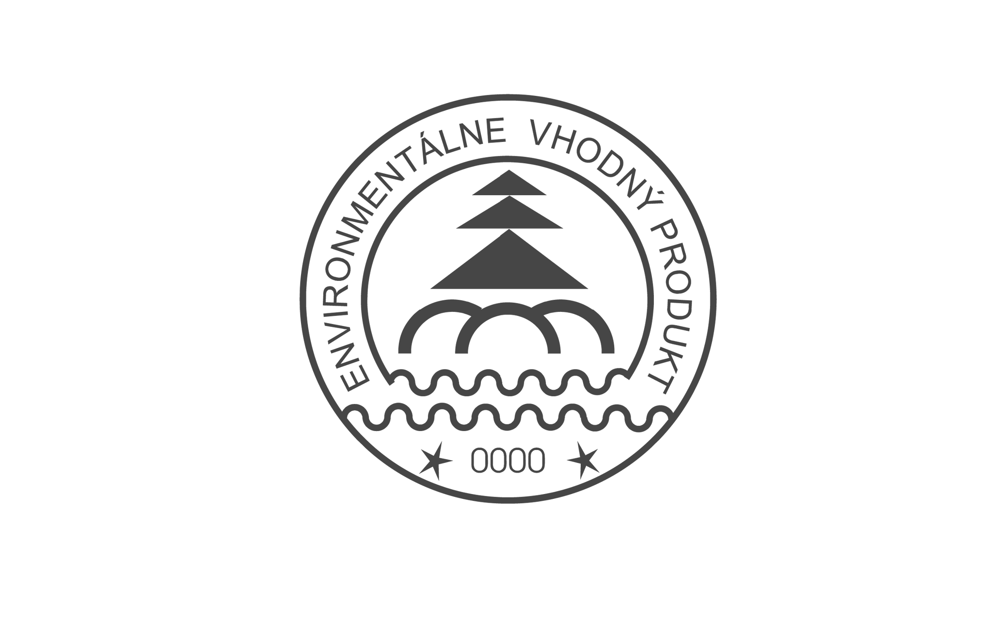

- Príloha č. 2

- k zákonu č. 469/2002 Z. z.

- NÁRODNÁ ENVIRONMENTÁLNA ZNAČKA

- (vzor)

- Národná environmentálna značka podľa vzoru uvedeného v tejto prílohe je jednofarebná a môže sa tlačiť v ľubovoľnej farbe, ktorá vyhovuje celkovému tvarovaniu produktu alebo jeho obalu.

- Vonkajší priemer (veľkosť) značky musí byť minimálne 15 mm.

