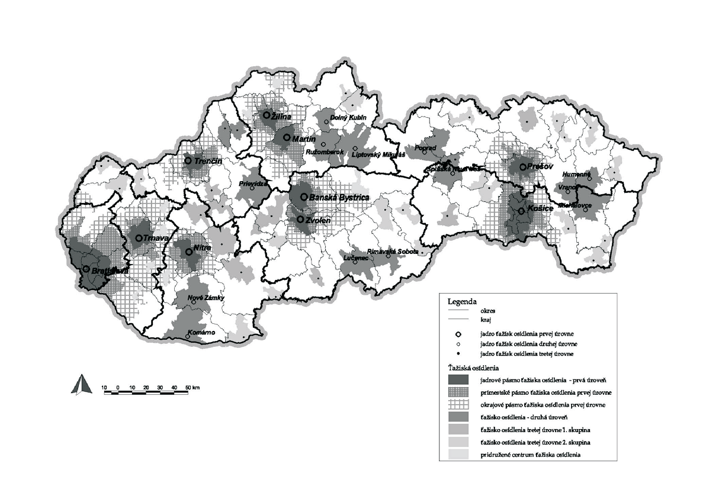
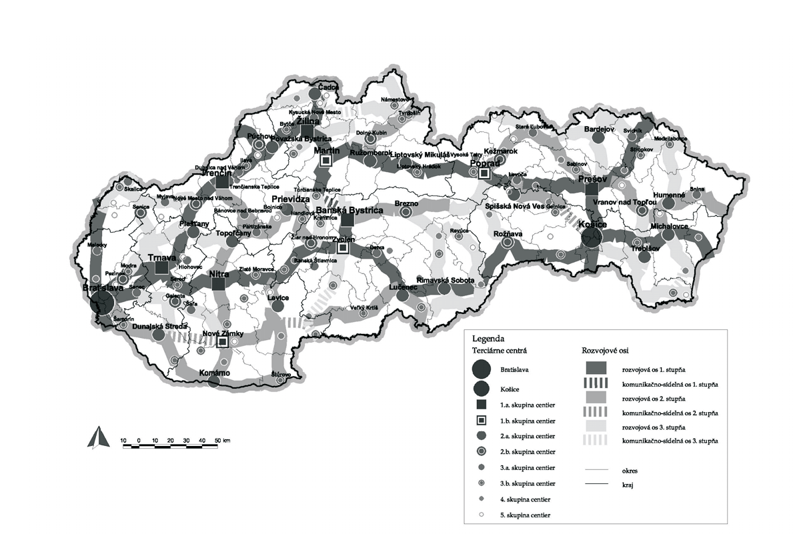
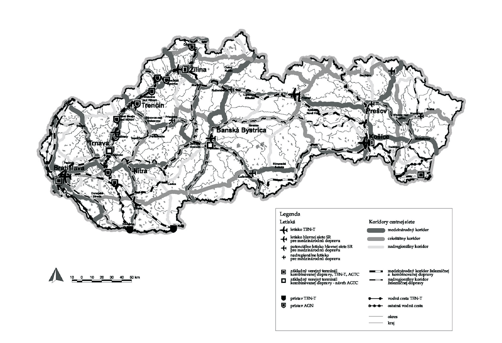

Príloha k nariadeniu vlády č. 528/2002 Z. z.

- KONCEPCIA ÚZEMNÉHO ROZVOJA SLOVENSKA 2001

- ZÁVÄZNÁ ČASŤ

- Pri riadení využitia a usporiadania územia Slovenskej republiky treba dodržať tieto záväzné zásady a regulatívy, ktoré boli schválené uznesením vlády Slovenskej republiky č. 1033 z 31. októbra 2001:

- 1. V oblasti medzinárodných súvislostí usporiadania územia, osídlenia a rozvoja sídelnej štruktúry

- 1.1. Upevňovať priame väzby na jednu z hlavných európskych urbanizačných osí v smere Stuttgart - Ulm - Mníchov - Salzburg/Linz - Viedeň/Bratislava - Budapešť - Belehrad, a to najmä prepojeniami v oblasti Bratislavy a pozdĺž toku Dunaja.

- 1.2. Rozvíjať ťažiská osídlenia a sídla pozdĺž spojníc

- 1.2.1. katowickej a viedenskej aglomerácie,

- 1.2.2. katowickej a budapeštianskej aglomerácie.

- 1.3. Upevňovať sídelné väzby považských ťažísk osídlenia a považského sídelného pásu na paralelný sídelný pás v Českej republike.

- 1.4. Rozvíjať bratislavsko-trnavské ťažisko osídlenia ako súčasť vyššej celoeurópskej aglomerácie Viedeň - Bratislava - Györ s dominantným centrom tvoreným hlavným mestom Bratislava ako jedným z jadier tejto európskej rozvojovej aglomerácie.

- 1.5. Rozvíjať košicko-prešovské ťažisko osídlenia ako ťažisko osídlenia celého Karpatského euroregiónu.

- 1.6. Vytvárať nadnárodnú sieť spolupráce medzi jednotlivými mestami, regiónmi a ostatnými aktérmi územného rozvoja v Slovenskej republike a okolitých štátoch s využitím väzieb jednotlivých sídiel a sídelných systémov v euroregiónoch a ďalších oblastiach cezhraničnej spolupráce.

- 1.7. Rozvíjať dotknuté sídla na trasách multimodálnych koridorov, predovšetkým v uzloch križovania týchto koridorov v smere sever - juh a západ - východ.

- 2. V oblasti celoštátnych a nadregionálnych súvislostí usporiadania územia, osídlenia a rozvoja sídelnej štruktúry

- 2.1. Formovať základnú makrokoncepciu sídelných štruktúr Slovenskej republiky v smere vytvárania polycentrickej siete ťažísk osídlenia a miest, ktorých prepojenia budú podporované rozvojovými osami. Rozvojom polycentrickej sídelnej štruktúry sledovať naviazanie sa na celoeurópsku polycentrickú sídelnú sústavu a komunikačnú kostru prostredníctvom medzinárodne odsúhlasených dopravných koridorov.

- 2.2. Podporovať rozvoj osídlenia vo východnej časti republiky s dominantným postavením košicko-prešovskej aglomerácie s nadväznosťou na michalovsko-vranovsko-humenské ťažisko osídlenia a popradsko – spišskonovoveské ťažisko osídlenia a s previazaním na sídelnú sieť v smere južnoslovenskej rozvojovej osi.

- 2.3. Podporovať v strednej časti republiky, v záujme vytvorenia celoštátne homogénneho a medzinárodne konkurenčného sídelného prostredia, rovnomerne rozložený systém osídlenia miest a vytvorenie vzájomného prepojenia žilinsko-martinského, banskobystricko-zvolenského ťažiska osídlenia s tým, aby sa v južnej časti Slovenskej republiky podporilo vytvorenie centier a lučenecko-rimavskosobotského ťažiska osídlenia, ktoré bude rovnocenné ostatným a ktorého vzájomné prepojenie bude plne podporovať a zabezpečovať rozvoj celého stredojužného územia republiky.

- 2.4. Podporovať predpoklady vytvorenia homogénneho bratislavsko-trnavsko-nitrianskeho ťažiska osídlenia medzinárodného významu s prepojením na najvyššiu európsku polycentrickú sústavu aglomerácií a miest.

- 2.5. Zabezpečovať rozvojovými osami pozdĺž komunikačných prepojení medzinárodného a celoštátneho významu sídelné prepojenia na medzinárodnú sídelnú sieť, ako aj konzistenciu a rovnocennosť rozvojových podmienok ostatného územia Slovenskej republiky.

- 2.6. Formovať sídelnú štruktúru na celoštátnej a nadregionálnej úrovni prostredníctvom regulácie priestorového usporiadania a funkčného využívania územia jednotlivých hierarchických úrovní ťažísk osídlenia, centier osídlenia, rozvojových osí a vidieckych priestorov.

- 2.7. Podporovať rozvoj sídelných centier, ktoré tvoria základné terciárne centrá osídlenia, rozvojové centrá hospodárskych, obslužných a sociálnych aktivít ako pre priliehajúce zázemie, tak pre príslušný regionálny celok, a to hierarchickým systémom pozostávajúcim z týchto skupín centier:

- 2.8. Podporovať rozvoj špecifických centier:

- 2.8.1. mesto Bratislava ako špecifické centrum plniace funkcie hlavného mesta štátu a centra európskeho významu,

- 2.8.2. mesto Košice ako centrum plniace medzinárodné a celoštátne funkcie so zohľadnením postavenia rozhodujúceho/najvýznamnejšieho centra Karpatského euroregiónu.

- 2.9. Podporovať rozvoj centier prvej skupiny, ktoré tvoria jej prvú podskupinu: Banská Bystrica, Nitra, Prešov, Trenčín, Trnava, Žilina.

- 2.10. Podporovať rozvoj centier prvej skupiny, ktoré tvoria jej druhú podskupinu: Martin, Nové Zámky, Poprad, Zvolen.

- 2.11. Podporovať rozvoj centier druhej skupiny, ktoré tvoria jej prvú podskupinu: Bardejov, Čadca, Dunajská Streda, Humenné, Komárno, Levice, Liptovský Mikuláš, Lučenec, Michalovce, Piešťany, Považská Bystrica, Prievidza, Rimavská Sobota, Ružomberok, Spišská Nová Ves, Topoľčany, Trebišov.

- 2.12. Podporovať rozvoj centier druhej skupiny, ktoré tvoria jej druhú podskupinu: Brezno, Dolný Kubín, Galanta, Kežmarok, Nové Mesto nad Váhom, Pezinok, Púchov, Rožňava, Senica, Vranov nad Topľou, Žiar nad Hronom.

- 2.13. Podporovať rozvoj centier tretej skupiny, ktoré tvoria jej prvú podskupinu: Bánovce nad Bebravou, Banská Štiavnica, Detva, Dubnica nad Váhom, Hlohovec, Kysucké Nové Mesto, Malacky, Myjava, Levoča, Partizánske, Senec, Skalica, Stará Ľubovňa, Šaľa, Snina, Svidník.

- 2.14. Podporovať rozvoj centier tretej skupiny, ktoré tvoria jej druhú podskupinu: Bojnice, Bytča, Fiľakovo, Gelnica, Handlová, Hnúšťa, Holíč, Ilava, Kolárovo, Kráľovský Chlmec, Kremnica, Krupina, Liptovský Hrádok, Medzilaborce, Modra, Moldava nad Bodvou, Námestovo, Nová Baňa, Rajec, Revúca, Sabinov, Sečovce, Sereď, Stropkov, Svit, Šamorín, Šahy, Štúrovo, Šurany, Trstená, Turčianske Teplice, Tvrdošín, Veľký Krtíš, Veľký Meder, Vráble, Vysoké Tatry, Zlaté Moravce.

- 2.15. Podporovať rozvoj centier štvrtej skupiny: Dobšiná, Dudince, Giraltovce, Hriňová, Hurbanovo, Krompachy, Lipany, Nová Dubnica, Poltár, Rajecké Teplice, Sobrance, Spišská Belá, Spišské Podhradie, Stará Turá, Stupava, Tisovec, Tornaľa, Trenčianske Teplice, Turzovka, Veľké Kapušany, Vrútky, Žarnovica, Želiezovce.

- 2.16. Podporovať rozvoj centier piatej skupiny: Beluša, Brezová pod Bradlom, Čierna nad Tisou, Dvory nad Žitavou, Gbely, Hanušovce nad Topľou, Jelšava, Krásno nad Kysucou, Leopoldov, Medzev, Modrý Kameň, Nemšová, Nováky, Oščadnica, Podolínec, Sládkovičovo, Sliač, Smižany, Spišská Stará Ves, Strážske, Svätý Jur, Šaštín – Stráže, Tlmače, Veľký Šariš, Vrbové.

- 2.17. Podporovať rozvoj kvartérnych centier, predovšetkým v aglomeráciách s najväčším predpokladom zabezpečenia rozvoja kvartérnych aktivít, akými sú:

- 2.17.1. bratislavsko-trnavsko-nitrianska aglomerácia,

- 2.17.2. košicko-prešovská aglomerácia,

- 2.17.3. banskobystricko-zvolenská aglomerácia,

- 2.17.4. žilinsko-martinská aglomerácia.

- 2.18. Podporovať ako ťažiská osídlenia najvyššej úrovne:

- 2.18.1. bratislavsko-trnavské ťažisko osídlenia ako najvýznamnejšiu aglomeráciu európskeho medzinárodného významu,

- 2.18.2. košicko-prešovské ťažisko osídlenia ako aglomeráciu medzinárodného významu s dominantným postavením v Karpatskom euroregióne,

- 2.18.3. banskobystricko-zvolenské a žilinsko-martinské ťažiská osídlenia ako aglomerácie najvyššieho celoštátneho a medzinárodného významu,

- 2.18.4. nitrianske a trenčianske ťažisko osídlenia ako aglomerácie celoštátneho významu.

- 2.19. Podporovať ako ťažiská osídlenia druhej úrovne:

- 2.19.1. liptovskomikulášsko-ružombersko-dolnokubínske ťažisko osídlenia,

- 2.19.2. lučenecko-rimavskosobotské ťažisko osídlenia,

- 2.19.3. michalovsko-vranovsko-humenské ťažisko osídlenia,

- 2.19.4. novozámocko-komárňanské ťažisko osídlenia,

- 2.19.5. popradsko-spišskonovoveské ťažisko osídlenia,

- 2.19.6. považsko-bystricko-púchovské ťažisko osídlenia,

- 2.19.7. prievidzské ťažisko osídlenia.

- 2.20. Podporovať ako ťažiská osídlenia tretej úrovne prvej skupiny:

- 2.20.1. bánoveckobebravské a partizánske ťažisko osídlenia,

- 2.20.2. bardejovské ťažisko osídlenia,

- 2.20.3. levické ťažisko osídlenia,

- 2.20.4. rožňavské ťažisko osídlenia,

- 2.20.5. topoľčianske ťažisko osídlenia,

- 2.20.6. veľkokrtíšske ťažisko osídlenia,

- 2.20.7. zlatomoravecké ťažisko osídlenia,

- 2.20.8. žiarske ťažisko osídlenia.

- 2.21. Podporovať ako ťažiská osídlenia tretej úrovne druhej skupiny:

- 2.21.1. banskoštiavnické ťažisko osídlenia,

- 2.21.2. gelnické ťažisko osídlenia,

- 2.21.3. hnúštianske ťažisko osídlenia,

- 2.21.4. kráľovskochlmecké ťažisko osídlenia,

- 2.21.5. krompašské ťažisko osídlenia,

- 2.21.6. medzilaborecké ťažisko osídlenia,

- 2.21.7. myjavské ťažisko osídlenia,

- 2.21.8. revúcke ťažisko osídlenia,

- 2.21.9. senické ťažisko osídlenia,

- 2.21.10. skalicko-holíčske ťažisko osídlenia,

- 2.21.11. sninské ťažisko osídlenia,

- 2.21.12. staroľubovnianske ťažisko osídlenia,

- 2.21.13. svidnícko-stropkovské ťažisko osídlenia,

- 2.21.14. šahianske ťažisko osídlenia,

- 2.21.15. štúrovské ťažisko osídlenia,

- 2.21.16. tornalianske ťažisko osídlenia,

- 2.21.17. trebišovské ťažisko osídlenia,

- 2.21.18. tvrdošínsko-námestovské ťažisko osídlenia,

- 2.21.19. veľkokapušianske ťažisko osídlenia.

- 2.22. Podporovať ťažiská osídlenia ako rozvojové sídelné priestory vytváraním ich funkčnej komplexnosti so zohľadnením ich regionálnych súvislostí.

- 2.23. Podporovať nástrojmi územného rozvoja diverzifikáciu ekonomickej základne ťažísk osídlenia pri využívaní špecifických daností a podmienok jednotlivých území.

- 2.24. Sledovať pri decentralizácii riadenia rozvoja územia vytváranie polycentrických systémov - sietí miest a aglomerácií, ktoré efektívne podporujú vytváranie vyššej funkčnej komplexnosti regionálnych celkov.

- 2.25. Formovať ťažiská osídlenia uplatňovaním princípov dekoncentrovanej koncentrácie.

- 2.26. Upevňovať vnútroštátne sídelné väzby medzi ťažiskami osídlenia.

- 2.27. Podporovať budovanie rozvojových osí v záujme tvorby vyváženej hierarchizovanej sídelnej štruktúry.

- Podporovať ako rozvojové osi prvého stupňa:

- 2.27.1. považskú rozvojovú os: Bratislava - Trnava - Trenčín - Žilina,

- 2.27.2. žilinsko-podtatranskú rozvojovú os: Žilina - Martin - Poprad - Prešov,

- 2.27.3. žilinsko-kysuckú rozvojovú os: Žilina - Čadca - hranica s Českou republikou,

- 2.27.4. košicko-prešovskú rozvojovú os: hranica s Poľskou republikou – Svidník – Prešov - Košice - Čaňa - hranica s Maďarskou republikou,

- 2.27.5. nitriansko-pohronskú rozvojovú os: Trnava - Nitra - Žiar nad Hronom - Zvolen,

- 2.27.6. zvolensko-turčiansku rozvojovú os: Zvolen - Banská Bystrica - Turčianske Teplice - Martin v úseku Banská Bystrica – Turčianske Teplice ako komunikačno-sídelnú os,

- 2.27.7. zvolensko-južnoslovenskú rozvojovú os: Zvolen - Lučenec - Rimavská Sobota - Rožňava - Košice,

- 2.27.8. východoslovenskú rozvojovú os: Košice - Sečovce - Michalovce - Sobrance - hranica s Ukrajinou,

- 2.27.9. záhorskú rozvojovú os: Bratislava - Malacky - Kúty - hranica s Českou republikou.

- 2.27.10. lyskú rozvojovú os: Beluša – Púchov – Lysá pod Makytou – hranica s Českou republikou.

- 2.28. Podporovať ako rozvojové osi druhého stupňa:

- 2.28.1. žitnoostrovno-dunajskú rozvojovú os: Bratislava - Dunajská Streda – Komárno – Štúrovo,

- 2.28.2. ponitriansku rozvojovú os: Trenčín - Bánovce nad Bebravou - Topoľčany - Nitra - Nové Zámky - Komárno,

- 2.28.3. hornonitriansku rozvojovú os: Topoľčany/Bánovce nad Bebravou - Partizánske - Prievidza - Handlová - Žiar nad Hronom,

- 2.28.4. pohronskú rozvojovú os: Hronský Beňadik - Levice - Želiezovce - Štúrovo,

- 2.28.5. južnoslovenskú rozvojovú os: Dunajská Streda - Nové Zámky - Želiezovce - Šahy - Veľký Krtíš - Lučenec v úsekoch Dunajská Streda – Nové Zámky, Želiezovce – Dudince ako komunikačno-sídelnú os,

- 2.28.6. novohradskú rozvojovú os: Lučenec - Fiľakovo - hranica s Maďarskou republikou,

- 2.28.7. liptovsko-oravskú rozvojovú os: Ružomberok - Dolný Kubín - Trstená - hranica s Poľskou republikou,

- 2.28.8. hornopohronskú rozvojovú os: Banská Bystrica - Brezno - Heľpa,

- 2.28.9. kežmarsko-toryskú rozvojovú os: Poprad – Kežmarok – Stará Ľubovňa – Sabinov – Prešov,

- 2.28.10. prešovsko-michalovskú rozvojovú os: Prešov - Hanušovce nad Topľou - Vranov nad Topľou - Strážske - Michalovce/Humenné,

- 2.28.11. vihorlatskú rozvojovú os: Humenné - Snina - hranica s Ukrajinou.

- 2.28.12. hornádsku rozvojovú os: Spišský Štvrtok – Spišská Nová Ves – Krompachy – Košice (v úseku Gelnica – Košice ako komunikačno-sídelnú os),

- 2.28.13. skaliťanskú rozvojovú os: Svrčinovec – Čierne – Skalité – hranica s Poľskou republikou.

- 2.29. Podporovať ako rozvojové osi tretieho stupňa:

- 2.29.1. záhorsko-trnavskú rozvojovú os: hranica s Českou republikou – Holíč – Senica – Trnava,

- 2.29.2. dolnomoravskú rozvojovú os: Kúty – Holíč – Skalica – hranica s Českou republikou,

- 2.29.3. malokarpatskú rozvojovú os: Modra – Smolenice – Chtelnica – Vrbové,

- 2.29.4. piešťansko-topoľčiansku rozvojovú os: Vrbové – Piešťany – Topoľčany,

- 2.29.5. myjavskú rozvojovú os: Senica – Myjava – Stará Turá – Nové Mesto nad Váhom,

- 2.29.6. podunajskú rozvojovú os: Senec – Galanta – Nové Zámky,

- 2.29.7. dudvážsko-dunajskú rozvojovú os: Galanta – Dunajská Streda,

- 2.29.8. kremnicko-turčiansku rozvojovú os: Žiar nad Hronom – Kremnica – Turčianske Teplice,

- 2.29.9. hornonitriansko-turčiansku rozvojovú os: Prievidza – Turčianske Teplice (v úseku Nitrianske Pravno – Turčianske Teplice ako komunikačno-sídelnú os),

- 2.29.10. kysuckú rozvojovú os: Čadca – Turzovka – Makov,

- 2.29.11. kysucko-oravskú rozvojovú os: Krásno nad Kysucou – Nová Bystrica – Námestovo – Tvrdošín – Trstená – Suchá Hora – hranice s Poľskou republikou (v úseku Krásno nad Kysucou – Nová Bystrica – Oravská Lesná ako komunikačno-sídelnú os),

- 2.29.12. kraľoviansku rozvojovú os: Kraľovany – Dolný Kubín,

- 2.29.13. polhoranskú rozvojovú os: Námestovo – Oravská Polhora – hranica s Poľskou republikou,

- 2.29.14. žilinskú rozvojovú os: Žilina – Varín – Terchová,

- 2.29.15. rajeckú rozvojovú os: Žilina – Rajec,

- 2.29.16. starohorskú rozvojovú os: Banská Bystrica – Staré Hory,

- 2.29.17. šarišskú rozvojovú os: Prešov – Bardejov – hranica s Poľskou republikou,

- 2.29.18. ľubovniansko-svidnícku rozvojovú os: Stará Ľubovňa – Bardejov – Svidník,

- 2.29.19. zamagurskú rozvojovú os: Stará Ľubovňa – Spišská Stará Ves,

- 2.29.20. laboreckú rozvojovú os: Svidník – Stropkov – Medzilaborce – hranica s Poľskou republikou/Humenné,

- 2.29.21. zemplínsku rozvojovú os: Košice – Slovenské Nové Mesto – Kráľovský Chlmec – Čierna nad Tisou,

- 2.29.22. vranovsko-trebišovskú rozvojovú os: Vranov nad Topľou – Sečovce – Trebišov – Slovenské Nové Mesto – hranica s Maďarskou republikou,

- 2.29.23. horehronskú rozvojovú os: Heľpa – Vernár – Poprad,

- 2.29.24. rožňavsko-dobšinskú rozvojovú os: Rožňava – Dobšiná – Vernár,

- 2.29.25. muráňsku rozvojovú os: hranica s Maďarskou republikou – Tornaľa – Revúca – Tisovec,

- 2.29.26. rimavickú rozvojovú os: Rimavská Sobota – Hnúšťa – Tisovec – Brezno,

- 2.29.27. cerovskú rozvojovú os: Fiľakovo – Rimavská Sobota/Rimavská Seč – hranica s Maďarskou republikou/Tornaľa,

- 2.29.28. krupinskú rozvojovú os: Zvolen – Krupina – Šahy – hranica s Maďarskou republikou (v úseku Krupina – Šahy – hranica s Maďarskou republikou ako komunikačno-sídelnú os),

- 2.29.29. juholaboreckú rozvojovú os: Michalovce – Veľké Kapušany – Kráľovský Chlmec (v úseku Veľké Kapušany – Kráľovský Chlmec ako komunikačno-sídelnú os).

- 3. V oblasti rozvoja vidieckeho priestoru a vzťahu medzi mestom a vidiekom

- 3.1. Podporovať vzťah urbánnych a rurálnych území v novom partnerstve založenom na integrácii funkčných vzťahov mesta a vidieka a prírodných, kultúrno-historických a urbanisticko-architektonických daností, pričom pri ich rozvoji zohľadniť koordinovaný proces prepojenia sektorových strategických a rozvojových dokumentov.

- 3.2. Zachovávať pôvodný špecifický ráz vidieckeho priestoru, vychádzať z pôvodného charakteru zástavby a historicky utvorenej okolitej krajiny; zachovať historicky utváraný typ zástavby obcí a zohľadňovať národopisné špecifiká jednotlivých regiónov.

- 3.3. Pri rozvoji vidieckych oblastí zohľadňovať ich ekonomické danosti, špecifické prírodné a krajinné prostredie a pri rozvoji jednotlivých činností dbať na zamedzenie, resp. obmedzenie možných negatívnych dôsledkov týchto činností na krajinné a životné prostredie vidieckeho priestoru.

- 3.4. Vytvárať podmienky dobrej dostupnosti vidieckych priestorov k sídelným centrám, podporovať výstavbu verejného dopravného a technického vybavenia obcí, moderných informačných technológií tak, aby vidiecke priestory vytvárali kultúrne a pracoviskovo rovnocenné prostredie voči urbánnym priestorom a dosiahnuť tak skĺbenie tradičného vidieckeho prostredia s požiadavkami na moderný spôsob života.

- 4. V oblasti zachovania, zhodnotenia a využívania kultúrneho dedičstva

- 4.1. Posudzovať pri rozvoji územia význam a hodnoty jeho kultúrno-historických daností v nadväznosti na všetky zámery v sociálno-ekonomickom rozvoji.

- 4.2. Zohľadňovať a revitalizovať v územnom rozvoji:

- 4.2.1. územia lokalít zapísaných v Zozname svetového dedičstva,

- 4.2.2. pamiatkový fond, ktorý tvoria pamiatkové rezervácie, pamiatkové zóny a národné kultúrne pamiatky, ako aj ochranné pásma všetkých kategórií pamiatkového fondu,

- 4.2.3. územia historických jadier miest a obcí,

- 4.2.4. známe a predpokladané archeologické náleziská a archeologické nálezy,

- 4.2.5. územia miest a obcí, kde je zachytený historický stavebný fond,

- 4.2.6. novodobé architektonické a urbanistické diela,

- 4.2.7. areály architektonických diel s dotvárajúcim prírodným prostredím,

- 4.2.8. historické technické diela.

- 4.2.9. historické krajinné štruktúry vrátane území s rozptýleným osídlením.

- 4.3. Rešpektovať objekty, súbory alebo areály objektov, ktoré sú navrhované na vyhlásenie za národné kultúrne pamiatky, územia navrhované na vyhlásenie za pamiatkové rezervácie, a pamiatkové zóny a ochranné pásma, ako aj objekty vedené v evidenciách pamätihodností miest a obcí.

- 5. V oblasti usporiadania územia z hľadiska ekologických aspektov, ochrany prírody, prírodných zdrojov, nerastného bohatstva a starostlivosti o krajinu a tvorby krajinnej štruktúry

- 5.1. Zabezpečovať nástrojmi územného plánovania ekologicky optimálne využívanie územia pri rešpektovaní a skvalitňovaní územného systému ekologickej stability, biotickej integrity krajiny a biodiverzity na úrovni národnej, regionálnej aj lokálnej.

- 5.2. Rešpektovať pri organizácii, využívaní a rozvoji územia význam a hodnoty jeho prírodných daností. V chránených územiach (európska sústava chránených území NATURA 2000 vrátane navrhovaných, národná sústava chránených území, chránené územia vyhlásené v zmysle medzinárodných dohovorov), v prvkoch prírodného dedičstva UNESCO, v NECONET, v biotopoch európskeho významu, národného významu a v biotopoch druhov európskeho a národného významu zosúladiť využívanie územia s funkciou ochrany prírody a krajiny s cieľom udržania resp. dosiahnutia priaznivého stavu druhov, biotopov a častí krajiny.

- 5.3. Rešpektovať pri umiestňovaní činností do územia hodnotovo-významové vlastnosti krajiny integrujúce v sebe prírodné a kultúrne dedičstvo, nerastné bohatstvo, vrátane energetických surovín, zohľadňovať ich predpokladané vplyvy na životné prostredie, na charakteristický vzhľad krajiny a realizáciou vhodných opatrení dosiahnuť odstránenie, obmedzenie alebo zmiernenie prípadných negatívnych vplyvov, ako aj elimináciu nežiaducich zmien v charakteristickom vzhľade krajiny.

- 5.4. Zabezpečovať zvýšenie ekologickej stability, prípadne obnovu biotickej integrity a biologickej rozmanitosti v územiach a krajinných segmentoch s narušeným prírodným, resp. životným prostredím.

- 5.5. Zabezpečovať zachovanie a ochranu všetkých typov mokradí, revitalizovať vodné toky a ich brehové územia s cieľom obnoviť integritu a zabezpečiť dlhodobo priaznivé existenčné podmienky pre akvatickú a semiakvatickú biotu vodných ekosystémov.

- 5.6. Identifikovať stresové faktory v území a zabezpečovať ich elimináciu.

- 5.7. Zabezpečovať vhodnú delimitáciu pôdneho fondu v súlade s potenciálom územia.

- 5.8. Uplatňovať účinné krajinnoekologické a technické opatrenia na elimináciu negatívnych vplyvov pri využívaní prírodných zdrojov a kultúrno-historických štruktúr.

- 5.9. Rešpektovať kvalitnú poľnohospodársku pôdu ako základný pilier potravinovej bezpečnosti štátu. Zabezpečiť ochranu najkvalitnejších a najprodukčnejších poľnohospodárskych pôd pred ich zástavbou už v rámci územnoplánovacej činnosti. Zabezpečovať ochranu pôdnych zdrojov vhodným a racionálnym využívaním poľnohospodárskej a lesnej krajiny a to aj s dôrazom na zamedzovanie erózie pôdy.

- 5.10. Asanovať a revitalizovať územia s vysokým stupňom environmentálnej záťaže.

- 5.11. Zabezpečiť ochranu a racionálne využívanie prírodných zdrojov, nerastného bohatstva vrátane energetických surovín a obnoviteľných zdrojov energie, eliminovať nadmerné čerpanie neobnoviteľných zdrojov, regulovať využívanie obnoviteľných zdrojov v súlade s mierou ich samoreprodukcie a revitalizovať narušené prírodné zdroje, najmä tie, ktoré sú poškodené alebo zničené následkom klimatických zmien, živelných pohrôm a prírodných katastrof.

- 5.12. Riešiť ochranu nerastného bohatstva a jeho racionálneho využívanie v súlade s organizáciou priestorového usporiadania a funkčného využívania a s požiadavkami na ochranu prírody a krajiny.

- 5.13. Zabezpečovať trvalo ochranu krajiny v zmysle Európskeho dohovoru o krajine smerujúcu k zachovaniu a udržaniu významných alebo charakteristických čŕt krajiny vyplývajúcich z jej historického dedičstva a prírodného usporiadania, alebo ľudskej aktivity.

- 6. V oblasti hospodárstva a regionálneho rozvoja

- 6.1. Rozvíjať decentralizovanú štruktúru ekonomiky prostredníctvom vytvorenej polycentrickej sústavy mestského osídlenia, a tým zabezpečovať aj vyváženú socio-ekonomickú úroveň regiónov v súlade s platnými strategickými a programovými dokumentmi v oblasti regionálneho rozvoja.

- 6.2. Zabezpečiť dostupnosť trhov a vytvorenie rovnocenných podmienok na podnikanie dobudovaním a modernizáciou územia regiónov verejnou infraštruktúrou.

- 6.3. Diverzifikovať odvetvovú ekonomickú základňu miest a regiónov a podporovať v záujme trvalej udržateľnosti malé a stredné podnikanie.

- 6.4. Vytvárať podmienky na rovnomerné rozmiestnenie obyvateľstva s vyššou kvalifikáciou a zvyšovať vzdelanostnú úroveň a mobilitu pracovnej sily v regiónoch.

- 6.5. Sústrediť pozornosť na rozvoj „Globálnej informačnej spoločnosti“ v Slovenskej republike predovšetkým skvalitňovaním infraštruktúry komunikačných systémov.

- 6.6. Zvyšovať kvalitu riadenia a koordinácie nástrojov regionálnej a územnoplánovacej politiky.

- 6.7. Zvyšovať konkurencieschopnosť a ekonomickú výkonnosť regiónov rozvíjaním inovačného potenciálu regiónov a efektívnejším využívaním existujúcich výrobných zdrojov.

- 7. V oblasti poľnohospodárskej výroby a lesného hospodárstva

- 7.1. Stabilizovať výmeru najkvalitnejších pôd, najmä pôd pod závlahami, pôd vinohradov a najlepších bonít a ochranu výmery a kvality pôdy uskutočňovať nielen ako ochranu hospodársko-sociálneho potenciálu štátu, ale aj ako súčasť ochrany prírodného a životného prostredia. V územnom rozvoji rešpektovať zachovalé a prevádzkyschopné závlahové sústavy a odvodňovacie kanálové siete a čerpacie stanice.

- 7.2. Stabilizovať a revitalizovať poľnohospodárske odvetvie diferencovane podľa poľnohospodárskych produkčných oblastí.

- 7.3. Zabezpečiť v záujme rozvoja vidieka v horských a podhorských oblastiach so sťaženými prírodnými podmienkami primeranú životnú úroveň a zlepšenie kvality života vidieckeho obyvateľstva prostredníctvom podpory vybraných centier s využitím ich prírodného, demografického a kultúrno-historického potenciálu v prospech rozvoja vidieckych oblastí.

- 7.4. Rozvíjať tradičnú remeselnú výrobu, doplnkové výroby a nevýrobné činnosti súvisiace s poľnohospodárskou a lesnou činnosťou, ako integrovanú súčasť hospodárenia na pôde, podporujúce rozvoj vidieka.

- 7.5. Realizovať ozdravné opatrenia v najviac poškodených lesných spoločenstvách.

- 7.6. Rešpektovať lesné pozemky a ich ochranné pásmo ako limitujúci prvok pri územnom rozvoji krajiny.

- 7.7. Zabezpečiť pri reštrukturalizácii krajiny vrátane projektov pozemkových úprav podmienky pre uplatňovanie zásad tvorby krajiny s rešpektovaním špecifických foriem osídlenia a historických krajinných štruktúr v typickom charaktere poľnohospodárskej krajiny.

- 8. V oblasti priemyslu a stavebníctva

- 8.1. Vychádzať pri územnom rozvoji predovšetkým z princípu rekonštrukcie a sanácie existujúcich priemyselných a stavebných areálov.

- 8.2. Podporovať budovanie rôznych typov priemyselných parkov vo všetkých regiónoch Slovenskej republiky na základe zhodnotenia ich externých a interných lokalizačných faktorov.

- 8.3. Vychádzať pri rozvoji priemyslu a stavebníctva nielen z ekonomickej a sociálnej, ale aj územnej a environmentálnej únosnosti územia v súčinnosti s hodnotami a limitami kultúrno-historického potenciálu územia a historického stavebného fondu so zohľadňovaním špecifík jednotlivých regiónov Slovenskej republiky a využívať pritom predovšetkým miestne suroviny.

- 8.4. Vychádzať pri vytváraní a prevádzke výrobných kapacít z využitia komparatívnych výhod regiónu (poloha, ekonomický potenciál, disponibilné zdroje).

- 9. V oblasti rozvoja rekreácie a turizmu

- 9.1. Podporovať tie druhy a formy turizmu, ktoré sú predmetom medzinárodného záujmu a ktoré z hľadiska potenciálu patria medzi ťažiskové formy na Slovensku vidiecky cestovný ruch a agroturistika, mestský a kultúrno-poznávací cestovný ruch, zimný cestovný ruch a zimné športy, kúpeľný a zdravotný cestovný ruch, letná turistika a pobyty pri vode.

- 9.2. Nadviazať na medzinárodný turizmus, a to najmä sledovaním turistických tokov a dopravných trás prechádzajúcich, resp. končiacich v Slovenskej republike. Venovať väčšiu pozornosť aktívnemu zahraničnému turizmu, cezhraničným vzťahom a malému prihraničnému turizmu.

- 9.3. Previazať dôslednejšie ciele rekreačného a poznávacieho turizmu.

- 9.4. Dotvoriť funkčno-priestorový systém rekreácie a turizmu na celoslovenskej úrovni vytváraním siete rekreačných územných celkov, siete rekreačných záujmových území väčších miest a siete ucelených území vidieckeho osídlenia.

- 9.5. Viazať lokalizáciu služieb zabezpečujúcich proces rekreácie a turizmu prednostne do sídiel s cieľom zamedziť neodôvodnené rozširovanie rekreačných útvarov vo voľnej krajine s využitím obnovy a revitalizácie historických mestských a vidieckych celkov a objektov kultúrnych pamiatok.

- 9.6. Podporovať podmienky na prímestskú rekreáciu obyvateľov miest v ich záujmovom území.

- 9.7. Podporovať rozvoj kúpeľných miest so zriadenými prírodnými liečebnými kúpeľmi alebo kúpeľnými liečebňami, za súčasného rešpektovania tvorby kúpeľného prostredia a ochrany kúpeľných území kúpeľných miest.

- 9.8. Podporovať vznik a rozvoj miestnych kúpeľov na základe využitia špecifík daného územia.

- 9.9. Na podporu rozvojových smerov turizmu využívať železničnú a cestnú dopravu, rozvoj a prepájanie cyklotrás, ako aj budovanie príslušnej technickej infraštruktúry.

- 9.10. Zabezpečovať na územiach európskej sústavy chránených území a územiach národnej sústavy chránených území funkcie spojené s rozvojom turizmu a rekreácie tak, aby nedochádzalo k zhoršeniu stavu ochrany týchto území a predmetu ich ochrany.

- 10. V oblasti rozvoja sociálnej infraštruktúry

- 10.1. Školstvo

- 10.1.1. Podporovať rovnomerný rozvoj škôl, vzdelávacích, školiacich a preškoľovacích zariadení na území štátu.

- 10.1.2. Znižovať regionálne rozdiely v úrovni vzdelania podporou vzdelávacích centier v prirodzených sídelných centrách a prispôsobovať sieť stredných škôl trhu práce a podporovaným ekonomickým aktivitám.

- 10.1.3. Diverzifikovať vysokoškolské štúdium predovšetkým do území, ktoré sú ekonomicky problémové a ktoré potrebujú nové rozvojové impulzy. V týchto územiach vytvárať, v súčinnosti s podporou adekvátnych ekonomických aktivít, vysoké školy podstatne viac zamerané na prax, t. j. zabezpečujúce štúdium na bakalárskej úrovni a sledujúce podporované ekonomické aktivity.

- 10.1.4. Podporovať vytváranie stredných odborných škôl, ktoré poskytujú pomaturitné vzdelávanie v rámci jednotlivých regiónov.

- 10.2. Zdravotníctvo

- 10.2.1. Rozvíjať zdravotnícke zariadenia v záujme ich optimálneho využitia v rovnocennej prístupnosti obyvateľov.

- 10.2.2. Podporovať zdravotnícke služby pri poskytovaní zdravotnej starostlivosti, a to najmä v oblastiach vzdialenejších od sídelných centier.

- 10.2.3. Rozšíriť kapacitu liečební, hospicov a domov ošetrovateľskej starostlivosti v súlade s potrebami obyvateľstva v regiónoch.

- 10.3. Sociálne veci

- 10.3.1. Podporovať rozvoj a dostupnosť sociálnych služieb poskytovaných v zariadeniach sociálnych služieb v súlade s národnými prioritami rozvoja sociálnych služieb a potrebami obyvateľov v území a opatrení sociálnoprávnej ochrany detí a sociálnej kurately vykonávaných v zariadeniach sociálnoprávnej ochrany detí a sociálnej kurately.

- 10.3.2. Vytvoriť podmienky pre postupné transformovanie veľkokapacitných zariadení sociálnych služieb na komunitne orientované formy sociálnych služieb, spojené s modernizáciou a zvyšovaním kvality poskytovaných služieb a ich efektívnym zabezpečovaním a vytvoriť podmienky na pokračovanie procesu transformácie a humanizácie zariadení sociálnoprávnej ochrany detí a sociálnej kurately.

- 10.4. Kultúra a umenie

- 10.4.1. Podporovať rovnomerne prevádzku a činnosť existujúcej siete kultúrnych zariadení v regiónoch ako neoddeliteľnej súčasti existujúcej infraštruktúry a kultúrnych služieb obyvateľstvu.

- 11. V oblasti rozvoja nadradeného dopravného vybavenia

- 11.1. Stabilizovať základné zónovanie Slovenskej republiky v priestoroch

- 11.1.1. Bratislava,

- 11.1.2. juhozápadné Slovensko a dopravno-gravitačné centrum Nitra/Trnava,

- 11.1.3. severozápadné Slovensko a dopravno-gravitačné centrum Žilina/Martin,

- 11.1.4. stredné Slovensko a dopravno-gravitačné centrum Zvolen/Banská Bystrica,

- 11.1.5. východné Slovensko a dopravno-gravitačné centrum Košice/Prešov.

- 11.2. Rešpektovať nadradené postavenie paneurópskych multimodálnych koridorov Medzinárodného dopravného fóra (ďalej len ITF), ktorá je nástupníckou organizáciou Európskej konfederácie ministrov dopravy (CEMT) a dopravných sietí TEN-T. V ich rámci rešpektovať prioritnú pozíciu projektov európskeho záujmu:

- 11.2.1. železničnej infraštruktúry osi (Paríž – Štrasburg – Štuttgard – Viedeň) Bratislava, na území Slovenska alokovanej a plánovanej v rámci paneurópskeho multimodálneho koridoru č. V. vetva Va,

- 11.2.2. infraštruktúry vnútrozemskej vodnej cesty Rýn – Mohan – Dunaj, na území Slovenska alokovanej a plánovanej v rámci paneurópskeho multimodálneho koridoru č. VII.,

- 11.2.3. železničnej infraštruktúry osi (Gdansk – Varšava – Katovice) – Brno/Žilina – Bratislava – (Viedeň), na území Slovenska alokovanej a plánovanej v rámci paneurópskych multimodálnych koridorov č. V. vetva Va a VI,

- 11.2.4. cestnej infraštruktúry osi (Gdansk – Varšava – Katovice) – Brno/Žilina – Bratislava – (Viedeň), na území Slovenska alokovanej a plánovanej v rámci paneurópskych multimodálnych koridorov č. V. vetva Va a VI.

- 11.3. Rešpektovať dopravné siete a zariadenia TEN-T a európskych dohôd alokované a plánované v trasách paneurópskych multimodálnych koridorov ITF:

- 11.3.1. multimodálny koridor č. IV. (Berlín/Norimberg – Praha) – Kúty – Bratislava/Rusovce – (Budapešť – Rumunsko/Turecko/Grécko) lokalizovaný pre cesty siete TEN-T, (Berlín/Norimberg – Praha) – Kúty – Bratislava – Nové Zámky – Štúrovo – (Budapešť – Rumunsko/Turecko/Grécko) lokalizovaný pre konvenčné trate železničnej a kombinovanej dopravy siete TEN-T,

- 11.3.2. multimodálny koridor č. V. vetva Va. (Rakúsko) – Bratislava/Jarovce – Žilina – Košice – Záhor/Čierna nad Tisou – (Užhorod – Ľvov) lokalizovaný pre cesty, pre konvenčné trate železničnej a kombinovanej dopravy a pre vysokorýchlostnú železničnú trať Bratislava – Žilina,

- 11.3.3. multimodálny koridor č. VI. (Gdansk – Varšava – Katovice) – Skalité – Čadca – Žilina/Hričovské Podhradie/Dubná Skala lokalizovaný pre cesty, pre konvenčné trate železničnej a kombinovanej dopravy sieti TEN-T a pre vysokorýchlostnú železničnú trať Skalité – Žilina,

- 11.3.4. multimodálny koridor č. VII. vodná cesta Dunaj s verejnými prístavmi v Bratislave, Komárne a Štúrove,

- 11.3.5. hlavné železničné uzlové body a základné verejné terminály kombinovanej dopravy sieti TEN-T v Bratislave (multimodálne koridory č. IV. a V. – vetva Va), Žiline (multimodálne koridory č. V. – vetva Va, VI.), Košiciach a Dobrej – ako náhrada za pôvodný terminál v Čiernej nad Tisou (multimodálny koridor č. V. – vetva Va),

- 11.3.6. letiská siete TEN-T pre medzinárodnú dopravu v Bratislave (multimodálne koridory č. IV. a V. vetva Va), Košiciach a Poprade (multimodálny koridor č. V. vetva Va).

- 11.4. Rešpektovať dopravnú infraštruktúru alokovanú a plánovanú v trasách mimokoridorových ITF sieti konvenčnej železničnej a kombinovanej dopravy TEN-T

- 11.4.1. (Krakov) – Plaveč – Prešov – Košice – Kechnec (Miškovec – Rumunsko), v úseku Košice – Kechnec – (Miškovec),

- 11.4.2. Leopoldov – Galanta,

- 11.4.3. Nové Zámky – Komárno – (Komárom),

- 11.4.4. Púchov – Strelenka – (Olomouc),

- 11.4.5. Čadca – Svrčinovec – (Ostrava),

- 11.4.6. Nové Zámky/Palárikovo – Levice – Zvolen – Lučenec – Košice s hlavným železničným uzlovým bodom vo Zvolene.

- 11.5. Rešpektovať dopravnú infraštruktúru alokovanú a schválenú v trasách mimokoridorovej ITF cestnej siete TEN-T

- 11.5.1. Martin – Turčianske Teplice – Šášovské Podhradie – Zvolen – Šahy – (Budapešť),

- 11.5.2. (Rzeszov) – Svidník – Prešov – Košice – Milhosť – (Miškovec – Rumunsko) (zároveň ako súčasť výhľadovej Via Carpatia Kaunas – Lublin – Rzesov – Svidník – Prešov – Košice – Miškovec – Rumunsko – Ukrajina/Odesa).

- 11.6. Rešpektovať dopravné siete a zariadenia TEN-T alokované a plánované v trasách pripravovaných multimodálnych koridorov a ich vetiev

- 11.6.1. prioritná os západ – východ (Norimberg/Drážďany – Praha – Olomouc) – Lysá pod Makytou – Púchov – Žilina – Košice – Záhor/Čierna nad Tisou – (Užhorod – Ľvov) lokalizovaná pre cesty a konvenčné železničné trate sieti TEN-T,

- 11.6.2. prepojenie vetiev multimodálneho koridoru č. VI. a VI. vetva VI.b Čadca – Svrčinovec – (Ostrava), lokalizované pre cesty a konvenčné železničné trate sieti TEN-T,

- 11.6.3. prepojenie vetiev multimodálneho koridoru č. V. vetva V.a Košice – Milhosť/Kechnec – (Miškovec), lokalizované pre cesty a konvenčné železničné trate sieti TEN-T.

- 11.7. Rešpektovať dopravnú infraštruktúru zaradenú podľa európskych dohôd (AGR) koridory ciest

- 11.7.1. E 50 (Brest – Paríž – Norimberg – Praha – Brno) – Drietoma – Trenčín – Žilina – Prešov – Košice – Vyšné Nemecké – (Užhorod – Dnepropetrovsk – Machačkala),

- 11.7.2. E 65 (Malmö – Štetín – Praha – Brno – Břeclav) – Bratislava – (Rajka – Záhreb – Split – Tripoli – Chania),

- 11.7.3. E 75 (Vardo – Helsinki – Gdansk – Katovice – Český Těšín) – Žilina – Bratislava – (Győr – Budapešť – Belehrad – Skopje – Solún – Atény – Sitia),

- 11.7.4. E 58 (Viedeň) – Bratislava – Zvolen – Košice – Vyšné Nemecké – (Užhorod – Kišinev – Odesa – Cherson – Rostov na Done),

- 11.7.5. E 71 Košice – Milhosť – (Miškovec – Budapešť – Záhreb – Split),

- 11.7.6. E 77 (Pskov – Riga – Gdansk – Varšava – Krakov) – Trstená – Ružomberok – Banská Bystrica – Zvolen – Šahy – (Budapešť),

- 11.7.7. E 371 (Radom – Rzeszov – Barvinek) – Vyšný Komárnik – Svidník – Prešov,

- 11.7.8. E 442 (Karlove Vary – Teplice – Hradec Králové – Olomouc) – Makov – Bytča – Žilina,

- 11.7.9. E 571 Bratislava – Zvolen – Košice,

- 11.7.10. E 572 Trenčín – Žiar nad Hronom,

- 11.7.11. E 575 Bratislava – Dunajská Streda – Medveďov – (Vámosszabadi – Győr).

- 11.8. Rešpektovať dopravnú infraštruktúru navrhovanú ako upravená existujúca alebo výhľadová súčasť medzinárodných cestných sietí

- 11.8.1. (Hodonín) – Holíč – Senica – Trnava,

- 11.8.2. (Kittsee) – Bratislava/(Jarovce) – Rovinka – Ivanka pri Dunaji sever – Bratislava/Rača – Marianka – Stupava juh – (Marchegg),

- 11.8.3. Lučenec – Šiatorská Bukovinka – (Salgótarján – Hatvan E71),

- 11.8.4. Lipníky – Vranov nad Topľou – Humenné – Michalovce,

- 11.8.5. Lysá pod Makytou – Púchov – Beluša,

- 11.9.6. Nitra – Nové Zámky – Komárno.

- 11.9. Rešpektovať dopravnú infraštruktúru zaradenú podľa európskych dohôd (AGC, AGTC) koridory konvenčných tratí a zariadenia železničnej a kombinovanej dopravy

- 11.9.1. trate E 40, C – E 40 (Le Havre – Paríž – Norimberg – Praha – Hranice na Morave – Ostrava) – Čadca – Žilina – Košice – Čierna nad Tisou – (Čop), (Hranice na Morave) – Lúky pod Makytou – Púchov,

- 11.9.2. trate E 52, C – E 52 (Viedeň – Marchegg) – Bratislava – Galanta – Nové Zámky – Štúrovo – (Szob – Budapešť – Nyíregyháza),

- 11.9.3. trate E 61, C – E 61 (Štokholm – Berlín – Praha – Lanžhot) – Kúty – Bratislava/Rusovce – (Hegyeshalom), Bratislava – Nové Zámky – Komárno – (Komárom – Budapešť),

- 11.9.4. trať E 63 (Viedeň – Kittsee) – Bratislava – Leopoldov – Žilina, Galanta – Leopoldov, C – E 63 (Viedeň – Kittsee) – Bratislava – Leopoldov – Žilina – Čadca – Skalité – (Czechowice-Dzedzice), Galanta – Leopoldov,

- 11.9.5. trať C 30/1 (Krakov – Muszyna) – Plaveč – Prešov – Košice – Kechnec – (Hidasnémeti – Miškovec),

- 11.9.6. základné verejné terminály kombinovanej dopravy medzinárodného významu v Bratislave, Žiline, Košiciach a Dobrej (ako náhrada za terminál v Čiernej nad Tisou, terminál typu Hub v Leopoldove,

- 11.9.7. hraničné železničné stanice s významom pre medzinárodnú kombinovanú dopravu Čadca, Lúky pod Makytou, Kúty, Čierna nad Tisou, Komárno, Štúrovo.

- 11.10 Rešpektovať dopravnú infraštruktúru navrhnutú na zaradenie do európskych dohôd (AGC, AGTC) koridory tratí a zariadenia železničnej a kombinovanej dopravy

- 11.10.1. trať Bratislava/Nové Mesto – Letisko M. R. Štefánika,

- 11.10.2. trať Letisko M. R. Štefánika – Bratislava/Ústredná nákladná stanica (ÚNS),

- 11.10.3. trať Bratislava/Predmestie – Bratislava/Filiálka – Bratislava/Petržalka,

- 11.10.4. trať Bratislava/Filiálka – Bratislava/Nové Mesto,

- 11.10.5. trať Letisko M. R. Štefánika – Bernolákovo, výhľad,

- 11.10.6. trať Letisko M. R. Štefánika – Bratislava/Vajnory, výhľad,

- 11.10.7. trať kombinovanej dopravy Palárikovo/Nové Zámky – Zvolen – Košice,

- 11.10.8. základné verejné terminály kombinovanej dopravy v Leopoldove a Zvolene – Budči.

- 11.11. Rešpektovať dopravnú infraštruktúru zaradenú podľa kritérií medzinárodných leteckých organizácií – letiská hlavnej siete pre medzinárodnú dopravu (zoradené podľa abecedy)

- 11.11.1. Bratislava/Letisko M. R. Štefánika,

- 11.11.2. Košice,

- 11.11.3. Piešťany,

- 11.11.4. Poprad,

- 11.11.5. Sliač,

- 11.11.6. Žilina.

- 11.12. Rešpektovať dopravnú infraštruktúru plánovanú podľa kritérií medzinárodných leteckých organizácií – potenciálne letiská hlavnej siete pre medzinárodnú dopravu

- 11.12.1. Lučenec,

- 11.12.2. Svidník.

- 11.13. Rešpektovať dopravnú infraštruktúru zaradenú podľa európskych dohôd AGN Európska dohoda o hlavných vnútrozemských vodných cestách medzinárodného významu, existujúce aj plánované a Protokolu k Dohode AGTC o kombinovanej doprave po vnútrozemských vodných cestách k európskej dohode o najdôležitejších trasách medzinárodnej kombinovanej doprave a súvisiaci objektoch z roku 1991

- 11.13.1. E 80, C – E 80 rieka Dunaj s verejnými prístavmi a terminálmi kombinovanej dopravy v prístavoch P 80 – 38, C – P 80 – 38 Bratislava, P 80 – 40, C – P 80 – 40 Komárno, P 80 – 41, C – P 80 – 41 Štúrovo,

- 11.13.2. E 81, C – E 81 koridor rieky Váh od ústia do Dunaja po Žilinu a koridor spojenia riek E 81 Váh – E 30 Odra s verejnými prístavmi v prístavoch P 81 – 01 Komárno, P 81 – 04 Hlohovec, P 81 – 05 Piešťany, P 81 – 06 Nové Mesto nad Váhom, P 81 – 07 Trenčín, P 81 – 08 Dubnica nad Váhom, P 81 – 09 Púchov, P 81 – 10 Považská Bystrica, P 81 – 11 Žilina a P 81 – 12 Čadca a terminálmi kombinovanej dopravy v prístavoch P81 – 03, C81 – 01 Sereď, P81 – 02, C81 – 02 Šaľa,

- 11.13.3. E 20, E 30, C – 20, C – E 30 koridor rieky Morava na území Slovenska, ako súčasť prepojenia vodných ciest Dunaj – Odra – Labe.

- 11.14. Rešpektovať hlavnú dopravnú infraštruktúru pre medzinárodnú turistickú dopravu – vodné cesty

- 11.14.1 Baťov kanál v úseku (Prístav Sudoměřice) – Prístav Skalica – rieka Morava – (Prístav Rohatec).

- 11.15. Rešpektovať dopravnú infraštruktúru celoštátnej úrovne – koridory ciest

- 11.15.1. Bratislava – Dunajská Streda – Nové Zámky – Veľký Krtíš – Lučenec (s existujúcimi a plánovanými komunikáciami),

- 11.15.2. Veľký Meder – Komárno,

- 11.15.3. Nitra – Topoľčany – Partizánske – Prievidza – Nitrianske Pravno – Turčianske Teplice, s vetvami Topoľčany – Chynorany – Bánovce nad Bebravou, Nitra – Hlohovec – Leopoldov,

- 11.15.4. (Vsetín) – Makov – Čadca – Krásno nad Kysucou – Nová Bystrica – Oravská Lesná – Námestovo – Trstená – Suchá Hora – (Chocholov) Poľská republika s pokračovaním (Stromovce Vyžne) – Spišská Stará Ves – Stará Ľubovňa – Ľubotín – Tarnov – Bardejov – Svidník,

- 11.15.5. Turčianske Teplice – Banská Bystrica – Brezno – Vernár,

- 11.15.6. Poprad – Spišská Belá – Stará Ľubovňa – Mníšek nad Popradom – (Piwniczna),

- 11.15.7. Ľubotín – Sabinov – Prešov,

- 11.15.8. Humenné – Snina – Ubľa – (Malyj Bereznyj),

- 11.15.9. Stropkov – Vranov nad Topľou – Trebišov – Slovenské Nové Mesto – Sátoraljaújhely/Kráľovský Chlmec – Čierna nad Tisou – (Solomonovo),

- 11.15.10. Ivanka pri Dunaji juh – Senec – Sládkovičovo – Sereď,

- 11.15.11. (Poľská republika) – Podspády/Javorina – Spišská Belá – Kežmarok – Poprad – Vernár – Rožňava,

- 11.15.12. Tornaľa – Kráľ – (Maďarská republika).

- 11.16. Rešpektovať dopravnú infraštruktúru nadregionálnej úrovne – koridory konvenčných železničných tratí

- 11.16.1. Bratislava – Dunajská Streda – Komárno,

- 11.16.2. (Strážnice/Hodonín) – Skalica/Holíč nad Moravou – Kúty – Jablonica – Trnava – Sereď,

- 11.16.3. Šurany – Nitra – Prievidza – Horná Štubňa,

- 11.16.4. Kozárovce – Lužianky – Zbehy – Leopoldov,

- 11.16.5. Chynorany – Trenčín,

- 11.16.6. širokorozchodná trať Maťovce – Košice,

- 11.16.7. Bánovce nad Ondavou – Maťovce,

- 11.16.8. Vrútky – Horná Štubňa – Hronská Dúbrava,

- 11.16.9. Zvolen - Šahy,

- 11.16.10. Fiľakovo – Fiľakovo št. hranica,

- 11.16.11. Zvolen – Banská Bystrica – Margecany,

- 11.16.12. Michaľany/Výhybňa Červený Dvor – Trebišov – Strážske – Humenné – Medzilaborce – (Lupków),

- 11.16.13. Prešov – Vranov nad Topľou – Strážske.

- 11.17. Rešpektovať dopravnú infraštruktúru nadregionálnej úrovne – koridory ciest

- 11.17.1. (Hohenau an der March) – Moravský Svätý Ján – Šaštín-Stráže– Senica – Nové Mesto nad Váhom,

- 11.17.2. (Angern an der March) – Záhorská Ves – Malacky – Šaštín-Stráže/Malacky – Pezinok – Senec – Šamorín,

- 11.17.3. Sládkovičovo – Galanta – Šaľa – Nové Zámky – Štúrovo,

- 11.17.4. Šoporňa – Šaľa,

- 11.17.5. Galanta – Dunajská Streda,

- 11.17.6. Komárno – Štúrovo,

- 11.17.7. Hronský Beňadik – Kalná nad Hronom – Štúrovo,

- 11.17.8. Nitra – Vráble – Kalná nad Hronom – Levice,

- 11.17.9. Žilina – Rajec – Nitrianske Pravno,

- 11.17.10. Kúty – Holíč – Skalica – (Sudoměřice),

- 11.17.11. (Ujsoly) – Novoť – Zákamenné,

- 11.17.12. (Korbielow) – Oravská Polhora – Námestovo,

- 11.17.13. Veľký Krtíš – Slovenské Ďarmoty – (Balassagyarmat),

- 11.17.14. Liptovský Hrádok – Brezno – Tisovec – Rimavská Sobota,

- 11.17.15. Červená Skala – Tisovec,

- 11.17.16. Spišský Štvrtok – Spišská Nová Ves – Košice – Slanec – Zemplínske Jastrabie – Veľké Kapušany,

- 11.17.17. Stropkov – Medzilaborce – (Lupków),

- 11.17.18. Humenné – Medzilaborce,

- 11.17.19. (Konieczna) – Becherov – Zborov – Bardejov – Kapušany,

- 11.17.20. Nové Mesto nad Váhom – Moravské Lieskové – (Strání – Brno),

- 11.17.21. (Bardejov) – Tarnov – Kurov – (Muszynka),

- 11.17.22. Bratislava – Pezinok – Trnava,

- 11.17.23. Levice – Bátovce – Banská Štiavnica – Hronská Breznica – koridor AGR (R1).

- 11.18. Rešpektovať dopravnú infraštruktúru nadregionálnej úrovne – existujúce a potenciálne letiská pre medzinárodnú dopravu v Nitre, Prievidzi, Trenčíne, Ružomberku, Kamenici nad Cirochou a Prešove.

- 11.19. Rešpektovať infraštruktúru vodnej dopravy nadregionálnej úrovne – koridor vodnej cesty Bodrog/Tisa v úseku Ladmovce – hranica Maďarskej republiky.

- 11.20. Proporcionálne podporovať doplnkové postavenie dopravnej infraštruktúry medzinárodného, celoštátneho a nadregionálneho významu, ktorá, spolu s paneurópskymi multimodálnymi koridormi ITF a sieťami TEN-T, vytvára nadradenú dopravnú sústavu Slovenskej republiky.

- 12. V oblasti rozvoja nadradeného technického vybavenia

- 12.1. Vodné hospodárstvo

- 12.1.1. Zabezpečiť likvidáciu povodňových škôd z predchádzajúcich rokov a budovať potrebné protipovodňové opatrenia s dôrazom na ochranu intravilánov miest a obcí. Nadväzne komplexne riešiť odtokové pomery v povodiach s dôrazom na odvedenie vnútorných vôd v súlade s ekologickými limitmi využívania územia a ochrany prírody.

- 12.1.2. Zvyšovať podiel obyvateľov zásobovaných pitnou vodou z verejných vodovodov s cieľom približovať sa postupne k úrovni vyspelých štátov EÚ.

- 12.1.3. Zvyšovať využívanie kapacít vybudovaných veľkozdrojov pitnej vody (vodárenských nádrží) urýchlením výstavby prívodov vody a vodovodných sietí v obciach v bilančnom dosahu týchto zdrojov.

- 12.1.4. Zvyšovať spoľahlivosť zásobovania pitnou vodou rozširovaním diverzifikácie zdrojov, využívaním vzájomného prepojenia zdrojov podzemnej a povrchovej vody a budovaním vodárenských dispečingov.

- 12.1.5. Zavádzať opatrenia na znižovanie strát vody, orientovať investície na rekonštrukciu diaľkovodných potrubí a vodovodných sietí.

- 12.1.6. Zabezpečovať územnú prípravu na výstavbu veľkokapacitných zdrojov vody na zásobovanie v deficitných oblastiach a v oblastiach s ohrozenou kvalitou vody a vodohospodárskych diel v súlade s racionálnym využívaním vodohospodárskeho potenciálu.

- 12.1.7. Zabezpečovať podľa návrhu plánu územného rozvoja a z neho vyplývajúcich potrieb prípravu zdrojov vody tak, aby sa docielil súlad medzi rozvojom vodného hospodárstva, ochranou prírody a ekologickou stabilitou územia.

- 12.1.8. Zabezpečiť požiadavky v oblasti odkanalizovania s cieľom postupne znižovať rozdiel medzi podielom odkanalizovaných obyvateľov a podielom zásobovaných obyvateľov pitnou vodou.

- 12.1.9. Zabezpečiť požiadavky v oblasti odkanalizovania s cieľom postupne zosúladiť vypúšťanie odpadových vôd z jestvujúcich kanalizácií a čistiarní odpadových vôd s legislatívou požadovaným stavom.

- 12.1.10. Zabezpečiť požiadavky v oblasti odkanalizovania s cieľom postupne zvyšovať úroveň v odkanalizovaní miest a obcí v súlade s požiadavkami legislatívy EÚ (budovať čistiarne odpadových vôd v sídlach s verejnou kanalizáciou, budovať verejné kanalizácie s mechanicko-biologickým čistením v aglomeráciách nad 2000 ekvivalentných obyvateľov a pod.).

- 12.1.11. Prioritne podporovať výstavbu kanalizácií s čistiarňami odpadových vôd v obciach ležiacich v ochranných pásmach prírodných liečivých zdrojov a prírodných minerálnych zdrojov.

- 12.1.12. Vodné hospodárstvo zamerať na zadržanie vody v povodiach. S týmto cieľom zabezpečiť obnovu povodí tak, aby plnili funkciu zadržiavania a postupného prepúšťania vody, zvlášť pri mimoriadnych situáciách.

- 12.2. Energetika

- 12.2.1. Zabezpečiť územné podmienky pre výstavbu nových zariadení na výrobu elektrickej energie a tepla a s tým súvisiacich stavieb, vrátane zabezpečenia územnej prípravy, výstavbu a dobudovanie vnútroštátnych elektrických vedení a zariadení slúžiacich na prenos elektrickej energie, výstavbu ďalších medzinárodných prepojení v súvislosti s liberalizáciou energetiky a s otvorením trhov s elektrickou energiou v súlade so Stratégiou energetickej bezpečnosti SR.

- 12.2.2. Pre rozvojové zámery zabezpečenia vnútroštátnych a medzinárodných elektrických sietí a zariadení rešpektovať existujúce koridory vedení 220kV a 400kV a územnú rezervu pre navrhované siete v existujúcich, či novo navrhovaných koridoroch

- 12.2.2.1. koridor pre nové medzištátne 2x400 kV vedenie ZVN v profile Stupava – štátna hranica Rakúsko,

- 12.2.2.2. koridor pre ďalšie uvažované medzištátne 2x400 kV vedenie ZVN v profile Podunajské Biskupice – Petržalka III. – štátna hranica Rakúsko,

- 12.2.2.3. koridor pre nové 2x400 kV vedenie ZVN v trase Podunajské Biskupice – Gabčíkovo,

- 12.2.2.4. koridor pre nové 2x400 kV vedenie ZVN v trase Gabčíkovo – štátna hranica Maďarsko,

- 12.2.2.5. koridor pre nové 2x400 kV vedenie ZVN v profile Gabčíkovo – Veľký Ďur,

- 12.2.2.6. koridor pre slovensko-maďarského prepojenia vedeniami 2x400 kV Rimavská Sobota – Sajóivánka a 2x400 kV Moldava – Felsözsolca (Veľké Kapušany – štátna hranica MR),

- 12.2.2.7. koridor pre nové 2x400 kV vedenie ZVN v trase Križovany – Podunajské Biskupice, súbežne s jestvujúcim 400 kV vedením V439,

- 12.2.2.8. koridor pre nové 2x400 kV vedenie ZVN v profile Bystričany – Horná Ždaňa,

- 12.2.2.9. koridor jestvujúceho vedenia VVN 220 kV V274 Križovany – Bystričany pre výstavbu nového 2x400 kV vedenia ZVN,

- 12.2.2.10. koridor jestvujúceho vedenia VVN 220 kV V275 Bystričany – Považská Bystrica pre výstavbu nového 2x400 kV vedenia ZVN,

- 12.2.2.11. koridor jestvujúceho vedenia VVN 220 kV V270 Považská Bystrica – štátna hranica SR/ČR pre výstavbu nového 2x400 kV vedenia ZVN,

- 12.2.2.12. koridor pre nové medzištátne 2x400 kV vedenie ZVN v profile Varín – štátna hranica s Poľskou republikou (Byczyna),

- 12.2.2.13. koridor pre zdvojenie jestvujúceho medzištátneho 400 kV vedenia ZVN V404 na vedenie 2x400 kV v profile Varín – štátna hranica ČR (Nošovice),

- 12.2.2.14. koridor pre nové 2x400 kV vedenie ZVN v súbehu s vedeniami V407 Liptovská Mara – Spišská Nová Ves a V408 Spišská Nová Ves – Lemešany,

- 12.2.2.15. koridor jestvujúceho vedenia VVN 220 kV V273 Medzibrod – Lemešany, v úseku Liptovská Mara – Lemešany pre výstavbu nového 2x400 kV vedenia ZVN,

- 12.2.2.16. koridory nových 400 kV vedení ZVN v trase 2x400 kV Rimavská Sobota – PVE Ipeľ a 2x400 kV PVE Ipeľ – Medzibrod – Horná Ždaňa,

- 12.2.2.17. koridor jestvujúceho vedenia VVN 2x220 kV V285/072 Lemešany – Voľa pre výstavbu nového 2x400 kV vedenia ZVN,

- 12.2.2.18. koridor pre nové 2x400 kV vedenie ZVN v trase Voľa – Veľké Kapušany, v súbehu s vedením V071/072 po križovatku s vedením V409, odkiaľ je trasované v súbehu s V409,

- 12.2.2.19. koridor pre nové medzištátne 2x400 kV vedenie ZVN v profile Veľké Kapušany – štátna hranica Ukrajina (Mukačevo), v súbehu s vedením V440,

- 12.2.2.20. koridor pre nové 2x400 kV vedenie ZVN v súbehu s vedením V427 Rimavská Sobota – Moldava.

- 12.2.3. Optimalizovať diverzifikované územné vedenie trás potrubných vedení strategických surovín (ropa, zemný plyn) v súlade s rozvojom ropného a plynárenského priemyslu s cieľom udržať a posilniť strategicky dôležité postavenie Slovenska z pohľadu medzinárodných tranzitov a obchodu v Európe.

- 12.2.4. Rešpektovať územný dopad prepojenia Slovenskej republiky na tranzitný plynovod JAMAL a potrebu výstavby ďalších zásobníkov plynu.

- 12.2.5. Akceptovať v územnom rozvoji potrebu dobudovania skladovacích kapacít pre núdzové zásoby ropy v objeme 90 dní spotreby uplynulého roku a stavieb na zabezpečenie diverzifikácie zásobovania Slovenska ropou.

- 12.2.6. Presadzovať uplatnením energetickej politiky Slovenskej republiky, regionálnej energetickej politiky a využitím kompetencie miestnych orgánov samosprávy budovanie kogeneračných zdrojov na výrobu elektriny a tepla a tam, kde je to ekonomicky a environmentálne zdôvodniteľné, udržať a inovovať už vybudované systémy s centralizovaným zásobovaním obyvateľstva teplom.

- 12.2.7. Vytvárať priaznivé podmienky na intenzívnejšie využívanie obnoviteľných a druhotných zdrojov energie ako lokálnych doplnkových zdrojov k systémovej energetike.

- 12.2.8. Podporovať a presadzovať v regiónoch s podhorskými obcami využitie miestnych energetických zdrojov (biomasa, geotermálna a solárna energia, malé vodné elektrárne a pod.) pre potreby obyvateľstva i služieb.

- 12.3. Odpadové hospodárstvo

- 12.3.1. Usmerniť cieľové smerovanie nakladania s určenými druhmi a množstvami odpadov v určenom čase, budovania nových zariadení na zhodnocovanie a zneškodňovanie odpadov, ako aj budovania zariadení na iné nakladanie s odpadmi v území v súlade s Programami odpadového hospodárstva.

- 12.3.2. Vytvárať územné predpoklady na zabezpečenie zneškodňovania nebezpečných odpadov ako podmienku ďalšieho rozvoja niektorých priemyselných odvetví.

- 12.3.3. Koordinovať a usmerňovať výstavbu nových skládok tak, aby kapacitne a spádovo zabezpečili požiadavky na ukladanie odpadov v jednotlivých regiónoch podľa ich špecifickej potreby.

- 12.3.4. Vytvárať územné podmienky na výstavbu regionálnych podnikov a prevádzok na separáciu a recykláciu odpadov a spaľovní odpadov pre jednotlivé oblasti s ich lokalizáciou v optimálnom dosahu najväčších producentov odpadov.

- Použité skratky:

- AGC Accord européen sur les grandes lignes internationales de Chemin de fer (Európska dohoda o hlavných železničných medzinárodných tratiach)

- AGR Accord européen sur les grandes routes de trafic international (Europská dohoda o hlavných cestách s medzinárodnou prevádzkou)

- AGTC Accord européen sur les grandes lignes de transport international combiné et les installations connexes (Európska dohoda o hlavných tratiach medzinárodnej kombinovanej dopravy a ich zariadeniach)

- EÚ Európska únia

- NECONET National Ecological Network (Národná ekologická sieť)

- TEN-T Trans European Network for Transport (Transeurópska dopravná sieť)

- ZVN zvlášť vysoké napätie

- VVN veľmi vysoké napätie

- KONCEPCIA ÚZEMNÉHO ROZVOJA SLOVENSKA 2001

- ŤAŽISKÁ OSÍDLENIA

- KONCEPCIA ÚZEMNÉHO ROZVOJA SLOVENSKA 2001

- TERCIÁRNE CENTRÁ OSÍDLENIA A ROZVOJOVÉ OSI

- KONCEPCIA ÚZEMNÉHO ROZVOJA SLOVENSKA 2001

- NADRADENÉ DOPRAVNÉ VYBAVENIE

