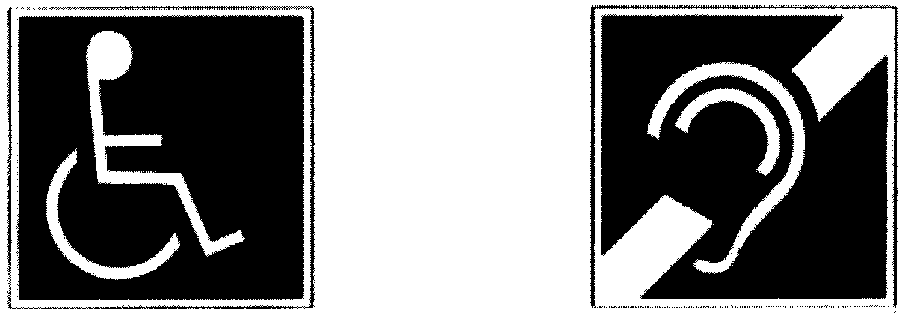

Príloha k vyhláške č. 532/2002 Z. z.

VŠEOBECNÉ TECHNICKÉ POŽIADAVKY ZABEZPEČUJÚCE UŽÍVANIE NA STAVBY UŽÍVANÉ OSOBAMI S OBMEDZENOU SCHOPNOSŤOU POHYBU A ORIENTÁCIE

1. Komunikácia

1.1. Úprava povrchu

1.1.1. Povrch chodníka, schodiska a rampy musí byť upravený proti šmyku.

1.1.2. Priechod musí mať zníženie obrubníka výrazne vyznačené odlišnou farbou, štruktúrou a povahou povrchu najmenej so šírkou 400 mm.

1.1.3. Povrch s hmatovými vlastnosťami signálneho a varovného pásu musí byť farebne kontrastný voči okoliu a nemôže sa použiť na iný účel.

1.2. Výškový rozdiel

1.2.1. Výškový rozdiel pri priechode a vodorovnej vnútornej komunikácii musí byť znížený na 20 mm.

1.2.2. Sklon šikmej roviny musí spĺňať požiadavky na rampu podľa bodu 1.3.

1.3. Schodisko a rampa vrátane schodiska a rampy v podchode

1.3.1. Schodiskové rameno a rampa musia byť po oboch stranách vybavené držadlom vo výške 900 mm. Odporúča sa vybudovať držadlo aj vo výške 750 mm.

1.3.2. Držadlo musí presahovať začiatok a koniec schodiskového ramena alebo rampy najmenej o 150 mm.

1.3.3. Tvar držadla musí umožňovať pevné uchopenie rukou.

1.3.4. Ak sú schodiskové ramená jediným prístupom, musia byť priame.

1.3.5. Nástupná hrana schodiskového stupňa nemôže prečnievať cez podstupnicu.

1.3.6. Schodisko so stupňami bez podstupníc sa nemôže navrhovať.

1.3.7. Prvý a posledný stupeň každého schodiskového ramena, ako aj začiatok a koniec rampy, musia byť výrazne farebne a povrchovou úpravou rozoznateľné od okolia, napríklad reliéfnou dlažbou.

1.3.8. Schodisko a rampa vysunuté do priestoru musia byť upravené tak, aby sa zabránilo možnosti vstupu zrakovo postihnutej osoby do priestoru s nižšou výškou ako 2 200 mm.

1.3.9. Rampa musí byť široká najmenej 1 300 mm a jej pozdĺžny sklon môže byť najviac 1 : 12.

1.3.10. Ak rampa nie je dlhšia ako 3 000 mm, môže mať výnimočne sklon najviac 1 : 8; to neplatí pri dome s bytom osobitného určenia a zariadení sociálnych služieb určenom na užívanie osobami s obmedzenou schopnosťou pohybu a orientácie.

1.3.11. Rampa musí mať po oboch stranách vodiacu tyč vo výške 300 mm.

1.3.12. Rampa dlhšia ako 9 000 mm musí byť prerušená odpočívadlom s dĺžkou najmenej 2 000 mm.

1.3.13. Prechod rampy na chodník musí byť plynulý.

1.4. Chodník

1.4.1. Chodník musí byť široký najmenej 1 300 mm a môže mať pozdĺžny sklon najviac 1 : 12 a priečny sklon najviac 1 : 50. Plocha chodníka okrem priechodu pre chodcov musí byť zvýšená oproti ploche vozovky minimálne o 50 mm alebo okraj pešej komunikácie pri vozovke musí byť vyznačený varovným pásom širokým 400 mm.

1.4.2. Na úseku dlhšom ako 200 m musí byť vybudované odpočívadlo s pozdĺžnym a priečnym sklonom najviac 1 : 50.

1.4.3. Komunikácia pre peších musí byť zabezpečená dôsledne dodržanou vodiacou líniou pre zrakovo postihnutú osobu. Prirodzenou vodiacou líniou je styková línia steny domu s rovinou chodníka, obrubník pešej komunikácie na rozhraní s trávnikom alebo rozhranie dvoch výrazne hmatovo odlišných štruktúr. Obrubník chodníka pri vozovke sa nepovažuje za vodiacu líniu.

1.4.4. V mieste, kde nie je prirodzená vodiaca línia a prechodová vzdialenosť medzi dvoma orientačnými bodmi je väčšia ako 8 000 mm, musí sa vytvoriť umelá vodiaca línia pásom špeciálnej dlažby v exteriéri širokým 400 mm a v interiéri 300 mm s povrchovou štruktúrou pozdĺžneho charakteru. Línia má byť priama, s odstupom od prekážok 800 mm až 1 000 mm na obe strany od vodiacej línie. Odbočenie vodiacej línie a zmena jej smeru sa pripúšťa lomom, najvhodnejšie v 90o uhle; oblúk sa neodporúča. V mieste odbočenia umelej vodiacej línie sa musí umiestniť prerušenie v exteriéri s dĺžkou 400 mm a v interiéri s dĺžkou 300 mm. Do vodiacich línií nemôžu zasahovať žiadne prekážky trvalého alebo prechodného charakteru.

1.4.5. Každá prekážka trvalého aj dočasného charakteru, ktorá sa nachádza na pešej komunikácii, sa musí vyznačiť tak, aby bola hmatovo vnímateľná pre nevidiacu alebo slabozrakú osobu. Preto musí byť prekážka pevne vyznačená pri zemi do výšky 100 mm obrubou a vo výške 1 100 mm pevným, hmatným a v porovnaní s okolím kontrastným označením. Nad chodníkom, v priestore od 450 mm do 2 200 mm, nemôže byť umiestnený žiadny predmet ani konštrukcia, ktoré by mohli ohroziť bezpečnosť zrakovo postihnutej osoby. Pevná časť a technické vybavenie stavby a inej konštrukcie nevyznačené v pôdoryse môžu byť umiestnené na stavbe vo výške od 450 mm do 2 200 mm len v prípade, ak nevystupujú z obrysu stien do priestoru komunikácie pre peších na viac ako 200 mm. Pevná časť a technické vybavenie stavby a inej konštrukcie, ktorých pôdorys je na zemi vyznačený ako prekážka identifikovateľná slepeckou palicou, môžu vyčnievať do priestoru pešej komunikácie najviac na vzdialenosť 300 mm. Prekážka na komunikácii pre peších musí byť umiestnená tak, aby sa zachoval priechodzí koridor široký 1 300 mm alebo v odôvodnených prípadoch len 900 mm.

1.4.6. Na označenie vstupu do dôležitej nebytovej budovy v časti určenej na užívanie verejnosťou sa na pešej komunikácii priečne umiestnia signálne pásy s odlišnou štruktúrou povrchu, napríklad pologuľový výstupok s výškou 3 - 5 mm a s priemerom 20 - 25 mm, v šírke najmenej 800 mm.

1.4.7. Na chodníku určenom tiež pre cyklistov na rozhraní medzi pásom pre chodcov a pásom pre cyklistov sa umiestni hmatný pás široký 300 mm až 400 mm. Jeho vlastnosti sa musia zhodovať s vlastnosťami varovného pásu.

1.4.8. Zábradlie na komunikáciách, ktoré je súčasťou vybavenia komunikácie a ktoré má pre nevidiaceho vodiacu funkciu, musí zodpovedať požiadavkám na zábranu označujúcu prekážku podľa bodu 2.4.8.

1.5. Priechod a nástupište

1.5.1. Šírka priechodu musí byť najmenej 1 300 mm. Každý priechod musí zabezpečovať plynulý prechod z pešej plochy na komunikáciu so sklonom maximálne 1 : 8, so zvislým prevýšením najviac 20 mm. Miesto prechodu cez vozovku sa na pešej komunikácii po celej jej šírke označí signálnym pásom s odlišnou štruktúrou povrchu so šírkou najmenej 800 mm. Po celej dĺžke zníženého obrubníka smerom do chodníka sa umiestni varovný pás so šírkou 400 mm. Ostrovček, ktorý delí komunikáciu, musí byť vnímateľný zvyškom zraku, nášľapom a slepeckou palicou. V mieste priechodu vedeného šikmo, prechodu dlhšieho ako 8 000 mm a priechodu vedeného v oblúku sa v rámci vodorovného dopravného značenia musí umiestniť vodiaci pás široký najmenej 400 mm, ktorý musí bezpodmienečne nadväzovať na varovný a signálny pás na chodníku. Na inom priechode sa vodiaci pás neumiestňuje.

1.5.2. Priechod, kde je častejšia frekvencia občanov so zníženou schopnosťou pohybu a orientácie, musí byť vybavený samoobslužným svetelným signalizačným zariadením s upravenou dĺžkou intervalu.

1.5.3. Priechod vybavený priechodovou signalizáciou musí byť vybavený aj zvukovou signalizáciou. Ovládanie signalizačného zariadenia musí byť umiestnené vo výške 900 mm až 1 200 mm.

1.5.4. Nástupište hromadnej dopravy musí byť označené farebne kontrastným varovným pásom s charakteristickou povrchovou štruktúrou, napríklad ihlanovitými výstupkami vysokými 3 - 5 mm. Varovný pás musí byť vnímateľný zvyškom zraku, nášľapom a slepeckou palicou. Umiestnenie varovného pásu pri hrane nástupišťa závisí od druhu dopravného prostriedku, pričom

a) na nástupišti autobusovej a električkovej dopravy varovný pás so šírkou 400 mm je vo vzdialenosti 500 mm od hrany nástupišťa. Vo vzdialenosti 500 mm pred stĺpikom označujúcim začiatok zástavky musí byť umiestnený po celej šírke nástupišťa signálny pás so šírkou najmenej 800 mm,

b) na nástupišti železničnej dopravy varovný pás so šírkou 400 mm je vo vzdialenosti 800 mm od hrany nástupišťa.

1.6. Vstup do stavby

1.6.1. Pred vstupom do stavby musí byť vodorovná plocha najmenej 1 500 mm x 1 500 mm, ak sa dvere otvárajú smerom dnu alebo sú posuvné. Pri otváraní dverí smerom von musí byť táto plocha široká najmenej 1 500 mm a dlhá 1 500 mm + šírka dverného krídla. Turniketové a kyvné dvere sa nemôžu navrhovať, ak nie je iná možnosť vstupu do stavby.

1.6.2. Vstupné dvere musia umožňovať otvorenie najmenej na šírku 900 mm. Môžu byť zasklené až od výšky 400 mm alebo musia byť zasklené nerozbitným sklom, napríklad tvrdeným s drôtenou vložkou.

1.6.3. Zámka dverí musí byť umiestnená vo výške najviac 1 000 mm; kľučka alebo držadlo vo výške najviac 1 100 mm.

1.6.4. Horná hrana zvončekového panelu nemôže byť umiestnená vyššie ako 1 400 mm.

1.6.5. Vstup musí byť osvetlený tak, aby nevznikol náhly a veľký kontrast medzi vonkajším a vnútorným osvetlením.

1.6.6. Nebytová budova v časti určenej na užívanie verejnosťou musí mať označený vstup podľa bodu 1.4.6.

1.7. Výťah

1.7.1. Pred vstupnými dverami výťahu musí byť voľný priestor najmenej 1 400 mm x 1 400 mm.

1.7.2. Vstupné dvere výťahu a výťahovej kabíny musia mať šírku najmenej 800 mm.

1.7.3. Šírka výťahovej kabíny musí byť najmenej 1 100 mm. Hĺbka výťahovej kabíny musí byť najmenej 1 400 mm.

1.7.4. Kabína výťahu musí byť vybavená

a) telefónnym alebo signálnym zariadením umiestneným najviac 1 200 mm nad podlahou,

b) sklopným malým sedadlom umiestneným v blízkosti ovládacieho panela,

c) ovládacím zariadením vo výške spodnej hrany najviac 1 200 mm nad podlahou umiestneným najvhodnejšie v strednej polohe kabíny (medzi vstupom a zadnou stenou výťahovej kabíny),

d) v nebytovej budove pre verejnosť aj akustickým informačným systémom oznamujúcim číslo podlažia, v ktorom výťah zastaví.

1.7.5. Podlaha kabíny musí byť rovná, nesmie byť textilná a musí mať protišmykovú úpravu.

1.7.6. Kabína výťahu musí mať na vnútornom obvode držadlá vo výške 750 mm a 900 mm.

1.7.7. Kabína výťahu nesmie mať dvere otvárateľné ručne.

1.7.8. Ovládacie zariadenie musí byť čitateľné aj hmatom. Odporúča sa vpravo od tlačidiel ovládacieho panelu umiestniť hmatateľné symboly a vľavo umiestniť označenie v Braillovom slepeckom písme. Hmatateľné označenie sa nemôže umiestniť na tlačidle ovládacieho panelu. Ovládač pre vstupné podlažie musí byť na ovládacom paneli v kabíne výťahu výrazne vizuálne a hmatovo odlíšený od ovládačov pre ostatné podlažia.

1.7.9. Chodbový privolávač výťahu musí byť umiestnený vo výške 900 mm až 1 200 mm. Musí mať aj hmatateľné označenie vrátane hmatateľného označenia čísla podlažia.

1.7.10. Po zastavení výťahu môže byť výškový rozdiel medzi podlahou výťahovej kabíny a podlahou chodby najviac 20 mm.

1.7.11. Príjazd privolanej kabíny musí oznamovať zvukový signál.

1.7.12. V nebytovej budove v časti určenej na užívanie verejnosťou musí byť chod eskalátora s určením jeho polohy a smeru chodu signalizovaný akustickým zariadením, ktoré pomocou diaľkového ovládania spúšťa nevidiaci alebo slabozraký užívateľ. Hrebeň eskalátora na vstupe a na výstupe z pásu pohyblivých schodov musí byť vyhotovený v kontrastnej žltej farbe.

2. Vnútorný priestor

2.1. Okno

2.1.1. Parapet v obytnej miestnosti určenej na užívanie osobou na vozíku nemôže byť vyššie ako 700 mm nad podlahou.

2.1.2. Okno v obytnej miestnosti musí byť otváracie. V žiadnom prípade nemôže byť v obytnej miestnosti výklopné okno, ktoré sa pri otváraní otáča okolo vodorovnej osi a po vyklopení zasahuje do miestnosti mimo okenného parapetu.

2.1.3. Otvárací a ovládací mechanizmus okna musí byť vzdialený od podlahy najmenej 900 mm a najviac 1 200 mm. V okennom otvore musí byť z vonkajšej strany ochranná tyč vo výške 1 100 mm nad úrovňou podlahy.

2.1.4. Okno a presklená stena s parapetom nižším ako 500 mm musia mať spodnú časť do výšky 400 mm chránenú ochranným plechom, mriežkou alebo iným podobným spôsobom. Vo výške 1 400 mm až 1 600 mm musia mať výrazný pás so šírkou najmenej 50 mm alebo pruh zo značiek s rozmermi 50 mm x 50 mm, vzdialenými od seba najviac 150 mm, zreteľne viditeľný oproti pozadiu. Vo výške 1 100 mm nad úrovňou podlahy musia byť zabezpečené ochrannou tyčou.

2.2. Dvere

2.2.1. Dvere vo vnútornom priestore musia mať svetlú šírku najmenej 800 mm. V dome s bytmi osobitného určenia a v inej stavbe na bývanie určenej na užívanie osobou na vozíku musia mať dvere šírku najmenej 900 mm a musia byť vybavené z obivoch strán šikmými držadlami. Turniketové a kyvné dvere sa nemôžu navrhovať ako jediný možný prístup. Otváracie a ovládacie zariadenie dverí sa musí umiestniť podľa bodov 1.6.4. a 1.6.5.

2.2.2. Prah môže byť vysoký najviac 20 mm. Môže byť oblý alebo so zaoblenými hranami.

2.2.3. Sklenené alebo presklené dvere, ktorých zasklenie zasahuje nižšie ako 800 mm nad podlahu, musia byť vo výške 1 400 mm až 1 600 mm označené výrazným pásom širokým najmenej 50 mm alebo pruhom zo značiek s rozmermi 50 mm x 50 mm vzdialenými od seba najviac 150 mm, zreteľne viditeľnými oproti pozadiu. Spodná časť dverí musí byť upravená podobne ako presklená stena podľa bodu 2.1.4.

2.2.4. Farba dverí musí kontrastovať s farbou stien.

2.2.5. Dvere v nebytovej budove v časti určenej pre verejnosť musia byť označené arabským číslovaním. Dvere do hygienického zariadenia musia byť označené aj písmenami. Výška číslic alebo písmen je 100 mm; majú výrazne kontrastné a reliéfne vyhotovenie s hrúbkou 10 mm, pričom výška reliéfu je 3 mm až 5 mm. Číslice a písmená sú umiestnené vo výške 1 400 mm až 1 600 mm nad podlahou, najvhodnejšie vedľa dverí alebo na ich zárubni.

2.2.6. V prípade kríženia komunikačných osí chodieb musia byť v mieste najbližšom oproti vstupu umiestnené najmenšie a najväčšie čísla miestností so smerovým označením vyhotovené podľa bodu 2.2.5. a zároveň musia byť vyhovujúco osvetlené.

2.3. Zdravotechnické zariadenie

2.3.1. Záchodová kabína navrhovaná pre osobu na vozíku musí mať najmenšie pôdorysné rozmery 1 400 mm x 1 800 mm; v novonavrhovanej budove 1 600 mm x 1 800 mm. Záchodová misa musí byť jednostranne osadená najmenej 270 mm od bočnej steny; z druhej strany musí byť vedľa záchodovej misy 800 mm široká manipulačná plocha so zabezpečeným voľným príjazdom pre vozík. Je vhodné zabezpečiť takúto plochu po oboch stranách záchodovej misy. Dvere záchodovej kabíny musia spĺňať požiadavky podľa bodu 2.3.4.

2.3.2. Výška hornej hrany záchodovej misy meraná od podlahy musí byť 500 mm. Po oboch stranách záchodovej misy musia byť sklopné opierky držadla vo vzájomnej vzdialenosti 600 mm a vo výške 780 mm nad podlahou. Splachovacie zariadenie musí byť umiestnené v dosahu zo záchodovej misy vo výške najviac 1 200 mm nad podlahou. V dosahu musí byť umiestnený tiež toaletný papier.

2.3.3. V záchodovej kabíne musí byť umiestnené umývadlo podľa bodu 2.3.5. a vešiak na odevy vo výške najviac 1 200 mm. Na voľnej stene musí byť osadené zrkadlo a sklopná odkladacia plocha.

2.3.4. Dvere do zdravotechnického zariadenia pre osobu na vozíku sa musia otvárať smerom von a musia byť umiestnené oproti manipulačnej ploche. Z vnútornej strany dverí musí byť umiestnené vodorovné držadlo. Zámok dverí musí byť odistiteľný aj z vonkajšej strany.

2.3.5. Umývadlo pre osobu na vozíku musí mať hornú hranu osadenú vo výške 870 mm až 900 mm nad podlahou. Umývadlo musí mať pákovú vodovodnú batériu osadenú vo výške najviac 1 200 mm nad podlahou. Vedľa umývadla musí byť osadené držadlo.

2.3.6. Vaňa pre osobu na vozíku musí mať najmenší rozmer 1 600 mm x 700 mm. Jej horná hrana musí byť osadená vo výške 520 mm až 550 mm. Vaňu je vhodné predĺžiť o plochu 450 mm až 500 mm, ktorá je potrebná na presadnutie z vozíka. Páková vodovodná batéria musí byť umiestnená na pozdĺžnej strane vane. Vo výške 100 mm až 150 mm od hornej hrany vane musia byť umiestnené držadlá.

2.3.7. Sprchovací box alebo sprchovací kút pre osobu na vozíku musí mať pôdorysné rozmery najmenej 1 400 mm x 1 400 mm. Musí byť vybavený sklopným sedadlom umožňujúcim bočný alebo čelný prístup. Ručná sprcha s pákovým ovládaním a držadlá musia byť umiestnené v dosahu zo sedadla. Výškový rozdiel podlahy a dna sprchovacieho boxu alebo kúta môže byť najviac 20 mm. Na voľnej stene musí byť osadené zrkadlo a sklopná odkladacia plocha.

2.4. Manipulačný priestor a plocha

2.4.1. Manipulačný manévrovací priestor je voľná plocha na účely manévrovania vozíka vo voľnom priestore, medzi stenami miestností a medzi zariaďovacími predmetmi. Týmto priestorom je kruh s priemerom 1 500 mm. Východiskom na určenie tohto priemeru je základný rozmer potrebný na otočenie vozíka o 360o.

2.4.2. Miesto pre vozík v hľadisku musí mať pôdorysné rozmery najmenej 1 000 mm x 1 200 mm a musí byť na rovnej podlahe.

2.4.3. Na vyhradenom mieste nebytovej budovy v časti určenej na užívanie verejnosťou musí byť určené miesto vybavené indukčnou slučkou pre sluchovo postihnutú osobu. Miesto musí byť označené medzinárodným symbolom hluchoty. Halový priestor nebytovej budovy určenej pre verejnosť musí byť vybavené aj vodiacimi líniami podľa bodu 1.4.4.

2.4.4. Šírka stojiska v garáži a na parkovisku musí byť najmenej 3 500 mm.

2.4.5. Zodpovedajúca výška na umiestnenie vybavenia a manipulačného zariadenia v byte je 600 mm až 1 400 mm.

2.4.6. Výška na umiestnenie vybavenia a manipulačného zariadenia pri stavbe s pracoviskom je 600 mm až 1 200 mm.

2.4.7. Chodba, ktorá vedie k priestoru určenému pre verejnosť, sa musí navrhovať na možný prejazd vozíka a jednej osoby. Najmenšia šírka chodby je

a) 1 500 mm pri stretnutí sa idúcej osoby s vozíkom,

b) 1 800 mm pri stretnutí sa dvoch vozíkov.

2.4.8. Prekážka na vnútornej komunikácii musí byť zabezpečená vo výške 1 100 mm ochranou zábradlím alebo oplotením a podstavcom vysokým najmenej 100 mm tvoriacim zarážku pri poklepávaní slepeckou palicou.

2.5. Informačné zariadenie

2.5.1. Základné informačné zariadenie pre pohyb verejnosti v nebytovej budove v časti určenej na užívanie verejnosťou musí mať kontrastné a vyhovujúco osvetlené nápisy s výškou písma najmenej 50 mm umiestnené vo výške 1 200 mm až 2 000 mm nad podlahou.

2.5.2. Základné informačné zariadenie musí byť doplnené alternatívnym riešením poskytovania informácií nevidiacej osobe (napríklad informátorom, akustickým alebo taktilným systémom, telefónnou informačnou službou) a optickým systémom pre sluchovo postihnutú osobu.

3. Verejná plocha

3.1. Parkovisko a odstavná plocha

3.1.1. Šírka stojiska na odstavnej ploche pre vozidlo osoby s obmedzenou schopnosťou pohybu a orientácie musí byť najmenej 3 500 mm a môže mať sklon najviac 1 : 20.

3.1.2. Miesto na parkovisku určenom pre autá osôb s obmedzenou schopnosťou pohybu a orientácie musí byť s verejnou pešou plochou spojené zošikmeným obrubníkom širokým najmenej 1 000 mm, so sklonom najviac 1 : 8.

3.2. Verejný telefónny automat

3.2.1. Priestor na umiestnenie verejného telefónneho automatu musí mať pôdorysné rozmery najmenej 1 100 mm x 1 400 mm a musí byť vybavený sklopným malým sedadlom vo výške najmenej 500 mm. Telefónna kabína s telefónnym automatom musí mať vstupné dvere široké najmenej 800 mm, ktoré sa otvárajú smerom von.

3.2.2. Výška na umiestnenie manipulačného zariadenia telefónneho automatu je 600 mm až 1 200 mm. Odporúčaná výška je 1 000 mm.

3.2.3. Prístup k verejným telefónnym automatom nemôže obmedzovať žiadna prekážka.

3.3. Poštová schránka a bankomat

Poštová schránka a bankomat musí mať otvor na vkladanie vo výške 1 100 mm až 1 200 mm.

4. Medzinárodný symbol prístupnosti

Medzinárodný symbol prístupnosti je štvorec modrej farby, na ktorom je vyobrazená bielou čiarou štylizovaná postava hľadiaca vpravo a sediaca na vozíku pre invalidov.

5. Medzinárodný symbol hluchoty

Medzinárodný symbol hluchoty je štvorec modrej farby, na ktorom je vyobrazená bielou čiarou štylizovaná ušnica, ktorá prerušuje diagonálu vedenú z horného pravého rohu štvorca.
