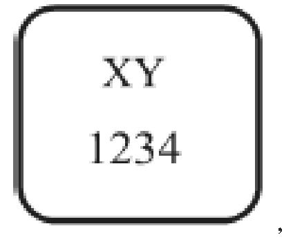

Príloha č. 3 k nariadeniu vlády č. 308/2003 Z. z.

- ŠPECIFICKÉ OPATRENIA NA KONTROLU NIEKTORÝCH CHORÔB Okrem všeobecných ustanovení tohto nariadenia sa na vezikulárnu chorobu ošípaných vzťahujú tieto špecifické ustanovenia:

  - 1. Opis choroby

    - Ide o chorobu ošípaných, ktorú nemožno klinicky odlíšiť od slintačky a krívačky. Choroba vyvoláva tvorbu vezikúl na rypáku, pyskoch, jazyku a na koronárnych častiach paprčiek. Závažnosť priebehu ochorenia je veľmi premenlivá, stádo ošípaných môže byť infikované bez toho, aby sa ochorenie klinicky prejavilo. Vírus môže prežívať dlhý čas mimo organizmu, dokonca aj v čerstvom mäse, je mimoriadne rezistentný voči bežným dezinfekčným prostriedkom a jeho vlastnosťou je schopnosť perzistovať a stabilita v rozpätí pH medzi 2,5 až 12 vyžaduje dôkladne vykonávať čistenie a dezinfekciu.

  - 2. Inkubačná doba

    - Maximálna inkubačná doba je 28 dní.

  - 3. Diagnostické postupy na potvrdenie choroby a diferenciálna diagnostika vezikulárnej choroby ošípaných

    - Podrobné metódy odberu vzoriek na stanovenie diagnózy, diagnostické vyšetrenia v laboratóriu, dôkaz protilátok a hodnotenie výsledkov laboratórnych vyšetrení sú určované podľa postupu v súlade s požiadavkami Európskych spoločenstiev.

  - 4. Potvrdenie výskytu vezikulárnej choroby ošípaných

  - Ako výnimka z § 2 písm. f) je výskyt choroby potvrdený

    - a) v chovoch, v ktorých bol izolovaný vírus vezikulárnej choroby buď z ošípaných, alebo z prostredia,

    - b) v chovoch, v ktorých sú ošípané séropozitívne na vezikulárnu chorobu ošípaných, ak tieto alebo iné ošípané v chove vykazujú zmeny, ktoré sú charakteristické pre vezikulárnu chorobu ošípaných,

    - c) v chovoch, v ktorých sú ošípané s klinickými príznakmi alebo sú séropozitívne, pod podmienkou, že existuje priama epizootologická súvislosť s potvrdeným ohniskom,

    - d) v ostatných stádach, v ktorých boli zistené séropozitívne ošípané; v tomto poslednom prípade príslušný orgán vykoná doplňujúce vyšetrenie, hlavne nové vykonanie testov zo vzoriek odobratých v intervale najmenej 28 dní, prv než sa potvrdí výskyt nákazy; ustanovenia § 4 zostávajú v platnosti až do skončenia týchto doplňujúcich vyšetrení; ak neskoršie vyšetrenie neodhalí dôkaz o chorobe, hoci sú ošípané stále séropozitívne, príslušný orgán zabezpečí, aby testované ošípané boli usmrtené a neškodne odstránené pod jeho kontrolou alebo aby boli pod jeho kontrolou zabité na ním určenom bitúnku; príslušný orgán zabezpečí, aby od príchodu uvedených ošípaných na bitúnok boli ošípané držané a zabité oddelene od ostatných ošípaných a aby ich mäso bolo výhradne určené na vnútorný trh.

  - 5. Referenčné laboratórium Európskych spoločenstiev

    - AFRC Institute for Animal Health,

    - Pirbright laboratory,

    - Ash Road,

    - Pirbright,

    - Woking,

    - Surrey,

    - GU24ONF,

    - Spojené kráľovstvo Veľkej Británie a Severného Írska.

  - 6. Ochranné pásmo

    - a) rozmery ochranného pásma zodpovedajú vymedzeniu uvedenému v § 10,

    - b) v prípade vezikulárnej choroby ošípaných sú opatrenia ustanovené v § 11 nahradené výnimočne týmito opatreniami:

      - 1. identifikujú sa všetky chovy vo vnútri pásma, v ktorom sú držané zvieratá vnímavých druhov,

      - 2. vykonajú sa pravidelné prehliadky v chovoch so zvieratami vnímavých druhov, tieto zvieratá sa klinicky vyšetria, prípadne sa u nich súčasne odoberajú vzorky na laboratórne vyšetrenie, pričom sa musia viesť záznamy o prehliadkach a zisteniach; opakovanosť týchto prehliadok musí byť úmerná závažnosti, ktorú má choroba v chovoch predstavujúcich najväčšie riziká,

      - 3. zakáže sa premiestňovanie a preprava zvierat vnímavých druhov po verejných alebo súkromných cestách s výnimkou komunikácií vo vnútri chovu; príslušný orgán môže výnimočne povoliť prepravu zvierat po ceste alebo po železnici, ak sa vykonáva bez prekladania a bez zastávky,

      - 4. príslušný orgán môže v súlade s požiadavkami Európskych spoločenstiev udeliť výnimku pre jatočné ošípané pochádzajúce z chovu mimo ochranného pásma, ktoré sú prepravované na bitúnky umiestnené v tomto pásme,

      - 5. kamióny, ako aj ostatné dopravné prostriedky a vybavenia používané vo vnútri ochranného pásma na prepravu ošípaných alebo iných zvierat, alebo materiálu, ktorý môže byť kontaminovaný - predovšetkým krmív, hnoja alebo močovky - nemôžu opustiť

      - 5.1 chov umiestnený vo vnútri ochranného pásma,

      - 5.2 ochranné pásmo,

      - 5.3 bitúnky

        - bez toho, aby boli vyčistené a dezinfikované v súlade s postupmi určenými príslušným orgánom. Tieto postupy predpokladajú, že najmä kamión alebo dopravný prostriedok použitý na prepravu ošípaných neopustí pásmo bez kontroly príslušným orgánom,

      - 6. ošípané nemôžu opustiť chov, v ktorom sú držané, a to 21dní po ukončení predbežného čistenia a dezinfekcie infikovaného chovu podľa ustanovenia § 16; po 21 dňoch môže príslušný orgán povoliť prepravu ošípaných z uvedeného chovu, a to:

      - 6.1 priamo na bitúnky určené príslušným orgánom, prednostne vo vnútri ochranného pásma alebo pásma dohľadu, ak

      - 6.1.1 ošípané prítomné v chove boli skontrolované,

      - 6.1.2 ošípané určené na prepravu na zabitie boli klinicky vyšetrené,

      - 6.1.3 ošípaná bola individuálne označená ušnou značkou alebo bola označená iným schváleným prostriedkom,

      - 6.1.4 preprava sa uskutočňuje v dopravných prostriedkoch zapečatených príslušným orgánom.

        - Príslušný orgán zodpovedný za vykonávanie kontrol a dozoru na bitúnku musí byť informovaný o úmysle zaslať na ne ošípané.

        - Po vstupe na bitúnok sú ošípané držané a zabíjané oddelene od ostatných ošípaných. Dopravné prostriedky a vybavenie slúžiace na prepravu ošípaných sa pred opustením bitúnkov vyčistia a dezinfikujú.

        - Počas prehliadky pred zabitím a po zabití vykonávanej na určených bitúnkoch má príslušný orgán správy na zreteli príznaky, ktoré by mohli súvisieť s prítomnosťou vírusu vezikulárnej choroby ošípaných.

        - Ak ide o ošípané zabíjané podľa týchto ustanovení, odoberie sa im štatisticky reprezentatívny počet vzoriek krvi. Ak ide o pozitívne výsledky potvrdzujúce prítomnosť vezikulárnej choroby ošípaných, uplatnia sa opatrenia uvedené v bode 9 písm. c),

      - 6.2 výnimočne priamo do iných miest nachádzajúcich sa vo vnútri ochranného pásma, ak

      - 6.2.1 všetky ošípané prítomné v chove boli skontrolované,

      - 6.2.2 ošípané, ktoré majú byť prepravované, boli podrobené klinickému vyšetreniu s negatívnym výsledkom,

      - 6.2.3 každá ošípaná bola individuálne označená ušnou značkou alebo bola označená inou schválenou metódou,

      - 7. mäso pochádzajúce z ošípaných uvedených v bode 6.1

      - 7.1 nie je predmetom obchodu medzi členskými štátmi ani medzinárodného obchodu a musí byť označené zdravotnou značkou pre čerstvé mäso podľa osobitného predpisu,1)

      - 7.2 sa získava, rozrába, prepravuje a skladuje oddelene od mäsa určeného na obchod medzi členskými štátmi a medzinárodný obchod a používa sa tak, aby sa zabránilo jeho pridaniu do mäsových výrobkov určených na obchod medzi členskými štátmi alebo medzinárodný obchod, ak nebolo podrobené ošetreniu podľa osobitného predpisu.2)

      - 8. odchylne od bodu 7 možno použiť inú identifikačnú značku ako osobitnú identifikačnú značku uvedenú v osobitnom predpise1) pre bravčové mäso uvedené v bode 6.1 pod podmienkou, že je jasne odlíšiteľná od iných identifikačných značiek, ktoré sa používajú pre bravčové mäso podľa osobitných predpisov.3) Ak sa príslušný orgán rozhodne použiť alternatívnu identifikačnú značku, informuje o tom komisiu,

      - 9. na účely bodu 8 musí byť identifikačná značka čitateľná a nezmazateľná, znaky musia byť ľahko čitateľné a viditeľne umiestnené. Identifikačná značka musí mať nasledujúci tvar a musí obsahovať nasledujúce údaje:

      - 

        - kde XY znamená kód príslušnej krajiny ustanovený v osobitnom predpise,3)

        - 1234 znamená schvaľovacie číslo prevádzkarne podľa osobitného predpisu.4)

    - c) uplatňovanie opatrení v ochrannom pásme sa dodržuje najmenej do

      - 1. úspešného skončenia opatrení uvedených v § 16,

      - 2. vykonania chovov v pásme

      - 2.1 klinického vyšetrenia ošípaných, ktorým sa zistilo, že tieto ošípané nemajú príznaky choroby, z ktorých by sa dala predpokladať prítomnosť vezikulárnej choroby ošípaných, a

      - 2.2 sérologického vyšetrenia štatisticky reprezentatívnej vzorky ošípaných bez prítomnosti protilátok proti vezikulárnej chorobe ošípaných; program sérologického vyšetrenia musí zvážiť prenos vezikulárnej choroby ošípaných a spôsob ustajnenia ošípaných. Príslušný orgán ustanoví program v súlade s požiadavkami Európskych spoločenstiev.

      - Príslušný orgán vykoná vyšetrenia a odber vzoriek opísaných v bodoch 2.1 a 2.2 najskôr za 28 dní po predbežnom čistení a dezinfekcii infikovaného chovu,

    - d) po uplynutí doby uvedenej v písmene c) sa opatrenia uplatňované v pásme dohľadu uplatňujú rovnako aj v ochrannom pásme,

    - e) ak opatrenia uvedené v bode 6 sú v platnosti dlhšie ako 30 dní z dôvodu výskytu ďalších prípadov choroby a ak v dôsledku toho vznikajú problémy s ustajnením zvierat, príslušný orgán môže na základe odôvodnenej žiadosti vlastníka zvierat a pod podmienkou, že úradný veterinárny lekár skonštatoval uvedené skutočnosti, povoliť prepravu zvierat z chovu v rámci ochranného pásma. Body 6 a 8 sa uplatnia po nevyhnutných zmenách.

  - 7. Pásmo dohľadu

    - a) rozmer pásma dohľadu zodpovedá rozmeru uvedenému v § 10,

    - b) ak ide o vezikulárnu chorobu ošípaných, opatrenia ustanovené v § 12 sú nahradené týmito opatreniami:

      - 1. identifikovanie všetkých chovov, v ktorých sú držané zvieratá vnímavých druhov,

      - 2. premiestňovanie ošípaných inam než na bitúnky z chovu pásma dohľadu je povolené, len ak v predchádzajúcich 21 dňoch nebola do tohto chovu zaradená ošípaná; vlastník alebo držiteľ musí zaznamenávať všetky premiestnenia ošípaných,

      - 3. premiestnenie ošípaných z pásma dohľadu môže príslušný orgán povoliť, len ak

      - 3.1 ošípané prítomné v chove boli počas 48 hodín pred premiestnením skontrolované,

      - 3.2 počas 48 hodín pred prepravou boli klinicky vyšetrené ošípané s negatívnym výsledkom určené na prepravu,

      - 3.3 sa sérologickým vyšetrením štatisticky reprezentatívnej vzorky ošípaných určených na prepravu vykonaným počas 14 dní pred prepravou nezistila prítomnosť protilátok proti vírusu vezikulárnej choroby ošípaných. Ak ide o jatočné ošípané, sérologické vyšetrenie môže byť vykonané na vzorkách krvi odobratých na bitúnkoch určenia určených príslušným orgánom. Ak ide o pozitívne výsledky, ktoré potvrdzujú prítomnosť vezikulárnej choroby ošípaných, uplatní sa opatrenie ustanovené v odseku 9 písm. c),

      - 3.4 každá ošípaná bola individuálne označená ušnou značkou alebo bola označená inou metódou schválenou príslušným orgánom,

      - 3.5 kamióny, ako aj iné dopravné prostriedky a ostatné vybavenia použité na prepravu týchto ošípaných boli vyčistené a dezinfikované po každej preprave,

      - 4. kamióny, ako aj iné dopravné prostriedky a vybavenie použité na prepravu ošípaných alebo iných zvierat, alebo materiálu, ktorý môže byť kontaminovaný, a ktoré sú používané vo vnútri pásma dohľadu, môžu opustiť toto pásmo len po vyčistení a dezinfekcii, ktoré sú v súlade s postupmi určenými príslušným orgánom.

    - c) 1. Rozmer pásma dohľadu môže byť zmenený podľa § 10 ods. 3.

      - 2. Opatrenia pre pásmo dohľadu sa uplatňujú najmenej do

      - 2.1 úspešného vykonania opatrení uvedených v § 16,

      - 2.2 vykonania opatrení vyžadovaných v ochrannom pásme.

  - 8. Spoločné opatrenia

  - Okrem predchádzajúcich opatrení sa uplatňujú tieto spoločné opatrenia:

    - a) ak ide o úradne potvrdený výskyt vezikulárnej choroby ošípaných, okrem opatrení uvedených v § 4 ods. 2 a v § 5, mäso ošípaných zabíjaných v období medzi pravdepodobným zavlečením choroby do chovu a začatím vykonávania úradných opatrení sa vyhľadá a pod úradným dozorom neškodne odstráni spôsobom, ktorý možnosť šírenia vírusu vezikulárnej choroby ošípaných odstráni,

    - b) ak úradný veterinárny lekár predpokladá, že ošípané niektorého chovu boli kontaminované v dôsledku pohybu osôb, zvierat, dopravných prostriedkov alebo iným spôsobom, ošípané chovu podliehajú obmedzeniam pohybu uvedeným v § 9, a to najmenej dovtedy, kým sa v chove vykoná

      - 1. klinické vyšetrenie ošípaných s negatívnym výsledkom,

      - 2. sérologické vyšetrenie štatisticky reprezentatívneho počtu ošípaných, pri ktorom sa nepreukáže prítomnosť protilátok proti vírusu vezikulárnej choroby ošípaných, podľa odseku 8 písm. c) bodu 2.2.

    - Vyšetrenie uvedené v písmenách a) a b) môže byť vykonané až po 28 dňoch, ktoré uplynú od možnej kontaminácie miest pohybom osôb, zvierat, dopravnými prostriedkami alebo inými spôsobmi.

    - c) Ak sa potvrdí výskyt vezikulárnej choroby ošípaných na bitúnku, príslušný orgán nariadi

      - 1. bezodkladné zabitie ošípaných prítomných na bitúnku,

      - 2. neškodné odstránenie tiel a vnútorností infikovaných a kontaminovaných ošípaných pod úradným dozorom tak, aby sa vylúčilo riziko šírenia vírusu vezikulárnej choroby ošípaných,

      - 3. vykonanie čistenia a dezinfekcie budov a vybavení vrátane dopravných prostriedkov, a to pod dozorom úradného veterinárneho lekára podľa inštrukcií určených príslušným orgánom,

      - 4. vykonanie epizootologického šetrenia podľa § 8,

      - 5. povoliť privezenie ošípaných na učel zabitia až po uplynutí najmenej 24 hodín od dokončenia čistenia a dezinfekcie vykonaných v súlade s bodom 3.

  - 9. Čistenie a dezinfekcia infikovaných chovov

  - Okrem ustanovení uvedených v § 16 sa uplatňujú tieto opatrenia:

    - a) Postup pri predbežnom čistení a dezinfekcii:

      - 1. Po odsune tiel ošípaných na neškodné odstránenie musia byť časti, kde boli ošípané ustajnené, a ostatné časti miest kontaminovaných počas zabitia ihneď pokropené dezinfekčným prostriedkom schváleným podľa § 16, a to v koncentrácii účinnej pre vezikulárnu chorobu ošípaných. Použitý dezinfekčný prostriedok musí byť na povrchu najmenej 24 hodín.

      - 2. Krv a tkanivá ošípaných, ktorými boli znečistené miesta zabitia, musia byť pozorne zozbierané a neškodne odstránené spoločne s telami zvierat (zabitie sa musí vždy vykonávať na nepresakujúcom povrchu).

    - b) Postup ďalšieho čistenia a dezinfekcie:

      - 1. Hnoj, podstielka, kontaminované krmivá musia byť z budov odstránené, navŕšené na hromady a pokropené schváleným dezinfekčným prostriedkom. Močovka musí byť ošetrená metódou, ktorá je schopná zabiť vírus.

      - 2. Mobilné príslušenstvo musí byť z priestorov odstránené a oddelene vyčistené a dezinfikované.

      - 3. Mastnota a ostatné nečistoty musia byť odstránené zo všetkých povrchov aplikáciou odmasťovača a povrchy potom omyté vodou pod tlakom.

      - 4. Dezinfekčný prostriedok sa znovu aplikuje pokropením všetkých povrchov.

      - 5. Dobre utesnené priestory musia byť dezinfikované fumigáciou.

      - 6. Opravy podláh, stien a ďalších poškodených častí musia podliehať súhlasu po inšpekcii úradného veterinárneho lekára a musia byť vykonané ihneď.

      - 7. Po skončení týchto opráv sa vykonáva inšpekcia, ktorou sa overí, či tieto práce boli riadne vykonané.

      - 8. Časti miest dokonale zbavené zápalných látok môžu byť tepelne ošetrené pomocou letovacej lampy.

      - 9. Povrchy musia byť poprášené alkalickým dezinfekčným prostriedkom, ktorého pH je vyššie než 12,5, alebo iným schváleným dezinfekčným prostriedkom. Po 48 hodinách pôsobenia sa tento dezinfekčný prostriedok odstráni omytím vodou.

    - c) Postup záverečnej očisty a dezinfekcie

      - Ošetrenie letovacou lampou alebo alkalickým dezinfekčným prostriedkom podľa písmena b) bodu 8 alebo 9 sa musí znovu vykonať za 14 dní.

  - 10. Repopulácia infikovaných chovov

  - Okrem opatrení stanovených v § 5 ods. 4 sa uplatňujú tieto opatrenia:

    - a) Repopulácia sa môže začať najskôr po štyroch týždňov od prvej kompletne vykonanej dezinfekcii miest, a to podľa bodu 10 písm. c).

    - b) Pri opätovnom ustajnení ošípaných sa berie do úvahy typ chovu uskutočňovaný v príslušnom chove a repopulácia musí byť v súlade s týmito ustanoveniami:

      - 1. Ak ide o chov pod otvoreným nebom, repopulácia sa začína ustajnením určitého obmedzeného počtu kontrolných indikátorových odstavčiat, ktoré reagovali negatívne pri kontrole prítomnosti protilátok proti vírusu vezikulárnej choroby ošípaných. Kontrolné indikátorové odstavčatá sú rozdelené podľa požiadaviek príslušného orgánu vo všetkých častiach infikovaného chovu a za 28 dní po ich umiestnení do chovu sa u nich vykoná klinické vyšetrenie a odber vzoriek na sérologické vyšetrenie.

      - Ak kontrolné odstavčatá nevykazujú klinické príznaky vezikulárnej choroby ošípaných, ani nedošlo k vytvoreniu protilátok proti vírusu vezikulárnej choroby ošípaných, môže sa vykonať kompletná repopulácia.

      - 2. U všetkých ostatných foriem chovu sa repopulácia vykoná buď podľa opatrení ustanovených v bode 1, alebo úplnou repopuláciou pod podmienkou, že

      - 2.1 ošípané sú do chovu prepravené počas 8 dní a pochádzajú z chovu ležiaceho mimo pásma obmedzenia z dôvodu vezikulárnej choroby ošípaných a sú séronegatívne,

      - 2.2 žiadne z ošípaných nemôžu počas 60-tich dní od príchodu posledných ošípaných opustiť chov,

      - 2.3 repopulované stádo sa vyšetruje klinicky a sérologicky v súlade s požiadavkami určenými príslušným orgánom. Toto vyšetrenie môže byť vykonané najskôr za 28 dní po repopulácii.
