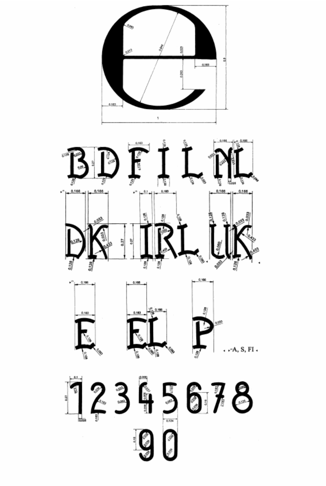
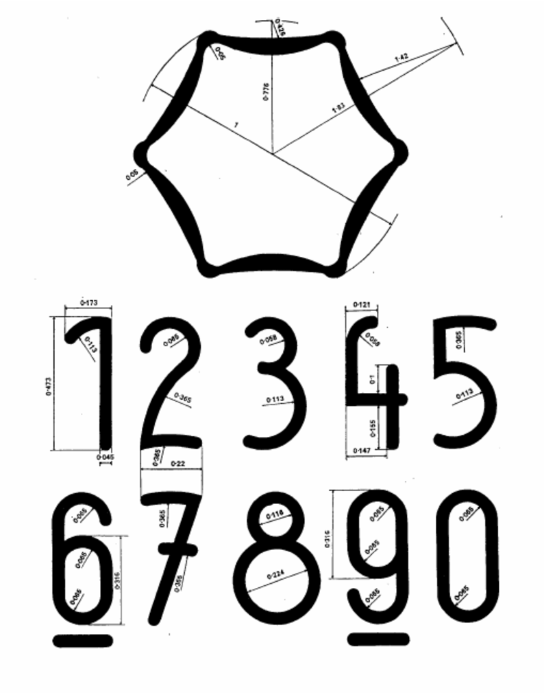

# Čl. I

Vyhláška Úradu pre normalizáciu, metrológiu a skúšobníctvo Slovenskej republiky č. 210/2000 Z. z. o meradlách a metrologickej kontrole v znení vyhlášky č. 310/2000 Z. z., vyhlášky č. 403/2000 Z. z., vyhlášky č. 9/2001 Z. z., vyhlášky č. 48/2001 Z. z., vyhlášky č. 75/2001 Z. z., vyhlášky č. 133/2001 Z. z., vyhlášky č. 27/2002 Z. z. a vyhlášky č. 69/2002 Z. z. sa mení a dopĺňa takto:

- 1. V § 4 ods. 4 úvodná veta znie: „Ústav alebo Slovenská legálna metrológia podľa § 9 ods. 5 zákona“.

- 2. V § 5 ods. 5 písmeno a) znie:

- „a)

- v hornej časti veľké písmeno identifikujúce štát, ktorý typ meradla schválil – B pre Belgicko, D pre Spolkovú republiku Nemecko, DK pre Dánsko, E pre Španielsko, F pre Francúzsko, EL pre Grécko, I pre Taliansko, IRL pre Írsko, L pre Luxembursko, NL pre Holandsko, P pre Portugalsko, UK pre Veľkú Britániu, A pre Rakúsko, S pre Švédsko, FI pre Fínsko, a posledné dvojčíslo roka, v ktorom typ schválil,“.

- 3. V § 6 odsek 1 znie:

- „(1)

- Objednávka na overenie určeného meradla (ďalej len „meradlo") sa podáva ústavu, Slovenskej legálnej metrológii alebo autorizovanej osobe podľa § 24 zákona (ďalej len „vykonávateľ overenia"). Objednávka musí obsahovať jednoznačnú špecifikáciu meradla.“.

- 4. V § 9 ods. 7 písm. a) bod 1 znie:

- „1.

- v hornej časti veľké písmeno identifikujúce štát, v ktorom bolo meradlo overené – B pre Belgicko, D pre Spolkovú republiku Nemecko, DK pre Dánsko, E pre Španielsko, F pre Francúzsko, EL pre Grécko, I pre Taliansko, IRL pre Írsko, L pre Luxembursko, NL pre Holandsko, P pre Portugalsko, UK pre Veľkú Britániu, A pre Rakúsko, S pre Švédsko, FI pre Fínsko, doplnené v prípade potreby jednou alebo dvoma číslicami identifikujúcimi územnú alebo administratívnu časť štátu,“.

- 5. V § 9 ods. 9 sa za prvú vetu dopĺňajú tieto vety:

- „Národné overovacie značky môžu byť vyhotovené ako samolepky, ako odtlačky razidiel, vložiek do plombovacích klieští alebo vypaľovadiel alebo môžu byť nanesené na meradle, ak sa na meradlo umiestňujú počas výroby. Rozmery samolepiek sa nepredpisujú.“.

- 6. V prílohe č. 1 sa bod 1.1 dopĺňa položkou 1.1.7, ktorá znie:

- „

- „1.1.7 | Automatické hladinomery2),3) | nie | áno | 1 rok | 68“

- “.

- 7. V prílohe č. 1 položka 1.3.16 znie:

- „

- „1.3.16 | Prepočítavače množstva kvapalín vrátane | | | |

- | pripojených prevodníkov:2) | áno | áno | 2 roky | 69

- | a) prevodníky prietoku | áno | áno | 2 roky | 10, 11, 12, 65

- | b) prevodníky teploty | áno | áno | 2 roky | 37

- | c) prevodníky tlaku | áno | áno | 2 roky | 33

- | d) prevodníky hustoty | áno | áno | 2 roky | 71“

- “.

- 8. V prílohe č. 1 položka 1.3.21 znie:

- „

- „1.3.21 | Prepočítavače pretečeného množstva plynu vrátane pripojených prevodníkov2) podliehajúcich pravidelnej skúške na mieste inštalácie jedenkrát za rok podľa prílohy č. 35 | áno | áno | 5 rokov | 35“

- “.

- 9. V prílohe č. 1 položka 2.1.1 znie:

- „

- „2.1.1 | Váhy s neautomatickou činnosťou triedy presnosti II, III a IM okrem váh uvedených v položkách 2.1.2, 2.1.3 a 2.1.42),3),7) | - | po vykonanej oprave14) | 2 roky | 15r“

- “.

- 10. V prílohe č. 1 položka 2.3.1 znie:

- „

- „2.3.1 | Meradlá tlaku krvi - tonometre4) | | | |

- | a) deformačné (mechanické) | áno | áno | 2 roky | 40“

- | b) ortuťové (kvapalinové) | | | |

- “.

- 11. V prílohe č. 1 položka 3.1.2 znie:

- „

- „3.1.2 | Meradlá používané na stanovenie spalného tepla pri bilančných meraniach2),3) | | | |

- | a) sklené teplomery | áno | áno | 2 roky | 38

- | b) elektrické snímače teplôt | áno | áno | 2 roky | 37

- | c) prevodníky teploty | áno | áno | 2 roky | 37“

- “.

- 12. V prílohe č. 1 položka 3.1.5 znie:

- „

- „3.1.5 | Merače tepla a ich členy2) | | | | 51

- | a) kompaktné merače tepla | áno | áno | 4 roky | 51

- | b) prietokomery | áno | áno | 4 roky | 53

- | c) odporové snímače teploty | áno | áno | 4 roky | 37

- | d) kalorimetrické počítadlá elektronické | áno | áno | 4 roky | 51

- | e) prevodníky tlaku | áno | áno | 2 roky | 33

- | f) prevodníky teploty | áno | áno | 2 roky | 37“

- “.

- 13. V prílohe č. 1 v položkách 7.1.1, 7.1.3 a 7.1.4 sa v poslednom stĺpci dopĺňa číslo „70“.

- 14. V prílohe č. 1 sa bod 7.1 dopĺňa položkou 7.1.5, ktorá znie:

- „

- „7.1.5 | Vibračné hustomery na kvapaliny a plyny2),3) | áno | áno | 1 rok | 71“

- “.

- 15. V prílohe č. 1 položka 8.8 znie:

- „

- „8.8 | Priamo odčítacie osobné dozimetre a osobné dozimetre signalizujúce prekročenie vopred nastavenej úrovne dozimetrických veličín, ktoré sa nepoužívajú súčasne s určenými meradlami uvedenými v položke 8.63) | áno | áno | 2 roky | 41“

- “.

- 16. V prílohe č. 3 sa obr. č. 8 nahrádza novým obrázkom č. 8:

- 

- 17. V prílohe č. 3 sa obr. č. 9 nahrádza novým obrázkom č. 9:

- 

- 18. V prílohe č. 6 prvej časti bode 3, prílohe č. 7 prvej časti bode 3, prílohe č. 8 prvej časti bode 5, prílohe č. 9 prvej časti bode 5 a v prílohe č. 17 prvej časti bode 6 sa za slová „musia spĺňať“ vkladajú slová „požiadavky zodpovedajúce predpisom Európskych spoločenstiev alebo“.

- 19. V prílohách č. 6, 7, 8, 9, 14, 17 a 18 v nadpisoch tretej časti sa slová „určených na trh“ nahrádzajú slovami „podľa národných požiadaviek“.

- 20. V prílohe č. 7 tretej časti bode 1.15 sa za slovo „hmotnosti“ vkladá slovo „zodpovedajúca“.

- 21. V prílohe č. 7 tretej časti nadpis bodu 5 znie:

- „5.

- Metrologická kontrola váh“.

- 22. V prílohe č. 10 druhej časti kapitole I bode 7.1 sa slovo „prvým“ nahrádza slovom „prvotným“.

- 23. V prílohe č. 10 druhej časti kapitole II bode 1 sa slovo „prvom“ nahrádza slovom „prvotnom“.

- 24. V prílohe č. 10 druhej časti kapitole II bode 4 sa slovo „prvom“ nahrádza slovom „prvotnom“.

- 25. Nadpis prílohy č. 11 znie:

- „PRÍDAVNÉ ZARIADENIA K PRIETOKOVÝM MERADLÁM NA KVAPALINY OKREM VODY“.

- 26. Príloha č. 13 vrátane nadpisu znie:

- „Príloha č. 13 k vyhláške č. 210/2000 Z. z.

- PLYNOMERY

- Prvá časť

- 1.

- Táto príloha sa vzťahuje na meradlá prietoku a pretečeného objemu plynov (ďalej len „plynomer").

- 2.

- Plynomery sa členia na

- a)

- membránové,

- b)

- rotačné,

- c)

- turbínové.

- 3.

- Na účely tejto prílohy sa rozlišujú plynomery na meranie zemného plynu, svietiplynu, propán-butánu a iných neagresívnych plynov na báze uhľovodíkov.

- 4.

- Plynomery určené na trh krajín Európskej únie musia spĺňať technické požiadavky a metrologické požiadavky zodpovedajúce predpisom Európskych spoločenstiev, ktorých podrobnosti sú uvedené v druhej časti.

- 5.

- Plynomery určené na vnútorný trh Slovenskej republiky musia spĺňať požiadavky zodpovedajúce predpisom Európskych spoločenstiev alebo technické požiadavky a metrologické požiadavky, ktorých podrobnosti sú uvedené v tretej časti.

- 6.

- Plynomery pred uvedením na trh podliehajú schváleniu typu a prvotnému overeniu. Metódy technických skúšok pri schvaľovaní typu a metódy skúšania pri overovaní sú uvedené v druhej a tretej časti.

- 7.

- Plynomer schváleného typu výrobca alebo dovozca označí značkou schváleného typu.

- 8.

- Plynomer, ktorý pri overení vyhovie ustanoveným požiadavkám, sa označí overovacou značkou.

- 9.

- Plynomer počas používania ako určeného meradla podlieha následnému overeniu.

- 10.

- Postup pri následnom overení je zhodný s postupom pri prvotnom overení s výnimkou plynomera so zariadením na teplotnú korekciu.

- Druhá časť

- Technické požiadavky, metrologické požiadavky, metódy technických skúšok a metódy skúšania pri overovaní plynomerov určených na trh Európskej únie

- Oddiel I

- A. Definície pojmov

- 1.

- Merací rozsah

- Merací rozsah plynomera je ohraničený maximálnym prietokom Qmax a minimálnym prietokom Qmin.

- 2.

- Cyklický objem objemového meradla

- Cyklický objem V je objem plynu zodpovedajúci jednému pracovnému cyklu meradla; jeden pracovný cyklus je celkový priebeh pohybov, ktorými sa všetky pohyblivé časti meradla s výnimkou počítadla a náhonu počítadla po prvý raz privedú opäť do východiskovej polohy. Tento objem sa vypočíta násobením objemu zodpovedajúceho jednému úplnému otočeniu kontrolného prvku prevodovým pomerom medzi meracím mechanizmom a počítadlom.

- 3.

- Prevádzkový tlak a referenčný tlak

- 3.1

- Prevádzkový tlak

- Prevádzkový tlak plynomera je rozdiel medzi tlakom plynu na vstupe do meradla a atmosférickým tlakom.

- 3.2

- Referenčný tlak

- Referenčný tlak pr plynomera je tlak, na ktorý sa vzťahuje indikovaný objem plynu. Odber tlaku na meranie referenčného tlaku je uvedený v oddiele III.

- 4.

- Tlaková strata

- Tlaková strata plynomera je rozdiel medzi tlakom meraným na vstupe a výstupe pretekajúceho plynu.

- 5.

- Hodnota otáčky výstupného hriadeľa

- Hodnota otáčky výstupného hriadeľa je hodnota objemu zodpovedajúca jednej otáčke osi; táto hodnota sa vypočíta vynásobením hodnoty objemu zodpovedajúceho jednej úplnej otáčke kontrolného prvku a hodnoty prevodového pomeru medzi počítadlom a osou výstupného hriadeľa.

- B. Všeobecné požiadavky na plynomery

- 1.

- Všeobecne

- 1.1

- V druhej časti v oddiele I sú ustanovené všeobecné požiadavky, ktoré musia spĺňať všetky plynomery uvedené v prvej časti bode 2.

- V oddieloch II a III sú ustanovené špeciálne požiadavky na meradlá.

- 2.

- Konštrukcia

- 2.1

- Materiály

- Meradlá musia byť vyhotovené z pevných materiálov, ktoré vykazujú nízke vnútorné napätia, málo sa menia starnutím a sú dostatočne odolné proti korózii a proti vplyvu rozličných obvyklých druhov plynov a ich kondenzátov.

- 2.2

- Tesnosť meradiel

- Telesá meradiel musia byť plynotesné pri najväčšom prevádzkovom tlaku.

- 2.3

- Ochrana proti vonkajším zásahom

- Meradlá musia byť konštruované tak, aby zásahy, ktoré by mohli ovplyvniť presnosť merania, neboli možné bez poškodenia overovacích alebo zabezpečovacích značiek.

- 2.4

- Smer prietoku

- Pri meradlách, ktorých počítadlo počíta pozitívne len v jednom smere prietoku plynu, musí byť smer prietoku vyznačený šípkou. Táto šípka nie je nevyhnutná, keď smer prietoku plynu je určený konštrukčne.

- 2.5

- Metrologické vlastnosti

- Meradlo musí pri prietoku rovnajúcom sa Qmaxv čase, ktorý je určený v oddiele II alebo III, pracovať bez toho, aby zmeny metrologických vlastností prekročili hranice určené v týchto oddieloch.

- 3.

- Prídavné zariadenia

- 3.1

- Plynomery môžu byť vybavené

- a)

- predplatnými zariadeniami,

- b)

- zabudovanými impulznými vysielačmi, ktorých výstupy musia mať vyznačenú hodnotu jedného impulzu, a to týmto spôsobom: „1 imp = ... m3 (alebo dm3)" alebo „1 m3 = ... imp".

- Tieto prídavné zariadenia, ak je nimi plynomer vybavený, sa považujú za súčasť meradla. Musia byť pripojené už pri prvotnom overení. Nie sú dané osobitné požiadavky týkajúce sa ich vplyvu na meracie vlastnosti plynomerov.

- 3.2

- Plynomery môžu byť vybavené aj výstupnými hriadeľmi, ktoré majú výstupné náhony alebo iné prípravky na pohon odoberateľných prídavných zariadení. Krútiaci moment potrebný na pohon prídavných zariadení plynomera nesmie spôsobiť zmeny údajov plynomera, ktoré by boli väčšie ako hodnoty špecifikované v oddiele II bode 5.2.1 a oddiele III bode 5.2.1.

- 3.2.1

- Ak je len jeden pohonný hriadeľ, potom sa musí označiť údajom jeho konštanty v tvare „1 otáčka = ... m3 (alebo dm3)", najväčšieho dovoleného krútiaceho momentu v tvare „Mmax = ... N.mm" a smerom otáčania.

- 3.2.2

- Ak je pohonných hriadeľov viac, každý hriadeľ sa musí označiť písmenom M s indexom v tvare „M1, M2,...Mn", hodnotou otáčky v tvare „1 otáčka = ... m3 (alebo dm3)" a smerom otáčania. Na meradle, prednostne na hlavnom štítku, sa musí vyznačiť tento vzorec:

- k1M1 + k2M2 + ... + knMn≤ A [N.mm]

- kde A je číselná hodnota najväčšieho dovoleného krútiaceho momentu výstupného hriadeľa s najväčšou konštantou, kde krútiaci moment je platný len pre tento hriadeľ. Tento výstupný hriadeľ sa označí ako M1,

- ki (i = 1, 2, .. n) je číselná hodnota stanovená ako ki = C1/Ci,

- Mi (i = 1, 2, .. n) je krútiaci moment platný pre výstupný hriadeľ označený ako Mi,

- Ci (i = 1, 2, .. n) je konštanta pre hriadeľ Mi.

- 3.2.3

- Ak plynomer nemá pripojené prídavné zariadenie, konce výstupného hriadeľa musia byť vhodne chránené.

- 3.2.4

- Krútiaci moment trojnásobne väčší, ako je najväčší dovolený krútiaci moment, nesmie prerušiť alebo deformovať spojenie plynomera s prídavným zariadením, ako je uvedené v oddiele I písm. B bodoch 3.2.1 a 3.2.2.

- 4.

- Označenie

- 4.1

- Na každom plynomere na štítku počítadla, na osobitnom hlavnom štítku alebo oddelene na oboch musia byť uvedené tieto údaje:

- a)

- značka schváleného typu,

- b)

- značka výrobcu alebo jeho meno,

- c)

- rok výroby a výrobné číslo plynomera,

- d)

- označenie plynomera veľkým písmenom G, za ktorým nasleduje jeho hodnota (oddiely II a III),

- e)

- maximálny prietok v tvare (Qmax...m3.h-1),

- f)

- minimálny prietok v tvare (Qmin ...m3.h-1),

- g)

- najväčší prevádzkový tlak (pmax ...MPa alebo kPa, alebo Pa, alebo mbar),

- h)

- pri objemových plynomeroch menovitá hodnota cyklického objemu vyjadrená ako V m3 (alebo dm3),

- i)

- ak je to vhodné, údaje uvedené v oddiele I písm. B bodoch 3.1 a 3.2 môžu byť aj na inom štítku alebo priamo na plynomere.

- Za normálnych prevádzkových podmienok musia byť nápisy dobre viditeľné, ľahko čitateľné a neodstrániteľné.

- 4.2

- Metrologický orgán, ktorý vydáva rozhodnutie o schválení typu, môže určiť prípady, pri ktorých je rovnako potrebné uviesť druh plynu na štítku.

- 4.3

- Meradlo môže mať aj obchodné označenie, špeciálne výrobné číslo, meno plynárenskej organizácie, značku zhody s európskou normou a štítok s údajom vykonaných opráv. Iné údaje alebo nápisy bez osobitného povolenia sú zakázané.

- 5.

- Počítadlá a kontrolné prvky

- 5.1

- Počítadlá

- 5.1.1

- Počítadlá musia pozostávať z valčekov s výnimkou posledného člena. Valčeky musia byť očíslované v kubických metroch alebo ich dekadických násobkoch alebo podieloch. Na štítku počítadla musí byť označenie „m3".

- 5.1.1.1

- Ak počítadlo s očíslovanými valčekmi obsahuje desatinné miesta kubického metra, musia sa oddeliť od valčekov očíslovaných kubickými metrami dobre čitateľnou čiarkou a okrem toho sa musia od predchádzajúcich zreteľne odlišovať.

- 5.1.1.2

- Ak je posledný valček očíslovaný desatinným násobkom kubického metra, potom musí byť na štítku počítadla

- a)

- jedna (alebo dve, tri atď.) nepohyblivá nula (nuly) za posledným valčekom alebo

- b)

- údaj „x 10"(alebo „x 100", „x 1 000" atď.),

- takým spôsobom, že odčítanie poskytuje vždy m3.

- 5.1.2

- Počítadlo musí mať toľko číslicových valčekov, aby sa počas prevádzkovej doby 1 000 hodín pri maximálnom prietoku posunul valček najvyššieho rádu počítadla o jednu číselnú hodnotu valčeka.

- 5.2

- Kontrolné prvky

- 5.2.1

- Meradlá musia byť navrhnuté tak, aby sa mohlo vykonať ich skúšanie s dostatočnou presnosťou. Na tento účel musia mať vlastný kontrolný prvok alebo usporiadanie, ktoré umožní pripojenie odoberateľného kontrolného prvku.

- 5.2.2

- Ako kontrolný prvok sa môže použiť posledný prvok počítadla, a to ako

- a)

- plynulo sa otáčajúci valček počítadla s očíslovanou stupnicou,

- b)

- ručička, ktorá sa otáča pred nepohybujúcou sa kruhovou stupnicou, alebo ako kotúč so stupnicou, ktorý sa otáča pred pevnou značkou.

- 5.2.3

- Na stupnici s číslicami sa musí uviesť jednotka dielika stupnice v m3 alebo v desatinách m3 výrazne a jednoznačne, začiatok stupnice musí mať vyznačenú nulu.

- 5.2.3.1

- Vzdialenosť medzi dielikmi musí byť konštantná na celej stupnici a nesmie byť menšia ako 1 mm.

- 5.2.3.2

- Hodnota dielika stupnice musí zodpovedať 1 x 10n m3, 2 x 10n m3 alebo 5 x 10n m3, pričom n je kladné alebo záporné celé číslo alebo nula.

- 5.2.3.3

- Čiary vyznačujúce dieliky musia byť tenké a rovnomerne hrubé. Pri hodnote dielika stupnice 1 x 10n m3 alebo 2 x 10n m3 musí byť každá piata čiara vyznačujúca dielik zvýraznená väčšou dĺžkou, pri hodnote dielika stupnice 5 x 10n m3 musí byť zvýraznená každá druhá čiara vyznačujúca dielik.

- 5.2.4

- Ručička alebo pevná značka musí byť taká tenká, aby umožnila spoľahlivé a jednoduché odčítanie. Kontrolný prvok môže mať odoberateľnú referenčnú značku dostatočnej veľkosti, aby sa umožnilo fotoelektrické snímanie. Táto značka nesmie prekrývať vyznačenie stupnice, v prípade potreby môže nahradiť číslicu 0. Táto značka nesmie ovplyvňovať presnosť odčítania.

- 5.3

- Priemer valčekov a stupníc

- Priemer valčekov musí byť aspoň 16 mm.

- Priemer vyznačenej stupnice uvedenej v oddiele I písm. B bode 5.2.2 písm. b) musí byť najmenej 32 mm.

- 5.4

- Odčítanie na počítadle

- Počítadlo musí byť usporiadané tak, aby sa na ňom dalo odčítať jednoduchým zoradením číslic.

- 5.5

- Presúvanie číslic

- Každá číslica určitého očíslovaného valčeka sa musí úplne presunúť o jednu jednotku, keď najbližší nižší očíslovaný valček dokončí poslednú desatinu svojej otáčky.

- 5.6

- Odobratie počítadla

- Meradlo musí byť navrhnuté tak, aby sa počítadlo dalo ľahko odobrať počas skúšania.

- 6.

- Najväčšie dovolené chyby

- 6.1

- Chyba merania sa vyjadruje v relatívnej hodnote ako percentuálny pomer rozdielu medzi objemom ukazovaným meradlom a skutočne pretečeným objemom cez meradlo k tomuto objemu.

- 6.2

- Chyby sa vzťahujú na meranie vzduchom s referenčnou hustotou 1,2 kg.m3. Za normálnych atmosférických podmienok sa môže predpokladať, že vzduch v miestnosti skúšobne spĺňa tento predpoklad.

- 6.3

- Najväčšie dovolené chyby sú stanovené v oddieloch II a III. Platia pre schválené smery prietoku.

- 7.

- Tlaková strata

- 7.1

- Najväčšie dovolené hodnoty

- Najväčšie dovolené hodnoty tlakovej straty sú stanovené v oddieloch II a III.

- 8.

- Umiestnenie overovacích a zabezpečovacích značiek

- 8.1

- Umiestnenie značiek musí byť zvolené tak, aby rozobratím časti so značkou alebo plombou bolo spôsobené poškodenie tejto značky alebo plomby.

- 8.2

- Ak sú nápisy v oddiele I písm. B bode 4.1 pripevnené na osobitnom štítku a ak tento štítok nemá stále upevnenie, jedna zo značiek alebo plomb musí byť umiestnená tak, aby pri odstránení štítku bola porušená.

- 8.3

- Umiestenie overovacích značiek alebo plomb:

- a)

- na všetkých štítkoch, ktoré majú nápis tak, ako je to určené, s výnimkou štítkov, ktoré sú pripevnené nastálo,

- b)

- na všetkých častiach plynomera, ktoré nemôžu byť inak chránené proti zásahu, ktorého zámerom by bolo

- 1.

- ovplyvniť alebo zmeniť indikáciu údajov na indikačnom zariadení plynomera,

- 2.

- zmeniť alebo prerušiť spojenie medzi meracím a indikačným zariadením,

- 3.

- odstrániť alebo premiestniť metrologicky dôležité časti plynomera,

- c)

- pri odpojiteľných prídavných zariadeniach na spojoch alebo na ochranných zariadeniach uvedených v oddiele I písm. B bode 3.2.2.

- 9.

- Schválenie typu a prvotné overenie

- 9.1

- Schválenie typu

- 9.1.1

- K žiadosti o schválenie typu plynomera musí byť priložená táto dokumentácia:

- a)

- opis plynomera, jeho technické charakteristiky a princíp činnosti,

- b)

- perspektívny nákres alebo fotografia,

- c)

- vymenovanie jednotlivých častí a materiálu použitého na ich výrobu,

- d)

- schéma s vyznačením jednotlivých častí s ich pomenovaním,

- e)

- kótovaný výkres,

- f)

- nákres s vyznačením, kde budú umiestnené plomby a overovacie značky,

- g)

- nákres indikačného zariadenia s justovacím mechanizmom,

- h)

- kótovaný výkres metrologicky dôležitých súčastí,

- i)

- nákres číselníka a zoskupenie označení,

- j)

- prípadne nákresy prídavných zariadení (oddiel I písm. B bod 3.1),

- k)

- tabuľka s charakteristikami hnacích hriadeľov (oddiel I písm. B bod 3.2),

- l)

- zoznam predloženej dokumentácie,

- m)

- vyhlásenie, že plynomer vyrobený v zhode s typom vyhovuje požiadavkám na bezpečnosť, najmä ak ide o najvyšší prevádzkový tlak tak, ako je uvedený na štítku.

- 9.1.2

- V rozhodnutí o schválení typu sa uvádza

- a)

- meno a adresa žiadateľa, ktorému sa vydáva rozhodnutie o schválení typu,

- b)

- typ alebo obchodný názov,

- c)

- hlavné technické a metrologické charakteristiky, ako je minimálny prietok, najväčší prevádzkový tlak, menovitý vnútorný priemer spojovacích častí, a pri objemových plynomeroch menovitá hodnota cyklického objemu,

- d)

- značka schváleného typu,

- e)

- platnosť rozhodnutia o schválení typu,

- f)

- ak je plynomer vybavený hnacími hriadeľmi, charakteristiky

- 1.

- hriadeľa tak, ako je to určené v oddiele I písm. B bode 3.2.1 (ak je len jeden hriadeľ),

- 2.

- každého hriadeľa podľa oddielu I písm. B bodu 3.2.2 (ak sú hriadele dva alebo viac),

- g)

- informácia o umiestnení značky schváleného typu, značky prvotného overenia a plomb (ak je to potrebné, priložiť fotografiu alebo nákres),

- h)

- zoznam dokumentácie k rozhodnutiu o schválení typu,

- i)

- ostatné špeciálne informácie.

- 9.2

- Prvotné overenie

- 9.2.1

- Plynomery predložené na prvotné overenie musia byť v pracovnom režime. Prvotné overenie nie je zárukou správneho chodu alebo presnosti čítania z prídavných zariadení, tak ako je to uvedené v oddiele I písm. B bode 3.1 alebo 3.2. Na tieto prídavné zariadenia sa neumiestňujú overovacie značky alebo plomby okrem prípadov pripojenia týchto zariadení k plynomeru – [oddiel I písm. B bod 8.3 písm. c)].

- 10.

- Overovacie značky a plomby

- 10.1

- Umiestnenie

- Plynomery, ktoré vyhoveli overovacím skúškam, sú označené

- a)

- značkou prvotného overenia,

- b)

- plombou na miestach, ktoré sú stanovené v oddiele I písm. B bode 8.3.

- 10.2

- Účel

- Umiestnenie značiek prvotného overenia a plomb na plynomer potvrdzuje iba to, že daný plynomer vyhovuje požiadavkám tejto prílohy.

- Oddiel II

- Požiadavky na membránové plynomery

- 1.

- Oblasť použitia

- Nasledujúci oddiel platí spolu s oddielom I pre plynomery, pri ktorých sa meranie pretekajúceho plynu vykonáva za pomoci meracích komôr s deformovateľnými oddeľovacími stenami.

- 2.

- Merací rozsah a označenie

- 2.1

- Dovolené hodnoty maximálneho prietoku a hornej hranice zodpovedajúceho minimálneho prietoku, ako aj minimálne hodnoty cyklických objemov a veľkosť G meradla sú uvedené v tejto tabuľke:

- G | Qmax m3.h-1 | Qmin m3.h-1 (maximálna hodnota) | V dm3 (minimálna hodnota)

- 1,6 | 2,5 | 0,016 | 0,7

- 2,5 | 4 | 0,025 | 1,2

- 4 | 6 | 0,040 | 2,0

- 6 | 10 | 0,060 | 3,5

- 10 | 16 | 0,100 | 6,0

- 16 | 25 | 0,160 | 10

- 25 | 40 | 0,250 | 18

- 40 | 65 | 0,400 | 30

- 65 | 100 | 0,650 | 55

- 100 | 160 | 1,000 | 100

- 160 | 250 | 1,600 | 200

- 250 | 400 | 2,500 | 400

- 400 | 650 | 4,000 | 900

- 650 | 1000 | 6,500 | 2000

- 2.2

- Ak je pre určitý typ plynomera hodnota Qminmenšia ako číslo uvedené v tabuľke v oddiele II bode 2.1, potom musí číselná hodnota tohto Qmin zodpovedať jednému z čísel v treťom stĺpci tabuľky, prípadne jeho dekadickému podielu.

- 2.3

- Meradlo s cyklickým objemom, ktorý je menší ako hodnota udaná v tabuľke v oddiele II bode 2.1, môže byť schválené za predpokladu, že typ tohto meradla spĺňa požiadavky oddielu II bodu 7.2.5 na skúšky životnosti.

- 3.

- Konštrukčné podrobnosti

- 3.1

- Chyba medzi vypočítanou hodnotou cyklického objemu V meradla a hodnotou udanou na meradle nesmie byť väčšia ako 5 % hodnoty V.

- 3.2

- Meradlá G 1,6 až G 6 vrátane môžu byť opatrené zariadením, ktoré zabraňuje chodu meracieho zariadenia, keď plyn prúdi v nepovolenom smere.

- 4.

- Kontrolný prvok

- 4.1

- V meradlách G 1,6 až G 6 vrátane musí byť kontrolný prvok vyhotovený podľa oddielu I písm. B bodu 5.2.2. V meradlách G 10 až G 250 vrátane musí byť kontrolný prvok vyhotovený

- a)

- podľa oddielu I písm. B bodu 5.2.2 alebo

- b)

- odoberateľne.

- 4.2

- Ak je kontrolný prvok vyhotovený podľa oddielu I písm. B bodu 5.2.2, musí delenie stupnice kontrolného prvku a očíslovanie spĺňať požiadavky uvedené v tejto tabuľke:

- Označenie veľkosti plynomera | Najväčšia hodnota delenia stupnice | Očíslovanie po

- G 1,6 až G 6 vrátane | 0,2 dm3 | 1 dm3

- G 10 až G 65 vrátane | 2 dm3 | 10 dm3

- G 100 až G 650 vrátane | 20 dm3 | 100 dm3

- 4.3

- Pri meradlách, ktorých kontrolný prvok je vyhotovený podľa oddielu I písm. B bodu 5.2.2, nesmú smerodajné odchýlky radu aspoň 30 po sebe nasledujúcich meraní, ktoré sú vykonané pri prietoku okolo 0,1 Qmax za rovnakých podmienok a pri objeme vzduchu špecifikovanom v ďalšom texte, prekročiť hodnoty uvedené v tejto tabuľke:

- Označenie veľkosti plynomera | Skúšobný objem | Najvyššia prípustná sme- rodajná odchýlka

- G 1,6 až G 4 vrátane | 20 V | 0,2 dm3

- G6 | 10V | 0,2 dm3

- G 10 až G 65 vrátane | 10V | 2 dm3

- G 100 až G 650 vrátane | 5V | 20 dm3

- Skúšobné objemy vzduchu môžu byť nahradené hodnotami k nim blízkymi, ktoré zodpovedajú celým otáčkam kontrolného prvku.

- 5.

- Najväčšie dovolené chyby

- 5.1

- Všeobecné požiadavky

- 5.1.1

- Najväčšie dovolené chyby, kladné alebo záporné, sú uvedené v tejto tabuľke:

- Prietok | Najväčšia dovolená chyba pri prvotnom overení

- Qmin≤ Q < Qmin | ±3%

- 2Qmin≤ Q ≤ Qmax | ±2 %

- 5.1.2

- Pri prvotnom overení, ak všetky chyby majú rovnaké znamienko, nesmú chyby meradla pri prietokoch Q medzi 2 Qmin a Qmax prekročiť 1 %.

- 5.2

- Osobitné požiadavky

- 5.2.1

- Ak sa na hnací hriadeľ vzťahuje údaj o najväčšom dovolenom krútiacom momente (oddiel I písm. B bod 3.2.1 alebo 3.2.2), indikácia plynomera pri Qmin nesmie kolísať viac ako o 1,5 % bez toho, že by bol tým dotknutý obsah oddielu II bodu 6.3.2.

- 6.

- Tlaková strata

- 6.1

- Celková tlaková strata

- Celková tlaková strata pri pretekaní vzduchu pri hustote 1,2 kg.m-3 a pri prietoku rovnajúcom sa Qmax nesmie prekročiť tieto stredné hodnoty:

- Označenie veľkosti meradla | Najväčšie dovolené stredné tlakové straty pri prvotnom overení |

- | Pa | mbar

- G 1,6 až G 10 vrátane | 200 | 2

- G 16 až G 40 vrátane | 300 | 3

- G 65 až G 650 vrátane | 400 | 4

- 6.2

- Mechanická tlaková strata

- Mechanická tlaková strata, t. j. tlaková strata pri pretekaní vzduchu s hustotou 1,2 kg.m-3 a pri prietoku medzi Qmin a 2 Qmin, nesmie prekročiť tieto hodnoty:

- Označenie veľkosti meradla | Najväčšie dovolené mechanické tlakové straty pri prvotnom overení |

- | Pa | mbar

- G 1,6 až G 40 vrátane | 60 | 0,6

- G 65 až G 650 vrátane | 100 | 1,0

- Uvedené hodnoty sa vzťahujú na najvyššie hodnoty mechanických strát.

- 6.3

- Osobitné požiadavky

- 6.3.1.

- Pre plynomery s prevádzkovým tlakom väčším ako 0,1 MPa (1 bar) platia podmienky uvedené v oddiele II bode 6.2 o mechanickej tlakovej strate v plynomere, ale neprihliada sa na celkovú tlakovú stratu, ako je uvedená v oddiele II bode 6.1.

- 6.3.2.

- Pripojenie prídavných zariadení nesmie spôsobiť mechanickú tlakovú stratu v plynomere viac ako 20 Pa (0,2 mbar).

- 7.

- Schválenie typu

- 7.1

- Okrem vzorky na schválenie musí žiadateľ príslušnému orgánu predložiť na odskúšanie dve až šesť meradiel, ktoré sú vyhotovené v zhode s typom. Ak je požadovaných viac veľkostí na schválenie, môže sa tento počet na žiadosť vykonávateľa skúšky typu rozdeliť na viac veľkostí G. Podľa priebehu skúšok môžu byť vyžiadané na odskúšanie viaceré meradlá.

- 7.1.1

- Z ustanovenia bodu 7.1 môže vyplynúť odchýlka, pretože meradlá na odskúšanie môžu byť predložené v neskoršom termíne. Rozhodnutie o schválení typu sa nevydá, kým nie sú všetky meradlá úplne odskúšané.

- 7.1.2

- Meradlá na odskúšanie ostávajú vo vlastníctve žiadateľa a budú po schválení typu vrátené.

- 7.2

- Skúšanie

- 7.2.1

- Vzorky na schválenie a meradlá na odskúšanie musia spĺňať ustanovenia oddielu I a oddielu II bodov 2 až 6.

- 7.2.2

- Rozdiel medzi najväčšou a najmenšou chybou v celom meranom rozsahu pre každé jednotlivé meradlo nesmie byť väčší ako 3 %.

- 7.2.3

- Vzorky na schválenie a meradlá na odskúšanie sa podrobia skúške životnosti. Táto skúška sa vykoná:

- 7.2.3.1

- Pri meradlách veľkosti G 1,6 až G 10 vrátane: pri maximálnom prietoku a vzduchom; pri meradlách, na ktorých hlavnom štítku je uvedený druh meraného plynu, môže byť vykonaná skúška úplne alebo čiastočne uvedeným plynom.

- 7.2.3.2

- Pri meradlách veľkosti G 16 až G 650 vrátane: čo najviac pri maximálnom prietoku a vzduchom alebo plynom.

- 7.2.4

- Trvanie skúšky pri meradlách s cyklickým objemom, ktorý sa rovná hodnotám uvedeným v tabuľke v oddiele II bode 2.1 alebo je väčší.

- 7.2.4.1

- Pri meradlách veľkosti G 1,6 až G 10 vrátane: 1 000 hodín, skúšanie sa môže prerušiť, ale musí sa ukončiť do 60 dní.

- 7.2.4.2

- Čas trvania skúšky meradiel veľkosti G 16 až G 650 vrátane sa volí tak, aby sa meradlom odmeral objem vzduchu alebo plynu, ktorý zodpovedá pracovnému času 1 000 hodín pri maximálnom prietoku; táto skúška sa musí ukončiť do šiestich mesiacov.

- 7.2.5

- Čas trvania skúšky meradiel s cyklickým objemom menším, ako je hodnota uvedená v tabuľke v oddiele II bode 2.1, sa predlžuje na 2 000 hodín a počet meradiel sa rozšíri na väčší počet, ako je uvedený v oddiele II bode 7.1, a závisí tak od veľkosti skúšaného meradla, ako aj od jeho charakteristických parametrov.

- 7.2.6

- Po ukončení skúšky životnosti musia meradlá (s výnimkou najviac jedného, ak je skúška vykonaná na troch alebo viacerých meradlách) spĺňať tieto požiadavky:

- a)

- v celom meracom rozsahu nesmie byť rozpätie chýb jednotlivých meradiel väčšie ako 4 %,

- b)

- hodnoty chýb sa nesmú od pôvodných im zodpovedajúcich odchyľovať viac ako o 1,5 %. Pre prietok Qmin platí táto chyba len pre zmeny v negatívnom smere,

- c)

- mechanická tlaková strata sa nesmie zvýšiť viac ako o 20 Pa (0,2 mbar).

- 7.2.7

- Meradlá s jedným alebo viacerými výstupnými hriadeľmi sa musia skúšať v minimálnom počte troch kusov každej veľkosti G vzduchom s hustotou 1,2 kg.m-3 (porovnaj oddiel I písm. B bod 6.2), aby sa zistilo, či spĺňajú požiadavky oddielu I písm. B bodu 3.2.4, ako aj oddielu II bodov 5.2.1 a 6.3.2.

- Keď má meradlo viac výstupných hriadeľov, vykoná sa skúška na hriadeli, ktorý vykazuje najmenej priaznivý vplyv krútiaceho momentu.

- Pri plynomeroch rovnakej veľkosti G najmenší krútiaci moment nameraný v skúškach sa považuje za najväčšiu dovolenú hodnotu krútiaceho momentu.

- Ak sú v jednom type zahrnuté plynomery rôznych veľkostí G, stačí vykonať skúšky len pri plynomeroch s najmenšou hodnotou G za predpokladu, že pre najväčšie plynomery platí rovnaký krútiaci moment a že hnací hriadeľ najväčšieho plynomera má takú istú alebo väčšiu konštantu.

- 7.3

- Zmena schváleného typu

- Keď sa žiadosť o schválenie týka zmeny už schváleného typu, potom rozhodne metrologický orgán, ktorý schválil pôvodný typ, podľa druhu zmeny, či a v akom rozsahu sa môžu vzťahovať na túto zmenu ustanovenia oddielu II bodov 7.1, 7.2.3, 7.2.4 a 7.2.5.

- 8.

- Prvotné overenie

- 8.1.

- Skúšky presnosti

- Meradlo vyhovuje požiadavkám na najväčšie dovolené chyby vtedy, ak spĺňa tieto požiadavky pri týchto prietokoch:

- a)

- Qmin,

- b)

- okolo 1/5 Qmax,

- c)

- Qmax.

- Ak je skúška vykonaná za iných podmienok, musí sa dosiahnuť rovnocenný výsledok v porovnaní s uvedenými meraniami.

- Oddiel III

- Požiadavky na rotačné plynomery a turbínové plynomery

- 1.

- Oblasť použitia

- Tento oddiel platí v nadväznosti na ustanovenia oddielu I pre:

- 1.1

- rotačné plynomery, pri ktorých sa meranie pretekajúceho plynu vykonáva za pomoci meracích komôr s rotujúcimi oddeľovacími stenami,

- 1.2

- turbínové plynomery, pri ktorých prúd plynu uvedie do pohybu turbínové koleso a počet otáčok kolesa predstavuje mieru pre pretečený objem plynu.

- 2.

- Merací rozsah

- 2.1

- Plynomery majú dovolené len tieto rozsahy objemov. Pre posledných päť riadkov platia desatinné násobky.

- Označenie G | Qmax m3.h-1 | Rozsah Qmin m3.h-1 | |

- | | malý | stredný | velký

- 40 | 65 | 13 | 6 | 3

- 65 | 100 | 20 | 10 | 5

- 100 | 160 | 32 | 16 | 8

- 160 | 250 | 50 | 25 | 13

- 250 | 400 | 80 | 40 | 20

- 400 | 650 | 130 | 65 | 32

- 650 | 1000 | 200 | 100 | 50

- 1000 | 1600 | 320 | 160 | 80

- 3.

- Požiadavky na konštrukciu

- 3.1

- Rotačné plynomery

- 3.1.1

- Plynomery musia mať na vstupe i výstupe odbery statického tlaku s priemerom 3 mm až 5 mm na meranie tlakovej straty, tlak meraný na vstupe sa stanoví ako referenčný tlak.

- 3.1.2

- Meradlá môžu mať manuálne ovládané zariadenie na otáčanie piestov, ak sa to nemôže zneužiť na brzdenie plynomera.

- 3.1.3

- Ložiská osí rotačných piestov môžu byť pri veľkostiach meradiel G 160 a väčších usporiadané tak, že sú prístupné bez porušenia zabezpečovacích značiek.

- 3.2

- Turbínové plynomery

- 3.2.1

- Meradlá musia byť vybavené odberom tlaku, pomocou ktorého sa môže určiť statický tlak bezprostredne pred turbínovým kolesom ako referenčný tlak, alebo nepriamo.

- 3.2.1.1

- Ak je pred turbínovým kolesom prípravok na zúženie prúdiaceho plynu, meradlá môžu mať okrem odberov tlaku uvedených v oddiele III bode 3.2.1 ešte ďalšie meracie miesto tlaku pred týmto prípravkom, ktoré spolu s odberom tlaku podľa oddielu III bodu 3.2.1 môže merať tlakovú diferenciu na tomto prípravku na zúženie.

- 3.3

- Odbery tlaku

- 3.3.1

- Otvory na odbery tlaku musia mať minimálny priemer 3 mm. Odbery tlaku v tvare štrbiny musia byť v smere prúdenia široké aspoň 2 mm a musia mať minimálny prierez 10 mm2.

- 3.3.2

- Odbery tlaku musia byť plynotesne uzatvorené.

- 3.3.3

- Odber tlaku pre referenčný tlak sa musí označiť zreteľne a trvalým spôsobom „pr", ostatné odbery tlaku označením „p".

- 4.

- Kontrolný prvok

- 4.1

- Podľa podmienok oddielu I písm. B bodu 5.2.2 písm. a) a b) stupnica kontrolného prvku nesmie prekročiť tieto hodnoty:

- pre G 16 až G 65 vrátane 0,002 m3

- pre G 100 až G 650 vrátane 0,02 m3

- pre G 1 000 až G 6 500 vrátane 1,0 m3

- pre G 10 000 a viac 2,0 m3

- 4.2

- Hodnota dielika na stupnici kontrolného prvku nesmie byť väčšia ako:

- pre G 16 až G 65 vrátane 0,1 m3

- pre G 100 až G 650 vrátane 0,1 m3

- pre G 1 000 až G 6 500 vrátane 1,0 m3

- pre G 10 000 a viac 10,0 m3

- 5.

- Najväčšie dovolené chyby

- 5.1

- Všeobecné požiadavky

- 5.1.1

- Najväčšie dovolené chyby, kladné alebo záporné, sú uvedené v tejto tabuľke:

- Prietok Q | Najväčšia dovolená chyba pri prvotnom overení

- Qmin≤ Q < 0,2 Qmax0,2 Qmax≤ Q ≤ Qmax | ±2 %±1 %

- 5.1.2

- Súhrn všetkých chýb nesmie prekročiť hodnotu polovice najväčšej dovolenej chyby, ak ide o plynomery rovnakej veľkosti.

- 5.2

- Osobitné požiadavky

- 5.2.1

- Ak pre hnací hriadeľ platí najväčší dovolený krútiaci moment vyznačený na plynomere v súlade s oddielom I písm. B bodom 3.2.1 a oddielom I písm. B bodom 3.2.2, údaj plynomera pri Qmin sa nesmie odlišovať o vyššie hodnoty, ako sú v tejto tabuľke:

- Qmin | Zmeny indikácie pri Qmin

- 0,05 Qmax | 1 %

- 0,1 Qmax | 0,5 %

- 0,2 Qmax | 0,25 %

- 6.

- Schválenie typu

- 6.1

- Okrem vzorky na schválenie musí žiadateľ predložiť príslušnému orgánu súčasne dve až šesť meradiel, ktoré sú vyhotovené tak, že zodpovedajú vzorke na schválenie. Tento počet sa musí na požiadanie príslušného orgánu rozdeliť na viaceré veľkosti G, ak je požadované schválenie meradiel rozdielnych veľkostí.

- Podľa priebehu skúšok na schválenie môžu byť vyžiadané ďalšie meradlá.

- 6.1.1

- Z ustanovenia bodu 6.1 môže vyplynúť odchýlka, pretože meradlá na odskúšanie môžu byť predložené v neskoršom termíne. Rozhodnutie o schválení typu sa nevydá, ak nie sú všetky meradlá úplne odskúšané.

- 6.1.2

- Meradlá na odskúšanie ostávajú vo vlastníctve žiadateľa a sú po schválení typu vrátené.

- 6.2

- Skúšanie

- 6.2.1

- Skúšanie zahŕňa určenie chyby každého meradla pri skúškach vzduchom s hustotou 1,2 kg.m-3. Každý skúšobný výsledok sa musí osobitne zohľadniť.

- 6.2.1.1

- Chyby každého z týchto meradiel musia v meracom rozsahu, ktorý sa na schválenie požaduje, ostať v hraniciach chýb, ktoré sú určené rozpätím chýb pre prvotné overenie.

- 6.2.1.2

- Pri žiadnom meradle nesmie rozdiel medzi najväčšou a najmenšou hodnotou chyby v rozsahu medzi 1/2 Qmax a Qmax prekročiť 1 %.

- 6.2.2

- Meradlá sú podrobené skúške životnosti vzduchom alebo plynom.

- 6.2.2.1

- Skúška životnosti prebieha pri maximálnom prietoku meradla. Čas trvalého chodu je taký, aby odmeral objem zodpovedajúci 1 000-hodinovému chodu pri maximálnom prietoku vzduchu alebo plynu, nesmie však prekročiť obdobie 6 mesiacov.

- 6.2.2.2

- Po skúške životnosti sa meradlá opätovne skúšajú vzduchom s hustotou 1,2 kg.m-3 pri použití tých istých etalónov ako pri skúške podľa bodu 6.2.1.

- Pri týchto podmienkach merania

- a)

- nesmú byť chyby pri prietokoch stanovených v oddiele III bode 7.1 pre každé meradlo (s výnimkou najviac jedného) prekročené o viac ako 1 % od hodnôt, ktoré boli určené pri skúškach podľa oddielu III bodu 6.2.1 a

- b)

- rozdiel medzi najväčšou a najmenšou chybou pre každé meradlo (s výnimkou najviac jedného) v rozsahu medzi 1/2 Qmax a Qmax nesmie byť väčší ako 1,5 %.

- 6.2.3

- Plynomery s hnacím hriadeľom

- 6.2.3.1

- V prípade plynomerov s jednými alebo viacerými hnacími hriadeľmi je potrebné, aby boli odskúšané aspoň tri plynomery z každého rozmeru G vzduchom s hustotou 1,2 kg.m-3 (pozri oddiel I písm. B bod 6.2) a aby boli splnené požiadavky oddielu I písm. B bodu 3.2.4 a oddielu III bodu 5.2.1.

- Ak ide o plynomer s viacerými hnacími hriadeľmi, skúška sa robí na hriadeli, ktorý ukazuje najhoršie výsledky.

- Pri plynomeroch rovnakého rozmeru G sa berie za najväčší dovolený krútiaci moment najmenší krútiaci moment zistený pri skúškach.

- Ak sú v jednom type zahrnuté plynomery s rôznymi rozmermi G, skúšky na krútiaci moment stačí vykonať len na plynomeroch s najmenším rozmerom G za predpokladu, že pre najväčšie plynomery je daný ten istý krútiaci moment a že ich výstupný hriadeľ má takú istú alebo väčšiu konštantu.

- 6.2.3.2

- Pri plynomeroch s viacerými hodnotami pre Qmin stačí vykonať skúšku len pre najmenšiu hodnotu Qmin podľa oddielu III bodu 6.2.3.1. Z výsledkov tejto skúšky možno vypočítať najväčšie dovolené krútiace momenty pre iné rozsahy prietokov.

- Prepočet na iné hodnoty Qmin sa riadi týmito postupmi:

- a)

- ak je prietok konštantný, odchýlka v chybe je úmerná krútiacemu momentu.

- b)

- ak je krútiaci moment konštantný, odchýlka v chybe pre rotačné plynomery je nepriamo úmerná prietoku a pre turbínové plynomery nepriamo úmerná druhej mocnine prietoku.

- 7.

- Prvotné overenie

- 7.1

- Skúšky presnosti

- Plynomer spĺňa požiadavky hraníc chýb, ak sa dodržia pri skúške s týmito prietokmi:

- Qmin, 0,10 Qmax, ak táto hodnota je väčšia ako Qmin, 0,25 Qmax, 0,40 Qmax, 0,70 Qmax a Qmax.

- Ak sa skúška vykoná pri iných podmienkach, musí sa dosiahnuť rovnocenný výsledok pre uvedené merania.

- 7.2

- Pre hodnoty prietoku v oddiele III bode 7.1 sú prípustné odchýlky najviac ± 5 %.

- Tretia časť

- Technické požiadavky , metrologické požiadavky, metódy technických skúšok a metódy skúšania pri overovaní plynomerov podľa národných požiadaviek Slovenskej republiky

- Definície

- plynomer | merací prístroj, ktorý odmeriava a súčasne zaznamenáva objem pretekajúce- ho plynu,

- objemový plynomer | plynomer pracujúci na princípe postupného plnenia a vyprázdňovania mera- cieho priestoru,

- membránový plynomer | objemový plynomer s meracími komorami, ktoré majú pohyblivé, čiastočne deformovateľné membrány, a s meracím zariadením pracujúcim na princípe pripočítavania čiastočných objemov,

- rotačný plynomer | objemový plynomer, ktorého merací priestor tvorí vnútorná stena skrine a odvaľovacie plochy otáčavých piestov vzájomne viazaných ozubeným súko- lesím; počet otáčok piestov je úmerný objemu pretečeného plynu,

- rýchlostný plynomer | plynomer pracujúci na princípe merania rýchlosti pretekajúceho plynu,

- turbínový plynomer | rýchlostný plynomer, pri ktorom sa obežné lopatkové koleso (turbína) otáča pôsobením pretekajúceho plynu, pričom rýchlosť otáčania lopatkového kolesa je úmerná rýchlosti pretekajúceho plynu a počet otáčok pretečenému objemu,

- označenie plynomera | dohodnutá značka charakterizujúca plynomer pozostávajúca z písmena G a hodnoty menovitého prietoku,

- cyklický objem meradla | cyklický objem V objemového meradla je objem plynu zodpovedajúci jedné- mu pracovnému cyklu meradla; jeden pracovný cyklus je celkový priebeh po- hybov, ktorými sa všetky pohyblivé časti meradla s výnimkou počítadla a ná- honu počítadla po prvý raz privedú opäť do východiskovej polohy. Tento objem sa vypočíta násobením objemu zodpovedajúceho jednému úplnému otočeniu kontrolného prvku prevodovým pomerom medzi meracím mecha- nizmom a počítadlom,

- zaťaženie plynomeramerací rozsah | objemový prietok plynu vyjadrený pretečeným objemom za čas,rozsah prietoku plynu ohraničený maximálnym prietokom Qmax a minimál- nym prietokom Qmin ,

- minimálny prietok Qmin | najmenšie zaťaženie plynomera, pri ktorom sa nesmie prekročiť najväčšia do- volená chyba plynomera ani najväčšia dovolená tlaková strata,

- menovitý prietok Q | charakteristický prietok plynomera využívaný na jeho označovanie,

- maximálny prietok Qmax | najväčšie dovolené trvalé zaťaženie plynomera, pri ktorom sa nesmie prekro- čiť najväčšia dovolená chyba plynomera ani najväčšia dovolená tlaková stra- ta,

- životnosť (trvanlivosť) | obdobie, počas ktorého si plynomer zachová svoje metrologické parametre v de- finovaných hraniciach,

- stálosť | vlastnosť plynomera, ktorá deklaruje, že pri opakovaných meraniach pri da- nom prietoku sa chyby od seba nelíšia viac, ako je stanovené,

- chyba plynomera f | pomer rozdielu medzi údajom plynomera Vp a skutočne pretečeným objemom plynu Ve k skutočne pretečenému objemu plynu Ve,

- prevádzkový tlak plynomera | rozdiel medzi absolútnym tlakom plynu na vstupe do meradla a atmosféric- kým tlakom,

- tlaková strata | rozdiel medzi statickými tlakmi na vstupe a výstupe plynomera,

- priemerná tlaková strata | priemerná aritmetická hodnota najväčšej a najmenšej tlakovej straty pri da- nom zaťažení,

- počítadlo | indikačné zariadenie plynomera, ktoré zaznamenáva (indikuje) celkové hod- noty pretečeného objemu plynu v m3 alebo dm3,

- kontrolný prvok počítadla prevádzkové (pracovné) podmienky | zariadenie, ktoré umožňuje presné odčítanie objemu plynu, podmienky používania plynomera, pri ktorých sa predpokladá, že špecifikované metrologické charakteristiky plynomera sa nachádzajú v určených medziach,

- základné podmienky | stavové hodnoty tlaku Pb a teploty tb používané na vyjadrenie objemu mera- ného plynu nezávisle od prevádzkových podmienok,

- referenčné podmienky | predpísané podmienky meradla pri jeho skúšaní alebo pri vzájomnom porov- návaní výsledkov meraní v laboratórnych priestoroch (napr. kalibrácia, ove- rovanie a pod.),

- zariadenie na teplotnú korekciu | zariadenie, ktoré koriguje objem meraný pri prevádzkových podmienkach na objem pri základných podmienkach,

- PN | abecedno-číslicové označenie používané na referenčné účely vo vzťahu ku kombinácii mechanických a rozmerových charakteristík súčastí potrubného systému. Skladá sa z písmen PN, za ktorými nasleduje bezrozmerné číslo. Číslo nasledujúce za písmenami PN nepredstavuje meratelhú hodnotu a ne- smie sa používať na výpočty, ak to neustanovuje príslušná slovenská tech- nická norma. Najvyšší pracovný pretlak súčasti potrubia závisí od čísla PN, materiálov a konštrukcií súčastí, od jej pracovnej teploty atď. Udávajú ho tabuľky zaťa- žiteľnosti tlakom/teplotou stanovené v príslušných slovenských technic- kých normách.

- Oddiel I

- Všeobecné technické požiadavky na všetky plynomery

- 1.

- Oblasť použitia

- Predpisuje všeobecné požiadavky, ktorým musia všetky plynomery uvedené v prvej časti vyhovovať.

- Tieto požiadavky platia pre tieto plynomery:

- 1.1

- objemové plynomery

- a)

- membránové,

- b)

- rotačné.

- 1.2

- rýchlostné plynomery

- turbínové.

- 2.

- Konštrukcia

- 2.1

- Materiály

- Plynomery musia byť vyrobené z pevných materiálov, bez vnútorných pnutí, odolných proti korózii, chemickým účinkom meraných plynov a ich kondenzátov, z materiálov, ktoré sa menia čo najmenej v dôsledku starnutia.

- 2.2

- Skrine plynomerov

- Musia byť pevné a plynotesné pri najväčšom pracovnom tlaku plynomera.

- 2.3

- Ochrana proti vonkajším zásahom

- Plynomer musí byť konštruovaný tak, aby bez viditeľného poškodenia overovacích alebo zabezpečovacích značiek nebol možný zásah do meracieho alebo regulačného zariadenia, ktorý by mohol ovplyvniť presnosť merania.

- 2.4

- Smer prúdenia plynu

- Na plynomeroch, ktorých počítadlo registruje kladne len v jednom smere prúdenia plynu, musí byť tento smer vyznačený šípkou na vstupnom hrdle alebo na telese plynomera.

- Táto šípka nie je nutná, keď smer prúdenia plynu je určený konštrukčne.

- Membránové plynomery do veľkosti G 6 musia byť a plynomery iných konštrukcií môžu byť vybavené zariadením, ktoré zabraňuje spätnému chodu meracieho mechanizmu, ak meraný plyn prúdi opačným smerom, ako je smer určený na meranie.

- 2.5

- Inštalačné podmienky

- Ak sa predpisuje určitá pracovná poloha plynomera (horizontálna, vertikálna a pod.), musí byť vyznačená na vhodnom mieste plynomera. Na inštaláciu a pripájanie plynomerov sa vzťahuje slovenská technická norma. Na inštaláciu a pripájanie turbínových a rotačných plynomerov sa vzťahujú pokyny, ktoré výrobca dodáva s plynomermi.

- 2.6

- Metrologické vlastnosti

- Plynomer si musí zachovať svoje metrologické vlastnosti (platné pre prevádzku) minimálne počas platnosti jeho overenia.

- 2.7

- Vonkajšia tesnosť

- Plynomer musí byť za prevádzkových podmienok tesný. Tesnosť plynomera, prípadne aj pevnosť materiálu a spojov sa skúša ponorením plynomera do vody alebo pretlakom vzduchu, prípadne akýmkoľvek rovnocenným spôsobom takto:

- a)

- membránové plynomery najmenej 1,5 násobku maximálneho prevádzkového tlaku najmenej počas 30 sekúnd,

- b)

- turbínové plynomery najmenej 1,1 násobku maximálneho prevádzkového tlaku najmenej počas 180 sekúnd,

- c)

- rotačné plynomery najmenej 1,1 násobku maximálneho prevádzkového tlaku najmenej počas 180 sekúnd.

- Skúške tesnosti sa podrobuje každý plynomer a počas skúšky nesmie byť spozorovaná žiadna netesnosť plynomera.

- 3.

- Prídavné zariadenia

- 3.1

- Plynomer môže byť vybavený prídavnými zariadeniami, ktorými môžu byť:

- a)

- predplatné zariadenie,

- b)

- impulzné vysielače, ktorých výstup musí mať označenie hodnoty jedného impulzu v tvare 1 imp = ...m3 (alebo dm3) alebo 1 m3 = ...imp,

- c)

- registračné zariadenie s možnosťou vynulovania údajov počítadla,

- d)

- iné, ktoré majú vplyv na metrologické vlastnosti plynomerov.

- Tieto prídavné zariadenia, ak je nimi plynomer vybavený, sa považujú za súčasť meradla a bližšie sú opísané v rozhodnutí o schválení typu meradla.

- Ak nie je k plynomeru pripojené prídavné zariadenie, pripájacie výstupy plynomera musia byť chránené.

- 3.1.1

- Ak je plynomer vybavený impulzným vysielačom, potom požiadavky na impulzné výstupy plynomera sú uvedené v tabuľke č. 1.

- Tabuľka č. 1

- Druh signálu | Druh snímača | Charakteristika |

- Nízka frekvencia (LF) | Bezpotenciálový spínací kontakt | Frekvencia impulzov Šírka impulzu Šírka medzery | f ≤ 1 Hz ≥ 50 ms ≥ 100 ms

- | | Konštrukcia vstupu prepočítavača musí vylúčiť vplyv prechodových javov pri spínaní a rozopínaní kontaktu v trvaní | ≤ 10 ms

- Stredná a vysoká frekvencia (MF) a(HF) | Elektronický snímač | Impulzy musia vyhovovať požiadavkám príslušných slovenských technických noriem. |

- 3.2

- Plynomery môžu byť vybavené aj výstupnými hriadeľmi, ktoré môžu byť použité ako poháňacie hriadele alebo ako iné zariadenia (prípravky) na pohon oddeliteľných prídavných zariadení. Krútiaci moment, ktorý potrebuje plynomer vytvoriť na pohon prídavných zariadení plynomera, nesmie spôsobiť zmeny údajov plynomera väčšie, ako sú hodnoty špecifikované v príslušných oddieloch.

- 3.2.1

- Ak je použitý len jeden hriadeľ, potom sa musí označiť

- a)

- údajom jeho konštanty v tvare 1 otáčka = ... m3 (alebo dm3),

- b)

- najväčším dovoleným krútiacim momentom v tvare Mmax = ...N.mm,

- c)

- smerom otáčania.

- 3.2.2

- Ak je použitých niekoľko hriadeľov, potom každý hriadeľ musí byť označený

- a)

- písmenom M s indexom, a to v tvare M1, M2, ...Mn,

- b)

- konštantou v tvare 1 otáčka = ...m3 (alebo dm3),

- c)

- smerom otáčania.

- Na plynomere, prednostne na hlavnom štítku, musí byť vyznačený vzťah

- k1M1 + k2M2 + ... + knMn≤ A [N.mm]

- kde: A je číselná hodnota najväčšieho dovoleného krútiaceho momentu výstupného hriadeľa s najväčšou konštantou, kde krútiaci moment je platný len pre tento hriadeľ. Tento výstupný hriadeľ sa označí ako M1,

- ki (i = 1, 2, ...n) je číselná hodnota stanovená vzťahom ki = C1/Ci,

- Ci (i = 1, 2, ...n) je konštanta pre hriadeľ Mi,

- Mi (i = 1, 2, ...n) je krútiaci moment pôsobiaci na výstupný hriadeľ označený ako Mi.

- 3.2.3

- Ak nie je k plynomeru pripojené prídavné zariadenie, konce výstupných hriadeľov musia byť vhodne chránené.

- 3.2.4

- Krútiaci moment trojnásobne väčší ako je najväčší dovolený krútiaci moment, nesmie prerušiť ani deformovať spojenie medzi plynomerom a prídavným zariadením.

- 4.

- Označenie

- 4.1

- Každý plynomer musí mať na počítadle alebo na skrini plynomera štítok, na ktorom sú vyznačené tieto údaje:

- a)

- značka schváleného typu,

- b)

- meno výrobcu alebo jeho značka,

- c)

- označenie plynomera určujúce jeho veľkosť,

- d)

- maximálny prietok vyjadrený v tvare Qmax = ... m3.h-1,

- e)

- minimálny prietok vyjadrený v tvare Qmin = ... m3.h-1 (alebo dm3.h-1),

- f)

- najväčší pracovný tlak vyjadrený v tvare pmax = ... MPa (alebo kPa, Pa, bar, mbar), alebo PN,

- g)

- výrobné číslo a rok výroby plynomera,

- h)

- menovitá hodnota cyklického objemu objemových plynomerov vyjadrená v tvare V = ...m3 (alebo dm3),

- i)

- plynomery vybavené prídavnými zariadeniami uvedenými v bodoch 3.1 a 3.2 sa označia spôsobom uvedeným v týchto bodoch; tieto údaje môžu byť na inom štítku na plynomere alebo na mechanickom výstupe prídavného zariadenia,

- j)

- pri plynomeroch vybavených zariadením na teplotnú korekciu sa uvedie rozsah prevádzkových podmienok, v ktorom toto zariadenie pracuje v hraniciach najväčšej dovolenej chyby, vyjadrených v tvare

- tm = od – ... oC do + ... oC

- tb = ... oC,

- tsp = .... oC,

- k)

- ak sa vyžaduje obchodné označenie plynomera, osobitné číslo, meno dodávateľa plynu a meno opravárenského servisu.

- Tieto nápisy musia byť priamo viditeľné, ľahko čitateľné a neodstrániteľné za normálnych podmienok používania plynomera.

- 4.2

- Metrologický orgán, ktorý vydáva rozhodnutie o schválení typu, môže určiť prípady, pri ktorých je rovnako potrebné uviesť druh plynu na štítku.

- 5.

- Počítadlá a kontrolný prvok

- 5.1

- Počítadlá

- 5.1.1

- Plynomery musia mať počítadlá zaznamenávajúce objem pretekajúceho plynu v súlade s jednou z týchto troch možností:

- a)

- plynomer má jedno počítadlo (indikačné zariadenie) udávajúce objem pri prevádzkových podmienkach. Symbol „m3" musí byť na plynomere uvedený,

- b)

- plynomer má jedno počítadlo (indikačné zariadenie) udávajúce objem pri teplote tb, na ktorú je vykonávaná teplotná korekcia. Symbol „m3" musí byť uvedený na štítku spolu s hodnotou teploty tb,

- c)

- plynomer má dve indikačné zariadenia, ktoré udávajú objem, ako je uvedené pod písmenami a) a b). Musí byť jasné a nezameniteľné, ktoré indikačné zariadenie udáva aký údaj.

- 5.1.2

- Počítadlo sa musí skladať z číslicových valčekov alebo zobrazovacích segmentov okrem posledného člena udávajúceho najmenšiu časť stupnice, ktorý môže byť výnimkou z tohto pravidla. Valčeky musia byť očíslované v metroch kubických alebo v ich dekadických násobkoch alebo podieloch. Na štítku počítadla musí byť označenie „m3".

- 5.1.2.1

- Na indikačnom zariadení musí byť zreteľne odlíšený údaj celých m3 od dekadických podielov m3.

- 5.1.2.2

- Ak posledný valček udáva dekadické násobky metra kubického, musí byť na štítku uvedené:

- a)

- jedna (alebo dve, tri atď.) pevná nula za posledným valčekom, alebo

- b)

- označenie „x 10" (alebo „x 100", „x 1000" atď.) tak, aby odčítanie bolo vždy v metroch kubických.

- 5.1.3

- Počítadlo musí mať najmenej toľko valčekov alebo segmentov, aby sa počas prevádzkovej doby 1 000 hodín pri maximálnom prietoku posunul valček najvyššieho rádu počítadla najviac o jednu číselnú hodnotu valčeka.

- 5.2

- Kontrolný prvok

- 5.2.1

- Plynomer musí byť riešený tak, aby sa jeho overenie mohlo vykonať s dostatočnou presnosťou v dostatočne krátkom čase. Na tento účel musí byť plynomer konštruovaný so zabudovaným kontrolným prvkom alebo s iným usporiadaním.

- Ak má plynomer dve počítadlá (indikačné zariadenia), ako je to uvedené v bode 5.1.1 písm. c), obe indikačné zariadenia musia mať kontrolný prvok, aby bolo možné overiť vlastnosti zariadenia na teplotnú korekciu s dostatočnou presnosťou v dostatočne krátkom čase.

- 5.2.2

- Zabudovaným kontrolným prvkom počítadla môže byť napríklad mechanický kontrolný prvok, t. j.

- a)

- plynulo sa otáčajúci valček počítadla s najvyššou rýchlosťou otáčania s očíslovanou stupnicou,

- b)

- ručička otáčajúca sa nad pevným číselníkom s označenou stupnicou alebo

- c)

- kotúč s vynesenou stupnicou otáčajúci sa za pevnou referenčnou značkou a pod.

- 5.2.2.1

- Na vynesenej stupnici mechanického kontrolného prvku v tvare ručičky alebo kotúča musí byť výrazne a jednoznačne vyznačená hodnota objemu zodpovedajúca jednej otáčke ručičky alebo kotúča, a to v tvare 1 otáčka = ...m3 (alebo dm3).

- Začiatok stupnice musí byť označený nulou.

- 5.2.2.2

- Vzdialenosť rysiek stupnice nesmie byť menšia ako 1 mm a musí byť konštantná po celej stupnici.

- 5.2.2.3

- Hodnota dielika stupnice musí zodpovedať 1 x 10n m3, 2 x 10n m3 alebo 5 x 10n m3, kde n je kladné alebo záporné celé číslo alebo nula.

- 5.2.2.4

- Rysky stupnice musia byť tenké a rovnako hrubé, aby umožňovali presné a jednoduché odčítanie.

- Ak je hodnota dielika stupnice 1 x 10n m3 alebo 2 x 10n m3, musí byť každá piata čiara vyznačujúca dielik zvýraznená väčšou dĺžkou, pri hodnote dielika stupnice 5 x 10n m3 musí byť zvýraznená každá druhá čiara vyznačujúca dielik.

- 5.2.2.5

- Kontrolný prvok má mať rysky kontrastné vzhľadom na stupnicu, s dostatočnými rozmermi na umožnenie fotoelektrického snímania. Rysky nesmú zakrývať očíslovanie a nesmú znižovať presnosť odčítania.

- 5.2.2.6

- Ručička alebo referenčná značka musí byť taká tenká, aby umožnila spoľahlivé a jednoduché odčítanie, nesmie prekrývať delenie stupnice a prekážať pri čítaní údajov.

- 5.2.3

- Kontrolný prvok môže mať odoberateľnú referenčnú značku dostatočnej veľkosti, aby sa umožnilo fotoelektrické snímanie. Táto značka nesmie prekrývať vyznačenie stupnice, v prípade potreby môže nahradiť číslicu 0. Táto značka nesmie ovplyvňovať presnosť odčítania.

- 5.3

- Valčeky a stupnice počítadiel

- Priemer valčekov má byť najmenej 16 mm.

- Priemer vyznačenej stupnice uvedenej v bode 5.2.2 písm. b), c) musí byť najmenej 16 mm.

- 5.4

- Odčítanie na počítadle

- Počítadlo musí byť riešené tak, aby sa na ňom dalo odčítať jednoduchým zoradením číslic.

- 5.5

- Presúvanie číslic

- Každá číslica určitého očíslovaného valčeka sa musí úplne presunúť o jednu jednotku, keď najbližší nižší očíslovaný valček dokončí poslednú desatinu svojej otáčky.

- 5.6

- Demontáž počítadla

- Plynomer musí byť riešený tak, aby bolo možné počítadlo ľahko demontovať počas overenia.

- Oddiel II

- Metrologické požiadavky na všetky plynomery

- 1.

- Najväčšie dovolené chyby

- 1.1

- Chyba meradla sa vyjadruje relatívnou hodnotou v percentách ako pomer rozdielu medzi udanou hodnotou skúšaného meradla a konvenčne pravou hodnotou etalónového meradla ku konvenčne pravej hodnote etalónového meradla.

- 

- 1.2

- Tieto chyby platia pre merania vzduchom, ktorého hustota je 1,2 kg.m-3. Pri normálnych atmosférických podmienkach sa môže predpokladať, že okolitý vzduch v overovacom laboratóriu spĺňa tento predpoklad.

- 1.3

- Hodnoty najväčších dovolených chýb sú stanovené v oddieloch VI a X.

- 1.4

- Ak má plynomer jedno počítadlo udávajúce objem pri základných podmienkach, konvenčne pravá hodnota pri referenčných podmienkach sa musí previesť na objem pri základných podmienkach.

- 1.5

- Ak má plynomer dve počítadlá, jedno udávajúce objem pri prevádzkových podmienkach a druhé udávajúce objem pri základných podmienkach, hodnoty najväčších dovolených chýb platia pre indikačné zariadenie (počítadlo) udávajúce objem pri prevádzkových podmienkach. Rozdiel chyby merania stanovený z oboch indikačných zariadení nesmie byť väčší ako 0,5 %.

- 2.

- Tlaková strata

- 2.1

- Najväčšie dovolené hodnoty

- Najväčšie dovolené hodnoty tlakovej straty pre membránové plynomery sú stanovené v oddiele VI. Pre rotačné plynomery bude dovolená tlaková strata stanovená pri skúške typu, pri turbínových plynomeroch sa tlaková strata neskúša.

- 3.

- Umiestnenie overovacích a zabezpečovacích značiek

- 3.1

- Všeobecné požiadavky

- Umiestnenie značiek musí byť volené tak, aby demontáž časti s umiestnenou značkou spôsobila poškodenie tejto značky.

- 3.2

- Štítok s údajmi

- Štítok s údajmi podľa oddielu I bodu 4 musí byť zabezpečený overovacou značkou. Demontáž štítku s údajmi musí byť nemožná bez poškodenia overovacej značky.

- 3.3

- Na všetkých plynomeroch musia byť miesta na umiestnenie overovacej alebo zabezpečovacej značky na

- a)

- všetkých štítkoch, na ktorých sú informácie predpísané v oddiele I,

- b)

- všetkých častiach skrinky, ktoré nemôžu byť inak chránené proti zásahu s možnosťou ovplyvnenia presnosti merania,

- c)

- pripojeniach odpojiteľných prídavných zariadení alebo na ochranných zariadeniach uvedených v oddieloch V a IX.

- Oddiel III

- Metrologická kontrola meradiel – všeobecne pre všetky plynomery

- 1.

- Metrologická kontrola plynomerov

- Plynomer podlieha štátnej metrologickej kontrole. Táto zahŕňa

- – schválenie typu,

- – prvotné overenie,

- – následné overenie.

- 1.1

- Schválenie typu

- 1.1.1

- Základnými technickými a metrologickými charakteristikami uvedenými v rozhodnutí o schválení typu podľa § 11 ods. 3 zákona sú minimálny prietok, najväčší prevádzkový tlak, menovitý vnútorný priemer pripojovacích častí a pri membránových plynomeroch, menovitá hodnota cyklického objemu.

- 1.1.2

- V rozhodnutí o schválení typu sa okrem údajov uvedených v § 11 ods. 3 zákona uvedú ešte tieto údaje:

- a)

- údaje o prídavných zariadeniach uvedených v oddiele I bode 3.1 a výstupných hriadeľoch uvedených v oddiele I bode 3.2, ak sú nimi plynomery vybavené,

- b)

- informácia o umiestnení overovacích a zabezpečovacích značiek a uzáverov, ak treba, tak formou výkresu alebo fotografie,

- c)

- štítok meradla s príslušnými údajmi,

- d)

- zoznam dokladov prislúchajúcich k rozhodnutiu o schválení typu,

- e)

- osobitné poznámky.

- 1.2

- Konanie pri schvaľovaní typu

- Žiadateľ predloží vykonávateľovi skúšky typu dve vzorky až šesť vzoriek plynomerov vyhotovených v súlade s typom.

- Vykonávateľ skúšky typu môže žiadať plynomery viacerých veľkostí, ak sa súčasne požaduje schvaľovanie týchto veľkostí.

- V závislosti od výsledku skúšok možno žiadať ďalšie vzorky plynomerov.

- Vzorky plynomerov sa môžu predložiť aj v rozličných časoch, ale rozhodnutie o schválení typu sa môže vydať až po predložení a odskúšaní všetkých vzoriek plynomerov.

- 1.3

- Všeobecná prehliadka

- 1.3.1

- Vykonávateľ skúšky typu vykoná vizuálnu prehliadku, pri ktorej skontroluje, či plynomer spĺňa požiadavky stanovené v oddieloch I a II, napr. požiadavky na označenia a nápisy, umiestnenie overovacích a zabezpečovacích značiek, na indikačné zariadenie (počítadlo) a kontrolný prvok.

- 1.3.2

- Plynomery určené na skúšanie musia byť pripravené na činnosť podľa návodu na obsluhu výrobcu.

- 1.3.3

- Na plynomeroch s viacerými počítadlami sa kontroluje správnosť ich pripojenia a či zodpovedajú dokumentácii dodanej výrobcom.

- 1.4

- Skúšanie

- 1.4.1

- Vzorky musia byť v súlade s požiadavkami uvedenými v oddiele II bode 3 a oddiele III bode 1.2.

- 1.4.2

- Skúšky pri teplote okolia

- (Krivka chýb)

- 1.4.2.1

- Plynomery majú byť stabilizované pri teplote skúšobne.

- 1.4.2.2

- Plynomery musia byť inštalované na skúšobnej trati podľa pracovných inštrukcií výrobcu. Potrubia pripojené k vstupu plynomera musia mať ten istý nominálny rozmer ako plynomer.

- 1.4.2.3

- Po pripojení plynomera na skúšobnú trať sa skontroluje tesnosť skúšobnej stanice tak, že sa skúšobná stanica naplní vzduchom na predpísaný maximálny tlak alebo podtlak a sleduje sa údaj na tlakomere. Tesnosť je vyhovujúca, ak po vyrovnaní teplôt skúšobného vzduchu tlak v skúšobnej stanici neklesá počas 120 sekúnd.

- 1.4.2.4

- Chyby vzoriek plynomerov sa určujú pri hodnotách prietoku rozložených v pracovnom rozsahu, ktoré sú uvedené v oddieloch VII a XI.

- 1.4.2.5

- Krivka chýb musí byť v rozsahu najväčších dovolených chýb stanovených v oddieloch VI a X.

- 1.4.3

- Vzorky plynomerov sa potom podrobia skúške životnosti (trvanlivosti).

- 1.4.3.1

- Skúška životnosti (trvanlivosti) sa vykoná na plynomeroch

- a)

- G 0,6 až G 10 pri maximálnom prietoku s použitím vzduchu,

- b)

- G 16 až G 650 podľa možnosti pri maximálnom prietoku s použitím plynu, na ktorý je plynomer určený, alebo so vzduchom. Prietok počas skúšky má byť najmenej 0,5 Qmax,

- c)

- väčších ako G 650 podľa pokynov výrobcu.

- Ak výrobca preukáže, že materiál plynomera je dostatočne odolný pri pôsobení plynu, vykonávateľ skúšky typu môže rozhodnúť, aby sa skúška životnosti (trvanlivosti) vykonala so vzduchom.

- 1.4.3.2

- Trvanie skúšky životnosti (trvanlivosti) je pri plynomeroch

- a)

- G 0,6 až G 10: 2000 hodín. Skúška životnosti (trvanlivosti) nemusí byť kontinuálna, ale musí sa skončiť do 100 dní,

- b)

- G 16 až G 650 také, aby odmeraný objem zodpovedal maximálnemu prietoku počas 2000 hodín. Skúška sa musí skončiť do 180 dní.

- 1.4.4

- Po skúške životnosti (trvanlivosti) majú plynomery (okrem jedného z nich, keď sa skúška vykonala najmenej na troch plynomeroch) spĺňať túto požiadavku:

- 1.4.4.1

- Krivka chýb musí byť v rozsahu najväčších dovolených chýb v prevádzke stanovených v oddieloch VI a X.

- 1.5

- Zmena už schváleného typu

- Keď sa žiadosť o schválenie typu týka zmeny už schváleného typu, vykonávateľ skúšky typu, ktorý schválil pôvodný typ, rozhodne podľa charakteru zmeny, či a v akom rozsahu uplatní požiadavky bodov 1.2 až 1.4.

- Oddiel IV

- Metódy technických skúšok všeobecne pre všetky plynomery

- 1.

- Všeobecné požiadavky

- Všeobecné požiadavky na vykonávanie technických skúšok sú uvedené v oddiele III.

- 2.

- Podmienky okolia

- 2.1

- Priemerná teplota okolia v skúšobnej miestnosti je definovaná ako aritmetický priemer týchto teplôt

- a)

- teplota okolia pri referenčnom etalóne,

- b)

- teplota okolia pri skúšanom plynomere,

- c)

- teplota vzduchu pri vstupe do meracej trate.

- 2.2

- Podmienky v skúšobnej miestnosti musia byť dostatočne ustálené. To znamená, že

- a)

- priemerná teplota okolia podľa bodu 2.1 sa nesmie meniť o viac ako 4 oC za 12 hodín a o 2 oC za hodinu,

- b)

- teploty uvedené v bode 2.1 sa nemajú navzájom líšiť o viac ako 2 oC.

- 2.3

- Plynomery možno skúšať bez korekcie teplotného rozdielu medzi etalónom a skúšaným plynomerom, ak sú splnené tieto požiadavky:

- a)

- vzduch použitý na skúšanie má vlastnosti okolia,

- b)

- priemerná teplota okolia podľa bodu 2.1 nekolíše o viac ako 2 oC v priebehu 24 hodín a o 0,5 oC za hodinu,

- c)

- teploty uvedené v bode 2.1 sa vzájomne nelíšia o viac ako 0,5 oC.

- V iných prípadoch sa berú do úvahy korekcie teplotného rozdielu, ktoré sú uvedené v oddieloch VII a VIII.

- 2.4

- Pred začiatkom skúšok treba skúšané plynomery umiestniť v skúšobnej miestnosti alebo v priestoroch s teplotou skúšobnej miestnosti najmenej na 5 hodín, aby sa ich teplota vyrovnala s teplotou skúšobnej miestnosti.

- 2.5

- Atmosférický tlak v laboratóriu sa meria najmenej raz za deň.

- 3.

- Meracia trať

- 3.1

- Skušobný vzduch

- 3.1.1

- Skúšobný vzduch je čistý, zbavený prachu a oleja.

- 3.1.2

- Teplota skúšobného vzduchu sa nesmie odlišovať od priemernej teploty okolia o viac ako 0,5 oC.

- 3.1.3

- Relatívna vlhkosť vzduchu je taká, aby nedochádzalo ku kondenzácii.

- 3.2

- Meranie tlaku

- 3.2.1

- Odbery tlaku pre plynomery pri skúšaní musia byť umiestnené vo vzdialenosti, ktorá sa rovná priemeru potrubia pred vstupom do plynomera a priemeru potrubia za výstupom z plynomera. Pri plynomeroch, ktoré sú vybavené prípojmi na meranie tlakovej straty, možno merať tlakovú stratu priamo na prípojoch, ak sa to nedá splniť, treba sa presvedčiť, či dané meranie tlakov poskytuje správne hodnoty zodpovedajúce uvedeným miestam na odbery tlakov.

- 3.2.2

- Otvory odberov tlaku musia byť kolmé na os potrubia. Musia mať priemer najmenej 3 mm. Musí byť zabezpečené, aby odbery tlakov nezasahovali do prierezu potrubia. Vnútorná stena potrubia musí byť hladká.

- 3.2.3

- Prístroj, ktorý poskytuje údaj tlakovej straty skúšaného plynomera, musí udávať priemerný kolísajúci tlak v plynomere.

- 3.3

- Meranie teploty

- Teplota vzťahujúca sa na meraný objem plynu sa meria na výstupe plynomera.

- 3.4

- Tesnosť

- Meracia trať sa testuje na tesnosť v súlade s postupmi metrologického laboratória.

- 3.5

- Skúšky v sérii

- Ak sa plynomery skúšajú v sérii, treba urobiť opatrenia, aby sa zabránilo vzájomnému ovplyvňovaniu plynomerov. Účinnosť týchto opatrení sa môže určiť tak, že sa skúšaný plynomer zo série odskúša jedenkrát v každej polohe trate.

- 4.

- Etalóny

- 4.1

- Meracia trať je vybavená etalónmi, ktoré sú vhodné na skúšanie plynomerov. Pracovný rozsah etalónov zodpovedá rozsahu skúšaných plynomerov.

- 4.2

- Tlakomery, teplomery, etalónové plynomery použité na meranie parametrov vstupujúcich do výpočtu určitej veličiny majú zabezpečenú nadväznosť.

- 4.3

- V kalibračných certifikátoch je uvedený rozsah, v ktorom sa môžu prístroje používať a uvedená neistota merania.

- 4.4

- Skúšobné pracovisko musí byť schopné určiť neistotu merania pri overovaní plynomera.

- 4.5

- Najlepšia meracia schopnosť skúšobného zariadenia pre dané merania musí byť aspoň trikrát menšia, ako je najväčšia dovolená chyba skúšaného plynomera.

- Oddiel V

- Technické požiadavky na membránové plynomery

- 1.

- Všeobecné požiadavky

- Všeobecné požiadavky sú uvedené v oddiele I.

- 2.

- Detaily konštrukcie

- 2.1

- Rozdiel medzi vypočítanou hodnotou cyklického objemu V meradla a hodnotou tohto objemu udanou na meradle pri referenčných podmienkach nesmie byť väčší ako ± 5 % tejto hodnoty.

- 3.

- Kontrolný prvok

- 3.1

- Všeobecne

- Pre plynomery vybavené počítadlom so súčtovým kontrolným prvkom podľa oddielu I bodu 5.2.2 nesmie smerodajná odchýlka presahovať hodnoty uvedené v tabuľke č. 2, pričom sa vykoná séria najmenej 30-tich po sebe nasledujúcich meraní. Objem vzduchu pretečeného plynomerom pri meraní sa musí rovnať 10-násobku nominálneho cyklického objemu (20-násobku, keď dekadický násobok nominálneho cyklického objemu je menší ako objem zodpovedajúci jednej otáčke kontrolného prvku). Skúšky sa vykonajú v rámci schválenia typu v identických podmienkach pri jednom prietoku v rámci rozsahu 0,2 Qmaxaž Qmax.

- Tabuľka č. 2

- Označenie plynomera | Najväčšia prípustná smerodajná odchýlka dm3

- G 0,6 až G 6 | 0,2

- G 10 až G 65 | 2

- G 100 až G 650 | 20

- 3.2

- Mechanický kontrolný prvok počítadla

- 3.2.1

- Mechanické indikačné zariadenie (počítadlo) môže byť integrovaný (zabudovaný) kontrolný prvok podľa oddielu I bodu 5.2.2 alebo zariadenie, ktoré umožní pripojenie odoberateľného prvku.

- 3.2.2

- Integrovaný (zabudovaný) kontrolný prvok mechanického indikačného zariadenia (počítadla) musí mať najväčší rozsah stupnice a číslovanie stupnice podľa tabuľky č. 3.

- Tabuľka č. 3

- Označenie plynomera | Najväčšia hodnota dielika dm3 | Očíslovaná hodnota stupnice dm3

- G 0,6 až G 6 | 0,2 | 1

- G 10 až G 65 | 2 | 10

- G 100 až G 650 | 20 | 100

- Oddiel VI

- Metrologické požiadavky na membránové plynomery

- 1.

- Všeobecné požiadavky

- Všeobecné požiadavky sú uvedené v oddiele II.

- 2.

- Merací rozsah

- Dovolené hodnoty maximálnych a minimálnych prietokov sú podľa veľkosti plynomerov uvedené v tabuľke č. 4.

- Tabuľka č. 4

- Označenie plynomera | Maximálny prietok Qmax m3.h-1 | Minimálny prietok Qmin m3.h-1 | Priemerná dovolená tlaková strata pri maximálnom prietoku Pa

- G 0,6 | 1 | 0,016 | 200 (220)

- G 1 | 1,6 | 0,016 |

- G 1,6 | 2,5 | 0,016 |

- G 2,5 | 4 | 0,025 |

- G4 | 6 | 0,040 |

- G6 | 10 | 0,060 |

- G 10 | 16 | 0,100 | 300 (330)

- G 16 | 25 | 0,160 |

- G 25 | 40 | 0,250 |

- G 40 | 65 | 0,400 |

- G 65 | 100 | 0,650 | 400 (440)

- G 100 | 160 | 1,000 |

- G 160 | 250 | 1,600 |

- G 250 | 400 | 2,500 |

- G 400 | 650 | 4,000 |

- G 650 | 1 000 | 6,500 |

- Plynomer môže mať menšiu hodnotu minimálneho prietoku, ako je uvedené v tabuľke č. 4, ale táto menšia hodnota sa musí rovnať jednej z hodnôt uvedených v treťom stĺpci tabuľky č. 4 alebo sa musí rovnať dekadickému podielu tejto hodnoty.

- 3.

- Najväčšia dovolená chyba

- 3.1

- Pri podmienkach uvedených v oddiele II sú najväčšie dovolené chyby pri schvaľovaní typu pri prvotnom overení a následnom overení a hodnoty najväčších dovolených chýb v prevádzke uvedené v tabuľke č. 5.

- Tabuľka č. 5

- Prietok | Najväčšia dovolená chyba |

- | Pri schvaľovaní typu a pri overení | V prevádzke

- Qmin≤ Q < 0,1 Qmax | ±3% | -6 %, +3 %

- 0,1 Qmax≤ Q ≤ Qmax | ±2 % | ±3%

- 3.2

- Pri overení chyby prietokov medzi 0,1 Qmax a Qmax nesmú presiahnuť 1 %, keď majú to isté znamienko.

- 3.3

- Ak najväčšie dovolené krútiace momenty udané na plynomere podľa oddielu I bodu 3.2.1 alebo 3.2.2 sa použili na náhon hriadeľa, potom údaj plynomera pre Qmin sa nesmie meniť o viac ako 1,5 %.

- 3.4

- Pre plynomery so zariadením na teplotnú korekciu vybavené jedným indikačným zariadením (počítadlom), ako je uvedené v oddiele I bode 5.1.1 písm. c) a v oddiele II bode 1.4, platí:

- 3.4.1

- Najväčšie dovolené chyby v prevádzke špecifikované v tabuľke č. 5 (stĺpec pre chyby v prevádzke) sa zväčšia o ± 1 %. Najväčšie dovolené chyby pri overení špecifikované v tabuľke č. 5 (stĺpec pre overovanie) sa zväčšia o 0,5 % v intervale tsp – 5 oC a tsp + 5 oC, kde tsp (tsp – špecifická teplota pri overovaní) je v intervale medzi 15 oC až 25 oC. Tento interval musí ležať v rozsahu teplôt merania vyznačenom na štítku plynomera.

- 3.4.2

- Pre interval rozsahu teplôt merania vyznačeného na štítku plynomera, ale mimo intervalu definovaného v predchádzajúcom bode, (t. j. napr. v intervale tmin až 15 oC a v intervale 25 oC až tmax, ak je tsp = 20 oC), sú najväčšie dovolené chyby uvedené v tabuľke č. 5 zväčšené o 1 %.

- 3.4.3

- Dodržiavanie požiadavky bodov 3.4.1 a 3.4.2. sa má kontrolovať pri teplotách v intervaloch tmin až tmin+ 2 oC, alebo tmax – 2 oC až tmax.

- 3.4.4

- Overovanie plynomerov so zariadením na teplotnú korekciu sa vykonáva podľa metódy v oddiele VIII.

- 4.

- Tlaková strata

- Celková tlaková strata plynomera pri prietoku vzduchu s hustotou 1,2 kg.m-3 a prietoku Qmax nesmie v priemere prekročiť hodnoty udané v tabuľke č. 4, kde hodnoty v zátvorkách sú odporúčané pre priemernú tlakovú stratu v prevádzke.

- Oddiel VII

- Metódy technických skúšok membránových plynomerov

- 1.

- Všeobecné požiadavky

- Všeobecné požiadavky sú uvedené v oddieloch III a IV.

- 2.

- Schvaľovanie typu

- 2.1

- Skúšanie

- 2.1.1

- Všeobecne

- Všeobecné požiadavky na skúšanie sú uvedené v oddiele IV.

- 2.1.2

- Pred začatím skúšania sa nechá plynomer zabiehať pri maximálnom prietoku. Objem pretečený cez plynomer musí byť najmenej 50-násobkom cyklického objemu plynomera. Skutočné trvanie zábehu môže závisieť od času, ktorý uplynul odvtedy, keď bol plynomer poslednýkrát v činnosti.

- 2.1.3

- Plynomer sa prednostne skúša s objemom vzduchu, ktorý sa rovná celému násobku cyklického objemu plynomera. Ak to nie je možné, objem vzduchu prechádzajúci cez plynomer sa volí tak, aby vplyv zmien cyklického objemu bol menší ako 0,2 % pri skúšaní pri prietokoch od 0,1 Qmax až Qmax a 0,4 % pri skúšaní pri prietokoch menších ako 0,1 Qmax.

- 2.1.4

- Ak sa skúša viac plynomerov v sérii, priemerný vstupný tlak každého plynomera sa môže merať alebo stanoviť výpočtom z tlakovej straty všetkých plynomerov, aby sa vypočítal vplyv na pretečený objem pri klesajúcom tlaku na meracej trati.

- 2.1.5

- Chyby sa určia ako priemerné hodnoty z najmenej šiestich meraní pri danom prietoku, trikrát s klesajúcim prietokom a trikrát so stúpajúcim prietokom.

- 2.1.6

- Chyby musia byť pri každom prietoku v hraniciach tolerancií uvedených v oddiele VI tabuľke č. 5.

- 2.1.7

- Počas skúšky sa odčíta tlaková diferencia medzi vstupom a výstupom plynomera pri Qmax na kontrolu priemernej tlakovej straty plynomera (pozri oddiel VI tabuľku č. 4).

- 2.1.8

- Pri hodnotách prietoku medzi Qmin až 2 Qmin a pri prietokoch 0,2 Qmax a Qmax sa určia chyby najmenej šesťkrát, nezávisle pri každom prietoku. alej sa minimálne dvakrát vykoná skúška pri prietokoch 3 Qmin, 0,1 Qmax, 0,4 Qmax, 0,7 Qmax. Skutočný prietok sa nesmie líšiť od menovitého o viac ako 5 %. Pre prietoky 0,2 Qmax a Qmax nesmie byť rozdiel medzi jednotlivými chybami pri každej hodnote skúšobného prietoku väčší ako 0,6 %.

- 2.1.9

- Okrem toho rozdiel medzi minimom a maximom krivky chýb ako funkcie prietoku Q nesmie presahovať 2 % v rozsahu od 0,1 Qmax do Qmax.

- 2.1.10

- Smerodajná odchýlka údaja počítadla minimálne jedného skúšaného plynomera sa kontroluje podľa oddielu V pri jednom prietoku v rámci rozsahu 0,2 Qmax až Qmax.

- 2.2

- Ďalšie zariadenia

- 2.2.1

- Ak je plynomer vybavený predplatným zariadením, skúša sa, či toto zariadenie nemá vplyv na metrologické parametre plynomera (oddiel I bod 3.1).

- 2.2.2

- Ak je plynomer vybavený generátorom impulzov, skontroluje sa jeho správna funkcia a počet impulzov na jednotku objemu (oddiel I bod 3.1).

- 2.2.3

- Ak je plynomer vybavený výstupným pohonným hriadeľom, skontroluje sa, či spojenie medzi meracím zariadením a prevodom ostalo bez zmeny pri pôsobení krútiaceho momentu trikrát väčšieho, ako je najväčší dovolený krútiaci moment Mmax (oddiel I bod 3.2.4). Podobne sa kontroluje, či chyba pri Qmin sa nemení viac, ako je stanovené v oddiele I, ak je hriadeľ zaťažený najväčším dovoleným krútiacim momentom Mmax.

- 2.2.4

- Na splnenie požiadaviek bodu 2.2.3 plynomery s jedným pohonným hriadeľom alebo viacerými pohonnými hriadeľmi sa skúšajú v počte troch kusov z každej veľkosti so vzduchom s hustotou 1,2 kg.m-3.

- Pri plynomere s viacerými pohonnými hriadeľmi sa skúška vykoná na hriadeli, ktorý poskytuje najnepriaznivejší výsledok.

- Pri plynomeroch s tou istou veľkosťou najmenšia hodnota krútiaceho momentu získaná počas skúšky sa použije ako najväčšia dovolená hodnota krútiaceho momentu.

- 2.2.5

- Ak typ plynomera zahŕňa rozdielne veľkosti, skúška krútiaceho momentu sa vykoná na plynomeroch s najmenšou veľkosťou za predpokladu, že ten istý krútiaci moment je špecifikovaný pre väčšie plynomery a že ich pohonný hriadeľ má rovnakú alebo väčšiu hodnotu najväčšieho dovoleného krútiaceho momentu.

- 2.3

- Membránové plynomery so zabudovanými zariadeniami na teplotnú korekciu

- 2.3.1

- Všeobecne.

- 2.3.1.1

- Pri plynomeroch so zabudovaným zariadením na teplotnú korekciu sa vykonajú všetky skúšky, ktoré sa vykonávajú pri schvaľovaní typu plynomerov bez teplotnej korekcie.

- 2.3.2

- Okrem skúšok pri teplote laboratória sa plynomery podrobia skúškam pri minimálnej a maximálnej teplote. Etalón musí byť vždy v prevádzke pri teplote, pri ktorej sa kalibroval.

- 2.3.2.1

- Postup skúšania

- a)

- najprv sa začne séria meraní od najnižšej teploty so stúpaním teploty pri prietokoch 0,2 Qmax a 0,7 Qmax,

- b)

- nasleduje séria meraní od najvyššej teploty s klesaním teploty pri prietokoch 0,2 Qmax a 0,7 Qmax.

- 2.3.2.2

- Rozdiel teploty okolia plynomera a skúšobného vzduchu na vstupe do plynomera je menší ako 1 oC a teplota sa udržiava ustálená v rozmedzí ± 0,5 oC pri danom nastavení teploty. Vlhkosť skúšobného vzduchu musí byť taká, aby sa nevyskytla kondenzácia.

- 2.3.2.3

- Skúšky pri rôznych teplotách sa opakujú dvakrát pri danom prietoku a teplote.

- 2.3.2.4

- Priemerná chyba pri každej skúšobnej teplote musí byť v toleranciách uvedených v oddiele VI bode 3.4.

- 2.3.2.5

- Pri malej zmene konštrukcie plynomera už schváleného typu stačí vykonať pri membránových plynomeroch so zariadením na teplotnú korekciu skúšky v teplotnej komore v menšom rozsahu, t. j. napr. len pri prietoku 0,2 Qmax.

- 2.4

- Skúška stálosti

- 2.4.1

- Ak je plynomer pri dlhodobom skúšaní v prevádzke mimo pracoviska vykonávateľa skúšky, je opatrený overovacími a zabezpečovacími značkami (plombami).

- 2.4.2

- Výsledná krivka chýb

- 2.4.2.1

- Podmienky pri určovaní výslednej krivky chýb musia byť rovnaké ako pri prvej skúške metrologických parametrov. Skúšky sa vykonajú na tej istej meracej trati, na ktorej bola urobená krivka chýb pri prvej skúške metrologických parametrov.

- 2.4.2.2

- Chyby sa určia pri prietokoch v rozsahu Qmin až 2 Qmin a pri prietokoch 0,2 Qmax a Qmax dvakrát, raz pri stúpajúcom a raz pri klesajúcom prietoku. Skutočný prietok sa nesmie líšiť od menovitého o viac ako 5 %. Hodnoty chýb sa určia podľa oddielu VII bodu 2.1.8 a nesmú presahovať hodnoty platné pre prevádzku uvedené v oddiele VI bode 3 tabuľke č. 5.

- 2.4.3

- Ak sa výrazne zmenila tlaková strata pri Qmin, plynomer treba preskúmať, aby sa zistila možná príčina.

- 2.5

- Záver

- Ak skúšané plynomery preukázali, že ich vlastnosti spĺňajú všetky požiadavky na schválenie typu, vydá sa rozhodnutie o schválení typu.

- 2.6

- Kontrolné meranie týkajúce sa plynomerov so zabudovanými zariadeniami na teplotnú korekciu

- Pri kontrolnom meraní (napríklad pri reklamácii odberateľa plynu) sa plynomery musia najprv odskúšať pri teplote (20 ± 5) oC pri prietokoch Qmin, 0,2 Qmax a Qmax. Pred touto skúškou musí plynomermi pri prietoku 0,2 Qmax pretiecť asi 30 dm3 vzduchu.

- Ak výsledky meraní ležia mimo zúžených hraníc najväčších dovolených chýb v prevádzke, ale vnútri hraníc najväčších dovolených chýb v prevádzke, môže žiadateľ dodatočne požadovať skúšku pri tmin a tmax pri prietoku 0,2 Qmax. Zúžené hranice najväčších dovolených chýb v prevádzke sú uvedené v tabuľke č. 6 a hranice najväčších dovolených chýb v prevádzke sú uvedené v tabuľke č. 7.

- Tabuľka č. 6

- Prietok | Najväčšia dovolená chyba |

- | Pri schvaľovaní typu a pri overení | V prevádzke

- Qmin≤ Q < 0,1 Qmax | ±3% | -6 %, +3 %

- 0,1 Qmax≤ Q ≤ Qmax | ±2 % | ±3%

- Tabuľka č. 7

- Skúšobná teplota | Prietok Q | |

- | | 0,2 Qmax | Qmax

- (20 ± 5) °C | ±7 % | ±5% | ±5%

- (tmax-0+2) °C(tmax-2+0) °C | - | ±6% | -

- Oddiel VIII

- Metódy skúšania pri overení membránových plynomerov

- 1.

- Prvotné overenie

- 1.1

- Príprava

- 1.1.1

- Plynomery musia byť stabilizované pri teplote skúšobne.

- 1.1.2

- Ak sú plynomery prinesené do skúšobne z prostredia s nižšou teplotou, musí sa zabezpečiť, aby v nich nekondenzovala voda.

- 1.1.3

- Ak sú plynomery opatrené mechanickým indikačným zariadením (počítadlom), skontroluje sa funkčnosť pretáčania valčekov z pozície všetkých valčekov na číslici 9 na pozíciu všetkých valčekov na číslici 0.

- 1.1.4

- Pred overením sa preveria všetky označenia a nápisy na plynomere.

- 1.1.5

- Pred overením sa skontroluje, či vzhľad a štítok plynomera zodpovedajú schválenému typu.

- 1.1.6

- Ak majú plynomery prídavné zariadenia, treba sa presvedčiť, či sú tieto zariadenia správne pripojené a či zodpovedajú dokumentácii, ktorú dodal výrobca.

- 1.2

- Postup pri overení

- 1.2.1

- Meracia trať sa podrobí skúške tesnosti podľa metodiky laboratória.

- 1.2.2

- Pred začatím overovania musí byť plynomer v prevádzke pri maximálnom prietoku. Objem pretečený cez plynomer musí byť najmenej 50-násobkom cyklického objemu plynomera.

- 1.2.3

- Skúška presnosti

- 1.2.3.1

- Plynomer sa považuje za vyhovujúci požiadavkám na najväčšie dovolené chyby, ak sú tieto požiadavky splnené pri prietokoch Qmin až 2 Qmin, 0,2 Qmax a Qmax. Skutočný prietok sa nesmie líšiť od menovitého o viac ako 5 %.

- 1.2.3.2

- Ak sa skúšanie vykonalo pri iných prietokoch, treba zaručiť, že skúšanie bolo prinajmenej rovnocenné tomu, ktoré je uvedené v bode 1.2.3.1.

- 1.2.4

- Následné overenie

- Následné overenie sa vykonáva rovnakým spôsobom ako prvotné overenie.

- 1.2.5

- Plynomer sa prednostne overuje pri pretečených objemoch vzduchu, ktoré sú celistvými násobkami cyklického objemu plynomera.

- 1.2.6

- Pri každom prietoku musí byť chyba v toleranciách uvedených v oddiele VI.

- 1.2.7

- Počas overovania pri Qmax sa musí odčítať tlaková diferencia medzi vstupom a výstupom plynomera, aby sa mohla skontrolovať celková priemerná tlaková strata plynomera, a zistiť, či je v súlade s ustanoveniami v oddiele VI.

- 1.2.8

- Ak sa overuje plynomer bez počítadla alebo so zariadením, ktoré nahrádza počítadlo, najmenej jedno meranie sa musí opakovať s počítadlom umiestneným na plynomere. Uprednostňuje sa prietok Qmax. Z oboch meraní sa dá určiť chyba a tlaková strata plynomera s počítadlom a bez neho. Ak rozdiel oboch chýb je väčší ako 0,6 %, potom všetky skúšky presnosti sa majú vykonať s počítadlom umiestneným na plynomere.

- 1.2.9

- Ak je plynomer vybavený generátorom impulzov, má sa overiť počet impulzov na jednotku objemu.

- 1.2.10

- Ak je plynomer vybavený výstupnými hnacími hriadeľmi, na ktoré nie sú pripojené ďalšie zariadenia, skontroluje sa, či tieto hriadele sú vhodne chránené proti vonkajšiemu ovplyvňovaniu (oddiel I bod 3.2.3).

- 1.2.11

- Ak sa plynomer nastavuje pomocou výmenných prevodových koliesok, musí sa najmenej pri jednom prietoku opakovane overiť, či boli vložené správne kolieska a správnym spôsobom. Opakované overenie sa uskutočňuje prednostne pri prietoku Qmax. Výsledok sa posúdi porovnaním chýb a tlakových strát pred výmenou a po výmene koliesok.

- 1.2.12

- Po overení sa plynomer zabezpečí overovacou značkou.

- 1.3

- Postup pri overení plynomerov so zabudovaným zariadením na teplotnú korekciu

- 1.3.1

- Pri skúške plynomera so simuláciou rôznych teplôt okolia, teplota okolia plynomera a teplota skúšobného vzduchu na vstupe musia byť rovnaké alebo sa môžu líšiť najviac o 1 oC. Majú sa udržiavať konštantné na určitej hodnote s odchýlkou menšou ako ± 0,5 oC. Vlhkosť skúšobného vzduchu je taká, aby sa nevyskytla kondenzácia. Prietok musí byť 0,2 Qmax.

- 1.3.2

- Postup A – Celková skúška všetkých plynomerov

- 1.3.2.1

- Priebeh skúšky

- Všetky plynomery sa skúšajú pri teplote (20 ± 5) oC pri prietokoch Qmin až 2 Qmin, 0,2 Qmax a Qmax. Pri hraničných hodnotách teploty tmin (dolná hraničná hodnota teploty) a tmax (horná hraničná hodnota teploty) sa skúšajú všetky plynomery iba pri prietoku 0,2 Qmax. Hranice najväčších dovolených chýb pri overovaní sú uvedené v tabuľke č. 8.

- Tabuľka č. 8

- Skúšobná teplota | Prietok | |

- | Qmin až 2 Qmin | 0,2 Qmax | Qmax

- (20 ± 5) °C | ±3,5 % | ±2,5 % | ±2,5 %

- (tmax-0+2) °C(tmax-2+0) °C | - | ±3% | -

- 1.3.3

- Postup B – Skúška náhodným výberom

- 1.3.3.1

- Výber dávok pre skúšku

- Do dávok sa dávajú plynomery rovnakej konštrukcie a veľkosti a musia byť nastavené na rovnaký teplotný rozsah. Z takýchto plynomerov sa môžu vytvoriť dávky s maximálnym počtom 500 plynomerov. Z každej dávky sa náhodne vyberie 5 plynomerov na náhodnú skúšku. Na skúšku pri teplote (20 ± 5) oC sa môžu vybrať 2 prídavné rezervné plynomery.

- 1.3.3.2

- Skúška náhodne vybraných plynomerov

- Náhodne vybrané plynomery sa najskôr skúšajú pri teplote (20 ± 5) oC a ich chyby nesmú prekročiť najväčšie dovolené chyby podľa tabuľky č. 9. Ak chyba plynomera pri teplote (20 ± 5) oC je väčšia ako najväčšia dovolená chyba, možno siahnuť po rezervnom plynomere.

- Následne sa skúšajú náhodne vybrané plynomery ešte pri 0,2 Qmax na hraničných hodnotách teplôt tmin a tmax a ich chyby nesmú prekročiť najväčšie dovolené chyby podľa tabuľky č. 9. Pri tejto skúške sa na znamienko neberie ohľad.

- Tabuľka č. 9

- Skúšobná teplota | Prietok | |

- | Qmin až 2 Qmin | 0,2 Qmax | Qmax

- (20 ± 5) °C | ±2,5 % | ±1,5 % | ±1,5 %

- (tmax-0+2) °C(tmax-2+0) °C | - | ±2,5 % | -

- Nastavenie plynomera po skúške pri teplotných hraniciach tmin a tmax je neprípustné.

- 1.3.3.3

- Počet chybných plynomerov

- Pri skúške na teplotných hraniciach tmin a tmax musia všetky plynomery vyhovieť, inak sa celá dávka zamietne, alebo sa vykoná skúška podľa postupu A.

- 1.3.3.4

- Skúška zvyšných plynomerov z dávky

- Zvyšné plynomery z dávky sa skúšajú pri teplote (20 ± 5) oC pri prietokoch Qmin až 2 Qmin, 0,2 Qmax a Qmax. Chyby plynomerov pritom nesmú prekročiť najväčšie dovolené chyby udané v tabuľke č. 10.

- Tabuľka č. 10

- Prietok Q | Qmin až 2 Qmin | 0,2 Qmax | Qmax

- Najväčšia dovolená chyba | ±2,5 % | ±1,5% | ±1,5%

- Plynomery, ktorých chyby pri tejto skúške prekročili najväčšie dovolené chyby, vyhovejú skúške len vtedy, keď budú podrobené celkovej skúške podľa postupu A.

- Ak skúška zvyšných plynomerov pokračuje v inej skúšobni, treba vystaviť protokol o vykonanej skúške.

- 1.3.4

- Následné overenie

- Pri následnom overení sa plynomery skúšajú pri teplote (20 ± 5) oC pri prietokoch Qmin až 2 Qmin, 0,2 Qmax a Qmax. Chyby plynomerov pritom nesmú prekročiť najväčšie dovolené chyby udané v tabuľke č. 11.

- Tabuľka č. 11

- Prietok Q | Qmin až 2 Qmin | 0,2 Qmax | Qmax

- Najväčšia dovolená chyba | ±2,5 % | ±1,5% | ±1,5%

- Plynomery, ktorých chyby pri tejto skúške prekročili najväčšie dovolené chyby, vyhovejú skúške len vtedy, ak budú podrobené celkovej skúške podľa postupu A.

- Oddiel IX

- Technické požiadavky na rotačné plynomery a turbínové plynomery

- 1.

- Všeobecné požiadavky

- Všeobecné požiadavky sú uvedené v oddiele I.

- 2.

- Konštrukcia

- 2.1

- Rotačné plynomery

- 2.1.1

- Rotačné plynomery musia mať na vstupe a na výstupe tesne pri pripojení (prírubách), prípadne priamo na prírubách odbery statického tlaku (rúrkové vývody) slúžiace na meranie tlakovej straty. Tlak meraný na vstupe predstavuje meraný (referenčný) tlak, ak nie je plynomer vybavený osobitným odberom označeným ako referenčný.

- 2.2

- Turbínové plynomery

- 2.2.1

- Turbínové plynomery musia mať odbery statického tlaku umožňujúce určenie tlaku (v prípade potreby nepriame) bezprostredne pred vstupom do turbínového kolesa. Uvedený odber tlaku predstavuje meraný (referenčný) tlak.

- 2.2.2

- Ak je dýza pred turbínovým kolesom, turbínový plynomer môže mať okrem odberu požadovaného podľa bodu 2.2.1 aj druhý odber tlaku bezprostredne pred touto dýzou tak, že tlakový spád na tejto dýze sa môže merať.

- 2.3

- Odbery tlakov

- 2.3.1

- Otvory na odbery tlakov musia mať priemer najmenej 3 mm. V prípade, že odbery tlakov majú tvar štrbiny, tieto štrbiny musia mať šírku najmenej 2 mm v smere prúdenia a prierez najmenej 10 mm2.

- 2.3.2

- Odbery tlakov musia byť vybavené prostriedkami na plynotesné uzavretie.

- 2.3.3

- Miesto na odber meraného (referenčného) tlaku je výrazne a neodstrániteľne označené „pm", ostatné odbery tlakov možno označiť „p".

- 2.4

- Zabudované zariadenie na teplotnú korekciu

- 2.4.1

- Rotačné plynomery môžu mať zabudované zariadenie na teplotnú korekciu, ktoré koriguje objem pri prevádzkovej teplote na objem pri základnej teplote alebo ktoré koriguje objem pri prevádzkových (pracovných) podmienkach na objem pri základných podmienkach.

- 3.

- Kontrolný prvok

- 3.1

- Ak má plynomer mechanický kontrolný prvok podľa oddielu I bodu 5.2.2, hodnota dielika stupnice a číslovanie stupnice zodpovedá tabuľke č. 12.

- Tabuľka č. 12

- Označenie plynomera | Najväčšia hodnota dielika (m3) | Očíslovaná hodnota stupnice (m3)

- do G 10 | 0,0002 | 0,001

- G 10 až G 65 | 0,002 | 0,01

- G 100 až G 650 | 0,02 | 0,1

- G 1 000 až G 6 500 | 0,2 | 1

- G 10 000 a väčšie | 2 | 10

- Oddiel X

- Metrologické požiadavky na rotačné plynomery a turbínové plynomery

- 1.

- Všeobecné požiadavky

- Všeobecné požiadavky sú uvedené v oddiele II.

- 2.

- Hodnoty prietoku

- Dovolené hodnoty prietoku rotačných plynomerov a turbínových plynomerov zodpovedajú údajom v tabuľke č. 13 (hodnoty prietoku sú stanovené pre vzduch s hustotou 1,2 kg.m-3). Prípustné sú aj hodnoty minimálneho prietoku pre plynomery s pracovným rozsahom väčším ako 1:30, t. j. Qmin < 0,03 Qmax, ktoré sa musia uviesť v rozhodnutí o schválení typu.

- Tabuľka č. 13

- Označenie plynomera | Qmin m3.h-1 | | | Q (m3.h-1) | Qmax(m3.h-1)

- | pri 1:30 | pri 1:20 | pri 1:10 | |

- G 10 | 0,5 | 0,8 | 1,6 | 10 | 16

- G 16 | 0,8 | 1,3 | 2,5 | 16 | 25

- G 25 | 1,3 | 2 | 4 | 25 | 40

- G 40 | 2 | 3,2 | 6,5 | 40 | 65

- G 65 | 3 | 5 | 10 | 65 | 100

- G 100 | 5 | 8 | 16 | 100 | 160

- G 160 | 8 | 13 | 25 | 160 | 250

- G 250 | 13 | 20 | 40 | 250 | 400

- G 400 | 20 | 32 | 65 | 400 | 650

- G 650 | 32 | 50 | 100 | 650 | 1 000

- G 1 000 | 50 | 80 | 160 | 1 000 | 1 600

- G 1 600 | 75 | 130 | 250 | 1 600 | 2 500

- G 2 500 | 120 | 200 | 400 | 2 500 | 4 000

- G 4 000 | 195 | 320 | 650 | 4 000 | 6 500

- G 6 500 | 300 | 500 | 1 000 | 6 500 | 10 000

- G 10 000 | 480 | 800 | 1 600 | 10 000 | 16 000

- 3.

- Najväčšie dovolené chyby

- 3.1

- Podľa podmienok uvedených v oddiele II sú najväčšie dovolené chyby uvedené v tabuľke č. 14.

- Tabuľka č. 14

- Prietok Q (m3.h-1) | Najväčšie dovolené chyby |

- | pri overení | v prevádzke

- Qmin ≤ Q < Qt | ±2 % | ±3%

- Qt ≤ Q ≤ Qmax | ±1 % | ±1,5%

- Hodnoty pre prechodový prietok Qt, t. j. pre prietok, pri ktorom sa menia hodnoty najväčších dovolených chýb, sú v tabuľke č. 15.

- Tabuľke č. 15

- Pracovný rozsah | Qt

- 1:10 | 0,20 Qmax

- 1:20 | 0,20 Qmax

- 1:30 | 0,15 Qmax

- 1:50 | 0,10 Qmax

- Väčšie ako 1:50 | 0,10 Qmax

- 3.2

- Pri prvotnom overení musí byť plynomer nastavený tak, aby stredná váhová chyba bola tak tesne pri nule, ako to nastavenie a najväčšia dovolená chyba dovoľujú.

- Stredná váhová chyba WME sa vypočíta:

- 

- Poznámka: Pri zmene nastavenia netreba opakovať všetky skúšky. Stačí zopakovať skúšku pri jednom prietoku a ostatné nové hodnoty Ei vypočítať z predchádzajúcich skúšok.

- 3.3

- Ak najväčšie dovolené krútiace momenty vyznačené na plynomere podľa oddielu I bodov 3.2.1 a 3.2.2 sú aplikované na pohonné hriadele, údaj plynomera pri minimálnom prietoku Qmin pri skúškach so vzduchom s hustotou 1,2 kg.m-3 a pri tlaku okolia nesmie spôsobiť väčšiu zmenu hodnôt, ako je uvedené v tabuľke č. 16.

- Tabuľka č. 16

- Hodnota Qmin | Dovolená odchýlka údaja pri Qmin

- 0,02 Qmax | 1 %

- 0,03 Qmax | 1 %

- 0,05 Qmax | 1 %

- 0,10 Qmax | 0,5 %

- Oddiel XI

- Metódy technických skúšok rotačných plynomerov a turbínových plynomerov

- 1.

- Všeobecné požiadavky

- Všeobecné požiadavky sú uvedené v oddieloch III a IV.

- 2.

- Skúšanie pri schvaľovaní typu

- 2.1

- Všeobecné požiadavky na schvaľovanie typu sú uvedené v oddiele III.

- 2.1.1

- Typ plynomera a jeho vzorky musia spĺňať požiadavky oddielu I bodov 2 až 5.

- 2.1.2

- Okrem toho rozdiel medzi maximom a minimom krivky chýb ako funkcie prietoku Q v rozsahu prietoku 0,4 Qmax až Qmax nesmie pri žiadnom plynomere prekročiť 1 %.

- 2.1.3

- Plynomery sa inštalujú v meracej trati podľa návodu výrobcu. Potrubia pripojené na vstup a výstup plynomera musia mať ten istý menovitý rozmer ako plynomer.

- 2.1.4

- Krivka chýb skúšaných plynomerov sa určí minimálne pri siedmich prietokoch. Tieto prietoky sú zhodné s prietokmi stanovenými pri overovaní a sú uvedené v oddiele XII bode 3.1. Ak je počet takto stanovených prietokov menší ako 7, skúšajúci môže zvoliť ďalšie prietoky tak, aby počet prietokov, pri ktorých sa vykonáva skúška typu, bol minimálne 7.

- Skúšobný prietok sa nesmie líšiť od menovitého viac ako o 5 %.

- Hodnoty chýb sa určia podľa oddielu X bodu 3.

- Ak pri nastavenom skúšobnom prietoku uvedenom v oddiele XII bode 3 nastanú rezonančné kmity, treba skúšobný prietok zmeniť o takú hodnotu, aby sa vylúčil vplyv rezonancie. V prípade potreby sa musí chyba pri žiadanom prietoku určiť pri nižšom a vyššom prietoku interpoláciou.

- 2.2

- Skúška na nepravidelné prúdenie pre turbínové plynomery sa vykoná podľa príslušného medzinárodného odporúčania.

- 2.2.1

- Počas skúšky posuv krivky chýb nesmie prekročiť 0,33 %.

- 2.2.2

- Ak konštrukcia turbínových plynomerov je pre všetky rozmery podobná, stačí skúška na nepravidelné prúdenie pre dve veľkosti.

- 2.3

- Skúška životnosti (trvanlivosti)

- 2.3.1

- Typy a vzorky rotačných plynomerov a turbínových plynomerov sa podrobia skúške životnosti (trvanlivosti). Táto skúška sa vykoná pri najväčšom prietoku so vzduchom alebo plynom.

- 2.3.2

- Skúška životnosti (trvanlivosti) trvá tak dlho, kým každý plynomer odmeria objem plynu zodpovedajúci 1 000 hodinám činnosti plynomera pri najväčšom prietoku. Skúška sa skončí do dvoch mesiacov.

- 2.3.3

- Po skúške životnosti (trvanlivosti) musia plynomery, ak boli skúšané so vzduchom s hustotou 1,2 kg.m-3 a s použitím toho istého etalónu, aký bol použitý pred skúškou životnosti (trvanlivosti), spĺňať tieto podmienky:

- a)

- hodnoty chýb určené pri prietokoch špecifikovaných v tomto oddiele sa nesmú líšiť viac ako o 0,5 % od chýb zistených pred skúškou životnosti (trvanlivosti),

- b)

- pri prietokoch medzi 0,4 Qmax a Qmax nesmie rozdiel medzi maximom a minimom krivky chýb prekročiť 1,5 %.

- 2.4

- Plynomery s pohonnými hriadeľmi

- 2.4.1

- Ak rotačné plynomery a turbínové plynomery majú jeden pohonný hriadeľ alebo viac pohonných hriadeľov, musia sa skúšať najmenej tri plynomery z každej veľkosti so vzduchom s hustotou 1,2 kg.m-3 podľa požiadavky oddielu I bodu 3.2.4.

- Ak rotačné plynomery a turbínové plynomery majú viac pohonných hriadeľov, skúška sa má vykonať na pohonnom hriadeli, ktorý poskytuje najhoršie výsledky.

- Ak sú do typu zahrnuté plynomery rôznych veľkostí, skúška krútiaceho momentu sa má vykonať iba na plynomeroch najmenšieho rozmeru pod podmienkou, že ten istý krútiaci moment je špecifikovaný pre väčšie plynomery a že výstupné hriadele majú také isté väčšie výstupné konštanty.

- Oddiel XII

- Metódy skúšania pri overení rotačných plynomerov a turbínových plynomerov

- 1.

- Všeobecné požiadavky

- Všeobecné požiadavky sú uvedené v oddiele III.

- 2.

- Overenie

- 2.1

- Plynomery sa overujú, aby sa zistilo, či zodpovedajú schválenému typu a spĺňajú požiadavky oddielov IX, X a XI.

- 2.2

- Plynomery sa musia predložiť v pracovnom vyhotovení a musia byť vybavené všetkým, čo je potrebné na vykonanie ich overenia, vrátane zabezpečovacích značiek.

- 3.

- Skúšky presnosti

- 3.1

- Plynomer spĺňa podmienky overenia, ak sa skúša pri týchto prietokoch:

- a)

- pre plynomery s pracovným rozsahom 1:10

- Qmin, 0,25 Qmax, 0,40 Qmax, 0,7 Qmax, Qmax,

- b)

- pre plynomery s pracovným rozsahom 1:20

- Qmin, 0,1 Qmax, 0,25 Qmax, 0,40 Qmax, 0,7 Qmax, Qmax,

- c)

- pre plynomery s pracovným rozsahom 1:30

- Qmin, 0,05 Qmax, 0,1 Qmax, 0,25 Qmax, 0,40 Qmax, 0,7 Qmax, Qmax,

- d)

- pre plynomery s pracovným rozsahom 1:50 a viac

- Qmin, 0,05 Qmax, 0,15 Qmax, 0,25 Qmax, 0,40 Qmax, 0,70 Qmax, Qmax,

- a nie sú prekročené najväčšie dovolené chyby.

- Ak sa overenie vykoná pri iných prietokoch, musí byť najmenej také účinné ako to, ktoré je už uvedené.

- 3.2

- Plynomer možno overiť pomocou iného plynu ako vzduch a aj v iných podmienkach, než sú podmienky blízke okoliu, napríklad sa môže overiť zemným plynom pri tlakoch blízkych prevádzkovému tlaku v mieste merania.“.

- 27. V prílohe č. 19 sa prvá časť dopĺňa bodom 7, ktorý znie:

- „7.

- Tlakomer počas používania ako určeného meradla podlieha následnému overeniu. Postup pri následnom overení je zhodný s postupom pri prvotnom overení.“.

- 28. V prílohe č. 24 prvej časti bod 4 znie:

- „4.

- Objemové meradlá na lieh, ktoré pri overení vyhovejú ustanoveným požiadavkám, sa označia overovacou značkou a vystaví sa doklad o overení.“.

- 29. V prílohe č. 24 druhej časti body 1.2, 1.3, 1.4, 1.6, 1.7, 1.9, 1.10, 1.12, 1.15, 1.16, 3.3, 7.16, 9.3.9, 9.3.10, 9.3.11, 9.3.12, 9.3.13, 9.7.4, 10.1 a 10.3 znejú:

- „1.2

- Objemové meradlo na lieh – prietokové meradlo s komorovým bubnom zloženým z niekoľkých výklopných meracích komôr. Meranie sa vykonáva postupným napĺňaním a vyprázdňovaním jednotlivých komôr, pričom sa indikácia indikačného zariadenia zakaždým posunie o hodnotu rovnajúcu sa objemu meracej komory.

- 1.3

- Objem meracej komory – objem kvapaliny v komore naplnenej do stanovenej výšky daný konštrukciou meradla.

- 1.4

- Objem bubna – súčet objemov meracích komôr tvoriacich rotačný bubon.

- 1.6

- Vzorkovacie zariadenie – zariadenie, ktoré odoberá a uchováva vzorky liehu vytekajúceho z meracích komôr, na základe ktorých sa určuje priemerná objemová koncentrácia pretečeného liehu.

- 1.7

- Naberačka – časť vzorkovacieho zariadenia, ktorá odoberá vzorky liehu do zberných nádob.

- 1.9

- Vložná nádoba – nádoba umiestnená v blízkosti zberných nádob slúžiaca na posúdenie zmien koncentrácie a teploty liehu v zberných nádobách.

- 1.10

- Vzduvná nádoba – nádoba na zachytenie vzorky liehu v prípade zastavenia odtoku liehu alebo v prípade poruchy meradla.

- 1.12

- Havarijné zariadenie – zariadenie, ktoré opticky alebo akusticky upozorní obsluhu na poruchu pravidelného chodu komorového bubna.

- 1.15

- Maximálny teplomer – teplomer registrujúci najvyššiu dosiahnutú teplotu v meradle.

- 1.16

- Ochranný plášť meradla – ochrana voči vonkajším tepelným vplyvom, ktorá zakrýva meradlo okrem priezorného skla, štítku a číselníka hlavného počítadla.

- 3.3

- Dovolený rozsah teplôt meradla je (0 až 30) oC.

- 7.16

- Svietidlo

- 9.3.9

- Relatívna chyba objemu meradla v percentách sa vypočíta podľa vzťahu:

- 

- 9.3.10

- Opravný koeficient na teplotnú rozťažnosť meranej kvapaliny sa určí zo vzťahu:

- 

- 9.3.11

- Opravný koeficient na teplotnú rozťažnosť meradla sa určí zo vzťahu:

- 

- 9.3.12

- Prietok v dm3.min-1 sa vypočíta podľa vzťahu

- 

- 9.3.13

- Relatívna chyba meradla nesmie byť väčšia ako hodnoty stanovené v bode 4.1 pre maloobjemové meradlá a v bode 4.2 pre veľkoobjemové meradlá.

- 9.7.4

- Skúšky správnosti objemu zberných, vložných a vzduvných nádob sa vykonávajú meraním objemu za pomoci odmerných nádob a pipety pri dodržaní požiadaviek bodu 9.3.2.

- 10.1

- Ak meradlo nespĺňa príslušné požiadavky, vystaví sa doklad o zamietnutí a zabezpečí sa tak, aby sa nemohlo používať, kým sa neopraví a nepreskúša.

- 10.3

- Overovacie značky sa umiestnia podľa rozhodnutia o schválení typu na daný typ meradla a vystaví sa doklad o overení.“.

- 30. V prílohe č. 33 prvej časti bod 1 znie:

- „1.

- Táto príloha sa vzťahuje na prevodníky tlaku s unifikovaným elektrickým prúdovým alebo napäťovým výstupným signálom, ktoré sa používajú ako súčasti určených meradiel alebo sú k nim pripojené, a na prevodníky tlaku, ktoré sa používajú v kafilériových zariadeniach ako určené meradlá podľa § 8 zákona.“.

- 31. V prílohe č. 33 prvej časti bod 2 znie:

- „2.

- V závislosti od druhu meraného tlaku sa prevodníky tlaku členia na:

- a)

- prevodníky pretlaku,

- b)

- prevodníky podtlaku,

- c)

- prevodníky absolútneho tlaku,

- d)

- prevodníky tlakovej diferencie.“.

- 32. V prílohe č. 33 druhej časti bod 3.3 znie:

- „3.3

- Základné chyby prevodníka nesmú prekročiť hranice najväčšej dovolenej chyby.“.

- 33. V prílohe č. 33 druhej časti bod 5.2.1 znie:

- „5.2.1

- Chyba prevodníka sa zisťuje porovnaním s etalónovým tlakomerom najmenej v šiestich tlakových hodnotách rozložených v celom meracom rozsahu prevodníka vrátane nuly, a to pri vzrastajúcom a klesajúcom tlaku s niekoľkonásobným opakovaním celého cyklu. Pri prevodníku tlakovej diferencie používaného pri statickom tlaku vyššom ako 1 MPa sa meracie cykly uskutočnia pri pôsobení statického tlaku v rozsahu statických tlakov udávaných výrobcom najmenej pri dvoch hodnotách, pričom jedna z týchto hodnôt musí byť najvyšší dovolený statický tlak.“.

- 34. V prílohe č. 35 druhej časti bod 6 znie:

- „6.

- Skúška meracieho systému na mieste inštalácie

- Pri stavových prepočítavačoch pretečeného množstva plynu po inštalácii prepočítavača a počas jeho prevádzky sa vykonávajú skúšky meracích prevodníkov tlaku a teploty jedenkrát za rok. Skúšky vykonáva používateľ meradla za účasti zmluvného subjektu a vedie o tom záznamy. Chyba prevodníkov pri skúške nesmie prekročiť dvojnásobok najväčšej dovolenej chyby uvedenej pre príslušný prevodník v rozhodnutí o schválení typu prepočítavača. Pri nesplnení tejto podmienky prepočítavač nesmie byť používaný ako určené meradlo.“.

- 35. V prílohe č. 37 prvej časti bode 1 sa slová „ktoré sa používajú v meračoch tepla, v kafilériových zariadeniach a v prístrojoch na stanovenie spalného tepla pri bilančných meraniach“ nahrádzajú slovami „ktoré sa používajú ako súčasti určených meradiel alebo sú k nim pripojené, a ktoré sa používajú v kafilériových zariadeniach a v prístrojoch na stanovenie spalného tepla pri bilančných meraniach“.

- 36. Príloha č. 40 vrátane nadpisu znie:

- „Príloha č. 40 k vyhláške č. 210/2000 Z. z.

- MERADLÁ TLAKU KRVI – TONOMETRE

- Prvá časť

- Vymedzenie meradiel a spôsob ich metrologickej kontroly

- 1.

- Táto príloha sa vzťahuje na meradlá tlaku krvi s deformačným alebo ortuťovým tlakomerom a ich príslušenstvo (ďalej len “tonometer„), ktoré sa pomocou nafukovacej manžety používajú na neinvazívne meranie arteriálneho tlaku krvi v zdravotníctve ako určené meradlá podľa § 8 zákona.

- 2.

- Tonometre sa členia podľa typu použitého tlakomera na

- a)

- deformačný (mechanický) tonometer,

- b)

- ortuťový (kvapalinový) tonometer.

- 3.

- Tonometer pred uvedením na trh podlieha schváleniu typu a prvotnému overeniu. Metódy technických skúšok pri schvaľovaní typu a metódy skúšania pri overení sú uvedené v druhej časti.

- 4.

- Tonometer schváleného typu výrobca alebo dovozca označí značkou schváleného typu.

- 5.

- Tonometer, ktorý pri overení vyhovie ustanoveným požiadavkám, sa označí overovacou značkou.

- 6.

- Tonometer počas používania ako určené meradlo podlieha následnému overeniu. Postup pri následnom overení je zhodný s postupom pri prvotnom overení.

- Druhá časť

- Technické požiadavky, metrologické požiadavky, metódy technických skúšok a metódy skúšania pri overení tonometrov

- 1.

- Technické požiadavky

- 1.1

- Manžeta

- Manžeta musí mať vzduchotesnú vložku. Vzhľadom na opakované používanie manžety výrobca uvedie v návode metódu jej čistenia. Optimálna veľkosť vzduchotesnej vložky je taká, že jej šírka je 40 % obvodu ramena v strede rozsahu pre každú veľkosť manžety a jej dĺžka je 80 % až 100 % obvodu ramena v strede rozsahu pre každú veľkosť manžety.

- 1.2

- Stupnica alebo číselník

- Stupnica alebo číselník sa navrhuje a usporiada tak, aby informácie vrátane nameraných hodnôt boli viditeľné, čitateľné a ľahko rozoznateľné.

- 1.3

- Meracie jednotky

- Tlak krvi sa udáva v milimetroch ortuťového stĺpca (mm Hg) alebo v kilopascaloch (kPa).

- 1.4

- Bezpečnosť

- Tonometer musí spĺňať požiadavky príslušnej slovenskej technickej normy.

- 1.5

- Odolnosť proti vibráciám a rázom

- Tonometer musí spĺňať požiadavky príslušnej slovenskej technickej normy.

- 1.6

- Spoločné požiadavky na deformačné a ortuťové tonometre

- 1.6.1

- Pneumatický systém

- 1.6.1.1

- Netesnosť

- Netesnosť nesmie spôsobiť pokles tlaku väčší ako 4 mm Hg/min (0,5 kPa/min).

- 1.6.1.2

- Rýchlosť poklesu tlaku

- 1.6.1.2.1

- Ručne ovládané a samolinearizačné výpustné ventily sa musia dať nastaviť na rýchlosť poklesu tlaku 2 mm Hg/s až 3 mm Hg/s (0,3 kPa/s až 0,4 kPa/s).

- 1.6.1.2.2

- Ručne ovládané výpustné ventily počas merania nastavuje obsluha na hodnotu uvedenú v bode 1.6.1.2.1.

- 1.6.1.2.3

- Samolinearizačné ventily počas merania automaticky udržujú hodnotu rýchlosti poklesu tlaku uvedenú v bode 1.6.1.2.1.

- 1.6.1.2.4

- Rýchle zníženie tlaku

- Počas rýchleho zníženia tlaku v pneumatickom systéme, pri plne otvorenom ventile, čas potrebný na zníženie tlaku z 260 mm Hg na 15 mm Hg (z 35 kPa na 2 kPa) nesmie prekročiť 10 s.

- 1.6.2

- Zariadenie na indikáciu tlaku

- 1.6.2.1

- Merací rozsah

- Merací rozsah pre pretlak v manžete musí byť od 0 mm Hg do najmenej 260 mm Hg (od 0 kPa do najmenej 35 kPa).

- 1.6.2.2

- Analógová indikácia

- 1.6.2.2.1

- Stupnica

- Stupnica sa navrhuje a usporiada tak, aby merané hodnoty boli zreteľné a ľahko sa dali rozoznať.

- 1.6.2.2.1.1

- Prvá ryska stupnice

- Vyznačenie stupnice musí začať prvou ryskou stupnice pri 0 mm Hg (0 kPa).

- 1.6.2.2.1.2

- Dielik stupnice

- Dielik stupnice musí mať hodnotu vyjadrenú v kilopascaloch (kPa) alebo v milimetroch ortuťového stĺpca (mm Hg) takto:

- a)

- 0,2 kPa na stupnici vyznačenej v kPa,

- b)

- 2 mm Hg na stupnici vyznačenej v mm Hg.

- 1.6.2.2.1.3

- Vzhľad stupnice

- Na stupnici s hodnotou dielika 2 mm Hg (0,2 kPa) musí mať každá piata ryska stupnice väčšiu dĺžku a každá desiata ryska stupnice musí byť očíslovaná.

- 1.6.2.2.1.4

- Dĺžka dielika

- Dĺžka dielika nesmie byť menšia ako 0,7 mm.

- 1.6.2.2.1.5

- Hrúbka rysiek

- Hrúbka rysiek stupnice nesmie prekročiť 20 % dĺžky dielika. Všetky rysky stupnice musia mať rovnakú hrúbku.

- 1.7

- Dodatočné požiadavky na tlakomer deformačných tonometrov

- 1.7.1

- Ryska stupnice zodpovedajúca nulovej hodnote

- Ak je v okolí rysky zodpovedajúcej nulovej hodnote uvedená tolerančná zóna, táto nesmie prekročiť ± 3 mm Hg (0,4 kPa) a musí byť jasne vyznačená. Ryska stupnice označujúca nulu musí byť vyznačená.

- 1.7.2

- Nula

- Pohyb pružného citlivého prvku vrátane ručičky nesmie byť mechanicky obmedzený až do hodnoty 6 mm Hg (0,8 kPa) pod nulovú značku. Používateľ nesmie mať možnosť nastaviť ani ručičku, ani číselník.

- 1.7.3

- Ručička

- Ručička musí prekrývať najkratšiu rysku stupnice vo vzdialenosti medzi jednou a dvomi tretinami jej dĺžky. Na konci nesmie byť hrubšia ako ryska stupnice. Vzdialenosť medzi ručičkou a číselníkom nesmie prekročiť 2 mm.

- 1.7.4

- Konštrukcia a materiály

- Konštrukcia použitého tlakomera a materiál použitý na deformačné prvky tlakomera musí zabezpečiť dostatočnú dlhodobú stabilitu meracích parametrov.

- 1.7.5

- Stabilita údajov tlakomera

- Rozdiel v údaji tlakomera pred a po vykonaní 10 000 striedavých tlakových cyklov nesmie byť väčší ako 3 mm Hg (0,4 kPa) v celom meracom rozsahu.

- 1.8

- Dodatočné požiadavky na tlakomer ortuťových tonometrov

- 1.8.1

- Vnútorný priemer trubice s ortuťou

- Menovitý vnútorný priemer trubice s ortuťou musí byť najmenej 3,5 mm. Tolerancia priemeru nesmie prekročiť ± 0,2 mm.

- 1.8.2

- Prenosné zariadenie

- Prenosné zariadenie musí mať nastavovací alebo uzatvárací mechanizmus, ktorý zabezpečuje tonometer v špecifikovanej pracovnej polohe.

- 1.8.3

- Uzatváracie zariadenie

- Medzi nádržkou a trubicou musí byť umiestnené uzatváracie zariadenie, ktoré oddeľuje nádržku od trubice a zabraňuje vyliatiu ortuti počas prepravy.

- 1.8.4

- Blokovacie zariadenie

- Na hornom konci trubice s ortuťou a na vývode z nádržky musí byť zabudované blokovacie zariadenie, ktoré musí zabrániť, aby sa ortuť počas prepravy a používania vyliala. Oneskorenie nastavenia ortuťového stĺpca spôsobené týmto blokovacím zariadením nesmie prekročiť 1,5 s pri prúdení ortuti z 200 mm Hg na 50 mm Hg (z 25 kPa na 5 kPa), keď tlak v systéme klesne rýchlo z 200 mm Hg na 0 mm Hg (z 25 kPa na 0 kPa).

- 1.8.5

- Čistota ortuti

- Ortuť musí mať čistotu najmenej 99,99 %.

- 1.8.6

- Stupnica

- Stupnica musí byť umiestnená tesne vedľa trubice s ortuťou alebo po oboch stranách trubice. Rysky stupnice musia byť vyznačené na trubici s ortuťou alebo priamo na stupnici. Ak sú očíslované na každej piatej ryske, číslovanie musí byť striedavé na pravej a ľavej strane vedľa trubice.

- 2.

- Metrologické požiadavky

- 2.1

- Najväčšia dovolená chyba merania tlaku v manžete

- Najväčšia dovolená chyba merania tlaku v manžete vo všetkých bodoch meracieho rozsahu je ± 3 mm Hg (± 0,4 kPa) pri teplote okolia v rozsahu od 15 oC do 25 oC a relatívnej vlhkosti v rozsahu od 20 % do 85 %, a to pri vzrastajúcom aj klesajúcom tlaku.

- 2.2

- Vplyv skladovania

- Tonometer musí spĺňať všetky požiadavky po skladovaní počas 24 h pri teplote -20 oC a počas 24 h pri teplote 70 oC a relatívnej vlhkosti 85 % (bez kondenzácie). Skúška sa vykoná podľa slovenskej technickej normy bezprostredne po vystavení skúšobnej vzorky počas 24 h teplote –20 oC a bezprostredne po vystavení skúšobnej vzorky počas 24 h teplote 70 oC.

- 2.3

- Vplyv teploty okolia

- Pri teplote okolia v rozsahu 10 oC až 40 oC a relatívnej vlhkosti 85 % (bez kondenzácie) chyba indikácie tlaku v manžete tonometra nesmie prekročiť 3 mm Hg (0,4 kPa).

- 2.4

- Chyba hysterézy deformačných tonometrov

- Chyba hysterézy deformačných tonometrov v celom meracom rozsahu nesmie prekročiť 4 mm Hg (0,5 kPa).

- 3.

- Nápisy, overovacie a zabezpečovacie značky a sprievodná dokumentácia

- 3.1.

- Nápisy

- Všetky nápisy musia byť viditeľné, ľahko čitateľné a neodstrániteľné v bežných podmienkach používania tonometra a nesmú prekážať odčítaniu údajov indikačného zariadenia. Na tonometroch musia byť tieto nápisy:

- 3.1.1

- na číselníku alebo stupnici symbol meracej jednotky: mm Hg alebo kPa

- 3.1.2

- na číselníku, štítku alebo samotnom tonometri

- a)

- meno alebo značka výrobcu,

- b)

- typové označenie tonometra,

- c)

- značka schváleného typu,

- d)

- výrobné číslo,

- e)

- pri ortuťových tonometroch vnútorný priemer trubice obsahujúcej ortuť,

- 3.1.3

- na manžete

- a)

- rozsah obvodu ramena, pre ktorý je manžeta určená,

- b)

- stred manžety označujúci správnu polohu manžety vzhľadom k artérii.

- 3.2

- Voliteľné nápisy

- Na tonometroch môžu byť uvedené aj doplnkové nápisy za predpokladu, že neprekážajú odčítaniu údajov indikačného zariadenia.

- 3.3

- Overovacie a zabezpečovacie značky

- 3.3.1

- Na umiestnenie overovacích a zabezpečovacích značiek musí byť vyhradené vhodné miesto.

- 3.3.2

- Tonometer musí byť skonštruovaný tak, aby nebolo možné bez porušenia overovacích a zabezpečovacích značiek zmeniť jeho metrologické charakteristiky.

- 3.4

- Sprievodná dokumentácia

- 3.4.1

- Návod na obsluhu

- Návod na obsluhu musí obsahovať postup pri meraní tlaku krvi (voľba správnej veľkosti manžety, umiestnenie manžety na ramene a nastavenie rýchlosti poklesu tlaku pri meraní), odkaz na slovenské technické normy, metódu čistenia a podrobné inštrukcie na bezpečné zaobchádzanie s prístrojom, ktorý obsahuje ortuť.

- 3.4.2

- Technické a metrologické charakteristiky tonometra

- Technické a metrologické charakteristiky musia obsahovať merací rozsah, najväčšiu dovolenú chybu merania tlaku v manžete, vnútorný priemer trubice pri ortuťových tonometroch, rozmery a hmotnosť tonometra (charakteristiky môžu byť uvedené v návode na obsluhu tonometra).

- 4.

- Skúšky

- 4.1

- Stanovenie chyby merania tlaku v manžete.

- 4.2

- Skúška vplyvu skladovania.

- 4.3

- Skúška vplyvu teploty.

- 4.4

- Stanovenie netesnosti pneumatického systému.

- 4.5

- Skúška vplyvu rýchlosti znižovania tlaku pri samolinearizačných ventiloch.

- 4.6

- Skúška ventilu na rýchle zníženie tlaku.

- 4.7

- Kontrola vyhotovenia stupnice.

- 4.8

- Kontrola vnútorného priemeru trubice ortuťového tonometra.

- 4.9

- Skúška zabezpečenia proti vytečeniu ortuti ortuťového tonometra.

- 4.10

- Skúška funkcie blokovacieho zariadenia.

- 4.11

- Kontrola kvality ortuti (posudzuje sa vizuálne, pričom sa zisťuje, či povrch hladiny je zrkadlovo čistý).

- 4.12

- Stanovenie chyby hysterézy deformačného tlakomera.

- 4.13

- Kontrola konštrukčného vyhotovenia.

- 5.

- Schválenie typu

- 5.1

- Pri schvaľovaní typu sa vykonajú všetky skúšky uvedené v bode 4 aspoň na dvoch tonometroch. Príslušné laboratóriá na základe výsledkov prebiehajúcich skúšok môžu požiadať o predloženie ďalších tonometrov.

- 5.2

- Overenie zhody s technickými požiadavkami a metrologickým požiadavkami.

- 5.3

- Tonometre predložené na schválenie typu sa skúšajú, či spĺňajú technické požiadavky a metrologické požiadavky podľa bodov 1, 2 a 3 skúškami uvedenými v bode 4.

- 5.4

- Postup technických skúšok pri schvaľovaní typu ustanovujú slovenské technické normy.

- 6.

- Overenie

- 6.1

- Overenie zhody so schváleným typom (vonkajšia prehliadka).

- 6.2

- Pri overení sa musia vykonať tieto skúšky:

- a)

- stanovenie chyby merania tlaku v manžete a chyby hysterézy deformačných tonometrov (body 2.1 a 2.4),

- b)

- stanovenie netesnosti pneumatického systému (bod 1.6.1.1).

- Ďalšie skúšky pre ortuťové tlakomery

- a)

- skúška funkcie blokovacieho zariadenia (bod 1.8.4),

- b)

- kontrola kvality ortuti (bod 4.11).

- 6.3

- Postup pri prvotnom a následnom overení ustanovujú slovenské technické normy.“.

- 37. V prílohe č. 48 prvej časti bode 1 sa slová „3 m3 až 100 000 m3“ nahrádzajú slovami „0,5 m3 až 100 000 m3“.

- 38. V prílohe č. 48 druhej časti bode 2.1 písm. a) sa slová „3 m3 až 100 000 m3“ nahrádzajú slovami „0,5 m3 až 100 000 m3“.

- 39. V prílohe č. 48 druhej časti bode 2.2 druhom ods. písmeno b) znie:

- „b)

- 0,1 % pri triede presnosti 0,5,“.

- 40. V prílohe č. 48 druhej časti bode 2.2 druhom ods. písmeno c) znie:

- „c)

- 0,2 % pri triede presnosti 1,0,“.

- 41. V prílohe č. 48 druhej časti bode 2.2 posledná veta znie: „Nádrže majúce triedy presnosti 0,3 a 0,5, ktoré nemajú zvislé steny (napríklad guľové alebo valcové vodorovné), sa môžu používať len na meranie menovitého objemu.“.

- 42. V prílohe č. 48 druhej časti bode 2.3 tabuľka č. 1

- vrátane nadpisu znie:

- „Tabuľka č. 1

- Trieda presnosti | Najmenší rozdiel výšok hladín (mm) | |

- | Nádrže s pevnými stenami | | Nádrže s plávajúcou strechou

- | Nádrže so zvislými stenami | Ostatné nádrže |

- 0,3 | 1 500 | - | -

- 0,5 | 1 000 | - | 2 000

- 1,0 | 300 | 400 | 1 500

- 2,5 | 100 | 150 | 500".

- “.

- 43. V prílohe č. 48 druhej časti bod 3.6 vrátane nadpisu znie:

- „3.6

- Automatické meranie hladiny

- Nádrže sa môžu vybaviť zariadeniami na automatické meranie výšky hladiny. Najväčšia dovolená chyba zariadenia (v % meranej výšky hladiny) je

- ± 0,04 % pre triedu presnosti 0,3,

- ± 0,06 % pre triedu presnosti 0,5,

- ± 0,1 % pre triedu presnosti 1,0,

- ± 0,25 % pre triedu presnosti 2,5.“.

- 44. V prílohe č. 53 druhej časti oddiele I bod 6.2.2.1 znie:

- „6.2.2.1 Skúška metrologických parametrov teplou vodou

- Skúška správnosti sa vykonáva teplou vodou s teplotou 50 oC ± 5 oC pri najmenej troch prietokoch:

- a)

- medzi 0,9 Qn a Qn,

- b)

- medzi 0,5 Qn a 0,6 Qn; pre prietokomery do Qn = 3 m3/h vrátane sa táto skúška nevyžaduje,

- c)

- medzi Qt a 1,1 Qt,

- d)

- medzi Qmin a 1,1 Qmin; táto skúška sa vyžaduje iba pre prietokomery do Qn = 3 m3/h vrátane.

- Počas tejto skúšky prietokomer nesmie prekročiť najväčšie dovolené chyby uvedené v bode 2.1.“.

- 45. Príloha č. 57 vrátane nadpisu znie:

- „Príloha č. 57 k vyhláške č. 210/2000 Z. z.

- LUXMETRE

- Prvá časť

- Všeobecné ustanovenia, vymedzenie meradiel a spôsob ich metrologickej kontroly

- 1.

- Táto príloha sa vzťahuje na luxmetre so selénovým alebo kremíkovým fotoelektrickým snímačom, ktoré sa používajú na meranie osvetlenosti vnútorných a vonkajších priestorov (ďalej len „luxmeter“) ako určené meradlá podľa § 8 zákona.

- 2.

- Luxmeter pred uvedením na trh podlieha prvotnému overeniu. Metódy skúšania pri overení sú uvedené v druhej časti.

- 3.

- Luxmeter, ktorý pri overení vyhovie ustanoveným požiadavkám, označí sa overovacou značkou a vystaví sa doklad o overení.

- 4.

- Luxmeter počas používania ako určené meradlo podlieha následnému overeniu. Postup pri následnom overení je zhodný s postupom pri prvotnom overení.

- Druhá časť

- Technické požiadavky, metrologické požiadavky a metódy skúšania pri overení luxmetrov

- 1.

- Termíny a definície

- 1.1

- Luxmeter je prístroj na meranie osvetlenosti pozostávajúci z fotometrickej hlavice a vyhodnocovacieho systému s digitálnym alebo analógovým meradlom fotoprúdu.

- 1.2

- Fotometrická hlavica je technické zariadenie luxmetra skladajúce sa z fotoelektrického snímača, filtra na korekciu spektrálnej citlivosti, súčastí upravujúcich smerovú citlivosť a upevňovacích súčastí.

- 1.3

- Fotoelektrický snímač je prevodník žiarenia vo viditeľnej oblasti spektra od 380 nm do 830 nm na elektrický signál využívajúci vonkajší alebo vnútorný fotoelektrický jav.

- 1.4

- Pomerná spektrálna svetelná účinnosť žiarenia V(λ) je podiel žiarivého toku pri vlnovej dĺžke λM k hodnote žiarivého toku pri vlnovej dĺžke λ , ktorý za určených podmienok budí v ľudskom oku vnem. λM= 555 nm je vlnová dĺžka, pri ktorej je spektrálna citlivosť priemerného ľudského oka maximálna. Funkcia V(λ) je konvenčne prijatá a tabelovaná.

- 1.5

- Spektrálna chyba luxmetra je chyba zapríčinená odchýlkou relatívnej spektrálnej citlivosti luxmetra od funkcie V(λ).

- 1.6

- Smerová chyba luxmetra je chyba spôsobená nepresným vyhodnotením účinkov svetla dopadajúceho na fotometrickú hlavicu z iného smeru ako kolmého.

- 1.7

- Fotopické videnie je denné videnie sprostredkované pomocou čapíkov, možno pri ňom rozoznávať farby. Vnem vzniká pri adaptácii oka na jas väčší ako 3 cd.m-2.

- 1.8

- Skotopické videnie je nočné videnie sprostredkované pomocou tyčiniek, nedajú sa pri ňom rozoznávať farby. Vnem vzniká pri adaptácii oka na jas menší ako 0,01 cd.m-2.

- 1.9

- Mezopické videnie je súmračné videnie za podmienok medzi fotopickým a skotopickým videním.

- 2.

- Technické požiadavky

- 2.1

- Fotoelektrický snímač luxmetra musí mať spektrálnu citlivosť prispôsobenú funkcii V(λ). Citlivosť fotoelektrického snímača na žiarenie mimo rozsahu viditeľného spektra musí byť potlačená.

- 2.2

- Na zvyšovanie meracieho rozsahu luxmetra možno použiť nadstavce s kalibrovateľnými sivými filtrami alebo s opticko-mechanickými clonami, ktoré sa nasadia na fotoelektrický snímač.

- 2.3

- Údaj meranej veličiny (lux) sa vo vyhodnocovacom systéme luxmetra zobrazuje analógovo alebo digitálne.

- 2.4

- Ak má luxmeter zabudovaný vlastný napájací zdroj, umožňuje indikáciu stavu.

- 2.5

- Luxmeter musí vydržať bez poškodenia krátkodobo 100-percentné preťaženie meracieho rozsahu a trvalo 20-percentné preťaženie meracieho rozsahu.

- 2.6

- Luxmeter umožňuje meranie modulovaného žiarenia v rozsahu frekvencií od 40 Hz do 100 kHz.

- 3.

- Nápisy a značky

- Na luxmetri musia byť vyznačené tieto údaje:

- 3.1

- označenie výrobcu,

- 3.2

- označenie typu luxmetra,

- 3.3

- výrobné číslo,

- 3.4

- pracovná poloha, ak sa vyžaduje.

- 4.

- Preprava a balenie

- 4.1

- Obal luxmetra zabezpečuje ochranu pred mechanickým poškodením pri transporte.

- 4.2

- Luxmeter musí mať ochranu pred vplyvom prachu a vlhkosti.

- 4.3

- Fotoelektrický snímač sa chráni pred svetlom v čase, keď sa nepoužíva na meranie.

- 4.4

- Fotoelektrický snímač a nadstavce so sivými filtrami musia byť chránené pred znečistením a poškrabaním vhodným krytom alebo uložením v obale.

- 5.

- Metrologické požiadavky

- 5.1

- Merací rozsah

- Základný merací rozsah luxmetra je od 10 lx do 10 000 lx. Pomocný rozsah je do 100 000 lx. Rozsahy do 10 lx nezohľadňujú mezopické ani skotopické podmienky videnia.

- 5.2

- Pri overení luxmetra sa kontrolujú tieto metrologické charakteristiky:

- a)

- citlivosť,

- b)

- linearita,

- c)

- spektrálna citlivosť,

- d)

- krátkodobá časová nestabilita (únava),

- e)

- časová nestabilita,

- f)

- smerová citlivosť,

- g)

- teplotná závislosť.

- 6.

- Metódy skúšania pri overení

- 6.1

- Druhy skúšok

- 6.1.1

- Pri overovaní sa vykonajú tieto úkony:

- a)

- vonkajšia obhliadka,

- b)

- kalibrácia citlivosti,

- c)

- skúška linearity,

- d)

- určenie spektrálnej citlivosti,

- e)

- skúška krátkodobej časovej nestability (únavy),

- f)

- určenie smerovej chyby,

- g)

- určenie teplotnej závislosti.

- 6.2

- Opis jednotlivých skúšok

- 6.2.1

- Pri vonkajšej obhliadke sa zisťuje, či luxmeter nie je mechanicky poškodený a či má označenie podľa bodu 3. alej sa kontroluje, či luxmeter spĺňa technické požiadavky podľa bodu 2 a či je kompletný podľa technickej dokumentácie.

- 6.2.2

- Luxmeter sa pri kalibrácii citlivosti kalibruje v každom rozsahu pre rad referenčných hodnôt. Pri určovaní linearity analógového luxmetra sa ako limitná hodnota berie maximálna referenčná hodnota a nameraná hodnota daného rozsahu. Pri digitálnych prístrojoch sa stanovuje ako limitná hodnota maximálna referenčná a k nej nameraná hodnota, pre ktorú sa normuje chyba linearity luxmetra. Výsledkom kalibrácie citlivosti a linearity luxmetra je tabuľka nameraných hodnôt s udaním neistôt.

- 6.2.3

- Pri určení spektrálnej citlivosti sa stanovuje miera prispôsobenia relatívnej spektrálnej citlivosti k priebehu pomernej spektrálnej svetelnej účinnosti žiarenia V(λ) pre fotopické videnie s krokom 10 nm. Výsledkom merania je tabuľka nameraných hodnôt relatívnej spektrálnej citlivosti fotometrickej hlavice s udaním neistoty merania.

- 6.2.4

- Pri skúšaní krátkodobej časovej nestability sa určuje zmena nameranej veličiny po 10 sekundách a 10 minútach od začiatku expozície luxmetra. Výsledkom merania je hodnota veľkosti nameranej veličiny s udaním jej neistoty.

- 6.2.5

- Pri skúšaní smerovej citlivosti sa udáva tabuľka hodnôt nameranej veličiny v rozsahu uhlov dopadu svetla na prijímaciu plochu fotometrickej hlavice od 0o do 85o s udaním neistôt.

- 6.2.6

- Pri určení teplotnej závislosti sa stanovuje činiteľ teploty pri zmene teploty z 0 oC na 22 oC. Výsledok merania sa udáva formou tabuľky s uvedením neistôt merania.

- 6.3

- Postup pri prvotnom a následnom overení ustanovuje slovenská technická norma.“.

- 46. Za prílohu č. 67 sa vkladajú prílohy č. 68 až 71, ktoré znejú:

- „Príloha č. 68 k vyhláške č. 210/2000 Z. z.

- AUTOMATICKÉ HLADINOMERY

- Prvá časť

- Všeobecné ustanovenia, vymedzenie meradiel a spôsob ich metrologickej kontroly

- 1.

- Táto príloha sa vzťahuje na automatické hladinomery (ďalej len „hladinomer“), ktoré sa používajú na meranie výšky hladiny kvapalín ako určené meradlá podľa § 8 zákona v stacionárnych nádržiach používaných ako meradlá objemu (ďalej len „nádrž“) na účely podľa § 8 zákona vo funkcii určených meradiel. Objem kvapaliny uskladnenej v nádrži alebo zmena objemu kvapaliny v nádrži sa určuje na základe merania výšky hladiny kvapaliny hladinomerom v overenej nádrži.

- 2.

- Táto príloha sa vzťahuje na

- a)

- plavákový (kontaktný) hladinomer, ktorého snímač výšky hladiny kvapaliny je v kontakte s meranou hladinou kvapaliny,

- b)

- elektronický (nekontaktný) hladinomer pracujúci na princípe vyžiarenia a odrazu elektromagnetického vlnenia od meranej hladiny kvapaliny.

- 3.

- Hladinomer pred uvedením na trh podlieha prvotnému overeniu. Metódy skúšania pri overení sú uvedené v druhej časti.

- 4.

- Hladinomer, ktorý pri overení vyhovie ustanoveným požiadavkám, sa označí overovacou a zabezpečovacou značkou a vystaví sa doklad o overení.

- 5.

- Hladinomer počas používania ako určeného meradla podlieha následnému overeniu.

- Druhá časť

- Technické požiadavky, metrologické požiadavky a metódy skúšania pri overení hladinomerov

- 1.

- Termíny a definície

- 1.1

- Hladinomer je meradlo určené na automatické meranie výšky hladiny kvapaliny obsiahnutej v nádrži vzhľadom k rovine nulovej úrovne.

- 1.2

- Rovina nulovej úrovne je pevná referenčná úroveň, ku ktorej sa určuje výška hladiny kvapaliny.

- 1.3

- Vertikálna meracia os je virtuálna priamka vedúca zo stredu montážnej príruby hladinomera kolmo na hladinu.

- 1.4

- Nulový bod je priesečník roviny nulovej úrovne a vertikálnej meracej osi alebo priesečník vertikálnej meracej osi a dna nádrže, ak nie je špecifikovaná rovina nulovej úrovne inak.

- 1.5

- Výška hladiny je kolmá vzdialenosť (najmenšia vzdialenosť) medzi hladinou kvapaliny a nulovým bodom.

- 1.6

- Snímač je časť hladinomera, ktorý sníma povrch hladiny kvapaliny a odovzdáva informáciu indikačnému zariadeniu hladinomera priamo alebo cez prevodník.

- 1.7

- Pohyblivý snímač je snímač, ktorý sa vertikálne pohybuje spolu s hladinou kvapaliny.

- 1.8

- Statický snímač je snímač, ktorý sníma výšku hladiny kvapaliny zo stacionárnej polohy.

- 1.9

- Korekčný snímač je snímač, ktorý meria relevantnú vlastnosť kvapaliny a/alebo média nad hladinou kvapaliny a slúži na výpočet korekcie meranej výšky hladiny kvapaliny. Hladinomer môže mať niekoľko korekčných snímačov, napríklad na zavedenie korekcie teploty, tlaku a pod.

- 1.10

- Indikačné zariadenie je zariadenie, ktoré zobrazuje alebo tlačí výsledok merania a môže byť súčasťou hladinomera alebo je externým zariadením.

- 1.11

- Kontrolné zariadenie je zariadenie, ktoré umožňuje detekciu chýb činnosti hladinomera a môže byť súčasťou hladinomera.

- 1.12

- Kalibračná tabuľka nádrže je tabuľka, ktorá vyjadruje vzťah medzi výškou hladiny kvapaliny a objemom kvapaliny obsiahnutej v nádrži za špecifikovaných podmienok.

- 1.13

- Pracovné podmienky sú súborom stanovených hodnôt ovplyvňujúcich veličín, za ktorých hladinomer spĺňa technické podmienky určené výrobcom.

- 1.14

- Referenčné podmienky sú súborom pevne stanovených hodnôt ovplyvňujúcich veličín, za ktorých sa vykonáva metrologická skúška a umožňuje porovnávanie výsledkov meraní.

- 1.15

- Chyba údaja (indikácie) hladinomera ΔL je rozdiel medzi údajom hladinomera a konvenčne skutočnou hodnotou meranej veličiny.

- 

- 1.16

- Relatívna chyba údaja (indikácie) hladinomera δL je chyba, ktorá sa vypočíta z chyby údaja (indikácie) hladinomera ΔL a konvenčne skutočnej hodnoty LE udávanej etalónom podľa vzťahu

- 

- 2.

- Technické požiadavky

- 2.1

- Hladinomer sa skladá najmenej zo snímača a prevodníka. Indikačné zariadenie môže byť súčasťou hladinomera alebo je externým zariadením.

- 2.2

- V elektronickom hladinomeri snímač tvorí vysielacia a prijímacia anténa. Anténová časť s elektronickými obvodmi a prevodníkom tvoria spravidla jeden montážny celok.

- 2.3

- Konštrukčné prvky a materiály hladinomera musia zaručovať stálosť metrologických parametrov uvádzaných výrobcom a spoľahlivosť funkcie pri dlhodobom používaní.

- 2.4

- Konštrukcia hladinomera musí umožniť umiestnenie overovacích a zabezpečovacích značiek a vylúčiť zmenu nastavenia a metrologických parametrov hladinomera bez porušenia týchto značiek.

- 2.5

- Elektronická časť hladinomera (prevodník) musí byť konštruovaná tak, aby sa bez porušenia overovacích alebo zabezpečovacích značiek nedalo zmeniť nastavenie, chránené metrologické parametre ani údaje uložené v pamäti hladinomera.

- 2.6

- Indikácia výšky hladiny kvapaliny musí obsahovať názov alebo symbol meracej jednotky. Je dovolené aj zobrazenie údaja, ktorý nie je predmetom metrologickej kontroly, ak je zaručené, že nemôže dôjsť k zámene s údajom podliehajúcim metrologickej kontrole.

- 2.7

- Pri číslicovej indikácii meraného údaja výšky hladiny kvapaliny hodnota poslednej zobrazovanej číslice (rozlišovacia schopnosť) nesmie byť väčšia ako 1 mm.

- 2.8

- Pri analógovej indikácii meraného údaja výšky hladiny kvapaliny hodnota dielika nesmie byť väčšia ako 1 mm.

- 2.9

- Hladinomer môže mať jedno alebo niekoľko indikačných zariadení.

- 2.10

- Indikačné zariadenie môže byť spoločné pre niekoľko hladinomerov. Musí však byť jednoznačné, ku ktorému hladinomeru sa vzťahuje indikácia.

- 2.11

- Ak má hladinomer viac ako jedno indikačné zariadenie, ich zobrazované údaje sa nesmú od seba líšiť viac ako o jednotku posledného zobrazovaného miesta (1 mm alebo 0,1 mm).

- 2.12

- Hladinomer musí indikovať meranú hodnotu výšky hladiny kvapaliny nepretržite alebo po prijatí vonkajšieho riadiaceho signálu.

- 2.13

- Hladinomer musí poskytovať informáciu o ukončení meracieho cyklu. V prípade možnosti nastavenia voľby času ustálenia meranej hodnoty, výrobca uvedie čas potrebný na odčítanie.

- 2.14

- Pre plavákový hladinomer výrobca určí spôsob upevnenia plaváka na závesné lanko a hodnotu ponoru plaváka, na ktorú sa nastaví hladinomer, aby sa dodržali najväčšie dovolené chyby merania výšky hladiny kvapaliny podľa bodu 3.2.

- 2.15

- Ak je plavákový snímač v statickom stave a je pod alebo nad meranou hladinou, indikačné zariadenie musí jednoznačne indikovať, že údaj nezodpovedá skutočnej výške hladiny.

- 2.16

- Ak hladinomer meria viac ako jednu veličinu, výrobca predpíše postupnosť nastavovania jednotlivých údajov na hladinomere.

- 2.17

- Výrobca hladinomera musí v technickej dokumentácii uviesť, či indikovaný výsledok merania výšky hladiny kvapaliny sa (automaticky) koriguje podľa hodnôt korekčných snímačov.

- 2.18

- Výrobca hladinomera musí v technickej dokumentácii najmenej určiť

- a)

- typ a technickú charakteristiku meranej kvapaliny,

- b)

- teplotný rozsah použitia pre daný typ kvapaliny,

- c)

- rozsah pracovných tlakov pri meraní v nádrži,

- d)

- rozsah hustoty kvapaliny a média nad hladinou kvapaliny,

- e)

- merací rozsah hladinomera pri meraní výšky hladiny kvapaliny,

- f)

- merací rozsah ostatných meraných veličín, ak je daná možnosť merania.

- 2.19

- Hladinomer určený pre kvapalné palivá a iné horľavé kvapaliny určený na použitie v prostredí s nebezpečenstvom výbuchu musí navyše zodpovedať požiadavkám príslušných všeobecne záväzných právnych predpisov.1)

- 3.

- Metrologické požiadavky

- 3.1

- Triedy presnosti

- Hladinomery sú klasifikované podľa najväčších dovolených chýb do tried presnosti 2, 3 a 4.

- 3.2

- Najväčšie dovolené chyby sú uvedené v tabuľke č. 1. Platia pri overení hladinomera v referenčných podmienkach a pri overení hladinomera po inštalácii na nádrž (bod 5.3) a v prevádzke.

- Najväčšia dovolená chyba hladinomera je väčšia hodnota z hodnôt udávaných pre triedy presnosti 2, 3 a 4 podľa tabuľky č. 1, pričom údaj v percentách sa vzťahuje na meranú výšku hladiny.

- Tabuľka č. 1

- | Trieda presnosti | | | | |

- | 2 | | 3 | | 4 |

- v referenčných podmienkach | ±2 mm | ±0,02 % | ±3 mm | ±0,03 % | ±4 mm | ±0,06 %

- po inštalácii na nádrž a v prevádzke | ±3 mm | ±0,04 % | ±4 mm | ±0,06 % | ±5 mm | ±0,10%

- 3.3

- Najväčšia dovolená chyba hysterézy pri zmene smeru pohybu hladiny je

- – 2 mm pre hladinomer triedy presnosti 2,

- – 3 mm pre hladinomer triedy presnosti 3,

- – 4 mm pre hladinomer triedy presnosti 4.

- 4.

- Označenie

- 4.1

- Hladinomery musia byť čitateľne a jasne označené štítkom, ktorý musí obsahovať najmenej tieto údaje:

- a)

- meno výrobcu alebo jeho značku,

- b)

- typ hladinomera,

- c)

- výrobné číslo a rok výroby,

- d)

- merací rozsah,

- e)

- triedu presnosti.

- 5.

- Prvotné a následné overenie

- 5.1

- Prvotné a následné overenie hladinomera sa vykonáva v dvoch etapách. Prvá etapa sa vykoná pred inštaláciou na nádrž – v referenčných podmienkach, druhá etapa sa vykoná po inštalácii na nádrž.

- 5.2

- Overenie pred inštaláciou na nádrž

- 5.2.1

- Referenčné podmienky:

- a)

- teplota okolia (20 ± 2) oC, dovolená zmena teploty počas skúšky ± 1 oC,

- b)

- atmosférický tlak vzduchu (101± 3) kPa,

- c)

- relatívna vlhkosť vzduchu od 35 % do 75 %, dovolená zmena počas skúšky ± 15 % relatívnej vlhkosti.

- 5.2.2

- Pri overení hladinomera pred inštaláciou na nádrž sa vykoná

- a)

- vonkajšia prehliadka,

- b)

- funkčná skúška,

- c)

- stanovenie počiatočnej chyby,

- d)

- stanovenie chyby meradla v jednom smere (zhora nadol),

- e)

- stanovenie chyby meradla v druhom smere (zdola nahor),

- f)

- stanovenie hysterézy meradla.

- 5.2.3

- Vonkajšia obhliadka

- 5.2.3.1

- Pri vonkajšej obhliadke hladinomera sa vykoná posúdenie zhody s technickými požiadavkami.

- 5.2.3.2

- Ďalej sa skontroluje celistvosť hladinomera, mechanický stav odvíjacieho bubna s navinutým lankom, stav plaváka a plavákového závesu, zaistenie plaváka proti vypadnutiu. Uvedené časti musia byť čisté, bez zvyškov usadenín po meranej kvapaline. Kontroluje sa najmä čistota v drážkach odvíjacieho bubna a na závesnom lanku. Kontroluje sa polohová správnosť nasadenia bubna a čistota v ložiskách.

- 5.2.3.3

- Pri elektronických hladinomeroch sa kontroluje neporušenosť antény z vnútornej strany, čistota antény a pripojenie na vnútornú časť elektroniky. Kontroluje sa aj stav príruby hladinomera na montáž na nádrž.

- 5.2.3.4

- Ak je súčasťou hladinomera indikačné zariadenie, kontroluje sa správnosť indikácie údajov o meraní a informačných údajov.

- 5.2.4

- Funkčná skúška

- 5.2.4.1

- Hladinomer sa po ustálení teploty (najmenej 3 hodiny v referenčných podmienkach) namontuje na skúšobné zariadenie na overovanie hladinomerov.

- 5.2.4.2

- Skúšobné zariadenie na overovanie hladinomerov musí zabezpečovať meranie s rozšírenou neistotou výsledku merania (k = 2) výšky hladiny kvapaliny, ktorá sa rovná najviac 1/5 najväčšej dovolenej chyby pre danú triedu presnosti hladinomera.

- 5.2.4.3

- Skontroluje sa činnosť meracej časti – navíjanie a odvíjanie lanka s plavákom. Vykoná sa najmenej jeden celý úkon pohybu plaváka v oboch smeroch. Kontroluje sa funkcia ustaľovania plaváka v kvapaline a správnosť indikácie hladinomera.

- 5.2.4.4

- Elektronická časť hladinomera sa kontroluje s ohľadom na možnosť nastavenia vstupných údajov a správnosť funkcie elektronickej ochrany vložených údajov.

- 5.2.4.5

- Pri elektronických hladinomeroch sa kontroluje funkčnosť merania v celom rozsahu a účinnosť elektronickej ochrany vložených údajov.

- 5.2.5

- Stanovenie počiatočnej chyby

- 5.2.5.1

- V okolí počiatku meracieho rozsahu (v prvej pätine až desatine celého meracieho rozsahu) sa vykoná meranie v jednom smere pre najmenej dve otáčky odvíjajúceho sa bubna s lankom hladinomera. Meranie sa vykoná najmenej v 10-tich meracích bodoch.

- 5.2.5.2

- Pri elektronických (nekontaktných) hladinomeroch sa meranie počiatočnej chyby nevykonáva.

- 5.2.6

- Stanovenie chyby v jednom smere

- Chyba hladinomera sa stanoví meraním LH v jednom smere v meracích bodoch tak, aby sa na 1 meter meranej dĺžky zmerali najmenej 3 body. Meranie sa musí vykonávať stále len v jednom smere, bez návratu, do konca merania. Celé meranie v jednom smere sa vykoná najmenej dvakrát. Výsledkom merania je chyba hladinomera vypočítaná podľa vzorcov (1) a (2).

- 5.2.7

- Stanovenie chyby v druhom smere

- Skúška sa vykoná v meracom rozsahu ako v bode 5.2.6 len pre opačný smer pohybu meranej hladiny kvapaliny alebo odrazovej plochy pre elektronické hladinomery.

- 5.2.8

- Stanovenie hysterézy

- 5.2.8.1

- Skúška hysterézy plavákových hladinomerov sa vykoná v oblasti počiatku meracieho rozsahu. Skúška sa vykoná tak, že výška hladiny kvapaliny je stále na rovnakej hodnote a pohybom plaváka nad hladinou a pod hladinou (vykoná sa pomocou ovládania funkcií hladinomera) sa dosahuje ustálený stav. Skúška sa opakuje najmenej trikrát pre každý smer pohybu.

- 5.2.8.2

- Pri elektronických – bezkontaktných hladinomeroch sa chyba hysterézy stanoví zmenou pohybu referenčnej odrazovej plochy, pričom sa volí smer zhora a zdola k tomu istému bodu merania s chybou najviac 0,2 mm. Skúška sa vykoná najmenej trikrát pre každý smer pohybu.

- 5.2.9

- Vyhodnotenie skúšok

- Vyhodnotením jednotlivých skúšok podľa bodu 5.2.2 písm. c), d), e) a f) sa zisťuje, či chyby hladinomera neprekročili najväčšie dovolené chyby. Hodnoty najväčších dovolených chýb sú uvedené v tabuľke č. 1 pre príslušnú triedu presnosti a v bode 3.3 pre hysterézu.

- 5.2.10

- Umiestnenie overovacej značky

- Po overení hladinomera v referenčných podmienkach, ktorý vyhovel požiadavkám tejto prílohy, sa umiestni značka čiastočného overenia cez krycie veko indikačnej a ovládacej časti, aby sa bez porušenia tejto značky nedali zmeniť údaje vložené do elektronickej časti.

- 5.3

- Overenie po inštalácii na nádrž

- 5.3.1

- Skúšobné zariadenie

- Skúšobné zariadenie reprodukuje jednotku s neistotou menšou, ako je 1/4 najväčšej dovolenej chyby meradla.

- 5.3.2

- Požiadavky pri skúške

- 5.3.2.1

- Rozšírená neistota stanovenia výšky hladiny (k = 2) je menšia ako hodnota rovnajúca sa 1/2 najväčšej dovolenej chyby meradla.

- 5.3.2.2

- Hladinomer musí byť na nádrži v zvislej polohe s odchýlkou najviac ± 1o.

- 5.3.3

- Skúška

- Pri overení hladinomera po inštalácii na nádrž sa vykoná

- a)

- vonkajšia obhliadka, pri ktorej sa zisťuje, či meradlo nie je mechanicky poškodené, deformované,

- b)

- do elektronickej časti hladinomera sa vloží aktuálny údaj nulového bodu, t. j. výška hladiny kvapaliny alebo vzdialenosť snímača odo dna nádrže v závislosti od technologických podmienok nádrže,

- c)

- skúška hladinomera sa vykoná v týchto výškových bodoch:

- – dno nádrže (nulový bod),

- – aktuálna výška hladiny kvapaliny,

- – najväčšia meracia výška hladinomera,

- d)

- hladinomer sa prepne z kalibračného módu na merací mód,

- 5.3.4

- Umiestnenie overovacích značiek

- 5.3.4.1

- Miesto na overovaciu značku sa vyhradí na viditeľnom mieste hladinomera bez potreby demontáže tak, aby sa znemožnil prístup do elektronickej časti hladinomera.

- 5.3.4.2

- Na hladinomer, ktorý vyhovel požiadavkám tejto prílohy, sa umiestni overovacia značka.

- 5.3.5

- Umiestnenie zabezpečovacích značiek

- Presná poloha hladinomera, ktorý vyhovel požiadavkám tejto prílohy, sa zaistí zabezpečovacou značkou s ohľadom na nádrž tak, aby sa znemožnila demontáž hladinomera.

- Príloha č. 69 k vyhláške č. 210/2000 Z. z.

- PREPOČÍTAVAČE MNOŽSTVA KVAPALÍN

- Prvá časť

- Vymedzenie meradiel a spôsob ich metrologickej kontroly

- 1.

- Táto príloha sa vzťahuje na elektronické prepočítavače množstva kvapalín (ďalej len „prepočítavač“) používané ako určené meradlá podľa § 8 zákona na prepočet (konverziu) pretečeného objemu kvapaliny zmeraného v podmienkach merania na zodpovedajúci objem za vzťažných podmienok alebo na zodpovedajúcu hmotnosť, pričom zohľadňujú charakteristiky kvapaliny merané pomocou pripojených elektrických prevodníkov alebo uložené v pamäti prepočítavača.

- 2.

- Prepočítavač pred uvedením na trh podlieha schváleniu typu a prvotnému overeniu. Metódy technických skúšok pri schvaľovaní typu a metódy skúšania pri overení sú uvedené v druhej časti.

- 3.

- Prepočítavač schváleného typu výrobca alebo dovozca označí značkou schváleného typu.

- 4.

- Prepočítavač, ktorý pri overení vyhovie ustanoveným požiadavkám, sa označí overovacou značkou.

- 5.

- Prepočítavač počas používania ako určené meradlo podlieha následnému overeniu. Postup pri následnom overení je zhodný s postupom pri prvotnom overení.

- Druhá časť

- Technické požiadavky, metrologické požiadavky, metódy technických skúšok a metódy skúšania pri overení prepočítavačov

- 1.

- Termíny a definície

- 1.1

- Meradlo na kvapaliny okrem vody (ďalej len „meradlo“) je prístroj určený na kontinuálne meranie, uchovávanie a zobrazovanie objemu kvapaliny pretekajúcej cez merací prevodník za daných podmienok merania.

- 1.2

- Meracia zostava na kvapaliny okrem vody (ďalej len „meracia zostava“) je meracia sústava obsahujúca okrem vlastného meradla a prípadných prídavných zariadení, ktoré môžu byť k nemu pripojené, aj zariadenia na zabezpečenie správneho merania alebo na uľahčenie meracej operácie, ako aj všetky ostatné zariadenia, ktoré by mohli ovplyvniť meranie.

- 1.3

- Prepočítavač je zariadenie, ktoré automaticky prepočítava (konvertuje) pretečený objem kvapaliny (V) zmeraný meradlom v podmienkach merania na objem za vzťažných podmienok (Vo) alebo na zodpovedajúcu hmotnosť (m), pričom zohľadňuje charakteristiky kvapaliny merané pomocou pripojených prevodníkov charakteristických veličín alebo uložené v pamäti prepočítavača, napríklad teplotu, tlak, hustotu, relatívnu hustotu, objemovú rozťažnosť a podobne.

- 1.4

- Merací prevodník (ďalej len „prevodník“) je zariadenie premieňajúce snímanú veličinu na elektrický výstupný signál, ktorý vstupuje do prepočítavača. Meradlo pripojené k prepočítavaču je v zmysle tejto definície prevodníkom pretečeného objemu kvapaliny.

- 1.5

- Podmienky merania sú hodnoty veličín charakterizujúcich stav kvapaliny v čase a na mieste merania jej množstva; napríklad teploty, tlaku, hustoty a viskozity kvapaliny.

- 1.6

- Vzťažné podmienky sú špecifikované podmienky, na ktoré sa merané množstvo kvapaliny prepočítava; napríklad vzťažná teplota, vzťažný tlak.

- 1.7

- Najmenší odmer je najmenšie množstvo kvapaliny, ktorého meranie meracou zostavou je metrologicky prípustné.

- 2.

- Technické požiadavky

- 2.1

- Všeobecne

- 2.1.1

- Vlastnosti meranej kvapaliny špecifikuje výrobca, pričom uvedie jej názov alebo druh a charakteristiky: rozsah teplôt, tlakov, hustôt alebo viskozít.

- 2.1.2

- Výrobca musí určiť pracovné podmienky prepočítavača, a to:

- a)

- zdroj elektrického prúdu pre prepočítavač: menovité napätie striedavého a/alebo jednosmerného prúdu,

- b)

- klimatické a mechanické podmienky prostredia triedy B, C alebo I, v ktorých má prepočítavač pracovať, pri dodržaní teplotného rozsahu aspoň 50 oC pre triedy C a I a aspoň 30 oC pre triedu B,

- c)

- typ elektromagnetického prostredia, v ktorom sa má prepočítavač používať,

- d)

- vzťažné podmienky na prepočítavané hodnoty,

- e)

- funkčné vzťahy (v tvare matematických vzorcov alebo tabuliek), podľa ktorých prepočítavač vykonáva výpočet charakteristických veličín kvapaliny a vlastný prepočet množstva.

- 2.1.3

- Prepočítavač musí správne fungovať v rozsahu pracovných podmienok špecifikovaných výrobcom.

- 2.2

- Konštrukcia prepočítavačov

- 2.2.1

- Konštrukčné prvky prepočítavača musia zaručovať dostatočnú stálosť metrologických vlastností a spoľahlivosť funkcie prepočítavača pri dlhodobom používaní.

- 2.2.2

- Prepočítavač musí byť zhotovený z materiálov odolných proti korózii a opotrebovaniu, ktoré sa vyskytujú pri bežnom používaní v pracovných podmienkach.

- 2.2.3

- Prepočítavač môže združovať funkcie počítadla objemu, počítadla ceny, justovacieho zariadenia, predvoľby objemu a iných prídavných zariadení. Tieto zariadenia musia spĺňať ustanovenia príloh č. 10 až 12.

- 2.2.4

- Prepočítavače meracích zostáv používaných pri priamom predaji verejnosti musia zobrazovať pretečené množstvo kvapaliny priebežne počas celého merania.

- 2.2.5

- Meracie prevodníky musia byť dostatočne odolné proti teplotám, tlakom a pôsobeniu kvapalín, pre ktoré sú určené.

- 2.2.6

- Konštrukcia prepočítavača musí umožniť umiestnenie overovacích a zabezpečovacích značiek a vylúčiť zmenu nastavenia a metrologických parametrov prepočítavača bez porušenia týchto značiek.

- 2.2.7

- Prevodníky prepočítavačov na nápoje a iné kvapalné požívatiny musia byť vyrobené zo zdravotne neškodných materiálov.

- 2.2.8

- Prepočítavače množstva kvapalných palív a iných horľavých kvapalín a prepočítavače určené na použitie v nebezpečných priestoroch musia zodpovedať požiadavkám všeobecne záväzných právnych predpisov.2)

- 2.3

- Vstupy a výstupy prepočítavačov

- 2.3.1

- Prepočítavač môže mať komunikačné rozhranie na pripojenie externých prídavných zariadení alebo na vlastné pripojenie na komunikačnú sieť. Rozhranie nesmie ovplyvňovať správnu funkciu prepočítavača.

- 2.3.2

- Prepočítavač môže mať elektrické výstupy na pripojenie periférnych zariadení. Tieto výstupy nesmú ovplyvňovať správnu funkciu prepočítavača.

- 2.4

- Napájanie

- 2.4.1

- Prepočítavače sa môžu napájať z elektrickej siete, akumulátora alebo vymeniteľnej batérie.

- 2.4.2

- Životnosť akumulátora alebo batérie musí byť aspoň 1,5-násobok času platnosti overenia prepočítavača.

- 2.4.3

- Prepočítavač musí v dostatočnom predstihu signalizovať potrebu nabitia akumulátora alebo výmeny batérie. Počas výmeny akumulátora alebo batérie sa musia uchovať nastavené parametre, odmerané a vypočítané údaje a poruchové hlásenia.

- 2.4.4

- Prepočítavače napájané zo siete bez záložného zdroja musia byť vybavené zariadeniami na uchovanie a zobrazenie údajov potrebných na dokončenie transakcie pri výpadku napájacieho napätia.

- 2.4.5

- Prepočítavač musí zabezpečiť napájanie prevodníkov v celom rozsahu pracovných podmienok.

- 2.5

- Programové vybavenie a ochrana parametrov

- 2.5.1

- Programové vybavenie prepočítavača musí poskytovať informácie o hodnotách vstupných veličín a o parametroch na prepočet množstva, o vypočítaných korekčných súčiniteľoch, o prietoku za prevádzkových a vzťažných podmienok a o poruchách.

- 2.5.2

- V prepočítavačoch, ktoré vykonávajú meranie charakteristických veličín a prepočet množstva v malých diskrétnych krokoch – elementárnych objemoch kvapaliny, nesmú byť tieto elementárne objemy väčšie ako 1/5 najmenšieho odmeru.

- 2.5.3

- Prepočítavač musí byť skonštruovaný tak, aby sa bez porušenia overovacích alebo zabezpečovacích značiek nedalo zmeniť jeho nastavenie, chránené metrologické parametre ani údaje uložené v pamäti prepočítavača.

- 2.5.4

- Ak prístup k metrologickým parametrom a nastaveniam nie je zabezpečený podľa bodu 2.5.3, ochrana prepočítavača musí spĺňať tieto požiadavky:

- a)

- prístup je povolený len oprávnenej osobe prostredníctvom kódu alebo špeciálneho zariadenia (kľúča, karty a podobne),

- b)

- hodnota chráneného parametra sa môže zmeniť len ovládačom, ktorým bol zadaný správny prístupový kód,

- c)

- najmenej posledný zásah do prepočítavača sa musí dať zapamätať. Záznam o zásahu musí obsahovať dátum a identifikáciu osoby, ktorá zásah urobila. Trvanlivosť posledného záznamu musí byť aspoň dva roky, ak nie je prepísaný neskorším zásahom,

- d)

- po skončení zmien parametrov sa musí príslušný ovládač prepočítavača automaticky prestaviť do režimu ochrany,

- e)

- pri ochrane kódom každý z prepočítavačov zapojených na komunikačnú sieť musí mať individuálny prístupový kód,

- f)

- prístupový kód sa musí dať meniť.

- 2.5.5

- V prepočítavačoch určených na priamy predaj verejnosti nie je povolené zabezpečenie prístupu k chráneným parametrom iba prostredníctvom kódu.

- 2.5.6

- Okrem priameho predaja verejnosti sa druh meranej kvapaliny alebo hustota môže vkladať do prepočítavača pred začatím merania. Takto vložené údaje sa musia vytlačiť súčasne s výsledkom merania.

- 2.6

- Meracie prevodníky

- 2.6.1

- Vstupy prepočítavača musia byť kompatibilné s výstupnými signálmi prevodníkov.

- 2.6.2

- Prevodník pretečeného objemu kvapaliny a prevodníky charakteristických veličín musia zodpovedať požiadavkám príslušných predpisov. Prevodníky určené na použitie v nebezpečných priestoroch musia navyše vyhovovať požiadavkám všeobecne záväzných právnych predpisov.2)

- 2.6.3

- Na umožnenie kontroly prevodníkov na mieste inštalácie sa odporúča umiestniť v blízkosti prevodníka teploty nezávislý odber na meranie teploty a prevodník tlaku vybaviť uzatváracou armatúrou a odberom na pripojenie kontrolného tlakomera.

- 3.

- Metrologické požiadavky

- 3.1

- Všeobecne

- 3.1.1

- Prepočítavač musí udávať množstvo kvapaliny v zákonných meracích jednotkách objemu alebo hmotnosti.

- 3.1.2

- Odporúčané vzťažné podmienky sú vzťažná teplota 15 oC a vzťažný tlak 101 325 Pa.

- 3.1.3

- Prepočítavač môže združovať funkcie počítadla objemu, počítadla ceny, justovacieho zariadenia, predvoľby objemu a iných prídavných zariadení. Tieto zariadenia musia spĺňať ustanovenia príloh č. 10 až 12.

- 3.2

- Merací rozsah prepočítavača a prevodníkov

- 3.2.1

- Merací rozsah prepočítavača je daný meracími rozsahmi použitých meracích prevodníkov a oborom platnosti funkčných závislostí (matematických funkcií alebo tabuliek) použitých na prepočet množstva a parametrov kvapaliny.

- 3.2.2

- Merací rozsah prevodníka teploty je –10 oC až +50 oC. Najmenší rozsah prevodníka teploty je 40 oC v rozmedzí hraníc meracieho rozsahu.

- 3.2.3

- Pomer medzi najväčším a najmenším tlakom prevodníka tlaku musí byť aspoň 2.

- 3.2.4

- Najmenší rozsah prevodníka hustoty je 200 kg/m3.

- 3.3

- Triedy presnosti a najväčšie dovolené chyby

- 3.3.1

- Triedy presnosti prepočítavačov, ich priradenie k triedam presnosti meracích zostáv a najväčšie dovolené chyby pri meraní objemov 2 l a väčších alebo im zodpovedajúcich hmotností sú uvedené v tabuľke č. 1. Hodnoty najväčších dovolených chýb sú vyjadrené v percentách meraného alebo prepočítaného množstva.

- Tabuľka č. 1

- | | Najväčšie dovolené chyby meradiel, meracích zostáv a prepočítavačov | | | |

- Trieda presnosti prepočítavača | | 0,1 | 0,2 | 0,3 | 0,5 | 1,0

- Trieda presnosti meracej zostavy | | 0,3 | 0,5 | 1,0 | 1,5 | 2,5

- A | Meracie zostavy | ±0,3 % | ±0,5 % | ±1,0 % | ±1,5 % | ±2,5 %

- B | Meradlá | ±0,2 % | ±0,3 % | ±0,6 % | ±1,0 % | ±1,5 %

- C | Prepočítavače | ±0,1 % | ±0,2 % | ±0,3 % | ±0,5 % | ±1,0 %

- 3.3.2

- Najväčšie dovolené chyby údaja pri meraní objemov menších ako 2 l alebo im zodpovedajúcich hmotnostných ekvivalentov sú uvedené v tabuľke č. 2.

- Tabuľka č. 2

- Merané množstvo V v litroch | Najväčšia dovolená chyba

- V < 0,1 | 4-násobok hodnoty v tabuľke č. 1 platnej pre 0,1l

- 0,1 ≤ V < 0,2 | 4-násobok hodnoty v tabuľke č. 1

- 0,2 ≤ V < 0,4 | 2-násobok hodnoty v tabuľke č. 1 platnej pre 0,4 l

- 0,4 ≤ V < 1 | 2-násobok hodnoty v tabuľke č. 1

- 1 ≤ V < 2 | hodnota v tabuľke č. 1 platná pre 2 l

- Poznámka: Ak prepočítavač zobrazuje merané množstvo v hmotnostných jednotkách,

- hodnoty uvedené v litroch sa prepočítajú na ekvivalentné hodnoty hmotnosti.

- 3.3.3

- Bez ohľadu na veľkosť meraného množstva hodnota najväčšej dovolenej chyby je daná väčšou z týchto dvoch hodnôt:

- a)

- absolútna hodnota najväčšej dovolenej chyby uvedenej v tabuľke č. 1 alebo v tabuľke č. 2,

- b)

- absolútna hodnota najväčšej dovolenej chyby pre najmenší odmer (Emin).

- 3.3.3.1

- Pre najmenší odmer 2 l alebo väčší alebo zodpovedajúci hmotnostný ekvivalent hodnota Emin sa vypočíta podľa vzorca

- 

- Pre najmenší odmer menší ako 2 l alebo zodpovedajúci hmotnostný ekvivalent Emin je dvojnásobkom hodnoty uvedenej v tabuľke č. 2 a prislúchajúcej riadku A tabuľky č. 1.

- 3.3.4

- Absolútna hodnota najväčšej dovolenej chyby údaja sa pri výpadku napájania zväčšuje o 5 % najmenšieho odmeru.

- 3.4

- Najväčšie dovolené chyby prepočítaných údajov, t. j. objemu pri vzťažných podmienkach alebo hmotnosti, sú uvedené v tabuľke č. 1 riadku A.

- 3.5

- Najväčšia dovolená chyba prepočítaných údajov spôsobená samotným prepočítavačom je uvedená v tabuľke č. 1 riadku C. Táto chyba však nemusí byť menšia, ako je väčšia z týchto dvoch hodnôt:

- a)

- polovica hodnoty dielika zobrazovacieho zariadenia pre prepočítané údaje,

- b)

- polovica hodnoty Emin.

- 3.6

- Najväčšia dovolená chyba prepočtu údajov o množstve kvapaliny sa rovná 1/10 najväčšej dovolenej chyby uvedenej v tabuľke č. 1 riadku A. Táto chyba však nemusí byť menšia ako polovica hodnoty dielika počítadla objemu meracej zostavy, pre ktorú je prepočítavač určený.

- 3.7

- Najväčšie dovolené chyby prevodníkov charakteristických veličín (teploty, tlaku a hustoty kvapaliny) nesmú prekročiť hodnoty uvedené v tabuľke č. 3.

- Tabuľka č. 3

- Najväčšie dovolené chyby prevodníkov | Trieda presnosti prepočítavača | | | |

- | 0,1 | 0,2 | 0,3 | 0,5 | 1,0

- teploty (t) | ±0,3 °C | | ±0,5 °C | | ±1,0 °C

- tlaku (P) | P < 1 MPa: ±50 kPa 1 MPa ≤ P ≤ 4 MPa: ±5 % z meranej hodnoty tlaku P > 4 MPa: ±200 kPa | | | |

- hustoty (ñ) | ±0,5 kg/m3 | ±1 kg/m3 | ±2 kg/m3 | | ±5 kg/m3

- 3.8

- Najväčšia dovolená chyba výpočtu každej charakteristickej veličiny je 2/5 z hodnoty uvedenej v tabuľke č. 3. Táto chyba však nemusí byť menšia ako polovica hodnoty dielika zariadenia na zobrazovanie prepočítavaných údajov.

- 4.

- Metrologická kontrola

- 4.1

- Všeobecne

- 4.1.1

- Prepočítavače podliehajú schváleniu typu, prvotnému overeniu a následnému overeniu.

- 4.1.2

- Pri skúške typu prepočítavača sa musia dodržiavať tieto podmienky:

- a)

- teplota okolia od 18 oC do 25 oC, dovolená zmena teploty počas skúšky ± 1 oC,

- b)

- tlak vzduchu 101 kPa ± 3 kPa,

- c)

- relatívna vlhkosť vzduchu od 35 % do 85 %, dovolená zmena počas skúšky ± 5 % relatívnej vlhkosti.

- 4.1.3

- Prevodníky prepočítavačov na nápoje a iné kvapalné požívatiny a prepočítavače určené na použitie v prostredí s nebezpečenstvom výbuchu podliehajú aj skúškam podľa iných všeobecne záväzných právnych predpisov.2)

- 4.2

- Technická skúška pri schvaľovaní typu

- 4.2.1

- Pri technickej skúške pri schvaľovaní typu prepočítavača sa vykoná

- a)

- vonkajšia obhliadka,

- b)

- funkčná skúška,

- c)

- skúška presnosti prepočtu,

- d)

- skúška presnosti prepočítavača,

- e)

- skúška prevodníkov,

- f)

- kontrola chybových hlásení.

- 4.2.2

- Pri vonkajšej obhliadke prepočítavača sa preverí, či

- a)

- konštrukčné a výrobné vyhotovenie prepočítavača a prevodníkov zodpovedá požiadavkám predpisov, slovenským technickým normám a technickej dokumentácii,

- b)

- prepočítavač a pripojené prevodníky nie sú poškodené, ani nemajú iné nedostatky,

- c)

- parametre v pamäti prepočítavača sú správne a úplné,

- d)

- predpísané údaje, nápisy a značky na prepočítavači sú čitateľné, správne a úplné.

- 4.2.3

- Funkčná skúška prepočítavača sa vykoná podľa technickej dokumentácie výrobcu s dôrazom na kontrolu

- a)

- výpočtových algoritmov,

- b)

- poruchových hlásení,

- c)

- ochrany nastavenia a parametrov v pamäti prepočítavača,

- d)

- prenosu údajov cez rozhrania, ak existujú.

- 4.2.4

- Skúškou presnosti prepočtu sa zisťuje chyba prepočtu údaja pretečeného objemu kvapaliny zmeraného v podmienkach merania na zodpovedajúci objem za vzťažných podmienok alebo na zodpovedajúcu hmotnosť, pričom sa neuvažujú chyby merania vstupných veličín. Chyby signálov zo všetkých pripojených prevodníkov vrátane meradla sa považujú za nulové.

- 4.2.4.1

- Ak prepočítavač umožňuje prepočet množstva podľa viacerých algoritmov, musia sa preskúšať všetky algoritmy.

- 4.2.4.2

- Ak je platnosť algoritmov prepočtu obmedzená, musí sa skúška presnosti prepočtu vykonať aj na hraniciach oboru platnosti algoritmu.

- 4.2.5

- Skúškou presnosti prepočítavača sa zisťuje chyba údaja pretečeného objemu kvapaliny za vzťažných podmienok alebo hmotnosti kvapaliny, pričom sa neuvažuje chyba merania pretečeného objemu kvapaliny. Chyba signálu z prevodníka pretečeného množstva kvapaliny sa považuje za nulovú.

- 4.2.6

- Skúšky presnosti prepočtu a presnosti vlastného prepočítavača sa vykonajú

- a)

- simuláciou signálov prevodníkov v skúšobných bodoch so stanovenými hodnotami charakteristických veličín,

- b)

- pôsobením fyzikálnych veličín na snímače prevodníkov v skúšobných bodoch so stanovenými hodnotami charakteristických veličín,

- c)

- kombináciou spôsobov podľa písmen a) a b).

- 4.2.7

- Skúšobné body

- 4.2.7.1

- Pri simulovanom signáli prevodníka pretečeného objemu kvapaliny podľa bodu 4.2.6 písm. a) sa použije najväčšia vstupná frekvencia prepočítavača alebo najvyššia frekvencia pripojiteľného prevodníka. Pri skúške podľa bodu 4.2.6 písm. b) sa použije najväčší prietok pripojeného prevodníka.

- 4.2.7.2

- Simulovaný alebo reálny skúšobný objem kvapaliny musí vyhovovať týmto podmienkam:

- a)

- skúška musí trvať najmenej 60 s,

- b)

- počet prijatých impulzov z prevodníka pretečeného objemu kvapaliny počas skúšky musí byť dostatočný, aby chyba spôsobená rozlíšiteľnosťou ± 1 impulz nepresahovala

- – 1/10 najväčšej dovolenej chyby prepočítavača pri skúške presnosti prepočtu,

- – 1/3 najväčšej dovolenej chyby prepočítavača pri skúške presnosti prepočítavača.

- 4.2.7.3

- Prepočítavač s prevodníkom teploty s obmedzeným meracím rozsahom sa skúša pri hraničných teplotách rozsahu; prepočítavač s prevodníkom s normálnym alebo s rozšíreným teplotným rozsahom sa navyše skúša aj v blízkosti vzťažnej teploty.

- 4.2.7.4

- Pri simulácii signálu prevodníka tlaku kvapaliny podľa bodu 4.2.6 písm. a) sa použije hodnota zodpovedajúca najväčšiemu tlaku pripojiteľného prevodníka. Skúška podľa bodu 4.2.6 písm. b) sa vykoná s najväčším tlakom pripojeného prevodníka. Pri skúške presnosti prepočítavača sa navyše vykoná aspoň jedno meranie pri polovičnom tlaku kvapaliny.

- 4.2.7.5

- Prepočítavač s prevodníkom hustoty sa skúša aspoň pri hraničných hodnotách rozsahu hustoty. Pri spôsobe skúšania podľa bodu 4.2.6 písm. a) sa použijú hodnoty signálov zodpovedajúce hraniciam najväčšieho rozsahu hustoty pripojiteľného prevodníka.

- 4.2.8

- Skúšky prevodníkov pretečeného objemu kvapaliny, teploty, tlaku a hustoty sa vykonajú podľa iných príloh tejto vyhlášky.

- 4.3

- Prvotné a následné overenie

- 4.3.1

- Prvotné a následné overenie prepočítavača sa skladá z

- a)

- vonkajšej obhliadky,

- b)

- funkčnej skúšky,

- c)

- skúšky presnosti prepočítavača,

- d)

- skúšky prevodníkov.

- 4.3.2

- Pri vonkajšej obhliadke prepočítavača sa preverí, či

- a)

- konštrukčné a výrobné vyhotovenie prepočítavača a prevodníkov zodpovedá príslušným požiadavkám a podmienkam schválenia typu,

- b)

- prepočítavač a pripojené prevodníky nie sú mechanicky poškodené alebo nemajú iné nedostatky,

- c)

- nastavené parametre v prepočítavači sú správne a úplné,

- d)

- predpísané údaje, nápisy a značky na prepočítavači sú čitateľné, správne a úplné.

- 4.3.3

- Pri funkčnej skúške prepočítavača sa vykoná náhodná kontrola poruchových hlásení a kontrola zabezpečenia parametrov v pamäti prepočítavača.

- 4.3.4

- Skúška presnosti prepočítavača sa vykoná metódami uvedenými v bodoch 4.2.6 až 4.2.8 s tým, že počet skúšobných teplôt, tlakov a hustôt sa prispôsobí podmienkam použitia prepočítavača.

- 4.3.5

- Prepočítavač sa pri overovaní skúša len v aktuálnom nastavení, v ktorom sa bude používať.

- 4.3.6

- Skúšky prevodníkov (meradlo s prídavnými zariadeniami a prevodníky teploty, tlaku a hustoty) sa vykonajú podľa príslušných príloh.

- 5.

- Nápisy a overovacie značky

- 5.1

- Na prepočítavači musia byť na dobre viditeľnom mieste zreteľne a nezmazateľne vyznačené tieto údaje:

- a)

- meno alebo značka výrobcu,

- b)

- typ prepočítavača,

- c)

- výrobné číslo a rok výroby,

- d)

- značka schváleného typu,

- e)

- ďalšie údaje určené pri schvaľovaní typu.

- 5.2

- Na pripojených prevodníkoch musia byť vyznačené aspoň tieto údaje:

- a)

- meno alebo značka výrobcu,

- b)

- typ snímača,

- c)

- výrobné číslo a rok výroby,

- d)

- značka schváleného typu (ak prevodník má samostatné schválenie typu).

- 5.3

- V sprievodnej dokumentácii prepočítavača musia byť uvedené:

- a)

- trieda presnosti prepočítavača,

- b)

- vzťažné podmienky,

- c)

- druh a rozsahy vstupných signálov,

- d)

- druh a potrebné fyzikálne vlastnosti meranej kvapaliny (napríklad objemová rozťažnosť, stlačiteľnosť, hustota pri vzťažných podmienkach a pod.).

- 5.4

- Počet a umiestnenie overovacích značiek sú uvedené v rozhodnutí o schválení typu prepočítavača. Overovacie a zabezpečovacie značky musia byť ľahko prístupné.

- Príloha č. 70 k vyhláške č. 210/2000 Z. z.

- LABORATÓRNE HUSTOMERY, CUKROMERY A MUŠTOMERY

- Prvá časť

- Vymedzenie meradiel a spôsob ich metrologickej kontroly

- 1.

- Táto príloha sa vzťahuje na

- a)

- laboratórne hustomery s nepremennou hmotnosťou (ďalej len „hustomer“),

- b)

- laboratórne cukromery s nepremennou hmotnosťou (ďalej len „cukromer“),

- c)

- laboratórne muštomery s nepremennou hmotnosťou (ďalej len „muštomer“)

- používané na meranie hustoty kvapalín ako určené meradlá podľa § 8 zákona.

- 2.

- Hustomer, cukromer alebo muštomer pred uvedením na trh podliehajú schváleniu typu a prvotnému overeniu. Metódy technických skúšok pri schvaľovaní typu a metódy skúšania pri overení sú uvedené v slovenských technických normách.

- 3.

- Hustomer, cukromer alebo muštomery schváleného typu výrobca alebo dovozca označí značkou schváleného typu.

- 4.

- Hustomer, cukromer alebo muštomer, ktoré pri overení vyhovejú ustanoveným požiadavkám, sa označia overovacou značkou a vydá sa doklad o ich overení.

- Druhá časť

- Technické požiadavky a metrologické požiadavky na hustomery, cukromery a muštomery

- 1.

- Termíny a definície

- 1.1

- Areometer (sklený areometer s nepremennou hmotnosťou) je merací prístroj stálej hmotnosti vo vyhotovení bez teplomera alebo s teplomerom, ktorý hĺbkou svojho rovnovážneho ponoru v meranej kvapaline za predpísaných podmienok udáva jej hustotu alebo koncentráciu niektorej zložky roztoku.

- 1.2

- Meraná hodnota je hustota kvapaliny, koncentrácia zložky roztoku alebo teplota meranej kvapaliny.

- 1.3

- Značka stupnice je značka na stupnici označujúca určitú meranú hodnotu.

- 1.4

- Dielik stupnice je úsek na stupnici oddelený dvoma susediacimi značkami stupnice.

- 1.5

- Dĺžka (veľkosť) dielika je vzdialenosť medzi osami susediacich značiek stupnice.

- 1.6

- Hodnota dielika je rozdiel meraných hodnôt zodpovedajúci jednému dieliku stupnice.

- 1.7

- Merací rozsah je rozsah areometrickej alebo teplomernej stupnice, ktorý je určený hodnotami začiatočnej a konečnej značky stupnice.

- 1.8

- Menovitý rozsah je časť meracieho rozsahu vymedzená prvou a poslednou očíslovanou značkou stupnice.

- 1.9

- Objem telíčka je objem spodnej časti areometra vrátane stonky až k prvej značke menovitého rozsahu areometrickej stupnice.

- 1.10

- Hustomery sú sklené areometre ukazujúce hustotu roztoku v kg.m-3.

- 1.11

- Cukromery sú sklené areometre ukazujúce hmotnostný zlomok sacharózy vo vodných roztokoch v percentách. Podľa použitia sa rozdeľujú na cukromery na sacharózu a cukromery pivovarské.

- 1.12

- Muštomery sú sklené areometre ukazujúce hmotnostnú koncentráciu cukru v mušte v kg/hl.

- 2.

- Technické požiadavky

- 2.1

- Opis meradiel

- 2.1.1

- Hustomery, cukromery alebo muštomery sú sklené meradlá skladajúce sa z

- a)

- valca s kónickou alebo pologuľovitou spodnou časťou, ktorá nezadržiava vzduchové bubliny,

- b)

- dutej stonky na hornom konci zatavenej.

- 2.1.2

- Spodná časť musí byť zaťažená materiálom, ktorý upravuje hmotnosť meradla.

- 2.1.3

- Na stonke je stupnica vyznačená na valcovitej ploche pevne pripevnenej k vnútornej strane stonky.

- 2.1.4

- Meradlá sú graduované pri tejto referenčnej teplote:

- hustomery pri 10 oC, 15 oC alebo 20 oC,

- cukromery pri 20 oC,

- muštomery pri 15 oC.

- 2.1.5

- Meradlá sú graduované prednostne na horný okraj menisku, ale pre priehľadné kvapaliny sa povoľuje aj graduácia na odčítavanie v rovine voľného horizontálneho povrchu kvapaliny.

- 2.2

- Konštrukcia

- 2.2.1

- Sklo použité na výrobu meradla musí byť priehľadné, bez akýchkoľvek kazov, ktoré by sťažovali čítanie údajov zo stupnice. Sklo musí mať teplotný koeficient objemovej rozťažnosti (25 ± 2) 10-6 oC-1.

- 2.2.2

- Zaťažovací materiál musí byť upevnený na dne meradla.

- 2.2.3

- Po tom, čo vyrobené meradlo bolo uložené v horizontálnej polohe počas jednej hodiny pri teplote 80 oC a následne v tejto polohe ochladené, musí meradlo plávať pozdĺžnou osou vertikálne s odklonom najviac 1o 30`.

- 2.2.4

- Kapilára teplomera musí byť prizmatická, priama a musí mať po celej dĺžke stupnice rovnaký prierez. Je umiestnená v osi areometra pri pohľade spredu a rovnobežne s osou pri pohľade zboku.

- 2.2.5

- Kapilára teplomera vstavaná do telíčka areometra musí byť prispôsobená tak, aby areometer zniesol bez poškodenia prehriatie do teploty +50 oC aj v prípade nižšieho meracieho rozsahu stupnice teplomera. Ak je horná hranica meracieho rozsahu stupnice teplomera vyššia ako 50 oC, musí areometer vydržať bez poškodenia prehriatie najmenej o ďalších 10 oC nad túto hranicu.

- 2.2.6

- Celý vonkajší povrch areometra musí byť súmerný okolo hlavnej osi. Kruhový prierez nesmie vykazovať žiadne náhle zmeny a priechody všetkých častí areometra musia byť plynulé a oblé. Kužeľovitosť stonky nesmie presiahnuť 0,1 mm na dĺžku 100 mm. Najväčšia odchýlka kruhovitosti ktoréhokoľvek prierezu stonky po celej dĺžke stupnice môže byť najviac 0,10 mm.

- 2.2.7

- Areometer musí plávať v kvapaline v každej hĺbke ponorenia stonky pozdĺžnou osou kolmo na hladinu. Odklon osi areometra od kolmice smie byť najviac 1o 30`.

- 2.2.8

- V žiadnej časti areometra nesmie byť žiadny voľný materiál. Stupnica nesmie byť poškodená plameňom.

- 2.2.9

- Areometer musí byť dobre vychladený a nesmie vykazovať nebezpečné vnútorné napätie. Areometer musí vydržať bez poškodenia teplotný ráz náhlym ochladením o 40 oC.

- 2.2.10

- Základné parametre teplomerov sú uvedené v bode 3.2.

- 2.3

- Stupnice

- 2.3.1

- Každé meradlo môže mať len jednu areometrickú stupnicu.

- 2.3.2

- Stupnica a nápisy musia byť vyznačené na hladkom matnom povrchu. Tento musí byť v stonke uchytený pevne a referenčné značky musia byť vyznačené tak, aby bol jasný prechod stupnice a bol zreteľne viditeľný pri pohľade na stonku. Na stupnici nesmú byť viditeľné žiadne zmeny po vystavení teplote 70 oC počas 24 hodín.

- 2.3.3

- Značky stupnice musia byť

- a)

- rovnobežné a kolmé na os meradla,

- b)

- vyznačené čiernou farbou, zreteľne a nezmazateľne (nad menovitý rozsah stupnice môže byť značenie v inej farbe),

- c)

- značky stupnice musia byť jemné a musia mať rovnakú hrúbku, nie väčšiu ako 0,2 mm.

- 2.3.4

- Dĺžka krátkych značiek stupnice musí byť najmenej 1/5 dlhých značiek, dĺžka stredne dlhých značiek musí byť najmenej 1/3 dlhých značiek a dlhé značky musia mať dĺžku najmenej polovice obvodu stonky.

- 2.3.5

- Na stupnici musí byť každá desiata značka, počítajúc od jedného konca menovitej stupnice, dlhá. Medzi dlhými značkami je jedna stredne dlhá značka a štyri krátke značky medzi každou dlhou a stredne dlhou značkou.

- 2.3.6

- Číslované sú iba dlhé značky.

- 2.3.7

- Začiatok a koniec menovitého rozsahu stupnice musí byť označený celým číslom.

- 2.3.8

- Každá stupnica má nanesené pod začiatkom a nad koncom menovitého rozsahu najmenej dva dieliky presahu, ak nie je v rozmerových slovenských technických normách uvedené inak.

- 2.3.9

- Najvyššia značka areometrickej stupnice musí byť najmenej 15 mm pod vrcholom stonky. Najnižšia značka musí byť vo vzdialenosti najmenej 5 mm od zmeny prierezu stonky, t. j. nad nátavkom stonky k telíčku.

- 2.3.10

- Vzájomné umiestenie areometrickej a teplomernej stupnice musí byť také, aby sa hodnoty oboch stupníc mohli odčítavať bez pootočenia areometra, pričom pravé konce značiek areometrickej stupnice by mali prechádzať (pri pohľade na prizmatické rozšírenie kapiláry) za obrys stonky aspoň o 1 mm.

- 2.3.11

- Teplomerná stupnica je graduovaná v stupňoch Celzia a v jej hornej tretine je uvedený symbol „oC“.

- 2.3.12

- Stupnice a nápisy na nej sú vyhotovené čiernou farbou. Značka stupnice zodpovedajúca teplote, pri ktorej bol areometer graduovaný, je cez celú šírku stupnice označená čiernou farbou. Rovnako aj číselné označenie značky je vyhotovené čiernou farbou.

- 2.3.13

- Najnižšia značka teplomernej stupnice musí byť umiestnená vo vzdialenosti najmenej 5 mm od ohybu kapiláry a najvyššia značka vo vzdialenosti najmenej 15 mm od zmeny priemeru telíčka pri prechode k nátavku stonky.

- 2.3.14

- Minimálna dĺžka dielika je

- a)

- 0,7 mm pri teplomeroch graduovaných na 0,05 oC, 0,1 oC a 0,2 oC,

- b)

- 1,0 mm pri teplomeroch graduovaných na 0,5 oC.

- 2.3.15

- Hrúbka značiek stupnice nesmie byť väčšia ako 1/5 dĺžky dielika.

- 3.

- Metrologické požiadavky

- 3.1

- Hustomery, cukromery alebo muštomery sú rozdelené do nasledujúcich tried presnosti:

- | Trieda presnosti | |

- Hustomer | IA 20 | IA 50 | IA/ t 50

- Cukromer | | | I-1A/t

- Muštomer | | | I-1A/t

- 3.2

- Základné rozmery a najväčšie dovolené chyby

- 3.2.1

- Laboratórne hustomery

- Trieda presnosti | | IA 20 | IA 50 | IA/ t 50

- Merací rozsah súprav hustomerov | kg.m3 | 600 až 2 000 | 600 až 2000 | 600 až 2 000

- Merací rozsah jednotlivého hustomera | kg.m3 | 20 | 50 | 50

- Obojstranný presah menovitého rozsahu najmenej | kg.m3 | 1 | 2,5 | 2,5

- Hodnota dielika | kg.m3 | 0,2 | 0,5 | 0,5

- Najväčšia dovolená chyba | kg.m3 | ±0,2 | ±0,5 | ±0,5

- Dĺžka stupnice menovitého rozsahu | mm | 110 až 130 | 120 až 140 | 120 až 140

- Priemer telíčka najviac | mm | 41 | 30 | 30

- Merací rozsah teplomera | °C | | | 0 až 30

- Hodnota dielika | °C | | | 0,5

- Najväčšia dovolená chyba | °C | | | ±0,5

- Dĺžka stupnice menovitého rozsahu | mm | | | 65

- 3.2.2.1

- Cukromery na sacharózu

- Trieda presnosti | | IA/ t | | | | |

- Merací rozsah cukromera | % | 0až6 | 0 až 10 | 5 až 17 | 15 až 26 | 20 až 25 | 10 až 25

- Hodnota dielika | % | 0,1 | | | | |

- Najväčšia dovolená chyba | % | ±0,1 | | | | |

- Dĺžka stupnice menovitého rozsahu | mm | 110 ±10 | 160 ±10 | | | 90 ±10 | 170 ±10

- Priemer telíčka najviac | mm | 28 | 27 | | | | 25

- Merací rozsah teplomera | °C | 10 až 50 | | | | |

- Hodnota dielika | °C | 0,5 | | | | |

- Najväčšia dovolená chyba | °C | ±0,5 | | | | |

- Dĺžka stupnice menovitého rozsahu | mm | 60 | | | | |

- 3.2.2.2

- Cukromery pivovarské

- Trieda presnosti | | I-1A/t | |

- Merací rozsah cukromera | % | 0 až 7 | 6 až 13 | 10 až 20

- Hodnota dielika | % | 0,1 | |

- Najväčšia dovolená chyba | % | ±0,1 | |

- Dĺžka stupnice menovitého rozsahu | mm | 150 ±10 | | 160 ±10

- Priemer telíčka najviac | mm | 28 | | 26

- Merací rozsah teplomera | °C | 0 až 30 | |

- Hodnota dielika | °C | 1 | |

- Najväčšia dovolená chyba | °C | ±1 | |

- Dĺžka stupnice menovitého rozsahu | mm | 40 | |

- 3.2.3

- Muštomery

- Trieda presnosti | | I-1A/t

- Merací rozsah | % | 10 až 30

- Hodnota dielika | % | 0,2

- Najväčšia dovolená chyba | % | ± 0,2

- Dĺžka stupnice menovitého rozsahu | mm | 145 ±10

- Priemer telíčka najviac | mm | 23

- Merací rozsah teplomera | °C | 0 až 30

- Hodnota dielika | °C | 0,5

- Najväčšia dovolená chyba | °C | ± 0,5

- Dĺžka stupnice menovitého rozsahu | mm | 55

- 4.

- Nápisy a značky

- Na meradle z vnútornej strany musia byť čitateľne a nezmazateľne uvedené tieto údaje:

- a)

- trieda presnosti,

- b)

- meracia jednotka (kg/m3 alebo % hmotnosti, alebo kg/hl),

- c)

- referenčná teplota,

- d)

- pracovná kvapalina alebo povrchové napätie,

- e)

- meno alebo identifikačná značka výrobcu,

- f)

- výrobné číslo meradla,

- g)

- spôsob odčítavania ..... „odčítavanie zdola, odčítavanie na menisku“,

- h)

- značka schváleného typu.

- Na meradle môže byť vyznačená aj hmotnosť.

- 5.

- Prvotné overenie

- 5.1

- Pri každom areometri sa kontroluje

- a)

- vzhľad a vyhotovenie – podľa požiadaviek tejto prílohy a rozmerovej slovenskej technickej normy,

- b)

- správnosť stupnice areometra – podľa požiadaviek tejto prílohy a slovenskej technickej normy.

- 5.2

- Vzhľad areometra sa kontroluje bežnou prehliadkou v rozptýlenom svetle bez optických pomôcok.

- 5.3

- Pri kontrole správnosti stupnice sa skúša

- a)

- areometrická stupnica aspoň v troch bodoch menovitého rozsahu stupnice,

- b)

- teplomerná stupnica pri predpísanej teplote, ak nie je v objednávke dohodnuté inak.

- 5.4

- Chyby areometrickej stupnice sa určujú metódou hydrostatického váženia v referenčnej kvapaline postupom podľa slovenskej technickej normy alebo priamym porovnaním s etalónovým areometrom.

- 5.5

- K overenému meradlu sa vydá doklad o overení, ktorý obsahuje tieto údaje:

- a)

- identifikácia meradla,

- b)

- vlastník,

- c)

- výrobca,

- d)

- merací rozsah (hustoty, teploty),

- e)

- pracovná kvapalina a povrchové napätie,

- f)

- spôsob odčítania (na horný okraj menisku alebo v rovine hladiny kvapaliny),

- g)

- metóda kalibrácie,

- h)

- chyby areometrickej stupnice a ich neistoty,

- i)

- nadväznosť,

- j)

- použitý etalón a referenčná kvapalina,

- k)

- laboratórium vykonávajúce overenie,

- l)

- čas platnosti overenia,

- m)

- dátum overenia.“.

- Príloha č. 71 k vyhláške č. 210/2000 Z. z.

  - VIBRAČNÉ HUSTOMERY NA KVAPALINY A PLYNY

    - Prvá časť Vymedzenie meradiel a spôsob ich metrologickej kontroly

      - 1. Táto príloha sa vzťahuje na vibračné hustomery prietokového typu používané na meranie hustoty kvapalín a hustoty plynov ako určené meradlá podľa § 8 zákona.

      - 2. Vibračný hustomer na kvapaliny a na plyny prietokového typu pred uvedením na trh podlieha schváleniu typu a prvotnému overeniu. Metódy technických skúšok pri schvaľovaní typu a metódy skúšania pri overení sú uvedené v druhej časti.

      - 3. Vibračný hustomer na kvapaliny a na plyny prietokového typu výrobca alebo dovozca označí značkou schváleného typu.

      - 4. Vibračný hustomer na kvapaliny a na plyny prietokového typu, ktorý pri overení vyhovie ustanoveným požiadavkám, sa označí overovacou značkou a vydá sa doklad o overení.

      - 5. Vibračný hustomer na kvapaliny a na plyny prietokového typu počas používania ako určeného meradla podlieha následnému overeniu. Postup pri následnom overení je zhodný s postupom pri prvotnom overení.

    - Druhá časť Technické požiadavky, metrologické požiadavky, metódy technických skúšok a metódy skúšania pri overení vibračných hustomerov na kvapaliny a na plyny

      - 1. Termíny a definície

      - 1.1 Vibračný hustomer je merací prístroj slúžiaci na meranie hustoty kvapalín alebo plynov na základe merania vlastnej frekvencie oscilujúcej časti prístroja s meraným médiom.

      - 1.2 Vibračný hustomer na kvapaliny je vibračný hustomer určený na meranie hustoty kvapalín.

      - 1.3 Vibračný hustomer na kvapaliny prietokového typu je vibračný hustomer určený na meranie hustoty kvapalín, pričom meraná kvapalina preteká meracím prístrojom. Meranie sa môže uskutočniť za prietoku kvapaliny alebo bez pohybu kvapaliny.

      - 1.4 Vibračný hustomer na plyny prietokového typu je vibračný hustomer určený na meranie hustoty plynu, pričom meraný plyn prúdi potrubím, v ktorom je vložený snímač meracieho prístroja. Meranie sa môže uskutočniť za prietoku plynu alebo bez pohybu plynu.

      - 2. Technické požiadavky

      - 2.1 Základnými časťami vibračného hustomera na kvapaliny a na plyny prietokového typu (ďalej len „vibračný hustomer“) sú upevňovacie zariadenie, mechanická meracia časť, elektronická meracia časť, elektronická jednotka spracovania signálu (môže byť súčasťou hustomera alebo samostatná jednotka – prepočítavač) a riadiaci softvér.

      - 2.2 Upevňovacie zariadenie slúži na inštaláciu meradla a prívod a odvod meraného média.

      - 2.3 Primárne indikácie meradla nesmú byť ovplyvniteľné riadiacim softvérom.

      - 2.4 Miesto inštalácie, rozvodná jednotka elektronickej meracej časti a spojovacie káble aj na konci pripojenia k prepočítavaču musia byť zabezpečené plombami.

      - 2.5 Použitý prepočítavač musí byť schváleného typu a navzájom kompatibilný s vibračným hustomerom.

      - 3. Metrologické požiadavky

      - 3.1 Vibračné hustomery sa zaraďujú do týchto tried presnosti:

      - 2 1 0,5 0,2 0,1 0,05 0,02 0,01

      - Trieda presnosti sa číselne rovná najväčšej dovolenej chybe indikácie vyjadrenej v percentách.

      - 3.2 Po overení vibračného hustomera sa jeho kalibračné konštanty vložia do prepočítavača a jeho počiatočná chyba indikácie je na úrovni rozšírenej neistoty kalibrácie.

      - Rozšírená neistota kalibrácie pri koeficiente rozšírenia k = 2 je menšia alebo sa rovná 1/3 najväčšej dovolenej chyby indikácie.

      - 4. Nápisy a značky:

      - Vibračné hustomery musia mať toto označenie:

        - a) značka výrobcu,

        - b) značka dovozcu,

        - c) výrobné číslo a typ hustomera,

        - d) napätie, frekvencia napájacieho prúdu,

        - e) značka schváleného typu,

        - f) merací rozsah.

      - 5. Metrologická kontrola

      - 5.1 Metódy technických skúšok pri schvaľovaní typu.

      - 5.1.1 Dokumentácia

      - Žiadosť o schválenie typu obsahuje dokumentáciu najmä s týmito údajmi:

        - a) metrologické charakteristiky a technické charakteristiky vibračného hustomera,

        - b) opis funkcie a návod na používanie a inštaláciu,

        - c) nákresy, schémy a všeobecné softvérové informácie o obsluhe a nastavení,

        - d) výsledky meraní a skúšok iných metrologických inštitútov a laboratórií.

      - 5.1.2 Všeobecné požiadavky

      - Technická skúška pri schvaľovaní typu sa vykoná spravidla na jednom vibračnom hustomere. Ak je potrebné vykonať skúšku na viacerých kusoch, ich počet nesmie prekročiť číslo tri.

      - 5.1.3 Skúšky

      - 5.1.3.1 Skontroluje sa predložená dokumentácia a preverí sa, či vibračný hustomer zodpovedá technickým požiadavkám a metrologickým požiadavkám.

      - 5.1.3.2 Pri technickej skúške pri schvaľovaní typu vibračných hustomerov na kvapaliny sa pri použití referenčných kalibračných kvapalín (aspoň šesť rôznych kvapalín a vzduch) odčíta indikácia prístroja a metódou najmenších štvorcov sa určia hodnoty kalibračných konštánt pre výrobcom udanú formu funkčného vzťahu na výpočet hustoty a pri teplote referenčnej kvapaliny. Zistia sa chyby indikácie vibračného hustomera a rozšírená neistota jeho kalibrácie.

      - 5.1.3.3 Pri technickej skúške pri schvaľovaní typu vibračných hustomerov na plyny sa pri použití referenčného kalibračného plynu pri konštantnej teplote a meniacom sa tlaku (aspoň šesť rôznych hodnôt tlaku plynu a atmosférický tlak) odčíta indikácia prístroja a metódou najmenších štvorcov sa určia hodnoty kalibračných konštánt pre výrobcom udanú formu funkčného vzťahu na výpočet hustoty (so zohľadnením korekcie rýchlosti zvuku). Hustota referenčného plynu sa stanoví zo stavovej rovnice plynu s použitím potrebných korekcií rozdielu medzi ideálnym a reálnym plynom (t. j. korekcia kompresibility, zloženia plynu). Zistia sa chyby indikácie vibračného hustomera a rozšírená neistota jeho kalibrácie.

      - 5.1.3.4 Na základe zistenej chyby sa určí trieda presnosti vibračného hustomera – ako najbližšia vyššia hodnota podľa bodu 3.1.

      - 5.2 Metódy skúšania pri prvotnom a následnom overení

      - 5.2.1 Vykonávateľ overenia preverí zhodu vibračného hustomera so schváleným typom a preskúša, či vyhovuje technickým požiadavkám a metrologickým požiadavkám.

      - 5.2.2 Skúška sa vykoná rovnakou metódou ako pri technických skúškach pri schvaľovaní typu.

      - 5.2.3 Umiestnenie overovacích značiek

      - Vibračný hustomer, ktorý pri overení vyhovel požiadavkám, sa označí overovacími značkami nasledujúcim spôsobom:

        - a) nad upevňovacou maticou jednej z upevňovacích skrutiek príruby vibračného hustomera a prívodného potrubia meraného média sa umiestni plomba,

        - b) kábel na prenos meracieho signálu sa zabezpečí plombou na rozvodnej jednotke elektronickej meracej časti vibračného hustomera, na spojovacích miestach kábla (najviac dve miesta) a v mieste pripojenia k prepočítavaču,

        - c) prepínač možnosti zmeny kalibračných konštánt na hustomere alebo prepočítavači sa nastaví do polohy zabraňujúcej zmene kalibračných konštánt a zabezpečí sa proti zmene polohy. Elektronická jednotka spracovania signálu sa zabezpečí plombou proti otvoreniu.

      - 5.2.4 Overenému vibračnému hustomeru sa vydá doklad o overení, ktorý obsahuje aspoň tieto údaje:

        - a) identifikácia vibračného hustomera,

        - b) trieda presnosti vibračného hustomera,

        - c) vlastník,

        - d) výrobca,

        - e) merací rozsah (hustoty, teploty, tlaku),

        - f) metóda a neistota kalibrácie,

        - g) kalibračné konštanty a ich neistota,

        - h) funkčný vzťah na výpočet hustoty,

        - i) korekcia teploty a tlaku,

        - j) laboratórium vykonávajúce overenie,

        - k) čas platnosti overenia,

        - l) dátum overenia.".
