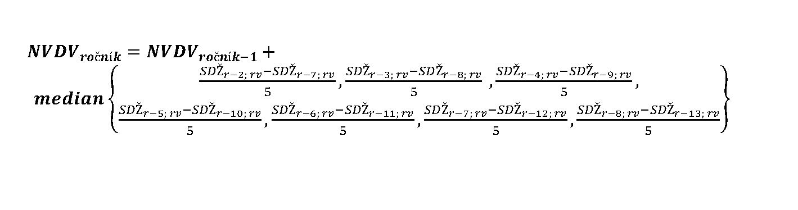

Príloha č. 3c k zákonu č. 461/2003 Z. z.

- Vzorec na určenie neupraveného všeobecného dôchodkového veku pre príslušný ročník

  - 

    - kde

    - NVDV je neupravený všeobecný dôchodkový vek určený v rokoch zaokrúhlený na štyri desatinné miesta,

    - ročník je príslušný ročník, pre ktorý sa určuje neupravený všeobecný dôchodkový vek,

    - SDŽ je stredná dĺžka života v kalendárnom roku a v referenčnom veku vykázaná štatistickým úradom, spoločná pre mužov a ženy,

    - r je kalendárny rok, v ktorom sa určuje neupravený všeobecný dôchodkový vek pre príslušný ročník na účel ustanovenia všeobecného dôchodkového veku pre príslušný ročník všeobecne záväzným právnym predpisom podľa § 65 ods. 8,

    - rv je referenčný vek, ktorý je neupravený všeobecný dôchodkový vek osôb narodených v kalendárnom roku, ktorý bezprostredne predchádza príslušnému ročníku, zaokrúhlený na celé roky nadol.
