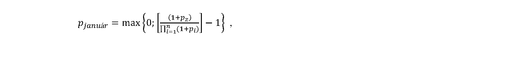

Príloha č. 4b k zákonu č. 461/2003 Z. z.

- VZOREC NA URČENIE PERCENTA ZVÝŠENIA ÚRAZOVEJ RENTY PODĽA § 89 ods. 8 písm. b)

  - Percento zvýšenia úrazovej renty podľa § 89 ods. 8 písm. b) sa určí podľa tohto vzorca:

  - 

  - kde:

  -  

  - p

  - j

  - a

  - n

  - u

  - á

  - r

  - je percento zvýšenia úrazovej renty v príslušnom kalendárnom roku podľa § 89 ods. 8 písm. b);

  -  

  - p

  - z

  - je percento medziročného rastu spotrebiteľských cien vykázané štatistickým úradom za prvých deväť mesiacov kalendárneho roka, ktorý bezprostredne predchádza príslušnému kalendárnemu roku;

  -  

  - p

  - i

  - je percento zvýšenia úrazovej renty podľa § 89 ods. 9 v kalendárnom roku, ktorý bezprostredne predchádza príslušnému kalendárnemu roku;

  -  

  - n

  - je počet zvýšení úrazovej renty podľa § 89 ods. 9 v kalendárnom roku, ktorý bezprostredne predchádza príslušnému kalendárnemu roku.

  - Percento zvýšenia úrazovej renty pjanuár sa zaokrúhľuje na jedno desatinné miesto nahor.
