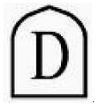

# § 6 Označovanie znehodnotenej zbrane

(1) Označenie znehodnotenej zbrane sa vykonáva podľa osobitného predpisu.3)

(2) Označenie znehodnotenej zbrane, na ktorej je vyrobený rez kontrolnou znehodnocovacou značkou, musí byť vykonané trvalým a viditeľným spôsobom. Na reze zbrane stačí označenie jednej hlavnej časti kontrolnou znehodnocovacou značkou

