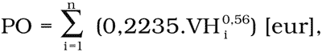

# § 4 Podielová odmena

(1) Podielová odmena znalca sa určí iba v prípade, ak

- a) predmetom úkonu znaleckej činnosti (ďalej len „znalecký úkon“) je ohodnocovanie nehnuteľností a stavieb alebo

- b) určenie východiskovej hodnoty nehnuteľností a stavieb súvisí s vykonaním znaleckého úkonu alebo je predpokladom na vykonanie znaleckého úkonu.

(2) Podielová odmena sa určuje podľa stanovenej výšky východiskovej hodnoty predmetu znaleckého úkonu podľa vzťahu

kde:

PO - výška podielovej odmeny,

VH - východisková hodnota predmetu úkonu zaokrúhlená na celé eurá nahor; za predmet úkonu sa považujú jednotlivo hlavné stavebné objekty, spoločne príslušenstvo (napríklad ploty, studne, inžinierske siete, spevnené plochy a pod.) a spoločne pozemky; východisková hodnota pozemkov je 16,60 eura/m2,

n - počet predmetov ohodnotenia.

(3) Vypočítaná podielová odmena sa zaokrúhľuje na celé eurá nahor.

(4) Minimálna výška podielovej odmeny je 26,56 eura.

(5) V prípade ohodnocovania nedokončenej stavby sa východiskovou hodnotou podľa odseku 2 rozumie východisková hodnota dokončenej stavby.

(6) Ak je predmetom úkonu znaleckej činnosti stanovenie hodnoty nehnuteľností a stavieb k rôznym rozhodujúcim dátumom, patrí znalcovi podielová odmena za ohodnotenie k jednému rozhodujúcemu dátumu a za ohodnotenie k ostatným rozhodujúcim dátumom sa odmena stanoví podľa § 3. Obdobne sa postupuje pri vykonávaní opakovaného znaleckého úkonu na tú istú nehnuteľnosť alebo stavbu.
