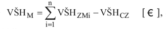
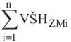
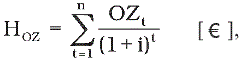
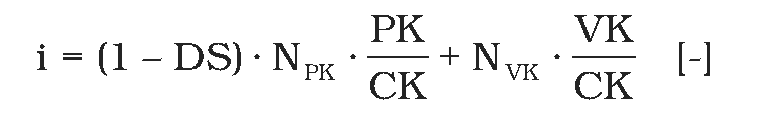
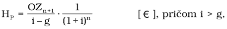
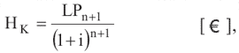
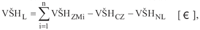
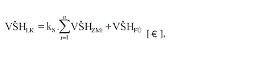
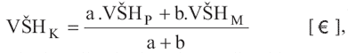

Príloha č. 1 k vyhláške č. 492/2004 Z. z.

- ZÁKLADNÉ POSTUPY STANOVENIA VŠEOBECNEJ HODNOTY PODNIKU A ČASTÍ PODNIKU

  - 1. Majetková metóda stanovenia všeobecnej hodnoty podniku a častí podniku

  - Všeobecná hodnota podniku a častí podniku stanovená majetkovou metódou sa stanoví takto:

  - 

  - kde:

  - VŠHM– všeobecná hodnota podniku a častí podniku stanovená majetkovou metódou [€],

  -  – súčet všeobecných hodnôt všetkých zložiek majetku, ktoré sú predmetom ohodnotenia [€],

  - VŠHCZ – všeobecná hodnota cudzích zdrojov [€].

  - 2. Podnikateľská metóda stanovenia všeobecnej hodnoty podniku a častí podniku

  - a) Všeobecná hodnota podniku a častí podniku stanovená podnikateľskou metódou pri časovo neobmedzenej životnosti podniku sa stanoví takto:

  - VŠHP = HOZ + HP [€],

  - kde je

  - VŠHP– všeobecná hodnota podniku stanovená podnikateľskou metódou [€],

  - HOZ– všeobecná hodnota odčerpateľných zdrojov počas hodnoteného obdobia [€],

  - HP– hodnota pokračujúca [€].

  - Všeobecná hodnota odčerpateľných zdrojov počas hodnoteného obdobia sa stanoví takto:

  - 

  - kde je

  - HOZ– všeobecná hodnota odčerpateľných zdrojov počas hodnoteného obdobia [€],

- OZt– odčerpateľné zdroje počas hodnoteného obdobia [€],

- i – miera kapitalizácie v percentách, ktorá sa do výpočtu dosadzuje v desatinnom tvare [%/100],

  - n – dĺžka sledovaného obdobia [rok].

  - Miera kapitalizácie (i) sa stanoví takto:

  - 

  - CK = PK + VK [€],

  - kde je

  - i – vypočítaná miera kapitalizácie v percentách odrážajúca mieru rizika, priemernú nákladovosť kapitálu a štruktúru využívaného kapitálu, ktorá sa do výpočtu dosadzuje v desatinnom tvare [%/100],

  - DS – sadzba dane z príjmu v percentách, ktorá je stanovená podľa zákona o dani z príjmov pre ohodnocovaný podnik, do výpočtu sa dosadzuje v desatinnom tvare [%/100],

  - NPK– náklady spojené s využívaním požičaného kapitálu v percentách, t. j. úrok a iné náklady platené veriteľom, ktoré sa do výpočtu dosadzujú v desatinnom tvare [%/100],

  - PK – objem požičaného kapitálu; pozostáva zo zložiek pasív, ktorými na účel výpočtu miery kapitalizácie sú dlhodobé bankové úvery, bežné bankové úvery, finančné výpomoci, emitované dlhopisy, zmenky, lízing, platené nájmy a iné záväzky [€],

  - NVK – náklady vlastného kapitálu v percentách, to znamená podiel na zisku očakávaný a získavaný vlastníkom za vklad svojho kapitálu do podniku, ktoré sa do výpočtu dosadzujú v desatinnom tvare [%/100],

  - VK – objem vlastného kapitálu pozostáva zo zložiek pasív, ktorými na účel výpočtu je vlastné imanie [€],

  - CK – celkový kapitál, ktorým sa rozumie súčet vlastného kapitálu a požičaného kapitálu [€].

  - Hodnota pokračujúca sa stanoví takto:

  - 

  - kde je

  - HP – hodnota pokračujúca [€],

  - OZn+1– objem odčerpateľných zdrojov v roku nasledujúcom po sledovanom období [€],

  - i – miera kapitalizácie v percentách, ktorá sa do výpočtu dosadzuje v desatinnom tvare [%/100],

  - g – trvale udržateľná miera rastu odčerpateľných zdrojov v percentách, ktorá sa do výpočtu dosadzuje v desatinnom tvare [%/100],

  - n – dĺžka sledovaného obdobia [rok].

  - Hodnota pokračujúca (HP) je všeobecná hodnota odčerpateľných zdrojov podniku v roku nasledujúcom po sledovanom období zohľadňujúca predpoklady podniku vytvárať odčerpateľné zdroje počas časovo neobmedzeného obdobia, ktorá je prepočítaná na súčasnú hodnotu k dátumu ohodnotenia.

  - Trvale udržateľná miera rastu odčerpateľných zdrojov (g) vyjadruje percentuálnu medziročnú zmenu schopnosti podniku vytvárať odčerpateľné zdroje, ktorá závisí od stavu podniku ku dňu ohodnotenia a od jeho vývoja počas sledovaného obdobia v rámci jeho odvetvia v kontexte s jeho históriou.

  - Trvale udržateľná miera rastu sa v znaleckom posudku stanoví v súlade so zaužívanými postupmi odbornej praxe, napríklad Gordonov model, geometrické rady, aritmetické rady, a vybraný metodický postup sa v znaleckom posudku opíše.

  - b) Všeobecná hodnota podniku a častí podniku stanovená podnikateľskou metódou pri časovo obmedzenej životnosti podniku sa stanoví takto:

  - VŠHP = HOZ + HK [€],

  - kde je

  - VŠHP – všeobecná hodnota podniku stanovená podnikateľskou metódu pri časovo obmedzenej životnosti podniku [€],

  - HOZ – všeobecná hodnota odčerpateľných zdrojov počas hodnoteného obdobia [€],

  - HK – konečná hodnota podniku a častí podniku v roku nasledujúcom po sledovanom období [€].

  - Hodnota konečná sa stanoví takto:

  - 

  - kde je

  - HK – konečná hodnota podniku a častí podniku v roku nasledujúcom po sledovanom období, ktorá je prepočítaná na súčasnú hodnotu k dátumu ohodnotenia [€],

  - LPn+1 – predpokladaný čistý výnos zo speňaženia majetku v roku nasledujúcom po sledovanom období (likvidačný prebytok) [€],

  - i – miera kapitalizácie v percentách, ktorá sa do výpočtu dosadzuje v desatinnom tvare [%/100],

  - n – dĺžka sledovaného obdobia.

  - 3. Likvidačná metóda stanovenia všeobecnej hodnoty podniku a častí podniku

  - a) Všeobecná hodnota podniku a časti podniku stanovená pri skončení podnikateľskej činnosti likvidáciou predstavuje hodnotu majetku podniku a časti podniku stanovenú likvidačnou metódou k určitému dátumu, ktorá ostáva vlastníkovi po predaji majetku, po splatení všetkých cudzích zdrojov vrátane odmeny likvidátora a všetkých nákladov na likvidáciu. Stanoví sa takto:

  - 

  - kde:

  - VŠHL– všeobecná hodnota podniku a častí podniku stanovená likvidačnou metódou [€],

  -  – súčet všeobecných hodnôt všetkých zložiek majetku, ktoré sú predmetom ohodnotenia [€],

  - VŠHCZ – všeobecná hodnota cudzích zdrojov [€],

  - VŠHNL– všeobecná hodnota nákladov súvisiacich s likvidáciou (napr. odmena likvidátora, odmeny za znalecké posudky, likvidácia škôd, vyraďovanie investičného majetku, nárok zamestnancov na odstupné a pod.) [€].

  - b) Všeobecná hodnota podniku a časti podniku pri skončení podnikateľskej činnosti konkurzom sa stanoví likvidačnou metódou takto:

  - 

- kde

- VŠHLK– všeobecná hodnota podniku stanovená likvidačnou metódou [€],

-  – súčet všeobecných hodnôt všetkých zložiek majetku, ktoré sú predmetom ohodnotenia [€],

- VŠHFÚ – všeobecná hodnota finančných účtov, ktorými sa rozumejú peniaze v pokladni a ceniny, účty v bankách, pričom pri tejto metóde ku všeobecnej hodnote finančných účtov nepatrí všeobecná hodnota krátkodobého finančného majetku,

- kS– súhrnný koeficient speňažiteľnosti majetku ako celku zohľadňujúci mimoriadne špecifiká, ktoré sa nebrali do úvahy pri stanovení všeobecných hodnôt jednotlivých zložiek majetku a majú vplyv na výslednú všeobecnú hodnotu majetku ako celku. Výšku súhrnného koeficientu speňažiteľnosti a v ňom zahrnuté mimoriadne špecifiká znalecká organizácia preskúmateľne zdôvodní. Spravidla sa koeficient speňažiteľnosti rovná približne 1,0 [–].

- Všeobecná hodnota majetku, ktorý slúži na zabezpečenie pohľadávok oddelených veriteľov a tovaru pod colným dohľadom, sa v znaleckom posudku stanoví aj samostatne.

- 4. Kombinovaná metóda stanovenia všeobecnej hodnoty podniku a častí podniku

- 

- kde

- VŠHK– všeobecná hodnota podniku a časti podniku vypočítaná kombinovanou metódou [€],

- VŠHP– všeobecná hodnota podniku a časti podniku stanovená podnikateľskou metódou [€],

- VŠHM– všeobecná hodnota podniku a časti podniku stanovená majetkovou metódou [€],

- a – váha korigujúca podnikateľskú hodnotu podniku [–],

- b – váha korigujúca majetkovú hodnotu podniku [–].

- V prípadoch, keď sa všeobecná hodnota stanovená podnikateľskou a majetkovou metódou približne rovnajú, alebo v prípadoch, keď je všeobecná hodnota stanovená podnikateľskou metódou vyššia, platí a = b = 1. V ostatných prípadoch platí: a > b.

- 5. Porovnávacia metóda stanovenia všeobecnej hodnoty podniku a častí podniku

- Všeobecná hodnota podniku a častí podniku podľa transakčného prístupu sa stanoví porovnaním so vzorovými podnikmi rovnakého odvetvia a zamerania, porovnateľnej veľkosti a štruktúry, ktoré boli kúpené alebo predané v nedávnom čase. Hodnota podniku alebo jeho častí sa stanoví pomocou cenových násobkov vybraných ukazovateľov vzorových podnikov, ktoré sa použijú na ohodnocovaný podnik alebo časť podniku.

- Všeobecná hodnota podniku alebo jeho častí podľa vzorového prístupu sa stanoví porovnaním so vzorovými podnikmi sumarizáciou finančných ukazovateľov po zohľadnení rizikových faktorov, kontrolných príplatkov, diskontov predajnosti.

- Všeobecná hodnota podniku alebo jeho častí podľa burzového prístupu sa stanoví ako súčet diskontovaných budúcich dividend počas sledovaného obdobia a očakávanej majetkovej hodnoty na konci sledovaného obdobia.

- Výber použitých metód stanovenia všeobecnej hodnoty podniku a časti podniku znalec právnická osoba jednoznačne zdôvodní.
