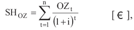
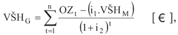
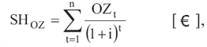

Príloha č. 2 k vyhláške č. 492/2004 Z. z.

- STANOVENIE VŠEOBECNEJ HODNOTY NEHMOTNÉHO MAJETKU

  - 1. Všeobecná hodnota zriaďovacích nákladov

    - Všeobecná hodnota zriaďovacích nákladov sa stanoví len pri tých zložkách majetku, ktoré k dátumu ohodnotenia vykazujú majetkovú podstatu. Všeobecná hodnota sa stanovuje podľa príloh tejto vyhlášky a tiež na základe technicko-ekonomického určenia zriaďovacích nákladov.

  - 2. Všeobecná hodnota softvéru

    - Všeobecná hodnota softvéru sa stanoví v závislosti od jeho využitia pri činnosti podniku a prínosu pri realizovaní jeho podnikateľských aktivít. Všeobecnú hodnotu stanoví znalec príslušného znaleckého odboru.

  - 3. Všeobecná hodnota nehmotných výsledkov výskumnej a obdobnej činnosti a všeobecná hodnota oceniteľných práv

    - Stanoví sa

    - a) metódou licenčnej analógie v prípade licencií, patentov, ochranných známok a iných obchodovateľných súčastí nehmotného majetku alebo

    - b) metódou kapitalizácie odčerpateľných zdrojov; základom je stanovenie dĺžky obdobia v rokoch, počas ktorého sa nehmotný majetok bude využívať; výpočet objemu odčerpateľných zdrojov, ktoré sa vytvárajú využívaním ohodnocovaného nehmotného majetku; stanovenie podielu, ktorý pripadá na ohodnocovaný nehmotný majetok podniku z vytváraných odčerpateľných zdrojov,

      - podľa vzťahu

      - VŠHNIM = SHOZ . pNIM [€],

      - kde

      - VŠHNIM– všeobecná hodnota nehmotného majetku podniku.

      - 

      - kde

      - n – počet rokov používania nehmotného majetku podniku [rok],

      - SHOZ– súčasná hodnota budúcich odčerpateľných zdrojov ku dňu vypracovania znaleckého posudku [€],

      - pNIM– percentuálny podiel, ktorým sa ohodnocovaný nehmotný majetok podieľa na tvorbe odčerpateľných zdrojov, ktorý sa do výpočtu dosadzuje v desatinnom tvare [%/100],

      - i – miera kapitalizácie v percentách vypočítaná podľa prílohy č. 1 časti 2, ktorá sa do výpočtu dosadzuje v desatinnom tvare [%/100].

  - 4. Iný nehmotný majetok

    - Člení sa na goodwill a know-how.

    - Všeobecná hodnota goodwillu sa stanoví ako

    - a) rozdiel medzi podnikateľskou a majetkovou hodnotou

      - VŠHG = VŠHP – VŠHM [€],

      - kde

      - VŠHG– všeobecná hodnota goodwillu [€],

      - VŠHP– všeobecná hodnota podniku alebo časti podniku stanovená podnikateľskou metódou [€],

      - VŠHM– všeobecná hodnota podniku alebo časti podniku stanovená majetkovou metódou [€],

      - alebo ako

    - b) súčasná hodnota rozdielu medzi hodnotou odčerpateľných zdrojov a súčinom miery rentability investovaného kapitálu a všeobecnou hodnotou majetku podniku

      - 

      - kde

      - OZt– objem odčerpateľných zdrojov v čase t [€],

      - VŠHM– všeobecná hodnota podniku alebo časti podniku stanovená majetkovou metódou [€],

      - n – počet rokov používania nehmotného majetku podniku [rok],

      - i1– rentabilita investovaného kapitálu v percentách, ktorá sa do výpočtu dosadzuje v desatinnom tvare [%/100],

      - i2– miera kapitalizácie v percentách vypočítaná podľa prílohy č. 1 časti 2, ktorá sa do výpočtu dosadzuje v desatinnom tvare [%/100].

      - Všeobecná hodnota goodwillu sa stanoví len v prípade, ak predmetom ohodnotenia je podnik ako celok, prípadne časť podniku.

      - Všeobecná hodnota know-how sa stanoví metódou kapitalizácie odčerpateľných zdrojov. Stanoví sa dĺžka obdobia v rokoch, počas ktorého sa know-how bude využívať, vypočíta sa objem odčerpateľných zdrojov, ktoré sa vytvárajú využívaním ohodnocovaného know-how, stanoví sa podiel, ktorý pripadá na ohodnocované know-how z vytváraných odčerpateľných zdrojov.

      - VŠHNIM = SHOZ . pNIM [€],

      - kde

      - VŠHNIM– všeobecná hodnota know-how podniku,

      - 

      - kde

      - n – počet rokov používania know-how podniku [rok],

      - SHOZ– súčasná hodnota budúcich odčerpateľných zdrojov ku dňu vypracovania znaleckého posudku [€],

      - pNIM– percentuálny podiel, ktorým sa ohodnocované know-how podieľa na tvorbe budúcich odčerpateľných zdrojov; do výpočtu sa dosadzuje v desatinnom tvare [%/100],

      - i – miera kapitalizácie v percentách vypočítaná podľa prílohy č. 1 časti 2, ktorá sa do výpočtu dosadzuje v desatinnom tvare [%/100].
