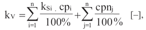
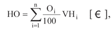
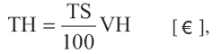
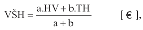
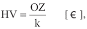
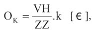
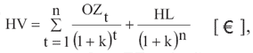
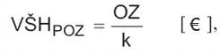
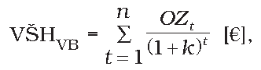
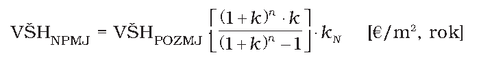

Príloha č. 3 k vyhláške č. 492/2004 Z. z.

- POSTUP STANOVENIA VŠEOBECNEJ HODNOTY NEHNUTEĽNOSTÍ A STAVIEB

  - A. ZÁKLADNÉ POJMY A NÁZVOSLOVIE

    - 1. Všeobecná hodnota (VŠH)

      - Všeobecná hodnota je výsledná objektivizovaná hodnota nehnuteľností a stavieb, ktorá je znaleckým odhadom ich najpravdepodobnejšej ceny ku dňu ohodnotenia, ktorú by tieto mali dosiahnuť na trhu v podmienkach voľnej súťaže, pri poctivom predaji, keď kupujúci aj predávajúci budú konať s patričnou informovanosťou i opatrnosťou a s predpokladom, že cena nie je ovplyvnená neprimeranou pohnútkou.

    - 2. Východisková hodnota stavieb (VH)

      - Východisková hodnota je znalecký odhad hodnoty, za ktorú by bolo možné hodnotenú stavbu nadobudnúť formou výstavby v čase ohodnotenia na úrovni bez dane z pridanej hodnoty.

    - 3. Technická hodnota (TH)

      - Technická hodnota je znalecký odhad východiskovej hodnoty stavby znížený o hodnotu zodpovedajúcu výške opotrebovania.

    - 4. Výnosová hodnota (HV)

      - Výnosová hodnota je znalecký odhad súčasnej hodnoty budúcich disponibilných výnosov z využitia nehnuteľnosti formou prenájmu, diskontovaných rizikovou (diskontnou) sadzbou.

    - 5. Stavby1)

      - Stavba je stavebná konštrukcia postavená stavebnými prácami zo stavebných výrobkov, ktorá je pevne spojená so zemou alebo ktorej osadenie vyžaduje úpravu podkladu.

      - Stavby sa podľa stavebnotechnického vyhotovenia a účelu členia na pozemné stavby a inžinierske stavby.

  - B. ZÁKLADNÉ POSTUPY OHODNOCOVANIA NEHNUTEĽNOSTÍ A STAVIEB

    - Všeobecná hodnota sa stanoví týmito metódami:

    - a) porovnávacia metóda,

    - b) kombinovaná metóda (použije sa pri stavbách, ktoré sú schopné dosahovať výnos formou prenájmu),

    - c) výnosová metóda (použije sa pri pozemkoch, ktoré sú schopné dosahovať výnos),

    - d) metóda polohovej diferenciácie.

      - Výber vhodnej metódy vykoná znalec. Výber je v znaleckom posudku zdôvodnený. Podľa účelu znaleckého posudku možno použiť aj viac metód súčasne, pričom v závere bude po zdôvodnení uvedená len všeobecná hodnota určená vybranou metódou, ktorá najvhodnejšie vystihuje definíciu všeobecnej hodnoty. Pri ohodnocovaní nehnuteľností a stavieb nemocníc a zdravotníckych zariadení sa ako jedna z metód vždy použije metóda polohovej diferenciácie a pri hodnotení faktorov sa zohľadňuje najmä faktor – súčasný technický stav.

  - C. TECHNICKÁ HODNOTA STAVIEB

    - C.1 Výpočet východiskovej hodnoty (VH) Výpočet sa vykoná na báze rozpočtových ukazovateľov. Rozpočtový ukazovateľ musí byť preskúmateľný, tzn. vybraný ukazovateľ sa musí presne identifikovať názvom, zatriedením do číselníka klasifikácie stavieb a jednotkovou hodnotou určenou podľa verejne publikovaných katalógov určených ministerstvom, z ktorého bol vybraný alebo vytvorený.

      - Jednotková hodnota sa preskúmateľným spôsobom upraví podľa jednotlivých charakteristík hodnoteného objektu (výška podlaží, plocha podlaží, vybavenosť objektu, konštrukčno-materiálová charakteristika a pod.) a prepočíta sa do cenovej úrovne k termínu, ku ktorému sa vykonáva ohodnotenie.

      - Východisková hodnota sa stanoví podľa základného vzťahu

      - VH = M . (RU . kCU . kV . kZP . kVP . kK . kM ) [€],

      - kde

      - M – počet merných jednotiek.

      - Udáva počet merných jednotiek hodnoteného objektu vypočítaných podľa technickej normy, na ktorej základe bol zostavený vybraný rozpočtový ukazovateľ.

      - RU – rozpočtový ukazovateľ

      - Rozumie sa hodnota základných rozpočtových nákladov na mernú jednotku porovnateľného objektu z katalógov rozpočtových ukazovateľov určených ministerstvom alebo stanovená tvorbou rozpočtového ukazovateľa na mernú jednotku hodnoteného objektu podľa katalógov rozpočtových ukazovateľov určených ministerstvom. Výber porovnateľného objektu (rozpočtového ukazovateľa) sa vykoná podľa zatriedenia hodnoteného objektu do číselníka príslušnej klasifikácie stavieb, na základe ktorej bol použitý katalóg rozpočtových ukazovateľov zostavený. Hodnota základných rozpočtových nákladov na mernú jednotku stavebného objektu, ktorý nie je uvedený v katalógoch určených ministerstvom, môže byť vytvorená cenovou kalkuláciou (ponukovým rozpočtom) alebo na základe nákladov na obstaranie.

      - kCU – koeficient vyjadrujúci vývoj cien

      - Vyjadruje vývoj cien stavebných prác medzi termínom ohodnotenia a obdobím, pre ktoré bol zostavený rozpočtový ukazovateľ porovnateľného objektu. Koeficient sa určí pomocou verejne publikovaných indexov vývoja cien stavebných prác a materiálov v stavebníctve vydávaných Štatistickým úradom Slovenskej republiky po jednotlivých štvrťrokoch pre odbor stavebníctvo ako celok. V prípade, že k termínu ohodnotenia neboli aktuálne indexy verejne publikované, použijú sa posledné známe.

      - kV – koeficient vplyvu vybavenosti hodnoteného objektu

      - Vyjadruje rozdiel ceny konštrukcií a vybavení porovnateľného a hodnoteného objektu.

      - Vypočíta sa podľa vzťahu

      - 

      - kde

      - kSi– koeficient štandardu i-tej konštrukcie alebo vybavenia zohľadňujúci štandardné, podštandardné alebo nadštandardné vybavenie. V prípade, ak sa v cenových podieloch porovnateľného objektu uvedených v katalógoch rozpočtových ukazovateľov nachádza konštrukcia alebo vybavenie, ktoré sa na hodnotenom objekte nevyskytuje, koeficient sa rovná nule. V prípade, keď je hodnotená konštrukcia alebo vybavenie podštandardné, je koeficient menší ako 1,00 a v prípade, keď je nadštandardné, je väčší ako 1,00. Pri určovaní koeficientu sa zohľadňuje aj podiel hodnotenej konštrukcie alebo vybavenia na stavbe ako celku,

      - cpi – cenový podiel i-tej konštrukcie alebo vybavenia vybraného porovnateľného objektu uvedený v katalógoch rozpočtových ukazovateľov,

      - cpnj – cenový podiel j-tej konštrukcie alebo vybavenia navyše, ktorý sa nevyskytuje v cenových podieloch porovnateľného objektu uvedených v katalógoch rozpočtových ukazovateľov a zistí sa z pomeru odhadnutých alebo preukázateľných obstarávacích nákladov na jej vybudovanie v čase a mieste ohodnotenia k východiskovej hodnote hodnoteného objektu.

      - Vo výnimočných prípadoch možno koeficient stanoviť zdôvodneným odborným odhadom. V prípade zhodného výberu porovnateľného objektu oproti hodnotenému objektu sa koeficient rovná 1,0.

      - kZP – koeficient vplyvu zastavanej plochy hodnotenej stavby

      - Vyjadruje rozdiel ceny konštrukcií a vybavení závislých od zastavanej plochy v porovnaní s priemernou zastavanou plochou hodnotenej a porovnateľnej stavby. Na výpočet koeficientu sa použijú primerané vzťahy vzhľadom na použitý katalóg rozpočtových ukazovateľov. Priemerná zastavaná plocha sa vypočíta ako aritmetický priemer zastavaných plôch všetkých reprezentatívnych podlaží.

      - kVP – koeficient vplyvu konštrukčnej výšky podlaží hodnotenej stavby

      - Vyjadruje rozdiel ceny konštrukcií a vybavenia závislých od konštrukčnej výšky v porovnaní s priemernou konštrukčnou výškou hodnotenej a porovnateľnej stavby. Na výpočet koeficientu sa použijú primerané vzťahy vzhľadom na použitý katalóg rozpočtových ukazovateľov. Priemerná konštrukčná výška sa vypočíta ako vážený priemer konštrukčných výšok všetkých podlaží stavby alebo jej časti. Ako váha sa použije veľkosť zastavanej plochy príslušného podlažia.

      - kK – koeficient konštrukčno-materiálovej charakteristiky

      - Vyjadruje rozdiel ceny v závislosti od použitého materiálu nosnej konštrukcie stavby, ak to nebolo zohľadnené v kV. Pri výbere porovnateľného objektu s rovnakou konštrukčno-materiálovou charakteristikou hodnoteného objektu sa tento koeficient rovná 1,0.

      - kM – koeficient vyjadrujúci územný vplyv

      - Vyjadruje zvýšené, resp. znížené náklady na výstavbu v danom mieste z dôvodu dopravných vzdialeností, možnosti zariadenia staveniska a pod.

      - Pri stavbách, ktoré majú vo zvislom alebo vodorovnom členení časť, ktorá sa typom konštrukcie alebo účelom výrazne líši podľa zatriedenia do klasifikácie stavieb (napr. dielne s kanceláriami na hornom podlaží, bytové domy s obchodmi na prvom nadzemnom podlaží, výrobné haly s administratívnymi alebo technickými prístavbami a pod.), východisková hodnota sa môže vypočítať ako súčet ohodnotení jednotlivých častí. Pri vodorovnom delení sa obstavaný priestor základov a strechy, t. j. spoločných častí stavby, rozdelí podľa pomerov obstavaného priestoru vrchnej stavby jednotlivých častí.

      - Obdobným spôsobom sa postupuje pri vstavbách v halových objektoch. Obstavaný priestor halového objektu sa neznižuje o obstavaný priestor vstavby, výnimku tvorí zvisle oddeliteľná (samostatná) časť. V koeficiente vybavenosti halového objektu sa nezohľadňuje vybavenie vstavby a naopak.

      - Ak obstavaný priestor časti stavby, ktorá sa typom konštrukcie alebo účelom výrazne líši podľa zatriedenia do klasifikácie stavieb, tvorí nevýrazný podiel z celkového obstavaného priestoru stavby, ohodnotenie sa vykoná podľa prevažujúcej časti.

      - Pri inžinierskych stavbách, bytoch a nebytových priestoroch sa koeficienty vplyvu zastavanej plochy a vplyvu výšky podlaží spravidla nepoužijú.

      - Nedokončené a poškodené stavby

      - Nedokončenými stavbami sa rozumejú rozostavané stavby, nadstavby a prístavby v čase od začatia výstavby do vydania kolaudačného rozhodnutia stavebným úradom alebo stavby, na ktorých sa vykonáva rekonštrukcia a modernizácia. Začiatkom výstavby sa na účely tejto vyhlášky rozumie fyzické začatie stavebných prác na hodnotenom objekte. Východisková hodnota stavby, na ktorej sa s výstavbou nezačalo, sa nepočíta. Východisková hodnota nedokončenej stavby sa vypočíta ako východisková hodnota stavby dokončenej na základe projektovej dokumentácie overenej stavebným úradom (ak taká projektová dokumentácia nie je alebo ak nie je v súlade so skutkovým stavom, tak podľa predpokladaného stavu stavby po jej dokončení) s tým, že sa odpočet východiskovej hodnoty nevyhotovených a nedokončených konštrukcií a vybavení vykoná podľa ich pomerného percentuálneho zastúpenia na celej stavbe.

      - Obdobným spôsobom sa postupuje pri poškodených stavbách. Za poškodenie sa nepovažuje fyzické alebo morálne starnutie jednotlivých konštrukcií alebo vybavení, ani dôsledky zanedbanej údržby hodnoteného objektu.

    - C.2 Výpočet technického stavu (TS) a hodnoty vyjadrujúcej opotrebenie stavby (HO) Technický stav sa vypočíta podľa vzťahu

      - TS = 100 – O [%],

      - kde

      - O – opotrebenie stavby [%].

      - Opotrebenie stavby sa uvádza v percentách a zodpovedá znehodnoteniu technického stavu stavby v závislosti od veku, predpokladanej životnosti, spôsobu užívania stavby, údržby stavby a pod.

      - Opotrebenie stavby sa vypočíta

      - a) lineárnou metódou,

      - b) analytickou metódou.

        - Opotrebenie nadstavieb, prístavieb a samostatne ohodnocovaných častí stavby sa pri lineárnej metóde vypočíta samostatne za každý rok ich veku rovnakým spôsobom, ale ukončenie predpokladanej životnosti sa určí vždy pre celú stavbu k rovnakému roku.

        - Celkové opotrebenie stavby sa pri lineárnej metóde môže vypočítať ako vážený priemer opotrebení jednotlivých častí stavby, kde váhou je merná jednotka použitá pri výpočte východiskovej hodnoty.

        - Opotrebenie nedokončených stavieb určí znalec odborným odhadom.

        - Pri výpočte opotrebenia sa používajú tieto pojmy:

        - Vek stavby (V) – vypočíta sa ako rozdiel roku, ku ktorému sa ohodnotenie vykonáva, a roku, v ktorom nadobudlo právoplatnosť kolaudačné rozhodnutie. V prípadoch, keď došlo k užívaniu stavby skôr, vypočíta sa vek tak, že od roku, ku ktorému sa ohodnotenie vykonáva, sa odpočíta rok, v ktorom sa preukázateľne stavba začala užívať. Ak nemožno vek stavby takto zistiť, počíta sa podľa iného dokladu, a ak nie je ani taký doklad, určí sa zdôvodneným odborným odhadom.

        - Základná životnosť stavby (ZZ) – rozumie sa predpokladaná životnosť daného typu stavieb s ohľadom na ich konštrukčno-materiálové riešenie a zatriedenie do klasifikácie. Udáva sa v rokoch.

        - Životnosť stavby (Z) – rozumie sa celková predpokladaná životnosť stavby pri bežnej údržbe od jej vzniku až do úplného zániku. Udáva sa v rokoch. Životnosť stavby určuje znalec s prihliadnutím na jej konštrukčno-materiálové riešenie, technický stav, spôsob a intenzitu užívania a vykonávanú údržbu.

        - Na určenie životnosti stavby možno použiť vzťah

        - Z = V + T [rok],

        - kde

        - V – vek stavby [rok],

        - T – znalcom určená zostatková životnosť stavby od roku, ku ktorému sa vykonáva ohodnotenie [rok].

        - Hodnota vyjadrujúca opotrebenie (HO) sa vypočíta ako súčet hodnôt vyjadrujúcich opotrebenie jednotlivých častí stavby podľa vzťahu

        - 

        - kde

        - Oi – opotrebenie i-tej časti stavby [%],

        - VHi – východisková hodnota i-tej časti stavby [€],

        - n – počet častí stavby [–].

    - C.3 Výpočet technickej hodnoty (TH) Výpočet sa vykoná podľa vzťahu

      - 

      - alebo

      - TH = VH – HO [€],

      - kde

      - TH – technická hodnota stavby [€],

      - TS – technický stav stavby [%],

      - VH – východisková hodnota stavby [€],

      - HO – hodnota vyjadrujúca opotrebenie stavby [€].

  - D. VŠEOBECNÁ HODNOTA STAVIEB (VŠHS)

    - D.1 Porovnávacia metóda Pri výpočte sa používa transakčný prístup. Na porovnanie je potrebný súbor aspoň troch nehnuteľností a stavieb. Porovnanie treba vykonať na mernú jednotku (obstavaný priestor, zastavaná plocha, podlahová plocha, dĺžka, kus a pod.) s prihliadnutím na odlišnosti porovnávaných objektov a ohodnocovaného objektu.

      - Hlavné faktory porovnávania:

      - a) ekonomické (dátum prevodu, forma prevodu, spôsob platby a pod.),

      - b) polohové (miesto, lokalita, atraktivita a pod.),

      - c) konštrukčné a fyzické (štandard, nadštandard, podštandard, príslušenstvo a pod.).

        - Podklady na porovnanie (doklad o prevode alebo prechode nehnuteľnosti, prípadne ponuky realitných kancelárií) musia byť identifikovateľné. Pri porovnávaní sa musia vylúčiť všetky vplyvy mimoriadnych okolností trhu (napr. príbuzenský vzťah medzi predávajúcim a kupujúcim, stav tiesne predávajúceho alebo kupujúceho a pod).

        - Pri výpočte sa môže použiť aj matematická štatistika. Na toto porovnanie je potrebný tak veľký súbor, aby boli splnené známe a platné testy matematickej štatistiky.

    - D.2 Kombinovaná metóda Vypočíta sa podľa vzťahu

      - 

      - kde

      - HV – výnosová hodnota stavieb [€],

      - TH – technická hodnota stavieb [€],

      - a – váha výnosovej hodnoty [–],

      - b – váha technickej hodnoty, spravidla sa rovná 1,00 [–].

      - Za výnosovú hodnotu dosadzujeme hodnotu stavieb bez výnosu z pozemkov.

      - V prípadoch, keď sa výnosová hodnota stavieb približne rovná súčtu alebo je vyššia ako technická hodnota stavieb, spravidla platí: a = b = 1. V ostatných prípadoch platí: a > b.

      - Výnosová hodnota (HV)

      - Výnosová hodnota stavieb sa vypočíta kapitalizáciou budúcich odčerpateľných zdrojov počas časovo neobmedzeného obdobia alebo kapitalizáciou budúcich odčerpateľných zdrojov počas časovo obmedzeného obdobia s následným predajom. Spôsob výpočtu určí znalec.

      - Kapitalizácia budúcich výnosov počas časovo neobmedzeného obdobia

      - Výnosová hodnota sa vypočíta podľa základného vzťahu

      - 

      - kde

      - OZ – odčerpateľný zdroj, ktorým sa rozumie disponibilný výnos so zohľadnením kapitalizovaného odpisu [€/rok],

      - k – úroková miera, ktorá sa do výpočtu dosadzuje v desatinnom tvare [%/100]. Úroková miera zohľadňuje aj zaťaženie daňou z príjmu.

      - Kapitalizovaný odpis sa spravidla vypočíta podľa vzťahu

      - 

      - kde

      - OK – kapitalizovaný odpis [€/rok],

      - ZZ – základná životnosť [rok], v prípade súboru stavieb sa dosadzuje základná životnosť určená váhovým priemerom,

      - k – úroková miera, ktorá sa do výpočtu dosadzuje v desatinnom tvare [%/100]. Úroková miera zohľadňuje aj zaťaženie daňou z príjmu.

      - Kapitalizácia budúcich výnosov počas časovo obmedzeného obdobia s následným predajom

      - Výnosová hodnota sa vypočíta podľa základného vzťahu

      - 

      - kde

      - OZt– odčerpateľný zdroj, ktorým sa rozumie disponibilný výnos v období t [€/rok],

      - n – časové obdobie výnosovosti v rokoch uvažované pre výpočet,

      - k – úroková miera, ktorá sa do výpočtu dosadzuje v desatinnom tvare [%/100]. Úroková miera zohľadňuje aj zaťaženie daňou z príjmu.

      - HL – likvidačná hodnota stavieb [€].

      - Likvidačná hodnota (HL) sa vypočíta podľa vzťahu

      - HL = VŠH – NL [€],

      - kde

      - VŠH – všeobecná hodnota stavieb vypočítaná metódou polohovej diferenciácie v čase ohodnotenia [€],

      - NL – odhadované náklady spojené s prevodom nehnuteľnosti, najmä daň z prevodu nehnuteľnosti podľa daňového zákona, náklady na inzerciu, náklady na poplatky a pod.

      - Odčerpateľný zdroj v období t (OZ)

      - Odčerpateľným zdrojom sa rozumie ročný disponibilný výnos z využívania nehnuteľnosti formou prenájmu. Vypočíta sa ako rozdiel hrubého výnosu a nákladov na využívanie nehnuteľnosti (prevádzkových, správnych nákladov, nákladov na údržbu a pod.) znížený o odhad predpokladaných strát výnosu z nájomného s ohľadom na typ majetku, jeho polohu, využiteľnosť a pod.

      - Hrubý výnos sa vypočíta za predpokladu 100 % prenajatia objektu ako súčin ročnej nájomnej sadzby a mernej jednotky (napr. m2 podlahovej plochy, podlažie, miestnosť, budova a pod.) Nájomné sadzby sa určia z uzatvorených nájomných zmlúv. Ak sa nájomné sadzby nedajú zistiť pre nedostatok podkladov alebo ak sa odlišujú od dosiahnuteľných výnosov pri riadnom obhospodarovaní majetku alebo stavby (príp. ich časti) nie sú v čase ohodnotenia prenajaté, vychádza sa z nájomných sadzieb, ktoré sa pri riadnom obhospodarovaní majetku dajú trvalo dosiahnuť.

      - Náklady na využívanie nehnuteľnosti sa určia podľa predložených dokladov, najmä platobného výmeru na daň z nehnuteľností, poistnej zmluvy a pod., prípadne odhadom z východiskovej hodnoty alebo hrubého výnosu s ohľadom na veľkosť majetku a predpokladanú výšku pri jeho riadnom obhospodarovaní. Do nákladov sa nezahŕňajú náklady, ktoré sú nájomníkom platené osobitne, alebo náklady, o ktoré je znížená sadzba nájomného použitá pri výpočte hrubého výnosu.

    - D.3 Metóda polohovej diferenciácie Metódou polohovej diferenciácie sa spravidla samostatne stanoví všeobecná hodnota pre

      - a) stavby s výnimkou bytov a nebytových priestorov,

      - b) byty a nebytové priestory.

    - D.3.1 Stavby s výnimkou bytov a nebytových priestorov Vypočíta sa podľa základného vzťahu

      - VŠHS= TH . kPD [€],

      - kde

      - TH – technická hodnota stavby [€],

      - kPD– koeficient polohovej diferenciácie vyjadrujúci vplyv polohy a ostatných faktorov vplývajúcich na všeobecnú hodnotu v mieste a čase [–] podľa metodiky určenej ministerstvom.

      - Koeficient polohovej diferenciácie sa môže stanoviť pre skupinu stavieb alebo jednotlivo pre každú stavbu.

      - Pri určení koeficientu polohovej diferenciácie sa váhovým priemerom zohľadnia spravidla tieto faktory:

    - – trh s nehnuteľnosťami – kúpna sila obyvateľstva,

    - – poloha nehnuteľnosti v danej obci – vzťah k centru obce,

    - – súčasný technický stav nehnuteľnosti,

    - – prevládajúca zástavba v okolí nehnuteľnosti,

    - – príslušenstvo nehnuteľnosti,

    - – typ nehnuteľnosti,

    - – pracovné možnosti obyvateľstva,

    - – skladba obyvateľstva v mieste stavby,

    - – orientácia nehnuteľnosti k svetovým stranám,

    - – konfigurácia terénu,

    - – pripravenosť inžinierskych sietí v blízkosti stavby,

    - – doprava v okolí nehnuteľnosti,

    - – občianska vybavenosť,

    - – prírodná lokalita v bezprostrednom okolí stavby,

    - – kvalita životného prostredia v bezprostrednom okolí stavby,

    - – možnosti zmeny v zástavbe – územný rozvoj,

    - – možnosti ďalšieho rozšírenia,

    - – dosahovanie výnosu z nehnuteľnosti,

    - – názor znalca,

    - – iné faktory.

    - D.3.2 Byty a nebytové priestory Vypočíta sa podľa základného vzťahu

      - VŠHB = TH . kPD [€],

      - kde

      - TH – technická hodnota bytu, nebytového priestoru [€],

      - kPD – koeficient polohovej diferenciácie vyjadrujúci vplyv polohy a ostatných faktorov vplývajúcich na všeobecnú hodnotu v mieste a čase [–].

      - Pri určení koeficientu polohovej diferenciácie sa váhovým priemerom zohľadnia spravidla tieto faktory:

    - – trh s bytmi v danej lokalite – na sídlisku,

    - – poloha bytového domu v danej obci – vzťah k centru obce,

    - – súčasný technický stav bytu a bytového domu,

    - – prevládajúca zástavba v bezprostrednom okolí bytového domu,

    - – príslušenstvo bytového domu,

    - – vybavenosť a príslušenstvo bytu,

    - – pracovné možnosti obyvateľstva – miera nezamestnanosti,

    - – skladba obyvateľstva v obytnom dome – na sídlisku,

    - – orientácia obytných miestností k svetovým stranám,

    - – umiestnenie bytu v bytovom dome,

    - – počet bytov vo vchode – v bloku,

    - – doprava v okolí bytového domu,

    - – občianska vybavenosť v okolí bytového domu,

    - – prírodná lokalita v bezprostrednom okolí bytového domu,

    - – kvalita životného prostredia v bezprostrednom okolí bytového domu,

    - – názor znalca,

    - – iné faktory.

    - D.4 Stavby určené na odstránenie Všeobecná hodnota stavieb, ktoré príslušný stavebný úrad nariadil alebo povolil odstrániť, sa vypočíta ako rozdiel všeobecnej hodnoty použiteľného materiálu, ktorý možno získať odstránením stavby, a nákladov na odstránenie stavby s odprataním nevyužiteľného materiálu a jeho uložením na skládku.

      - Všeobecná hodnota stavby určenej na odstránenie na účely tejto vyhlášky nemôže byť záporná.

  - E. VŠEOBECNÁ HODNOTA POZEMKOV (VŠHPOZ)

    - E.1 Porovnávacia metóda

    - Pri výpočte sa používa transakčný prístup. Na porovnanie je potrebný súbor aspoň troch pozemkov. Porovnanie treba vykonať na mernú jednotku (1 m2pozemku)s prihliadnutím na odlišnosti porovnávaných pozemkov a ohodnocovaného pozemku. Pri porovnávaní trvalých porastov bez pozemkov sa merná jednotka určí v závislosti od ich druhu (napríklad kus, 1 ha plochy a pod.).

    - Hlavné faktory porovnávania:

    - d) ekonomické (napríklad dátum prevodu, forma prevodu, spôsob platby a pod.),

    - e) polohové (napríklad miesto, lokalita, atraktivita, prístup a pod.),

    - f) fyzické (napríklad infraštruktúra a možnosť zástavby pri stavebných pozemkoch; kvalita pôdy a kvalita výsadby pri ostatných pozemkoch a pod.).

      - Podklady na porovnanie (doklad o prevode alebo prechode nehnuteľnosti, prípadne ponuky realitných kancelárií) musia byť identifikovateľné. Pri porovnávaní sa musia vylúčiť všetky vplyvy mimoriadnych okolností trhu (napr. príbuzenský vzťah medzi predávajúcim a kupujúcim, stav tiesne predávajúceho alebo kupujúceho a pod).

      - Pri výpočte sa môže použiť aj matematická štatistika. Na toto porovnanie je potrebný tak veľký súbor, aby boli splnené známe a platné testy matematickej štatistiky.

      - E.2 Výnosová metóda

      - Výnosová hodnota pozemkov sa vypočíta kapitalizáciou budúcich odčerpateľných zdrojov počas časovo neobmedzeného obdobia podľa vzťahu

      - 

      - kde

      - OZ – odčerpateľný zdroj, ktorým sa rozumie disponibilný výnos dosiahnuteľný pri riadnom hospodárení formou prenájmu pozemku. Pri poľnohospodárskych a lesných pozemkoch je možné v odôvodnených prípadoch použiť disponibilný výnos z poľnohospodárskej alebo lesnej výroby. Stanoví sa ako rozdiel hrubého výnosu a nákladov [€/rok],

      - k – úroková miera, ktorá sa do výpočtu dosadzuje v desatinnom tvare [%/100]. Minimálna výška úrokovej miery v percentách sa rovná 1,5-násobku základnej úrokovej sadzby Európskej centrálnej banky. Úroková miera zohľadňuje aj zaťaženie daňou z príjmu.

      - E.3 Metóda polohovej diferenciácie

      - E.3.1 Pozemky

      - Pozemky sa pri použití metódy polohovej diferenciácie na účely tejto vyhlášky delia na skupiny:

      - E.3.1.1 Pozemky na zastavanom území obcí, nepoľnohospodárske a nelesné pozemky mimo zastavaného územia obcí,2) pozemky v zriadených záhradkových osadách,3) pozemky mimo zastavaného územia obcí určené na stavbu,4) pozemky v pozemkových obvodoch jednoduchých pozemkových úprav na usporiadanie vlastníckych a užívacích pomerov k pozemkom, ktoré sa nachádzajú pod osídleniami marginalizovaných skupín obyvateľstva a v hospodárskych dvoroch4a)

      - Všeobecná hodnota sa vypočíta podľa základného vzťahu

      - VŠHPOZ = M . VŠHMJ [€],

      - kde

      - M – výmera pozemku v m2,

      - VŠHMJ – jednotková všeobecná hodnota pozemku v €/m2.

      - Jednotková všeobecná hodnota pozemku sa môže stanoviť aj pre skupinu pozemkov.

      - Jednotková všeobecná hodnota pozemkov sa stanoví podľa vzťahu

      - VŠHMJ = VHMJ . kPD [€/m2],

      - kde

      - VHMJ – jednotková východisková hodnota pozemku, ktorá sa určí podľa tabuľky:

      - Klasifikácia obce – názov alebo údaj podľa počtu obyvateľov | | VHMJ €/m2

      - a) | Bratislava | 66,39

      - b) | Krajské mestá: Nitra, Prešov, Trenčín, Trnava, Žilina, Košice, Banská Bystrica a mestá: Piešťany, Vysoké Tatry, Trenčianske Teplice | 26,56

      - c) | Mestá: Poprad, Zvolen, Liptovský Mikuláš, Martin | 16,60

      - d) | Ostatné okresné mestá so sídlom okresných úradov | 9,96

      - e) | Ostatné obce nad 15 000 obyvateľov | 6,64

      - f) | Ostatné obce od 5 000 do 15 000 obyvateľov | 4,98

      - g) | Ostatné obce do 5 000 obyvateľov | 3,32

      - Obce a lokality v okolí miest so zvýšeným záujmom o kúpu nehnuteľností na bývanie alebo rekreáciu môžu mať jednotkovú východiskovú hodnotu do 80 % z východiskovej hodnoty obce (mesta), z ktorej vyplýva zvýšený záujem. V prípade záujmu o iné druhy nehnuteľností (napríklad priemyselné, poľnohospodárske využitie) okrem pozemkov v zriadených záhradkových osadách, chatových osadách, hospodárskych dvoroch poľnohospodárskych podnikov a pozemkov pod osídleniami marginalizovaných skupín obyvateľstva môžu mať jednotkovú východiskovú hodnotu do 60 % z východiskovej hodnoty obce (mesta), z ktorej vyplýva zvýšený záujem. V prípade záujmu o pozemky v zriadených záhradkových osadách, chatových osadách, hospodárskych dvoroch poľnohospodárskych podnikov a pozemky pod osídleniami marginalizovaných skupín obyvateľstva môžu mať jednotkovú východiskovú cenu do 50 % z východiskovej hodnoty obce (mesta), z ktorej vyplýva zvýšený záujem. V takých prípadoch sa koeficient polohovej diferenciácie vzťahuje na obec, z ktorej vyplýva zvýšený záujem. Minimálna jednotková východisková hodnota pozemku po zohľadnení zvýšeného záujmu o kúpu nehnuteľností je hodnota prislúchajúca klasifikácii obce, v ktorej sa pozemok nachádza.

      - kPD – koeficient polohovej diferenciácie sa vypočíta podľa vzťahu

      - kPD = kS . kV . kD . kF . kI . kZ . kR [–],

      - kde

      - kS – koeficient všeobecnej situácie (0,70 – 2,00) sa určí takto:

      - Všeobecná situácia | | ks

      - 1. | oblasti mimo zastavaného územia obcí určeného platnou územnoplánovacou dokumentáciou | 0,70 – 0,80

      - 2. | stavebné územie obcí do 5 000 obyvateľov, priemyslové´a poľnohospodárske oblasti obcí a miest do 10 000 obyvateľov | 0,80 – 0,90

      - 3. | obytné časti obcí a miest od 5 000 do 10 000 obyvateľov a rekreačné oblasti pre individuálnu rekreáciu, centrá obcí do 5 000 obyvateľov, obytné zóny na predmestiach a priemyslové a poľnohospodárske oblasti miest do 50 000 obyvateľov, obytné zóny samostatných obcí v dosahu miest do 50 000 obyvateľov | 0,90 – 1,00

      - 4. | centrá miest od 10 000 do 50 000 obyvateľov, obytné zóny miest nad 50 000 obyvateľov, obytné zóny samostatných obcí v dosahu miest nad 50 000 obyvateľov, prednostné oblasti vilových alebo rodinných domov v centre i mimo centra mesta, oblasti rekreačných stavieb v dôležitých centrách turistického ruchu, priemyslové a poľnohospodárske oblasti miest nad 50 000 obyvateľov | 1,00 – 1,30

      - 5. | veľmi dobré obchodné a obytné časti v mestách od 50 000 do 100 000 obyvateľov, obytné zóny miest nad 100 000 obyvateľov, luxusné obytné oblasti s dobrým osvetlením a výhľadom, exkluzívne oblasti rodinných domov v dosahu miest nad 100 000 obyvateľov | 1,20 – 1,60

      - 6. | veľmi dobré obchodné oblasti v mestách od 50 000 do 100 000 obyvateľov a v kúpeľných mestách, vedľajšie ulice v centre miest nad 100 000 obyvateľov, nákupné centrá vo veľkých obytných častiach mimo centra miest nad 100 000 obyvateľov s dobrými dopravnými možnosťami | 1,50 – 1,80

      - 7. | prednostné obchodné ulice a miesta v užšom centre miest nad 100 000 obyvateľov, najlepšie miesta pre obchod v mestách od 50 000 do 100 000 obyvateľov | 1,70 – 1,90

      - 8. | najlepšie miesta pre obchod v mestách nad 100 000 obyvateľov | 1,80 – 2,00

      - kV – koeficient intenzity využitia (0,50 – 2,00) sa určí takto:

      - Intenzita využitia | | kv

      - 1. | – záhradkové osady, – chatové osady, – hospodárske dvory poľnohospodárskych podnikov, – sídelná koncentrácia obydlí obývaných prevažne priestorovo alebo sociálne vylúčenými skupinami obyvateľstva | 0,50 – 0,70

      - 2. | – inžinierske stavby, chránené ložiskové územia | 0,70 – 0,90

      - 3. | – nebytové budovy alebo nebytové budovy s nízkym využitím, – poľnohospodárske budovy a sklady bez využitia | 0,90 – 0,95

      - 4. | – rodinné domy, bytové domy a ostatné budovy na bývanie s nižším štandardom vybavenia, – nebytové stavby pre priemysel, dopravu, školstvo, zdravotníctvo, šport s nižším štandardom vybavenia, – nebytové budovy pre poľnohospodársku výrobu | 0,95 – 1,00

      - 5. | – rodinné domy, bytové domy a ostatné stavby na bývanie so štandardným vybavením, – rekreačné stavby na individuálnu rekreáciu, – nebytové stavby pre priemysel, dopravu, školstvo, zdravotníctvo, šport so štandardným vybavením | 1,00 – 1,05

      - 6. | – rodinné domy, bytové domy a ostatné stavby na bývanie s nadštandardným vybavením, – nebytové stavby pre priemysel, dopravu, školstvo, zdravotníctvo, šport s nadštandardným vybavením – nebytové budovy pre obchod, administratívu, ubytovanie, kultúru s nižším štandardom vybavenia | 1,05 – 1,10

      - 7. | – exkluzívne bytové budovy, nebytové budovy pre obchod, administratívu, ubytovanie, kultúru so štandardným vybavením | 1,10 – 1,15

      - 8. | – nebytové budovy pre obchod, administratívu, ubytovanie, kultúru s nadštandardným vybavením, viacpodlažné budovy | 1,15 – 1,30

      - 9. | – využitie ako v položke 8, ale exkluzívne miesta v centrách miest | 1,30 – 2,00

      - Intenzita využitia pozemkov sa posudzuje podľa skutočného využitia pozemkov k rozhodnému dátumu.

      - kD – koeficient dopravných vzťahov (0,80 – 1,20) sa určí takto:

      - Dopravné vzťahy | | kD

      - 1. | pozemky v odľahlých lokalitách bez možnosti využitia hromadnej dopravy, cesty bez dokončovacích prác (nespevnené a pod.), cesta do obce alebo mesta v trvaní viac ako 30 min. pri bežnej premávke | 0,80

      - 2. | obce so železničnou zastávkou alebo autobusovou prímestskou dopravou, doprava do mesta ešte vyhovujúca | 0,85

      - 3. | pozemky v samostatných obciach, odkiaľ sa možno dostať prostriedkom hromadnej dopravy alebo osobným motorovým vozidlom do centra mesta do 15 min. pri bežnej premávke, pozemky v mestách bez možnosti využitia mestskej hromadnej dopravy | 0,90

      - 4. | pozemky v mestách s možnosťou využitia mestskej hromadnej dopravy | 1,00

      - 5. | pozemky na obchodných uliciach miest do 100 000 obyvateľov, v nákupných centrách obytných zón, intenzívny peší ruch, centrum hromadnej dopravy (autobus, trolejbus, električka) | 1,05

      - 6. | pozemky na obchodných uliciach v centre miest nad 100 000 obyvateľov so širokými ulicami a parkoviskami, mestská hromadná doprava s hustou premávkou | 1,05 – 1,20

      - kF – koeficient funkčného využitia územia (0,80 – 2,00) sa určí takto:

      - Funkčné využitie územia | | kF

      - 1. | plochy území občianskej vybavenosti s prevahou plôch pre obchod a služby (obchodná poloha) | 1,50 – 2,00

      - 2. | zmiešané územie s prevahou občianskej vybavenosti (obchodná poloha a byty) | 1,20 – 1,50

      - 3. | plochy obytných a rekreačných území (obytná alebo rekreačná poloha) | 1,00 – 1,30

      - 4. | výrobné územia s prevahou plôch pre priemyselnú výrobu a sklady (priemyselná poloha), plochy určené pre verejné dopravné a technické vybavenie | 0,90 – 1,10

      - 5. | výrobné územia s prevahou plôch pre poľnohospodársku výrobu (poľnohospodárska poloha), osídlenia marginalizovaných skupín obyvateľstva | 0,80– 1,00

      - Uplatnenie hodnoty koeficientu funkčného využitia sa posudzuje podľa územnoplánovacej dokumentácie platnej k rozhodnému dátumu. Hodnota koeficientu v jednotlivých intervaloch sa určuje v nadväznosti na atraktivitu posudzovanej lokality a zastavovacie podmienky.

      - kI – koeficient technickej infraštruktúry pozemku (0,80 – 1,50) sa určí takto:

      - Technická infraštruktúra | | kI

      - 1. | bez technickej infraštruktúry (vlastné zdroje alebo možnosť napojenia iba na jeden druh verejnej siete) | 0,80 – 1,00

      - 2. | stredná vybavenosť (možnosť napojenia najviac na dva druhy verejných sietí, napríklad miestne rozvody vody, elektriny) | 1,00 – 1,20

      - 3. | dobrá vybavenosť (možnosť napojenia najviac na tri druhy verejných sietí, napríklad miestne rozvody vody, elektriny, zemného plynu) | 1,20 – 1,30

      - 4. | veľmi dobrá vybavenosť (možnosť napojenia na viac ako tri druhy verejných sietí) | 1,30 – 1,50

      - Technická infraštruktúra pozemku sa posudzuje z pohľadu možného priameho napojenia cez vlastné, prípadne obecné pozemky (napríklad komunikácie). Hodnota koeficientu v odporúčanom intervale je závislá od náročnosti (finančnej, technickej a pod.) súvisiacej s napojením.

      - kZ – koeficient povyšujúcich faktorov (1,00 – 3,00) sa určí takto:

      - Povyšujúce faktory | kZ

      - – nevyskytujú sa | 1,00

      - – pozemky určené územným plánom na vyššie využitie, než na aké slúžia v súčasnosti (napríklad nezastavané stavebné pozemky, zmena funkcie zóny sídla a pod.), – obchodné pozemky v miestach so silným turistickým ruchom, ak to nebolo zohľadnené v koeficiente kS, – pozemky s výrazne zvýšeným záujmom o kúpu, ak to nebolo zohľadnené vo zvýšenej východiskovej hodnote, – iné faktory (napríklad tvar pozemku, výmera pozemku, druh možnej zástavby, sadové úpravy pozemku a pod.) | 1,01 - 3,00

      - Povyšujúce faktory možno použiť, ak už neboli zohľadnené vo východiskovej hodnote alebo v predchádzajúcich koeficientoch.

      - kR – koeficient redukujúcich faktorov (0,20 – 0,99) sa určí takto:

      - Redukujúce faktory | kR

      - – nevyskytujú sa | 1,00

      - – ak sa v najbližšom čase podľa platného územného plánu predpokladá nižší stupeň využitia ako doteraz, – spád emisií a vplyv zápachu z priemyselnej výroby, uskladnenia surovín, odpadov, z výroby potravín, z poľnohospodárskej výroby a pod., – rušivý hluk z cestnej, leteckej alebo železničnej dopravy v obytných oblastiach, – ekologické zaťaženie pozemku, – ak sa v blízkosti obytnej, administratívnej alebo rekreačnej zóny nachádzajú rušivo pôsobiace priemyselné zariadenia, – pri mimoriadnom zatienení obytných miest (les, skaly, severné úbočie a pod.), svahovitosť terénu, hladina podzemnej vody, únosnosť základovej pôdy, – ochranné pásma zo zákona, stavebná uzávera, – stavba pod povrchom pozemku, – závady viaznuce na pozemku (napríklad právo priechodu alebo prejazdu, ochranné pásmo a pod.), – vplyv časového vývoja minulých období, – iné faktory (napríklad tvar pozemku, výmera pozemku, druh možnej zástavby, nezabezpečený prístup z verejnej komunikácie, chránené územia, obmedzujúce regulatívy zástavby a pod.) | 0,20 - 0,99

      - Redukujúce faktory možno použiť, ak už neboli zohľadnené vo východiskovej hodnote alebo v predchádzajúcich koeficientoch.

      - Pri závadách viaznucich na pozemku sa hodnota koeficientu redukujúcich faktorov stanoví s ohľadom na predpokladanú hodnotu závady.

      - Pri stanovení všeobecnej hodnoty pozemku na účely vyporiadania vlastníckych práv k pozemku medzi vlastníkom stavby a vlastníkom pozemku sa pri hodnotení redukujúcich faktorov neprihliada na záťaže spôsobené vlastníkom stavby (napríklad stavba na cudzom pozemku a pod.).

      - E.3.1.2 Poľnohospodárske pozemky5) mimo zastavaného územia obcí druhu orná pôda alebo trvalý trávny porast

      - Všeobecná hodnota sa vypočíta podľa základného vzťahu

      - VŠHPOZ = M . VŠHMJ [€],

      - kde

      - M – výmera pozemku v m2,

      - VŠHMJ – jednotková všeobecná hodnota pozemku v €/m2.

      - Jednotková všeobecná hodnota pozemku sa môže stanoviť aj pre skupinu pozemkov.

      - Jednotková všeobecná hodnota pozemku sa stanoví podľa vzťahu

      - VŠHMJ = VHMJ . kPD [€/m2],

      - kde

      - VHMJ– jednotková východisková hodnota pozemku, ktorá sa stanoví podľa osobitného zákona6) v závislosti od katastrálneho územia a okresu. V prípade, že v osobitnom zákone je uvedená nulová východisková hodnota, jednotková východisková hodnota ornej pôdy sa stanoví v závislosti od kódu bonitovanej pôdno-ekologickej jednotky7) poskytnutého príslušnou správou katastra alebo príslušným obvodným pozemkovým úradom. Jednotková východisková hodnota pozemkov druhu trvalý trávny porast, ktoré majú podľa osobitného zákona uvedenú nulovú východiskovú hodnotu, sa rovná 75 % jednotkovej východiskovej hodnoty pozemku druhu orná pôda určenej podľa predchádzajúcej vety [€/m2],

      - kPD – koeficient polohovej diferenciácie, ktorý zohľadňuje produkčnú schopnosť poľnohospodárskej pôdy, špecifiká polohy, trh s poľnohospodárskou pôdou v danom mieste a čase, technické úpravy na poľnohospodárskej pôde, environmentálne funkcie a iné špecifické faktory [–].

      - E.3.1.3 Poľnohospodárske pozemky5) mimo zastavaného územia obcí druhu chmeľnica, vinica, ovocný sad a záhrady mimo zriadených záhradkových osád

      - Všeobecná hodnota sa vypočíta podľa základného vzťahu

      - VŠHPOZ = M . VŠHMJ [€],

      - kde

      - M – výmera pozemku v m2, prípadne v ha,

      - VŠHMJ – jednotková všeobecná hodnota pozemku v €/m2, prípadne v €/ha.

      - Jednotková všeobecná hodnota pozemku sa môže stanoviť aj pre skupinu pozemkov.

      - Jednotková všeobecná hodnota pozemku sa stanoví porovnávacou metódou alebo metódou polohovej diferenciácie podľa základného vzťahu

      - VŠHMJ = VHMJ . kPD [€/m2], [€/ha],

      - kde

      - VHMJ – jednotková východisková hodnota pozemku sa rovná jednotkovej východiskovej hodnote pozemku druhu orná pôda podľa osobitného zákona.6) V prípade, že v osobitnom predpise je uvedená nulová východisková hodnota, jednotková východisková hodnota ornej pôdy sa stanoví v závislosti od kódu bonitovanej pôdno-ekologickej jednotky7) poskytnutého príslušnou správou katastra alebo príslušným obvodným pozemkovým úradom,

      - kPD – koeficient polohovej diferenciácie, ktorý zohľadňuje produkčnú schopnosť poľnohospodárskej pôdy, špecifiká polohy, trh s poľnohospodárskou pôdou v danom mieste a čase, technické úpravy na poľnohospodárskej pôde, environmentálne funkcie a iné špecifické faktory [–].

      - E.3.1.4 Lesné pozemky8) mimo zastavaného územia obcí

      - Všeobecná hodnota lesného pozemku sa vypočíta podľa vzťahov

      - VŠHLPOZ = M . VŠHLMJ [€],

      - VŠHLMJ = VHLMJ . kPD [€/ha], [€/m2],

      - VHLMJ= Hpz+ fp [€/ha], [€/m2],

      - Hpz= Hpzjk. zstcjk [€/ha], [€/m2],

      - fp = Zcujk . zstcjk (Hv1 + Hv2) [€/ha], [€/m2],

      - kde

      - VŠHLPOZ – všeobecná hodnota lesného pozemku,

      - M – výmera lesného pozemku v ha s presnosťou na štyri desatinné miesta (m2),

      - VŠHLMJ – jednotková všeobecná hodnota lesného pozemku sa stanoví podľa špecifických metód stanovenia hodnoty lesov,

      - VHLMJ – jednotková východisková hodnota lesného pozemku v €/ha (€/m2) sa stanoví ako súčet základnej hodnoty lesného pozemku pre cieľové drevinové zastúpenie podľa prílohy č.14 tab. č. I a hodnoty faktora polohy v závislosti od približovacej a odvoznej vzdialenosti podľa prílohy č.14 tab. č.II,

      - Hpz – základná hodnota lesného pozemku v €/ha sa určí ako súčet základnej hodnoty jednotlivých drevín upravenej cieľovým zastúpením,

      - fp – hodnota faktora polohy v €/ha,

      - Hpzjk – základná hodnota lesného pozemku v €/ha cieľových drevín – k, j-tej bonity, príloha č. 14, tab. č.I,

      - zstcjk – cieľové zastúpenie drevín – k, j-tej bonity na lesnom pozemku v percentách určené v lesnom hospodárskom pláne (LHP),

      - Hv1, Hv2 – jednotková hodnota sadzby faktora polohy lesného pozemku za približovanie (v1) a odvoz (v2) dreva v €/m3, príloha č. 14, tab. č.II,

      - Zcujk – celková zásoba produkcie dreva na pni, cieľových drevín – k, j-tej bonity v rubnej dobe na hektár, príloha č. 14, tab. č.III,

      - kPD – koeficient polohovej diferenciácie zohľadňujúci špecifiká využiteľnosti, dosahovania výnosu, predajnosti a pod., ktorý sa stanoví osobitne pre lesné pozemky a osobitne pre lesné porasty podľa vzťahu

      - kPD = kS.kV.kL [-]

      - kde

      - kS – koeficient všeobecnej situácie dopytu po úžitkoch funkcií lesa sa stanoví takto:

      - Ukazovateľ hustoty obyvateľstva okresu na km2 | Hodnota koeficienta ks |

      - | lesný pozemok | lesný porast

      - nad 1 000 | 1,5 | 1,3

      - 500 – 1 000 | 1,4 | 1,2

      - 250 – 500 | 1,3 | 1,1

      - 100 – 250 | 1,0 | 1,0

      - 50 – 100 | 0,9 | 0,9

      - do 50 | 0,7 – 0,9 | 0,8 – 0,9

      - Údaje hustoty obyvateľstva okresu sa získajú na obvodnom úrade, do ktorého územného obvodu príslušný okres patrí.

      - kV – koeficient využiteľnosti lesného majetku sa stanoví takto:

      - Skupiny lesov podľa možnosti komerčného využitia produkčnej funkcie | Hodnota koeficienta kv |

      - | lesný pozemok | lesný porast

      - Lesy hospodárske s absolútnou výškovou bonitou od stredu bonitného rozpätia hore vo veku začiatku obnovy a staršie | 1,3 | 1,20

      - Lesy hospodárske s absolútnou výškovou bonitou od stredu bonitného rozpätia hore, ktoré nedosiahli vek začiatku obnovy | 1,3 | 1,15

      - Lesy hospodárske s absolútnou výškovou bonitou od stredu bonitného rozpätia dole vo veku začiatku obnovy a staršie | 1,2 | 1,10

      - Lesy hospodárske s absolútnou výškovou bonitou od stredu bonitného rozpätia dole, ktoré nedosiahli vek začiatku obnovy | 1,2 | 1,00

      - Lesy osobitného určenia s absolútnou výškovou bonitou od stredu bonitného rozpätia hore | 1,3 | 1,05

      - Lesy osobitného určenia s absolútnou výškovou bonitou od stredu bonitného rozpätia dole | 1,2 | 0,95 – 1,0

      - Lesy ochranné a chránených území s 2., 3. a 4. stupňom ochrany prírody | 1,0 | 0,90 – 0,95

      - Lesy chránených území s 5. stupňom ochrany prírody | 0,8 – 0,9 | 0,85 – 0,90

      - Lesy v marginálnych a horších prírodných a výrobných podmienkach | 0,7 – 0,8 | 0,80 – 0,85

      - Vplyv inej využiteľnosti lesného pozemku (napr. poľovné právo, bažantnice a pod.) sa zohľadní pre dotknuté plochy osobitne.

      - kL – koeficient lesnatosti časti krajiny (regiónu – okresu) sa stanoví takto:

      - Lesnatosť časti krajiny v % | Hodnota koeficienta kL |

      - | lesný pozemok | lesný porast

      - do 5 % | 1,3 | 1,2

      - 5 – 10 % | 1,1 – 1,2 | 1,1

      - 10 – 20 % | 1,0 | 1,0

      - 20 – 30 % | 0,9 | 0,95

      - 30 – 40 % | 0,8 | 0,9

      - 40 – 60 % | 0,6 – 0,7 | 0,85

      - nad 60 % | 0,4 – 0,6 | 0,8

      - Lesnatosť sa zistí na lesnom úrade v sídle okresu.

      - Minimálna základná hodnota 1 ha lesného pozemku je 132,78 eura.

      - Pri nesúlade údajov o druhu pozemku v katastri nehnuteľností so skutočným stavom sa všeobecná hodnota pozemku stanovuje podľa skutočného stavu.

      - E.3.2 Trvalé porasty

      - E.3.2.1 Všeobecná hodnota trvalých porastov na poľnohospodárskej pôde mimo zastavaného územia obcí

      - Všeobecná hodnota porastu sa vypočíta podľa vzťahu

      - VŠHP = VHP . kPD [€],

      - kde

      - VHP – jednotková východisková hodnota porastu sa stanoví podľa prílohy č. 15 pre ovocné stromy podľa tabuľky č. I, pre viničné porasty podľa tabuľky č. II, pre chmeľové porasty vrátane zariadenia chmeľníc podľa tabuľky č. III a pre okrasné dreviny podľa tabuľky č. X,

      - kPD – koeficient polohovej diferenciácie, ktorý zohľadňuje špecifiká kvality, stupňa poškodenia, dosahovania výnosu, predajnosti a pod. [–].

      - E.3.2.2 Všeobecná hodnota trvalých porastov na lesnom pôdnom fonde

      - Všeobecná hodnota lesného porastu v zastavanom území aj mimo zastavaného územia obcí sa vypočíta podľa vzťahov

      - VŠHLP = M . VŠHLPMJ [€]

      - VŠHLPMJ =VHLPa . kPD [€/ha], [€/m2]

      - VHLPa = Hporzijk . (1-kP) + fP [€/ha], [€/m2]

      - Hporzijk = [(Hutjk – cjk) . faijk + cjk] kd – zstijk . z [€/ha], [€/m2]

      - fP = Zsijk . (Hv1+Hv2) [€/ha], [€/m2]

      - kde:

      - VŠHLPJM – jednotková všeobecná hodnota lesného porastu v €/ha sa stanoví ako súčin jednotkovej východiskovej hodnoty lesného porastu VHLpa a koeficienta polohovej diferenciácie (kPD),

      - VHLPa – jednotková východisková hodnota lesného porastu v €/ha sa stanoví ako súčet základnej hodnoty drevín skutočného zastúpenia (k), veku (i), bonity (j) a zakmenenia (z) upravenej o poškodenie lesného porastu (kp v %) a hodnoty faktora polohy (fp) v €/ha,

      - Hporzijk – základná hodnota lesného porastu v €/ha sa stanoví ako súčet hodnoty jednotkovej sadzby lesného porastu danej dreviny vo veku 3 rokov (cjk), príloha č. 15, tab. VI, a súčinu vekového hodnotového faktora dreviny (faijk), príloha č. 15, tab. IV.1 – IV.6, a hodnoty ťažbového výnosu v rubnej dobe (Huťjk), príloha č. 15, tab. V, zníženého o hodnotu jednotkovej sadzby lesného porastu danej dreviny vo veku 3 rokov (cjk), príloha č. 15, tab. VI, upravený na skutočné zastúpenie dreviny a zakmenenie lesného porastu v €/ha,

      - Huťjk – hodnota ťažbového výnosu v rubnej dobe, danej bonity (j) a dreviny (k), príloha č. 15, tab. V,

      - cjk – celkové pestovné náklady založenia lesného porastu vo veku 3 rokov danej bonity (j) a dreviny (k), príloha č. 15, tab. VI,

      - faijk – vekový hodnotový faktor i-tého vekového stupňa, j-tej bonity, k-tej dreviny, príloha č. 15, tab. IV. 1 – IV. 6,

      - z – zakmenenie (od 0,1 – 1,0),

      - kP – koeficient poškodenia porastu (podiel zníženia celkovej hodnoty porastu odvodený zo zníženia hodnoty zásoby dreva vo vekovom stupni), príloha č. 15, tab. IX,

      - fP – hodnota faktora polohy v €/ha sa určí ako súčin jednotkových hodnôt faktora polohy v €/m3, príloha č. 15, tab. VIII, a skutočnej zásoby porastu v m3 (Zsijk),

      - M – výmera lesného porastu JPRL (na štyri desatinné miesta),

      - kd – koeficient prepočtu základnej hodnoty porastu určujúcich drevín na hodnotu priradených drevín, príloha č. 15, tab. VII,

      - zstijk – skutočné zastúpenie drevín – k, v poraste i-tého vekového stupňa, j-tej bonity,

      - Zsijk – skutočná zásoba dreva na pni v i-tom vekovom stupni, j-tej bonity, zastúpených drevín – k,

      - Hv1, Hv2 – jednotková sadzba faktora polohy lesného porastu za približovanie (v1) a odvoz (v2) dreva v €/m3, príloha č. 15, tab. VIII,

      - kPD – koeficient polohovej diferenciácie zohľadňujúci špecifiká využiteľnosti, dosahovania výnosu, predajnosti a pod.

      - Porasty staršie, ako sú rubné doby v prílohe č. 15 v tab. IV. 1 – IV. 6, sa ohodnotia podľa údajov najvyššej rubnej doby danej dreviny ich interpoláciou s primeraným zohľadnením poklesu kvality drevných zásob.

      - V prípade poškodenia porastu antropogénnou činnosťou, predovšetkým imisiami sa jednotková východisková hodnota lesného porastu zníži o hodnotu identifikovaného poškodenia podľa prílohy č. 15, tab. IX. Hodnota poškodenia v stupňoch sa preberie z výsledkov pravidelného monitoringu zdravotného stavu lesa alebo sa zistí priamo v poraste (pre listnaté dreviny iba v období plnej vegetácie) na základe priemernej defoliácie drevín v poraste alebo iných relevantných postupov.

      - Skutočná celková zásoba porastu v m3, ktorá sa preberie z lesného hospodárskeho plánu alebo sa zistí meraním. Jednotkové hodnoty polohy sa zistia v prílohe č. 15, tab. VIII na základe priemernej približovacej a odvoznej vzdialenosti konkrétneho porastu.

  - F. VŠEOBECNÁ HODNOTA ZÁVAD

    - F.1 Vecné bremeno

    - Vecné bremená sa delia na vecné bremená s povinnosťou

    - a) konať (napr. poskytnúť doživotné bývanie),

    - b) zdržať sa (napr. nestavať plot nad určenú výšku),

    - c) strpieť (napr. právo priechodu, prejazdu, právo stavby, užívacie právo).

      - Samostatne sa všeobecná hodnota jednotlivých vecných bremien viaznucich na nehnuteľnostiach stanoví spravidla na účely exekučného konania alebo vtedy, ak je potrebné stanoviť všeobecnú hodnotu na požiadanie štátneho orgánu v rámci jeho právomocí alebo ak ide o právny úkon alebo konanie podľa osobitného predpisu. V takých prípadoch sa všeobecná hodnota nehnuteľností a stavieb stanoví bez zohľadnenia existencie vecného bremena.

      - V ostatných prípadoch sa existencia vecného bremena zohľadní pri výpočte všeobecnej hodnoty nehnuteľností a stavieb.

      - F.2 Výpočet všeobecnej hodnoty vecného bremena (VŠHVB)

      - Výpočet všeobecnej hodnoty vecného bremena sa vykoná takto:

    - a) Práva spojené s nehnuteľnosťou sa odhadnú tak, že sa zistí výhoda, ktorú tieto práva prinášajú oprávnenému (vlastníkovi) v období jedného roka, a hodnota tejto výhody sa násobí pri právach časovo neobmedzených dvadsiatimi, pri právach časovo obmedzených počtom rokov, počas ktorých má právo ešte trvať, najviac však dvadsiatimi.

    - b) Závady viaznuce na nehnuteľnosti sa odhadnú podľa hospodárskej ujmy, ktorá vyplýva zo závady pre zaťaženého (vlastníka). Výpočet sa vykoná kapitalizáciou hospodárskej ujmy (rozdielu budúcich znížených odčerpateľných zdrojov oproti bežným odčerpateľným zdrojom) počas časovo obmedzeného obdobia. Pri stanovení odčerpateľných zdrojov sa postupuje obdobne ako pri stanovení výnosovej hodnoty podľa bodu D.2. Pri závadách neobmedzeného trvania sa vezme za základ výpočtu obdobie dvadsiatich rokov, pri závadách presne obmedzeného trvania toto obdobie.

      - Všeobecná hodnota vecného bremena sa vypočíta podľa základného vzťahu

      - 

      - kde

      - OZt – trvalo odčerpateľný zdroj [eur/rok], ktorý sa vypočíta ako rozdiel budúcich znížených odčerpateľných zdrojov oproti bežným odčerpateľným zdrojom (napr. hodnota zvýšenia alebo zníženia ročnej nájomnej sadzby vyplývajúca z vecného bremena a pod.),

      - n – časové obdobie trvania vecného bremena pri neobmedzenom trvaní platí: n = 20 rokov [rok],

      - k – úroková miera, ktorá sa do výpočtu dosadzuje v desatinnom tvare [%/100].

  - G. VÝPOČET VŠEOBECNEJ HODNOTY NÁJMU ZA POZEMOK

    - Všeobecnú hodnotu ročného nájmu za pozemok možno stanoviť porovnávaním alebo výpočtom podľa vzťahu

    - 

    - kde:

    - VŠHPOZMJ – všeobecná hodnota pozemku na mernú jednotku [€/m2],

    - k – úroková miera, ktorá sa do výpočtu dosadzuje v desatinnom tvare [%/100],

    - kN– koeficient zohľadňujúci daňové zaťaženie daňou z príjmu, ktorý sa rovná (100+N)/100, kde N vyjadruje náklady spojené s dosiahnutím hrubého výnosu (daň z príjmu v percentách),

    - n – obdobie predpokladanej návratnosti investície, spravidla v intervale 15 až 40 rokov, v závislosti od ekonomických, polohových a fyzických faktorov.

    - Pri stanovení všeobecnej hodnoty nájmu za pozemok porovnávaním sa dodržujú rovnaké zásady ako pri stanovení všeobecnej hodnoty pozemku podľa časti E bodu E.1.

- 1) § 43 zákona č. 50/1976 Zb. o územnom plánovaní a stavebnom poriadku (stavebný zákon) v znení neskorších predpisov.

- 2) Vyhláška Úradu geodézie, kartografie a katastra Slovenskej republiky č. 461/2009 Z. z., ktorou sa vykonáva zákon Národnej rady Slovenskej republiky č. 162/1995 Z. z. o katastri nehnuteľností a o zápise vlastníckych a iných práv k nehnuteľnostiam (katastrálny zákon) v znení neskorších predpisov.

- 3) Zákon č. 64/1997 Z. z. o užívaní pozemkov v zriadených záhradkových osadách a vyporiadaní vlastníctva k nim v znení neskorších predpisov.

- 4) § 43h zákona č. 50/1976 Zb. o územnom plánovaní a stavebnom poriadku (stavebný zákon) v znení zákona č. 237/2000 Z. z.

- 4a) § 2 ods. 4 a 5 zákona Slovenskej národnej rady č. 330/1991 Zb. o pozemkových úpravách, usporiadaní pozemkového vlastníctva, pozemkových úradoch, pozemkovom fonde a o pozemkových spoločenstvách v znení neskorších predpisov.

- 5) Zákon č. 220/2004 Z. z. o ochrane a využívaní poľnohospodárskej pôdy a o zmene zákona č. 245/2003 Z. z. o integrovanej prevencii a kontrole znečisťovania životného prostredia a o zmene a doplnení niektorých zákonov v znení neskorších predpisov.

- 6) Príloha č. 1 zákona č. 582/2004 Z. z. o miestnych daniach a o miestnom poplatku za komunálne odpady a drobné stavebné odpady v znení zákona č. 465/2008 Z. z.

- 7) Vyhláška Ministerstva pôdohospodárstva Slovenskej republiky č. 38/2005 Z. z. o určení hodnoty pozemkov a porastov na nich na účely pozemkových úprav.

- 8) Zákon č. 326/2005 Z. z. o lesoch v znení neskorších predpisov.

- 9) Napríklad § 87a zákona č. 511/1992 Zb., § 139 zákona Národnej rady Slovenskej republiky č. 233/1995 Z. z.
