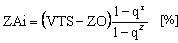
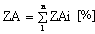

Príloha č. 4 k vyhláške č. 492/2004 Z. z.

- POSTUP STANOVENIA VŠEOBECNEJ HODNOTY STROJOVÝCH ZARIADENÍ, DRÁHOVÝCH VOZIDIEL, PLAVIDIEL A LIETADIEL

  - Táto príloha ustanovuje postup znalcov pri vypracovaní posudku na stanovenie všeobecnej hodnoty zložiek majetku: strojové zariadenia, dráhové vozidlá, plavidlá a lietadlá.

  - A. ZÁKLADNÉ POJMY A NÁZVOSLOVIE

    - A.1 Strojové zariadenia

    - Strojové zariadenia sú stroje, prístroje, súbory strojov, napríklad výrobné linky, pružné výrobné systémy a pod., ktoré majú samostatné technicko-ekonomické určenie a výrobcom, dovozcom či predajcom stanovené plnenie prevádzkovo-technických funkcií. Podľa ďalej uvedeného postupu môže stanovovať hodnotu strojových zariadení len znalec z odboru strojárstvo.

    - A.2 Dráhové vozidlá

    - Dráhové vozidlá sú dopravné prostriedky určené na prepravu osôb, zvierat a vecí, na vykonávanie činností súvisiacich s výstavbou a údržbou dráhy alebo s prevádzkovaním dráhy, vedené pri svojom pohybe po dráhe. Dráhové vozidlá podľa technických podmienok rozdeľujeme na železničné, električkové, trolejbusové, lanové a špeciálne. Železničné koľajové vozidlá rozdeľujeme na hnacie vozidlá závislej a nezávislej trakcie a na hnané vozidlá osobné, nákladné a špeciálne. Podľa ďalej uvedeného postupu sa stanovuje hodnota dráhových vozidiel uvedených v príslušných predpisoch.1) Tieto predpisy zároveň určujú rozsah oprávnenia na výkon znaleckej činnosti v odbore doprava železničná.

    - A.3 Lietadlá

    - Lietadlá sú zariadenia schopné pohybu v atmosfére v dôsledku iných reakcií vzduchu, ako sú reakcie vzduchu voči zemskému povrchu.2) Znalec môže ohodnocovať lietadlá ľahšie ako vzduch s pohonom alebo bez pohonu (balóny, vzducholode) a ťažšie ako vzduch s pohonom alebo bez pohonu (klzáky, letúny a vrtuľníky). Podľa ďalej uvedeného postupu môže stanovovať hodnotu lietadiel len znalec z odboru doprava letecká.

    - A.4 Plavidlá

    - Plavidlá sú lode vnútrozemskej plavby, malé plavidlá, prievozné lode, plávajúce stroje alebo plávajúce zariadenia3) a námorné rekreačné plavidlá.4) Podľa ďalej uvedeného postupu môže určovať hodnotu plavidiel len znalec z odboru doprava lodná.

    - A.5 Základné pojmy

    - (1) Na účely tejto prílohy

      - a) skupinou je funkčne, konštrukčne, úžitkovo, významovo kompaktný celok zložky majetku,

      - b) príslušenstvom zložky majetku sú predmety, ktoré tvoria so zložkou majetku jeden majetkový celok a sú súčasťou jej obstarávacej ceny a evidencie,

      - c) štandardnou výbavou zložky majetku je výbava zahrnutá obvykle vo vstupnej cene zložky majetku,

      - d) mimoriadnou výbavou zložky majetku je vybavenosť zložky majetku nad rámec štandardne dodávanej výbavy zložky majetku výrobcom alebo dovozcom, autorizovaným distribútorom alebo predajcom a tiež výbava, ktorej vstupná cena nie je zahrnutá vo vstupnej cene zložky majetku. Zásady stanovenia hodnoty mimoriadnej výbavy sú totožné so zásadami stanovenia hodnoty zložky majetku,

      - e) medzným stavom je stav zložky majetku, v ktorom musí byť ďalšie používanie zložky majetku prerušené alebo ukončené,

      - f) opotrebením je postupné znehodnocovanie zložky majetku v procese jej používania, ktoré môže byť fyzické a morálne,

      - g) fyzickým opotrebením je postupné, spravidla dlhší čas trvajúce zhoršovanie fyzických parametrov zložky majetku vznikajúce štandardným používaním zložky majetku spôsobom zodpovedajúcim povahe a účelu, na ktorý má slúžiť pri rešpektovaní predpisov a pokynov výrobcov alebo dodávateľov na jej prevádzku,

      - h) morálnym opotrebením je opotrebenie, ktoré vzniká ako dôsledok technického pokroku, pričom zložka majetku vyrobená na rovnaký účel ako jej predchádzajúca má technicky dokonalejšie parametre alebo pri približne rovnakom výkone nižšiu energetickú náročnosť prevádzky, resp. náročnosť obsluhy, čím hodnota skôr vyrobenej zložky majetku s menšou výkonnosťou spravidla klesá, alebo sa zložka s rovnakými parametrami spravidla predáva lacnejšie,

      - i) údržbou je súhrn činností zabezpečujúcich štandardnú technickú spôsobilosť a hospodárnosť prevádzky zložky majetku, spomaľujúci fyzické opotrebenie, predchádzajúci jeho následkom a odstraňujúci drobnejšie chyby, spravidla bez demontáže dielov a bez výmeny súčiastok a podľa predpisov výrobcu alebo dodávateľa zložky majetku,

      - j) opravou je súhrn činností, ktorými sa odstraňujú následky poškodenia, opotrebenia alebo straty prevádzkyschopnosti celku, skupín alebo dielcov zložky majetku za účelom uvedenia zložky majetku do prevádzkyschopného stavu, pričom nemusia byť zachované pôvodné rozmery a tvar novej zložky majetku,

      - k) bežnou opravou je oprava, pri ktorej sa obnovuje prevádzkyschopnosť skupiny alebo zložky majetku ako celku. Spravidla sa uskutočňuje výmenou chybných alebo opotrebovaných súčiastok za nové, opravené alebo renovované. Tento pojem sa uvádza len pre potreby ohodnocovania zložky majetku,

      - l) celkovou opravou je oprava skupiny takého rozsahu v predpísanom rozsahu a kvalite podľa predpisov výrobcu, pri ktorej sa po úplnej demontáži skupiny vymieňajú všetky poškodené alebo opotrebované časti zložky majetku za nové, opravené alebo renovované. Tento pojem sa uvádza len pre potreby ohodnocovania zložky majetku,

      - m) generálnou opravou je oprava v predpísanom rozsahu a kvalite podľa predpisov výrobcu, pri ktorej sa vykoná celková oprava všetkých skupín zložky majetku, resp. sa oprava vykoná výmenným spôsobom skupín za funkčné skupiny, ktoré mali celkovú opravu (retrofit). Tento pojem sa uvádza len pre potreby ohodnocovania zložky majetku,

      - n) záručnou opravou je oprava zložky majetku v záručnej dobe,

      - o) renováciou súčiastky je oprava, pri ktorej sa poškodenej alebo opotrebovanej časti súčiastky alebo súčiastky zložky majetku vráti jej geometrický tvar, rozmery, funkčné vlastnosti, pričom sa obyčajne zachováva životnosť súčiastky porovnateľná s jej pôvodnou životnosťou,

      - p) modernizáciou je úprava zložky majetku, pri ktorej sa zlepší jej vybavenosť, zvýšia sa jej úžitkové vlastnosti alebo rozšíri sa jej použiteľnosť,

      - r) rekonštrukciou je úprava zložky majetku, ktorou sa zmení účel použitia a technické parametre alebo nastáva kvalitatívna zmena výkonnosti,

      - s) nákladmi na opravu zložky majetku sú náklady na vykonanie úkonov opráv štandardnou technológiou nutných na odstránenie následkov poškodenia, opotrebenia alebo straty prevádzkyschopnosti zložky majetku spojených s uvedením zložky majetku do prevádzkyschopného stavu porovnateľného so stavom zložky majetku, v akom bola pred poškodením,

      - t) výškou škody je skutočná škoda vyjadrená rozdielom všeobecnej hodnoty zložky majetku pred jej poškodením a jej všeobecnej hodnoty po odstránení poškodenia, aj predpokladaného poškodenia, štandardnými postupmi, pri zohľadnení nákladov na opravu zložky majetku a všeobecnej hodnoty zvyškov zložky majetku k dátumu vzniku poškodenia. Výška škody pri totálnom zničení zložky majetku zodpovedá všeobecnej hodnote zložky majetku pred jej poškodením,

      - u) všeobecnou hodnotou zvyškov zložky majetku je všeobecná hodnota častí alebo skupín poškodenej zložky majetku stanovená k dátumu poškodenia zložky majetku, ktoré sú využiteľné, najmä ako už použité náhradné diely po odpočítaní nákladov na ich demontáž, prípadné čistenie, skladovanie a predaj, resp. ako odpad,

      - v) likvidačnou hodnotou je predpokladaná predajná hodnota dielcov zložky majetku alebo zložky majetku po odpočítaní nevyhnutných nákladov spojených s jej likvidáciou v súvislosti s ukončením podnikateľskej činnosti majiteľa zložky majetku alebo jej vyradením z evidencie.

    - (2) Zložky majetku sa na účely hodnotenia delia na tieto kategórie:

      - a) zložky majetku, ktoré majú vstupnú cenu uvedenú v eurách,

      - b) zložky majetku zahraničnej výroby, ktoré majú vstupnú cenu uvedenú v cudzej mene,

      - c) zložky majetku vyhotovené vlastnou činnosťou alebo iným spôsobom, bez cenových kalkulácií,

      - d) zložky majetku nové, poškodené,

      - e) jednoúčelové zložky majetku,

      - f) zložky majetku, pri ktorých nemožno vykonať obhliadku,

      - g) zložky majetku zaradené alebo nezaradené do používania,

      - h) zložky majetku nadobudnuté na základe zmluvy o nájme,

      - i) technologické celky,

      - j) modernizované a rekonštruované zložky majetku,

      - k) zložky majetku, ktoré mali celkovú alebo generálnu opravu,

      - l) morálne opotrebované zložky majetku,

      - m) príslušenstvo, náhradné dielce, mimoriadna výbava zložky majetku, nástroje a náradie,

      - n) zásoby strojových zariadení, dráhových vozidiel, plavidiel a lietadiel.

        - A.6 Skupiny zložky majetku a pomerný podiel skupiny zložky majetku PDS

    - (1) Zložka majetku sa hodnotí zásadne ako celok s výnimkou prípadu, keď niektorá skupina zložky majetku má podstatne iný technický stav, resp. niektorá skupina zložky majetku má výrazne odlišnú životnosť. V takom prípade sa zložka majetku hodnotí rozčlenená na skupiny. Metodika ohodnocovania skupín je rovnaká ako metodika ohodnocovania celku. O tom, či zložku majetku pri ohodnocovaní treba, alebo netreba členiť na skupiny, rozhoduje znalec, pričom skupinu kvantifikuje stanovením pomerného podielu skupiny zložky majetku PDS.

    - (2) PDS je percentuálne vyjadrenie podielu príslušnej skupiny z novej zložky majetku ako celku bez mimoriadnej výbavy. Vypočíta sa podľa vzťahov

      - ,

      - ,

      - ,

      - kde

      - VHs – východisková hodnota skupiny zložky majetku [€],

      - VH – východisková hodnota zložky majetku [€],

      - VCs – vstupná cena skupiny zložky majetku [€],

      - VC – vstupná cena zložky majetku [€],

      - PHs – porovnateľná hodnota skupiny zložky majetku [€],

      - PH – porovnateľná hodnota zložky majetku [€].

      - VHs, resp. PHssa stanovia postupom na stanovenie VH podľa časti A.16, resp. A.17.

    - (3) Ak nie sú k dispozícii vstupné údaje na výpočet PDS, pomerný diel skupiny zložky majetku sa stanoví odborným odhadom alebo porovnaním so zložkou majetku, pre ktorú sú tieto hodnoty známe.

      - (4) Platí : Σ PDS všetkých skupín zložky majetku = 100 %.

      - A.7 Predpokladaná životnosť (Ž) [roky, h, počet výrobných cyklov]

    - (1) Je to predpokladaná technická životnosť zložky majetku v rokoch (napr. strojové zariadenia, lietadlá, plavidlá, dopravné zariadenia), v hodinách (napr. lietadla) alebo uvedená počtom výrobných cyklov (špeciálne náradie, nástroje a pod.), stanovená na základe technických parametrov zložky majetku a jej normálneho používania za predpokladu vykonávania údržby a opráv podľa pokynov výrobcu alebo predajcu zložky majetku. Životnosť strojových zariadení stanoví znalec v rokoch podľa tabuliek uvedených v časti B.2.

    - (2) Znalec v odôvodnených prípadoch môže pre hodnotené strojové zariadenie stanoviť aj inú hodnotu predpokladanej životnosti zložky majetku, ako je uvedená v tabuľkách časti B.2.

    - (3) Znalec pri ohodnocovaní strojového zariadenia členeného na skupiny môže pre jednotlivé skupiny v odôvodnených prípadoch stanoviť aj inú predpokladanú životnosť skupín, aká je stanovená pre nečlenené strojové zariadenie podľa časti B.2.

    - (4) Ak má ohodnocovaná zložka majetku uvedenú životnosť v pracovných hodinách, v prípade potreby sa prepočíta na životnosť v rokoch (jeden mesiac je 1/12 roka = 0,083 roka, pri jednozmennej prevádzke jeden pracovný deň má 8 pracovných hodín a jeden pracovný rok má 250 pracovných dní, pri trvalej prevádzke má pracovný deň 24 hodín, rok 365 dní).

      - A.8 Doba prevádzky (r) [roky, počet odpracovaných výrobných cyklov, hodiny]

      - Doba prevádzky je doba zložky majetku (skupiny) uvedená v skutočne odpracovaných mesiacoch, v hodinách od dátumu jej prvého uvedenia do prevádzky, prípadne od jej uvedenia do prevádzky po vykonaní celkovej alebo generálnej opravy, rekonštrukcie alebo modernizácie po dátum ohodnotenia, resp. počtom odpracovaných cyklov pri zložkách majetku, ktoré majú predpokladanú životnosť uvedenú počtom výrobných cyklov. Ak mala zložka majetku od dátumu zaradenia do prevádzky z rôznych dôvodov prerušenú prevádzku, znalec to musí do posudku uviesť a dokladovať.

      - A.9 Koeficient zmennosti kZ) [–]

      - Koeficient zmennosti sa určuje podľa režimu práce len pre zložky majetku: strojové zariadenia podľa časti B.2. Pre dráhové vozidlá a plavidlá vo vzťahu na výpočet základnej amortizácie znalec stanoví kZ = 1.

      - A.10 Zostatkové percento prevádzkyschopnosti (ZO) [%]

      - Je to zostatkové percento prevádzkyschopnosti zložky majetku, ktoré zostáva po skončení predpokladanej životnosti zložky majetku. Číselná hodnota ZO pri strojových zariadeniach sa stanoví podľa časti B.2.

      - A.11 Východiskový technický stav (VTS) [%]

      - Je to technický stav novej zložky majetku, prípadne zložky majetku po celkovej alebo generálnej oprave, modernizácii alebo rekonštrukcii vo vzťahu k novej zložke majetku. Vyjadruje sa v percentách. Východiskový technický stav zložky majetku sa stanoví na základe predložených dokladov, ktoré hodnoverne opisujú jej stav, najmä kúpna zmluva, odovzdávací protokol, záručný list, zápis z odbornej skúšky alebo prehliadky podľa osobitných predpisov5) alebo iný hodnoverný doklad. Ak sa na zložke majetku (skupine) nevykonala celková alebo generálna oprava, rekonštrukcia alebo modernizácia, jej východiskový technický stav sa rovná 100 %. Ak sa na zložke majetku vykonala celková alebo generálna oprava, rekonštrukcia alebo modernizácia, jej východiskový technický stav sa stanoví podľa ďalej uvedeného postupu.

    - (1) VTS továrensky vyrobenej novej zložky majetku, novej zložky majetku vyrobenej vlastnou činnosťou alebo novej skupiny je 100 %.

    - (2) VTS skupiny zložky majetku po celkovej oprave znalec stanoví odborným odhadom v rozsahu 60 – 90 % továrensky novej skupiny podľa kvality vykonanej opravy a s prípadným zohľadnením podmienok závodu, v ktorom bola oprava realizovaná. Pre skupinu zložky majetku, ktorá bola opravovaná v zahraničí alebo ktorá sa doviezla ako repasovaná z výrobného alebo porovnateľného závodu, VTS = 100 %.

    - (3) VTS zložky majetku po jej generálnej oprave znalec stanoví v rozsahu 60 – 90 % podľa kvality vykonanej opravy a s prípadným zohľadnením podmienok závodu, v ktorom bola oprava realizovaná. Pre zložku majetku, ktorá bola opravovaná vo výrobnom alebo porovnateľnom závode v zahraničí, alebo ktorá sa doviezla ako repasovaná z výrobného alebo porovnateľného závodu zo zahraničia, VTS = 100 %.

    - (4) Východiskový technický stav celej zložky majetku členenej na skupiny z dôvodu, že jedna alebo viac jej skupín mala celkovú opravu, vypočíta sa podľa vzťahu

      - ,

      - kde

      - VTSSi – východiskový technický stav i-tej skupiny zložky majetku stanovenej podľa časti A.11 odsekov 1 a 2 [%],

      - PDSi – pomerný podiel i-tej skupiny zložky majetku [%],

      - i – i-tá skupina zložky majetku, i = 1 až n,

      - n – počet skupín zložky majetku.

      - (5) Východiskový technický stav mimoriadnej výbavy VTSMV stanoví sa postupom uvedeným v časti A.11 odsekoch 1 až 3 pre VTS.

      - (6)Východiskový technický stav zložky majetku, ktorú nemožno obhliadnuť, sa stanoví:

      - a) ak pre danú zložku majetku existujú doklady o tom, že pôvodný majiteľ ju zakúpil ako novú, tak VTS = 100 %,

      - b) ak doklady nie sú k dispozícii, znalec stanoví hodnotu VTS podľa iných relevantných dostupných údajov.

    - (7) Východiskový technický stav náradia, mimoriadnej výbavy a pomocného zariadenia stanoví sa podľa časti A.11 odsekov 1 až 3.

    - (8) Východiskový technický stav linky sa stanoví:

      - a) ak je linka zostavená z nových továrensky vyrobených strojov, tak VTS = 100 % pre celú linku,

      - b) ak je linka zložená zo strojov s rôznou percentuálnou hodnotou VTS, stanovenou podľa časti A.11 odsekov 1 a 3, tak VTS sa stanoví podľa vzťahu

        - ,

        - kde

        - VTS – východiskový technický stav linky [ %],

        - n – počet strojov linky,

        - i – i-tý stroj linky, i = 1 až n,

        - VTSi – východiskový technický stav i-tého stroja linky, stanovený podľa časti A.11 odsekov 1 až 3 [%],

        - kli – koeficient podľa vzťahu [–],

        - ,

        - kde

        - VHi – východisková hodnota i-tého stroja linky [€],

        - VHl – východisková hodnota linky [€].

        - Platí: súčet hodnôt kli = 1.

        - Vzťah pre VTS v tomto odseku znalec použije len v prípade, ak niektorý stroj linky mal generálnu opravu.

    - (9) Východiskový technický stav rekonštruovanej alebo modernizovanej zložky majetku sa stanoví:

      - a) ak všetky skupiny zložky majetku, ktorá bola rekonštruovaná alebo modernizovaná (mala technické zhodnotenie), boli rekonštruované alebo modernizované a mali VTS skupín po vykonanej úprave rovnú 100 %, aj východiskový technický stav rekonštruovanej, modernizovanej zložky majetku – VTS je 100 %,

      - b) ak hodnotená zložka majetku bola rekonštruovaná alebo modernizovaná tak, že niektoré skupiny zložky majetku mali celkovú opravu (CO), t. j. mali VTSS menšiu ako 100 %, tak východiskový technický stav rekonštruovanej alebo modernizovanej zložky majetku VTS sa vypočíta podľa vzťahu

        - ,

        - kde

        - VTS – východiskový technický stav rekonštruovanej /modernizovanej zložky majetku [%],

        - VTSS – východiskový technický stav skupín, ktoré nemali technické zhodnotenie, ich VTSS = 100 % [%],

        - PDS – pomerný podiel skupín zložky majetku, ktoré nemali technické zhodnotenie [%],

        - VTStz– východiskový technický stav skupín zložky majetku, ktoré mali technické zhodnotenie, ich VTStz < 100 %, [%],

        - PDStz – pomerný podiel skupín, ktoré mali technické zhodnotenie, pričom PDStz = (100 – PDS) [%].

        - VTStz znalec určí podľa časti A.11 odsekov 1 až 3.

    - (10) Východiskový technický stav zložky majetku, pre ktorú nie je dostupná dokumentácia, stanoví znalec na základe

      - a) obhliadky zložky majetku,

      - b) informácií prevádzkovateľa (majiteľa a pod.), resp informácií uvedených v spisových materiáloch konania pred štátnymi orgánmi, výpovedí svedkov a pod.),

      - c) odborným odhadom.

    - (11) Postup stanovenia VTS znalec zdôvodní.

      - A.12 Základná amortizácia za dobu prevádzky (ZA) [%]

      - je percentuálnou mierou fyzického opotrebovania zložky majetku počas jej skutočnej prevádzky. Pre strojové zariadenia po zaradení zložky majetku do kategórie podľa tabuliek časti B.2 sa priradí tomuto stroju hodnota predpokladanej životnosti zložky majetku a zostatkové percento prevádzkyschopnosti zložky majetku v súlade s časťami A.7 a A.10. Výpočet základnej amortizácie znalec stanoví v súlade s časťou B.2.

      - A.13 Skutočný technický stav (TS) [%]

      - je taký technický stav zložky majetku, ktorý predstavuje jej reálny zostatkový technický a morálny stav k dátumu ohodnocovania.

      - (1) Skutočný technický stav zložky majetkusa stanoví na základe vykonanej obhliadky, pričom sa zohľadnia všetky zistené skutočnosti, najmä úplnosť, kompletnosť, funkčnosť, spôsob vykonávania údržby a opráv, schopnosť plniť účel, na ktorý bola zložka majetku určená. Zistené skutočnosti sa uvedú v posudku.

    - (2) Ak nie je možné vykonať obhliadku zložky majetku, technický stav sa stanoví podľa dostupných podkladov, najmä informácií vlastníkov, prevádzkovateľov, výpovedí svedkov, spisového materiálu. Postup znalec zdôvodní.

    - (3) Postup stanovenia skutočného technického stavu zložky majetku je uvedený v časti B.3.

      - A.14 Zmena technického stavu (Z) [%]

      - Zmena technického stavu vyjadruje zmenu technického stavu zložky majetku (horší alebo lepší technický stav) zrážkou (-Z) alebo prirážkou (+Z), ako je predpokladaný stav daný základnou amortizáciou zložky majetku. Hodnota Z rovnajúca sa 0 % znamená, že skutočný technický stav zložky majetku je totožný s predpokladaným stavom daným základnou amortizáciou zložky majetku. Zmenu technického stavu zložky majetku znalec stanoví v súlade s časťou B.3.

      - A.15 Koeficient morálneho opotrebenia zložky majetku – kMO [–]

      - Vyjadruje mieru morálneho opotrebenia zložky majetku. Znalec ho stanoví v súlade s časťou B.3.

      - A.16 Vstupná cena zložky majetku VC [€, cudzia mena]

      - Vstupná cena sa stanovuje k času hodnotenia zložky majetku z podkladov poskytnutých zadávateľom posudku. Môže byť v úrovni s daňou, resp. s DPH alebo bez dane, resp. bez DPH. Za vstupnú cenu zložky majetku možno na účely stanovenia hodnoty zložky majetku považovať

    - – obstarávaciu cenu,

    - – vlastné náklady.

    - (1) Obstarávacia cena – OC [€, cudzia mena]

      - Do obstarávacej ceny možno zahrnúť nasledujúce položky:

    - – cena zložky majetku,

    - – náklady na projektovú prípravu,

    - – náklady na inžiniersku činnosť (technologický dozor, autorský dozor, stavebný dozor, odborné prehliadky, odborné skúšky, úradné skúšky a pod.),

    - – pri prototype náklady na vývoj a vyhotovenie prototypu či funkčných vzoriek

    - – náklady na dopravu,

    - – náklady na montáž,

    - – náklady na softvér, ak nie je súčasťou ceny zložky majetku,

    - – clo, dovozná prirážka,

    - – daň z obratu, resp. daň z pridanej hodnoty u majiteľa, ktorý nie je platiteľom DPH.

    - Do obstarávacej ceny zložky majetku sa nezahŕňajú

    - – penále, poplatky z omeškania a peňažné náhrady škôd súvisiace s obstaraním zložky majetku,

    - – výdavky na prípravu pracovníkov pre obsluhu zložky majetku (zaškolenie),

    - – výdavky súvisiace s prípravou a zabezpečením zložky majetku, ktoré vznikli po uvedení obstaranej investície do používania,

    - – výdavky na opravy a udržiavanie zložky majetku,

    - – dane súvisiace s obstaraním zložky majetku, ktoré zákon o daniach z príjmov neuznáva za výdavky na dosiahnutie, zabezpečenie a udržanie príjmov,

    - – spotrebný materiál (napr. nástroje, papier na tlač a pod.),

    - – výdavky na vybavenie zložky majetku zásobami a náhradnými dielmi, ktoré vznikli po uvedení obstaranej investície do používania,

    - – zabezpečovacie, konzervačné, udržiavacie, dekonzervačné práce v prípade zastavenia obstarávanej investície,

    - – poplatky za lízing,

    - – úroky z úverov na obstaranie zložky majetku.

    - Takto stanovenú obstarávaciu cenu OC možno považovať v plnom rozsahu za vstupnú cenu VC.

    - Ak sa OC určená znalcom líši od hodnoty OC z účtovnej evidencie uvedenej v časti II posudku, znalec v časti III posudku túto skutočnosť uvedie. Znalec ním stanovenú úroveň OC a jej postup zdôvodní.

    - OC pri zahraničnej zložke majetku, ak ju majiteľ zložky majetku nemá uvedenú v €, ale v cudzej mene, uvedie sa v tejto mene.

    - Ak majiteľ zložky majetku nemá OC, v posudku sa uvedie ako neznáma.

    - (2) Vlastné náklady – VN [€]

      - Ak zložka majetku nebola obstaraná nákupom ako celok, alebo ide o svojpomocne vyrobenú zložku majetku (napr. vyrobenú vlastnou činnosťou, jednoúčelovú zložku majetku, prípravok, výrobná pomôcka a podobne), jej vstupnú cenu znalec stanoví ako vlastné náklady. Sú to všetky opodstatnené priame a nepriame náklady vynaložené na výrobu (výrobná réžia), ale aj nepriame náklady správneho charakteru (správna réžia) v prípade, že vlastná výrobná činnosť presahuje jedno účtovné obdobie (je dlhodobého charakteru). Znalec v posudku uvedie rozpis jednotlivých nákladových položiek a čísla účtovných dokladov, resp. ich kópie vloží do príloh znaleckého posudku.

      - Vlastné náklady možno považovať za vstupnú cenu pre zložku majetku vytvorené vlastnou činnosťou.

      - Jednotlivé položky vlastných nákladov musia byť v súlade s položkami pre OC uvedenými v časti A.16 odseku 1. Ak majiteľ zložky majetku vytvorenej vlastnou činnosťou nemá kompletné alebo hodnoverné údaje o vlastných nákladoch, môže sa obstarávacia cena zložky majetku stanoviť aj ako porovnateľná hodnota zložky majetku – PH, časťA.18. Hodnota vlastných nákladov nemá byť vyššia ako obstarávacia cena novej továrensky vyrobenej porovnateľnej zložky majetku z hľadiska jej funkcie a veľkosti.

      - A.17 Východisková hodnota (VH) [€]

      - Východisková hodnota zložky majetku sa používa na výpočet technickej hodnoty zložky majetku TH a všeobecnej hodnoty zložky majetku VŠH. Postup stanovenia VH na účely stanovenia hodnoty je uvedený v časti B.1.

      - A.18 Porovnateľná hodnota (PH) [€]

    - (1) Ak nie je možné zistiť VC alebo VH hodnotenej zložky majetku, znalec stanoví porovnateľnú hodnotu hodnotenej zložky majetku PH jej porovnaním s porovnateľnou zložkou, ktorej vstupná cena je známa, resp. s porovnateľnou zložkou rovnakej kategórie a rovnakej položky v kategórii podľa časti B.2, ktorej vstupná cena je známa.

    - (2) Porovnateľná hodnota PH zložky majetku sa stanovuje k dátumu obstarania (zhotovenia) zložky majetku alebo k dátumu jej hodnotenia.

    - (3) Porovnateľná hodnota PH sa stanoví porovnaním hodnotenej zložky majetku s takou porovnateľnou továrensky vyrobenou novou zložkou, ktorej cena je známa a ktorá je s hodnotenou zložkou porovnateľná výkonom, vybavenosťou a úžitkovosťou. Typ porovnateľnej zložky majetku a jej presnú špecifikáciu spolu so spôsobom určenia jej ceny znalec uvedie v posudku. Ak VC viacerých porovnateľných zložiek nie sú zhodné, znalec môže stanoviť PH ako priemernú hodnotu viacerých zložiek majetku.

    - (4) Porovnateľnú hodnotu PH v prípade, ak porovnateľná zložka majetku má s hodnotenou zložkou len približne rovnaký výkon, vybavenosť a úžitkovosť, možno v krajnom prípade stanoviť aj pomocou rozpočtovej ceny (PH = hmotnosť hodnotenej zložky majetku × cena 1 kg hmotnosti zložky majetku porovnateľnej výkonom a úžitkovosťou pre rok jej výroby alebo hodnotenia, resp. PH = rozhodujúci parameter × cena jednotky rozhodujúceho parametra zložky majetku porovnateľnej výkonom a úžitkovosťou pre rok jej výroby alebo hodnotenia a pod.).

    - (5) Porovnateľnú hodnotu PH v prípade, ak porovnateľná zložka majetku, ktorej VC je známa, má s hodnotenou zložkou rozdielny výkon a vybavenosť, možno v krajnom prípade stanoviť aj pomocou rozpočtovej ceny (PH = hmotnosť hodnotenej zložky majetku × cena 1 kg hmotnosti zložky majetku porovnateľnej výkonom a úžitkovosťou pre rok jej výroby alebo hodnotenia, PH = rozhodujúci parameter × cena jednotky rozhodujúceho parametra zložky majetku porovnateľnej výkonom a úžitkovosťou pre rok jej výroby alebo hodnotenia a pod.), pričom rozdielnosť použitých veličín hodnotenej zložky majetku a porovnateľnej zložky majetku (hmotnosť, rozhodujúci parameter a pod.) znalec spravidla zhodnotí korekčným koeficientom kK.

    - (6) Porovnateľná hodnota PH sa vzťahuje aj na zložku majetku zhotovenú vlastnou činnosťou, ďalej na zložku majetku, ktorej OC zistená u majiteľa je v porovnaní s obdobnými zložkami neprimerane vysoká, a aj na zložku majetku, na ktorú majiteľ nemá cenovú kalkuláciu.

      - A.19 Technická hodnota zložky majetku (TH) [€]

    - (1) Je to zvyšok technickej životnosti zložky majetku vyjadrený v eurách k dátumu jej ohodnocovania. Technická hodnota zložky majetku sa stanoví na základe skutočného technického stavu zložky majetku k dátumu stanovenia hodnoty zložky majetku pri zohľadnení jej východiskovej hodnoty.

    - (2) Postup stanovenia technickej hodnoty zložky majetku je uvedený v časti B.4.

      - A.20 Technická hodnota mimoriadnej výbavy (THMV) [€]

      - Je to hodnota zvyšujúca technickú hodnotu zložky majetku o hodnotu jej mimoriadnej výbavy k dátumu jej ohodnocovania. Postup stanovenia technickej hodnoty mimoriadnej výbavy zložky majetku je totožný s postupom stanovenia TH zložky majetku.

      - A.21 Koeficient predajnosti zložky majetku (kP) [–]

      - Predstavuje vo všeobecnosti pomer medzi spriemerovanými, skutočne dosahovanými predajnými cenami a technickou hodnotou TH určitej, resp. porovnateľnej zložky majetku v danom čase a mieste jej ohodnocovania. Pri stanovovaní koeficientu predajnosti znalec postupuje podľa časti B.5, pričom postup náležite zdôvodní.

      - A.22 Všeobecná hodnota (VŠH) [€]

      - Všeobecná hodnota zložky majetku je hodnota zložky majetku v danom mieste a čase, pri ktorej stanovení sú okrem vplyvu opotrebovania zahrnuté aj vplyvy trhu (predajnosť typu zložky majetku). Vyjadruje hodnotu zložky majetku pri jej predaji obvyklým spôsobom na voľnom trhu k rozhodujúcemu dátumu. Znalec v znaleckom posudku vždy uvedie, či vypočítaná všeobecná hodnota zložky majetku je vrátane dane z pridanej hodnoty, alebo bez dane z pridanej hodnoty.

      - A.23 Stanovenie výšky škody VŠ [€]

      - Stanovenie výšky škody vzniknutej na zložke majetku vychádza predovšetkým zo všeobecnej hodnoty zložky majetku k dátumu jej poškodenia a nákladov potrebných na jej opravu. Postup stanovenia výšky škody je uvedený v časti B.6.

      - A.24 Stanovenie likvidačnej hodnoty zložky majetku VŠHLO[€]

    - (1) Likvidačná hodnota zložky majetku sa stanovuje v prípadoch, keď

      - a) vlastník zložky majetku končí podnikateľskú činnosť likvidáciou,

      - b) vlastník zložky majetku končí podnikateľskú činnosť konkurzom, pričom nasleduje likvidácia zložky majetku,

      - c) vlastník zložky majetku končí podnikateľskú činnosť iným spôsobom, pričom nasleduje likvidácia zložky majetku.

    - (2) Pri stanovení likvidačnej hodnoty zložky majetku musí znalec jednoznačne stanoviť, či hodnotená zložka majetku je určená na likvidovanie.

    - (3) Postup stanovenia likvidačnej hodnoty zložky majetku je uvedený v časti B.7.

      - A.25 Zaokrúhľovanie výpočtov

      - Údaje v procese stanovenia všeobecnej hodnoty zložky majetku sa zaokrúhľujú takto:

      - a) doba prevádzky zložky majetku r, kurz cudzej meny kCM a koeficienty predajnosti zložky majetku kPna tri desatinné miesta,

      - b) indexy cien IC, koeficient indexov cien kIC, koeficient zmennosti zložky majetku kZ, koeficient využiteľnosti kV, základná amortizácia zložky majetku ZA, technický stav zložky majetku TS, koeficient morálneho opotrebenia zložky majetku kMO, zmena technického stavu Z, technická hodnota zložky majetku TH na dve desatinné miesta,

      - c) východisková hodnota zložky majetku VH sa zaokrúhľuje na 50 centov,

      - d) východisková hodnota zložky majetku VH a všeobecná hodnota VŠH bez DPH do hodnoty 50 centov vrátane sa nezaokrúhľujú,

      - e) všeobecná hodnota zložky majetku v úrovni bez DPH na 50 centov a v úrovni s DPH na centy.

  - B. POSTUP PRI VÝPOČTE HODNOTY

    - Všeobecná hodnota sa vypočíta týmto postupom:

    - B.1 Východisková hodnota (VH)

    - Východisková hodnota zložky majetku sa používa na výpočet hodnoty zložky majetku. Znalec východiskovú hodnotu stanoví buď ako obstarávaciu cenu zložky majetku pre dátum ohodnocovania zložky, alebo ako objektivizovanú cenu z pôvodnej obstarávacej ceny zložky majetku, pričom znalec zdôvodní postup tejto objektivizácie.

    - B.1.1 Východisková hodnota zložky majetku, ktorý má VC uvedenú v €

    - a) Východisková hodnota VH zložky majetku bez ohľadu na krajinu jej obstarania, ak zložka majetku

    - – bola obstaraná pred viac ako 10 rokmi (vzhľadom na dátum jej hodnotenia),

    - – v súčasnosti sa už nevyrába, spravidla sa stanoví ako pôvodná VC, resp. porovnateľná hodnota PH:

    - VH = VC [€] alebo

    - VH = PH [€],

    - kde

    - VC – vstupná cena zložky majetku v roku obstarania zložky majetku [€],

    - PH – porovnateľná hodnota zložky majetku v roku obstarania zložky majetku, stanovená

    - podľa časti A.18 [€].

    - V odôvodnených prípadoch znalec pri stanovení VH podľa tohto bodu môže sa od tohto pravidla odchýliť a môže aj pre zložku majetku obstaranú pred viac ako 10 rokmi (ak je jej predpokladaná životnosť Ž vyššia ako 10 rokov) a tiež pre zložku majetku, ktorej životnosť je nižšia ako 10 rokov a bola obstaraná pred viac rokmi, ako je jej životnosť, stanoviť VH podľa časti B.1.1 písmen b) a c) tejto kapitoly;

    - b) východisková hodnota VH zložky majetku bez ohľadu na krajinu jej obstarania, ktorá má vstupnú cenu uvedenú v €, ak zložka majetku

    - – bola obstaraná pred menej ako 10 rokmi (vrátane desiateho roku obstarania),

    - – v súčasnosti sa bez významných zmien vyrába,

    - – je známa jej VC, resp. PH platná pre rok jej hodnotenia, stanoví sa ako VC, resp. porovnateľná hodnota PH v roku hodnotenia:

    - VH = VC [€] alebo

    - VH = PH [€],

    - kde

    - VC – vstupná cena zložky majetku v roku hodnotenia zložky majetku [€],

    - PH – porovnateľná hodnota zložky majetku v roku hodnotenia zložky majetku, stanovená

    - podľa časti A.18 [€];

    - c) východisková hodnota VH zložky majetku s ohľadom na krajinu jej obstarania, ktorá má vstupnú cenu uvedenú v €, ak zložka majetku

    - – bola obstaraná pred menej ako 10 rokmi (vrátane desiateho roku obstarania),

    - – v súčasnosti sa bez významných zmien vyrába,

    - – nie je známa jej VC, resp. PH platná pre rok jej hodnotenia, stanoví sa ako pôvodná VC, resp. porovnateľná hodnota PH, vynásobená koeficientom indexov cien kIC, resp. kICZ:

    - VH = VC • kIC(kICZ) [€],

    - VH = PH • kIC(kICZ) [€],

    - kde

    - VC – vstupná cena zložky majetku stanovená v čase jej prvotného obstarania [€],

    - PH – porovnateľná hodnota zložky majetku v čase jej prvotného obstarania [€],

    - kIC(kICZ) – koeficient indexov cien (ktorý pre zložku majetku vyrobenú v krajinách [–],

    - bývalého východného bloku je kIC a pre zložku majetku vyrobenú v krajinách mimo bývalého východného bloku je kICZ) sa vypočíta pomocou indexov cien IC pre príslušné roky a klasifikáciu produkcie zložky majetku:

    - ,

    - ak v období stanovenia ICoh, ICob je rovnaký vzťažný dátum alebo

    - ,

    - ak v období stanovenia ICoh, ICob sú dva rozdielne vzťažné dátumy na stanovenie ICoh, ICob – uvedený vzťah platí pre vzťažný dátum ICoh = priemer roka 2000 *),

    - kde

    - ICoh – predpokladaný priemerný index ceny pre príslušnú klasifikáciu produkcie zložky majetku a mesiac (kvartál, polrok, rok) hodnotenia zložky majetku [%],

    - ICob – index ceny pre príslušnú klasifikáciu produkcie zložky majetku v roku obstarania zložky majetku so vzťažným dátumom iným, ako je priemer roka 2000 [%],

    - *) IC2000 – index ceny pre príslušnú klasifikáciu produkcie zložky majetku a vzťažný dátum je ako príklad uvedený priemer roka 2000 [%].

    - Indexy cien sa spravidla stanovia na základe hodnoverných štatistických podkladov, ktoré vydávajú oficiálne štatistické úrady (napr. pre zložku majetku vyrobenú v krajinách bývalého východného bloku je Štatistický úrad Slovenskej republiky a pre zložku majetku vyrobenú v krajinách mimo bývalého východného bloku je EUROSTAT PRESS OFFICE LUXEMBOURG) pre príslušnú klasifikáciu produkcie zložky majetku a príslušný rok.

    - Ak sa hodnotí strojová linka alebo strojový technologický celok, v ktorom rôzne stroje patria do rôznych kategórií, alebo nie sú známe indexy cien pre príslušnú kategóriu strojov, môže znalec určiť koeficient indexu cien ako koeficient za odvetvie strojárstvo.

    - Ak pre dátum hodnotenia nemá znalec k dispozícii index cien ICoh, vypočíta ho napr. tak, ako keby sa index ceny v roku hodnotenia zmenil oproti predchádzajúcemu roku o hodnotu rozdielu indexov cien za ostatné 2 roky, v ktorých je ICoh známy, a pod.

    - Znalec pri stanovovaní VH podľa časti B.1.1 písmen b) a c) preferuje postup stanovenia VH podľa časti B.1.1 písmena b).

    - Analogickým postupom sa určí východisková hodnota pre skupinu zložky majetku, mimoriadnu výbavu, strojovú linku, náradie a pomocné zariadenie, modernizovanú, rekonštruovanú alebo opravenú zložku majetku, ktorej vstupná cena je stanovená v €.

    - Znalec taktiež skúma, či vo VC, resp. VCCMje zahrnuté clo a dovozná prirážka. Ak nie je, znalec štandardným postupom stanoví VH s prihliadnutím na aktuálne hodnoty cla, resp. dovoznej prirážky.

    - Znalec v posudku postup stanovenia VH zdôvodní.

    - B.1.2 Východisková hodnota zložky majetku, ktorý má vstupnú cenu uvedenú v cudzej mene

    - a) Východisková hodnota VH zložky majetku pre zložku majetku bez ohľadu na krajinu jej obstarania, ktorá má vstupnú cenu uvedenú v cudzej mene, ak zložka majetku

    - – bola obstaraná pred viac ako 10 rokmi (vzhľadom na dátum jej hodnotenia),

    - – v súčasnosti sa už nevyrába, stanoví sa podľa vzťahov

    - VH = VCCM • kCM [€] alebo

    - VH = PHCM • kCM [€],

    - kde

    - VH – východisková hodnota zahraničnej zložky majetku, ktorej vstupná cena je udaná v cudzej mene [€],

    - VCCM – vstupná cena zahraničnej zložky majetku v cudzej mene pre rok obstarania zložky majetku [cudzia mena],

    - PHCM – porovnateľná hodnota zahraničnej zložky majetku v cudzej mene pre rok obstarania zložky majetku [cudzia mena],

    - kCM– kurz cudzej meny podľa platného referenčného výmenného kurzu tejto meny podľa ECB pre dátum obstarania zložky majetku [–].

    - V technicky odôvodnených prípadoch sa znalec pri stanovovaní VH podľa tohto bodu môže od tohto pravidla odchýliť a môže aj pre zložku majetku vekovo staršiu alebo mladšiu, ako je uvedené vyššie, stanoviť VH podľa časti B.1.2 písmen b) alebo c);

    - b) východisková hodnota VH zložky majetku, ktorá má vstupnú cenu uvedenú v cudzej mene, bez ohľadu na krajinu jej obstarania, ak zložka majetku

    - – bola obstaraná pred menej ako 10 rokmi (vrátane desiateho roku obstarania),

    - – v súčasnosti sa bez významných zmien vyrába,

    - – je známa jej VCCM, resp. PHCM platná pre rok jej hodnotenia, stanoví sa ako VC, resp. porovnateľná hodnota PH v roku hodnotenia vypočítaná podľa vzťahov

    - VH = VCCM • kCM [€] alebo

    - VH = PHCM • kCM [€],

    - kde

    - VH – východisková hodnota zahraničnej zložky majetku, ktorej vstupná cena je udaná v cudzej mene [€],

    - VCCM – vstupná cena zahraničnej zložky majetku v cudzej mene pre rok hodnotenia zložky majetku [cudzia mena],

    - PHCM – porovnateľná hodnota zahraničnej zložky majetku v cudzej mene pre rok hodnotenia zložky majetku [cudzia mena],

    - kCM– kurz cudzej meny podľa platného referenčného výmenného kurzu tejto meny podľa ECB k dátumu hodnotenia zložky majetku [–];

    - c) východisková hodnota VH zložky majetku, ktorá má vstupnú cenu uvedenú v cudzej mene, ak zložka majetku

    - – bola obstaraná pred menej ako 10 rokmi (vrátane desiateho roku obstarania),

    - – v súčasnosti sa bez významných zmien vyrába,

    - – nie je známa jej VCCM, resp. PHCM platná pre rok jej hodnotenia, stanoví sa podľa vzťahov

    - VH = VCCM • kCM• kI [€] alebo

    - VH = PHCM • kCM• kI[€],

    - kde

    - VH – východisková hodnota zahraničnej zložky majetku, ktorej vstupná cena je udaná v cudzej mene [€],

    - VCCM – vstupná cena zahraničnej zložky majetku v cudzej mene pre rok obstarania zložky majetku [cudzia mena],

    - PHCM – porovnateľná hodnota zahraničnej zložky majetku v cudzej mene pre rok obstarania zložky majetku [cudzia mena],

    - kCM– kurz cudzej meny podľa platného kurzu tejto meny podľa ECB k dátumu obstarania zložky majetku [–],

    - kI– koeficient indexov cien zahraničnej zložky majetku, ktorý sa vypočíta z indexov cien [–], pre jednotlivé roky podľa zásad uvedených v časti B.1.1 písmene c).

    - Hodnota kurzu cudzej meny sa spolu s poradovým číslom kurzového lístka ECB a dátumom platnosti kurzového lístka uvedie v posudku.

    - Ak sa hodnotí strojová linka alebo strojový technologický celok, v ktorom rôzne stroje patria do rôznych kategórií, alebo nie sú známe indexy cien pre príslušné kategórie strojov, môže znalec určiť koeficient indexu cien pre rozhodujúcu skupinu strojov v linke alebo technologického celku, alebo ako koeficient za odvetvie strojárstvo.

    - Ak pre dátum hodnotenia nemá znalec k dispozícii index cien ICohz, vypočíta ho napr. tak, ako keby sa index ceny v roku hodnotenia zmenil oproti predchádzajúcemu roku o hodnotu rozdielu indexov cien za ostatné 2 roky, v ktorých je ICohz známy.

    - Analogickým postupom sa určí východisková hodnota pre skupinu zložky majetku, mimoriadnu výbavu, strojovú linku, náradie a pomocné zariadenia, modernizovanú, rekonštruovanú alebo opravenú zložku majetku, ktorej vstupná cena je stanovená v cudzej mene.

    - Znalec taktiež skúma, či vo VC, resp. VCCMje zahrnuté clo a dovozná prirážka. Ak nie je, znalec štandardným postupom stanoví VH s prihliadnutím na aktuálne hodnoty cla, resp. dovoznej prirážky.

    - Znalec pri stanovovaní VH podľa časti B.1.2 písmen b) a c) preferuje postup stanovenia VH podľa časti B.1.2 písmena b).

    - Znalec postup stanovenia VH zdôvodní.

    - B.1.3 Východisková hodnota zložky majetku, ktorej VC je neznáma

    - Pri stanovovaní východiskovej hodnoty VH zložky majetku, ktorej VC je neznáma, VH stanoví znalec ako PH zložky majetku v roku jej výroby, resp. v roku jej hodnotenia podľa častí B.1.1 a B.1.2.

    - B.1.4 Východisková hodnota zložky majetku továrensky novej, ale poškodenej

    - Východiskovú hodnotu VH znalec stanoví z príslušnej VC podľa častí B.1.1 a B.1.2. Výšku škody znalec vypočíta podľa časti B.6.

    - B.1.5 Východisková hodnota zložky majetku, pri ktorej nemožno vykonať obhliadku

    - Východisková hodnota sa stanoví zo vstupnej ceny, prípadne z porovnateľnej hodnoty zložky majetku podľa častí B.1.1. a B.1.2.

    - B.1.6 Východisková hodnota zložky majetku zhotovenej vlastnou činnosťou alebo iným spôsobom aj bez cenových kalkulácií

    - Východiskovú hodnotu zložky majetku VH zhotovenej vlastnou činnosťou alebo iným spôsobom aj bez cenových kalkulácií možno stanoviť ako porovnateľnú hodnotu zložky majetku PH alebo podľa hodnoty vlastných nákladov stanovených podľa časti A.16.2. Z pôvodnej hodnoty vlastných nákladov podľa celkového stavu, spracovateľskej úrovne a úžitkových vlastností zložky majetku znalec stanoví príslušné zrážky alebo prirážky. Východisková hodnota VH sa vypočíta podľa časti B.1.1.

    - B.1.7 Východisková hodnota jednoúčelovej zložky majetku

    - Východisková hodnota jednoúčelovej zložky majetku VH sa stanoví zo vstupnej ceny uvedenej v protokole o prevzatí zložky majetku do používania, podľa zostavy dlhodobého majetku, resp. podľa iných hodnoverných podkladov podľa časti B.1.1.

    - B.1.8 Východisková hodnota zložky majetku na účely reštitúcie

    - Východisková hodnota zložky majetku VH na reštitučné účely sa vypočíta ako VH stanovená podľa časti B.1.1, resp. pre PH, pričom VH, resp. PH sa stanoví pre rok 1991,6) ak nie je osobitným predpisom stanovené inak.

    - B.1.9 Východisková hodnota zložky majetku nadobudnutej na základe zmluvy o nájme zložky majetku

    - Východisková hodnota zložky majetku VH nadobudnutej na základe zmluvy o kúpe najatej veci (finančný, operatívny, spätný lízing) sa stanovuje z pôvodnej VC zložky majetku (t. j. bez ceny za služby lízingovej spoločnosti, prípadne aj dane z pridanej hodnoty) podľa časti B.1.1 a B.1.2.

    - B.1.10 Východisková hodnota zložky majetku, na ktorej sa v tuzemsku vykonala generálna alebo celková oprava

    - Východisková hodnota zložky majetku, ktorá mala generálnu opravu (GO) alebo celkovú opravu (CO) vykonanú v tuzemsku, sa stanoví takto:

    - a) ak sa GO, resp. CO vykonala pred dlhšou dobou, ako je predpokladaná životnosť Ž hodnotenej zložky majetku podľa časti A.7 (táto doba sa vzťahuje na dátum hodnotenia), o nákladoch na GO, resp. CO sa neuvažuje a východisková hodnota zložky majetku sa bude rovnať východiskovej hodnote zložky majetku stanovenej podľa časti B.1.1 alebo časti B.1.2; v tomto prípade znalec pre výpočet VH stanoví úroveň východiskového technického stavu VTS = 100 %,

    - b) ak sa GO, resp. CO vykonala v dobe kratšej, ako je predpokladaná životnosť zložky majetku Ž podľa časti A.7 (táto doba sa vzťahuje na dátum hodnotenia), východisková hodnota zložky majetku sa určí podľa tohto postupu:

      - 1. podľa zásad časti A.16 sa stanoví vstupná cena novej zložky majetku pre dátum jej obstarania,

      - 2. vypočíta sa technická hodnota zložky majetku vyjadrená v eurách TH podľa zásad časti A.19 k dátumu započatia GO, resp. CO (ak je presný dátum opravy známy, ak nie je, tak k 1. 7. roku realizácie opravy) pre technický stav TS v % vypočítaný podľa časti A.13; znalec stanoví ±Z podľa reálneho stavu zložky majetku pred GO, resp. CO,

      - 3. zistia sa náklady na vykonanie GO, resp. CO, t. j. NGO, resp. NCO z účtovnej evidencie pre dátum ukončenia GO, resp. CO,

      - 4. vypočíta sa východisková hodnota nákladov VHN na GO, resp. CO podľa časti B.1.1, a to tak, že do vzťahov podľa časti B.1.10 písm. a), b) alebo c) sa namiesto VC dosadí hodnota NGO, resp. NCO, kde NGO, resp. NCO sú náklady na GO, resp. CO pre dátum ukončenia GO, resp. CO; koeficient indexu cien kIC sa stanoví pre dátum hodnotenia zložky majetku podľa príslušných zásad tejto kapitoly,

      - 5. východisková hodnota zložky majetku alebo skupiny zložky majetku VH bude súčtom vypočítanej TH a východiskovej hodnoty nákladov na GO, resp. CO:

        - VH = TH*) + VHN[€],

        - kde

        - VH – východisková hodnota opravenej zložky majetku alebo skupiny zložky majetku [€],

        - TH – technická hodnota hodnotenej zložky majetku alebo skupiny zložky majetku k dátumu ukončenia práce zložky majetku alebo skupiny zložky majetku pred vykonanou opravou*) [€],

        - VHN– východisková hodnota nákladov na opravu zložky majetku alebo skupiny zložky majetku [€],

        - *) V prípade takého vykonania GO, že sa niektoré skupiny zložky majetku vymenili za nové skupiny, resp. za skupiny z inej ako opravovanej zložky majetku (čiže ich cena je zahrnutá vo VHN), TH sa vypočíta len pre zvyšné skupiny z opravovanej zložky majetku, pre ktoré znalec stanoví ich celkovú hodnotu PDS podľa časti A.6 a VTS podľa časti A.11.

        - Ak mala zložka majetku počas svojej predpokladanej životnosti viacero GO, týmto postupom sa stanoví VH po ostatnej vykonanej GO.

        - Ak sa GO, resp. CO preukázateľne vykonala a zadávateľ posudku nemá dokladované nákladové položky na vykonanú GO, resp. CO, znalec môže stanoviť NGO, resp. NCO odborným odhadom podľa kvality opravy. Údajnú vykonanú GO môže znalec aj nezohľadniť, musí to však v posudku zdôvodniť.

        - Ak sa GO vykonala výmenným spôsobom, tak sa za TH dosadí TH = 0 € a VH = VHN zložky majetku, kde VHN je východisková hodnota zložky, ktorá bola dodaná namiesto opravovanej zložky majetku.

    - c) východisková hodnota zložky majetku dovezenej zo zahraničia, ktorá mala GO, resp. tzv. repasáciu vo výrobnom alebo porovnateľnom závode, sa stanoví podľa časti B.1.1 z hodnoty, ktorá bola zaplatená dodávateľovi zložky majetku,

    - d) ak NGO, resp. NCO už boli zahrnuté do pôvodnej VC, tak VH zložky majetku po generálnej alebo celkovej oprave znalec stanoví podľa časti B.1.1, kde za VC znalec dosadí obstarávaciu cenu zložky po oprave zložky majetku.

      - B.1.11 Východisková hodnota zložky majetku, ktorá sa v tuzemsku rekonštruovala alebo modernizovala

    - a) ak sa stanovuje východisková hodnota takým spôsobom rekonštruovanej alebo modernizovanej zložky majetku, že v zložke majetku zostal zvyšok nerekonštruovaných skupín zložky majetku, VH sa vypočíta podľa vzťahu:

      - ,

      - kde

      - VH – východisková hodnota rekonštruovanej alebo modernizovanej zložky majetku [€],

      - TH – technická hodnota upravovanej zložky majetku vyjadrená v eurách, vypočítaná pre dobu ukončenia práce zložky majetku pred jej úpravou [€],

      - PDS – pomerný podiel skupín zložky majetku, ktoré sa nerekonštruovali, resp. nemodernizovali [%],

      - kV – koeficient využiteľnosti, zhodnotenia pomerných podielov skupín (1– PDS/100) vykonaným technickým zhodnotením [–],

      - VHN – východisková hodnota nákladov na rekonštrukciu alebo modernizáciu zložky majetku, ktorá sa stanoví podľa časti B.1.1, kde za VC znalec dosadí NRM = obstarávaciu cenu nákladov na modernizáciu, resp. rekonštrukciu – NRM [€]; prípadný koeficient indexu cien kIC sa stanoví pre dátum hodnotenia zložky majetku podľa príslušných zásad tejto kapitoly [€],

    - b) ak sa stanovuje východisková hodnota takým spôsobom rekonštruovanej alebo modernizovanej zložky majetku, že pôvodná zložka majetku sa nerekonštruovala, nemodernizovala a rekonštrukcia, resp. modernizácia zložky majetku sa vykonala v zásade len pridaním ďalších skupín k pôvodnej zložke, VH sa vypočíta podľa vzťahu:

      - VH = TH + VHN[€],

      - kde

      - VH – východisková hodnota rekonštruovanej alebo modernizovanej zložky majetku [€],

      - TH – technická hodnota hodnotenej zložky majetku vyjadrená v korunách, vypočítaná podľa časti A.19 pre dobu práce zložky majetku pred jej úpravou [€],

      - VHN – východisková hodnota nákladov na rekonštrukciu alebo modernizáciu zložky majetku stanovená podľa časti B.1.1 [€],

      - Ak sa rekonštrukcia, resp. modernizácia preukázateľne vykonala a zadávateľ posudku nemá od nej doklady nákladových položiek, znalec môže stanoviť VH aj odborným odhadom podľa kvality úprav.

    - c) ak obstarávacia cena nákladov na modernizáciu, resp. rekonštrukciu – NRM už bola zahrnutá do ceny zložky VC po vykonanom technickom zhodnotení, znalec túto skutočnosť uvedie v posudku; VH vo vzťahu k časti B.1.11 písm. b) sa stanoví podľa časti B.1.1, kde za VC znalec dosadí NRM; koeficient indexu cien kIC sa stanoví pre dátum hodnotenia zložky majetku podľa príslušných zásad tejto prílohy.

      - B.2 Základná amortizácia strojového zariadenia, dráhového vozidla, plavidla, lietadla (ZA)

      - B.2.1.Vzťahy na výpočet základnej amortizácie pre stroje, dráhové vozidlá a plavidlá

      - B.2.1.1 Vzťahy na výpočet základnej amortizácie pre stroje, dráhové vozidlá a plavidlá nečlenené na skupiny s rešpektovaním obmedzujúcich podmienok uvedených ďalej

    - a) pre r.kZ ≤ Ž:

      - ,

    - b) pre r.kZ > Ž:

      - ZA = VTS - ZO[%],

      - kde

      - r – počet odpracovaných rokov [roky],

      - kz– koeficient zmennosti stroja, pre dráhové vozidlá a plavidlá kZ=1 [–],

      - Ž – predpokladaná životnosť stroja, dráhového vozidla, plavidla [roky],

      - ZO – zostatkové percento prevádzkyschopného stroja, dráhového vozidla, plavidla po skončení predpokladanej životnosti Ž [%],

      - VTS – východiskový technický stav stroja, dráhového vozidla, plavidla [%].

      - Obmedzujúce podmienky výpočtu ZA podľa časti B.2.1.1 písm. a) sú tieto:

      - 1. pre zložku majetku, ktorej VTS = 100 %, je vzťah pre ZA podľa časti B.2.1.1 písm. a) platný len pre

        - r ∙ kZ ≤ Ž,

      - 2. pre zložku majetku, ktorej VTS = 100 % a súčin r. kz > Ž, je vzťah podľa časti B.2.1.1 písm. a) neplatný a ZA sa vypočíta podľa vzťahu

        - ZA = 100 - ZO [%],

      - 3. pre zložku majetku, ktorej VTS < 100 %, platí vzťah podľa časti B.2.1.1 písm. a), iba ak

        - ,

      - 4. ak pre zložku majetku, ktorej VTS < 100 % a pre súčin r . kZ je

        - ,

        - pre výpočet ZA neplatí vzťah pre ZA podľa časti B.2.1.1 písm. a). V takom prípade sa ZA vypočíta podľa vzťahu:

        - ZA = VTS - ZO [%].

        - B.2.1.2 Vzťahy na výpočet základnej amortizácie pre skupiny zložiek majetku ZAs(stroje, dráhové vozidlá a plavidlá) a zložky majetku členenej na skupiny

    - a) základná amortizácia skupiny zložky majetku – ZAS sa vypočíta pre príslušnú skupinu zložky majetku podľa časti B.2.1.1, kde sa vstupné hodnoty stanovia pre príslušnú skupinu; hodnoty Ž a ZO sa stanovia ako pre nečlenenú zložku majetku v súlade s časťami A.7 a A.10,

    - b) pre zložku majetku členenú na skupiny a pre takú zložku majetku, pri ktorej sa základná amortizácia skupín zložky majetku vypočítala podľa časti B.2.1.2 písm. a), celková amortizácia zložky majetku ZA sa stanoví podľa vzťahu:

      - ,

      - kde

      - n – počet skupín zložky majetku,

      - ZASi – ZA i-tej skupiny zložky majetku stanovená podľa časti B.2.1.2 písm. a) [%],

      - PDSi – pomerný podiel i-tej skupiny zložky majetku [%],

      - i – i-tá skupina zložky majetku, i = 1 až n.

      - Podľa tohto pravidla sa hodnota ZA počíta aj v takom prípade, ak je ZA L (VTS – ZO). Ak je ZA > (VTS – ZO), vtedy sa ZA stanoví podľa vzťahu:

      - ZA = VTS - ZO [%].

      - B.2.1.3 Základná amortizácia zložky majetku, ktorú nemožno obhliadnuť – ZA

      - Základná amortizácia sa stanoví ako pre zložku majetku úmerne opotrebovanú za dobu jej prevádzky, prípadne na základe údajov majiteľa, ktoré písomne deklaruje a ktoré sa stanú prílohou znaleckého posudku.

      - B.2.1.4 Základná amortizácia náradia, pomocného zariadenia, ktoré má predpokladanú životnosť Ž uvedenú v rokoch – ZA

      - a) ak je nutné stanoviť amortizáciu náradia alebo pomocného zariadenia, ZA sa stanoví podľa vzťahu pre ZA v časti B.2.1.1, pričom ich reálnu hodnotu životnosti Ž, zostatkové percento prevádzkyschopnosti ZO a koeficient zmennosti kZ určí znalec; ak sa nástroj, náradie alebo pomocné zariadenie nedá renovovať, hodnota ZO sa stanoví na takú úroveň, aby VŠH sa rovnala hodnote odpadu,

    - b) pre náradie znalec posúdi stanovené hodnoty Ž a ZO v tabuľkách časti B.2 uvedených ďalej, a ak sú pre konkrétne ohodnocované náradie nevhodné, stanoví a zdôvodní iné podklady na výpočet ZA,

      - B.2.1.5 Základná amortizácia mimoriadnej výbavy – ZAmv

      - Vypočíta sa podľa zásad časti B.2.1.1, pričom hodnoty Ž, ZO sa určia podľa charakteru mimoriadnej výbavy z tabuliek pre Ž a ZO. Koeficient zmennosti kZ sa stanoví podľa zásad uvedených nižšie.

      - B.2.1.6 Základná amortizácia strojovej linky – ZA

    - a) ak všetky stroje linky boli zaradené do prevádzky v tom istom čase, tak ZA sa určí podľa vzťahov pre celú linku. Celú linku znalec zaradí do takej kategórie tabuliek pre Ž a ZO uvedených ďalej, ktorá charakterizuje výrobné zameranie linky,

    - b) v prípade, ak jednotlivé stroje majú rozdielnu dobu zaradenia do prevádzky, tak sa ZA vypočíta podľa vzťahu:

      - ,

      - kde

      - ZA – základná amortizácia linky [%],

      - ZAli – základná amortizácia i-teho stroja linky stanovená podľa časti B.2.1.1 [%],

      - kli – koeficient vypočítaný podľa časti A.11 [–],

      - n – počet strojov v linke,

      - i – i-tý stroj linky.

      - B.2.1.7 Základná amortizácia modernizovanej, rekonštruovanej a opravenej zložky majetku – ZA

    - a) vypočíta sa podľa časti B.2.1.1, pričom doba prevádzky r sa počíta od dátumu uvedenia rekonštruovanej, modernizovanej, resp. opravenej zložky majetku do prevádzky,

    - b) pre zložku majetku opravenú v zahraničí sa r počíta od dátumu jej zaradenia do prevádzky u prvého majiteľa zložky majetku po repasácii podľa časti B.2.1.8.

      - B.2.1.8 Zásady stanovenia doby prevádzky r [mesiace, roky]

      - Pre zložky majetku a ich skupiny, ktoré majú uvedenú predpokladanú životnosť v rokoch (pre strojové zariadenia a ich skupiny predpokladaná životnosť v rokoch je uvedená v tabuľkách časti B.2.1.10 tejto prílohy),

    - a) doba prevádzky je doba zložky majetku (skupiny) uvedená v skutočne odpracovaných mesiacoch od dátumu jej prvého uvedenia do prevádzky, prípadne od jej uvedenia do prevádzky po vykonaní celkovej alebo generálnej opravy, rekonštrukcie alebo modernizácie, po dátum ohodnotenia bez ohľadu na zmennosť zložky majetku,

    - b) doba prevádzky zložky majetku sa k dátumu hodnotenia zložky majetku stanoví na základe hodnoverného dokladu o prvotnom zaradení zložky majetku do prevádzky,

    - c) v prípade opravy, modernizácie alebo rekonštrukcie zložky majetku vykonanej v zahraničí, ak zložka majetku po vykonaní zásahu v zahraničí nepracovala, doba prevádzky sa počíta od dátumu zaradenia hodnotenej zložky majetku do prevádzky u prvého prevádzkovateľa v Slovenskej republike,

    - d) dobu prevádzky zložky majetku znalec stanoví v skutočne odpracovaných mesiacoch a tento údaj prepočíta na roky (r = doba prevádzky v mesiacoch/12), pričom do doby prevádzky sa započítava každý mesiac i započatý, v ktorom bola zložka majetku v prevádzke,

    - e) ak nemožno stanoviť dátum zaradenia zložky majetku do prevádzky, znalec postupuje takto:

      - 1. ak nie je známy mesiac, ale len rok zaradenia zložky majetku do prevádzky, potom za dátum zaradenia do prevádzky znalec stanoví prvý júl v známom roku zaradenia,

      - 2. ak vôbec nie je známy dátum zaradenia zložky majetku do prevádzky, potom za dátum zaradenia znalec stanoví prvý júl v známom roku výroby zložky majetku,

      - 3. ak nie je známy ani rok zaradenia zložky majetku do prevádzky a ani rok výroby zložky majetku, znalec ich stanoví podľa odhadnutého veku zložky majetku, resp. podľa predpokladanej životnosti zložky majetku,

        - Tieto skutočnosti znalec uvedie v príslušných kapitolách posudku.

    - f) pri zložkách majetku, ktoré majú predpokladanú životnosť uvedenú v hodinách, sa doba prevádzky prepočíta na roky podľa časti A7 ods. 4,

    - g) pri zložkách majetku, ktoré majú predpokladanú životnosť danú počtom výrobných cyklov, sa doba prevádzky nahrádza počtom odpracovaných cyklov.

      - B.2.1.9 Zásady stanovenia koeficientu zmennosti kZ pre strojové zariadenia [–]

      - Koeficient zmennosti sa stanovuje podľa režimu práce stroja za dobu jeho prevádzky:

    - a) ak stroj pracoval počas celej doby prevádzky r nepretržite v režime rovnakej zmennosti v pracovnom režime 250 osemhodinových pracovných dní do roka, koeficient zmennosti sa stanoví v úrovni kZ = 1, 2 alebo 3 podľa toho, či išlo o jednozmennú, dvojzmennú, alebo trojzmennú prevádzku stroja,

    - b) ak počas doby prevádzky r stroj nemal rovnakú zmennosť (v rôznych rokoch mal rôznu zmennosť), znalec vypočíta priemernú zmennosť za dobu prevádzky r (kZ nemusí byť celé číslo),

    - c) pre stroj, pri ktorom sa nedá preukázať zmennosť, stanoví znalec hodnotu kZ = 1,

    - d) koeficient zmennosti kZ = 1 (pozri tabuľky pre Ž a ZO v časti B.2.1.10) znalec stanoví taktiež pre stroj s charakteristickou trvalou nepretržitou prevádzkou (napr. chladničky, mraziace boxy, turbíny a pod., nádrže, zásobníky, niektoré druhy tlakových nádob, potrubia, zariadenia na úpravu vody, vybrané zariadenia nepretržite pracujúce v chemickom priemysle a pod.), ktoré sú na taký charakter prevádzky primárne konštruované,

    - e) ak stroj pracoval počas zmeny prerušovane alebo pracoval v inom v pracovnom režime ako 250 osemhodinových pracovných dní do roka, znalec stanoví kZ podľa skutočného pracovného režimu zložky majetku, napríklad ak ide o zložku majetku, ktorá je náročná na údržbu; taká zložka majetku môže mať ročný pracovný časový fond aj nižší, ako je uvedený v časti A.7 ods. 4, ak má dlhšiu dobu na prevádzkovú údržbu; v takých prípadoch koeficient zmennosti môže byť kZ < 1; najvhodnejšie je kZ stanoviť prepočtom pomocou skutočne odpracovaných hodín za rok, pričom sa hodnoty pre jednozmennú prevádzku vezmú podľa časti B.2.1.9 písm. a).

      - B.2.1.10 Kategorizácia strojových zariadení

      - (1) Všeobecné poznámky ku kategorizácii strojových zariadení

        - Znalec pri zaraďovaní strojového zariadenia rešpektuje tieo zásady:

    - a) hodnotené strojové zariadenie zaradí do kategórie a v rámci nej do položky, ktorá najpresnejšie vystihuje jeho poslanie (určenie), druh, konštrukciu, charakter prevádzky, životnosť i zostatkové percento prevádzkyschopnosti a pod.,

    - b) každé také zaradenie strojového zariadenia do danej položky sa vzťahuje nielen na stroj, ktorý je úplne dohotovený, ale aj na taký stroj, ktorý je do istej miery nekompletný alebo nedokončený. Nekompletný alebo nedohotovený stroj sa zaraďuje zhodne ako stroj dohotovený iba za predpokladu, že k dátumu ohodnotenia má tento nekompletný alebo nedokončený stroj charakteristické znaky kompletného alebo dohotoveného stroja,

    - c) ak zistí, že zložka majetku môže byť zaradená do dvoch alebo viacerých položiek, potom pre zaradenie má položka s najpresnejšou špecifikáciou prednosť pred položkami so všeobecnejším významom,

    - d) ak zložka majetku, napr. linka sa skladá z komponentov rôzneho charakteru, potom sa hodnotená zložka majetku zaradí podľa komponentu, ktorý jej dáva rozhodujúci charakter.

      - Číselný kód zložky majetku je len pomocný kód, ktorý znalec používa len pri elektronickom spracovaní dát, a znalec ho v posudku neuvádza.

      - Na účely tejto prílohy sú stroje rozdelené do kategórií podľa ich určenia.

      - (2) Kategorizácia strojových zariadení

        - 2.1 Energetické strojové zariadenia, hnacie stroje

          - Kód | Energetické strojové zariadenia, hnacie stroje | Ž [r] | ZO [%] | Stanovený kZ

          - 7 | zdrojové agregáty pre pohonné elektrické sústavy | 20 | 20 |

          - 20 | čerpadlá a čerpacie strojovne na kvapaliny, elevátory na kvapaliny | 10 | 25 | 1

          - 14 | vzduchové čerpadlá, objemové kompresory a vývevy | 12 | 25 | 1

          - 10 | turbokompresory | 17 | 25 | 1

          - 14 | priemyselné chladiace a mraziace zariadenia, tepelné čerpadlá | 12 | 25 | 1

          - 13 | piestové motory | 14 | 25 |

          - 10 | priemyselné a lodné kotly | 17 | 25 | 1

          - 4 | zariadenia na ústredné vykurovanie a prípravu teplej vody | 25 | 20 | 1

          - 4 | kogeneračné jednotky | 25 | 20 | 1

          - 10 | pomocné zariadenia pre kotly (ekonomizéry, prehrievače pary, kondenzátory, rekuperátory a pod.) | 17 | 25 | 1

          - 4 | plynové generátory, vyvíjače acetylénu vrátane čističov plynu | 25 | 20 | 1

          - 9 | kachle a obdobná tepelná technika | 17 | 5 |

          - 4 | parné turbíny a turboagregáty | 25 | 20 | 1

          - 4 | plynové turbíny a turboagregáty | 25 | 20 | 1

          - 4 | vodné turbíny a generátory | 25 | 20 | 1

          - 1 | vodné turbíny a generátory do 10 MW | 50 | 5 | 1

          - 13 | prenosné a pojazdné zariadenia | 14 | 25 |

          - | v tomto odvetví | | |

          - 29 | stroje a zariadenia používané na výrobu v elektrotechnickom priemysle | 4 | 30 |

          - 20 | prenosné a pojazdné energetické stroje | 10 | 25 |

          - 20 | ostatné strojové zariadenia | 10 | 25 |

        - 2.2 Dopravné strojové zariadenia, manipulačná technika a zdvíhadlá

          - Kód | Dopravné strojové zariadenia, manipulačná technika a zdvíhadlá | Ž [r] | ZO [%] | Stanovený kZ

          - 10 | žeriavy vrátane nadstavby autožeriavov, zdvíhacie rámy | 17 | 25 |

          - 20 | stavebné žeriavy | 10 | 25 |

          - 13 | zdvíhacie, nakladacie, vykladacie a manipulačné zariadenia (výťahy, lanovky, eskalátory a pod.) | 14 | 25 |

          - 13 | výťahy | 14 | 25 |

          - 14 | transportné zariadenia na prepravu sypkých materiálov | 12 | 25 |

          - 10 | zariadenia na dopravu po lane | 17 | 25 |

          - 14 | zariadenia pre ložné operácie | 12 | 25 |

          - 22 | zariadenia pre stavebné montážne práce | 7 | 25 |

          - 25 | dopravné vozíky | 6 | 30 |

          - 16 | transportné zariadenia na prepravu kusových materiálov | 11 | 25 |

          - 25 | koľajové banské a malodráhové vozíky | 6 | 30 |

          - 25 | veľkopriestorové banské vozy | 6 | 30 |

          - 29 | dopravníky zariadení pre hlbinné dobývanie | 4 | 30 |

          - 20 | banské lokomotívy | 10 | 25 |

          - 24 | špeciálne lesné traktory bez evid. č. | 6 | 25 |

          - 21 | kolesové a pásové traktory bez evid. č. | 8 | 25 |

          - 16 | manipulačné zariadenia | 11 | 25 |

          - 7 | kontajnery | 20 | 20 | 1

          - 21 | kovové prepravné prostriedky na paletizáciu a kontajnerizáciu | 8 | 25 |

          - 10 | skladové zakladače | 17 | 25 |

          - 10 | regály | 17 | 25 | 1

          - 14 | drobné prepravné prostriedky | 12 | 25 |

          - 5 | žeriavové a podvesné dráhy | 25 | 25 |

          - 20 | ostatné stroje | 10 | 25 |

        - 2.3 Vzduchotechnika a klimatizácia

          - Kód | Vzduchotechnika a klimatizácia | Ž[r] | ZO[%] | Stanovený kZ

          - 13 | vzduchotechnické zariadenia | 14 | 25 | 1

          - 14 | klimatizačné zariadenia | 12 | 25 | 1

          - 13 | sušiarne | 14 | 25 |

          - 13 | ventilačné alebo recirkulačné odsávače s ventilátorom, tiež so vstavaným filtrom | 14 | 25 |

          - 13 | odsávacie zariadenia | 14 | 25 |

          - 20 | filtre | 10 | 25 | 1

          - 13 | pneumatická doprava | 14 | 25 |

          - 13 | pneumatické pohony a motory | 14 | 25 |

          - 14 | odlučovače (cyklóny) | 12 | 25 | 1

          - 21 | kovové rúrkové odlučovače | 8 | 25 | 1

          - 14 | ostatné strojové zariadenia | 12 | 25 |

        - 2.4 Jemná mechanika

          - Kód | Jemná mechanika | Ž [r] | ZO [%] | Stanovený kZ

          - 16 | mechanické meracie prístroje | 11 | 25 |

          - 14 | váhy a zariadenia na zisťovanie hmotnosti (bez váh pre domácnosť) | 12 | 25 |

          - 6 | váhy pre domácnosť | 20 | 5 |

          - 16 | časomerné mechanické prístroje | 11 | 25 |

          - 15 | mechanika prístrojov | 11 | 20 |

          - 21 | predajné automaty, napríklad na predaj poštových známok, cigariet, potravín a nápojov, automaty na rozmieňanie mincí | 8 | 25 | 1

          - 20 | zdravotnícka mechanická technika vrátane mechanických prístrojov | 10 | 25 |

          - 9 | mechanické stabilné a prenosné zabezpečovacie zariadenia a systémy | 17 | 5 | 1

          - 9 | mechanické zariadenia na automatické zatváranie dverí | 17 | 5 | 1

          - 21 | rozmnožovacie stroje a prístroje, reprografické zariadenia, adresovacie stroje, automatické rozdeľovače bankoviek, stroje na triedenie, čítanie alebo na balenie mincí, orezávače ceruziek, dierkovacie a spínacie stroje | 8 | 25 |

          - 20 | opticko-mechanické prístroje vrátane zariadení na spracovanie filmového a fotografického materiálu | 10 | 25 |

          - 20 | fotodokumentačné zariadenia | 10 | 25 |

          - 16 | mechanické prístroje na zisťovanie vlastností a chýb materiálov | 11 | 25 |

          - 21 | mechanické prístroje na vedecký výskum | 8 | 25 |

          - 18 | mechanické prístroje a laboratórne zariadenia | 10 | 5 |

          - 20 | mechanické meradlá a meracie zariadenia na meranie geometrických veličín | 10 | 25 |

          - 6 | prístroje a nástroje na meranie alebo kontrolu prietokov, hladiny, tlaku alebo iných premenných charakteristík kvapalín alebo plynov (napr. hladinomery, prietokomery aj manometre, merače tepla okrem bytových a domových meradiel vody) | 20 | 5 | 1

          - 15 | otáčkomery, počítače výrobkov, taxametre, merače dráhy, krokomery, rýchlomery a tachometre | 11 | 20 |

          - 21 | kancelárske stroje, prístroje a zariadenia | 8 | 25 |

          - 21 | mechanické stroje na spracovanie dát | 8 | 25 |

          - 12 | bytové a domové meradlá teplej úžitkovej vody, podľa ktorých sa fakturuje | 14 | 5 | 1

          - 6 | bytové a domové meradlá studenej vody, podľa ktorých sa fakturuje | 20 | 5 | 1

          - 12 | bytové a domové meradlá teplej vody do ÚK, podľa ktorých sa fakturuje | 14 | 5 | 1

          - 19 | ostatné mechanické zariadenia | 10 | 20 |

        - 2.5 Ostatné stroje, zariadenia a súčasti

          - Kód | Ostatné stroje, zariadenia a súčasti | Ž [r] | ZO [%] | Stanovený kZ

          - 10 | priemyselné palivové pece a neelektrické laboratórne pece (okrem pekárenských pecí) a plynové horáky | 17 | 25 |

          - 14 | priemyselné tepelné zariadenia | 12 | 25 |

          - 16 | plniace a baliace stroje a stroje na úpravu obalov | 11 | 25 |

          - 14 | zariadenia na čerpanie a meranie kvapalných palív | 12 | 25 |

          - 13 | zariadenia na úpravu vody | 14 | 25 | 1

          - 14 | hydraulické agregáty, hydromotory | 12 | 25 |

          - 25 | stroje a zariadenia na hlbinné dobývanie | 6 | 30 |

          - 10 | ťažné zariadenia hlbinných baní | 17 | 25 |

          - 14 | stroje a zariadenia na úpravu uhlia, rúd a nerastov | 12 | 25 |

          - 7 | kolesové rýpadlá a zakladače | 20 | 20 |

          - 20 | rýpadlá lopatové a korčekové | 10 | 25 |

          - 14 | stroje a zariadenia na spracovanie nerastných surovín | 12 | 25 |

          - 13 | zariadenia na ťažbu a spracovanie rašeliny | 14 | 25 |

          - 21 | strojové zariadenia na geologický prieskum | 8 | 25 |

          - 10 | strojové zariadenia na prípravu vsádzky a výrobu surového železa | 17 | 25 |

          - 7 | stroje a zariadenia koksární | 20 | 20 |

          - 10 | stroje a zariadenia oceliarní | 17 | 25 |

          - 7 | valcovacie zariadenia | 20 | 20 |

          - 13 | stroje a zariadenia zlievární | 14 | 25 |

          - 24 | stroje a zariadenia na zemné, stavebné a cestné práce (planírovacie, škrabacie, hĺbiace, utĺkacie, zhutňovacie, stroje na ťažbu alebo vŕtanie zeme, rúd a nerastov, baranidlá a vyťahovače pilótov) | 6 | 25 |

          - 25 | zariadenia na stavebné montážne práce | 6 | 30 |

          - 20 | poľnohospodárske a záhradnícke strojové zariadenia okrem ďalej uvedených | 10 | 25 |

          - 27 | stroje na hnojenie a ochranu kultúr | 5 | 30 |

          - 19 | strojové zariadenia na chov hydiny, hospodárskych zvierat a rýb | 10 | 20 |

          - 27 | strojové zariadenia na odstránenie, skladovanie a spracovanie výkalov hydiny a hospodárskych zvierat | 5 | 30 |

          - 20 | ostatné strojové zariadenia pre poľnohospodárstvo, lesníctvo, hydinárstvo a včelárstvo vrátane zariadení na klíčenie, umelé liahne a umelé kvočky | 10 | 25 |

          - 14 | stroje a zariadenia pre verejné stravovanie a predaj | 12 | 25 |

          - Kód | Ostatné stroje, zariadenia a súčasti | Ž [r] | ZO [%] | Stanovený kZ

          - 20 | čistiace, pracie, žmýkacie, žehliace, sušiace, upratovacie, holičské a kadernícke stroje | 10 | 25 |

          - 20 | holiace strojčeky a strojčeky na strihanie vlasov | 10 | 25 |

          - 13 | šijacie stroje pre domácnosť | 14 | 25 |

          - 23 | pletacie stroje pre domácnosť | 7 | 30 |

          - 21 | zariadenia na kúrenie a varenie | 8 | 25 |

          - 21 | chladničky a mrazničky pre domácnosť | 8 | 25 | 1

          - 16 | stroje na čistenie a sušenie fliaš a iných obalov | 11 | 25 |

          - 13 | pekárenské pece | 14 | 25 |

          - 14 | umývačky riadu | 12 | 25 |

          - 14 | spoločné zariadenia pre chemický priemysel | 12 | 25 |

          - 10 | prístroje na filtrovanie a čistenie kvapalín | 17 | 25 |

          - 10 | stroje a zariadenia na výrobu a spracovanie celulózy, papiera a lepenky | 17 | 25 |

          - 14 | stroje a zariadenia na spracovanie gumy, kaučuku a plastických hmôt a výrobkov z nich | 12 | 25 |

          - 4 | zásobníky na stabilné plyny (plynojemy) | | | 1

          - | s premenným obsahom plynov | 25 | 20 |

          - 7 | stroje a zariadenia plynární a na spracovanie plynných palív | 20 | 20 |

          - 13 | obrábacie stroje na opracovanie kovov číslicovo neriadené | 14 | 25 |

          - 20 | obrábacie stroje na opracovanie kovov číslicovo riadené | 10 | 25 |

          - 20 | obrábacie stroje na opracovanie kovov účelové inde neuvedené | 10 | 25 |

          - 20 | obrábacie stroje na opracovanie materiálov elektrofyzikálnymi metódami | 10 | 25 |

          - 20 | obrábacie stroje na opracovanie dreva, korku | 10 | 25 |

          - 20 | obrábacie stroje na nekovové materiály | 10 | 25 |

          - 20 | tvárniace stroje na kovy a plastické hmoty číslicovo riadené | 10 | 25 |

          - 13 | tvárniace stroje na kovy a plastické hmoty číslicovo neriadené | 14 | 25 |

          - 20 | tvárniace stroje na kovy a cermety pracujúce inak ako úberom materiálu | 10 | 25 |

          - 20 | stroje na opracovanie kameňa, keramických látok, betónu, azbestocementu, nerastných materiálov, skla za studena | 10 | 25 |

          - 16 | stroje a zariadenia na zváranie, spájkovanie | | |

          - | a rezanie kovov tepelným procesom | 11 | 25 |

          - 16 | zariadenia na povrchovú úpravu | 11 | 25 |

          - 20 | zariadenia na montáž súčiastok | 10 | 25 |

          - 20 | stroje a zariadenia pre lesnú výrobu | 10 | 25 |

          - 20 | stroje a zariadenia pre drevospracujúci priemysel | 10 | 25 |

          - 14 | stroje a zariadenia pre sklársky priemysel | 12 | 25 |

          - 13 | stroje a zariadenia pre textilný priemysel | 14 | 25 |

          - Kód | Ostatné stroje, zariadenia a súčasti | Ž [r] | ZO [%] | Stanovený kZ

          - 13 | stroje na úpravu textílií | 14 | 25 |

          - 22 | stroje a zariadenia pre konfekčnú výrobu | 7 | 25 |

          - 13 | stroje a zariadenia pre kožiarsky priemysel | 14 | 25 |

          - 21 | strojové zariadenia pre polygrafický a knihársky priemysel | 8 | 25 |

          - 13 | stroje na čistenie, triedenie a preosievanie semien, zrna alebo sušených strukovín, stroje a prístroje používané v mlynárstve alebo pri spracúvaní obilia alebo suchých strukovín | 14 | 25 |

          - 13 | stroje a zariadenia pre potravinársky priemysel | 14 | 25 |

          - 13 | strojové zariadenia pre cukrovary, pivovary, sladovne, liehovary, pálenice, likérky, | 14 | 25 |

          - | spracovanie vína, výrobu kvasníc, pliesní, | | |

          - | octu, kyselín, enzýmov, tukov, škrobu | | |

          - 13 | stroje na čistenie, triedenie a spracovanie mlieka, vajec, obilia, krmív, mäsa, ovocia a iných poľnohospodárskych produktov, rýb, tabaku, výroby čokolády, cukroviniek a konzervovanie potravín | 14 | 25 |

          - 13 | stroje na prípravu a spracovanie tabaku | 14 | 25 |

          - 10 | hasiace zariadenia a hasiaca technika | 17 | 25 |

          - 13 | stroje na technickú obsluhu dopravných prostriedkov | 14 | 25 |

          - 21 | priemyslové mazacie zariadenia | 8 | 25 |

          - 13 | stabilné a pojazdné umývacie zariadenia | 14 | 25 |

          - 10 | mechanické a hydraulické závory a brány | 17 | 25 | 1

          - 6 | oceľové potrubia z ocelí tried 10 až 16 | 20 | 5 | 1

          - 4 | oceľové potrubia z nehrdzavejúcich ocelí | 25 | 20 | 1

          - 3 | potrubia z plastov | 25 | 5 | 1

          - 6 | armatúry | 20 | 5 | 1

          - 7 | sklady a zásobníky z ocelí tried 10 až 16 | 20 | 20 | 1

          - 5 | zásobníky na plyny | 25 | 25 | 1

          - 5 | sklady a zásobníky z nehrdzavejúcich ocelí | 25 | 25 | 1

          - 7 | tlakové oceľové nádoby | 20 | 20 | 1

          - 8 | sklady a zásobníky z iných kovových materiálov | 20 | 25 | 1

          - 3 | sklady, zariadenia a zásobníky z plastov | 25 | 5 | 1

          - 4 | ťažké oceľové konštrukcie | 25 | 20 | 1

          - 7 | ľahké a prenosné oceľové konštrukcie | 20 | 20 | 1

          - – | hutnícke výrobky a polotovary | – | – |

          - 20 | mechanické polohovadlá a manipulátory | 10 | 25 |

          - 21 | priemyselné roboty a programovateľné manipulátory | 8 | 25 |

          - 20 | športové potreby strojového charakteru | 10 | 25 |

          - 20 | športová a rehabilitačná technika | 10 | 25 |

          - Kód | Ostatné stroje, zariadenia a súčasti | Ž [r] | ZO [%] | Stanovený kZ

          - 10 | javiskové a divadelné zariadenia mechanického charakteru | 17 | 25 |

          - 14 | technické prostriedky na hromadnú zábavu (zariadenia pre lunaparky, spoločenské hry, zariadenia kolkární a pod.) | 12 | 25 |

          - 3 | kancelársky kovový nábytok | 25 | 5 | 1

          - 9 | lekársky, zubolekársky, zverolekársky a nemocničný kovový nábytok | 17 | 5 | 1

          - 20 | lekárske, zubolekárske, zverolekárske a nemocničné kreslá, kreslá pre holičstvá, kaderníctva so sklápacím, resp. so zdvíhacím mechanizmom | 10 | 25 |

          - 28 | upínacie, rezné, ručné náradie | 4 | 5 |

          - 27 | ručné mechanizované náradie | 5 | 30 |

          - – | nástroje, spojovacie prvky, konštrukčné prvky | – | – |

          - 18 | drobné kovové súčiastky a výrobky, kovanie a zámky | 10 | 5 |

          - 17 | drobné inštalačné armatúry | 10 | 0 | 1

          - 19 | kovové obaly | 10 | 20 | 1

          - 19 | kovový riad | 10 | 20 | 1

          - 19 | ručné kuchynské stroje, nožiarsky tovar | 10 | 20 | 1

          - 18 | lekárske, chirurgické, zubolekárske, zverolekárske nástroje | 10 | 5 |

          - 18 | spojovacie materiály | 10 | 5 | 1

          - – | špeciálne obrábacie a tvarovacie náradie | – | – |

          - – | zásoby strojového charakteru | – | – |

          - 20 | ostatné strojové zariadenia | 10 | 25 |

          - B.2.2 Základná amortizácia zložky majetku strojového charakteru, ktorá má predpokladanú životnosť Ž uvedenú počtom výrobných cyklov – ZA

          - Vypočíta sa podľa vzťahov:

    - a) pre P ≤ Ž:

      - ,

    - b) pre P > Ž:

      - ZA = VTS - ZO [%],

      - kde

      - P – počet kusov výrobkov zložky,

      - Ž – počet kusov výrobkov za dobu predpokladanej životnosti,

      - ZO – zostatkové percento prevádzkyschopnosti zložky majetku podľa zložitosti zložky majetku (zápustky, nástroje a pod.) stanoví znalec [%].

      - B.2.3. Vzťahy pre výpočet ZA pre lietadlá

    - a) pre r ≤ Ž:

      - znalec vypočíta parciálnu ZAi pre každý rok prevádzky lietadla

      - ,

      - a výslednú amortizáciu ZA vypočíta podľa vzťahu

      - ,

      - kde

      - i = 1 až n = r,

    - b) pre r > Ž:

      - ZA = VTS - ZO [%],

      - kde

      - VTS – východiskový technický stav lietadla [%],

      - ZO – zostatkové percento prevádzkyschopnosti lietadla po skončení predpokladanej životnosti [%],

      - q – podiel odpisov základnej amortizácie dva po sebe nasledujúce roky zohľadňujúci fyzické opotrebenie lietadla (platí: 0 < q < 1),

      - Ž – predpokladaná doba životnosti [roky, hodiny],

      - r – doba prevádzky [roky].

      - B.3 Výpočet technického stavu strojového zariadenia, dráhového vozidla, plavidla, lietadla (TS)

      - B.3.1 Technický stav strojového zariadenia, dráhového vozidla, plavidla, lietadla nečleneného na skupiny sa vypočíta podľa vzťahu

      - ,

      - kde

      - VTS – východiskový technický stav strojového zariadenia, dráhového vozidla, plavidla, lietadla [%],

      - ZA – základná amortizácia strojového zariadenia, dráhového vozidla, plavidla, lietadla [%], Z – zmena technického stavu strojového zariadenia, dráhového vozidla, plavidla, lietadla [%],

      - kMO– koeficient morálneho opotrebenia strojového zariadenia, dráhového vozidla, plavidla, lietadla [–].

      - B.3.2 Technický stav strojového zariadenia, dráhového vozidla, plavidla, lietadla členeného na skupiny sa vypočíta podľa vzťahu

      - ,

      - kde

      - TS – technický stav zložky majetku rozčlenenej na skupiny [%],

      - TSi – technický stav i-tej skupiny zložky majetku stanovený podľa časti B.3.2 [%],

      - PDSi – pomerný diel i-tej skupiny zložky majetku [%],

      - VH – východisková hodnota zložky majetku stanovená podľa časti A.17 [€],

      - n – počet všetkých skupín zložky majetku,

      - i – i-tá skupina zložky majetku, i = 1 až n.

      - B.3.3 Technický stav strojovej linky, členenej na jednotlivé stroje – TS

      - TS linky členenej na jednotlivé stroje sa vypočíta takto:

    - a) ak majú všetky stroje linky rovnaký technický stav TS, Z a kmo, vtedy TS sa vypočíta podľa časti B.3.1,

    - b) ak stroje linky nemajú rovnaký technický stav TS, Z a kmo, vtedy sa TS vypočíta podľa vzťahu:

      - ,

      - kde

      - TSli – technický stav i-tého stroja linky vypočítaný podľa vzťahu v časti B.3.1 pre stanovené

      - hodnoty TSli, Zi a kmoi pre i-tý stroj [%],

      - kli – koeficient pre i-tý stroj linky vypočítaný podľa časti A.11 [–],

      - n – počet strojov linky,

      - i – jednotlivý stroj linky, i = 1 až n.

      - B.3.4 Zmena technického stavu – Z [%]

      - Je vyjadrením odchýlky skutočného technického stavu oproti tzv. porovnávaciemu etalónu, t. j. takému technickému stavu, aký by mala mať zložka majetku pri optimálnych prevádzkových podmienkach, predpísanom spôsobe údržby, frekvencii a kvalite opráv a štandardnom používaní zložky majetku. Zrážkou alebo prirážkou Z sa zohľadňuje skutočný technický stav skupiny zložky majetku alebo zložky majetku, ktorý odráža charakter prevádzky zložky majetku, kvalitu jej údržby, vyskytujúce sa chyby, poškodenie a podobne. Zrážka (–Z) alebo prirážka (+Z) môže vyjadrovať aj kvalitu vykonaných opráv, poškodenie skupín, ktoré nebolo spôsobené normálnym opotrebovaním, prípadne zvýšené opotrebenia na začiatku prevádzky zložky majetku, resp. medzný stav zložky majetku. Zrážka Z sa uplatňuje aj na prevádzku zložky majetku po predpokladanej životnosti, resp. v súvislosti so zmenou technického stavu spôsobenou inými objektívnymi príčinami, napríklad vplyv nesprávneho skladovania zložky majetku, poveternostné vplyvy, vplyv neprevádzkovania zložky majetku, kvalifikačná úroveň, resp. striedanie sa obsluhy, dokonalosť konštrukcie – kvalita projektu, prvý alebo inovovaný predstaviteľ typu zložky majetku, kvalita výroby, montáže zložky majetku atď.

      - Hodnotu parametra Z stanoví znalec

      - a) na základe vykonanej obhliadky, alebo ak nemožno obhliadku vykonať na základe hodnoverných a dostupných podkladov, pričom Z Є ( – 100 ; 100> %,

    - b) v prípade, že nie sú k dispozícii hodnoverné podklady a obhliadku nemožno vykonať, znalec zvolí hodnotu parametra Z = 0, resp. na základe údajov majiteľa.

      - Na obhliadke zložky majetku na účely stanovenia parametra Z znalec skúma predovšetkým:

    - – celkový technický stav zložky majetku ako celku s dôrazom na kompletnosť a funkčnosť,

    - – stav, funkčnosť a úplnosť základnej konštrukcie,

    - – stav, funkčnosť a úplnosť pracovnej časti,

    - – stav, funkčnosť a úplnosť príslušenstva,

    - – stav, funkčnosť a úplnosť mimoriadnej výbavy,

    - – vykonaním skúšobnej prevádzky, resp. iným vhodným spôsobom overuje technické parametre uvedené v technickej dokumentácii,

    - – frekvenciu a spôsob vykonávania predpísaných prác podľa predpisov výrobcu zložky majetku, resp. platných STN (údržba, opravy, prípadne odborné prehliadky a skúšky).

    - Z vykonanej obhliadky môže znalec vypracovať záznam, spravidla vyhotoví fotografickú dokumentáciu, ktorú priloží k posudku. Hodnotu parametra Z, ktorú znalec určí pre konkrétnu zložku majetku alebo skupinu (ak zložku majetku hodnotí rozčlenenú na skupiny), v posudku zdôvodní.

    - B.3.5 Koeficient morálneho opotrebenia zložky majetku – kMO [–]

    - Koeficient morálneho opotrebenia je funkciou vstupnej ceny, konštrukčného riešenia zložky a môže dosahovať hodnoty kMO Є (0;1>, pričom znalec v posudku príslušne zdôvodní hodnotu koeficienta kMO. Pre potreby tohto predpisu sa rozlišujú dve skupiny morálneho opotrebenia:

    - a) morálne opotrebenie I – vzniká pre rast produktivity práce, keď sa nová zložka majetku vyrába a predáva lacnejšie, preto klesá hodnota rovnakých zložiek majetku vyrobených skôr, pričom technická úroveň zložiek vyrobených skôr je v podstate rovnaká ako technická úroveň novej zložky majetku,

    - b) morálne opotrebenie II – vzniká pre technický pokrok, keď sa už vyrábajú zložky s technicky dokonalejšími parametrami, čím klesá hodnota skôr vyrobených zložiek s menšou výkonnosťou, pričom nové zložky zväčša plnia svoje funkcie kvalitnejšie, efektívnejšie a spravidla aj s vyšším výkonom,

      - c) pri voľbe číselnej úrovne kMO znalec zohľadní:

    - – technickú úroveň zložiek vyrábaných v súčasnosti v kontexte s hodnotenou zložkou majetku a jej

    - obstarávacej ceny,

    - – úžitkové vlastnosti zložiek vyrábaných v súčasnosti v kontexte s hodnotenou zložkou majetku,

    - – rozvoj výrobnej základne a produktivity práce v príslušnom výrobnom odvetví.

    - V prípade, že nemožno vykonať obhliadku hodnotenej zložky majetku a nie sú k dispozícii hodnoverné podklady, znalec stanoví hodnotu kMO podľa porovnateľných zložiek predávaných na trhu v období obstarávania hodnotenej zložky majetku v kontexte s technicky porovnateľnými výrobkami v čase hodnotenia.

    - B.4 Výpočet technickej hodnoty strojového zariadenia, dráhového vozidla, plavidla, lietadla (TH)

    - B.4.1 Technická hodnota strojového zariadenia, dráhového vozidla, plavidla, lietadla nečleneného na skupiny sa vypočíta podľa vzťahu

    - ,

    - kde

    - VH – východisková hodnota strojového zariadenia, dráhového vozidla, plavidla, lietadla [€],

    - TS – technický stav strojového zariadenia, dráhového vozidla, plavidla, lietadla [%],

    - THMV– technická hodnota mimoriadnej výbavy strojového zariadenia, dráhového vozidla, plavidla,

    - lietadla [€].

    - B.4.2 Technická hodnota strojového zariadenia, dráhového vozidla, plavidla, lietadla členeného na skupiny sa bez mimoriadnej výbavy vypočíta podľa vzťahu

    - ,

    - kde

    - VHi – východisková hodnota i-tej skupiny strojového zariadenia, dráhového vozidla, plavidla,

    - lietadla rozčleneného na skupiny [€],

    - TSi – technický stav i-tej skupiny strojového zariadenia, dráhového vozidla, plavidla,

    - lietadla rozčleneného na skupiny [%].

    - B.5 Výpočet všeobecnej hodnoty (VŠH)

    - B.5.1 Všeobecná hodnota stroja, strojového zariadenia, dráhového vozidla, plavidla a lietadla sa vypočíta podľa vzťahu

    - VŠH = TH • kp+ THMV• kPMV[€],

    - kde

    - VŠH` – všeobecná hodnota zložky majetku na úrovni bez DPH [€],

    - TH – technická hodnota zložky majetku na úrovni bez DPH [€],

    - kP – koeficient predajnosti zložky majetku [ – ],

    - THMV – technická hodnota mimoriadnej výbavy zložky majetku stanovená postupom pre TH na úrovni bez DPH [€],

    - kPMV – koeficient predajnosti mimoriadnej výbavy stanovený postupom pre kP zložky majetku [ – ].

    - Koeficient predajnosti stanoví znalec takto:

    - kP = kPT• kPS• kPD • kPL• kPI[–],

    - kde

    - kPT– koeficient neúplnosti alebo neplatnosti dokumentácie potrebnej na prevádzku, kPT є (0; 1> [–],

    - kPS– koeficient zohľadňujúci dostupnosť náhradných dielov a servisných služieb na opravy a údržbu, kPSє (0; 1> [–],

    - kPD– koeficient dopytu po ohodnocovanom stroji, strojovom zariadení, dráhovom vozidle, plavidle alebo lietadle na trhu, kPDє (0; R+> [–],

    - kPL– koeficient sa použije pri stanovení všeobecnej hodnoty strojovej linky alebo strojového technologického celku pozostávajúceho z viacerých strojov alebo aj jednotlivého stroja, kPL є (0; 1>, pri stanovení koeficientu predajnosti dráhových vozidiel, plavidiel a lietadiel sa tento koeficient rovná 1,0 [–],

    - kPI– koeficient ostatných vplyvov, kPI–;R+> [–].

    - Faktory ovplyvňujúce jednotlivé parciálne koeficienty predajnosti sú:

    - Koeficient neúplnosti alebo neplatnosti dokumentácie kPT

    - 1.

    - Dokumentácia je úplná, kompletná a platná.

    - 2.

    - Dokumentácia je úplná, kompletná, neplatné sú odborné prehliadky a odborné skúšky podľa osobitných predpisov.5) Zložka sa môže používať aj bez technickej dokumentácie.

    - 3.

    - Dokumentácia je neúplná, chýbajú doklady o zariadení, a to neúplné doklady podľa osobitného predpisu,5) neúplné doklady o odborných skúškach podľa osobitného predpisu.7)

    - 4.

    - Od zložky nejestvuje žiadna technická dokumentácia, ktorú vyžadujú predpisy,8) prevádzkové záznamy ani doklady o nadobudnutí vlastníckeho či iného práva k tomuto zariadeniu.

    - Koeficient dostupnosti náhradných dielov, služieb, opráv, údržby kPS

    - 1.

    - V mieste prevádzkovania zložky majetku sú v požadovanom čase dostupné opravárenské služby, výkon údržby je zmluvne zabezpečený, náhradné dielce (ND) sa vyrábajú a sú bežne dostupné.

    - 2.

    - Opravárenské služby sú mimo miesta prevádzkovania zložky majetku v požadovanom čase dostupné, výkon údržby je zmluvne zabezpečený, ND sú bežne dostupné.

    - 3.

    - Zložka majetku je problematicky opraviteľná, bežne dostupná sieť opravárenských a údržbárskych firiem je len z ČR, ND sa nevyrábajú sériovo, resp. možno vykonať opravy len necertifikovaným subjektom.

    - 4.

    - Zložku majetku nemožno v SR opraviť, dostupný je len servis a údržba zo zahraničia (mimo ČR), ND nie sú v SR k dispozícii.

    - Koeficient dopytu po hodnotenej zložke majetku kPD

    - 1.

    - Zložka majetku je nepredajná, nevyužiteľná v podnikateľskej činnosti iného subjektu.

    - 2.

    - Zložka majetku je nepredajná, využiteľná je len na náhradné dielce na opravy iných zložiek.

    - 3.

    - Na trhu je prebytok zložiek hodnoteného typu a parametrov, ponuka prevláda nad dopytom, resp. na trhu sú zložky podobného typu, avšak výkonnejšie.

    - 4.

    - Na trhu je rovnováha ponuky a dopytu po hodnotenej zložke.

    - 5.

    - Dopyt po hodnotenej zložke prevláda nad ponukou, hodnotená zložka majetku dosahuje mimoriadne technické parametre, dovoz zložky majetku porovnateľného typu zo zahraničia je nerentabilný, zložka majetku je využiteľná v ďalšej podnikateľskej činnosti a pod.

    - Koeficient stavu strojovej linky, resp. strojového technologického celku kPL

    - 1.

    - Linka, technologický celok je kompletný a úplný.

    - 2.

    - Linka, technologický celok je nekompletný a neúplný, pričom tento stav nemá vplyv na výkonnosť a projektované parametre linky, resp. technologického celku.

    - 3.

    - Linka, technologický celok je nekompletný, neúplný s minimálnym dosahom na výkonnosť a projektované parametre linky, resp. technologického celku.

    - 4.

    - Linka, technologický celok je nekompletný, neúplný so závažným dosahom na výkonnosť a projektované parametre linky, resp. technologického celku.

    - 5.

    - Linka, technologický celok je nekompletný, neúplný, pričom tento stav sa nedá odstrániť.

    - Koeficient iných vplyvov kPI

    - 1.

    - Zložka majetku je kompletná, používaná v súlade s odporučeniami výrobcov, resp. dovozcov. Zložka majetku je v záručnej lehote. Majiteľ zložky majetku je prvým užívateľom. V prípade technológie viazanej na budovu (napr. čerpacie stanice PHM) výhodná lokalizácia technológie, vysoký obslužný komfort a poskytovanie služieb, iné skutočnosti zvyšujú dopyt po zložke majetku.

    - 2.

    - Počet majiteľov zložky majetku je známy. Zložka majetku je kompletná, využívaná intenzívne s občasným prekročením projektovaných parametrov a výkonu so zanedbateľným vplyvom na životnosť pri dodržiavaní predpísanej frekvencie údržbárskych a servisných prác. V prípade skladovania zložka majetku (nie je v prevádzke) je zodpovedajúcim spôsobom uložená a ošetrovaná v predpísaných priestoroch.

    - 3.

    - Počet majiteľov zložky majetku je neznámy, ale zložka je kompletná, bola využívaná pri dodržiavaní predpísanej frekvencie údržbárskych a servisných prác. V prípade skladovania zložka majetku je uložená v uzatvorených priestoroch, avšak ďalej neošetrovaná. V prípade technológie viazanej na budovu (napríklad čerpacie stanice PHM) nevýhodná lokalizácia technológie, nízky obslužný komfort a poskytovanie služieb znižuje dopyt po zložke majetku.

    - 4.

    - Zložka majetku bola využívaná neznámym spôsobom bez vedenia potrebných prevádzkových záznamov a pri neznámom počte predchádzajúcich majiteľov (prevádzkovateľov), objektívne sa nedá zistiť jej skutočný technický stav. V prípade skladovania zložka majetku je skladovaná nevhodným spôsobom v rozpore s predpismi výrobcu, resp. dovozcu, so zreteľným vplyvom okolitého prostredia na zložku majetku, nevhodné klimatické podmienky. Nebezpečné odpady pri likvidácii. Zníženie hodnoty rešpektovaním povinnej úrovne vstupov pri výpočte technickej hodnoty. Zložka majetku po havárii. Práca alebo uskladnenie zložky majetku vo vysoko koróznom prostredí pri nekoróznom alebo netropikalizovanom zhotovení zložky majetku.

    - 5.

    - Zložka majetku je ekonomicky neopraviteľná.

    - Pri stanovovaní kp nemožno zohľadňovať mimoriadne (napríklad sezónne či akciové) okolnosti trhu, vzájomné vzťahy predávajúceho a kupujúceho alebo ďalšie okolnosti, ktoré by rozhodným spôsobom ovplyvnili výšku VŠH voči priemernej cene danej zložky majetku na otvorenom trhu.

    - Ak sa stanovuje VŠH v súlade s časťou A.24, úroveň hodnoty zložky majetku by mala byť na úrovni kovového odpadu príslušnej triedy podľa STN, ak je likvidácia zložky majetku bezproblémová.

    - Pre neexistujúcu zložku majetku stanoví znalec koeficient predajnosti kp = 0.

    - B.5.2 V prípade, že sa zložka majetku hodnotí rozčlenená na skupiny alebo ide o linku a skupiny, alebo komponenty strojovej linky sa odpredajú samostatne, VŠH` sa vypočíta podľa vzťahu

    - ,

    - kde

    - VŠH` – všeobecná hodnota zložky majetku rozčlenenej na skupiny na úrovni bez DPH [€],

    - THi– technická hodnota i-tej skupiny zložky majetku na úrovni bez DPH [€],

    - kpi – koeficient predajnosti i-tej skupiny zložky majetku stanovený podľa časti B.5.1 [ – ].

    - Znalec uvedie spôsob stanovenia hodnoty kP a podrobne zdôvodní jednotlivé koeficienty.

    - Znalec pri stanovení kP vychádza z objektívnych, preukázateľných a dokladovateľných skutočností tak, aby VŠH bola stanovená objektívne a správne.

    - B.5.3 Znalec po stanovení VŠH` obvykle zaradí zložku majetku do príslušnej sadzby DPH podľa osobitného predpisu9) a stanoví všeobecnú hodnotu zložky majetku s DPH podľa vzťahu

    - ,

    - kde:

    - VŠH` – všeobecná hodnota zložky majetku vypočítaná podľa častí B.5.1 a B.5.2 na úrovni bez DPH [€],

    - d – sadzba DPH podľa osobitného predpisu9)[%].

    - Znalec v IV. časti posudku Záver uvedie stanovenú všeobecnú hodnotu s DPH číselne a zároveň slovne, a ak je VŠH s DPH, tak aj so stanovením úrovne DPH v % .

    - Takto stanovená VŠH sa rovná objektivizovanej reprodukčnej zostatkovej (obstarávacej) cene zložky majetku podľa zákona č. 366/1999 Z. z. o daniach z príjmov v znení neskorších predpisov.

    - Pri stanovení VŠH ako nepeňažného vkladu do spoločnosti v zmysle zákona č. 500/2001 Z. z. znalec uvedie údaje podľa § 59 ods. 3.

    - B.6 Výška škody na zložke majetku – VŠ [€]

    - (1)

    - Výpočet výšky škody vychádza z týchto predpokladov:

    - – zložka majetku bola pred poškodením v prevádzkyschopnom stave,

    - – poškodenie spôsobilo úplné znemožnenie alebo čiastočné obmedzenie používania zložky majetku, poškodením sa zmenili vlastnosti alebo technické parametre zložky majetku, pričom poškodenie mohli spôsobiť rôzne vplyvy (nesprávna prevádzka, chyba konštrukcie, materiálu, chyba montáže, havária, iné vplyvy),

    - – zložka majetku bola po poškodení vykonaním opravy, resp. iného zásahu uvedená do štandardne prevádzkyschopného stavu, t. j. obnovili sa jej parametre, funkčné a úžitkové vlastnosti v rozsahu, v akom boli pred opravou, alebo

    - – zložka majetku nebola po poškodení opravená. V takom prípade sa predpokladá oprava štandardnou technológiou a pre takú sa vyčíslia predpokladané objektívne náklady na opravu zložky majetku, aby zložka majetku bola uvedená do štandardne prevádzkyschopného stavu.

    - (2)

    - V prípade, že zložka majetku je alebo by bola po vykonanej oprave v inom technickom stave (lepšom alebo horšom), ako to bolo pred opravou, znalec túto skutočnosť zohľadní.

    - (3)

    - V prípade poškodenia zložky majetku sa určuje len tzv. skutočná škoda, t. j. priama majetková ujma spočívajúca v zmene hodnoty zložky majetku k tzv. rozhodujúcemu dátumu. Výška škody sa vypočíta podľa vzťahu

    - VŠ = NO + (VŠH1 - VŠH2) - VŠHZ [€],

    - kde

    - VŠ – výška škody [€],

    - VŠH1– všeobecná hodnota zložky majetku v okamihu pred poškodením stanovená podľa časti B.5.1 k dátumu poškodenia zložky majetku [€],

    - VŠH2 – všeobecná hodnota zložky majetku po vykonanom zásahu, resp. po vykonanej alebo predpokladanej oprave s cieľom uviesť zložku majetku do štandardne prevádzkyschopného stavu, stanovená podľa časti B.5.1 [€],

    - VŠHZ – všeobecná hodnota zvyškov zložky majetku, ktoré zostanú po vykonaní opravy (aj zamýšľanej), ak je predpoklad ich ďalšieho zhodnotenia [€],

    - NO – náklady na opravu [€].

    - (4)

    - Výška škody pri totálnom zničení zložky majetku bez využiteľných zvyškov sa vypočíta podľa vzťahu:

    - VŠ = VŠH1[€].

    - (5)

    - Náklady na opravu tvoria v zásade tieto položky:

    - – náklady na materiál,

    - – mzdové náklady súvisiace s opravou,

    - – režijné náklady súvisiace s opravou,

    - – iné náklady (likvidácia odpadov…), ak neboli zahrnuté do predošlých položiek.

    - (6)

    - Náklady na opravu (aj zamýšľanej) sa stanovia rozpočtom na základe cenníkov opravárskych prác platných pre dátum hodnotenia v autorizovanej opravovni výrobcom predpísanými postupmi za predpokladu dodržania predpísanej kvality alebo podľa kalkulácie na vykonanie opravy stanovenej znalcom. Ak pre daný typ zložky majetku neexistuje cenník opravárskych prác, použije sa cenník platný pre porovnateľný typ zložky majetku alebo náklady na opravu stanoví znalec odborným odhadom.

    - (7)

    - V prípade, že už bola vykonaná oprava zložky majetku a existujú doklady o jej vykonaní, náklady na opravu sa nestanovujú rozpočtom, ale podľa skutočne vynaložených nákladov na vykonanú opravu. Znalec preskúma doklady, či opravárenské práce a materiál boli skutočne vynaložené len na opravy súvisiace s posudzovaným poškodením zložky majetku a či sú úmerné rozsahu vykonanej opravy zložky majetku. Ak opravu poškodenia nevykonala autorizovaná opravovňa, resp. ak pri oprave neboli dodržané výrobcom alebo dodávateľom predpísané postupy, stanoví znalec TS zložky majetku po oprave poškodenia s prihliadnutím na tieto skutočnosti.

    - (8)

    - Znalec postup stanovenia VŠ zdôvodní.

    - B.7 Stanovenie likvidačnej hodnoty zložky majetku – VŠHLO[€].

    - (1)

    - Pri stanovení likvidačnej hodnoty zložky majetku musí znalec jednoznačne uviesť, či hodnotená zložka

    - (1) majetku je určená na likvidovanie.

    - (2)

    - Likvidačná hodnota zložky majetku určenej na likvidovanie sa vypočíta podľa vzťahu:

    - VŠHLO = VŠH*) - NL [€],

    - kde

    - VŠHLO – všeobecná hodnota zložky majetku určenej na likvidovanie [€],

    - VŠH – všeobecná hodnota zložky majetku stanovená v časti B.5.1 k dátumu hodnotenia zložky majetku [€],

    - NL – náklady na likvidáciu zložky majetku, pričom NL môžu byť väčšie alebo menšie ako VŠH.

    - *) Znalec VŠH môže stanoviť aj ako hodnotu kovového odpadu.

    - (3)

    - Náklady na likvidáciu zložky majetku sú náklady, ktoré je nevyhnutné vynaložiť na:

    - – odstavenie zložky majetku z prevádzky (ak je v prevádzke) vrátane archivácie histórie prevádzky, technickej dokumentácie, programov, prevádzkových záznamov a podobne,

    - – demontáž zložky majetku,

    - – dopravu na miesto likvidácie, resp. odovzdanie prvému prepravcovi, resp. bez dopravy na miesto likvidácie,

    - – náklady na likvidáciu, detoxikáciu vzniknutých odpadov a ich zneškodnenie.

    - Nebezpečné odpady a prípadné náklady na ich detoxikáciu a ich zneškodnenie deklaruje a dokladuje majiteľ zložky majetku. Výšku nákladov znalec v posudku zdôvodní.

- 1) Zákon Národnej rady Slovenskej republiky č. 164/1996 Z. z. o dráhach a o zmene zákona č. 455/1991 Zb.o živnostenskom podnikaní (živnostenský zákon) v znení neskorších predpisov.

- Vyhláška Ministerstva dopravy, pôšt a telekomunikácií Slovenskej republiky č. 250/1997 Z. z., ktorou sa vydáva dopravný poriadok dráh.

- 2) § 2 písm. b) zákona č. 143/1998 Z. z. o civilnom letectve (letecký zákon) a o zmene a doplnení niektorých zákonov.

- 3) § 2 písm. e) zákona č. 338/2000 Z. z. o vnútrozemskej plavbe a o zmene a doplnení niektorých zákonov.

- 4) § 2 písm. f) zákona č. 435/2000 Z. z. o námornej plavbe v znení zákona č. 581/2003 Z. z.

- 5) Vyhláška Ministerstva práce, sociálnych vecí a rodiny Slovenskej republiky č. 718/2002 Z. z. na zaistenie bezpečnosti a ochrany zdravia pri práci a bezpečnosti technických zariadení.

- 6) Zákon č. 87/1991 Zb. o mimosúdnych rehabilitáciách.

- Nariadenie vlády Slovenskej republiky č. 97/1992 Zb., ktorým sa upravujú niektoré otázky náhrad podľa zákona č. 229/1991 Zb. o úprave vlastníckych vzťahov k pôde a inému poľnohospodárskemu majetku.

- 7) Zákon č. 264/1999 Z. z. o technických požiadavkách na výrobky a o posudzovaní zhody a o zmene a doplnení niektorých zákonov.

- 8) Zákon č. 264/1999 Z. z.

- Vyhláška Ministerstva práce, sociálnych vecí a rodiny Slovenskej republiky č. 718/2002 Z. z. na zaistenie bezpečnosti a ochrany zdravia pri práci a bezpečnosti technických zariadení.

- 9) Zákon Národnej rady Slovenskej republiky č. 255/2003 Z. z., ktorým sa mení a dopĺňa zákon Národnej rady Slovenskej republiky č. 289/1995 Z. z. o dani z pridanej hodnoty v znení neskorších predpisov.
