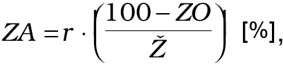
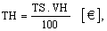

Príloha č. 5 k vyhláške č. 492/2004 Z. z.

- POSTUP PRI STANOVENÍ VŠEOBECNEJ HODNOTY ELEKTROTECHNICKÝCH ZARIADENÍ

  - A. ZÁKLADNÉ POJMY

    - 1. Elektrotechnické zariadenie (EZ) – akékoľvek zariadenie, ktoré sa používa na výrobu, premenu, prenos, akumulovanie, distribúciu alebo využitie elektrickej energie, ako sú stroje, transformátory, prístroje, meracie prístroje, ochranné prístroje, zariadenia pre elektrické rozvody, spotrebiče.

    - 2. Počet odpracovaných rokov EZ – doba prevádzky (r) – skutočná doba, počas ktorej bolo EZ v prevádzke, stanovená v mesiacoch, prepočítaná na roky od dátumu jeho prvého uvedenia do prevádzky, prípadne od jeho uvedenia do prevádzky po vykonaní celkovej alebo generálnej opravy, rekonštrukcie alebo modernizácie po rozhodujúci dátum, t. j. dátum, ku ktorému sa elektrotechnické zariadenie hodnotí.

      - r = Počet mesiacov prevádzky /12 [rok]

      - Vypočítaný údaj sa zaokrúhli na 3 desatinné miesta.

      - V prípade, že nie sú k dispozícii hodnoverné doklady, doba prevádzky sa stanoví podľa iných dostupných údajov alebo zdôvodneným odborným odhadom.

    - 3. Východisková hodnota (VH) – cena zariadenia, za akú je možné obstarať hodnotené zariadenie alebo zariadenie s rovnakými alebo porovnateľnými technickými parametrami a úžitkovými vlastnosťami k rozhodujúcemu dátumu v mieste používania zariadenia.

    - 4. Východiskový technický stav (VTS) – preukázateľným spôsobom definovaný, technický stav v čase prvotného alebo opätovného uvedenia zariadenia do prevádzky. Je vyjadrením miery schopnosti zariadenia plniť funkcie a účel, pre ktoré bolo zariadenie vyrobené v súlade s technickou dokumentáciou a pokynmi výrobcu na začiatku doby prevádzky zariadenia (v okamihu uvedenia zariadenia do prevádzky, zaradenia do evidencie, resp. po vykonanej generálnej oprave či modernizácii – technickom zhodnotení).

      - V prípade, ak od hodnoteného zariadenia nie sú k dispozícii žiadne doklady, znalec stanoví východiskový technický stav na základe vykonanej obhliadky, informácií prevádzkovateľa alebo iného hodnoverného dokladu. Keď zariadenie nemožno obhliadnuť a nie sú k dispozícii žiadne doklady ani informácie, znalec stanoví VTS zdôvodneným odborným odhadom.

    - 5. Základná amortizácia (ZA) – miera skutočného fyzického opotrebenia ohraničená časovým intervalom uvedenia zariadenia do prevádzky a rozhodujúcim dátumom.

    - 6. Technická životnosť (Ž) – doba, počas ktorej je zariadenie schopné plniť požadované funkcie v súlade s určením zariadenia, technickou dokumentáciou, sprievodnou dokumentáciou, odporúčaniami a pokynmi výrobcu alebo dodávateľa.

    - 7. Zostatkové percento prevádzkyschopnosti (ZO) – miera schopnosti zariadenia plniť požadované funkcie v súlade s určením zariadenia, technickou dokumentáciou, sprievodnou dokumentáciou, odporúčaniami výrobcu alebo dodávateľa, po skončení prognózovanej technickej životnosti.

    - 8. Rozhodujúci dátum – dátum, ku ktorému je stanovená všeobecná hodnota.

    - 9. Technický stav (TS) – skutočný technický stav zariadenia stanovený k rozhodujúcemu dátumu, zodpovedajúci základnej amortizácii určenej pre skutočnú dobu prevádzky zariadenia, priamo úmerný spôsobu prevádzky a morálnemu opotrebeniu zariadenia.

    - 10. Zmena technického stavu (Z) – percentuálne vyjadrenie odchýlky skutočného technického stavu hodnoteného zariadenia od stavu definovateľného technickou, sprievodnou, resp. inou dokumentáciou alebo stavu určeného optimálnym používaním zariadenia v reálnom čase.

    - 11. Koeficient morálneho opotrebenia (kMO) – vyjadruje mieru morálneho opotrebenia zariadenia, pričom v praxi sa rozlišujú dve skupiny morálneho opotrebenia:

      - a) Morálne opotrebenie I – vzniká v dôsledku rastu produktivity práce, keď sa nové EZ vyrábajú lacnejšie, v dôsledku čoho klesá hodnota rovnakých EZ vyrobených skôr, pričom technická úroveň EZ vyrobených skôr je rovnaká ako technická úroveň nových EZ.

      - b) Morálne opotrebenie II – vzniká v dôsledku technického pokroku, keď sa vyrábajú EZ s technicky dokonalejšími parametrami, čím klesá hodnota skôr vyrobených EZ s menšou výkonnosťou, pričom nové EZ zväčša plnia svoje funkcie kvalitnejšie a efektívnejšie (napr. výpočtová technika a pod.). Koeficient morálneho opotrebenia môže dosahovať hodnoty kMOЄ (0;1>, pričom znalec v posudku príslušne zdôvodní hodnotu koeficienta kMO.

        - V prípade, že pri hodnotenom EZ nemožno vykonať obhliadku a nie sú k dispozícii hodnoverné podklady, znalec stanoví hodnotu kMO podľa porovnateľných EZ predávaných na trhu v období obstarávania hodnoteného EZ v kontexte so súčasnými technicky porovnateľnými výrobkami.

    - 12. Technická hodnota (TH) – peňažné vyjadrenie technického stavu hodnoteného EZ.

    - 13. Všeobecná hodnota (VŠH) – výsledná objektivizovaná hodnota EZ stanovená k rozhodujúcemu dátumu pri rešpektovaní trhových podmienok v mieste hodnotenia, kompletnosti zariadenia, technického stavu, úplnosti sprievodnej a technickej dokumentácie. Pri stanovení VŠH znalec vždy uvedie, či je stanovená s daňou z pridanej hodnoty alebo bez.

    - 14. Koeficient predajnosti EZ (kp) – vyjadruje stav trhového prostredia v mieste hodnotenia pri rešpektovaní rozhodujúceho dátumu, úplnosti sprievodnej a technickej dokumentácie, spôsobu údržby a prevádzkovania EZ, jeho úplnosti, kompletnosti a iných faktorov, ktoré môžu mať preukázateľný vplyv na hodnotu EZ.

    - 15. Výška škody (VŠ) – finančným vyjadrením priamych i nepriamych nákladov vynaložených na odstránenie javov, ktoré spôsobili alebo spôsobujú nefunkčnosť EZ alebo zmenu technických a projektovaných parametrov EZ.

  - B. POSTUP PRI VÝPOČTE VŠEOBECNEJ HODNOTY EZ

    - Znalec zatriedi hodnotené EZ podľa časti C tejto prílohy.

    - 1. Základná amortizácia

      - Vypočíta sa podľa vzťahu:

      - 

      - kde

      - r – počet odpracovaných rokov [roky]

      - ZO – zostatkové percento prevádzkyschopnosti EZ [%]

      - Ž – prognózovaná technická životnosť EZ [roky]

      - Základnou podmienkou na použitie tohto vzťahu je: r ≤ Ž

      - V prípade, že zariadenie je v prevádzke dlhšiu dobu, ako je prognózovaná technická životnosť, t. j. r > Ž, základná amortizácia sa vypočíta podľa vzťahu:

      - ZA = VTS – ZO [%],

      - kde

      - VTS – východiskový technický stav EZ [%]

    - 2. Technický stav

      - Vypočíta sa podľa vzťahu:

      - 

      - kde

      - TS – technický stav EZ [%]

      - VTS – východiskový technický stav EZ [%]

      - ZA – základná amortizácia EZ [%]

      - Z – zmena technického stavu EZ [%]

      - kMO – koeficient morálneho opotrebenia [ - ]

      - Koeficient morálneho opotrebenia môže dosahovať hodnoty z intervalu (0; 1>

    - 3. Technická hodnota

      - Vypočíta sa podľa vzťahu:

      - 

      - kde

      - TH – technická hodnota [€]

      - TS – technický stav EZ stanovený k rozhodujúcemu dátumu [%]

      - VH – východisková hodnota EZ [€]

    - 4. Všeobecná hodnota

      - Vypočíta sa podľa vzťahu:

      - VŠH = TH . kP [€],

      - kde

      - TH – technická hodnota EZ [€]

      - kP – koeficient predajnosti EZ [ - ]

      - Koeficient predajnosti sa vypočíta podľa vzťahu:

      - kP = kPT . kPS . kPD . kPL . kPI[ - ],

      - kde

      - kPT– koeficient neúplnosti alebo neplatnosti dokumentácie potrebnej na prevádzku EZ – kPT є (0; 1>

      - P. č. | Dokumentácia | kPT

      - 1. | Dokumentácia je úplná, kompletná a platná | 1,00

      - 2. | Dokumentácia je úplná, kompletná, neplatné sú odborné prehliadky a odborné skúšky podľa osobitných predpisov 1) | 0,85 – 1,00

      - 3. | Dokumentácia je neúplná, chýbajú doklady o zariadení v rozsahu: – neúplné doklady podľa osobitného predpisu 2), 3) – neúplné doklady o odborných skúškach podľa osobitného predpisu 1) | 0,50 – 0,85

      - 4. | Od EZ nejestvuje žiadna technická dokumentácia, prevádzkové záznamy ani doklady o nadobudnutí vlastníckeho či iného práva k tomuto zariadeniu | 0,10 – 0,50

      - kPS– koeficient zohľadňujúci dostupnosť náhradných dielov a servisných služieb, opravy a údržbu

      - EZ – kPSє (0; 1>

      - P. č. | ND, služby, opravy, údržba | kPS

      - 1. | V mieste prevádzkovania EZ sú dostupné opravárenské služby, výkon údržby je zmluvne zabezpečený, ND sú vyrábané a dostupné | 1,00

      - 2. | Opravárenské služby sú dostupné v rozsahu do 100 km, výkon údržby je zmluvne zabezpečený, ND sú bežne dostupné | 0,90 – 1,00

      - 3. | EZ hodnoteného typu sú ťažko opravovateľné, nejestvuje bežne dostupná sieť opravárenských a údržbárskych firiem, ND sa nevyrábajú sériovo | 0,50 – 0,90

      - 4. | EZ nemožno v SR opraviť, dostupný je len servis a údržba zo zahraničia, ND nie sú v SR k dispozícii | 0,30 – 0,50

      - 5. | EZ je neopraviteľné | 0,10 – 0,30

      - kPD– koeficient dopytu po hodnotenom EZ na trhu – kPDє R+

      - P. č. | Dopyt | kPD

      - 1. | EZ je nepredajné, nevyužiteľné v podnikateľskej činnosti iného subjektu | 0,01 – 0,20

      - 2. | EZ je nepredajné, využiteľnosť je len na náhradné diely pre opravy iných EZ | 0,20 – 0,40

      - 3. | Na trhu je prebytok EZ hodnoteného typu a parametrov, ponuka prevláda nad dopytom, resp. na trhu sú EZ podobného typu, ale výkonnejšie, EZ morálne zastarané, jednoúčelové EZ, EZ poškodené a pod. | 0,40 – 0,80

      - 4. | Na trhu je rovnováha ponuky a dopytu po hodnotenom EZ | 0,80 – 1,00

      - 5. | Hodnotené EZ je možné predať vopred určenému záujemcovi | 1,00

      - 6. | Dopyt po hodnotenom EZ prevláda nad ponukou, hodnotené EZ dosahuje mimoriadne technické parametre, dovoz EZ porovnateľného typu zo zahraničia je nerentabilný, EZ je využiteľné v ďalšej podnikateľskej činnosti a pod. | > 1,00

      - kPL– tento koeficient sa použije pri stanovení všeobecnej hodnoty technologického celku pozostávajúceho z viacerých EZ alebo aj jednotlivého EZ a zohľadňuje zníženie všeobecnej hodnoty technologického celku alebo EZ v dôsledku zásahu do celku, napr. nutnosťou jeho demontáže alebo vyčlenením niektorého EZ z technologického celku – kPL є (0; 1>

      - P. č. | Stav technologického celku | kPL

      - 1. | Technologický celok je kompletný a úplný | 1,00

      - 2. | Technologický celok je nekompletný a neúplný, pričom tento stav nemá vplyv na výkonnosť a projektované parametre zariadenia | 0,85 – 1,00

      - 3. | Technologický celok je nekompletný, neúplný, pričom tento stav sa dá odstrániť náhradou chýbajúcich, resp. nefunkčných častí za iné s minimálnym dopadom na výkonnosť a projektované parametre zariadenia | 0,70 – 0,85

      - 4. | Technologický celok je nekompletný, neúplný, pričom tento stav sa dá odstrániť náhradou chýbajúcich, resp. nefunkčných častí za iné so závažným dopadom na výkonnosť a projektované parametre zariadenia | 0,50 – 0,70

      - 5. | Technologický celok je nekompletný, neúplný, pričom tento stav sa nedá odstrániť náhradou chýbajúcich, resp. nefunkčných častí za iné | 0,01 – 0,50

      - kPI– koeficient ostatných vplyvov, napr. EZ v záručnej lehote, počet predchádzajúcich užívateľov (neznámy spôsob údržby a využívania EZ, EZ po havárii a pod.). – kPI(0; 1>

      - P. č. | Iné vplyvy | kPI

      - 1. | EZ je kompletné, plne funkčné, zodpovedne ošetrované, používané v súlade s odporúčaniami výrobcov, resp. dovozcov | 1,00

      - 2. | EZ je využívané intenzívne s občasným prekročením projektovaných parametrov a výkonu so zanedbateľným vplyvom na životnosť, pri dodržiavaní predpísanej frekvencie údržbárskych a servisných prác. V prípade skladovania EZ (EZ nie je v prevádzke) je toto zodpovedajúcim spôsobom uložené a ošetrované v predpísaných priestoroch | 0,85 – 1,00

      - 3. | EZ je využívané intenzívne s trvalým prekračovaním projektovaných parametrov a výkonu s podstatným vplyvom na životnosť EZ, pri dodržiavaní predpísanej frekvencie údržbárskych a servisných prác. V prípade skladovania EZ je toto uložené v uzatvorených priestoroch, avšak ďalej neošetrované | 0,60 – 0,85

      - 4. | EZ je využívané neznámym spôsobom bez vedenia potrebných prevádzkových záznamov a pri neznámom počte predchádzajúcich majiteľov (prevádzkovateľov). V prípade skladovania EZ je toto skladované nevhodným spôsobom v rozpore s predpismi výrobcu, resp. dovozcu, so zreteľným vplyvom okolitého prostredia na EZ | 0,01 – 0,60

    - 5. Výška škody

      - Vypočíta sa podľa vzťahu:

      - VŠ = NO + (VŠHPP – VŠHPZ) – VŠHZ[€],

      - kde

      - VŠ – výška škody [€]

      - VŠHPP– všeobecná hodnota EZ pred poškodením stanovená k dátumu poškodenia EZ [€]

      - VŠHPZ – všeobecná hodnota EZ po vykonanom zásahu, resp. po predpokladanom vykonaní zásahu s cieľom uvedenia EZ do pôvodného prevádzkyschopného stavu [€]

      - VŠHZ – všeobecná hodnota zvyškov EZ, ktoré zostanú po vykonaní zásahu a je predpoklad ich ďalšieho speňaženia [€]

      - NO – náklady na opravu [€]

    - 6. Likvidačná hodnota EZ sa stanovuje len v nasledujúcich prípadoch:

    - - vlastník zariadenia končí podnikateľskú činnosť likvidáciou

    - - vlastník zariadenia končí podnikateľskú činnosť konkurzom, pričom nenasleduje likvidácia

    - - vlastník zariadenia končí podnikateľskú činnosť konkurzom, pričom nasleduje likvidácia

    - - vlastník zariadenia končí podnikateľskú činnosť iným spôsobom.

    - Pri stanovení likvidačnej hodnoty zariadenia musí byť jednoznačne stanovené, či zariadenie je určené na ďalšiu prevádzku alebo na odstránenie – znehodnotenie (do šrotu). V prípade zariadenia určeného na znehodnotenie sa likvidačná hodnota určí podľa vzťahu:

    - VŠHLO = VŠH – NL [€],

    - kde

    - VŠHLO – všeobecná hodnota EZ určeného na odstránenie (do šrotu) [€]

    - VŠH – všeobecná hodnota EZ k dátumu odstránenia EZ [€]

    - NL – náklady na likvidáciu EZ [€]

    - Náklady na likvidáciu nie sú častokrát zanedbateľné. Pozostávajú z nákladov na odstránenie z prevádzky, demontáž, archiváciu histórie (počítačové programy, výpočtová technika...), prepravu na miesto určenia, náklady na separáciu toxických odpadov, ich zneškodnenie, poplatky za znečistenie životného prostredia, ak nejaké vzniknú, a podobne. Výšku nákladov znalec v posudku zdôvodní.

    - 7. Vypočítaná hodnota VŠH EZ, výšky škody a likvidačnej hodnoty EZ sa zaokrúhľuje na 50 centov.

  - C. KATEGORIZÁCIA EZ A MATERIÁLOV POUŽÍVANÝCH NA ICH VÝROBU

    - Podľa tejto prílohy sa môžu hodnotiť elektrotechnické zariadenia, ktoré sa uvádzajú v jednotlivých kategóriách v tabuľke pod číselným znakom jednotného triedenia. Pri zatriedení hodnoteného EZ znalec rešpektuje nasledujúce zásady:

    - a) Každé EZ uvedené v niektorej položke sa vzťahuje aj na taký výrobok, ktorý je nekompletný alebo nedokončený za predpokladu, že v stave a za podmienok, v akých sa nachádza k rozhodujúcemu dátumu tento nekompletný alebo nedokončený výrobok, má charakteristické znaky kompletného alebo hotového výrobku.

    - b) Ak má byť EZ zaradené do dvoch alebo viacerých položiek, najšpecifickejšia položka musí mať prednosť pred položkami so všeobecnejším významom.

    - c) Zmesi, EZ zložené z rôznych materiálov alebo EZ skladajúce sa z rôznych komponentov a EZ dodávané v súboroch sa zaradia podľa materiálu alebo komponentu, ktorý im dáva ich podstatný charakter.

    - d) EZ alebo materiál, ktorý nie je možné zatriediť podľa vyššie uvedených pravidiel, sa zatriedi do položky, ktorá zahŕňa najpodstatnejšie elektrotechnické zariadenie alebo materiál.

    - e) Púzdra, obaly, schránky, špeciálne tvarované alebo upravené na vloženie určitého výrobku alebo súboru výrobkov, vhodné na dlhodobé využitie sa zatrieďujú s týmito výrobkami.

      - 2.1 Silnoprúdové elektrotechnické zariadenia

      - 2.1.1 Elektrotechnické zariadenia na výrobu elektrickej energie

        - Číselný kód Colný sadzobník | Číselný kód KP | Popis položky | Ž | ZO

        - | | | [r] | [%]

        - 8402 | 28.30.11 28.30.13 | Kotly na výrobu vodnej alebo inej pary – parné kotly (iné ako nízkotlakové kotly na ústredné kúrenie schopné dodávať tak teplú vodu, ako aj paru); kotly na „prehriatu“ paru – len elektrokotly | 17 | 25

        - 8407 | 34.10.11 34.10.12 35.30.11 | Kogeneračné jednotky | 20 | 5

        - 8502 | 31.10.32 31.10.61 31.10.31 | Elektrické generátorové agregáty a rotačné meniče (konvertory), elektrické generátorové agregáty s piestovým vznetovým spaľovacím motorom (dieselové motory alebo motory so žiarovou hlavou) | 20 | 25

      - 2.1.2 Elektrotechnické zariadenia na rozvod elektrickej energie

        - Číselný kód Colný sadzobník | Číselný kód KP | Popis položky | Ž | ZO

        - | | | [r] | [%]

        - 8534 | 32.10.30 | Tlačené obvody | 20 | 5

        - 8535 | 25.24.90 31.20.10 31.20.40 | Elektrické prístroje na vypínanie alebo na ochranu elektrických obvodov, na ich spájanie do elektrického obvodu (napr. odpájače, spínače, poistky, bleskoistky, obmedzovače prúdových nárazov, zásuvky, rozvodné skrine) na napätie presahujúce 1000 V | 20 | 20

        - 8536 | 31.20.24 31.20.25 31.20.26 31.20.27 31.20.21 31.20.22 31.20.23 | Elektrické zariadenia na vypínanie alebo na ochranu elektrických obvodov, na ich spájanie do elektrického obvodu (napr. vypínače, spínače, relé, poistky, obmedzovače prúdových nárazov, zástrčky, zásuvky, objímky žiaroviek, rozvodné skrine) na napätie nepresahujúce 1000 V | 20 | 20

        - 8537 | 25.24.90 31.20.40 31.20.32 31.20.31 | Rozvádzače, rozvodové panely, ovládacie (dispečerské) stoly, pulty, skrine a ostatné základne vybavené dvoma alebo viacerými zariadeniami položky 8535 alebo 8536, na elektrické riadenie alebo na rozvod elektrického prúdu vrátane zabudovaných nástrojov a prístrojov a číslicové riadiace zariadenia, okrem spínacích prístrojov a zariadení položky 8517 | 20 | 20

        - 8538 | 25.24.90 31.20.40 | Časti a súčasti určené výhradne alebo hlavne na použitie s prístrojmi a zariadeniami položiek 8535, 8536 alebo 8537 | 20 | 20

        - 8544 | 31.30.15 31.30.11 31.30.14 31.30.13 31.30.12 31.61.10 | Drôty, káble (vrátane koaxiálnych káblov) izolované (tiež lakovým povrchom alebo s anodickým okysličením) a ostatné izolované elektrické vodiče, tiež s prípojkami; káble z optických vlákien vyrobené z jednotlivo opláštených vlákien, tiež spojené s elektrickými vodičmi alebo s prípojkami | 20 | 20

        - 8545 | 31.62.15 | Uhlíkové elektródy, uhlíkové kefky, osvetľovacie uhlíky, uhlíky na elektrické batérie a ostatné výrobky zhotovené z grafitu alebo z iného uhlíku, tiež spojené s kovom, druhov používaných na elektrické účely | 4 | 5

        - 8546 | 26.15.25 26.23.10 31.62.14 | Elektrické izolátory z ľubovoľného materiálu | 25 | 20

        - 8547 | 25.24.26 26.23.10 31.62.14 | Izolačné časti a súčasti na elektrické stroje, prístroje a zariadenia, vyrobené úplne z izolačných materiálov alebo len s jednoduchými, do materiálu vlisovanými drobnými kovovými súčasťami (napr. s objímkami so závitom), slúžiacimi výlučne na pripevňovanie, okrem izolátorov položky 8546; elektrické rozvodné rúrky a ich spojky zo základného kovu, s vnútorným izolačným materiálom | 20 | 10

      - 2.1.3 Elektrotechnické zariadenia na premenu a prenos elektrickej energie

        - Číselný kód Colný sadzobník | Číselný kód KP | Popis položky | Ž | ZO

        - | | | [r] | [%]

        - 8302 60 | 28.63.14 | Zariadenia na automatické zatváranie dverí (elektrické) | 17 | 10

        - 8403 | 28.22.12 28.22.13 28.30.12 | Kotly na ústredné kúrenie, iné ako položky 8402 – elektrické | 25 | 20

        - 8404 | 28.30.12 28.30.13 | Pomocné prístroje a zariadenia na kotly položky 8402 alebo 8403 (napr. ohrievače vody, tzv. ekonomizéry, prehrievače pary, odstraňovače sadzí, zariadenia na rekuperáciu plynov); parné kondenzátory alebo iné pomocné jednotky – elektrické | 17 | 25

        - 8413 | 28.40.20 29.12.21 29.12.23 29.12.24 | Čerpadlá na kvapaliny, tiež vybavené meracím zariadením; elevátory na kvapaliny | 10 | 25

        - 8414 | 29.12.38 | Vzduchové čerpadlá, kompresory a ventilátory | 12 | 25

        - 8415 | 29.23.30 29.23.12 | Klimatizačné stroje a prístroje, skladajúce sa z ventilátora so vstavaným motorom a zo strojov a prístrojov na zmenu teploty a vlhkosti, vrátane strojov a prístrojov, v ktorých môže byť vlhkosť regulovaná oddelene | 12 | 25

        - 8418 | 29.23.13 29.23.30 29.71.11 | Chladničky, mraziace boxy a ostatné chladiace alebo mraziace zariadenia, elektrické, tepelné čerpadlá, iné ako klimatizačné stroje a prístroje položky 8415 – elektrické | 8 | 25

        - 8419 | 29.23.11 29.23.30 29.24.40 29.53.15 29.56.22 29.72.14 33.10.14 | Prístroje, stroje alebo laboratórne zariadenia s elektrickým ohrevom, na spracovávanie materiálu výrobnými postupmi, zakladajúcimi sa na zmene teploty, ako je ohrievanie, varenie, praženie, destilácia, rektifikácia, sterilizácia, pasterizácia, parenie, sušenie, vyparovanie, odparovanie, kondenzovanie alebo chladenie, okrem prístrojov a zariadení pre domácnosť; prietokové alebo zásobníkové ohrievače vody | 12 | 25

        - 8421 | 29.23.14 29.24.31 29.24.52 | Odstredivky, vrátane sušiacich odstrediviek, prístroje na filtrovanie alebo na čistenie tekutín | 10 | 25

        - 8422 | 29.24.60 | Umývačky riadu | 11 | 25

        - 8425 | 29.22.11 29.22.19 | Kladkostroje a iné zdvíhacie zariadenia s elektrickým pohonom | 17 | 25

        - 8428 | 29.22.18 29.22.16 29.22.17 29.52.11 | Ostatné zdvíhacie, nakladacie a vykladacie a manipulačné zariadenia (napr. výťahy, lanovky, eskalátory, dopravníky) s elektrickým pohonom | 17 | 25

        - 8431 | 29.22.19 29.52.61 29.22.20 | Elektrické časti a súčasti vhodné na použitie výhradne na stroje a zariadenia položiek 8425 až 8430 | 10 | 20

        - 8434 | 29.53.12 29.32.62 29.53.21 | Dojacie stroje a mliekarenské stroje a ostatné stroje v potravinárskom priemysle s elektrickým pohonom a riadením | 8 | 25

        - 8447 | 29.54.14 29.54.41 29.54.12 29.54.15 | Pletacie stroje a krosná, stroje na spevnenie prešitím, opriadacie stroje, stroje na výrobu tylu, čipiek, výšiviek, lemoviek a prámikov, pletených alebo sieťovinových a stroje na výrobu strapcov – riadené elektronicky | 14 | 25

        - 8451 | 29.54.21 29.71.13 29.54.22 | Stroje a zariadenia na pranie, čistenie, žmýkanie, sušenie, žehlenie | 10 | 25

        - 8456 | 29.40.11 29.40.12 29.40.21 29.40.22 29.40.23 29.40.31 | Obrábacie stroje na spracovanie všetkých materiálov ich úberom mechanicky, pomocou lasera alebo pomocou iných svetelných alebo fotónových zväzkov, ultrazvuku, elektroerózie, elektrochemických reakcií, elektrónových zväzkov ionizujúceho žiarenia alebo oblúkových výbojov v plazme | 10 | 25

        - 8467 19 | 29.40.76 29.40.77 | Náradie s vlastným zabudovaným elektrickým motorom | 10 | 20

        - 8501 | 31.10.22 31.10.61 31.10.23 31.10.24 31.10.10 31.10.26 31.10.25 31.10.21 | Elektrické motory a generátory (okrem generátorových agregátov) | 20 | 25

        - 8504 | 31.10.50 31.10.62 31.10.42 31.10.43 31.10.41 | Elektrické transformátory, statické meniče (napr. usmerňovače) a induktory | 20 | 20

        - 8505 | 31.62.12 | Elektromagnety; permanentné magnety a výrobky určené na zmagnetizovanie; upínacie dosky, skľučovadlá a iné podobné upínacie zariadenia s elektromagnetmi alebo permanentnými magnetmi | 8 | 10

        - 8508 | 25.24.90 29.40.77 | Elektromechanické ručné nástroje so vstavaným elektrickým motorom | 5 | 20

        - 8509 | 25.24.90 29.71.21 29.71.30 | Elektromechanické zariadenia pre domácnosť so vstavaným elektrickým motorom | 10 | 10

        - 8510 | 29.71.22 29.71.30 | Holiace strojčeky a strojčeky na strihanie vlasov so vstavaným elektrickým motorom: | 6 | 10

        - 8514 | 27.51.12 27.51.11 27.51.13 27.52.10 27.53.10 27.54.10 29.21.13 29.21.14 | Elektrické pece priemyselné alebo laboratórne (vrátane indukčných alebo dielektrických); ostatné priemyselné alebo laboratórne indukčné alebo dielektrické ohrievacie zariadenia | 12 | 25

        - 8503 | 31.10.61 | Časti a súčasti určené výhradne alebo hlavne na stroje položky 8501 alebo 8502 | 20 | 10

        - 8515 | 29.40.60 29.40.78 | Zariadenia a stroje elektrické (aj elektricky vyhrievaný plyn), laserové alebo používajúce iné svetelné či fotónové zväzky, ultrazvukové, využívajúce elektrónové zväzky, magnetické impulzy alebo plazmové výboje na spájkovanie alebo zváranie, tiež schopné rezania; elektrické stroje a prístroje na striekanie kovov alebo cermetov za tepla | 11 | 25

        - 8516 | 25.24.90 29.71.28 29.71.24 29.71.27 29.71.23 29.71.25 29.71.26 29.71.29 29.71.30 | Elektrické prietokové alebo zásobníkové ohrievače vody a ponorné ohrievače; elektrické zariadenia na vykurovanie miestností, pôdy a na podobné účely; elektrotepelné zariadenia na ošetrovanie vlasov (napr. sušiče vlasov, vlničky na vlasy [kulmy], prístroje na trvalú onduláciu) a sušiče rúk; žehličky; ostatné elektrotepelné prístroje používané v domácnostiach; elektrické vykurovacie odpory, iné ako položky 8545 | 10 | 10

        - 8539 | 31.50.11 31.50.12 31.50.13 31.50.14 31.50.15 31.50.41 | Elektrické žiarovky alebo výbojky, vrátane žiaroviek na svetlomety a ultrafialové alebo infračervené žiarovky; oblúkovky | 5 | 5

        - 8607 | 35.20.40 | Časti a súčasti železničných a električkových vozidiel alebo iných koľajových vozidiel – len elektrotechnické zariadenie | 12 | 20

        - 9405 | 25.24.24 26.15.24 31.50.34 31.50.23 31.50.33 31.50.25 31.50.32 31.50.42 31.50.22 | Svietidlá (vrátane svetlometov) a ich časti a súčasti inde neuvedené ani nezahrnuté; svetelné reklamy, svetelné znaky a značky; svetelné oznamovacie tabule a podobné výrobky s pevným osvetľovacím zdrojom a ich časti a súčasti inde nešpecifikované alebo nezahrnuté | 6 | 20

      - 2.2 Slaboprúdové elektrotechnické zariadenia

      - 2.2.1 Elektrotechnické zariadenia na rozvod elektrickej energie

        - Číselný kód Colný sadzobník | Číselný kód KP | Popis položky | Ž | ZO

        - | | | [r] | [%]

        - 8544 | 31.30.15 31.30.11 31.30.14 31.30.13 31.30.12 31.61.10 | Drôty, káble (vrátane koaxiálnych káblov) izolované (tiež lakovým povrchom alebo s anodickým okysličením) a ostatné izolované elektrické vodiče, tiež s prípojkami; káble z optických vlákien vyrobené z jednotlivo opláštených vlákien, tiež spojené s elektrickými vodičmi alebo s prípojkami | 20 | 20

        - 8547 | 25.24.26 26.23.10 31.62.14 | Izolačné časti a súčasti na elektrické stroje, prístroje a zariadenia, vyrobené úplne z izolačných materiálov alebo len s jednoduchými, do materiálu vlisovanými drobnými kovovými súčasťami (napr. s objímkami so závitom), slúžiacimi výlučne na pripevňovanie, okrem izolátorov položky 8546; elektrické rozvodné rúrky a ich spojky zo základného kovu, s vnútorným izolačným materiálom | 20 | 10

        - 9001 | 33.40.21 33.40.11 | Optické vlákna a zväzky optických vlákien; káble optických vlákien, iné ako zaradené do položky 8544; polarizačný materiál v tvare listov alebo dosiek; šošovky (tiež kontaktné), hranoly, zrkadlá a iné optické články z akéhokoľvek materiálu, nezasadené, iné ako z opticky neopracovaného skla: | 20 | 10

      - 2.2.2 Elektrotechnické zariadenia na premenu a prenos elektrickej energie

        - Číselný kód Colný sadzobník | Číselný kód | Popis položky | Ž | ZO

        - | | | [r] | [%]

        - 8506 | 31.40.12 | Galvanické články a batérie | 6 | 10

        - 8507 | 31.40.23 31.40.22 31.40.24 31.40.21 | Elektrické akumulátory, vrátane separátorov, tiež s pravouhlým prierezom (vrátane štvorcového) | 5 | 10

        - 8511 | 31.61.21 31.61.24 31.61.22 | Elektrické zapaľovacie alebo spúšťacie zariadenie na zážihové a vznetové spaľovacie motory (napr. magnetické zapaľovače [magnetá], zapaľovacie cievky, zapaľovacie a žeraviace sviečky, spúšťače); generátory (napr. dynamá, alternátory) a regulačné spínače používané s týmito motormi | 8 | 20

        - 8512 | 31.61.24 31.61.23 | Elektrické prístroje osvetľovacie a signalizačné (okrem výrobkov položky 8539), stierače, rozmrazovače a odhmlievače, elektrické, na bicykle a motorové vozidlá | 12 | 25

        - 8513 | 31.50.21 31.50.42 | Prenosné elektrické svietidlá s vlastným zdrojom elektrickej energie (napr. na suché články, akumulátory, magnetá), okrem svietidiel položky 8512 | 4 | 5

        - 8532 | 32.10.12 32.10.13 32.10.71 32.10.11 | Elektrické kondenzátory, pevné, otočné a dolaďovacie | 7 | 10

        - 8533 | 32.10.20 32.10.72 | Elektrické odpory (vrátane reostatov a potenciometrov), okrem vykurovacích odporov | 7 | 10

        - 8540 | 32.10.41 32.10.42 32.10.73 | Elektrónky a trubice so studenou katódou, so žeravenou katódou alebo s fotokatódou (napr. vákuové či parami alebo plynmi plnené elektrónky a trubice, ortuťové usmerňovacie výbojky a trubice, katódové trubice, televízne obrazovky a snímacie elektrónky televíznych kamier) | 5 | 5

        - 8541 | 32.10.51 32.10.52 32.10.73 | Diódy, tranzistory a podobné polovodičové prvky, fotocitlivé polovodičové zariadenia, vrátane fotovoltických článkov, tiež zostavených do modulov alebo zabudovaných do panelov; diódy vyžarujúce svetlo (LED); zabudované piezoelektrické kryštály | 10 | 5

        - 8542 | 32.10.60 32.10.73 | Elektronické integrované obvody a mikrozostavy | 10 | 5

        - 8548 | 31.62.16 | Odpad a zvyšky galvanických článkov, batérií a elektrických akumulátorov, nepoužívateľné galvanické články, batérie a elektrické akumulátory; elektrické časti a súčasti strojov a prístrojov nešpecifikované ani nezahrnuté inde v tejto kapitole | 4 | 2

        - 8709 | 29.22.15 29.22.19 | Vozíky s elektrickým pohonom | 12 | 25

        - 8805 | 35.30.14 | Pozemné prístroje pre letecký výcvik, ich časti a súčasti | 8 | 15

        - 9207 | 36.30.15 36.30.18 | Hudobné nástroje, ktorých zvuk sa tvorí alebo sa musí zosilniť elektricky (napr. organy, gitary, akordeóny) | 10 | 20

        - 9209 | 36.30.17 36.30.18 | Časti, súčasti a príslušenstvo hudobných nástrojov (napr. mechanizmy hracích skriniek, metronómy a ladičky všetkých druhov – elektronické | 12 | 10

        - 9503 | 36.50.33 36.50.20 36.50.12 | Ostatné hračky; zmenšené modely, podobné modely na hranie; skladačky všetkých druhov – elektronické | 7 | 10

        - 9613 | 36.63.61 36.63.62 | Zapaľovače cigariet a iné zapaľovače, elektrické a ich časti a súčasti | 5 | 10

        - 9019 | | Mechanoterapeutické zariadenia, masážne prístroje, prístroje na testovanie psychologickej spôsobilosti, prístroje na liečbu ozónom, kyslíkom, aerosólom, dýchacie prístroje, oživovacie prístroje, elektrické vibračné masážne strojčeky | 7 | 20

      - 2.2.3 Elektrotechnické zariadenia na prenos informácií

        - Číselný kód Colný sadzobník | Číselný kód KP | Popis položky | Ž | ZO

        - | | | [r] | [%]

        - 8517 | 32.20.20 32.20.30 | Elektrické prístroje na drôtovú telefóniu alebo telegrafiu, vrátane drôtových telefónnych prístrojov s batériovými mikrotelefónmi a telekomunikačné prístroje na nosnú frekvenciu alebo na digitálne drôtové systémy; videotelefóny | 5 | 5

        - 8518 | 32.30.41 32.30.42 32.30.43 32.30.51 | Mikrofóny a ich stojany; reproduktory, tiež vstavané; slúchadlá všetkých druhov a kombinované rečnícke súpravy; elektrické nízkofrekvenčné zosilňovače; súpravy elektrických zosilňovačov zvuku | 5 | 10

        - 8526 | 32.30.52 33.20.20 | Rádiolokačné a rádiosondážne prístroje (radary), rádionavigačné prístroje a rádiové prístroje na diaľkové riadenie | 6 | 20

      - 2.2.4 Elektrotechnické zariadenia na spracovanie informácií

        - Číselný kód Colný sadzobník | Číselný kód KP | Popis položky | Ž | ZO

        - | | | [r] | [%]

        - 8469 | 30.01.11 30.01.12 30.01.14 30.02.19 | Písacie stroje (iné ako tlačiarne položky 8471); stroje na spracovanie textu – okrem mechanických | 8 | 25

        - 8470 | 30.01.13 | Počítacie stroje a vreckové prístroje na záznam, vyvolanie a zobrazenie údajov výpočtovými funkciami | 8 | 25

        - 8471 | 30.02.17 30.02.14 30.02.16 30.02.18 30.02.19 30.02.11 30.02.15 32.02.12 32.02.13 | Stroje na automatické spracovanie údajov a ich jednotky; magnetické alebo optické snímače, stroje na prepis údajov v kódovanej forme na pamäťové médiá a stroje spracovávajúce tieto údaje, inde nešpecifikované alebo nezahrnuté | 5 | 5

        - 8472 | 30.01.23 | Iné kancelárske stroje a prístroje (napr. rozmnožovacie stroje hektografické alebo blanové, adresovacie stroje, automatické rozdeľovače bankoviek, stroje na triedenie, čítanie alebo na balenie mincí, prístroje na orezávanie ceruziek, dierkovacie alebo spínacie stroje) – elektronické | 8 | 25

        - 8473 | 30.01.24 30.01.14 30.02.19 | Časti, súčasti a príslušenstvo (okrem krytov, kufríkov a podobných výrobkov) používané výhradne alebo hlavne na strojoch položiek 8469 až 8472 – len elektrické zostavy | 5 | 5

        - 8476 | 29.24.33 29.24.53 | Predajné automaty (napríklad na predaj poštových známok, cigariet, potravín alebo nápojov), vrátane automatov na rozmieňanie mincí – elektronické | 8 | 25

      - 2.2.5 Elektrotechnické zariadenia na záznam a reprodukciu informácií

        - Číselný kód Colný sadzobník | Číselný kód KP | Popis položky | Ž | ZO

        - | | | [r] | [%]

        - 8519 | 25.24.90 32.30.31 32.30.51 | Gramofóny, tiež prenosné, gramofónové šasi, kazetové prehrávače a iné zvukové reprodukčné prístroje, bez zariadenia na záznam zvuku | 7 | 20

        - 8520 | 32.30.32 32.30.51 | Magnetofóny a iné prístroje na záznam zvuku, tiež s reprodukčným zariadením | 7 | 20

        - 8521 | 32.30.33 32.30.51 | Videofonické prístroje na záznam a reprodukciu, tiež so zabudovaným videotunerom | 7 | 20

        - 8522 | 25.24.90 32.30.51 | Časti, súčasti a príslušenstvo vhodné na použitie výhradne alebo hlavne s prístrojmi položiek 8519 až 8521 | 7 | 20

        - 8523 | 24.65.10 25.22.15 | Hotové nenahraté médiá na záznam zvuku alebo podobný záznam | 7 | 20

        - 8524 | 22.14.11 22.14.12 25.22.15 | Gramofónové platne, magnetické pásky a iné nahraté médiá na záznam zvuku alebo na podobné záznamy, vrátane matríc a galvanických odtlačkov na výrobu platní | 7 | 20

        - 8525 | 25.24.90 32.20.12 32.20.11 32.30.52 32.30.33 | Vysielacie prístroje pre rádiotelefóniu, rádiotelegrafiu, rozhlasové alebo televízne vysielanie, tiež s prijímacím zariadením alebo so zariadením na záznam alebo reprodukciu zvuku; televízne kamery; stabilné videokamery a ostatné videokamery | 5 | 10

        - 8527 | 32.30.11 32.30.12 32.30.44 32.30.52 | Prijímacie prístroje na rádiotelefóniu, rádiotelegrafiu alebo rozhlasové vysielanie tiež kombinované v jednej skrini s prístrojom na záznam alebo reprodukciu zvuku alebo s hodinami | 5 | 10

        - 8528 | 32.30.20 25.24.90 32.30.52 | Televízne prijímače tiež so vstavanými rozhlasovými prijímačmi alebo prístrojmi na záznam či reprodukciu zvuku alebo obrazu; videomonitory a videoprojektory | 7 | 20

        - 8529 | 32.30.52 | Časti a súčasti vhodné výlučne alebo hlavne na prístroje položiek 8525 až 8528: | 6 | 10

        - 9005 | 33.40.22 33.40.24 | Binokulárne i monokulárne ďalekohľady a ostatné optické teleskopy, ostatné, astronomické prístroje a rádioastronomické prístroje | 10 | 25

        - 9006 | 33.40.32 33.40.33 31.50.31 33.40.38 33.40.36 | Fotografické prístroje, prístroje na letecké fotografovanie, lekárske a chirurgické vyšetrovanie, prístroje a žiarovky na bleskové svetlo na fotografické účely | 8 | 25

        - 9007 | 33.40.34 33.40.38 33.40.35 | Kinematografické kamery a projektory, tiež so vstavanými prístrojmi na záznam alebo reprodukciu zvuku | 8 | 25

        - 9008 | 33.40.35 33.40.36 33.40.37 33.40.38 | Projektory statických snímkov (iné ako kinematografické); fotografické (iné ako kinematografické) prístroje zväčšovacie alebo zmenšovacie | 8 | 25

        - 9009 | 30.01.21 30.01.25 | Fotokopírovacie prístroje s optickým alebo kontaktným systémom a termokopírovacie prístroje | 7 | 20

        - 9010 | 25.24.90 33.40.36 33.40.37 33.40.38 | Prístroje a vybavenie pre fotografické alebo kinematografické laboratóriá (vrátane prístrojov na premietanie alebo realizáciu predlôh obvodov) | 6 | 20

        - 9011 | 33.40.22 33.40.24 | Združené optické mikroskopy, vrátane mikroskopov na mikrofotografiu, mikrokinematografiu alebo mikroprojekciu | 7 | 5

        - 9013 | 25.24.90 33.40.23 | Výrobky s tekutými kryštálmi, ktoré nie sú špecifikované v iných položkách; lasery, iné ako laserové diódy; ostatné optické prístroje a nástroje | 6 | 10

      - 2.2.6 Meracie zariadenia

        - Číselný kód Colný sadzobník | Číselný kód KP | Popis položky | Ž | ZO

        - | | | [r] | [%]

        - 8423 | 29.24.22 29.24.23 29.24.53 | Prístroje a zariadenia na váženie, váhy spojené s počítacími a kontrolnými prístrojmi | 12 | 25

        - 9012 | 33.20.61 33.20.82 | Mikroskopy iné ako optické; difraktografy | 10 | 5

        - 9014 | 33.20.11 | Buzoly, vrátane navigačných kompasov; iné navigačné prístroje a zariadenia | 10 | 10

        - 9015 | 33.20.12 33.20.81 | Vymeriavacie (vrátane fotogrammetrických meraní), hydrografické, oceánografické, hydrolologické, meteorologické alebo geofyzikálne prístroje a zariadenia, okrem kompasov; zameriavacie zariadenia | 7 | 10

        - 9018 | 33.10.15 33.10.12 33.20.13 | Lekárske, chirurgické, zubolekárske alebo zverolekárske nástroje a prístroje vrátane scientigrafických prístrojov, ostatné elektrolekárske prístroje, ako aj prístroje na skúšanie zraku | 7 | 10

        - 9017 | | Kresliace, rysovacie alebo počítacie prístroje (napr. kresliace stroje, pantografy, uhlomery, matematické počítacie stroje, súradnicové zapisovače, mikrometre, posuvné meradlá a pod.) | 7 | 10

        - 9021 | | Načúvacie pomôcky, stimulátory srdcového svalu | 5 | 5

        - 9022 | 33.10.11 | Röntgenové prístroje a prístroje využívajúce žiarenie alfa, beta alebo gama, tiež na lekárske, chirurgické, zubolekárske alebo zverolekárske účely vrátane rádiografických alebo rádioterapeutických prístrojov, röntgenoviek a iných zariadení na výrobu röntgenových lúčov, generátorov vysokého napätia, ovládacích panelov a pultov, presvetľovacích štítov, vyšetrovacích a liečebných stolov, kresiel a podobne | 10 | 10

        - 9025 | 33.20.51 33.20.81 | Hydrometre a podobné plávajúce prístroje, teplomery, žiaromery, barometre, vlhkomery a psychrometre, tiež registračné i navzájom kombinované: | 10 | 25

        - 9026 | 33.20.52 33.20.81 | Prístroje a nástroje na meranie alebo na kontrolu prietokov, hladiny, tlaku alebo iných premenných charakteristík kvapalín alebo plynov (napr. prietokomery, hladinomery, manometre, merače tepla) – elektrické a elektronické, okrem prístrojov a nástrojov položiek 9014, 9015 alebo 9032 | 4 | 25

        - 9027 | 25.24.90 33.20.53 33.20.81 | Prístroje, zariadenia a nástroje na fyzikálne alebo na chemické rozbory (napr. polarimetre, spektrometre, refraktometre, analyzátory plynov alebo dymu); prístroje a nástroje na určovanie viskozity, pórovitosti, rozťažnosti, povrchového napätia alebo podobné prístroje a nástroje na kalorimetrické, akustické alebo fotometrické merania alebo kontrolu (vrátane expozimetrov); mikrotómy: | 7 | 20

        - 9028 | 33.20.63 33.20.83 | Merače dodávky alebo produkcie plynov, kvapalín a elektrickej energie, vrátane meračov na ich kalibrovanie | 10 | 20

        - 9029 | 33.20.64 33.20.83 | Otáčkomery, počítače výrobkov, taxametre, merače ubehnutej dráhy, krokomery a pod.; rýchlomery a tachometre, okrem patriacich do položky 9014 alebo 9015; stroboskopy | 11 | 20

        - 9030 | 25.24.90 33.20.43 33.20.41 33.20.45 33.20.81 | Osciloskopy, analyzátory spektra a ostatné prístroje a nástroje na meranie alebo kontrolu elektrických veličín, okrem meračov položky 9028; prístroje a nástroje na meranie alebo zisťovanie žiarenia alfa, beta, gama, X-lúčov kozmického alebo iného ionizujúceho žiarenia | 8 | 20

        - 9031 | 33.20.65 33.20.81 | Meracie alebo kontrolné prístroje, nástroje a stroje, inde nešpecifikované ani nezahrnuté v tejto kapitole | 12 | 25

        - 9102 | 33.50.12 | Náramkové hodinky, vreckové hodinky a ostatné hodinky (vrátane stopiek), iné ako zaradené do položky 9101 – elektrické a elektronické | 14 | 25

        - 9105 | 33.50.14 | Ostatné hodiny – elektrické a elektronické | 14 | 25

        - 9106 | 33.50.15 | Časové kontrolné prístroje a časové počítadlá s hodinovým alebo hodinkovým strojčekom alebo synchrónnym motorom (napr. kontrolné časové registračné hodiny, záznamové hodiny) – elektrické a elektronické | 14 | 25

        - 9108 | 33.50.21 | Hodinkové strojčeky, úplné a zmontované – elektrické a elektronické | 11 | 25

        - 9109 | 33.50.22 | Hodinové stroje, úplné a zmontované – elektrické a elektronické | 11 | 25

      - 2.2.7 Riadiace zariadenia

        - Číselný znak Colný sadzobník | Číselný kód KP | Popis položky | Ž | ZO

        - | | | [r] | [%]

        - 8530 | 24.66.48 31.62.16 31.62.11 33.50.28 | Elektrické prístroje signalizačné, bezpečnostné alebo na kontrolu a riadenie železničnej, električkovej, cestnej a riečnej dopravy, na parkovacie zariadenia a na vybavenie prístavov a letísk | 10 | 10

        - 8531 | 31.62.16 31.62.11 | Elektrické akustické alebo vizuálne signalizačné prístroje (napr. zvončeky, sirény, návestné panely, poplachové zariadenia na ochranu proti krádeži alebo proti požiaru), iné ako položky 8512 alebo 8530 | 10 | 10

        - 8802 | 35.30.40 35.30.31 35.30.32 35.30.33 35.30.34 | Ostatné letúne (napr. vrtuľníky, lietadlá); kozmické lode (vrátane družíc) a ich štartovacie nosiče – len elektrotechnické zariadenia | 12 | 20

        - 9032 | 25.24.90 33.20.84 | Automatické regulačné alebo riadiace prístroje a nástroje | 17 | 10

      - 2.2.8 Iné elektrotechnické zariadenia

        - Číselný kód Colný sadzobník | Číselný kód KP | Popis položky | Ž | ZO

        - | | | [r] | [%]

        - 8543 | 31.62.13 31.62.16 | Elektronické stroje a zariadenia a prístroje, ktoré majú individuálne funkcie a nie sú špecifikované alebo zahrnuté inde v tejto kapitole | 10 | 10

        - 9504 | 36.50.42 36.50.43 | Potreby na lunaparkové a spoločenské hry, špeciálne stoly pre herne a automatické zariadenia do kolkární – elektrická časť | 7 | 25

        - 9999 | | Softvér dodávaný s výpočtovou technikou | 4 | 5

- 1) Vyhláška Ministerstva práce, sociálnych vecí a rodiny Slovenskej republiky č. 718/2002 Z. z. na zaistenie bezpečnosti a ochrany zdravia pri práci a bezpečnosti technických zariadení.

- 2) Zákon č. 264/1999 Z. z. o technických požiadavkách na výrobky a o posudzovaní zhody a o zmene a doplnení niektorých zákonov v znení neskorších predpisov.

- 3) Zákon č. 70/1998 Z. z. o energetike a o zmene zákona č. 455/1991 Zb. o živnostenskom podnikaní (živnostenský zákon) v znení neskorších predpisov.
