Príloha č. 6 k vyhláške č. 492/2004 Z. z.

- POSTUP STANOVENIA HODNOTY CESTNÝCH VOZIDIEL

  - A. Základné pojmy a názvoslovie

    - 1. Cestné vozidlo

      - Cestné vozidlo (ďalej len „vozidlo“) je motorové vozidlo, nemotorové vozidlo, prípojné vozidlo, zvláštne motorové alebo nemotorové vozidlo (pojazdný stroj) a ostatné vozidlá. Podľa § 2 vyhlášky Ministerstva dopravy, pôšt a telekomunikácií Slovenskej republiky č. 116/1997 Z. z.1) (ďalej len „vyhláška“) sú to vozidlá zaradené do kategórií L, M, N, O, R, S a T. Na účely tejto vyhlášky, pre potreby stanovenia ich hodnoty sú vozidlá zaradené do ďalších kategórií, pozri časť B tejto prílohy.

    - 2. Základné časti vozidla – technická skupina

      - Technickou skupinou (ďalej len „skupina“) sa na účely stanovenia hodnoty vozidla rozumie funkčne, konštrukčne a montážne jednotný celok. Rozdelenie vozidla na skupiny pre potreby ohodnocovania závisí od jeho technickej koncepcie.

    - 3. Životnosť vozidla

      - Životnosť vozidla je čas, počas ktorého je vozidlo pri dodržaní určeného systému údržby a opráv schopné bezpečne plniť požadované funkcie až do dosiahnutia medzného stavu.

      - Medzný stav je stav vozidla, keď sa musí jeho ďalšie používanie prerušiť. Dôvodom môže byť ohrozenie bezpečnosti prevádzky, neodstrániteľné prekročenie medzných tolerancií a parametrov vozidla, zníženie efektívnosti prevádzky pod prípustnú hodnotu alebo nevyhnutnosť vykonania opravy, ktorej náklady presahujú jeho technickú hodnotu k dátumu dosiahnutia tohto medzného stavu.

      - Životnosť vozidla závisí od doby prevádzky, počtu najazdených kilometrov, prípadne od odpracovaného počtu prevádzkových hodín. Na účely stanovenia hodnoty vozidla sa technický stav vozidla rovná zostatkovému percentu technickej životnosti vozidla.

    - 4. Prognózovaná životnosť vozidla

      - Prognózovaná životnosť vozidla je predpokladaná technická životnosť vozidla určená na základe jeho zatriedenia do príslušnej kategórie pri bežnej starostlivosti o vozidlo.

    - 5. Údržba a oprava vozidla

    - 5.1 Údržba je súhrn predpísaných úkonov zabezpečujúcich technickú spôsobilosť prevádzky vozidla a jej hospodárnosť. Patrí sem ošetrenie vozidla, technická prehliadka, výmena alebo doplnenie prevádzkových náplní vozidla, umývanie a čistenie vozidla, kontrola a dotiahnutie alebo nastavenie určitých častí vozidla (prípadne po predpísanom čase alebo jazdnom výkone aj výmena niektorých drobných súčiastok) a podobne.

    - 5.2 Oprava je súhrn úkonov, ktorými sa odstraňujú následky mechanického poškodenia alebo opotrebenia celku, skupín, prípadne dielov vozidla. Opravou sa obnovujú správne a predpísané funkcie vozidla, pričom opravované diely nemusia mať vždy predpísané rozmery nových dielov.

    - 5.3 Celková oprava – CO obnovuje v medziach povolených tolerancií pôvodné technické vlastnosti skupín alebo súčiastkových celkov vozidla. Rozumie sa ňou výmena všetkých poškodených alebo opotrebovaných súčiastok za nové, opravené alebo renovované. Opravované skupiny sa obvykle z vozidla demontujú.

    - 5.4 Generálna oprava – GO obnovuje v medziach povolených tolerancií pôvodné technické vlastnosti vozidla. Rozumie sa ňou úplná demontáž vozidla na diely alebo až na súčiastky, výmena chybných dielov za nové, opravené alebo renovované a opätovná montáž vozidla vrátane obnovenia jeho povrchovej úpravy. Generálnu opravu (GO) tvoria celkové opravy (CO) všetkých hlavných skupín vozidla. Ak sa niektorá hlavná skupina neopravuje, nejde o GO, ale len o CO. GO sa môže vykonať aj výmenou niektorých skupín za nové.

    - 5.5 Záručná oprava (prehliadka) je oprava (prehliadka predpísaná výrobcom alebo predajcom) vozidla, skupiny, dielu, súčiastky alebo mimoriadnej výbavy vykonaná výrobcom, predajcom alebo oprávnenou dielňou v záručnej dobe.

    - 6. Modernizácia a prestavba

    - 6.1 Modernizácia je úprava vozidla, skupiny, dielu alebo mimoriadnej výbavy vykonaná s cieľom zvýšiť jeho výkonnosť, spoľahlivosť alebo životnosť. Pri motorových vozidlách je to napríklad zníženie spotreby paliva a exhalátov výfukových plynov výmenou niektorých dielov motora za novšie, ale pre daný typ vozidla použiteľné modifikácie, výmena klasického zapaľovania za bezkontaktové elektronické zapaľovanie, dodatočná montáž katalyzátora výfukových plynov a podobne.

    - 6.2 Prestavba podľa § 101 vyhlášky znamená zmenu niektorej podstatnej časti mechanizmu vozidla alebo konštrukcie alebo takú úpravu vozidla, pri ktorej nastala zmena

      - a) podvozkovej časti, hmotnosti, rozmerov a obsaditeľnosti vozidla, riadenia alebo bŕzd a kategórie vozidla,

      - b) druhu pohonu,

      - c) druhu alebo typu motora,

      - d) druhu, prípadne typu karosérie alebo nadstavby.

    - 7. Mimoriadna výbava vozidla

      - Mimoriadna výbava vozidla je vybavenosť vozidla nad rámec štandardne dodávanej výbavy výrobcom daného typu vozidla. Štandardnou výbavou vozidla sa rozumie výbava zahrnutá obvykle v tzv. základnej cene vozidla.

      - Pri určovaní mimoriadnej výbavy znalec vychádza z údajov a katalógov výrobcov, z údajov a katalógov autorizovaných predajcov, prípadne z iných katalógov a zdrojov.

    - 8. Doba prevádzky – T

      - Doba prevádzky je vek vozidla (skupiny) uvedený v mesiacoch od dátumu jeho (jej) prvého uvedenia do prevádzky, prípadne od uvedenia do prevádzky po vykonaní CO alebo GO, po dátum ohodnotenia. Ak vozidlo nebolo uvedené do prevádzky v tom istom roku, ako je jeho rok výroby, uvažuje sa doba prevádzky od 1. januára roka nasledujúceho po roku jeho výroby. To neplatí pri vozidlách modelového radu o rok vyššieho, ako je ich rok výroby. Tu znalec zohľadní dobu prevádzky od skutočného uvedenia vozidla do prevádzky.

      - Ak ide o vozidlá (skupiny), pri ktorých nemožno zistiť presný dátum prvého uvedenia do prevádzky, znalec ho stanoví na 1. júl v roku výroby vozidla (skupiny). Obdobne znalec postupuje pri stanovení doby prevádzky dielov mimoriadnej výbavy, prípadne jednotlivých súčiastok.

    - 9. Predpokladaný ročný jazdný výkon – PKV

      - PKV vyjadruje priebeh predpokladaného ročného jazdného výkonu určených kategórií vozidiel za ich predpokladanú dobu prevádzky. Znalec stanoví PKV na základe zaradenia vozidla do príslušnej kategórie podľa kapitoly B tejto prílohy.

    - 10. Predpokladaný zostatkový technický stav ­– PZTS

      - Predpokladaný zostatkový technický stav vyjadruje predpokladané zostatkové percento prevádzkyschopnosti vozidla (skupiny) určitej kategórie pri určenej dobe prevádzky a pre niektoré kategórie vozidiel aj pri určenom počte najazdených kilometrov.

    - 11. Predpokladaná efektívna životnosť – PEZ

      - Predpokladaná efektívna životnosť vozidla (skupiny) je predpokladaná doba prevádzky, pri ktorej vozidlo (skupina) je schopné (schopná) plniť svoju funkciu do dosiahnutia predpokladaného zostatkového technického stavu.

    - 12. Predpokladaný počet najazdených kilometrov – PRKM

      - Predpokladaný počet najazdených kilometrov vyjadruje predpokladaný počet najazdených kilometrov určených kategórií vozidiel za ich skutočnú dobu prevádzky. Je daný dvanástinou súčinu predpokladaného ročného jazdného výkonu (PKV) s dobou prevádzky vozidla (T).

      - 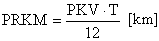,

      - keď:

      - PKV – predpokladaný ročný jazdný výkon [km/rok],

      - T – doba prevádzky [mesiace].

      - Ak je predpokladaný počet najazdených kilometrov (PRKM) väčší ako súčin predpokladanej efektívnej životnosti (PEZ) a predpokladaného ročného jazdného výkonu (PKV), predpokladaný počet najazdených kilometrov (PRKM) sa rovná súčinu predpokladanej efektívnej životnosti (PEZ) a predpokladaného ročného jazdného výkonu (PKV).

      - Maximálna hodnota predpokladaného počtu najazdených kilometrov (PRKM) je určená násobkom predpokladaného kilometrického výkonu (PKV) s predpokladanou efektívnou životnosťou (PEZ).

      - PRKMmax n = PKVn . PEZn [km],

      - keď:

      - PRKMmax n – maximálny predpokladaný počet najazdených kilometrov pre n-tú kategóriu vozidla [km],

      - PKVn – predpokladaný ročný jazdný výkon pre n-tú kategóriu vozidla [km],

      - PEZn – predpokladaná efektívna životnosť pre n-tú kategóriu vozidla [roky].

    - 13. Počet skutočne najazdených kilometrov – PSKM

      - Počet skutočne najazdených kilometrov určuje počet skutočne najazdených kilometrov vozidla od jeho prvého uvedenia do prevádzky, prípadne od uvedenia do prevádzky po vykonaní generálnej opravy, po dátum ohodnotenia.

      - Pri určovaní počtu skutočne najazdených kilometrov skupiny sa uvažuje jazdný výkon od jej prvého uvedenia do prevádzky alebo od jej uvedenia do prevádzky po vykonaní celkovej opravy.

    - 14. Rozdiel v počte najazdených kilometrov – RKM

      - Je to rozdiel medzi počtom skutočne najazdených kilometrov (PSKM) a predpokladaným počtom najazdených kilometrov (PRKM).

      - RKM = PSKM - PRKM [km],

      - keď:

      - PSKM – počet skutočne najazdených kilometrov [km],

      - PRKM – predpokladaný počet najazdených kilometrov [km].

    - 15. Koeficient najazdených kilometrov – kKM

      - Koeficient najazdených kilometrov vyjadruje amortizáciu vozidla vzhľadom na predpokladaný počet najazdených kilometrov.

    - 16. Koeficient amortizácie za skutočne najazdené kilometre – kAM

      - Koeficient amortizácie za skutočne najazdené kilometre vyjadruje vplyv skutočne najazdených kilometrov na celkovú základnú amortizáciu vozidla. Rovná sa tisícine súčinu rozdielu v počte najazdených kilometrov (RKM) s koeficientom najazdených kilometrov (kKM).

      - 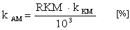,

      - keď:

      - RKM – rozdiel v počte najazdených kilometrov [km],

      - kKM – koeficient najazdených kilometrov [%].

    - 17. Základná amortizácia za dobu prevádzky vozidla (skupiny) – ZAV

      - Je to amortizácia, ktorá vyjadruje predpokladaný pokles technického stavu (skupiny) za dobu jeho (jej) prevádzky. Určuje sa pomocou amortizačných stupníc a vzorcov určených pre jednotlivé kategórie vozidiel na základe doby prevádzky ohodnocovaného vozidla.

      - Maximálna hodnota základnej amortizácie za dobu prevádzky (ZAV) je limitovaná hodnotou predpokladaného zostatkového technického stavu. Základná amortizácia za dobu prevádzky (ZAV) nemôže byť vyššia, ako je rozdiel sto percent a hodnoty predpokladaného zostatkového technického stavu (PZTS).

      - ZAVmax n = 100 - PZTSn [%].

    - 18. Celková základná amortizácia vozidla – ZA

      - Celková základná amortizácia vyjadruje opotrebenie, ktoré sa rovná priemernému opotrebeniu porovnateľného (etalónového) vozidla rovnakého veku, rovnakej doby prevádzky a rovnakého počtu najazdených kilometrov pri priemernej primeranej údržbe. Pretože každá kategória vozidiel zahŕňa pomerne veľký a rozmanitý súbor typov vozidiel, pri stanovení priebehu celkových základných amortizácií sa musí pri každej kategórii vozidiel zohľadniť priemerná amortizácia.

      - Celková základná amortizácia vozidla pri kategóriách vozidiel s predpísaným predpokladaným počtom najazdených kilometrov (PRKM) je súčtom základnej amortizácie za dobu prevádzky vozidla (ZAV) a vzťahu určujúceho zvýšenie, prípadne zníženie celkovej základnej amortizácie za počet skutočne najazdených kilometrov.

      - 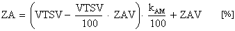,

      - keď:

      - VTSV – východiskový technický stav vozidla [%],

      - ZAV – základná amortizácia za dobu prevádzky vozidla [%],

      - kAM– koeficient amortizácie za skutočne najazdené kilometre [%].

      - V prípade, že VTSV = 100 %, možno použiť zjednodušený vzorec výpočtu celkovej základnej amortizácie:

      - 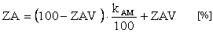,

      - keď:

      - ZAV – základná amortizácia za dobu prevádzky vozidla [%],

      - kAM– koeficient amortizácie za skutočne najazdené kilometre [%].

      - Pri ostatných kategóriách vozidiel sa celková základná amortizácia vozidla rovná základnej amortizácii za dobu prevádzky vozidla (ZA = ZAV). Obdobne znalec postupuje pri výpočte celkovej základnej amortizácie jednotlivých skupín vozidla.

    - 19. Obstarávacia cena vozidla – OC

      - Obstarávacia cena vozidla je cena, za ktorú bolo vozidlo obstarané. Obstarávacia cena starších vozidiel mohla byť napríklad

      - VOC – bývalá veľkoobchodná cena bez dane z obratu,

      - MOC – bývalá maloobchodná cena s daňou z obratu.

      - Obstarávacia cena vozidla nemusí byť totožná s jeho východiskovou hodnotou.

    - 20. Východisková hodnota vozidla – VH

      - Východisková hodnota vozidla sa používa na výpočet technickej hodnoty vozidla (TH), všeobecnej hodnoty vozidla (VŠH) a na výpočet reprodukčnej obstarávacej hodnoty vozidla (ROH).

    - 21. Východiskový technický stav skupiny – VTSS

      - Je to technický stav skupiny vyjadrený v percentách v čase jej uvedenia do prevádzky, ktorý udáva jej technický stav v porovnaní s novou skupinou.

      - Skupina sa začína amortizovať od svojho prvého uvedenia do prevádzky. Ak na skupine nebola vykonaná celková oprava, tak východiskový technický stav sa rovná 100 %.

      - Hodnoty východiskových technických stavov jednotlivých skupín po vykonaní celkovej opravy sú uvedené v kapitole B tejto prílohy.

    - 22. Východiskový technický stav vozidla – VTSV

      - Je to východiskový technický stav vozidla vyjadrený v percentách. Je váženým aritmetickým priemerom východiskových technických stavov jednotlivých technických skupín vozidla.

      - 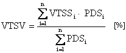,

      - keď:

      - VTSSi – východiskový technický stav i-tej skupiny [%],

      - PDSi – pomerný diel i-tej skupiny [%].

    - 23. Zrážka, prirážka za technický stav – ZP

      - Zrážka, prirážka za technický stav vyjadruje lepší alebo horší technický stav skupiny, dielu mimoriadnej výbavy, prípadne vozidla ako celku, než je predpokladaný stav daný základnou amortizáciou skupiny, dielu mimoriadnej výbavy, prípadne vozidla.

    - 24. Technický stav skupiny – TSS

      - TSS je zvyšok technickej životnosti skupiny v porovnaní s novou skupinou vyjadrený v percentách.

      - 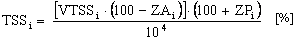,

      - keď:

      - VTSSi – východiskový technický stav i-tej skupiny [%],

      - ZAi – celková základná amortizácia i-tej skupiny [%],

      - ZPi – zrážka, prirážka za technický stav i-tej skupiny[%].

    - 25. Pomerný diel i-tej skupiny – PDSi

      - Je to percentuálne vyjadrenie podielu príslušnej skupiny na novom vozidle ako celku bez mimoriadnej výbavy.

      - 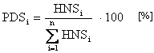,

      - keď:

      - HNSi – hodnota i-tej skupiny ako nového náhradného dielu u autorizovaného predajcu,

      - 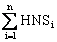 – súčet hodnôt všetkých technických skupín vozidla ako náhradných dielov u autorizovaného predajcu.

    - 26. Pomerný technický stav i-tej skupiny – PTSSi

      - Je to pomerný diel, ktorý predstavuje hodnota konkrétnej i-tej technickej skupiny z nového vozidla.

      - 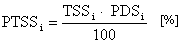,

      - keď:

      - TSSi – technický stav i-tej skupiny [%],

      - PDSi – pomerný diel i-tej skupiny [%].

    - 27. Technický stav vozidla – TSV

      - Je to zvyšok technickej životnosti vozidla vyjadrený v percentách. Určuje ju súčet pomerných technických stavov (PTSS) jednotlivých skupín vozidla.

      - 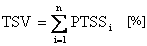,

      - keď:

      - PTSSi – pomerný technický stav i-tej skupiny [%].

    - 28. Technická hodnota vozidla – TH

      - Je to zvyšok technickej životnosti vozidla vyjadrený v eurách.

      - 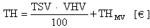,

      - keď:

      - TSV – technický stav vozidla [%],

      - VHV – východisková hodnota vozidla [€],

      - THMV – technická hodnota mimoriadnej výbavy [€].

    - 29. Technická hodnota mimoriadnej výbavy – THMV

      - Je to hodnota zvyšujúca technickú hodnotu vozidla o hodnotu jeho mimoriadnej výbavy.

      - 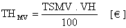,

      - keď:

      - TSMV – technický stav mimoriadnej výbavy [%],

      - VH – východisková hodnota mimoriadnej výbavy [€].

    - 30. Koeficient predajnosti vozidla – kP

      - kP vyjadruje predajnosť hodnoteného vozidla k rozhodnému dátumu. Je súčinom koeficientu platnosti kontroly technického stavu vozidla, koeficientu poškodenia vozidla haváriou, koeficientu počtu držiteľov vozidla, koeficientu spôsobu prevádzky vozidla a koeficientu dopytu trhu.

      - kP = k1 • k2 • k3 • k4 • k5[–],

      - keď:

      - k1– koeficientplatnosti kontroly technického stavu vozidla [–],

      - k2– koeficient poškodenia vozidla haváriou [–],

      - k3 – koeficient počtu držiteľov vozidla [–],

      - k4 – koeficient spôsobu prevádzky vozidla [–],

      - k5 – koeficient dopytu trhu [–].

    - 31. Koeficient platnosti kontroly technického stavu vozidla – k1

      - Vyjadruje vplyv platnosti kontroly technického stavu vozidla, prípadne iných povinných kontrol na predajnosť vozidla k dátumu jeho ohodnotenia.

    - 32. Koeficient poškodenia vozidla haváriou – k2

      - Vyjadruje vplyv prípadných opráv poškodení vozidla na jeho predajnosť.

    - 33. Koeficient počtu držiteľov vozidla – k3

      - Vyjadruje vplyv počtu predchádzajúcich držiteľov vozidla na jeho predajnosť.

    - 34. Koeficient spôsobu prevádzky vozidla – k4

      - Zohľadňuje vplyv spôsobu používania vozidla na jeho predajnosť.

    - 35. Koeficient dopytu trhu – k5

      - Vyjadruje pomer medzi priemernou predajnou cenou predmetného typu vozidla na voľnom trhu v porovnaní s jeho priemernou technickou hodnotou (TH) k rozhodnému dátumu.

      - 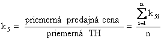,

      - keď:

      - k5 – pomer predajnej ceny a TH vozidla i zo skúmaného súboru n vozidiel [–],

      - n – počet skúmaných vozidiel [–],

      - TH – technická hodnota vozidla [€].

    - 36. Všeobecná hodnota vozidla – VŠH

      - Všeobecná hodnota vozidla je hodnota vozidla v danom mieste a čase v eurách, pri ktorej stanovení sú okrem vplyvu opotrebenia zahrnuté aj vplyvy trhu (predajnosť typu vozidla). Vyjadruje hodnotu vozidla pri jeho predaji obvyklým spôsobom na voľnom trhu k rozhodnému dátumu.

      - Je súčinom technickej hodnoty vozidla (TH) s koeficientom predajnosti (kP).

      - VŠH = TH • kP[€],

      - keď:

      - TH – technická hodnota vozidla [€],

      - kP – koeficient predajnosti vozidla [–].

      - Znalec v znaleckom posudku vždy uvedie, či vypočítaná všeobecná hodnota vozidla je vrátane DPH alebo bez DPH.

    - 37. Reprodukčná obstarávacia hodnota vozidla – ROH

      - Reprodukčná obstarávacia hodnota vozidla (ROH) je hodnota vozidla v eurách, ktorú treba uhradiť pri obstaraní porovnateľného vozidla obvyklým spôsobom na voľnom trhu v rozhodnej dobe vrátane primeraných a obvyklých nákladov na jeho zaobstaranie.

      - Je rovná súčtu všeobecnej hodnoty vozidla (VŠH) a nákladov na zaobstaranie vozidla (NZ).

      - ROH = VŠH + NZ [€],

      - keď:

      - VŠH – všeobecná hodnota vozidla [€],

      - NZ – náklady na zaobstaranie vozidla predstavujúce bežné priemerné náklady potrebné na zaobstaranie podobného typu porovnateľného vozidla v danom regióne a v rozhodnom čase, napríklad obvyklá marža predajcu, náklady na prihlásenie vozidla do evidencie a podobne [€].

      - Znalec v znaleckom posudku vždy uvedie, či vypočítaná reprodukčná obstarávacia hodnota vozidla je vrátane DPH alebo bez DPH.

    - 38. Výška škody – VŠ

      - VŠ je podľa Občianskeho zákonníka skutočná škoda, ktorá vznikla na vozidle jeho poškodením, prípadne odcudzením.

      - Pod pojmom skutočná škoda sa rozumie zmenšenie majetku poškodeného alebo náklady potrebné na to, aby sa dosiahol predchádzajúci stav.

      - Na stanovenie výšky škody na vozidle je rozhodujúca cena veci v čase, keď bola poškodená.

  - B. Výpočet hodnoty cestných vozidiel

    - 1. Identifikácia vozidla

      - Identifikácia vozidla sa vykonáva overením údajov v dokumentácii vozidla (napríklad technický preukaz, osvedčenie o evidencii vozidla, pri vozidlách bez evidenčného čísla v technickej dokumentácii) a ich porovnaním so skutočne zistenými údajmi pri obhliadke vozidla.

      - Znalec zistí, či typ vozidla zodpovedá typu uvedenému v dokumentácii. Ďalej sa zameria najmä na výrobné číslo vozidla (VIN), čísla karosérie, rámu, motora a porovná, či tieto čísla v skutočnosti sú zhodné s číslami uvedenými v dokumentácii.

      - Znalec v znaleckom posudku uvedie zhodnosť alebo nezhodnosť typu a výrobných čísel hodnoteného vozidla s údajmi uvedenými v dokumentácii. Identifikácia vozidla obsahuje nasledujúce údaje:

    - – druh vozidla,

    - – značka a typ vozidla,

    - – výrobca,

    - – rok výroby vozidla,

    - – dátum prvého uvedenia do prevádzky,

    - – zdvihový objem valcov motora (pri vozidlách s piestovým motorom),

    - – maximálny výkon motora (pri motorových vozidlách),

    - – predpísané palivo (pri vozidlách so spaľovacím motorom),

    - – užitočná hmotnosť (povinné, len ak ide o vozidlo zaradené do kategórií 4, 7 alebo 8),

    - – celková hmotnosť vozidla (povinné, len ak ide o vozidlo zaradené do kategórií 4, 7 alebo 8),

    - – evidenčné číslo vozidla (pri vozidlách s prideleným evidenčným číslom),

    - – držiteľ (meno a adresa),

    - – počet predchádzajúcich držiteľov,

    - – technický preukaz – číslo (pri vozidlách podliehajúcich evidencii),

    - – osvedčenie o evidencii vozidla – číslo (pri vozidlách podliehajúcich evidencii),

    - – platnosť technickej kontroly (pri vozidlách podliehajúcich pravidelnej kontrole technického stavu),

    - – platnosť emisnej kontroly (len ak je povinná),

    - – výrobné číslo vozidla (VIN),

    - – výrobné číslo karosérie (pri vozidlách s karosériou),

    - – výrobné číslo motora (pri vozidlách s motorom),

    - – počet najazdených km (pri vozidlách vybavených počítačom najazdených km)

    - – podľa počítača najazdených km,

    - – podľa záznamov držiteľa,

    - – počet odpracovaných motohodín (pri vozidlách vybavených počítačom odpracovaných motohodín – platí aj pre nadstavby)

    - – podľa počítača odpracovaných motohodín,

    - – podľa záznamov držiteľa.

    - 2. Údaje o opravách a poškodení vozidla, opravách hlavných skupín a ich výmene

      - Údaje o predchádzajúcich opravách a poškodení vozidla, opravách hlavných skupín a ich výmene majú podstatný vplyv na následné vyhodnotenie ich technického stavu. V znaleckom posudku je potrebné uviesť, či na vozidle boli vykonávané opravy a či údaje o nich existujú

    - – v záznamoch v TP,

    - – v dokladoch držiteľa,

    - alebo znalec tieto údaje akceptoval na základe

    - – oznámenia držiteľa,

    - – vlastného zistenia na vozidle (v zmysle bodu 6 tejto kapitoly).

    - 3. Výbava vozidla

      - V znaleckom posudku je potrebné uviesť opis a zoznam výbavy a to, či táto výbava podľa údajov výrobcu zodpovedá alebo nezodpovedá uvedenému typu a modelu vozidla, prípadne či výbava nie je úplná.

      - Znalec takisto uvedie druh a stav mimoriadnej výbavy, pokiaľ ju vozidlo má.

    - 4. Obhliadka vozidla

      - Obhliadka vozidla pozostáva z vizuálnej kontroly jednotlivých skupín a častí vozidla, spravidla bezdemontážnou diagnostikou skupín; v prípade potreby aj s demontážou a s použitím diagnostických prístrojov.

      - Obhliadka slúži na zistenie technického stavu vozidla a jeho skupín v potrebnom rozsahu. Z obhliadky znalec vykoná zápis. Pri obhliadke posudzuje aj výbavu vozidla, či zodpovedá údajom výrobcu daného typu a modelu v zmysle bodu 3 tejto kapitoly.

      - Znalec v znaleckom posudku uvedie, kedy a kde obhliadku ohodnocovaného vozidla vykonal.

    - 5. Skúšobná jazda vozidla

      - Ak technický stav vozidla umožňuje vykonať skúšobnú jazdu, znalec ju vykoná v rozsahu, ktorý je potrebný na zistenie požadovaných údajov. Pri skúšobnej jazde vedie vozidlo podľa možností znalec sám, čo je na subjektívne hodnotenie správania vozidla veľmi dôležité. Údaje z hodnotenia jednotlivých skupín pri jazde sú súčasťou celkového hodnotenia skupiny (vozidla).

      - Znalec v znaleckom posudku uvedie, kedy a kde skúšobnú jazdu s vozidlom vykonal.

    - 6. Technický stav skupín vozidla

      - Znalec v znaleckom posudku opíše technický stav jednotlivých skupín vozidla podľa rozdelenia vozidla na skupiny tak, aby vyjadril stav skupiny, jej podskupín a jednotlivých najdôležitejších dielov v potrebnom rozsahu.

    - 7. Stanovenie východiskovej hodnoty vozidla

      - Pri určovaní východiskovej hodnoty vozidla (VHV) postupuje znalec podľa nasledujúceho postupu:

      - a) pre vozidlá kategórie, ktoré sú k rozhodnému dátumu predávané na trhu SR, je východiskovou hodnotou VH údaj zistený z cenníka autorizovaných predajcov predmetných vozidiel, prípadne z iných hodnoverných a preskúmateľných zdrojov relevantných k rozhodnému dátumu. Pri určovaní východiskovej hodnoty je potrebné dbať na zhodnosť typu, ako aj výbavu ohodnocovaného vozidla a vozidla z cenníka;

      - b) pre vozidlá, ktoré sa v SR ako nové predávali, ale sa už k rozhodnému dátumu nepredávajú, je východiskovou hodnotou posledná predajná cena nového vozidla príslušného typu, v predmetnej výbave, zistená z cenníka autorizovaných predajcov predmetných vozidiel, prípadne z iných hodnoverných a preskúmateľných zdrojov k rozhodnému dátumu;

      - c) pre vozidlá vyrobené v ČSSR, ČSFR a v bývalých socialistických štátoch do roku výroby 1992 je východiskovou hodnotou posledná predajná cena uvedeného typu nového vozidla na trhu v bývalej ČSSR, resp. ČSFR. Pokiaľ ohodnocovaný typ vozidla nebol predávaný na trhu v bývalej ČSSR, resp. ČSFR, stanoví sa jeho východisková hodnota podľa písmena d) alebo e) tohto bodu. Pri určovaní východiskovej hodnoty podľa tohto písmena znalec prihliada na prípadné technické zlepšenia a modernizáciu príslušného typu;

      - d) pre vozidlá, ktoré sa v sieti predajcov SR, resp. ČSSR, ČSFR nepredávajú a ani nepredávali, je východiskovou hodnotou VH posledná predajná cena nového vozidla predmetného typu a predmetnej výbavy na trhu v SRN zistená z cenníka autorizovaných predajcov, prípadne z iných preskúmateľných zdrojov, prepočítaná na eurá. Pokiaľ je k dispozícii iba údaj o cene vozidla v DEM, prepočíta sa tento údaj hodnotou kurzu NBS DEM k EUR k 30. 12. 2001. Pokiaľ sa predmetný typ vozidla na trhu v SRN nepredával, určí znalec VH vozidla na základe cenníkov autorizovaných predajcov iných krajín Európskej únie, prípadne pomocou iných hodnoverných a preskúmateľných prameňov, ktoré v znaleckom posudku uvedie. Ak je cena vozidla v pôvodnej mene krajiny EÚ, ktorá sa stala členom Európskej menovej únie, prepočíta túto menu konverzným kurzom ku dňu vstupu tejto krajiny do Európskej menovej únie. Ak znalec počíta všeobecnú alebo reprodukčnú obstarávaciu hodnotu vozidla v úrovni s DPH, zohľadní východiskovú hodnotu vozidla vrátane DPH v krajine, ktorej cenu uvažoval. Pokiaľ sa predmetný typ vozidla ako nový nepredával v žiadnej z krajín Európskej únie, znalec určí východiskovú hodnotu vozidla na základe poslednej predajnej ceny nového vozidla v krajine jeho pôvodu. Od tejto ceny sa odpočíta daň z pridanej hodnoty a prípadne aj iné dane, ak tvoria súčasť ceny v krajine pôvodu vozidla. Takto získaná suma v pôvodnej mene sa prepočíta na eurá k dátumu ohodnotenia. Pokiaľ takéto vozidlo na základe krajiny svojho pôvodu podlieha platbe cla, prípadne iným povinným poplatkom, znalec tieto poplatky zaráta do jeho východiskovej hodnoty. Ak znalec počíta všeobecnú alebo reprodukčnú obstarávaciu hodnotu vozidla v úrovni s DPH, pripočíta ju k východiskovej hodnote vozidla;

      - e) vo výnimočných prípadoch, keď nie je možné jednoznačne použiť určenie východiskovej hodnoty podľa písmen a) až d), použije znalec na výpočet hodnoty vozidla tzv. porovnateľnú východiskovú hodnotu. Pri jej určovaní dodržiava nasledujúci postup:

      - – porovná zdvihový objem valcov, výkon a konštrukciu motora oboch vozidiel,

      - – porovná prevodové ústrojenstvo oboch vozidiel,

      - – porovnaná rozmery a hmotnosti oboch vozidiel,

      - – porovnaná príslušenstvo a výbavu oboch vozidiel,

      - – porovnaná značku, typ a rok výroby oboch vozidiel – nie je možné porovnávať generačne rozdielne vozidlá.

      - Tieto údaje je znalec povinný uviesť v znaleckom posudku;

      - f) Pri určovaní všetkých východiskových hodnôt je potrebné vychádzať z cien nových vozidiel.

    - 8. Rozdelenie vozidiel do kategórií

      - Cestné vozidlá sa na účely stanovenia ich hodnoty rozdeľujú do kategórií podľa nasledujúcej tabuľky (v zátvorke je uvedená príslušná kategorizácia podľa § 2 vyhlášky):

      - Kate- gória | Názov (označenie v zmysle vyhlášky č. 116/1997 Z. z.) | ZAV [%] | kKM[-] | PKV [km/rok] | PZTS [%] | PEZ [roky]

      - 1. | Ostatné nemotorové vozidlá a invalidné motorové vozíky (R) | | | | |

      - 1.1 | Bicykle detské a bez prevodov, kolobežky |  | - | - | 25 | 7

      - 1.2 | Bicykle s prevodmi a špeciálne (športové) |  | - | - | 20 | 10

      - 1.3 | Ručné nemotorové vozíky |  | - | - | 25 | 8

      - 1.4 | Nemotorové a motorové invalidné vozíky |  | - | - | 20 | 9

      - 2. | Motocykle (L) | | | | |

      - 2.1 | Malé motocykle nepodliehajúce dopravnej evidencii s maximálnou konštrukčnou rýchlosťou do 50 km/h a trojkolky a štvorkolky s maximálnou konštrukčnou rýchlosťou do 50 km/h a s ľubovoľným druhom pohonu |  | - | - | 10 | 10

      - 2.2 | Motocykle s evidenčným číslom a zdvihovým objemom valcov motora do 125 cm3 atrojkolky a štvorkolky s ľubovoľným druhom pohonu a s maximálnou konštrukčnou rýchlosťou nad 50 km/h * |  | 1.69 | 4 200 | 15 | 12

      - 2.3 | Motocykle s evidenčným číslom a zdvihovým objemom valcov motora 125 < V ≤ 500 cm3* |  | 1.13 | 5 000 | 15 | 15

      - 2.4 | Motocykle s evidenčným číslom a zdvihovým objemom valcov motora V > 500 cm3* |  | 0.9 | 6 200 | 15 | 15

      - 3. | Osobné motorové vozidlá, dodávkové motorové vozidlá, mikrobusy a ich modifikácie (M1) | | | | |

      - 3.1 | Vozidlá vyrobené v ČSFR a v bývalých socialistických štátoch do 31. 12. 1991 |  | 0.708 | 12 000 | 15 | 10

      - 3.2 | Vozidlá so zdvihovým objemom valcov motora V ≤ 1100 cm3 |  | 0.586 | 14 500 | 15 | 10

      - 3.3 | Vozidlá so zdvihovým objemom valcov motora 1 100 < V ≤ 1 600 cm3 |  | 0.5 | 13 500 | 15 | 12

      - 3.4 | Vozidlá so zdvihovým objemom valcov motora 1 600 < V ≤ 2 000 cm3 |  | 0.36 | 16 500 | 10 | 15

      - 3.5 | Vozidlá so zdvihovým objemom valcov motora V > 2 000 cm3 |  | 0.28 | 18 800 | 10 | 17

      - 3.6 | Luxusné vozidlá vybraných výrobcov so zdvihovým objemom valcov motora V > 2 500 cm3 |  | 0.350 | 20 000 | 30 | 10

      - 3.7 | Vozidlá s elektrickým druhom pohonu (elektromobily) |  | 0.533 | 15 000 | 20 | 10

      - 3.8 | Vozidlá s hybridným druhom pohonu a vozidlá s motorom typu Wankel |  | 0.607 | 14 000 | 15 | 10

      - 4. | Úžitkové vozidlá, špeciálne úžitkové vozidlá a ich modifikácie na podvozkoch uvedených vozidiel (N) | | | | |

      - 4.1 | Úžitkové vozidlá s celkovou hmotnosťou do 3 500 kg |  | 0.40 | 30 000 | 15 | 7

      - 4.2 | Úžitkové vozidlá s celkovou hmotnosťou od 3 501 kg do 12 000 kg |  | 0.36 | 36 000 | 10 | 7

      - 4.3 | Úžitkové vozidlá s celkovou hmotnosťou nad 12 000 kg |  | 0.21 | 60 000 | 10 | 7

      - 4.4 | Úžitkové vozidlá s celkovou hmotnosťou nad 12 000 kg používané v diaľkovej doprave a spĺňajúce medzinárodné normy a predpisy |  | 0.11 | 120 000 | 10 | 7

      - 5. | Traktory, pojazdné a účelové stroje (T, S, R) | | | | |

      - 5.1 | Kolesové traktory |  | - | - | 20 | 10

      - 5.2 | Pásové traktory | ZAV = 0,9722 ∙ T<?xml:namespace prefix = o ns = "urn:schemas-microsoft-com:office:office" /> | - | - | 30 | 6

      - 5.3 | Pojazdné stroje na zemné, stavebné a cestné práce | ZAV = 0,9722 ∙ T | - | - | 30 | 6

      - 5.4 | Pojazdné poľnohospodárske stroje | ZAV = 0,625 ∙ T | - | - | 25 | 10

      - 5.5 | Pojazdné žeriavy | ZAV = 0,368 ∙ T | - | - | 25 | 17

      - 5.6 | Pojazdná manipulačná technika na ložné a skladové operácie | ZAV = 0,9722 ∙ T | - | - | 30 | 6

      - 5.7 | Stroje na báze ručných motorových vozíkov a traktorov | ZAV = 0,625 ∙ T | - | - | 25 | 10

      - 6. | Autobusy, ich modifikácie, trolejbusy a ich modifikácie (M2, M3) | | | | |

      - 6.1 | Autobusy s celkovou hmotnosťou do 5 000 kg a do 19 miest na sedenie |  | 0.45 | 22 000 | 20 | 8

      - 6.2 | Autobusy mestskej prepravy osôb |  | 0.138 | 65 000 | 10 | 10

      - 6.3 | Autobusy linkovej prímestskej prepravy osôb (hmotnosť nad 5 000 kg) |  | 0.100 | 90 000 | 10 | 10

      - 6.4 | Autobusy diaľkovej prepravy osôb (hmotnosť nad 5 000 kg) |  | 0.064 | 110 000 | 15 | 12

      - 6.5 | Trolejbusy |  | 0.063 | 110 000 | 10 | 13

      - 7. | Prívesy a návesy k vozidlám 2. a 3. kategórie (O) | | | | |

      - 7.1 | Prívesy za motocykle a postranné vozíky k motocyklom |  | - | - | 15 | 15

      - 7.2 | Nákladné prívesy za osobné a terénne osobné automobily a ich modifikácie |  | - | - | 15 | 12

      - 7.3 | Obytné prívesy a návesy za osobné a terénne automobily a ich modifikácie |  | - | - | 15 | 15

      - 8. | Prívesy a návesy na vozidlá 4., 5. a 6. kategórie (O) | | | | |

      - 8.1 | Valníkové prívesy a návesy |  | - | - | 10 | 10

      - 8.2 | Vyklápacie prívesy a návesy |  | - | - | 10 | 7

      - 8.3 | Špeciálne prívesy a návesy |  | - | - | 10 | 11

      - 8.4 | Obytné prívesy a návesy |  | - | - | 15 | 15

  - * Pri motocykloch s evidenčným číslom ide o motocykle podliehajúce evidencii vozidiel. Pod pojmom trojkolky sa myslia vozidlá s poháňanou zadnou nápravou. Vozidlá na báze motocyklov s postranným vozíkom znalec zaradí do kategórie podľa zdvihového objemu valcov ich motora.

    - 9. Výpočet základnej amortizácie vozidla

      - a) Znalec vypočíta základnú amortizáciu za dobu prevádzky vozidla (ZAV) podľa amortizačnej stupnice a vzorca pre príslušnú kategóriu vozidla podľa tabuľky uvedenej v bode 8. Pri kategóriách vozidiel, kde nie je uvedený koeficient najazdených kilometrov (kKM) a predpokladaný ročný jazdný výkon (PKV), základná amortizácia vozidla za dobu prevádzky (ZAV) sa súčasne rovná jeho celkovej základnej amortizácii (ZA). Pri kategóriách vozidiel s určeným koeficientom najazdených kilometrov a predpokladaným ročným jazdným výkonom ďalej znalec postupuje podľa písmen b) až e).

      - b) Znalec podľa amortizačnej stupnice príslušnej kategórie vozidla vypočíta predpokladaný počet najazdených kilometrov (PRKM) k dátumu ohodnotenia a koeficient počtu najazdených kilometrov (kKM). Dbá na to, aby nebola prekročená maximálna hodnota predpokladaného počtu najazdených kilometrov (PRKM), ktorá je obmedzená technickou podmienkou uvedenou v bode 10 tejto kapitoly.

      - 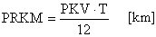,

      - keď:

      - PKV – predpokladaný ročný jazdný výkon [km/rok],

      - T – doba prevádzky [mesiace].

      - c) Na základe zisteného skutočného počtu najazdených kilometrov (PSKM) znalec vypočíta rozdiel v počte najazdených kilometrov (RKM) podľa vzorca

        - RKM = PSKM - PRKM [km],

        - keď:

        - PSKM – počet skutočne najazdených kilometrov [km],

        - PRKM – predpokladaný počet najazdených kilometrov [km].

        - d) Znalec vypočíta koeficient vplyvu skutočne najazdených kilometrov (kAM):

        - 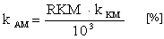,

        - keď:

        - RKM – rozdiel v počte najazdených kilometrov [km],

        - kKM – koeficient najazdených kilometrov [%].

        - e) Z týchto vstupných údajov ďalej znalec vypočíta celkovú základnú amortizáciu (ZAi) jednotlivých skupín:

        - 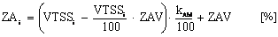,

        - keď:

        - VTSSi – východiskový technický stav i-tej skupiny [%],

        - ZAV – základná amortizácia za dobu prevádzky vozidla [%],

        - kAM– koeficient amortizácie za skutočne najazdené kilometre [%].

        - V prípade, ak VTHV = 100 %, postupuje podľa zjednodušeného vzorca:

        - 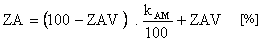,

        - keď:

        - ZAV – základná amortizácia za dobu prevádzky vozidla [%],

        - kAM– koeficient amortizácie za skutočne najazdené kilometre [%].

        - Ak pri obhliadke vozidla alebo jeho skupiny zaradeného do kategórie s určeným koeficientom najazdených kilometrov (kKM) a predpokladaným počtom najazdených kilometrov (PRKM) nemožno hodnoverne zistiť počet skutočne najazdených kilometrov (PSKM), základná amortizácia za dobu prevádzky vozidla (ZAV) sa rovná celkovej základnej amortizácii (ZA). Znalec v takomto prípade musí venovať zvýšenú pozornosť prehliadke jednotlivých skupín vozidla a pri ďalších výpočtoch zrážkou alebo prirážkou za technický stav vyjadriť ich skutočný technický stav.

        - Pokiaľ sú na vozidle technické skupiny, ktoré majú rozdielne vstupné parametre pre výpočet celkovej základnej amortizácie (ZA), musí ju znalec vypočítať pre každú skupinu zvlášť. Postupuje podľa bodu 12 tejto kapitoly.

    - 10. Amortizačné stupnice

      - Každá kategória vozidiel má na účely ich ohodnocovania stanovený vzorec pre výpočet základnej amortizácie za dobu prevádzky (ZAV) a hodnotu predpokladaného zostatkového technického stavu (PZTS). Taktiež má uvedenú predpokladanú efektívnu životnosť (PEZ) a niektoré vybrané kategórie vozidiel majú určený aj koeficient najazdených kilometrov (KKM) a predpokladaný ročný jazdný výkon (PKV). Tieto údaje sú uvedené v tabuľke rozdelenia vozidiel do kategórií v bode 8 tejto kapitoly.

      - Maximálna hodnota základnej amortizácie za dobu prevádzky (ZAV) je limitovaná hodnotou predpokladaného zostatkového technického stavu. Základná amortizácia za dobu prevádzky (ZAV) nemôže byť vyššia, ako je rozdiel sto percent a hodnoty predpokladaného zostatkového technického stavu (PZTS).

      - ZAVmax n = 100 - PZTSn [%],

      - keď:

      - ZAVmax n – maximálna hodnota základnej amortizácie za dobu prevádzky pre n-tú kategóriu vozidla [%],

      - PZTSn – predpokladaný zostatkový technický stav pre n-tú kategóriu vozidla [%].

      - Znalec pri použití amortizačnej stupnice dbá pri kategóriách vozidiel s určeným predpokladaným ročným jazdným výkonom (PKV) na správny výpočet predpokladaného počtu najazdených kilometrov (PRKM). Maximálna hodnota predpokladaného počtu najazdených kilometrov (PRKM) je určená násobkom predpokladaného kilometrického výkonu (PKV) s predpokladanou efektívnou životnosťou (PEZ).

      - PRKMmax n = PKVn . PEZn [km],

      - keď:

      - PRKMmax n – maximálny predpokladaný počet najazdených kilometrov pre n-tú kategóriu vozidla [km],

      - PKVn – predpokladaný ročný jazdný výkon pre n-tú kategóriu vozidla [km],

      - PEZn – predpokladaná efektívna životnosť pre n-tú kategóriu vozidla [roky].

    - 11. Rozdelenie vozidiel na technické skupiny (stanovenie hodnôt pomerných dielov skupín – PDS)

      - a) Znalec pre potreby stanovenia hodnoty rozdelí vozidlo na pomerné diely skupín PDS. Hodnota PDS musí zodpovedať približnému cenovému podielu predmetnej skupiny z celého nového vozidla.

        - 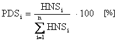,

        - keď:

        - HNSi – hodnota i-tej skupiny ako nového náhradného dielu u autorizovaného predajcu,

        - 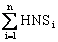 – súčet hodnôt všetkých technických skupín vozidla ako náhradných dielov u autorizovaného predajcu.

        - Ak je technický stav všetkých skupín vozidla rovnaký, možno použiť zjednodušený spôsob výpočtu TSV (pozri ďalej bod 12). V tomto prípade vozidlo nie je potrebné rozdeliť na jednotlivé technické skupiny a určiť jednotlivé pomerné diely každej skupiny (PDS), ale do 1. stĺpca tabuľky na výpočet TSV uvedenej v bode 12 sa namiesto jednotlivých skupín vozidla uvedie „vozidlo ako celok“. Vzhľadom na odlišný priebeh životnosti však možno oddeliť skupinu pneumatiky a zvlášť vypočítať pomerný technický stav (PTSS) vozidla ako celku bez pneumatík a zvlášť PTSS pneumatík.

    - 12. Stanovenie a výpočet technického stavu vozidla – TSV a technického stavu skupín – TSS

      - Na výpočet technického stavu vozidla (TSV) znalec vyplní nasledujúcu tabuľku:

      - Skupina | PDS [%] | VTSS [%] | ZA [%] | ZP [%] | TSS [%] | PTSS [%]

      - Technické skupiny vozidla podľa jeho koncepcie | 1 | 2 | 3 | 4 | 5 | 6

      - Pneumatiky | | – | – | – | |

      - Spolu | 100 | VTSV = | – | – | – | TSV =

      - V úvode výpočtu technického stavu vozidla (TSV) znalec rozdelí ohodnocované vozidlo na technické skupiny podľa bodu 11.

      - Stanovenie technického stavu vozidla (TSV) sa zakladá na posúdení skutočného technického stavu jeho skupín a porovnaní s predpokladaným stavom (určeným na základe celkovej základnej amortizácie) za rovnakú dobu prevádzky pri rovnakom počte najazdených kilometrov príslušnými skupinami.

      - Predpokladaným stavom sa rozumie priemerný porovnateľný technický stav skupín vozidla rovnakej ohodnocovanej kategórie s rovnakou dobou prevádzky i rovnakým počtom najazdených kilometrov (t. j. na základe skúseností a poznatkov stanovený porovnávací etalón).

      - Znalec ďalej zrážkou alebo prirážkou za technický stav (ZP) zhodnotí skutočný technický stav skupiny, prípadne celého vozidla a postupne vypočíta technický stav jednotlivých skupín vozidla (TSS) pomocou vzorca

      - 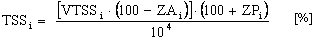,

      - keď:

      - VTSSi – východiskový technický stav i-tej skupiny vozidla [%],

      - ZAi – celková základná amortizácia i-tej skupiny vozidla [%],

      - ZPi – zrážka, prirážka za technický stav i-tej skupiny vozidla [%].

      - Na základe vypočítaných technických stavov skupín (TSS) vypočíta ich pomerné technické stavy (PTSS). Použije vzorec

      - 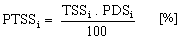,

      - keď:

      - TSSi – technický stav i-tej skupiny vozidla [%],

      - PDSi – pomerný diel i-tej skupiny vozidla [%].

      - Technický stav vozidla (TSV) sa rovná súčtu pomerných technických stavov jeho skupín.

      - 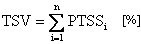,

      - keď:

      - PTSSi – pomerný technický stav i-tej skupiny vozidla [%].

      - Ak znalec ohodnocuje vozidlo (prípadne samostatnú technickú skupinu vozidla) s mimoriadne vysokým počtom najazdených kilometrov, môže sa stať, že jeho (jej) základná amortizácia, prípadne základná amortizácia niektorej technickej skupiny vozidla, presahuje 100 %. V takom prípade znalec nepoužije zrážky ani prirážky za technický stav (ZP), ale priamo na základe výsledkov obhliadky vozidla (skupiny), skúšobnej jazdy a prípadnom vyhodnotení iných podkladov (napr. dokladov o opravách) určí technický stav jednotlivých technických skupín vozidla (alebo samostatnej technickej skupiny).

    - 12.1 Stanovenie technického stavu skupiny pneumatiky

      - Pretože priebeh životnosti pneumatík je odlišný od priebehu životnosti ostatných skupín vozidla, ich TSS stanoví znalec nasledujúcim spôsobom:

      - a) pri skupine pneumatiky nestanoví východiskový technický stav (VTSS) ani základnú amortizáciu (ZA) a nepoužije zrážky ani prirážky (ZP),

      - b) pri obhliadke vozidla zistí celkový stav skupiny pneumatiky, pričom sa zameria hlavne na to, či ide o pneumatiky určené pre daný typ vozidla; ďalej zistí zhodnosť použitých pneumatík, výšku dezénu, rovnomernosť opotrebenia, prípadné poškodenia a vek pneumatík,

      - c) na základe vyššie uvedených údajov stanoví priemerný technický stav pneumatík, pričom dbá na platné právne predpisy a technické normy,

      - d) v prípade použitia pneumatík vyššej kvality, ako sú pneumatiky štandardne dodávané pre daný typ vozidla, musí túto skutočnosť zohľadniť.

    - 13. Určenie technickej hodnoty mimoriadnej výbavy (THMV)

      - Mimoriadna výbava sa na účely výpočtu hodnoty vozidiel (HMV) rozdeľuje do dvoch základných skupín:

      - a) mimoriadna výbava nenahrádzajúca pôvodné diely (skupiny) štandardne vybaveného vozidla, ale rozširujúca

      - jeho technické, úžitkové, prípadne estetické vlastnosti,

      - b) mimoriadna výbava nahrádzajúca pôvodné diely, prípadne skupiny štandardne vybaveného vozidla.

        - Technická hodnota mimoriadnej výbavy sa vypočíta podľa týchto vzťahov:

        - 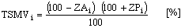,

        - 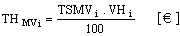,

        - 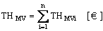,

        - keď:

        - TSMVi – technický stav i-tej mimoriadnej výbavy [%],

        - ZAi – základná amortizácia i-tej mimoriadnej výbavy [%],

        - ZPi – zrážka, prirážka za technický stav i-tej mimoriadnej výbavy [%],

        - VHi – východisková hodnota i-tej mimoriadnej výbavy [€],

        - THMV i– technická hodnota i-tej mimoriadnej výbavy [€].

    - 14. Stanovenie východiskového technického stavu skupiny – VTSS

      - Východiskový technický stav skupiny (VTSS) sa uvádza v 2. stĺpci tabuľky na výpočet technického stavu vozidla (v zmysle bodu 12). Rozumie sa ňou technický stav skupiny na začiatku jej uvedenia do nového cyklu prevádzky (ako novej alebo po CO) v porovnaní s novou skupinou.

      - VTSS = 100 %, iba ak ide o skupinu, ktorá bola daná do prevádzky ako nová, bez celkovej opravy.

      - VTSS jednotlivých skupín po vykonaní celkovej opravy (CO) sú uvedené v nasledujúcej tabuľke:

      - Druh vykonanej opravy | Preukázateľné vykonanie CO | Vykonanie CO výrobcom poverenou opravovňou, príp. na preukázateľne veľmi vysokej odbornej úrovni, za použitia originálnych náhradných dielov, tesniacich hmôt a montáž nych technológií

      - Skupina | VTSS [%] | VTSS [%]

      - Motor + spojka | 50 | 80

      - Prevodovka, rozvodovka, prídavná prevodovka, hnacie hriadele zadnej/prednej nápravy, spojovací hriadeľ (vždy iba ako príslušný celok) | 50 | 80

      - Predná náprava + mech. riadenia | 60 | 85

      - Stredná alebo zadná náprava | 60 | 85

      - Rám | 65 | 85

      - Valníková nadstavba | 50 | 85

      - Skriňa karosérie | 40 | 50

      - Výbava karosérie | individuálne* | individuálne*

      - Mechanická alebo mechanicko- -hydraulická nadstavba | 60 | 80

  - * Určuje sa individuálne podľa množstva a pomeru nových a renovovaných dielov skupiny výbava karosérie.

    - 15. Výpočet technickej hodnoty vozidla – TH

      - Technická hodnota vyjadruje zvyšok technickej životnosti vozidla vyjadrený v eurách a nie sú v nej zahrnuté vplyvy zohľadňujúce trhové a ekonomické podmienky.

      - Pri výpočte technickej hodnoty postupuje znalec podľa tohto vzťahu:

      - 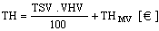,

      - keď:

      - TSV – technický stav vozidla [%],

      - VHV– východisková hodnota vozidla [€],

      - THMV– technická hodnota mimoriadnej výbavy [€].

    - 16. Výpočet koeficientu predajnosti – kP

      - Koeficient predajnosti znalec vypočíta ako súčin koeficientov platnosti kontroly technického stavu (k1), poškodenia vozidla haváriou (k2), počtu držiteľov vozidla (k3), spôsobu prevádzky vozidla (k4) a dopytu trhu (k5). Postupy náležite zdôvodní.

      - kP = k1 • k2 • k3 • k4 • k5[–],

      - keď:

      - k1– koeficientplatnosti kontroly technického stavu vozidla [–],

      - k2– koeficient poškodenia vozidla haváriou [–],

      - k3 – koeficient počtu držiteľov vozidla [–],

      - k4 – koeficient spôsobu prevádzky vozidla [–],

      - k5 – koeficient dopytu trhu [–].

    - 16.1 Koeficient platnosti kontroly technického stavu – k1

      - k1 vyjadruje vplyv platnosti kontroly technického stavu vozidla, prípadne iných povinných kontrol na predajnosť vozidla k dátumu jeho ohodnotenia. Hodnota k1 sa stanovuje nasledujúcim spôsobom:

      - a) Vozidlá kategórie 2.1

        - Do absolvovania prvej kontroly technického stavu vozidla od jeho prvého uvedenia do prevádzky k1 = 1.00 [–].

        - V nasledujúcom období prevádzky vozidla postupuje znalec podľa vzorca:

        - k1 = 0.93 + 0.002 • M [–],

        - keď:

        - M – počet mesiacov platnosti kontroly technického stavu vozidla [mesiace].

      - b) Vozidlá kategórií 2.2, 2.3, 3, 4.1, 5.1 a 7

        - Do absolvovania prvej kontroly technického stavu vozidla od jeho prvého uvedenia do prevádzky k1 = 1.00 [–].

        - V nasledujúcom období prevádzky vozidla postupuje znalec podľa vzorca

        - k1 = 0.91 + 0.005 • M [–],

        - keď:

        - M – počet mesiacov platnosti kontroly technického stavu vozidla [mesiace].

      - c) Vozidlá kategórií 4.2, 4.3, 4.4, 6, 8, vozidlá používané na zdravotnícku službu, banskú záchrannú službu, poruchovú službu plynárenských zariadení, vozidlá používané na taxislužbu, vozidlá požičovne automobilov a vozidlá autoškoly schválené na cvičné účely

        - Do absolvovania prvej kontroly technického stavu vozidla od jeho prvého uvedenia do prevádzky k1 = 1.00 [–].

        - V nasledujúcom období prevádzky vozidla postupuje znalec podľa vzorca

        - k1 = 0.92 + 0.01 • M [–],

        - keď:

        - M – počet mesiacov platnosti kontroly technického stavu vozidla [mesiace].

      - d) Vozidlá kategórie 6.4 používané na medzinárodnú prepravu osôb

        - Do absolvovania prvej kontroly technického stavu vozidla od jeho prvého uvedenia do evidencie k1 = 1.00 [–].

        - V nasledujúcom období prevádzky vozidla postupuje znalec podľa vzorca

        - k1 = 0.96 + 0.01 • M [–],

        - keď:

        - M – počet mesiacov platnosti kontroly technického stavu vozidla [mesiace].

      - e) Pri vozidlách ostatných kategórií k1 = 1.00 [–].

    - 16.2 Koeficient poškodenia vozidla haváriou – k2

      - k2 vyjadruje vplyv prípadných opráv poškodení vozidla na jeho predajnosť. Jeho hodnota sa stanovuje nasledujúcim postupom:

    - 1. Oprava poškodenia skupín (okrem pneumatík a brzdového systému) haváriou výmenou dielov len za použitia rozoberateľných spojov predpísanou technológiou:

      - a) vozidlá s dobou prevádzky kratšou ako 1 rok k2 = 0,98 [–],

      - b) vozidlá s dobou prevádzky dlhšou ako 1 rok a kratšou ako 3 roky k2 = 0,99 [–],

      - c) vozidlá s dobou prevádzky dlhšou ako 3 roky k2 = 1,0 [–].

    - 2. Oprava výmenou celých dielov za použitia zváracej technológie bez použitia vyrovnávacieho zariadenia:

      - a) vozidlá s dobou prevádzky kratšou ako 3 roky k2 = 0,97 [–],

      - b) vozidlá s dobou prevádzky dlhšou ako 3 roky a kratšou ako 4 roky k2 = 0,99 [–],

      - c) vozidlá s dobou prevádzky dlhšou ako 4 roky k2= 1,0 [–].

    - 3. Oprava nosných častí skeletu karosérie na vyrovnávacom zariadení:

      - a) vozidlá s dobou prevádzky kratšou ako 3 roky k2 = 0,95 [–],

      - b) vozidlá s dobou prevádzky dlhšou ako 3 roky a kratšou ako 8 rokov k2 = 0,97 [–],

      - c) vozidlá s dobou prevádzky dlhšou ako 8 rokov k2 = 0,98 [–].

    - 4. Žiadna významnejšia oprava k2 = 1,00 [–].

    - 16. 3 Koeficient počtu držiteľov vozidla – k3

      - k3 vyjadruje vplyv počtu držiteľov na jeho predajnosť, pri jeho stanovení postupuje znalec podľa vzorca:

      - k3 =1.01 – 0.01D [–],

      - keď:

      - D – počet držiteľov vozidla [–].

      - V prípade, že nie je možné hodnoverne preukázať skutočný počet držiteľov (neuskutočnené prepisy, krádež vozidla a podobne), k3 = 0,95 [–].

    - 16.4 Koeficient spôsobu prevádzky vozidla – k4

      - k4 zohľadňuje vplyv spôsobu používania vozidla. Určuje sa podľa nasledujúcich tabuliek:

      - Koeficienty spôsobu použitia vozidiel zaradených do 3. kategórie:

      - | Kategória 3.1 | Kategória 3.2 | Kategória 3.3 | Kategória 3.4 | Kategória 3.5 | Kategória 3.6 | Kategória 3.7 | Kategória 3.8

      - Referentské vozidlo | 0,96 | 0,94 | 0,94 | 0,93 | 0,95 | 1 | 0.96 | 0.94

      - Vozidlo používané na zásobovanie | 0,95 | 0,93 | 0,93 | 0,92 | 0,95 | 1 | 0.95 | 0.93

      - Vozidlo autoškoly | 0.94 | 0.92 | 0.92 | 0.91 | 0.94 | 1 | 0.94 | 0.92

      - Vozidlo používané na taxislužbu | 0.97 | 0.95 | 0.95 | 0.94 | 0..96 | 0.98 | 0.97 | 0.95

      - Vozidlo požičovne automobilov | 0,95 | 0,93 | 0,93 | 0,92 | 0,95 | 0.96 | 0.95 | 0.93

      - Vozidlo používané len na reprezentáciu | 1 | 1 | 1 | 1,06 | 1,05 | 1,02 | 1 | 1

      - Motorové vozidlo používané na súkromné účely | 1 | 1 | 1 | 1 | 1 | 1 | 1 | 1

      - Koeficienty spôsobu použitia vozidiel zaradených do 4. kategórie:

      - | Kategória 4.1 | Kategória 4.2 | Kategória 4.3 | Kategória 4.4

      - Normálne podmienky | 1 | 1 | 1 | 1

      - Sťažené podmienky | 0,93 | 0,95 | 0,97 | 1

      - Koeficient spôsobu použitia vozidla zaradeného do ostatných kategórií sa rovná 1 (k4 = 1).

    - 16. 5 Koeficient dopytu trhu – k5

      - k5 vyjadruje pomer medzi priemernou predajnou cenou predmetného typu vozidla v porovnaní s jeho priemernou technickou hodnotou (TH) k rozhodnému dátumu.

      - 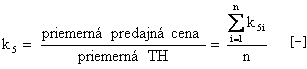,

      - keď:

      - k5i – pomer predajnej ceny a TH vozidla i zo skúmaného súboru n vozidiel [–],

      - n – počet skúmaných vozidiel [–],

      - TH – technická hodnota vozidla [€].

      - Pri výpočte koeficientu dopytu trhu znalec vychádza z reálnych predajných cien porovnateľných ojazdených vozidiel rovnakého typu a porovnateľného technického stavu, ktoré zistí z inzertnej tlače, z inzertných portálov verejnej informačnej elektronickej siete Internet, z vlastného prieskumu trhu, prípadne z iných preskúmateľných a hodnoverných zdrojov.

    - 17. Výpočet všeobecnej hodnoty vozidla – VŠH

      - Všeobecná hodnota vozidla je hodnota v eurách, ktorej výpočet zahŕňa okrem vplyvov opotrebenia aj vplyvy trhu (predajnosť typu vozidla).

      - Vypočíta sa ako súčin technickej hodnoty vozidla (TH) s koeficientom predajnosti kP.

      - VŠH = TH . kP [€],

      - keď:

      - TH – technická hodnota vozidla [€],

      - kP– koeficient predajnosti [–].

      - V znaleckom posudku musí byť vždy uvedené, či vypočítaná všeobecná hodnota vozidla je vrátane DPH alebo bez DPH.

      - Znalec zoradí výpočet VŠH do nasledujúcej tabuľky:

      - VHV [€] |

      - TSV [%] |

      - TH [€] |

      - KP [–] |

      - VŠH [€] |

      - Túto tabuľku znalec v znaleckom posudku uviesť nemusí, pokiaľ počíta aj reprodukčnú obstarávaciu hodnotu a zostaví tabuľku podľa bodu 18 tejto kapitoly.

    - 18. Výpočet reprodukčnej obstarávacej hodnoty vozidla – ROH

      - V prípade, že je to potrebné, vypočíta znalec aj reprodukčnú obstarávaciu hodnotu vozidla (ROH). Pri jej výpočte vychádza z aktuálneho vývoja na trhu, aktuálnych ekonomických podmienok a právnych noriem.

      - ROH sa rovná súčtu všeobecnej hodnoty vozidla (VŠH) a nákladov na obstaranie vozidla (NZ):

      - ROH = VŠH + NZ [€],

      - keď:

      - NZ – náklady na zaobstaranie vozidla predstavujú bežné priemerné náklady potrebné na zaobstaranie podobného typu porovnateľného vozidla v danom regióne a v rozhodnom čase; napr. obvyklá marža predajcu, náklady na prihlásenie vozidla do evidencie a podobne [€],

      - VŠH – všeobecná hodnota vozidla [€].

      - Znalec v znaleckom posudku vždy uvedie, či vypočítaná reprodukčná obstarávacia hodnota je vrátane DPH alebo bez DPH.

      - Znalec zoradí výpočet ROH do nasledujúcej tabuľky:

      - VHV [€] |

      - TSV [%] |

      - TH [€] |

      - KP [–] |

      - VŠH [€] |

      - ROH [€] |

      - V prípade výpočtu ROH a zostavenia vyššie uvedenej tabuľky už tabuľku podľa bodu 17 zostavovať nemusí.

    - 19. Výpočet hodnoty samostatnej skupiny alebo dielu vozidla

      - Znalec môže na základe postupu uvedeného v bodoch 1 až 18 tejto kapitoly vypočítať hodnotu samostatnej skupiny alebo dielu vozidla.

    - 19.1 Určenie východiskovej hodnoty samostatnej skupiny alebo dielu vozidla

      - Pri určovaní východiskovej hodnoty skupiny alebo dielu vozidla postupuje znalec takto:

      - a) Zistí cenu skupiny, resp. dielu, za ktorý sa tieto predávajú ako náhradné diely k rozhodnému dátumu u autorizovaného predajcu. Táto cena je potom východisková hodnota.

      - b) Ak sa predmetný náhradný diel nepredáva, východiskovou hodnotou je jeho posledná predajná cena u autorizovaného predajcu (cena, za ktorú sa k rozhodnému dátumu predával diel nový, nepoškodený).

      - c) Ak sa diel ako nový v ČSSR, ČSFR ani SR nepredával, postupuje znalec pri určovaní východiskovej hodnoty v zmysle bodu 7 písmena d) alebo e).

      - d) Pokiaľ znalec ohodnocuje väčšiu ucelenú časť vozidla, pozostávajúcu z viacerých kompletných alebo aj nekompletných technických skupín vozidla, určí východiskovú hodnotu celého vozidla. Pri výpočte potom zohľadní v tabuľke výpočtu technického stavu vozidla (bod 12) chýbajúce technické skupiny a aj kompletnosť a zodpovedajúci technický stav ohodnocovanej časti vozidla.

    - 19.2 Výpočet základnej amortizácie skupiny alebo dielu vozidla

      - Znalec pri výpočte základnej amortizácie použitých (ojazdených) samostatných skupín alebo dielov vychádza z amortizačných stupníc vozidla kategórie, pre ktoré sú diel alebo skupina určené. Pri skupinách a dieloch, ktoré je možné použiť pre viaceré kategórie vozidiel, tieto znalec zaradí do tej kategórie, ktorá má najdlhšiu predpokladanú efektívnu životnosť (PEZ) podľa tabuľky v bode 8. Pri samostatných častiach vozidiel, pri ktorých neexistujú údaje o ich prevádzke a znalec nemôže vypočítať ich základnú amortizáciu, postupuje podľa bodu 19.3.

    - 19.3 Výpočet technického stavu samostatnej skupiny alebo dielu vozidla

      - Znalec pri výpočte technického stavu samostatnej skupiny alebo dielu vozidla postupuje rovnako ako pri výpočte technického stavu skupín kompletného vozidla. Pri skupinách alebo dieloch, kde neexistujú údaje o ich prevádzke, môže znalec priamo na základe obhliadky a prípadného preskúšania v potrebnom rozsahu určiť hodnotu technického stavu ohodnocovanej samostatnej časti vozidla. V takom prípade nepočíta základnú amortizáciu častí vozidla.

    - 20. Znalecký posudok pri výpočte hodnoty vozidla alebo jeho časti

      - Znalecký posudok pri výpočte hodnoty vozidla alebo jeho časti vypracovaný podľa tejto vyhlášky musí byť v súlade s § 17 zákona č. 382/2004 Z. z. o znalcoch, tlmočníkoch a prekladateľoch a o zmene a doplnení niektorých zákonov, ktorý určuje jeho formu.

  - C. STANOVENIE VÝŠKY ŠKODY NA CESTNÝCH VOZIDLÁCH

    - Pod pojmom škoda sa rozumie ujma, ktorá nastala na majetku poškodeného a ktorú možno objektívne vyjadriť v peniazoch. Výška škody je podľa § 442 Občianskeho zákonníka tzv. skutočná škoda.

    - Pojem skutočná škoda znamená zmenšenie majetku poškodeného alebo náklady potrebné na to, aby sa dosiahol predchádzajúci stav.

    - Na stanovenie výšky škody je rozhodujúca cena veci v čase poškodenia (s prihliadnutím na pokles ceny vyplývajúci z veku, amortizácie, funkčnosti, prípadne s prihliadnutím na vzrast ceny). Výška škody sa teda vypočíta ako tzv. skutočná škoda. Pri jej výpočte musí byť zohľadnené zlepšenie alebo zhoršenie technického stavu vozidla vykonanou opravou, prípadne jeho nezmenenie.

    - 1. Výpočet výšky škody na vozidle

      - Na účely stanovenia výšky škody znalec vykoná identifikáciu a obhliadku vozidla podľa kapitoly B.

      - Pri výpočte výšky škody znalec

      - a) musí stanoviť všeobecnú hodnotu vozidla, ako aj reprodukčnú obstarávaciu hodnotu vozidla pred jeho poškodením (VŠH1aROH1). Tieto hodnoty vypočíta postupom uvedeným v kapitole B tejto prílohy; pri výpočte uvažuje so známym alebo s predpokladaným stavom vozidla bezprostredne pred jeho poškodením;

      - b) stanoví náklady na opravu poškodenia vozidla (NO);

        - c) porovná náklady na opravu poškodenia vozidla (NO) s reprodukčnou obstarávacou hodnotou vozidla bezprostredne pred jeho poškodením (ROH1). Ak sú tieto náklady vyššie alebo sa rovnajú reprodukčnej obstarávacej hodnote vozidla bezprostredne pred jeho poškodením (NO ≥ ROH1), ide o tzv. úplné zničenie vozidla (totálnu škodu) a znalec postupuje podľa písmena d) a f) tohto bodu. Ak náklady na opravu poškodenia vozidla (NO) nepresahujú reprodukčnú obstarávaciu hodnotu vozidla bezprostredne pred jeho poškodením (NO < ROH1), znalec postupuje podľa písmen e) a g), prípadne h) tohto bodu;

      - d) stanoví hodnotu predajných zvyškov vozidla (HZ). Hodnotou predajných zvyškov vozidla sa rozumie výkupná hodnota týchto zvyškov u predajcu opotrebovaných náhradných dielov po odpočítaní nákladov na ich demontáž z vozidla a očistenie, prípadne preskúšanie;

        - e) stanoví všeobecnú hodnotu vozidla po oprave jeho poškodenia (VŠH2). Pri výpočte VŠH2 venuje zvýšenú pozornosť technickému stavu opravovaných skupín vozidla po oprave poškodenia a jeho zlepšeniu, prípadne zhoršeniu a takisto vplyvu zmeny technického stavu na predajnosť vozidla;

        - f) v prípade, že náklady na opravu sú väčšie alebo sa rovnajú reprodukčnej obstarávacej hodnote vozidla bezprostredne pred jeho poškodením (NO ≥ ROH1), vypočíta výšku škody (VŠ) podľa vzorca:

        - VŠ = (ROH1 + NL) - HZ [€],

        - keď:

        - VŠ – výška škody na cestnom vozidle [€],

        - ROH1– reprodukčná obstarávacia hodnota vozidla bezprostredne pred poškodením [€],

        - HZ – hodnota predajných zvyškov vozidla [€],

        - NL – náklady na likvidáciu nepoužiteľného odpadu vzniknutého pri získaní predajných zvyškov vozidla [€].

      - g) V prípade, že náklady na opravu (NO) sú menšie než reprodukčná obstarávacia hodnota vozidla bezpro- stredne pred jeho poškodením, postupuje podľa vzorca:

        - VŠ = NO + (VŠH1 - VŠH2) - HZ [€],

        - keď:

        - NO – náklady na opravu poškodenia [€],

        - VŠH1 – všeobecná hodnota vozidla bezprostredne pred poškodením [€],

        - VŠH2 – všeobecná hodnota vozidla po oprave poškodenia [€],

        - HZ – hodnota predajných zvyškov vozidla [€].

        - h) V prípadoch, keď sa vykonanou opravou nezmení všeobecná hodnota vozidla a VŠH1 = VŠH2, vypočíta

        - výšku škody podľa zjednodušeného vzorca:

        - VŠ = NO - HZ [€],

        - keď:

        - NO – náklady na opravu poškodenia [€],

        - HZ – hodnota predajných zvyškov vozidla [€].

    - 2. Stanovenie nákladov na opravu poškodenia vozidla – NO

      - Náklady na opravu poškodenia (NO) sa rovnajú súčtu nákladov na opravárske práce (NP), nákladov na materiál (NM) potrebný na opravu poškodenia a nákladov na likvidáciu nepoužiteľného odpadu vzniknutého pri oprave poškodenia vozidla (NL).

      - NO = NM + NP + NL [€],

      - keď:

      - NM – náklady na materiál potrebný na opravu poškodenia [€],

      - NP – náklady na opravárske práce potrebné na opravu poškodenia [€],

      - NL – náklady na likvidáciu nepoužiteľného odpadu vzniknutého pri oprave [€].

      - Pri stanovení nákladov na opravu poškodenia znalec vychádza z technológie opravy predpísanej výrobcom vozidla. Hodnotu opravy kalkuluje v úrovni priemerných cien autorizovaných opravovní vozidla k rozhodnému dátumu.

    - 2.1 Náklady na materiál – NM

      - Ide o náklady na materiál potrebný na opravu poškodenia. Znalec odborným posúdením vyhodnotí, ktoré diely vozidla je možné ekonomicky opraviť a ktoré je potrebné vymeniť.

    - 2.2 Náklady na opravárske práce – NP

      - Sú to náklady na vykonanie opravárskych úkonov nevyhnutných na odstránenie poškodenia vozidla. Vypočítajú sa ako súčin času (T) nevyhnutného na vykonanie opravy v normohodinách (Nh), prípadne časových alebo pracovných jednotkách (čj alebo pj) a sadzby za 1 Nh , čj alebo pj. Tieto sadzby sú rozdielne pri jednotlivých typoch vozidiel a v jednotlivých opravovniach. Pri výpočte výšky škody znalec zohľadňuje hodinové sadzby opravovní oprávnených výrobcom vozidla v danom regióne.

      - NP = TONh • SNh [€],

      - alebo

      - NP = TOčj • Sčj [€],

      - alebo

      - NP = TOčj • Spj [€],

      - keď:

      - NP – náklady na opravárske práce [€],

      - TONh– čas opravy v normohodinách [Nh],

      - SNh– sadzba za 1 normohodinu [€],

      - TOčj – čas opravy v časových jednotkách [čj],

      - Sčj – sadzba za 1 časovú jednotku [€],

      - Spj – sadzba za 1 pracovnú jednotku [€].

    - 2.3 Náklady na likvidáciu nepoužiteľného odpadu vzniknutého pri oprave poškodenia vozidla – NL

      - NL predstavujú náklady spojené s likvidáciou nepoužiteľných častí vozidla. Možno ich však uplatniť len vtedy, ak už nie sú zahrnuté do opravárskeho úkonu.

      - Náklady na likvidáciu nepoužiteľného odpadu môžu vzniknúť aj pri získavaní predajných zvyškov z totálne zničeného vozidla. Znalec pri ich stanovení uvedie podrobnú špecifikáciu.

    - 3. Stanovenie hodnoty predajných zvyškov vozidla – HZ

      - Znalec stanoví hodnotu predajných zvyškov vozidla ako celku alebo jednotlivých predajných zvyškov. Hodnota predajných zvyškov vozidla je priemerná výkupná hodnota týchto zvyškov u predajcov opotrebovaných náhradných dielov. Pri stanovení hodnoty jednotlivých predajných zvyškov je potrebné odpočítať náklady na ich demontáž z vozidla a očistenie, prípadne preskúšanie.

    - 4. Výpočet technického stavu jednotlivých skupín po oprave poškodenia – TSS2

      - Výpočet technického stavu skupín po oprave poškodenia (TSS2i) vychádza z reálnych zhodnotení, prípadne znehodnotení skupín po oprave poškodenia. V praxi možno iba veľmi ťažko dosiahnuť, aby technický stav vozidla po oprave poškodenia bol presne taký istý ako pred poškodením.

      - Pri výpočte zhodnotenia či znehodnotenia skupín vozidla opravou znalec najprv vypočíta technický stav vozidla pred poškodením (TSV1). Na výpočet technického stavu vozidla pred poškodením (TSV1) slúži nasledujúca tabuľka:

      - Skupina | PDS % | VTSS1 [%] | ZA1 [%] | ZP [%] | TSS1 [%] | PTSS1 [%]

      - | 1 | 2 | 3 | 4 | 5 | 6

      - Technické skupiny | | | | | |

      - Pneumatiky | | | | | |

      - Spolu | 100 | VTSV = | | | | TSV1

      - Znalec dôkladne vyhodnotí technológiu opravy vozidla a percentuálne určí, či sa opravou technická skupina zhodnotí alebo znehodnotí. Parameter, ktorý určuje zhodnotenie, resp. znehodnotenie skupiny, sa nazýva vplyv opravy – VO.

      - Znalec potom vypočíta technický stav skupiny po oprave poškodenia (TSS2i):

      - 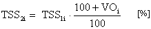,

      - keď:

      - TSS1i– technický stav i-tej skupiny pred poškodením [%],

      - VOi – vplyv opravy na i-tú skupinu [%].

      - Týmto spôsobom znalec vypočíta technický stav všetkých skupín vozidla, ktoré boli opravované. Výpočet zostaví do nasledujúcej tabuľky:

      - Skupina | PDS [%] | TSS1 [%] | VO [%] | TSS2 [%] | PTSS2 [%]

      - Technické skupiny vozidla podľa jeho koncepcie | | | | |

      - Pneumatiky | | – | – | |

      - Spolu | 100 | VTSV1 = | – | – | TSV2 =

      - Ďalej bežným spôsobom vypočíta všeobecnú hodnotu vozidla po oprave poškodenia (VŠH2). Pri jej výpočte dbá najmä na to, aby pri výpočte boli správne použité hodnoty koeficientu platnosti kontroly technického stavu (k12), koeficientu poškodenia vozidla haváriou (k22), koeficientu počtu držiteľov vozidla (k32), koeficientu spôsobu prevádzky vozidla (k42) a koeficientu dopytu trhu (k52) po oprave poškodenia.

      - Spôsobom uvedeným v kapitole B tejto prílohy postupuje pri výpočte technického stavu vozidla po poškodení (TSV2) a jeho všeobecnej hodnoty po poškodení (VŠH2).

    - 5. Neštandardné opravy

      - V prípadoch, keď opravu poškodenia vozidla nevykonala autorizovaná opravovňa (dielňa), resp. neboli dodržané postupy predpísané výrobcom vozidla, znalec sám, na základe zisteného skutočného stavu, určí TH opravovanej skupiny.

    - 6. Výpočet technickej hodnoty vozidla po oprave poškodenia – TH2

      - Technická hodnota vozidla po oprave poškodenia (TH2) vyjadruje zvyšok technickej životnosti vozidla vyjadrenej v € po oprave poškodenia.

      - Pri výpočte TH2 postupuje znalec podľa vzorca:

      - 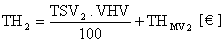,

      - keď:

      - TSV2 – technický stav vozidla po oprave [%],

      - VHV – východisková hodnota vozidla [€],

      - THMV2– technická hodnota mimoriadnej výbavy po oprave [€].

    - 7. Stanovenie koeficientu predajnosti po oprave poškodenia – kp

      - Pri výpočte koeficientu predajnosti vozidla po oprave poškodenia kp2 znalec počíta s prípadnými zmenenými hodnotami koeficientov platnosti osvedčenia o evidencii vozidla (k11), poškodenia haváriou (k22), počtu držiteľov vozidla (k32), spôsobu prevádzky vozidla (k42), ako aj dopytu trhu (k52).

      - kp2 = k12 • k22 • k32 • k42 • k52 [–],

      - keď:

      - k12– koeficientplatnosti kontroly technického stavu vozidla po oprave poškodenia [–],

      - k22– koeficient poškodenia vozidla haváriou po oprave poškodenia [–],

      - k32 – koeficient počtu držiteľov vozidla po oprave poškodenia [–],

      - k42 – koeficient spôsobu prevádzky vozidla po oprave poškodenia [–],

      - k52 – koeficient dopytu trhu po oprave poškodenia [–].

    - 8. Výpočet všeobecnej hodnoty vozidla po oprave poškodenia – VŠH2

      - Výpočet všeobecnej hodnoty vozidla po oprave poškodenia znalec zoradí do nasledujúcej tabuľky:

      - VHV [€] |

      - TH2 [€] |

      - kp2 [–] |

      - VŠH2 [€] |

      - VŠH2 = TH2 • kp2 [€],

      - keď:

      - VŠH2– všeobecná hodnota vozidla po oprave poškodenia [€],

      - TH2 – technická hodnota vozidla po oprave poškodenia [€],

      - kp2 – koeficient predajnosti vozidla po oprave poškodenia [–].

      - Znalec vždy uvedie, či vypočítané hodnoty sú vrátane DPH alebo bez DPH.

    - 9. Znalecký posudok pri výpočte výšky škody na vozidle

      - Znalecký posudok pri výpočte výšky škody na vozidle vypracovaný podľa tejto vyhlášky musí byť v súlade s § 17 zákona č. 382/2004 Z. z. o znalcoch, tlmočníkoch a prekladateľoch a o zmene a doplnení niektorých zákonov, ktorý určuje jeho formu.

- 1) Vyhláška Ministerstva dopravy, pôšt a telekomunikácií Slovenskej republiky č. 116/1997 Z. z. o podmienkach premávky vozidiel na pozemných komunikáciách.
