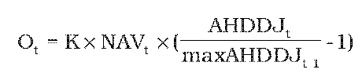

Príloha č. 1 k zákonu č. 650/2004 Z. z. v znení zákona č. 318/2013 Z. z.

- VZOREC NA VÝPOČET VÝŠKY ODPLATY ZA ZHODNOTENIE MAJETKU V PRÍSPEVKOVOM DOPLNKOVOM DÔCHODKOVOM FONDE

  - Vzorec na výpočet výšky odplaty za zhodnotenie majetku v príspevkovom doplnkovom dôchodkovom fonde:

- 

  - Pri výpočte odplaty za zhodnotenie majetku v príspevkovom doplnkovom dôchodkovom fonde sa použijú tieto veličiny, funkcie a ich označenia:

- Ot | výška odplaty za zhodnotenie majetku v príspevkovom doplnkovom dôchodkovom fonde pre deň t

- NAVt | čistá hodnota majetku v príspevkovom doplnkovom dôchodkovom fonde platná pre deň t

- AHDDJt | aktuálna hodnota doplnkovej dôchodkovej jednotky platná pre deň t

- maxAHDDJt-1 | maximálna aktuálna hodnota doplnkovej dôchodkovej jednotky dosiahnutá po 1. januári 2010 do dňa t-1

- K | koeficient na určenie výšky odplaty za zhodnotenie majetku v príspevkovom doplnkovom dôchodkovom fonde, ktorý môže byť maximálne vo výške 0,10

- t | pracovný deň bezprostredne predchádzajúci dňu výpočtu odplaty za zhodnotenie majetku v príspevkovom doplnkovom dôchodkovom fonde.
