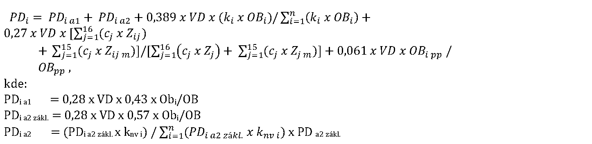

Príloha č. 4 k nariadeniu vlády č. 668/2004 Z. z.

- VZOREC na výpočet podielu obce na výnose dane

- 

- Vysvetlivky:

- PDi | - | podiel obce „i“ na výnose dane v eurách

- PDi a1 | - | podiel obce „i“ na výnose podielových daní v eurách neupravený koeficientom nadmorskej výšky obce

- PDi a2 zákl . | - | pomocný výpočet základne pre výpočet podielu obce PDia2

- PDi a2 | - | podiel obce „i“ na výnose podielových daní v eurách upravený koeficientom nadmorskej výšky obce

- VD | - | výnos dane podľa § 2 zákona v eurách

- OBi | - | počet obyvateľov obce „i“

- OB | - | počet obyvateľov Slovenskej republiky

- knvi | - | koeficient nadmorskej výšky obce „i“

- ki | - | koeficient obce „i“

- cj | - | koeficienty „j“ uvedené v prílohe č. 3

- zij | - | počet žiakov (detí, poslucháčov) „j“ škôl a školských zariadení v zriaďovateľskej pôsobnosti obce „i“ zistený zberom údajov podľa osobitného predpisu1)

- zij m | - | počet žiakov (detí, poslucháčov) „j“ škôl a školských zariadení zistený zberom údajov podľa osobitného predpisu1) v zriaďovateľskej pôsobnosti štátom uznanej cirkvi alebo súkromnej osoby na území obce „i“

- Zj | - | počet žiakov (detí, poslucháčov) „j“ škôl a školských zariadení v zriaďovateľskej pôsobnosti obcí v Slovenskej republike zistený zberom údajov podľa osobitného predpisu1)

- Zj m | - | počet žiakov (detí, poslucháčov) „j“ škôl a školských zariadení v zriaďovateľskej pôsobnosti zákonom uznanej cirkvi alebo súkromnej osoby na území obcí v Slovenskej republike zistený zberom údajov podľa osobitného predpisu1)

- OBi pp | - | počet obyvateľov obce „i“, ktorí dovŕšili vek 62 rokov

- OBpp | - | počet obyvateľov Slovenskej republiky, ktorí dovŕšili vek 62 rokov

- i | - | údaj týkajúci sa príslušnej obce

- j | - | údaj týkajúci sa príslušnej školy a školských zariadení uvedených v osobitnom predpise1)

- n | - | počet obcí
