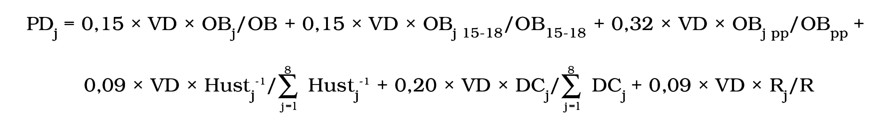

Príloha č. 5 k nariadeniu vlády č. 668/2004 Z. z.

- VZOREC na výpočet podielu vyššieho územného celku na výnose dane 

- Vysvetlivky:

- PDj– podiel vyššieho územného celku „j“ na výnose dane v eurách

- VD – výnos dane podľa § 3 zákona v eurách

- OBj – počet obyvateľov vyššieho územného celku „j“ k 1. januáru predchádzajúceho kalendárneho roka

- OB – počet obyvateľov Slovenskej republiky k 1. januáru predchádzajúceho kalendárneho roka

- OBj 15-18 – počet obyvateľov vyššieho územného celku „j“ vo veku pätnásť až osemnásť rokov s trvalým pobytom na jeho území k 1. januáru predchádzajúceho kalendárneho roka

- OB15-18 – počet obyvateľov Slovenskej republiky vo veku pätnásť až osemnásť rokov k 1. januáru predchádzajúceho kalendárneho roka

- OBj pp – počet obyvateľov vyššieho územného celku „j“, ktorí dovŕšili vek šesťdesiatdva rokov k 1. januáru predchádzajúceho kalendárneho roka

- OBpp – počet obyvateľov Slovenskej republiky, ktorí dovŕšili vek šesťdesiatdva rokov k 1. januáru predchádzajúceho kalendárneho roka

- Hustj – hustota obyvateľstva vyššieho územného celku „j“ k 1. januáru predchádzajúceho kalendárneho roka

- DCj – dĺžka ciest II. triedy a III. triedy vo vlastníctve vyššieho územného celku „j“ k 1. januáru predchádzajúceho kalendárneho roka

- Rj – rozloha vyššieho územného celku „j“

- R – rozloha Slovenskej republiky

- j – údaj týkajúci sa príslušného vyššieho územného celku
