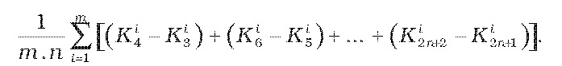

# Čl. I

Vyhláška Úradu pre normalizáciu, metrológiu a skúšobníctvo Slovenskej republiky č. 210/2000 Z. z. o meradlách a metrologickej kontrole v znení vyhlášky č. 310/2000 Z. z., vyhlášky č. 403/2000 Z. z., vyhlášky č. 9/2001 Z. z., vyhlášky č. 48/2001 Z. z., vyhlášky č. 75/2001 Z. z., vyhlášky č. 133/2001 Z. z., vyhlášky č. 27/2002 Z. z., vyhlášky č. 69/2002 Z. z., vyhlášky č. 427/2003 Z. z. a vyhlášky č. 361/2004 Z. z. sa mení a dopĺňa takto:

- 1. § 7 sa dopĺňa odsekom 8, ktorý znie:

- „(8)

- Ak prvotné overenie Európskych spoločenstiev meradla uvedeného v prílohe č. 1 v položkách 1.3.15, 1.3.17 a 4.1 sa vykoná v poslednom štvrťroku príslušného kalendárneho roka, možno ho označiť značkou prvotného overenia Európskych spoločenstiev s dvojčíslom nasledujúceho kalendárneho roka. Takto overené meradlo možno uviesť na trh až v nasledujúcom kalendárnom roku. Na žiadosť objednávateľa overenia ústav, určená organizácia alebo autorizovaná osoba vydá doklad o overení s dátumom overenia nie neskorším ako 10. január nasledujúceho kalendárneho roka.“.

- 2. V § 9 ods. 2 sa na konci pripájajú tieto slová: „ak technické požiadavky na daný druh meradla neustanovujú inak. Táto značka zároveň slúži ako zabezpečovacia značka ústavu a Slovenskej legálnej metrológie.“.

- 3. V § 9 odseky 3 a 4 znejú:

- „(3)

- Overovacia značka autorizovanej osoby pozostáva z písmena M a evidenčného čísla autorizovanej osoby, ak technické požiadavky na daný druh meradla neustanovujú inak. Evidenčné číslo autorizovanej osobe prideľuje úrad a zverejní ho vo vestníku. Overovacia značka slúži ako zabezpečovacia značka autorizovanej osoby.

- (4)

- Pri meradle podliehajúcom následnému overovaniu sa národná overovacia značka dopĺňa dátumom overenia meradla alebo posledným dvojčíslom roka, v ktorom bolo meradlo overené, umiestneným v jej blízkosti. Ak je dátum overenia vyjadrený len posledným dvojčíslom roka, ústav, Slovenská legálna metrológia alebo autorizovaná osoba vydá doklad o overení alebo doklad, v ktorom je uvedený presný dátum overenia.“.

- 4. V § 9 ods. 7 sa na konci pripájajú tieto slová: „Identifikačné číslo ústavu, Slovenskej legálnej metrológii a autorizovaným osobám prideľuje úrad a zverejňuje ich vo vestníku.“.

- 5. V § 9 odseky 9 až 13 znejú:

- „(9)

- Grafické znázornenie overovacích značiek podľa odsekov 2 až 5 a 7 je uvedené v prílohe č. 3. Národné overovacie značky doplnené dátumom overenia môžu byť vyhotovené ako samolepky. Overovacie značky, ktoré plnia funkciu zabezpečovacích značiek, sa vyhotovujú ako odtlačky vložiek do plombovacích klieští, razidlá alebo ako samolepky. Overovacie značky môžu byť nanesené na meradle, ak sa na meradlo umiestňujú počas výroby. Rozmery národných overovacích značiek sú funkciou priemeru kružnice opísanej okolo značky. Priemery kružníc sú 3,2 mm, 6,3 mm, 8,0 mm a 12,5 mm pre samolepky a razidlá, 8,0 mm pre vložky do plombovacích klieští a 12,0 mm a 40,0 mm pre vypaľovadlá. Celkové rozmery a tvar samolepiek nie sú určené. Odporúčané vyhotovenie samolepiek je uvedené v prílohe č. 3 na obrázkoch č. 8 až 11. Udané rozmery značiek prvotného overenia Európskych spoločenstiev sú relatívnymi hodnotami a sú funkciou priemeru kružnice opísanej okolo značky. Skutočné priemery kružníc sú 1,6 mm, 3,2 mm, 6,3 mm a 12,5 mm. Overovacia značka vrátane dátumu overenia alebo posledného dvojčísla roka, v ktorom bolo meradlo overené, musí byť nezmazateľne vyznačená alebo pripevnená tak, aby sa nedala bez porušenia odstrániť. Overovacia značka musí byť čitateľná, dobre viditeľná a ľahko prístupná.

- (10)

- Čas platnosti overenia určených meradiel označených značkou prvotného overenia Európskych spoločenstiev sa počíta odo dňa uvedenia meradla do používania, ak bolo uvedené do používania v roku overenia, a od začiatku nasledujúceho roka, ak bolo uvedené do používania v roku nasledujúcom po roku overenia.

- (11)

- Pri meradlách uvedených na trh podľa osobitného predpisu,1) ak postup posudzovania zhody neumožňuje zistiť deň overenia, čas platnosti overenia sa počíta odo dňa uvedenia meradla do používania.

- (12)

- Overovacie a zabezpečovacie značky sa umiestňujú v súlade s rozhodnutím o schválení typu meradla.

- (13)

- Na používanie niektorých druhov určených meradiel v čase od skončenia ich opravy do ich overenia úrad pridelí zabezpečovaciu značku a identifikačné číslo podnikateľovi - opravárovi po predložení platnej zmluvy uzatvorenej medzi podnikateľom - opravárom a Slovenskou legálnou metrológiou alebo ústavom o vykonaní overenia meradiel do 21 dní. Grafické znázornenie zabezpečovacej značky je uvedené v prílohe č. 4.“.

- 6. Nadpis § 10 znie:

- 㤠10

- Autorizácia“.

- 7. V § 10 ods. 1 písm. c) sa za slovo „dátum“ vkladajú slová „a miesto“ a vypúšťa sa čiarka a slová „rodné číslo“.

- 8. V § 10 ods. 4 sa za písmeno c) vkladajú nové písmená d) a e), ktoré znejú:

- „d)

- kópiu poistnej zmluvy zodpovednosti za škodu spôsobenú činnosťou autorizovanej osoby,

- e)

- čestné vyhlásenie štatutárneho orgánu o splnení podmienok podľa § 23 ods. 2 písm. j) zákona o tom, že nie je v konkurznom konaní alebo vo vyrovnávacom konaní, že ani nebol podaný návrh na ich začatie a nie je v likvidácii,“.

- Doterajšie písmeno d) sa označuje ako písmeno f).

- 9. § 10 sa dopĺňa odsekmi 7 až 11, ktoré znejú:

- „(7)

- Autorizovaná osoba musí mať na výkon činnosti, ktorý je predmetom autorizácie, vyčlenenú samostatnú organizačnú jednotku, ktorá je pri výkone autorizovanej činnosti nestranná, nezaujatá a objektívna. Zamestnanci autorizovanej osoby zainteresovaní na úlohách súvisiacich s overovaním meradiel nesmú byť konštruktérmi, výrobcami, dodávateľmi, montážnikmi, opravármi alebo používateľmi nimi overovaných meradiel ani ich oprávnenými zástupcami. Okrem toho nesmú byť priamo, či nepriamo zainteresovaní na projektovaní, výrobe, marketingu, oprave alebo údržbe týchto meradiel a nesmú zastupovať strany angažujúce sa v týchto aktivitách.

- (8)

- Systém práce autorizovanej osoby podľa § 23 ods. 2 písm. e) zákona a dokumentácia podľa § 23 ods. 2 písm. k) zákona musí zodpovedať požiadavkám na riadenie kvality podľa slovenskej technickej normy.6) Pri posudzovaní systému práce a dokumentácie sa okrem splnenia základných požiadaviek tejto slovenskej technickej normy posudzuje

- a)

- pracovný postup činnosti, ktorá je predmetom autorizácie,

- b)

- neistoty merania,

- c)

- opis pravidelných interných kontrol etalónov v období medzi kalibráciami,

- d)

- spôsob riadenia dokumentácie podľa § 23 ods. 2 písm. k) zákona vrátane manipulácie s meradlami a overovacími značkami,

- e)

- spôsob kontroly zamestnancov pri výkone činnosti, ktorá je predmetom autorizácie.

- (9)

- Fyzická osoba, ktorá zodpovedá za činnosť, ktorá je predmetom autorizácie podľa § 23 ods. 2 písm. c) zákona, musí mať so žiadateľom uzavretú pracovnú zmluvu.

- (10)

- Merania súvisiace s platbami vo vzťahu priamo k spotrebiteľovi sú merania pri priamom predaji, ak

- a)

- výsledok merania slúži ako základ na stanovenie ceny,

- b)

- aspoň jedna zo zúčastnených strán je spotrebiteľ alebo účastník, ktorý si vyžaduje podobný stupeň ochrany,

- c)

- všetky zúčastnené strany akceptujú výsledky merania na danom mieste a v danom čase.

- (11)

- Zabezpečovacia značka autorizovanej osoby podľa § 2 písm. l) zákona má tvar overovacej značky podľa prílohy č. 3 obrázka č. 3, ak úrad nerozhodol inak.“.

- Poznámka pod čiarou k odkazu 6 znie:

- „6)

- STN EN ISO/IEC 17025 Všeobecné požiadavky na spôsobilosť skúšobných a kalibračných laboratórií.“.

- 10. Nadpis § 11 znie:

- 㤠11

- Registrácia“.

- 11. V § 11 ods. 1 písm. d) sa vypúšťa slovo „vyrábaných,“.

- 12. § 11 sa dopĺňa odsekom 4, ktorý znie:

- „(4)

- Fyzická osoba, ktorá zodpovedá za činnosť, ktorá je predmetom registrácie v zmysle § 26 ods. 2 písm. c) zákona, musí mať s podnikateľom uzavretú pracovnú zmluvu, ak fyzická osoba nie je žiadateľom.“.

- 13. V § 12 odsek 1 znie:

- „(1)

- Výsledkom metrologického dozoru je protokol o výkone štátneho metrologického dozoru (ďalej len „metrologický dozor"), ktorý vyhotovuje inšpektor podľa § 35 ods. 2 písm. d) zákona. V protokole uvedie identifikačné údaje kontrolovanej osoby podľa § 33 ods. 3 zákona, predmet metrologického dozoru, svoje identifikačné údaje, výsledky kontroly alebo uložené nápravné opatrenia.“.

- 14. V § 12 sa za odsek 3 vkladá nový odsek 4, ktorý znie:

- „(4)

- Ak sa pri výkone metrologického dozoru podľa § 33 ods. 3 písm. c) až h) zákona zistí nedodržanie povinností ustanovených zákonom, orgán metrologického dozoru informuje o výsledku kontroly úrad.“.

- Doterajší odsek 4 sa označuje ako odsek 5.

- 15. Za § 12 sa vkladá § 12a, ktorý znie:

- 㤠12a

- Táto vyhláška bola prijatá v súlade s príslušným právnym aktom Európskych spoločenstiev6) pod číslom notifikácie 2005/0004/SK.“.

- Poznámka pod čiarou k odkazu 6 znie:

- „6)

- Smernica Európskeho parlamentu a Rady 98/34/ES o postupe pri poskytovaní informácií v oblasti technických noriem a predpisov v platnom znení (Ú. v. ES L 204, 21. 7. 1998).“.

- 16. V prílohe č. 1 sa v názve položky 2.2.1 vypúšťa slovo „radarové“.

- 17. V prílohe č. 1 v položke 2.4.6 sa vypúšťa odkaz na poznámku 3.

- 18. V prílohe č. 3 obrázok č. 3 sa nahrádza novým obrázkom č. 3:

- Obrázok č. 3

- 

- 19. V prílohe č. 3 sa za obrázok č. 7 vkladajú nové obrázky č. 8 až 11:

- „Príklady overovacích značiek - samolepiek

- Obrázok č. 8

- 

- Obrázok č. 9

- 

- Obrázok č. 10

- 

- Obrázok č. 11

- 

- Obrázok č. 8 Príklad overovacej značky - samolepky ústavu alebo Slovenskej legálnej metrológie.

- Obrázok č. 9 Príklad overovacej značky - samolepky autorizovanej osoby.

- Obrázok č. 10 Príklad overovacej značky - samolepky ústavu alebo Slovenskej legálnej metrológie.

- Obrázok č. 11 Príklad overovacej značky - samolepky autorizovanej osoby.“.

- Doterajšie obrázky č. 8 až 11 sa označujú ako obrázky č. 12 až 15.

- 20. Príloha č. 5 znie:

- „Príloha č. 5

- k vyhláške č. 210/2000 Z. z.

- VZOR PREUKAZU ZAMESTNANCOV VYKONÁVAJÚCICH METROLOGICKÝ DOZOR

- [Vzor 05](assets/7ee46de73f386afbc1cec7905d85b4f4781c5f8e1505f1f4c471daf6ac6b509d.pdf)

- 21. V prílohe č. 24 v druhej časti bod 1.15 znie:

- „1.15 Maximálny teplomer - teplomer registrujúci najvyššiu dosiahnutú teplotu v meradle, slúžiaci na indikáciu prekročenia dovoleného rozsahu teplôt meradla. Tento teplomer nie je určeným meradlom podľa § 8 zákona.“.

- 22. V prílohe č. 24 v druhej časti bod 3.21 znie:

- „3.21 Meradlo sa vybavuje maximálnym teplomerom.“.

- 23. V prílohe č. 24 v druhej časti sa vypúšťa bod 4.3.

- 24. V prílohe č. 38 v druhej časti v bode 2.1 sa slová „v prílohe č. 22 v tretej časti" nahrádzajú slovami „v tretej časti".

- 25. V prílohe č. 38 v druhej časti v bode 2.3 sa slová „podľa prílohy č. 22 tretej časti bodu 1" nahrádzajú slovami „podľa tretej časti bodu 1".

- 26. Príloha č. 38 sa dopĺňa treťou časťou, ktorá vrátane nadpisu znie:

- „Tretia časť

- Požiadavky, ktoré musí spĺňať sklo na výrobu teplomerových nádobiek

- 1.

- Hydrolytická odolnosť

- Pri rozbore na stanovenie hydrolytickej odolnosti skla podľa slovenskej technickej normy1) (určenie hydrolytickej odolnosti sklenej drviny pri 98 °C) nesmie byť množstvo alkalických látok rozpustených v 1 g skla väčšie ako 263,5 mg Na2O.

- 2.

- Priemerný pokles nulového bodu

- Pokles nulového bodu sa určuje špeciálnymi skúšobnými teplomermi bez maximálneho zariadenia vyrobenými zo skla, ktoré sa má skúšať, a podľa požiadaviek určených príslušným orgánom.

- 2.1 Priemerný pokles nulového bodu zistený touto metódou nesmie byť väčší ako 0,05 °C.

- 2.2 Skúšobné teplomery musia vyhovovať týmto požiadavkám:

- 2.2.1 Minimálny rozsah stupnice od –3,0 °C do +3,0 °C.

- 2.2.2 Hodnota dielikov stupnice 0,02 °C, 0,05 °C alebo 0,1 °C.

- 2.2.3 Dĺžka dielika stupnice nesmie byť menšia ako 0,7 mm v prípade obalových teplomerov a menšia ako 1,0 mm pri tyčinkových teplomeroch.

- 2.2.4 Expanzný priestor musí byť dostatočne veľký na to, aby bolo možné teplomer ohriať na teplotu 400 °C bez jeho poškodenia.

- 2.3 Každý skúšobný teplomer musí byť odskúšaný, či je správne stabilizovaný podľa týchto požiadaviek:

- 2.3.1 Teplomer sa ohreje v prostredí s regulovanou teplotou (kvapalinový kúpeľ alebo pec) z teploty okolia na teplotu (350 +-10) °C a udržuje sa na tejto teplote najmenej 5 minút. Potom sa v prostredí s regulovanou teplotou ochladí na 50 °C, pričom teplota v tomto prostredí klesá rýchlosťou 10 °C až 15 °C za hodinu.

- 2.3.2 Keď teplomer dosiahne teplotu 50 °C, vyberie sa z prostredia s regulovanou teplotou a určí sa korekcia na 0 °C (korekcia K1).

- 2.3.3 Potom sa teplomer po druhýkrát ohreje na teplotu (350 +-10) °C a udržuje sa na tejto teplote najmenej 24 hodín. Potom sa ochladí na 50 °C, ako je to opísané v bode 2.3.1.

- 2.3.4 Keď teplomer dosiahne teplotu 50 °C, vyberie sa z prostredia s regulovanou teplotou a určí sa opäť korekcia na 0 °C (hodnota K2).

- 2.3.5 Absolútna hodnota rozdielu K1 a K2 nesmie byť väčšia ako 0,15 °C. Teplomery, ktoré nespĺňajú túto požiadavku, sa nemôžu použiť na určenie poklesu nulového bodu.

- 2.4 Skúšobný postup

- 2.4.1 Musia sa použiť aspoň tri teplomery spĺňajúce požiadavky stabilizačnej skúšky uvedenej v bode 2.3, ktoré neboli po stanovení hodnoty K2 ohriate na teplotu vyššiu, ako je teplota okolia.

- 2.4.2 Každý z týchto teplomerov sa musí odskúšať aspoň trikrát podľa požiadaviek bodov 2.4.2.1 až 2.4.2.3.

- 2.4.2.1 Teplomer sa uchováva počas jedného týždňa pri teplote 20 °C až 25 °C. Po týždni sa určí jeho korekcia na 0 °C (hodnota K3).

- 2.4.2.2 Potom sa teplomer ponorí do skúšobného kúpeľa pri teplote (100 +-1) °C na 30 minút, po ktorých sa z kúpeľa vyberie a nechá sa ochladiť pri teplote okolia. Pri ochladzovaní na teplotu okolia sa teplomerová nádobka nesmie dotýkať okolitých predmetov.

- 2.4.2.3 Korekcia na 0 oC sa určí do 15 minút po vybratí teplomera z kúpeľa. Takto získaná hodnota sa označí ako K4.

- 2.4.3 Postupy v bodoch 2.4.2.1 až 2.4.2.3 sa zopakujú, aby sa dosiahla séria rozdielov K4 – K3, K6 – K5, ..., K2n + 2 – K2n + 1, ktoré predstavujú hodnoty poklesu nulového bodu teplomerov stanovené v prvej, druhej a n-tej sérii meraní.

- 2.4.4 Po vykonaní n sérií meraní s m skúšobnými teplomermi priemerný pokles nulového bodu týchto teplomerov je daný vzorcom

- 

- V súlade s bodmi 2.4.1 a 2.4.2 sa musia splniť požiadavky: m >= 3 a n >= 3. Smerodajná odchýlka priemerného poklesu nulového bodu určená v súlade s predchádzajúcimi požiadavkami nesmie byť väčšia ako 0,01 °C.“.

- Poznámka pod čiarou k odkazu 1 znie:

- „1)

- STN ISO 719.“.

- 27. V prílohe č. 61 v druhej časti v oddiele I sa za bod 3.1 vkladá nový bod 3.2, ktorý znie:

- „3.2 Skúšobné lisy na skúšky zatvrdnutého betónu sa zaraďujú do troch tried presnosti: 1, 2 a 3.“.

- Doterajšie body 3.2 až 3.5 sa označujú ako body 3.3 až 3.6.

- 28. V prílohe č. 61 v druhej časti v oddiele I sa za bod 4.16 vkladá bod 4.17, ktorý znie:

- „4.17 Pri overení skúšobného lisu na skúšky zatvrdnutého betónu sa okrem kontroly a skúšania meracieho zariadenia vykonajú aj skúšky zavádzania sily, rovinnosti tlačných dosiek a regulácie rýchlosti zaťažovania podľa príslušnej slovenskej technickej normy.“.
