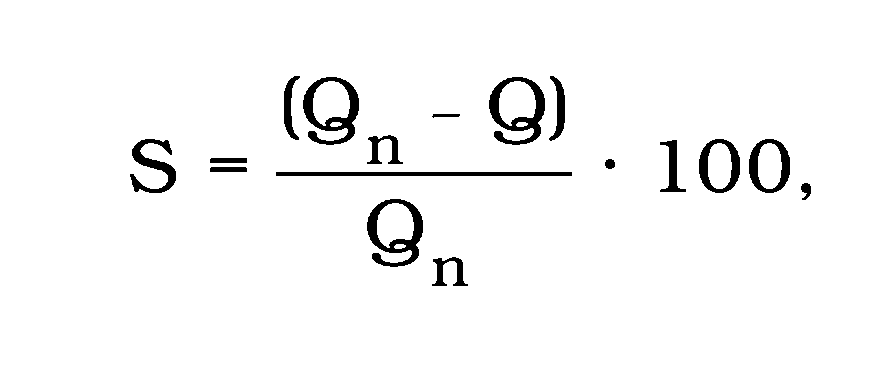
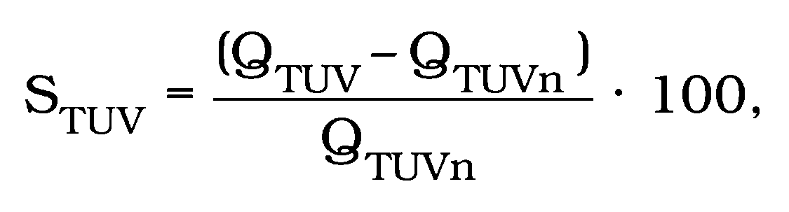
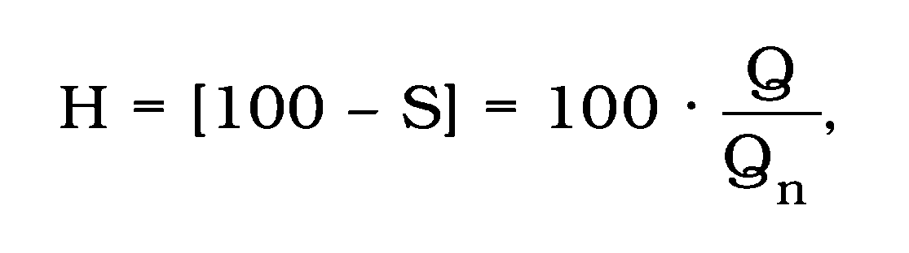

# § 3 Spôsob overenia hospodárnosti

(1) Overenie hospodárnosti sa vykonáva porovnaním skutočne vyrobeného alebo dodaného množstva tepla s normatívnym množstvom vyrobeného alebo dodaného tepla zo sústavy tepelných zariadení po odberné miesto za predchádzajúci kalendárny rok.

(2) Normatívne množstvo vyrobeného tepla sa zistí ako súčin ukazovateľov energetickej účinnosti zariadenia na výrobu tepla podľa prílohy č. 1, množstva paliva a výhrevnosti paliva; normatívne množstvo dodaného tepla sa zistí ako súčin ukazovateľov energetickej účinnosti zariadení na distribúciu tepla podľa prílohy č. 1 a množstva vstupujúceho tepla do sústavy tepelných zariadení.

(3) Ukazovateľ energetickej účinnosti sústavy tepelných zariadení sa zistí ako súčin ukazovateľov energetických účinností jednotlivých častí sústavy tepelných zariadení.

(4) Nadnormatívna strata v sústave tepelných zariadení za kalendárny rok sa zistí zo skutočne nameraného ročného množstva tepla na odbernom mieste a z normatívneho ročného množstva vyrobeného alebo dodaného tepla na tom istom mieste podľa vzťahu

- 

kde

S – nadnormatívna strata [%],

Q – skutočne vyrobené alebo dodané množstvo tepla za predchádzajúci kalendárny rok [GJ . r-1],

Qn – normatívne ročné množstvo vyrobeného alebo dodaného tepla [GJ . r-1].

(5) Nadnormatívna strata tepla na prípravu a dodávku teplej úžitkovej vody za kalendárny rok sa zistí podľa vzťahu

- 

kde

STUV – nadnormatívna strata tepla na prípravu a dodávku teplej úžitkovej vody [%],

QTUV – skutočne spotrebované množstvo tepla na prípravu a dodávku teplej úžitkovej vody za predchádzajúci kalendárny rok [GJ . r-1],

QTUVn – normatívne ročné množstvo spotrebovaného tepla na prípravu a dodávku teplej

úžitkovej vody [GJ . r-1].

(6) Hospodárnosť prevádzky sústavy tepelných zariadení sa zistí podľa vzťahu

- 

kde

H – hospodárnosť [%],

S – nadnormatívna strata [%],

Q – skutočne vyrobené alebo dodané množstvo tepla za rok [GJ . r-1],

Qn – normatívne ročné množstvo vyrobeného alebo dodaného tepla [GJ . r-1].
